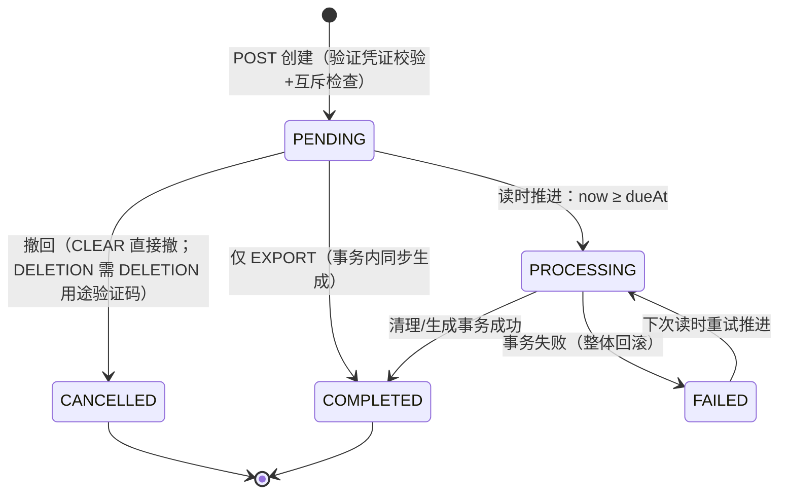
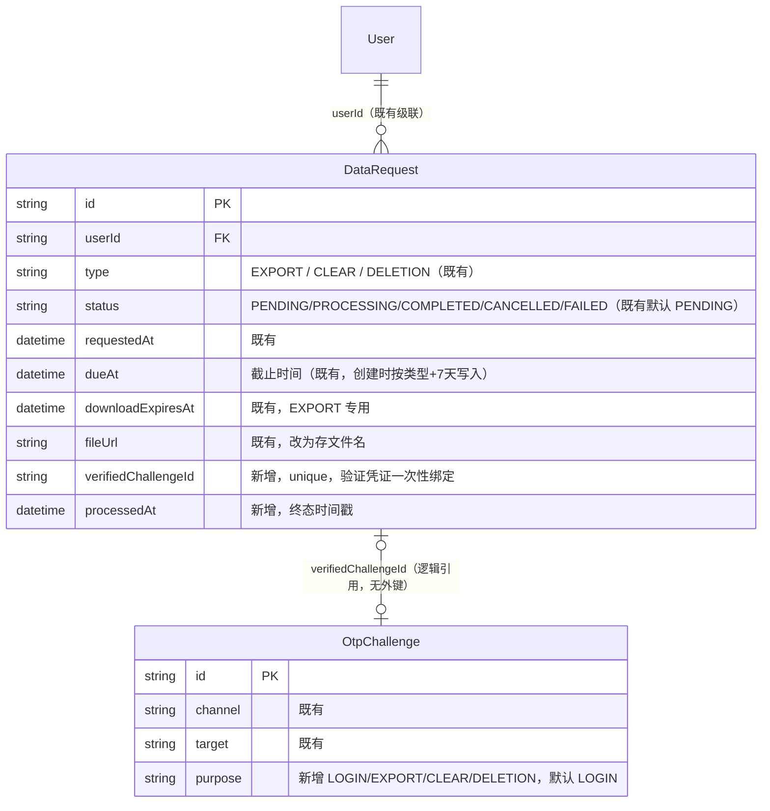
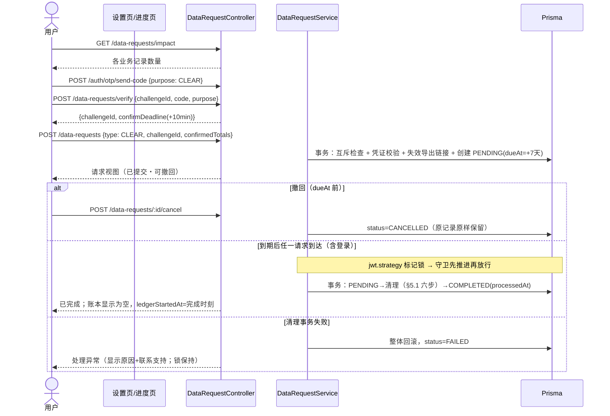

# 技术方案：M11 账号与个人数据（account-data）

> 依据：`changes/account-data/需求文档.md`、《01_首次使用与设置_待确认》:95-148、《13_MVP功能清单》功能 27:41、《changes/mvp-completion/审查报告与开发计划.md》阶段 4。
> 结论先行：本次 **0 张新表、2 处既有表加列**（`otp_challenges` 加 `purpose`、`data_requests` 加 `verified_challenge_id`/`processed_at`/索引，2 个 migration）、**7 个端点**（6 新 + 1 扩展）、后端 **1 个新模块**（`src/data-request/`，含纯函数规则层与导出构建层）+ 认证模块 4 处小改，前端 **1 个新页面 + 1 个业务组件目录 + 1 个 hook**。新增依赖仅 `jszip`（§3.4）。
> 需求未定稿事项集中在 §12，实施前逐项人工确认。

---

## 0. 结论先行

- **复用 OTP 全套频控/锁定设施**，仅给 `OtpChallenge` 加 `purpose` 列实现"登录、导出、清空、注销分别验证"（doc 01:33）；验证凭证 = 已消费的 `challengeId` + 10 分钟确认窗口 + 一次性绑定请求，零新增表。
- **请求期限（清空 7 日 / 注销撤回期 7 日 / 30 日清理）采用读时惰性推进**，不引入定时任务设施（决策与先例见 §3.1）。
- **导出同步生成**（提交即完成 ZIP），文件落本地盘（`DATA_EXPORT_DIR` 环境变量），下载走认证流式端点 + 24 小时过期校验；不引入对象存储。
- **注销即时生效**：`jwt.strategy` 每请求已查库，顺带检查进行中的注销/清空请求，由全局守卫拦截业务端点（§3.3），不改冻结基线的 `User` 表。
- **删除级联显式化**：裸外键表（`PlanAllocation`/`UsageLotAllocation` 等）不靠数据库级联，事务内按序删除；清空后 `ledgerStartedAt` 置为完成时刻（新记账起点），其余设置保留——"清空不改变本位币"口径由此保证（§5）。

## 1. 现状调研（事实）

| 事实 | 位置 |
| --- | --- |
| `DataRequest` 表已建：`type`（EXPORT/CLEAR/DELETION）、`status` 默认 PENDING、`requestedAt`/`dueAt`/`downloadExpiresAt`/`fileUrl`，**全仓零读写** | `services/chat/prisma/schema.prisma:360` |
| `OtpChallenge` 无用途字段；`SendOtpCodeDto` 仅 `channel/target`——无法满足"不同用途分别验证" | `services/chat/prisma/schema.prisma:52`、`services/chat/src/auth/otp/dto/send-otp-code.dto.ts:6` |
| OTP 规则已齐：10 分钟有效、5 次输错锁 15 分钟、1h 5 次/24h 20 次发送上限、新码失效旧码、频控按目标邮箱合计（登录与数据操作天然合并计算，符合 doc 01:31） | `services/chat/src/auth/otp/otp.service.ts:21-45` |
| OTP 校验消费 `verifyCode` 返回 `channel/target`，challenge 行消费后仍在库（`consumedAt` 非空）——可作"验证凭证"追溯 | `services/chat/src/auth/otp/otp.service.ts:272` |
| dev 渠道 `devMode=true` 时验证码明文随响应返回（`devCode`），E2E 可取码 | `services/chat/src/auth/otp/otp.service.ts:263` |
| `jwt.strategy.validate` 每请求查一次 User——注销/清空锁定检查的天然挂载点 | `services/chat/src/auth/strategies/jwt.strategy.ts:29` |
| 设置页三个按钮禁用占位（"即将上线"），`AccountDataRow` 为占位组件 | `clients/chat-web/app/(protected)/settings/page.tsx:59-69` |
| `AuthModule` 只导出 `AuthService`，`OtpService` 未导出——跨模块复用需补导出 | `services/chat/src/auth/auth.module.ts:43` |
| M0 冻结基线 14 模型自 W1 起只读，加列走 migration 回主分支（先例：reminders 加 `read_at`）；`PlanAllocation`/`UsageLotAllocation`/`PlanChangeLog` 为**裸外键无 Prisma relation** | `services/chat/prisma/schema.prisma:94`、`schema.prisma:261/275/311` |
| `User.email` 可空且 unique——注销完成后物理删 User 行即可释放邮箱供重新注册 | `services/chat/prisma/schema.prisma:12` |
| `ledgerStartedAt` 为记账起点，onboarding 完成时写入——清空后更新该字段即"新记账起点" | `services/chat/src/onboarding/onboarding.service.ts:292`、`services/chat/prisma/schema.prisma:109` |
| 未建账 409 `ONBOARDING_NOT_COMPLETED`、响应包装 `{success, data, message}`、控制器级 `JwtAuthGuard`、全局 Throttler 均有先例 | `services/chat/src/settings/settings.controller.ts:76`、`services/chat/src/plan/plan.controller.ts:77` |
| 无定时任务设施（无 `@nestjs/schedule`）、无对象存储、无 Redis；读时惰性处理有方案先例 | `changes/reminders/技术方案.md` §4.1 |
| 前端契约链路：后端 DTO → `bun run generate:api` → `schema.gen.ts` → `contract.ts` 别名层 | `clients/chat-web/lib/api/contract.ts:1` |
| E2E 编号 01-10 已占用，`11-*` 已预留给 reports | `e2e/modules/`、`changes/reports/技术方案.md` §10.4 |

## 2. 量化指标（预估，选型依据）

| 指标项 | 预估值 | 依据/备注 |
| --- | --- | --- |
| 数据规模 | 千级用户 × 人均业务记录 ≤ 万行；单次导出打包 < 10 MB | 个人记账工具；导出为全量本人数据 |
| 请求频次 | 数据权利请求人均年 < 5 次；`GET current` 仅设置页/进度页触发 | 低频高危操作 |
| 并发压力 | < 10 QPS | 与既有模块同量级；jwt.strategy 每请求 +1 次 indexed 查询可忽略 |
| 响应要求 | 同步 < 500ms；导出生成 < 5s（万行级 CSV+ZIP）；删除事务 < 10s | 万行级 Prisma deleteMany 串行实测秒级（预估） |
| 一致性等级 | 强一致（单库本地事务；删除整体成功或整体回滚） | 对应"失败时不保存任何一部分"的规格语义 |
| 期限语义 | 清空 7 日 / 注销撤回期 7 日 / 清理 30 日为**上限** | 读时惰性推进的权衡见 §3.1 与 §12-6 |

结论：无需 MQ、缓存、对象存储、定时调度器；常规 NestJS 模块 + 本地事务即可承载。

## 3. 总体设计

### 3.1 三个机制决策

**决策一：期限处理——读时惰性推进（不引入定时器）**

| 备选 | 说明 | 结论 |
| --- | --- | --- |
| A. 常驻定时任务 | 引 `@nestjs/schedule` 周期扫描到期请求执行清理 | **否**：项目无该设施，多实例部署还需分布式锁；为个位数/年的请求引入调度器属过度设计（铁律 6） |
| B. 外部触发（MQ/云函数） | 事件驱动 | **否**：MVP 无消息设施 |
| C. 读时惰性推进（选定） | 任何认证请求到达时（挂载点 §3.3），若存在到期未处理的 CLEAR/DELETION 请求，先在事务内推进（PENDING → 清理 → COMPLETED）再放行 | **是**：零新增设施；个人量级清理秒级完成；撤回窗口最大化（整个 7 天内都可撤回） |

代价与声明：用户提交后若始终不访问，清理延后到其下次到访（期间数据无人可见、无实质损害）；doc 01:122/134 的期限作为"完成后不迟于"语义由读时推进尽力满足，**严格 SLA 兜底需后台设施，列入 §12-6 待确认**。登录入口本身即触发推进（登录后首个请求完成清理），与"登录进入进度页"的产品行为闭环。

**决策二：导出同步生成**——提交事务内完成 CSV 组装 + ZIP 打包 + 落盘（§2 量级 < 5s），请求即到 `COMPLETED`。规格"导出完成前可取消"（doc 01:107）在同步语义下无取消窗口（PRD 待确认点 7）；文件存 `DATA_EXPORT_DIR`（env 配置 + compose volume），`fileUrl` 存文件名（不存绝对路径），下载经认证端点流式返回。24 小时过期的判定读 `downloadExpiresAt`；过期文件在本人下次创建导出/请求下载时惰性删除。

**决策三：注销/清空锁挂 jwt.strategy，不改 `User` 表**

| 备选 | 说明 | 结论 |
| --- | --- | --- |
| A. `User` 加 status 列 | 冻结基线模型加列，且状态与 DataRequest 重复、需维护两处一致 | **否** |
| B. validate 时查进行中请求（选定） | `dataRequest.findFirst({ userId, type ∈ {CLEAR, DELETION}, status ∈ {PENDING, PROCESSING, FAILED} })`，命中则在 `request` 上标记；全局守卫据此拦截（§3.3） | **是**：每请求 +1 次 indexed 查询（`@@index([userId, status])`），QPS < 10 无感 |

**3.4 新依赖：`jszip`（仅此一个）**
现栈（Bun + NestJS + Prisma + React）无任何 ZIP 能力，而 ZIP 是导出包的规格硬性交付物（doc 01:103）。选 `jszip`：纯 JS 实现、无原生编译模块、Bun 兼容性无风险；`archiver` 依赖 Node Stream 管道在 Bun 下兼容面更窄。替代方案"自己拼 store（不压缩）ZIP"属于重复造轮子。仅后端 `services/chat` 引入。

### 3.2 请求状态机

`DataRequest.status`：`PENDING / PROCESSING / COMPLETED / CANCELLED / FAILED`（沿用现有默认 `PENDING`）。流转由纯函数 `data-request-rules.ts` 判定，Service 只执行：

图例：`PROCESSING` 是事务内瞬态，外部观察通常只见到 PENDING→COMPLETED；`FAILED` 的 CLEAR/DELETION **保持锁定**（对应"不把残留数据当正常账本"doc 01:124），直至重试成功。

展示映射（前端）：EXPORT COMPLETED = 已完成（可下载）；CLEAR PENDING = 已提交（可撤回）；DELETION PENDING = 等待撤回期结束；FAILED = 处理异常；CANCELLED = 已撤回。

**互斥**（doc 01:142）：创建时事务内查本人 `status ∈ {PENDING, PROCESSING, FAILED}` 的请求，存在即 409 返回原请求视图；提交 CLEAR/DELETION 时顺带将本人可下载的 EXPORT 请求 `downloadExpiresAt` 置为当前时刻并删除文件（导出链接失效联动，doc 01:143）。

### 3.3 锁定守卫与放行清单

`jwt.strategy.validate` 查到进行中请求后在 `request.dataRequestLock` 标记 `{type, status}`；新增全局守卫 `DataRequestLockGuard`（`APP_GUARD` 注册，先于路由执行）：

| 锁状态 | 拦截范围 | 错误码 |
| --- | --- | --- |
| DELETION PENDING/PROCESSING/FAILED | 除白名单外全部端点 | `403 ACCOUNT_PENDING_DELETION` |
| CLEAR PROCESSING/FAILED | 除白名单外全部端点 | `403 DATA_REQUEST_LOCKED` |
| CLEAR PENDING（开始清理前） | 仅非 GET 请求（停写不停看，doc 01:122） | `403 DATA_REQUEST_LOCKED` |

白名单（装饰器 `@SkipDataRequestLock()` 标注）：`data-request` 控制器全部端点（进度/撤回/下载）、`auth/otp/send-code` 与 `auth/otp/login`（注销后"新的邮箱验证只进入进度页"doc 01:132——OTP 登录换发的新 JWT 同样被本守卫拦到白名单外端点）、`auth/me`、健康探针。前端凭 403 错误码统一跳转进度页（§8），实现"退出所有现有登录"的等效强制（JWT 无状态无法吊销，全端点拒绝即为强制下线）。

### 3.4 验证与确认凭证

复用 `OtpService.verifyCode`（消费语义、频控、锁定全部继承），链路：

1. `POST /auth/otp/send-code` 带新字段 `purpose`（默认 `LOGIN`，向后兼容旧客户端）；`OtpChallenge` 行记录 `purpose`，频控口径不变（按 channel+target 合计，符合 doc 01:31"登录及数据操作验证码合计计算"）。
2. `POST /data-requests/verify`：校验 `challenge.purpose === dto.purpose` 且 `purpose ≠ LOGIN`，通过后返回 `{ challengeId, confirmDeadline = consumedAt + 10min }`（doc 01:34 的 10 分钟确认窗口）。
3. 提交 `POST /data-requests`（或 DELETION 撤回）：事务内校验 challenge——`target === 当前用户邮箱`、`consumedAt ≠ null`、`now − consumedAt ≤ 10min`、`purpose` 与操作匹配、**未被任何 `DataRequest.verifiedChallengeId` 引用**（该列 unique，"提交后本次验证失效"由此保证，重放被唯一约束拒绝）。

## 4. 数据模型变更

- `services/chat/prisma/schema.prisma:52` `OtpChallenge` 增加 `purpose String @default("LOGIN")`。
- `services/chat/prisma/schema.prisma:360` `DataRequest` 增加 `verifiedChallengeId String? @unique @map("verified_challenge_id")`、`processedAt DateTime? @map("processed_at") @db.Timestamptz(3)`，以及 `@@index([userId, status])`。
- 2 个 migration（可逆：对应 `DROP COLUMN` / `DROP INDEX`）；`@@index([userId, status])` 同时服务互斥查询、jwt 锁定查询与"查当前请求"，避免每请求多索引开销。
- 不新增表；`User`/`UserSettings` 及其余冻结基线模型零改动。`verifiedChallengeId` 对 `OtpChallenge` 为逻辑引用（challenge 行消费后留存，无清理机制，无悬挂风险），不建外键以不触碰 OTP 基线结构。

## 5. 删除级联设计（核心）

**原则**：单事务、显式按序删除、失败整体回滚（对应"失败时不保存任何一部分"的更正类规格语义在删除域的同构要求）。数据库级联只信任挂了 Prisma relation 的边（`schema.prisma` 中 `onDelete: Cascade`），裸外键表必须显式删。

### 5.1 CLEAR（清空业务记录，保留账号）——事务内顺序

| 步 | 表 | 删除方式 | 依据 |
| --- | --- | --- | --- |
| 1 | `usage_lot_allocations` | `deleteMany where usageId ∈ (本人 usageRecords)` | 裸外键无级联，`schema.prisma:311` |
| 2 | `plan_allocations` | `deleteMany where planId ∈ (本人 plans)` | 裸外键无级联，`schema.prisma:261` |
| 3 | `plan_change_logs` | `deleteMany where planId ∈ (本人 plans)` | 裸外键（DB 级联存在但显式删以保事务可控），`schema.prisma:275` |
| 4 | `plans` | `deleteMany where userId` | 级联删除 `plan_installments`（relation），`schema.prisma:247` |
| 5 | `usage_records` `corrections` `reminders` `cost_lots` `transactions` `initial_holdings` `accounts` | 逐表 `deleteMany where userId` | 均挂 `User onDelete: Cascade`，显式删以统计行数 |
| 6 | `user_settings` | `update ledgerStartedAt = 完成时刻`（事务内同一时刻） | 新记账起点（doc 01:125、术语表 15:15）；其余字段保留＝本位币/偏好不变（doc 13:41"清空业务记录不改变本位币"） |

**保留**：`users`、`user_settings`（除起点）、`terms_consents`（条款同意）、`otp_identities`（登录方式）、`data_requests`（本次请求结果，doc 01:117）。`CostLot`/`UsageLotAllocation` 虽未出现在规格删除清单文字中，但属买入/使用的派生成本事实，残留即成孤儿数据，必须随主数据删除；导出包中对应的成本口径处理见 §7.5 说明。

### 5.2 DELETION（注销）

先执行 §5.1 步 1-5（业务数据），随后 `user.delete()`：级联清理 `user_settings`、`terms_consents`、`otp_identities`、`data_requests`（含注销请求记录自身）。`email` unique 随行删除自动释放 → 同一邮箱可作为新账号重新注册（doc 01:135）。"依法必须保留的记录"当前默认为空集（§12-1）；若法务确认需保留，则从物理删改为软删（`email` 置空 + 保留行），接口契约不变，仅 Service 内部调整——方案预留此分叉。

### 5.3 一致性保障

- 幂等：整体单事务，`FAILED` 后重试从头执行（前次已整体回滚，无残留）。
- 行数统计：各步 `deleteMany` 返回 `count`，汇总写入日志与 `processedAt` 记录，供"处理异常时显示已完成部分"与审计。
- 导出文件清理：提交 CLEAR/DELETION 事务内同步删除本人 EXPORT 请求的临时文件（`unlink` 失败仅 warn，不影响事务——链接已随 `downloadExpiresAt` 关闭）。

## 6. 核心时序：清空业务记录（提交 → 撤回 / 到期推进）

图例：推进挂载在守卫链最前（`DataRequestLockGuard` 内先调 `service.advanceDueRequests(userId)` 再判定拦截），保证"到期后的下一个请求"既是推进触发点也是被锁请求放行前的清理点；注销流程同构，仅撤回需 `purpose=DELETION` 的新验证码、清理多一步 `user.delete()`。

## 7. 接口契约

统一 `{ success, data, message }` 包装；控制器级 `JwtAuthGuard`；金额沿用字符串 4 位小数约定；DTO 全部显式 `@ApiProperty`，前端类型经 `bun run generate:api` 生成。

### 7.1 POST /api/auth/otp/send-code（扩展）

请求体新增 `purpose`：枚举 `LOGIN/EXPORT/CLEAR/DELETION`，可选，默认 `LOGIN`（旧调用零破坏）。响应不变（`challengeId/expiresAt/devCode`）。

### 7.2 POST /api/data-requests/verify

| 字段 | 类型 | 说明 |
| --- | --- | --- |
| `challengeId` | string | send-code 返回 |
| `code` | string | 6 位数字 |
| `purpose` | string | 必须 ∈ `EXPORT/CLEAR/DELETION`（LOGIN 不放行） |

响应 `data: { challengeId, purpose, confirmDeadline }`；`confirmDeadline` 为确认截止时刻（consumedAt+10min，ISO 8601）。错误复用 OTP 语义（无效/过期/已用/锁定）。

### 7.3 GET /api/data-requests/current

响应 `data: DataRequestView | null`：

| 字段 | 类型 | 说明 |
| --- | --- | --- |
| `id` / `type` / `status` | string | type: EXPORT/CLEAR/DELETION；status 五态 |
| `requestedAt` / `dueAt` / `processedAt` | string \| null | 提交/截止/终态时间 |
| `displayStatus` | string | 展示映射（§3.2）：SUBMITTED/WITHDRAWAL_PERIOD/PROCESSING/COMPLETED/CANCELLED/FAILED |
| `canCancel` | boolean | 纯函数判定（CLEAR PENDING；DELETION PENDING） |
| `withdrawDeadline` | string \| null | DELETION 撤回期截止（=dueAt） |
| `download` | object \| null | EXPORT COMPLETED 时：`{ url, expiresAt }`，过期后为 null |

### 7.4 GET /api/data-requests/impact

CLEAR 确认页数据：`data: { totals: { accounts, transactions, initialHoldings, plans, usageRecords, corrections }, hasDownloadableExport }`。`confirmedTotals` 快照用于提交时比对。

### 7.5 POST /api/data-requests

请求：`{ type, challengeId, confirmedTotals? }`——`CLEAR` 必带 `confirmedTotals` 且与服务端重算一致（不等 → `409 IMPACT_CHANGED`，对应"验证与确认之间记录变化须重新确认"）；`EXPORT/DELETION` 不带。

行为：EXPORT 事务内同步生成 ZIP（`export-builder`，§7.5.1）→ `COMPLETED` + `fileUrl`/`downloadExpiresAt=+24h`；CLEAR/DELETION → `PENDING` + `dueAt=+7d`，并失效本人可下载导出链接。响应 `DataRequestView`。

### 7.6 POST /api/data-requests/:id/cancel

EXPORT 无取消窗口（同步生成，PRD 待确认点 7）；CLEAR PENDING 直接撤回；DELETION PENDING 需请求体 `{ challengeId }`（purpose=DELETION 的新验证码，"仅登录不算撤回" doc 01:133）。响应撤回后的 `DataRequestView`。非本人/不存在 → `404`。

### 7.7 GET /api/data-requests/:id/download

校验：本人 + `type=EXPORT` + `status=COMPLETED` + `downloadExpiresAt > now`，流式返回 ZIP（`Content-Disposition`）。过期/文件缺失 → `410 DOWNLOAD_EXPIRED`（可重新申请）。顺带惰性清理本人其他已过期临时文件。

### 7.8 错误码汇总

| HTTP | code | 场景 |
| --- | --- | --- |
| 401 | — | 未登录 / JWT 无效 |
| 403 | `ACCOUNT_PENDING_DELETION` | 注销流程中访问非白名单端点 |
| 403 | `DATA_REQUEST_LOCKED` | 清空期间写操作 / 清理中访问非白名单端点 |
| 403 | `VERIFICATION_INVALID / _EXPIRED / _USED / _PURPOSE_MISMATCH` | 凭证校验失败细分 |
| 404 | `DATA_REQUEST_NOT_FOUND` | 不存在 / 非本人（同一响应，不泄露存在性） |
| 409 | `DATA_REQUEST_CONFLICT` | 互斥：已有进行中请求（data 附原请求视图） |
| 409 | `IMPACT_CHANGED` | confirmedTotals 与当前不符 |
| 409 | `ONBOARDING_NOT_COMPLETED` | 未完成首次设置（对齐 settings 先例） |
| 410 | `DOWNLOAD_EXPIRED` | 下载超期 / 文件已清理 |

## 8. 前端设计

| 位置 | 职责 |
| --- | --- |
| `lib/api/client.ts`（修改） | 统一响应拦截：`403 DATA_REQUEST_LOCKED / ACCOUNT_PENDING_DELETION` → 跳转 `/data-requests`（实现"登录只进进度页"与强制下线体验） |
| `app/(protected)/settings/page.tsx`（修改） | 删除 `AccountDataRow` 占位，挂载 `AccountDataSection`；退出登录逻辑不动 |
| `components/business/account-data/`（新增，带桶文件） | `account-data-section.tsx`（账号与数据区三入口）；`otp-verify-step.tsx`（发码/倒计时/输码，复用 `use-otp-countdown`，purpose 透传）；`export-flow.tsx`（数据范围说明→验证→提交→下载入口）；`clear-flow.tsx`（记录数量+警示→可选先导出→验证→确认→提交）；`deletion-flow.tsx`（将删除内容+先导出提醒→验证→确认→提交后登出）；`request-progress.tsx`（进度卡：状态/时间线/撤回按钮/下载入口/异常与联系支持） |
| `app/(protected)/data-requests/page.tsx`（新增） | 进度页：`request-progress` 全屏态；守卫在 `(protected)/layout.tsx`，页面零校验代码 |
| `lib/api/data-requests.ts`（新增） | 七端点封装（类型取 `schema.gen.ts` 生成别名） |
| `lib/hooks/use-data-request.ts` + `use-data-request.spec.tsx`（新增） | `useCurrentRequest`（staleTime 30s）/`useImpact`/创建与撤回 mutation（成功即失效缓存）；前端唯一带单测的层（AGENTS.md：组件靠 E2E） |

流程文案随应用语言（i18n 未接入前沿用项目先例：文案先落前端中文）。

## 9. 代码影响范围

<pre>
services/chat/（后端）
├─ prisma/
│  ├─ schema.prisma                                     (M) OtpChallenge.purpose；DataRequest 两列+索引
│  └─ migrations/&lt;ts&gt;_otp_purpose/、&lt;ts&gt;_data_request_meta/  (A) 两个可逆 migration
├─ src/
│  ├─ data-request/                                     (A) 新模块
│  │  ├─ data-request.module.ts                          (A) 模块声明（import AuthModule 取 OtpService）
│  │  ├─ data-request.controller.ts                      (A) §7.2-7.7 六端点 + @SkipDataRequestLock 白名单
│  │  ├─ data-request.service.ts                         (A) 编排：凭证校验/互斥/导出/级联事务/读时推进
│  │  ├─ data-request-rules.ts                           (A) 纯函数：状态流转/互斥/撤回可行性/展示映射/锁判定
│  │  ├─ data-request-rules.spec.ts                      (A) 单元测试（§10.1）
│  │  ├─ export-builder.ts                               (A) 纯函数为主：业务行→CSV 文本→JSZip 条目
│  │  ├─ export-builder.spec.ts                          (A) 单元测试（§10.1）
│  │  ├─ data-request-lock.guard.ts                      (A) 全局锁守卫 + SkipDataRequestLock 装饰器 + advanceDueRequests 挂载
│  │  └─ dto/data-request.dto.ts                          (A) VerifyDto / CreateDto / DataRequestView / ImpactView 等
│  ├─ auth/
│  │  ├─ otp/otp.service.ts                              (M) sendCode/verifyCode 透传 purpose（默认 LOGIN 不破坏登录）
│  │  ├─ otp/dto/send-otp-code.dto.ts                      (M) +purpose 枚举字段
│  │  ├─ auth.module.ts                                  (M) exports 补 OtpService
│  │  └─ strategies/jwt.strategy.ts                          (M) validate 附带查进行中请求并标记锁
│  ├─ app.module.ts                                     (M) 注册 DataRequestModule + APP_GUARD 挂锁守卫
│  └─ config/env.ts                                     (M) 新增 DATA_EXPORT_DIR（含 zod 校验）
├─ test/
│  ├─ api/data-request.spec.ts                           (A) 接口测试（§10.2）
│  ├─ integration/account-data-lifecycle.spec.ts          (A) 集成测试（§10.3）
│  └─ helpers/data-request-helper.ts                       (A) 造数：直接置 consumedAt 模拟已验证凭证等
clients/chat-web/（前端）
├─ app/(protected)/
│  ├─ settings/page.tsx                                   (M) 占位行 → AccountDataSection
│  └─ data-requests/page.tsx                            (A) 进度页
├─ components/business/account-data/
│  ├─ index.ts・account-data-section.tsx・otp-verify-step.tsx   (A)
│  └─ export-flow.tsx・clear-flow.tsx・deletion-flow.tsx・request-progress.tsx  (A)
└─ lib/
   ├─ api/data-requests.ts                                (A) 七端点封装
   ├─ api/client.ts・contract.ts                            (M) 403 锁码拦截 / 类型别名
   └─ hooks/use-data-request.ts + use-data-request.spec.tsx     (A)
e2e/modules/12-account-data.spec.ts                            (A) E2E（§10.4）
infra/compose/compose.dev.yaml 等                              (M) DATA_EXPORT_DIR volume 挂载
</pre>

不改动：账户/计划/交易/更正等既有业务模块的任何文件（其数据仅作为级联删除与导出的读取对象，契约冻结）；`package.json` 仅 `services/chat` 新增 `jszip`。

## 10. 测试设计

> 质量红线：实施必跑通 0 failed。OTP 真实邮件渠道在测试中以 `OTP_OPTIONS` override + mock 渠道（`devCode`）替代；涉及"到期推进"的场景用注入 `now` 或直接写库 `dueAt` 过去时刻构造，不等待真实时间。

### 10.1 单元测试 1：`src/data-request/data-request-rules.spec.ts`

被测 `data-request-rules.ts`（纯函数）——覆盖点：

1. **互斥矩阵**：现有 PENDING/PROCESSING/FAILED 请求时，创建 EXPORT/CLEAR/DELETION 一律拒绝；COMPLETED/CANCELLED 不阻塞；
2. 撤回可行性：CLEAR PENDING → 可撤；CLEAR PROCESSING/FAILED → 不可撤；DELETION PENDING → 可撤（且需验证码标记）；EXPORT 任何状态均无 cancel 语义；
3. 读时推进判定：`PENDING ∧ now ≥ dueAt → start`；`FAILED → retry`；`now < dueAt → none`；EXPORT 不参与推进；
4. 展示映射：DELETION PENDING → `WITHDRAWAL_PERIOD`；CLEAR PENDING → `SUBMITTED`；FAILED → `FAILED`；EXPORT COMPLETED 过期前后 download 字段差异；
5. 锁判定：DELETION 三态全锁；CLEAR PENDING 仅锁非 GET；白名单集合命中即放行；
6. dueAt 计算：EXPORT/CLEAR/DELETION 各类型 +7 自然日的边界（跨月/闰日）；
7. 凭证窗口：consumedAt 距 now ≤10min 通过、>10min 拒绝、purpose 不匹配拒绝、LOGIN purpose 拒绝。

### 10.2 单元测试 2：`src/data-request/export-builder.spec.ts`

被测 `export-builder.ts`——覆盖点：

1. 空数据：未形成的表格输出表头 + "（无）"注记行（"未形成的数据注明为空"）；
2. 金额列带币种列；`feeAmount=null` 导出为 `未知`（绝不写 0）；`feeAmount=0` 导出为 0；
3. 日期列 ISO 8601 带时区（UTC 输出）；
4. JPY/KRW 金额按 0 位小数、其余 2 位（复用 `packages/money/src/round.ts` 的 `roundToCurrency`）；
5. 记录编号对应：transactions.planId、usage_records.planId、cost_lots.sourceId 等跨表编号原样导出可互查；
6. CSV 转义：含逗号/引号/换行的字段（如计划名）正确转义；
7. ZIP 条目清单完整：README + 11 份表格（settings/draft/initial_holdings/transactions/accounts/plans/plan_allocations/usage_records/corrections/terms_consents/data_requests），usage_records 附"使用成本"列；
8. README 内容含生成时间、口径说明（先进先出、费用未知语义、时区）。

### 10.3 接口测试：`test/api/data-request.spec.ts`

| 场景 | 预期 |
| --- | --- |
| 未登录访问全部端点 | 401 |
| 未完成首次设置用户访问 | 409 `ONBOARDING_NOT_COMPLETED` |
| send-code 携带 purpose=CLEAR / 缺省 | challenge 记录对应 purpose；缺省为 LOGIN（登录回归不受影响） |
| verify 用 LOGIN purpose | 403 `VERIFICATION_PURPOSE_MISMATCH` |
| verify 后立即创建 EXPORT | 200，status=COMPLETED，返回 download.url/expiresAt |
| 同一 challengeId 二次创建（重放） | 403 `VERIFICATION_USED`（unique 兜底） |
| verify 后超过 10 分钟再创建（置 consumedAt 过去） | 403 `VERIFICATION_EXPIRED` |
| challenge target ≠ 当前用户邮箱 | 403 `VERIFICATION_INVALID` |
| 已有 PENDING 清空请求时创建 EXPORT / DELETION | 409 `DATA_REQUEST_CONFLICT`，data 含原请求视图 |
| CLEAR 创建时 confirmedTotals 过期 | 409 `IMPACT_CHANGED` |
| CLEAR PENDING 期间 POST 业务端点（如创建计划） | 403 `DATA_REQUEST_LOCKED`；GET 放行 |
| DELETION PENDING 期间访问任意业务端点（含 GET） | 403 `ACCOUNT_PENDING_DELETION`；`/data-requests/current` 与 otp 端点放行 |
| 撤回：CLEAR 直接撤成功；DELETION 无验证码撤回被拒、带 purpose=DELETION 验证成功 | 200 / 403 / 200 |
| 下载：本人 COMPLETED 24h 内成功（校验 Content-Type）；过期 410；他人 id 404 | 200 / 410 / 404 |
| 冻结基线回归：`/auth/otp/login`、`/plans` 等既有接口全量回归不受 purpose 默认值影响 | 既有断言全部通过 |

### 10.4 集成测试：`test/integration/account-data-lifecycle.spec.ts`

一个业务流一个文件，覆盖两条生命周期：

- **清空**：种初始持仓 + 买入（含未知手续费）+ 计划 + 分配 + 使用 + 更正 + 提醒 → 提交 CLEAR（断言导出链接失效、写锁生效）→ 将 `dueAt` 置为过去并触发推进 → 断言：§5.1 六步涉及表该用户行数为 0（含裸外键两表）、`user_settings` 仅 `ledgerStartedAt` 更新为完成时刻、`terms_consents`/`data_requests` 保留 → 清空后再建买入以新起点入账成功。
- **注销**：同量数据 + 提交 DELETION → 撤回期内验证撤回（账号恢复可用）→ 再次提交并推进到期 → 断言：`users` 行删除、全部业务表级联清空、同邮箱 `POST /auth/otp/login` 走新账号注册路径且看不到旧数据。
- **异常**：清理事务中注入失败（mock 某表 deleteMany 抛错）→ 断言整体回滚、status=FAILED、锁保持、重试推进后 COMPLETED。

### 10.5 E2E：`e2e/modules/12-account-data.spec.ts`

按用户操作路径编号（验证码经 mock 渠道 `devCode` 获取）：

1. **入口启用**：完成首次设置的用户打开设置页 → 断言三按钮可点击，无"即将上线"；
2. **导出全流程**：有数据用户走导出（范围说明→验证→提交）→ 断言出现下载入口、下载请求返回 200；重复点击导出 → 断言返回同一请求而非新建；
3. **清空警示**：进入清空流程 → 断言记录数量与不可恢复警示文案可见；确认页先展示"可先导出"；
4. **清空撤回**：提交清空后立即撤回 → 断言账本数据仍在、可正常记账；
5. **清空完成**：提交清空并把到期推进触发（测试钩子将 dueAt 置过去后刷新）→ 断言空账本、本位币不变、设置页偏好保留、新增买入以新起点成功；
6. **注销与撤回**：提交注销 → 断言被登出、重新验证邮箱只达进度页；撤回期内验证撤回 → 断言账号恢复；
7. **用途隔离**：在导出流程中尝试填入登录用途验证码 → 断言提示验证码无效；
8. **锁写体验**：清空请求期间尝试首页快速录入 → 断言被引导至进度页。

### 10.6 测试文件树（文件 ↔ 被测对象一一对应）

<pre>
services/chat/src/data-request/data-request-rules.ts      ← 同目录 data-request-rules.spec.ts（单元）
services/chat/src/data-request/export-builder.ts          ← 同目录 export-builder.spec.ts（单元）
services/chat/src/data-request/data-request.controller.ts ← services/chat/test/api/data-request.spec.ts（接口）
services/chat/src/data-request/data-request.service.ts     ← services/chat/test/integration/account-data-lifecycle.spec.ts（集成）
clients/chat-web/lib/hooks/use-data-request.ts          ← 同目录 use-data-request.spec.tsx（单元）
设置页/进度页/流程组件                                     ← e2e/modules/12-account-data.spec.ts（E2E）
</pre>

## 11. 异常兜底、回滚与监控

- **异常兜底**：导出生成失败 → `FAILED`（处理异常，可重新申请）；清理事务失败 → 整体回滚 + `FAILED` + 锁保持 + 下次读时重试（对应"处理中断显示异常并继续处理，不提前显示成功"）；下载文件丢失/过期 → 410；`unlink` 失败仅 warn 不阻塞（链接已关）；过期导出文件惰性清理（本人下次创建/下载时）。
- **回滚**：两个 migration 均可逆；代码回滚 = revert 提交 + `app.module.ts` 摘除模块与守卫。**删除动作本身不可逆**——安全保障是"单事务 + 失败不部分保存 + 撤回窗口先于到期"，而非回滚机制；无外部依赖，不需要 Feature Toggle。
- **监控**：沿用模块级 Logger 先例；关键日志点——创建/撤回/推进/完成各状态迁移（含 type+id）、删除行数汇总、导出文件生成耗时与大小、FAILED 事件 warn。`DATA_EXPORT_DIR` 磁盘写失败显式报错（不静默降级为无文件的成功响应）。

## 12. 待确认点汇总（实施前逐项确认）

与需求文档第十一节一一对应，技术侧补充默认立场：

| # | 待确认点 | 默认立场（未确认前） |
| --- | --- | --- |
| 1 | 依法必须保留的记录清单 | 空集 → DELETION 物理删 `users` 行；确认需保留后切软删分叉（§5.2），契约不变 |
| 2 | 备份 90 天轮换 | 依赖基础设施备份策略，应用层不可达；进度说明如实告知 |
| 3 | 未完成首次设置的清空分支 | 当前不可达，不实现入口；接口层统一 409 `ONBOARDING_NOT_COMPLETED` |
| 4 | 导出包"已有报告文件" | 当前报告为查看型无存量 → 条目注明为空；M10 落地文件化后补条目 |
| 5 | 状态通知邮件 | 站内进度为主；邮件模板待邮件渠道具备非验证码模板能力后补（Should 级） |
| 6 | 清理期限严格 SLA 兜底 | 读时惰性推进（§3.1）；需主动兜底时再评估 `@nestjs/schedule` + 分布式锁，本期不做 |
| 7 | 导出取消窗口 | 同步生成不适用；如需异步化再引入任务队列（本期拒绝） |
| 8 | 导出包是否含成本批次/分摊明细原始表 | 默认不含（规格清单未列），`usage_records` 附"使用成本"列；README 说明先进先出口径 |

## 13. 实施顺序

1. **schema 与 migration**（2 个可逆迁移）→ 纯函数层 `data-request-rules` / `export-builder` + 单元测试（无 IO，先行）；
2. **OTP purpose**（otp.service/dto 透传 + auth.module 导出）→ `data-request` 模块 Service/Controller/Guard + 接口测试；
3. **集成测试**（生命周期 + 异常回滚）→ `config/env` 与 compose volume；
4. **前端**：`generate:api` → `data-requests.ts` → hook + 单测 → 五组件 + 两页面 → client.ts 拦截；
5. **E2E** `12-account-data.spec.ts`；
6. §12 待确认点逐项人工确认后，修订对应小节再合入相应部分（保留清单、邮件通知、SLA 兜底）。

外部依赖：无阻塞性外部依赖；`jszip` 引入需评审确认（§3.4）。与 M10 报告模块的 E2E 编号已协调（11 预留 reports，本模块取 12）。
