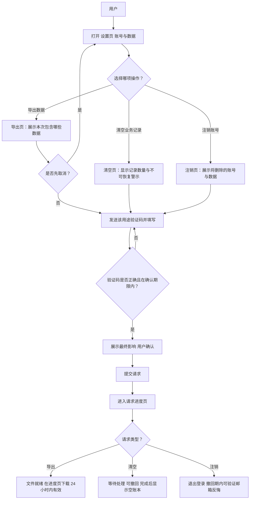
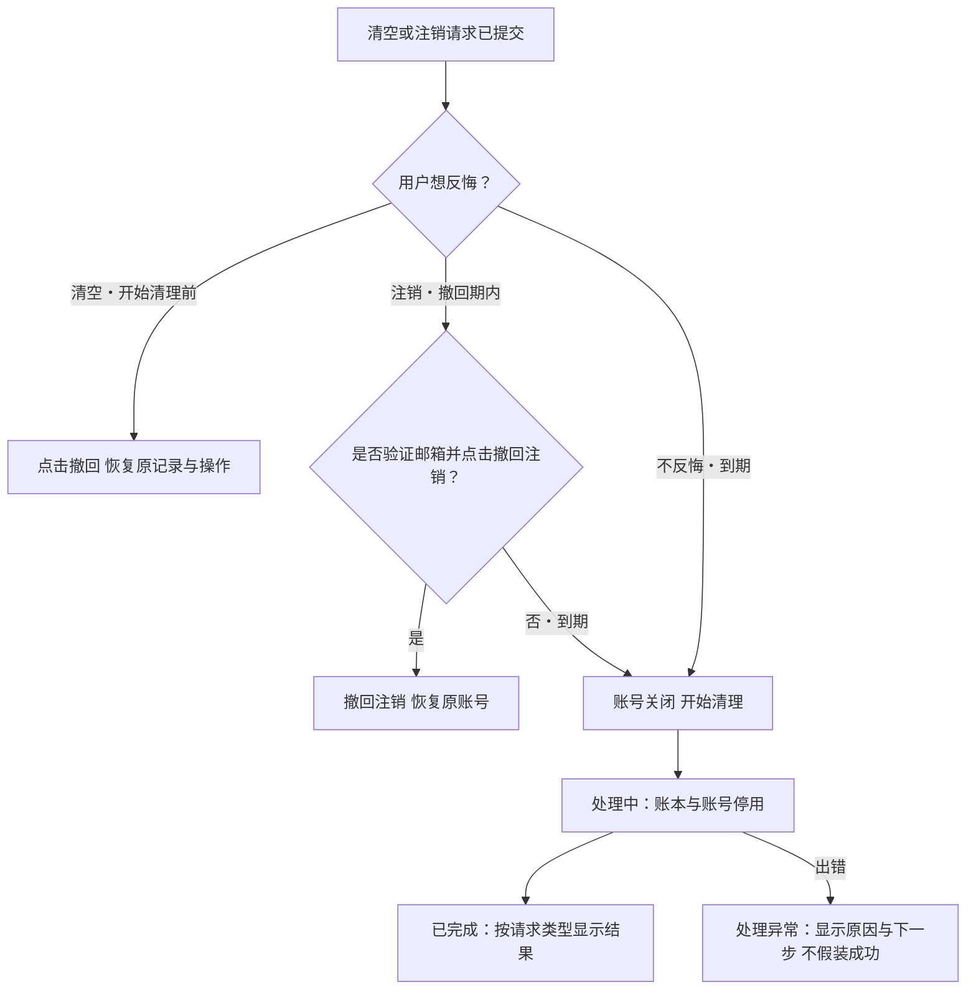
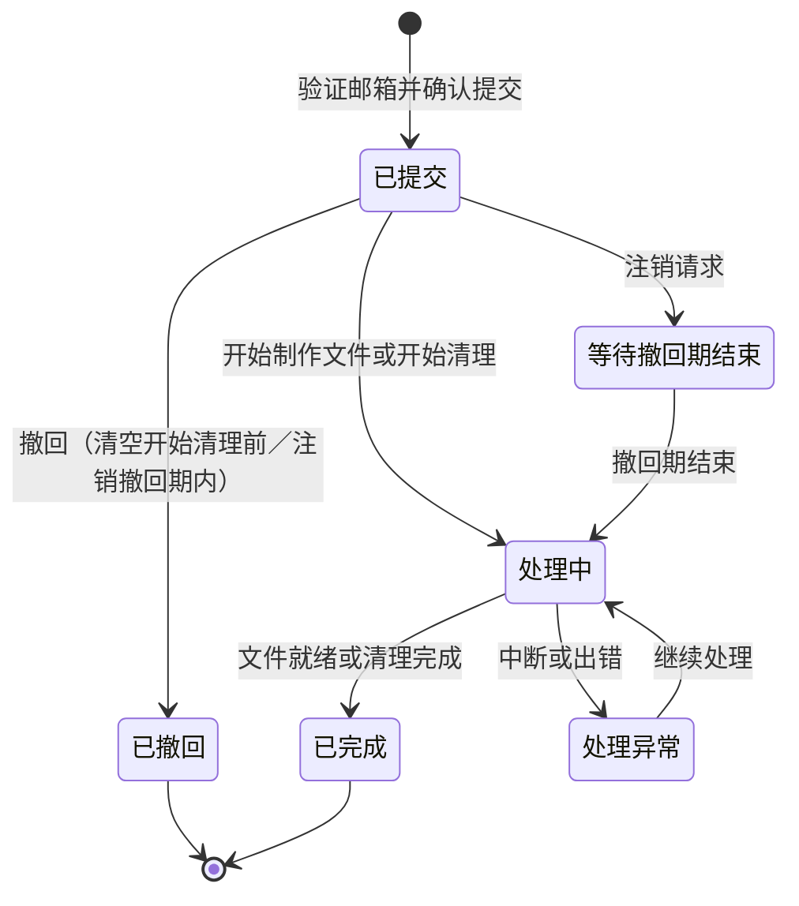

# 需求文档：M11 账号与个人数据

> 依据：《01_首次使用与设置_待确认》「账号与数据」章（`docs/MVP功能模块&业务逻辑&专业术语/01_首次使用与设置_待确认.md:95-148`）、《13_MVP功能清单》功能 27（`docs/MVP功能模块&业务逻辑&专业术语/13_MVP功能清单.md:41`）、《14_业务逻辑清单》第 8 节（`docs/MVP功能模块&业务逻辑&专业术语/14_业务逻辑清单.md:99`）、《15_专业术语清单》、《changes/mvp-completion/审查报告与开发计划.md》阶段 4。
> 档位：Complex（涉及三类高危数据操作、请求状态流转、期限与撤回规则）。
> ⚠️ 上游需求文件标记"待确认"。本文只把**已明确的规则**写成正式需求；未定稿事项集中列入「十一、待确认点清单」，确认前不得当作定稿需求实施。
> 说明：本文档为纯业务视角；系统如何实现见同目录《技术方案.md》。

---

## 一、概述

### 1.1 背景

产品已能记录买入、分配与使用，但用户对自己数据的最终支配权缺失：设置页里"导出个人数据 / 清空业务记录 / 注销账号"三个按钮均为"即将上线"的禁用占位。用户既拿不走自己的数据副本，也无法在放弃使用时清空记录或关闭账号。这类操作动的是用户的全部家当，属于最高风险的一组功能：做错方向（删错范围、不能恢复、被他人冒用）代价不可逆。

### 1.2 目标

在设置的"账号与数据"区提供三项数据权利操作，完成 MVP 功能 27：

1. **导出数据**——把本人全部记录打包带走（一份完整的数据副本）；
2. **清空业务记录**——删光账本、保留账号，从零重新开始记账；
3. **注销账号**——连账号一起关闭，按期限清理全部个人数据。

三项操作共用同一套安全底线：**先验证邮箱本人才可操作、操作前展示影响、提交后可见进度、期限内可撤回**。

### 1.3 范围

| 做 | 不做 |
| --- | --- |
| 设置页"账号与数据"三项操作的启用与完整流程 | 查看登录设备、退出其他设备（清单已排除） |
| 高危操作前的邮箱验证码二次确认（与登录验证码用途隔离） | 用另一个邮箱取走或删除原账号数据（明确禁止） |
| 导出包生成、下载、24 小时下载期限、链接失效联动 | 把导出的数据导回系统（明确不提供旧数据迁移） |
| 清空业务记录的范围控制、撤回、完成后口径 | 单笔记录的删除或撤销（平时更正仍走更正流程） |
| 注销的撤回期、清理期限、完成后重新注册 | 备份轮换的自动化机制（依赖基础设施，见待确认点） |
| 请求进度展示、请求互斥、处理异常的提示与求助入口 | 邮件中附带业务数据或金额明细（明确禁止） |

---

## 二、角色

单一角色：**已登录用户**。每人只能对自己名下的数据发起操作，无法触及其他用户；注销中的账号只能看到自己请求的进度，不能打开账本。

---

## 三、术语对照

| 术语 | 白话说明 |
| --- | --- |
| 业务记录 | 买入、账户、初始外币、计划、分配、使用、更正以及由此算出的提醒等账本内容 |
| 个人数据 | 业务记录之外，还包括账号资料（邮箱等）与账号设置偏好 |
| 导出包 | 系统为用户生成的一个压缩文件，内含多份表格和一份阅读说明；本期为 ZIP 文件内含 CSV 表格 |
| 验证码用途 | 同一个邮箱的验证码按目的分开：登录、导出、清空、注销各自独立，互相不能顶用 |
| 确认期限 | 验证通过后须在 10 分钟内完成最后确认，超时需重新验证 |
| 撤回 | 请求提交后、开始清理前，把请求撤销、恢复原样的动作 |
| 撤回期 | 注销请求提交后允许反悔的期限，7 个自然日，有准确截止时间 |
| 记账起点 | 开始记账的时刻；清空业务记录后，以清空完成时刻重新起算 |
| 本位币 | 统一计算成本的货币，首次设置后固定；清空业务记录不改变它 |
| 处理状态 | 一项请求的进展：已提交、处理中、已完成、已撤回、处理异常；注销另有"等待撤回期结束" |

---

## 四、业务流程

三项操作共用一条路径：**在设置页选择操作 → 阅读本次包含的数据与影响 → 用对应用途的验证码确认邮箱 → 展示最终影响 → 用户确认提交 → 进入进度页**。

图例：菱形为判断；三项操作都先验证后确认，验证码用途互不通用（`docs/MVP功能模块&业务逻辑&专业术语/01_首次使用与设置_待确认.md:97`）。

清空与注销的特殊分支：

图例：撤回注销必须"验证邮箱＋点击"两步齐全，仅重新登录不算撤回（`docs/MVP功能模块&业务逻辑&专业术语/01_首次使用与设置_待确认.md:133`）。

---

## 五、请求处理状态（用户视角）

一项请求从提交到结束只走以下状态之一；进度页始终显示提交时间、截止时间和结果（`docs/MVP功能模块&业务逻辑&专业术语/01_首次使用与设置_待确认.md:140`）。

各状态下用户能做什么：

| 状态 | 用户能看到／做到 |
| --- | --- |
| 已提交 | 进度与截止时间；清空可撤回；注销显示撤回截止并可反悔 |
| 等待撤回期结束 | 注销专属；账号已停用，只能看进度或撤回注销 |
| 处理中 | 提示正在处理；账本不可用（注销则账号不可用） |
| 已完成 | 导出：出现下载入口（24 小时内）；清空：显示空账本；注销：提示已关闭 |
| 已撤回 | 恢复原记录与操作，一切如初 |
| 处理异常 | 显示原因、已完成部分和下一步处理，提供联系支持入口；不自动宣布完成 |

---

## 六、功能规则

### 6.1 入口与通用规则

1. 入口在设置中的"账号与数据"，提供退出登录、导出数据、清空业务记录、注销账号；没有设备列表或退出其他设备的独立页面（`docs/MVP功能模块&业务逻辑&专业术语/01_首次使用与设置_待确认.md:95`）。
2. **用途隔离**：登录、导出、清空、注销分别验证；登录码不能用于注销，导出码不能用于清空；改换操作或删除范围必须重新验证（`docs/MVP功能模块&业务逻辑&专业术语/01_首次使用与设置_待确认.md:33`）。
3. 验证通过只放行**当前邮箱的本次操作**，须在 10 分钟内完成最后确认，逾期重新验证（`docs/MVP功能模块&业务逻辑&专业术语/01_首次使用与设置_待确认.md:34`）。
4. 验证与确认之间，相关记录发生变化时，重新展示影响并请用户再次确认。
5. 提交后本次验证立即失效；重复点击同一操作只返回原请求，不产生新请求。
6. **互斥**：一个账号同时只处理一项导出、清空或注销请求；要改换操作，先撤回仍可撤回的请求；已经开始清理时，不再接收导出或另一项删除请求（`docs/MVP功能模块&业务逻辑&专业术语/01_首次使用与设置_待确认.md:142`）。
7. 提交清空或注销时，已生成的导出下载链接立即失效、临时文件一并删除；确认前提示用户先下载需要的文件。
8. 丢失邮箱使用权时，先联系邮箱服务商恢复；**不能**改填另一邮箱来取走或删除原账号数据。
9. 正在删除数据或注销的账号，下次登录直接进入该请求的进度页，不打开可编辑账本（`docs/MVP功能模块&业务逻辑&专业术语/01_首次使用与设置_待确认.md:52`）。
10. 验证码的发送频次、输错锁定等规则与登录验证码一致且**合并计算**（`docs/MVP功能模块&业务逻辑&专业术语/01_首次使用与设置_待确认.md:31`）。

### 6.2 导出数据

1. 提交前先提示本次包含哪些数据，验证邮箱后提交（`docs/MVP功能模块&业务逻辑&专业术语/01_首次使用与设置_待确认.md:101`）。
2. 按提交时**已经成功保存**的数据制作文件；之后新增或修改的内容留到下一次导出。
3. 导出包为 ZIP 文件，内含 CSV 表格和每份表格的阅读说明，覆盖：账号设置、首次设置草稿、初始外币、买入、账户、计划、分配、使用、更正、条款同意记录及数据请求记录；已有报告文件一并附上；**尚未形成的数据注明为空**（`docs/MVP功能模块&业务逻辑&专业术语/01_首次使用与设置_待确认.md:103`）。
4. 文件口径：金额标明币种；费用未知保留"未知"（不写 0）；日期带时区；各表格通过记录编号互相对应；**不包含**验证码、登录凭证或任何他人数据。
5. 没有使用记录也可以导出已有数据；这里是个人数据副本，与单计划报告文件分开。
6. 文件就绪后在"账号与数据"下载；**24 小时**后删除临时文件并关闭链接；下载需登录同一账号；不在邮件中附带业务数据；过期后可以重新申请（`docs/MVP功能模块&业务逻辑&专业术语/01_首次使用与设置_待确认.md:105`）。
7. 导出完成前可以取消，取消后不再交付文件并删除已生成的临时文件；取消与生成同时发生时，取消成功就不开放下载。
8. 导出完成后可直接申请清空或注销，原下载链接随该请求提交失效。

### 6.3 清空业务记录

1. 只有**一种**范围："清空业务记录，保留账号"。删除范围见下表（`docs/MVP功能模块&业务逻辑&专业术语/01_首次使用与设置_待确认.md:117`）：

   | 删除 | 保留 |
   | --- | --- |
   | 全部首次设置草稿、虚拟账户、初始外币、买入、计划、分配、使用、更正及系统保存的报告文件 | 登录邮箱、原本位币、地区语言、准备偏好、提醒设置、首次设置完成标记、必要条款同意和本次请求结果 |

2. 确认前显示**记录数量**和固定提醒："这是删除全部业务记录，不是取消一个计划；删除后不能恢复。"用户可先导出，也可直接验证并确认，不强制先导出。
3. 提交后立即**停止新增和修改业务记录及计划提醒**，7 个自然日内完成清理（`docs/MVP功能模块&业务逻辑&专业术语/01_首次使用与设置_待确认.md:122`）。
4. 请求期间可查看进度；**开始清理前可撤回**，撤回后恢复原记录和操作；开始清理后不能撤回，也不再打开原账本。
5. 只有全部清理完成后才显示空账本；若处理中断，显示处理异常并继续处理，不把残留数据当成正常账本使用，也不提前显示成功。
6. **完成后口径**（`docs/MVP功能模块&业务逻辑&专业术语/01_首次使用与设置_待确认.md:125`）：
   - 保留首次设置完成标记及原本位币——**清空不改变本位币**（`docs/MVP功能模块&业务逻辑&专业术语/13_MVP功能清单.md:41`）；
   - 不重新开放首次设置；
   - 以清空完成时刻为**新的记账起点**，以后可从新买入记录开始记账，不补回清空前的记录。
7. 原来还没完成首次设置的账号：清空后返回首次设置、本位币可重新选择（当前产品未完成设置进不了设置页，此条为规格完整性保留，见待确认点 3）。
8. 这是删除整套业务数据：平时的单笔更正仍须保留原记录，**不能**借清空删除单笔使用或跳过分配检查。

### 6.4 注销账号

1. 提交前展示将删除的账号和数据，提醒可以先导出；重新验证邮箱后最终确认（`docs/MVP功能模块&业务逻辑&专业术语/01_首次使用与设置_待确认.md:131`）。
2. 提交后**立即**停止账本操作和提醒、退出所有现有登录；此后新的邮箱验证只进入注销进度页。
3. 提供 **7 个自然日撤回期**，显示准确截止时间；用户需验证邮箱并点击"撤回注销"，仅登录不算撤回。
4. 撤回注销后恢复原账号和本位币；尚未过期的设置草稿可继续；不补发暂停期间的计划提醒，已失效的导出链接不恢复。
5. 撤回期结束后账号关闭，原账号不能恢复；自最初提交起 **30 个自然日内**完成在线账号资料及业务数据清理。
6. 清理未完成前，同一邮箱不能重新注册；完成后可作为新账号注册，不能恢复原记录。
7. 注销保留范围：仅处理依法必须保留的记录（种类、依据、用途限制及截止时间须单独说明，到期删除，其余照常清理；不统一写成"全部保留若干年"）。

### 6.5 进度、通知与留存

1. 进度页显示处理状态（见第五节）及提交时间、截止时间和结果；注销另显示"等待撤回期结束"。
2. 账号处理结果以站内进度和必要邮件通知告知；**邮件只说明请求状态，不附外币金额和交易明细**；通知用途不扩展成换汇提醒。
3. 导出超期或清理异常时，显示原因、已完成部分和下一步处理，不自动宣布完成，也不要求反复提交同一请求；提供联系支持入口。
4. 在线数据按上述期限清理；隔离备份在请求提交后最多 **90 天**内轮换清除，期间不供日常查询；备份恢复时必须再次排除已要求删除的数据。
5. 已经下载到用户设备的文件由用户自行管理，系统无法远程删除。

---

## 七、异常与边界

| 场景 | 表现 |
| --- | --- |
| 已有请求未结束又点任一操作 | 不产生新请求，展示进行中的原请求与进度 |
| 已开始清理后再点导出/另一项删除 | 拒绝并说明原因 |
| 验证码用错用途（如拿登录码确认注销） | 提示验证码无效，须获取对应用途的新验证码 |
| 验证后超过 10 分钟才确认 | 提示已过期，重新验证 |
| 验证与确认之间记录变化 | 重新展示影响，要求再次确认 |
| 清空处理中断 | 显示处理异常＋已完成部分＋继续处理，不显示空账本假象 |
| 下载链接过期或文件已删 | 提示过期，可重新申请导出 |
| 提交清空/注销时还有可下载的导出包 | 链接立即失效、文件删除；确认页此前已提醒先下载 |
| 注销撤回期内仅重新登录 | 不算撤回，账号保持关闭流程 |
| 清理完成前用原邮箱重新注册 | 不允许，提示清理完成后可注册新账号 |
| 丢失邮箱使用权 | 引导联系邮箱服务商；不提供换邮箱取数据的通道 |
| 他人的请求或记录 | 一律不可见、不可操作 |

---

## 八、优先级（MoSCoW）

| 级别 | 内容 |
| --- | --- |
| Must | 三项操作全流程、用途隔离验证、10 分钟确认期限、请求互斥、进度页、清空撤回、注销撤回期、完成后口径（本位币不变/新记账起点） |
| Should | 导出链接失效联动、处理异常提示与求助入口、必要的邮件状态通知 |
| Could | 下载剩余时间显示、进度页的自动刷新 |
| Won't（本期） | 设备管理、数据导回、换邮箱操作、邮件附带数据、备份轮换自动化 |

---

## 九、验收标准（Given-When-Then）

1. **入口启用**：假如用户完成首次设置后打开设置页，当查看"账号与数据"区，那么退出、导出、清空、注销四项均为可操作状态，不再显示"即将上线"。
2. **用途隔离**：假如用户刚用"登录"用途验证成功，当尝试用该验证结果确认注销，那么被拒绝；重新获取"注销"用途验证码后才能继续。
3. **确认期限**：假如用户验证通过后超过 10 分钟才点最终确认，当提交请求，那么提示验证已过期，要求重新验证，且不产生任何请求。
4. **请求互斥**：假如用户已有一个处理中的清空请求，当再点导出或注销，那么看不到新建入口效果，页面展示原请求的进度。
5. **导出内容**：假如用户有一笔手续费未知的买入和若干计划，当导出并打开文件，那么各表格齐全且金额标明币种、未知费用显示"未知"而非 0、日期带时区、表格间可用记录编号互相对上，且不含验证码或登录凭证。
6. **空数据导出**：假如新用户没有任何使用记录，当导出数据，那么仍能成功得到文件，未形成的表格注明为空。
7. **下载期限**：假如导出文件已就绪，当在 24 小时内登录同一账号下载，那么成功；当超过 24 小时再下载，那么提示链接已失效并可重新申请。
8. **导出链接失效联动**：假如用户有可下载的导出包，当提交清空或注销请求，那么原下载链接立即失效，且确认页此前已提示先下载。
9. **清空警示与数量**：假如用户有 3 笔买入、2 个计划，当进入清空确认页，那么看到记录数量与"删除全部业务记录，不是取消一个计划；删除后不能恢复"的提醒。
10. **清空撤回**：假如清空请求已提交但尚未开始清理，当用户撤回，那么全部业务记录原样恢复，账本可正常使用。
11. **清空完成口径**：假如本位币为港币的用户完成清空，当重新打开账本，那么显示空账本、本位币仍为港币、不重开首次设置，且新的记录从清空完成时刻起算，看不到清空前的任何记录。
12. **清空期间锁写**：假如清空请求处理中，当用户尝试新增或修改业务记录，那么被拒绝；进度页正常可看。
13. **注销立即生效**：假如用户确认注销，当提交完成，那么所有登录立即失效，重新验证邮箱只能进入注销进度页，无法打开账本。
14. **撤回注销**：假如注销处于 7 个自然日撤回期内，当用户验证邮箱并点击"撤回注销"，那么账号与本位币恢复、可正常使用；仅重新登录不产生恢复效果。
15. **撤回期后不可恢复**：假如注销撤回期已结束，当用户尝试恢复，那么原账号不可恢复；清理完成后同一邮箱可作为全新账号注册，注册后看不到任何旧记录。
16. **邮件不带明细**：假如用户收到请求状态通知邮件，当查看内容，那么只有请求状态说明，没有任何外币金额或交易明细。
17. **处理异常不假成功**：假如清理过程中断，当用户查看进度，那么显示处理异常、已完成部分和下一步处理（含联系支持入口），不显示"已完成"。
18. **越权防护**：假如用户构造请求访问他人的请求记录或下载链接，那么得到"不存在"的提示，看不到任何内容。

---

## 十、非功能要求

- 数据权限：一切操作严格限定本人数据；下载须登录同一账号。
- 隐私底线：验证码与登录凭证永不进入导出包与邮件；邮件不含金额与交易明细。
- 语言：流程文案随应用语言（简体中文／英文，默认简体中文）。
- 可理解性：高危步骤必须展示影响与不可恢复警示；处理状态、截止时间对用户透明。
- 期限承诺：导出 7 个自然日内提供；清空 7 个自然日内完成；注销撤回期 7 个自然日、30 个自然日内完成清理（`docs/MVP功能模块&业务逻辑&专业术语/14_业务逻辑清单.md:99`）。

---

## 十一、待确认点清单

| # | 待确认点 | 出处 | 建议默认（过渡） |
| --- | --- | --- | --- |
| 1 | "依法必须保留的记录"的具体种类与依据 | doc 01 注销保留范围 | MVP 默认无保留项、到期全清；法务确认后单独列清单 |
| 2 | 隔离备份 90 天轮换的落实机制 | doc 01:146 | 依赖基础设施备份策略，产品侧先在进度说明中如实告知 |
| 3 | "未完成首次设置的账号"清空路径 | doc 01:126 | 当前产品未完成设置进不了设置页，该分支暂不可达，保留规则不实现入口 |
| 4 | 导出包中"已有报告文件"的形态 | doc 01:103 | 当前报告为查看型、无存量文件，导出包中该项注明为空 |
| 5 | 必要邮件状态通知的发送渠道与模板 | doc 01:144 | 站内进度为主；邮件通知在邮件渠道具备条件后补齐 |
| 6 | 用户长期不访问时清理期限的兜底机制 | doc 01:122/134 | 到期后的处理挂靠在用户下次到访时完成；如需主动兜底需引入后台设施（见技术方案） |
| 7 | 导出"取消"窗口 | doc 01:107 | 文件秒级生成、提交即完成，取消窗口不适用；如需改为"先受理、稍后生成"的方式再加 |
