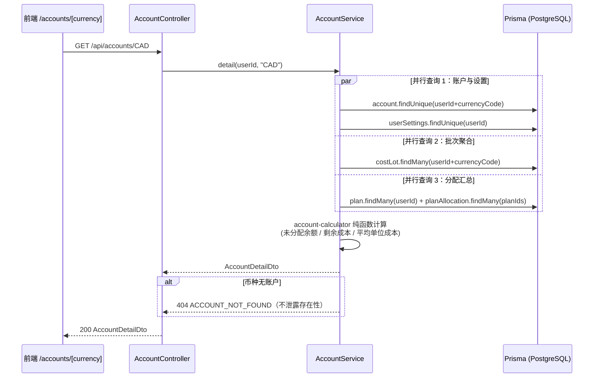
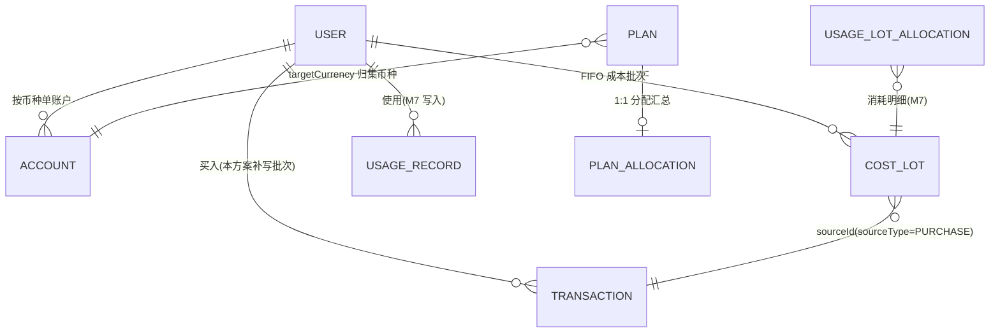

# 技术方案：外汇账户模块（M3：account-module）

> 术语与口径先读：本方案沿用 `changes/plan-management/技术方案.md` 的术语表，并新增两条裁决——
> **「未分配余额」为唯一术语**（doc 04/14 口径），废弃原型中的「可分配/可分配余额」；
> **账户流水**指账户详情页的按时间倒序事件列表（初始持仓 / 买入 / 使用），非 FIFO 成本计算顺序。
>
> 本次方案涉及：**0 张表变更**（M0 冻结基线已预留全部模型）、**3 个新只读接口**、
> 录入事务补写 **1 处**（CostLot 批次）、**1 个幂等回填脚本**、前端 **2 个页面**，
> 预计改动约 1,400 行（含测试，预估）。

## 1. 目标与量化约束

### 1.1 业务背景

外汇账户是 doc 04 定义的按币种虚拟账户视图：用户录入的初始持仓、买入、计划使用都汇聚于此。
当前录入（M4）与计划分配（M5）已上线，但账户侧只有 `home/state` 的余额摘要——
余额 / 已分配 / 未分配余额 / 平均单位成本 / 流水五项信息（doc 04）没有承载页面，
`app/(protected)/layout.tsx` 中 `/accounts` 导航项已预留但点击 404。

本方案交付 M3 账户完整模块，并对上轮评审确认的三处矛盾一并裁决：

| # | 裁决项 | 结论 | 影响面 |
| --- | -------- | ------ | -------- |
| 1 | 术语分裂（「未分配余额」vs「可分配」） | 统一为**未分配余额**，后端字段 `unallocatedAmount`，前端文案同步 | 本模块全部文案与 DTO |
| 2 | 流水缺使用记录导致「流水合计 ≠ 余额」 | 流水 union `UsageRecord`（`type=USAGE`）；M7 上线前该类型自然不出现，上线零改动 | 流水接口与表格 |
| 3 | 现有接口（`home/state` 仅返回余额）缺 doc 04 五项中的已分配/未分配/平均单位成本/流水 | 本方案补齐；`CostLot` 写入提前至本方案（原规划与 M7 同批，见 §2 决策 2） | 录入事务 + 回填 |
| 4 | 原型成本列硬编码「成本（CNY）」 | 成本币种动态取 `userSettings.baseCurrency`，接口返回 `baseCurrency`，前端不硬编码 | 流水接口与表格 |

### 1.2 核心指标预估

| 指标项 | 预估值 | 依据/备注 |
| -------- | -------- | ----------- |
| 数据规模 | 单用户账户 ≤ 15（币种上限）、流水 ≤ 万级；全量用户千级 → accounts 表十万级以内 | 个人工具，预估；远低于分表阈值 |
| 并发压力 | < 100 QPS | 个人工具，预估 |
| 响应要求 | 同步 < 500ms | 3 个只读接口，2-4 条并行查询可满足 |
| 一致性等级 | 强一致（单库本地事务） | 无跨库/跨服务，无 MQ |

风险点（未单独访谈，按保守假设显式标注）：最大风险是**余额与成本批次的数据一致性**——
`Account.balance` 与 `Σ CostLot.remainingQty` 必须相等（M7 使用扣减上线后仍成立），
本方案以不变式断言（§3.3）+ 接口测试兜底，不做运行时自愈（数据修复走人工，避免掩盖问题）。

### 1.3 约束条件

- **M0 schema 冻结**：`Account` / `CostLot` / `UsageRecord` / `Correction` 均已在基线内，本方案 0 DDL、0 migration。
- **依赖功能未上线**：初始持仓入账（M1 遗留）、资金使用录入（M7）、交易更正（M8）均未实现。
  本方案接口契约按终态设计（`type=INITIAL/USAGE`、`version` 字段），实现按现状接入，缺口登记 §9。
- **质量红线**：方案测试设计见 §8；实施须 0 failed 并附日志。
- **目录铁律**：新增后端代码仅落 `services/chat/src/account/`；回填脚本同目录（`tsx` 运行，对齐 `prisma:seed` 先例）。

## 2. 方案选型与取舍

### 决策 1：已分配金额——实时汇总 vs Account 冗余列

| 维度 | A：实时汇总 PlanAllocation（选定） | B：Account 增加 allocated 冗余列 |
| ------ | ----------------------------------- | ---------------------------------- |
| 一致性 | 单一事实来源，无双写 | 计划创建/调整/取消/使用 4 处写路径都要同步维护，漏一处即脏数据 |
| 性能 | 单用户计划数 < 百，内存分组微秒级 | 省一次聚合，无意义 |
| schema | 0 变更 | 违反 M0 冻结，需 migration |

**结论**：选 A。依据 §1.2 量级（万级以内），冗余列的写入一致性成本远大于查询收益。
`PlanAllocation` 取消计划时已由 `amount → max(used, 0)` 释放（`plan.service.ts:642`），
完成计划受 `checkCompleteReady` 约束剩余分配为 0，因此**对全部计划求和无需按状态过滤**，不变式见 §3.3。

### 决策 2：CostLot 写入——本方案提前 vs 维持原规划（M7 同批）

`changes/transaction-entry/技术方案.md` §11 原规划：「M7 资金使用前统一从 Transaction 回填 CostLot；M3 平均成本同批实现」。

**结论**：本方案把**写入侧**（新录入补写 + 存量回填）提前，M7 只做消耗侧（`remainingQty` 扣减 + `UsageLotAllocation`）。理由：

1. 平均单位成本是 doc 04 账户页五项内容之一，本方案交付它就必须有批次数据，回避不了；
2. `CostLot.sourceId` 指向 `Transaction.id`、`acquiredAt = transactedAt`、同日顺序由 `createdAt` 保留——
   从交易记录**确定性重建**（transaction-entry 已论证无数据丢失），回填幂等可重跑；
3. 提前后 M7 范围收窄为纯消耗逻辑，不再背负回填职责。

### 决策 3：流水合并——应用层内存合并 vs DB 视图 union

**结论**：应用层并行查询（`Transaction` + `UsageRecord`）后内存合并排序。理由：
无视图迁移成本、无 SQL 方言耦合；单用户流水 ≤ 万级，内存合并微秒级；
`type=INITIAL`（M1 后）与未来更正版本过滤（M8）都在同一合并层扩展，改动集中。

**无备选说明**：账户页布局与录入入口对齐原型（列表页表格 + 两处「录入换汇」按钮），
doc 04 待确定项之一「账户页的录入入口和列表布局」按原型裁决，登记 §9 文档回填。

## 3. 核心设计

### 3.1 账户详情聚合读路径（一图一核心）



> 图例说明：三条并行查询对应三个数据来源（账户行 / 成本批次 / 计划分配），
> 聚合计算全部下沉到 `account-calculator.ts` 纯函数（无 IO，单测覆盖），
> 与 `plan-calculator` / `transaction-calculator` 分层先例一致。

写路径只有一处增量：`TransactionService.create` 事务内追加第 ④ 步写批次，见 §3.4。

### 3.2 数据模型（0 变更，只画读取关系）



> 索引说明：`cost_lots` 已有 `@@index([userId, currencyCode, acquiredAt, createdAt])`，
> 恰好覆盖本方案的聚合与同日排序（doc 09：同日按首次录入顺序），无需新增索引。
> `PlanAllocation` 与 `Plan` 为裸外键（无 Prisma relation，plan-management 先例），汇总时按 planId 内存关联。

### 3.3 计算口径（account-calculator 纯函数，接口层只做编排）

记币种 `c`，全部金额 `Prisma.Decimal` 运算、出口 `toFixed(4)`（成本）/ `toFixed(8)`（单位成本）：

| 指标 | 公式 | 边界 |
| ------ | ------ | ------ |
| 已分配 `allocatedAmount(c)` | `Σ_p (PlanAllocation.amount − PlanAllocation.usedAmount)`，`p.targetCurrency = c`，**全部计划** | CANCELLED 已释放、COMPLETED 受完成校验，剩余恒为 0，无需状态过滤 |
| 未分配余额 `unallocatedAmount(c)` | `Account.balance − allocatedAmount` | **不 clamp**：理论上 ≥ 0；若为负说明数据被并发/更正破坏，如实返回并 `warn` 日志（§7），禁止掩盖 |
| 剩余已记录成本 `remainingTotalCost(c)` | `Σ_lot (remainingQty × unitCost)` | 无批次（理论上仅清空后）返回 `null` |
| 平均单位成本 `averageUnitCost(c)` | `remainingTotalCost ÷ Σ_lot remainingQty`，`toFixed(8)` 四舍五入 | `Σ remainingQty = 0`（余额 0 或全部消耗）时返回 `null`——对齐 doc 04「余额为 0 时不计算单位平均成本」 |

**不变式（测试断言依据）**：`Σ_lot remainingQty = Account.balance`。
M7 前成立（balance 只被买入 increment）；M7 使用扣减两侧同步递减仍成立；
M1 初始持仓入账须同建 `INITIAL` 批次才保持（登记 §9）。

**与 plan-calculator 的口径差异（刻意不同，勿“对齐”）**：`plan-calculator.ts` 的 `computeCaps`
对未分配余额取 `max(…, 0)`（`plan.service.ts:424` 展示给分配上限提示）——那是**分配上限语义**，
负数无意义故钮 0；本模块是**事实展示语义**，负数即数据破坏信号，必须暴露。正常数据下两接口数值恒等；
异常时以账户页负值 + `warn` 为准（§8.2 有对应用例锁定该差异）。

小数位口径：`unitCost = (principal + (fee ?? 0)) ÷ quantity`，完整精度存 `Decimal(20,10)`（整数位上限 10 位，
即 unitCost 必须 < 1e10，容量预校验见 §3.4），展示 `toFixed(8)`；
手续费未知（`fee = null`）的批次以本金口径计算，`feeKnown = false` 由 `Transaction.feeAmount` 透出，
对齐 doc 05「费用可能不完整」的说明义务，M8 补录手续费时按 `sourceId` 更新对应批次（登记 §9）。

**超用边界（M7 后可能触发）**：plan 模块允许超用计划存续（`usedAmount > amount`，完成时才拒绝），
此时该计划对 `allocatedAmount` 产生负贡献，进而 `unallocatedAmount > balance`（金额凭空多出）。
处理与负未分配一致：如实展示 + `warn`，不做钳制；M7 设计时须同步评估该口径（登记 §9）。

### 3.4 录入事务补写 CostLot（TransactionService.create 第 ④ 步）

现有事务（`transaction.service.ts` ①计划校验 → ②建户+余额 → ③落交易）追加：

```
④ costLot.create({
     userId, currencyCode, sourceType: "PURCHASE", sourceId: transaction.id,
     quantity, remainingQty: quantity,
     unitCost: (principal + (fee ?? 0)) / quantity,   // Decimal 完整精度
     totalCost: principal + (fee ?? 0),
     acquiredAt: transactedAt,                        // 同日顺序由 createdAt 保留（doc 09）
   })
```

**unitCost 容量预校验（`buildPurchaseLot` 内）**：`Decimal(20,10)` 整数位仅 10 位（上限 < 1e10），
而合法录入域可达 unitCost = 1e11（本金 1e9 ÷ 数量 0.01）——溢出时 Prisma 抛 P2000 变 500。
构造前校验 `unitCost < 1e10`，不满足按 transaction-calculator 先例抛 `400 INVALID_TRANSACTION_PARAMS`
（message 指明单位成本超界，请核对本金与到账数量），在事务前拦截。

任一步失败整体回滚，与现有 ①②③ 同一事务边界；`createdAt` 由 Prisma 自动生成，
同日多笔的批次顺序即录入顺序，恰好满足 doc 09「同日按第一次录入的顺序」。

### 3.5 存量回填（幂等脚本）

`services/chat/src/account/backfill-cost-lots.script.ts`（`tsx` 运行，package.json 增加 `backfill:cost-lots`）：

1. **单实例执行**：脚本启动时获取 PostgreSQL advisory lock（`pg_advisory_lock` 固定键），
   获取失败即退出——M0 冻结下 `CostLot` 无 `(sourceType, sourceId)` 唯一约束，
   「先查后插」在并发双跑下会产生重复批次（与实时录入第④步同理），只能以互斥兜底（登记 §9）；
2. 全量遍历 `Transaction`，按 `(userId, currencyCode)` 分组；
3. **分组事务内「复检 + createMany」**：每个分组一个事务，事务内重新查询已存在批次，
   `sourceType="PURCHASE" AND sourceId=transaction.id` 已存在的跳过（幂等，可重跑），
   缺失的按 §3.4 同一纯函数（`buildPurchaseLot`，calculator 导出，含容量预校验）构造插入；
   单条构造失败（如 unitCost 溢出的存量脏数据）**跳过该条并计入明细日志**，不中断其他分组；
4. 全部分组完成后，在**单条聚合查询内**校验不变式 `Σ remainingQty = balance`
   （禁止两条独立查询——并发录入恰在两查之间提交会造成误报）；
   同时检测重复批次（`sourceType+sourceId` 分组 count > 1 即违规）；
5. 违反不变式或存在重复批次**不静默修复**：打印明细并以非零码退出，由人工按 doc 02/09 更正流程处理。

### 3.6 流水合并与排序

- 数据源：`Transaction`（`type=PURCHASE`）+ `UsageRecord`（`type=USAGE`，M7 前为空表）并行查询；
  M7 上线时**接口契约与前端零改动**，但 `ledger()` 须追加 `UsageLotAllocation` 按 `usageId`
  聚合 `totalCost`（`UsageRecord` 表无成本字段，`schema.prisma:272`），登记 §9；
- `type=INITIAL` 行由 M1 初始持仓入账落 `CostLot(sourceType=INITIAL)` 后接入（§9），
  接口契约与前端类型已预留该枚举值；
- 排序：`occurredAt` 倒序，同刻按 `createdAt` 倒序稳定排列。**展示顺序不是成本计算顺序**
  （doc 02 的「初始 → 买入 → 使用」仅用于 FIFO 重算，页面不承担该语义）；
- 分页：**本次不做**（单用户流水 ≤ 万级、个人工具一次渲染可接受），阈值超过 500 行时再引入 cursor 分页（§9 登记）；
- 更正版本：当前全部 `version=1` 有效；M8 更正落地后须按「每笔逻辑交易的最新有效版本」过滤，
  届时需 schema 增加版本组标识（M8 设计责任），本方案出参已带 `version` 字段预留（§9）。

### 3.7 状态流转

无。账户无生命周期状态（建立后永久保留，余额 0 不删除，doc 04），不涉及状态机。

## 4. 接口契约

约定：金额一律字符串（`toFixed(4)`）、单位成本 `toFixed(8)`；错误响应统一 `{ code, message }`；
鉴权为 **Controller 级守卫**（项目无全局 JWT 守卫，`app.module.ts` 仅全局挂 ThrottlerGuard）：
`account.controller.ts` 须显式 `@UseGuards(JwtAuthGuard)` + `@ApiBearerAuth()`，
对齐 `plan.controller.ts:77` 先例；`userId` 取自请求上下文，禁止入参传入。

**`baseCurrency` 缺失口径**：三个接口的 `baseCurrency` 取自 `userSettings`；
onboarding 向导已按产品决策从前端取消、注册时不创建 `userSettings`，真实新用户可能无此行——
此时 `baseCurrency` 返回 `null`，前端成本列退化为纯金额（不带币种代码），本位币相关文案不展示。
缺口随 onboarding 波次确认后收敛（登记 §9）。

### 4.1 `GET /api/accounts` — 账户列表

| 项 | 内容 |
| ---- | ------ |
| 入参 | 无（`userId` 来自鉴权上下文） |
| 出参 | `{ "baseCurrency": "CNY", "accounts": [ { "currencyCode": "CAD", "balance": "12000.0000", "allocatedAmount": "6000.0000", "unallocatedAmount": "6000.0000" } ] }` |
| 排序 | `currencyCode` 升序（对齐 `home/state` 先例） |
| 幂等性 | 只读 |
| 空态 | 未建任何账户时 `accounts: []`（前端显示引导态） |

### 4.2 `GET /api/accounts/:currencyCode` — 账户详情

| 项 | 内容 |
| ---- | ------ |
| 入参 | 路径参数 `currencyCode`（15 币种之一，大小写不敏感，统一转大写） |
| 出参 | 4.1 单账户字段 + `{ "remainingTotalCost": "63620.0000", "averageUnitCost": "5.30166667" }`（8 位小数）；`remainingTotalCost` / `averageUnitCost` 在 §3.3 边界下为 `null` |
| 幂等性 | 只读 |
| 错误 | `400 INVALID_ACCOUNT_CURRENCY`（非支持币种）；`404 ACCOUNT_NOT_FOUND`（该币种无账户，不泄露存在性） |

### 4.3 `GET /api/accounts/:currencyCode/transactions` — 账户流水

| 项 | 内容 |
| ---- | ------ |
| 入参 | 路径参数同 4.2；无分页参数（§3.6） |
| 出参 | `{ "baseCurrency": "CNY", "items": [ { "id": "clr1...", "type": "PURCHASE", "occurredAt": "2026-09-08T02:00:00.000Z", "quantity": "2000.0000", "totalCost": "10620.0000", "feeKnown": true, "version": 1 }, { "id": "usg1...", "type": "USAGE", "occurredAt": "...", "quantity": "400.0000", "totalCost": "2128.0000", "feeKnown": true, "version": 1 } ] }` |
| 字段说明 | `type`: `INITIAL \| PURCHASE \| USAGE`（`INITIAL` 为 M1 预留枚举，当前不出现）；`totalCost`：买入 = 本金+手续费（未知时=本金），使用 = FIFO 消耗成本（M7 起，`UsageLotAllocation.cost` 按 `usageId` 聚合）；USAGE 行字段映射：`quantity` = `UsageRecord.amount`、`feeKnown` 恒 `true`（使用无费用概念）、`version` = `UsageRecord.version`；`feeKnown=false` 时前端显示「费用未明确」标记（doc 05） |
| 排序 | `occurredAt` 倒序、同刻 `createdAt` 倒序（§3.6） |
| 错误 | 同 4.2 |

### 4.4 错误码汇总

| code | HTTP | 场景 |
|------|------|------|
| `INVALID_ACCOUNT_CURRENCY` | 400 | 币种不在 15 种支持列表 |
| `ACCOUNT_NOT_FOUND` | 404 | 该币种未建账户（含他人账户，不泄露存在性） |

## 5. 代码影响范围

### 5.1 后端

<pre>
services/chat/
├── package.json <font color="#92400e">(M)</font> [注: scripts 增加 backfill:cost-lots（tsx 运行，对齐 prisma:seed 先例）]
├── src/
│   ├── transaction/
│   │   └── <font color="#92400e">transaction.service.ts</font> <font color="#92400e">(M)</font> [注: 录入事务追加第④步]
│   │       └── <font color="#ca8a04">create()</font> [注: ③落交易后 costLot.create（§3.4），同事务回滚]
│   └── account/ <font color="#166534">(A)</font>
│       ├── <font color="#166534">account.module.ts</font> <font color="#166534">(A)</font> [注: 在 app.module.ts 注册一次]
│       ├── <font color="#166534">account.controller.ts</font> <font color="#166534">(A)</font> [注: @Controller("accounts") + @UseGuards(JwtAuthGuard)（§4，项目无全局 JWT 守卫）]
│       │   ├── <font color="#16a34a">listAccounts()</font> [注: GET /api/accounts（§4.1）]
│       │   ├── <font color="#16a34a">getAccount()</font> [注: GET /api/accounts/:currencyCode（§4.2）]
│       │   └── <font color="#16a34a">getLedger()</font> [注: GET /api/accounts/:currencyCode/transactions（§4.3）]
│       ├── <font color="#166534">account.service.ts</font> <font color="#166534">(A)</font> [注: 只读编排，并行查询 + 调 calculator]
│       │   ├── <font color="#16a34a">list()</font> [注: 账户 + 分配汇总]
│       │   ├── <font color="#16a34a">detail()</font> [注: + 批次聚合、404 判定]
│       │   └── <font color="#16a34a">ledger()</font> [注: Transaction+UsageRecord 并行查询合并]
│       ├── <font color="#166534">account-calculator.ts</font> <font color="#166534">(A)</font> [注: 纯函数层，无 IO（§3.3 口径唯一实现）]
│       │   ├── <font color="#16a34a">sumAllocatedByCurrency()</font> [注: 按币种汇总剩余分配]
│       │   ├── <font color="#16a34a">buildPurchaseLot()</font> [注: Transaction → CostLot 构造（录入与回填共用，含 unitCost 容量预校验 §3.4）]
│       │   ├── <font color="#16a34a">computeRemainingCost()</font> [注: Σ remainingQty×unitCost 与平均单位成本]
│       │   └── <font color="#16a34a">mergeLedgerItems()</font> [注: 跨源合并 + occurredAt 倒序稳定排序]
│       ├── <font color="#166534">backfill-cost-lots.script.ts</font> <font color="#166534">(A)</font> [注: 幂等回填 + advisory lock 互斥 + 不变式校验（§3.5）]
│       └── dto/
│           └── <font color="#166534">account.dto.ts</font> <font color="#166534">(A)</font> [注: 三个出参 DTO + 币种路径参数校验]
└── src/app.module.ts <font color="#92400e">(M)</font> [注: AccountModule 注册（模块唯一注册点）]
</pre>

### 5.2 前端

<pre>
clients/chat-web/
├── app/(protected)/accounts/
│   ├── <font color="#166534">page.tsx</font> <font color="#166534">(A)</font> [注: 账户列表页（原型 l3R09）：表格 + 录入换汇入口]
│   │   ├── <font color="#16a34a">AccountsPage()</font> [注: useQuery listAccounts；空态引导去录入]
│   │   └── <font color="#16a34a">AccountsSkeleton()</font> [注: 加载态（对齐交易详情页先例）]
│   └── [currency]/
│       └── <font color="#166534">page.tsx</font> <font color="#166534">(A)</font> [注: 账户详情页（原型 QKb1c）：金额卡 + 流水表]
│           └── <font color="#16a34a">AccountDetailPage()</font> [注: useQuery detail+ledger；404 提示态]
├── components/business/account/
│   ├── <font color="#166534">account-summary-cards.tsx</font> <font color="#166534">(A)</font> [注: 余额/已分配/未分配余额/平均单位成本；null 显示「—」；数值原样渲染接口字符串（不做千分位/精度裁剪，保障 E2E 精确断言）]
│   ├── <font color="#166534">account-ledger-table.tsx</font> <font color="#166534">(A)</font> [注: 流水表：类型标签映射 + 成本列动态本位币 + feeKnown 标记；PURCHASE 行点击跳 /transactions/:id]
│   └── <font color="#166534">index.ts</font> <font color="#166534">(A)</font> [注: 桶文件（文件归属规则）]
└── lib/api/
    └── <font color="#166534">accounts.ts</font> <font color="#166534">(A)</font> [注: accountsApi.list/detail/ledger；被两个页面复用在此归档]
        └── [引用方] accounts/page.tsx / accounts/[currency]/page.tsx
</pre>

### 5.3 测试文件树（文件与被测对象一一对应）

<pre>
services/chat/
├── src/account/
│   ├── <font color="#166534">account-calculator.spec.ts</font> <font color="#166534">(A)</font> [注: 测试四个纯函数 —— 覆盖 §8.1]
│   └── <font color="#166534">backfill-cost-lots.script.spec.ts</font> <font color="#166534">(A)</font> [注: 测试回填幂等与不变式 —— 覆盖 §8.1]
└── test/api/
    ├── <font color="#166534">account.spec.ts</font> <font color="#166534">(A)</font> [注: 一个 controller 一个文件（文件归属规则）—— 覆盖 §8.2]
    └── <font color="#92400e">transaction.spec.ts</font> <font color="#92400e">(M)</font> [注: 录入用例追加 CostLot 断言]
e2e/
├── helpers/
│   └── <font color="#166534">api-seeder.ts</font> <font color="#166534">(A)</font> [注: API 造数 helper（注册/登录拿 token → 完成设置 → 录入 → 建计划分配）；后端地址 process.env.API_URL ?? http://localhost:4001（对齐 playwright.config 注释）]
└── modules/
    └── <font color="#166534">02-account.spec.ts</font> <font color="#166534">(A)</font> [注: 用户路径 E2E —— 覆盖 §8.3]
</pre>

## 6. 可靠性保障

- **超时与重试**：纯本地 PostgreSQL 查询，无外部依赖；读接口不做重试（前端 react-query 默认策略，401 由 apiClient 统一处理）。
- **降级**：无外部依赖，不涉及降级/熔断；查询失败按现有 `HttpException({ code, message })` 先例返回
  （项目未注册全局异常过滤器，对齐 `transaction-calculator.ts` 先例）。
- **回滚机制**：0 DDL、0 列变更——代码回退即完全回滚；回填脚本写入的批次以 `sourceId` 幂等识别，
  重跑无副作用；如需清除重灌，按 `sourceType='PURCHASE'` 删除批次后重跑（脚本只认缺失，不产生重复）。
- **存量数据**：新录入即时写批次；存量 `Transaction` 由回填脚本一次性补齐。
  发布顺序无技术强制手段：实际以「发布后立即执行回填」为准，间隙窗口内详情页
  `averageUnitCost=null` 由既有降级用例覆盖（批次缺失 → null，不报错），不作为阻塞依赖。
- **不变式破坏**：`unallocatedAmount < 0`、`allocatedAmount < 0`（超用，§3.3）或
  `Σ remainingQty ≠ balance` 时如实返回 + `warn`（§3.3/§7），不做运行时自愈；
  修复走 doc 02/09 的人工更正流程。

## 7. 可观测性

- **入口日志**：`AccountController` 挂 `Logger`（对齐 `plan.controller.ts` 的 withLog 先例），
  记录动作、路径参数与错误码；**info 级不打印金额明细**（个人财务数据最小暴露，对齐现有先例）。
- **异常诊断例外口径**：`warn` 级日志（负未分配、超用、不变式破坏）与回填脚本明细**允许打印触发异常的具体数值**
  （两侧金额、违规账户清单）——异常诊断必需，且仅限异常场景，禁止出现在 info/常规日志。
- **回填脚本日志**：开始/结束时间、处理用户数、补写批次数、跳过明细（含溢出脏数据）、
  重复批次检测结果、不变式校验结果（§3.5）。
- **禁止**：循环体内逐条 Debug 日志。

## 8. 测试策略

> 前端只测 `lib/hooks`（AGENTS.md 测试约定），页面交互靠 E2E；后端三类分写，实施须 0 failed。

### 8.1 单元测试

| 测试文件 | 被测对象 | 覆盖点 |
| ---------- | ---------- | -------- |
| `account-calculator.spec.ts` | `sumAllocatedByCurrency` | 多计划多币种分组；CANCELLED（amount=used）计 0；无分配账户返回 0；`usedAmount>0`（部分使用）按差额计入（用 `setAllocationUsedAmount` 先例）；合计 > 余额时返回负数（不钮制，锁定与 plan-calculator computeCaps 的口径差异） |
| `account-calculator.spec.ts` | `buildPurchaseLot` | fee=0 / fee=20 / fee=null（未知）三种成本的 unitCost 与 totalCost；acquiredAt=transactedAt；unitCost 溢出 Decimal(20,10)（如 1e9÷0.01）抛 400（§3.4 容量预校验） |
| `account-calculator.spec.ts` | `computeRemainingCost` | 正常批次求和；部分消耗（remainingQty<quantity）；全消耗 → averageUnitCost=null；8 位四舍五入（5 进位，对齐 doc 02） |
| `account-calculator.spec.ts` | `mergeLedgerItems` | PURCHASE+USAGE 合并排序；同刻 createdAt 倒序稳定；空输入返回空数组 |
| `backfill-cost-lots.script.spec.ts` | 回填主流程 | 已有批次跳过（幂等，跑两遍数量不变）；缺失批次补齐且字段与实时写入一致；不变式违反时非零退出并输出明细；**实时写入与回填交错**（spy 模拟第④步先行插入）不产生重复批次；**分组循环中单组失败**（溢出脏数据）跳过该组、其余分组继续、汇总日志完整 |

### 8.2 接口测试（`test/api/account.spec.ts`，一个 controller 一个文件）

| 接口 | 场景 | 预期结果 |
| ------ | ------ | ---------- |
| GET /api/accounts | 未登录 | 401（验证 Controller 级守卫已挂载，§4） |
| GET /api/accounts | 新用户无账户（无 userSettings，模拟真实注册路径） | 200 `{ baseCurrency: null, accounts: [] }`（§4 缺失口径） |
| GET /api/accounts | 录入 2 笔 CAD + 1 笔 USD | 200 两账户余额正确、`allocatedAmount="0.0000"` |
| GET /api/accounts | 创建计划分配 6,000 CAD 后**直插超量分配**（amount > balance，用 plan-test-helper） | `allocatedAmount` 如实返回超量值、`unallocatedAmount` 为负不钮制（锁定 §3.3 与 computeCaps 的口径差异） |
| GET /api/accounts/:code | 取消计划后查询 | 分配释放、`unallocatedAmount` 回升 |
| GET /api/accounts/cad | 小写路径参数 | 200，等价大写（统一转大写） |
| GET /api/accounts/XYZ | 非 15 币种 | 400 `INVALID_ACCOUNT_CURRENCY` |
| GET /api/accounts/JPY | 未建账户币种 | 404 `ACCOUNT_NOT_FOUND` |
| GET /api/accounts/CAD | 2 笔买入：汇率 1、principal 10,600+fee 20/数量 10,620；principal 7,800/数量 7,800 | `remainingTotalCost` = "18420.0000"；`averageUnitCost` = 18,420÷18,420 = "1.00000000"（入参对齐 transaction.spec simpleBody 风格，每个数字可复算） |
| GET /api/accounts/CAD | 直插余额 0 账户（ensureAccount 先例）+ 全消耗批次 | `averageUnitCost=null`（余额 0 不计算，doc 04）；`unallocatedAmount` 如期计算 |
| GET /api/accounts/CAD | 回填前查详情（未跑脚本旧数据模拟） | 批次缺失时 `averageUnitCost=null` 不报错（仅新录入有批次） |
| GET /api/accounts/CAD/transactions | 混合买入记录 | items 按 occurredAt 倒序；`type`/`feeKnown`/`version` 字段正确 |
| GET /api/accounts/CAD/transactions | 手续费未知的买入 | `totalCost`=本金、`feeKnown=false` |
| GET /api/accounts/CAD/transactions | 他人账户币种（越权） | 404（不泄露存在性） |

`test/api/transaction.spec.ts` 追加：录入成功后 `CostLot` 行存在且 `remainingQty=quantity`、
`unitCost`/`totalCost`/`acquiredAt` 与 §3.4 一致；两笔录入后 `Σ remainingQty === account.balance`
（组合级不变式断言）；**事务内失败注入**（关联不存在的 planId → PLAN_NOT_FOUND，在事务内第①步抛出）
后无批次残留（证明回滚完整性；ROUND_TO_ZERO 发生在事务外的 parseParams，验证不了回滚，不用作回滚用例）。

### 8.3 E2E 测试（`e2e/modules/02-account.spec.ts`，按用户操作路径编号）

**场景 1：查看账户列表与金额**

1. 登录 → 通过 API 造数（`e2e/helpers/api-seeder.ts`）：完成初始化设置（POST consents + complete，仅用于构造 baseCurrency；注：该向导前端已取消，真实新用户无 userSettings 的降级展示由接口测试 §8.2 覆盖）→ 录入 2 笔 CAD 买入 → 创建计划分配 6,000
2. 侧边栏点击「外汇账户」进入 `/accounts`
3. 断言：列表出现 CAD 行，余额 / 已分配 / 未分配余额 三值正确（接口字符串原样渲染，可精确断言），术语显示「未分配余额」

**场景 2：账户详情与流水**

1. 列表行点击「查看账户」进入 `/accounts/CAD`
2. 断言：金额卡含平均单位成本（原样渲染接口 8 位字符串，`toContainText` 精确断言）；流水表两行买入记录按日期倒序；成本列表头显示本位币代码（baseCurrency 由接口返回）
3. 点击买入行（行级跳转，§5.2 ledger-table 设计）跳转 `/transactions/:id`，断言详情页金额与流水行一致

**场景 3：空账户引导**

1. 新注册用户直接访问 `/accounts`
2. 断言：显示空态引导（无账户），「录入换汇」入口可跳转 `/transactions/new`

## 9. 依赖与遗留登记

| # | 事项 | 归属 | 说明 |
| --- | ------ | ------ | ------ |
| 1 | 初始持仓详情 / 更正页面（原型 VMHcX~RsfQ8 四画板） | **M1 遗留阻塞** | 初始持仓入账未实现（`changes/m1-onboarding/技术方案.md` §遗留 2），无数据来源；本方案流水 `type=INITIAL` 与前端枚举已预留，M1 落地后接入 |
| 2 | 初始持仓入账须同建 `INITIAL` 批次 | M1 联动 | 否则破坏 §3.3 不变式（Σ remainingQty = balance）且平均成本漏初始部分 |
| 3 | 使用记录数据（`type=USAGE` 行） | M7 联动 | `UsageRecord` 空表，接口契约与前端零改动；但 M7 上线时 `ledger()` 须追加 `UsageLotAllocation` 按 `usageId` 聚合 `totalCost`（`UsageRecord` 无成本字段）；M7 消耗侧同步扣 `remainingQty`；M7 设计时同步评估超用计划（`usedAmount > amount`）对 `allocatedAmount` 为负的展示口径（§3.3） |
| 4 | 流水按「最新有效版本」过滤 | M8 联动 | 交易更正（M8）引入版本组标识后，`mergeLedgerItems` 增加过滤；当前全 `version=1` 不受影响 |
| 5 | M8 补录手续费同步更新批次 | M8 联动 | 按 `sourceId` 更新对应 `CostLot` 的 unitCost/totalCost（doc 09 例） |
| 6 | 流水 cursor 分页 | 阈值触发 | 单用户流水 > 500 行时引入（§3.6），当前不做 |
| 7 | 不变式告警接入监控平台 | 监控缺位 | MVP 无告警平台，以 `warn` 日志为界 |
| 8 | doc 04 待确定项回填 | 文档回填 | 「账户页录入入口与列表布局」按本方案 §2 裁决回填 doc 04；「关联交易是否同时分配」已由原型核对页文案裁决（不自动分配），一并回填 |
| 9 | 原型术语修订 | 文档回填 | pen 原型「可分配/可分配余额」改为「未分配余额」，与 §1 裁决 1 同步（人工修订画板） |
| 10 | `GET /api/transactions`（全局交易列表） | 撤销原规划 | transaction-entry §11 #7 原登记「随 M3 账户页实现」；本方案裁决**不实现**——账户维度流水（§4.3）已覆盖前端消费场景（E2E 场景 2 详情跳转走既有 `GET /transactions/:id`）；全局列表如后续出现消费方随需重开，届时须显式按 userId 过滤并补跨用户不可见断言（承 §11 #7 安全要求） |
| 11 | `CostLot(sourceType, sourceId)` 唯一约束评估 | M0 冻结解除后 | 当前无唯一约束，防重靠脚本 advisory lock + 分组事务内复检（§3.5）；冻结解除后建议补唯一索引作为最终防线；顺带评估幂等查询索引 |
| 12 | `baseCurrency` 依赖 `userSettings` 的缺口 | onboarding 波次 | onboarding 向导已从前端取消、注册不创建 userSettings → 新用户 `baseCurrency=null`（§4 降级口径）；随 onboarding 遗留（初始持仓入账归属）一并确认后收敛 |
| 13 | 「分配 > 余额」负值数据的修复路径 | 运维 | 超量分配直插仅测试环境构造；生产出现负 `unallocatedAmount` 即数据破坏，按 doc 02/09 人工更正，本方案不做自愈 |

## 10. 自检清单

- [x] 量化指标齐全，选型基于量级（§1.2 → §2 三项决策均引用量级）
- [x] 只写增量/变更，未复制整个系统（仅 account 新模块 + transaction 一处事务增量）
- [x] 未引入新中间件/新依赖（`tsx` 已有，Prisma/NestJS 现有栈全覆盖）
- [x] 核心流程有 Mermaid 图（§3.1 一图一核心；§3.7 状态机不适用已说明）
- [x] 覆盖异常兜底、回滚、监控（§6/§7；负未分配不掩盖策略已声明）
- [x] 代码影响范围树状清单，A/M/D 清晰，`<pre>`+`<font>` 上色，共享 API 单独归档标引用方（§5）
- [x] 测试策略分单元/接口集成/E2E 三类，文件与被测对象一一对应，E2E 按路径编号带断言（§8）
- [x] 已完成项目现状调研（§1.1 引用现有文件与既有方案 §11 规划；无新目录违反目录树）
- [x] 审核意见逐条处理（§11）

## 11. 审核意见与修订记录

> 2026-XX-XX 多视角审核（架构 / 安全与边界 / 测试，3 个独立 subagent）。
> 架构视角：通过附 4 条必修；安全与边界视角：不通过（8 条）；测试视角：不通过（8 条）。逐条处理如下。

| # | 来源 | 审核意见（引用章节） | 处理方式 | 说明 |
| --- | ------ | ---------------------- | ---------- | ------ |
| 1 | 架构 | §9 漏登记 transaction-entry §11 #7（`GET /api/transactions` 原规划随 M3 实现） | 已修改 | §9 #10 显式裁决不实现 + 重开条件 |
| 2 | 架构 | §3.3 负未分配与 `plan-calculator` computeCaps 钮 0 口径冲突未声明 | 已修改 | §3.3 增口径差异声明；§8.1/8.2 补差异锁定用例 |
| 3 | 架构 | §9.3 「零改动」不实：M7 须追加 UsageLotAllocation 聚合（UsageRecord 无成本字段） | 已修改 | §3.6/§9.3 措辞改为「契约与前端零改动，实现须加聚合」；§4.3 补 USAGE 行字段映射 |
| 4 | 架构/安全/测试 | 回填幂等仅靠应用层先查后插，无 DB 兜底，并发双跑/与实时写入竞态会产生重复批次 | 已修改 | §3.5 重写：advisory lock 单实例 + 分组事务内复检 + 重复批次检测；§8.1 补交错用例；§9.11 登记唯一约束评估 |
| 5 | 架构 | §1.1 裁决 #3 「doc 04 缺平均单位成本」表述与事实相反（缺的是接口） | 已修改 | 改为「现有接口缺五项中的四项」 |
| 6 | 安全 | §4 「全局 JWT 守卫」与现状不符（仅 Controller 级手动挂载，app.module 只有 ThrottlerGuard） | 已修改 | §4/§5.1/§8.2 改为 Controller 级 @UseGuards(JwtAuthGuard) 先例，未登录用例标注守护意图 |
| 7 | 安全 | §3.4 unitCost 可溢出 Decimal(20,10)（合法输入 1e9÷0.01=1e11）→ P2000 500 | 已修改 | §3.4 增容量预校验 400 拦截；§8.1 补溢出用例；§3.5 单条失败跳过策略 |
| 8 | 安全 | §7 「不打印金额明细」与告警/回填明细自相矛盾 | 已修改 | §7 显式声明例外口径：info 不打金额，warn/回填明细仅异常场景允许数值 |
| 9 | 安全 | §3.5 不变式校验两条独立查询存在竞态误报 | 已修改 | §3.5 第 4 步改为单条聚合查询内校验 |
| 10 | 安全 | §3.3 未定义 allocatedAmount < 0（M7 超用）边界 | 已修改 | §3.3 增超用边界段；§9.3 补 M7 评估；§6 不变式破坏列表同步 |
| 11 | 安全 | §8.2 回滚用例注入点错误（ROUND_TO_ZERO 在事务外） | 已修改 | 改为事务内 PLAN_NOT_FOUND 注入，并注明 ROUND_TO_ZERO 为何不能作回滚用例 |
| 12 | 安全 | §6 「全局异常过滤器」不存在 | 已修改 | 改述为 HttpException({code,message}) 先例 |
| 13 | 安全 | §6 「先跑回填再发布」顺序无技术保障 | 已修改 | 改为「发布后立即执行，间隙 null 降级覆盖」 |
| 14 | 测试 | E2E 造数「完成初始化设置」掩盖 baseCurrency 缺失场景（onboarding 前端已取消、注册不建 userSettings） | 已修改 | §4 增 baseCurrency=null 降级口径；§8.2 无 userSettings 用例；§8.3 场景 1 注明造数仅构造 baseCurrency；§9.12 登记缺口归属 |
| 15 | 测试 | §8.2 averageUnitCost 断言无具体值；§4.2 示例 7 位应为 8 位 | 已修改 | §4.2 改 "5.30166667"；§8.2 场景补齐入参与可复算期望值 |
| 16 | 测试 | §8.1 回填测试缺并发交错与单组失败场景 | 已修改 | §8.1 回填行补两条覆盖点（同 #4） |
| 17 | 测试 | §3.3 负未分配、余额 0 → null 两边界无测试条目 | 已修改 | §8.1/§8.2 各补对应用例（#2/#16 关联） |
| 18 | 测试 | E2E 场景 2 断言无设计依据（行级跳转、8 位展示格式未定义） | 已修改 | §5.2 ledger-table 补行级跳转设计、summary-cards 补「原样渲染接口字符串」口径；§8.3 断言同步 |
| 19 | 测试 | E2E API 造数 helper 未列入 §5.3 文件树 | 已修改 | §5.3 补 e2e/helpers/api-seeder.ts (A) |
| 20 | 测试 | 不变式缺组合级断言（单笔推不出 Σ=balance） | 已修改 | §8.2 transaction.spec 追加说明补 Σ 断言 |
| 21 | 测试 | usedAmount>0（部分使用）口径无回归网 | 已修改 | §8.1 sumAllocatedByCurrency 补覆盖点（setAllocationUsedAmount 先例） |
