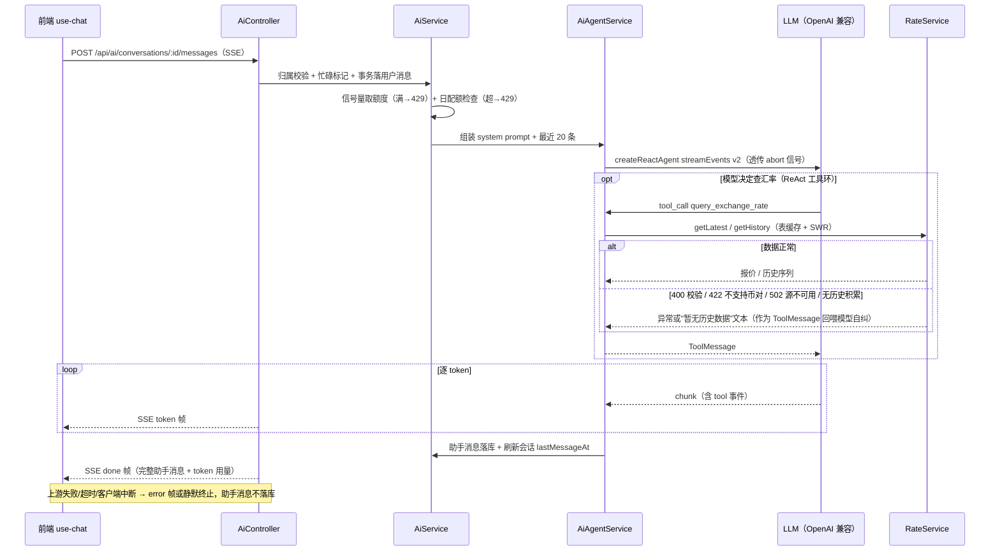
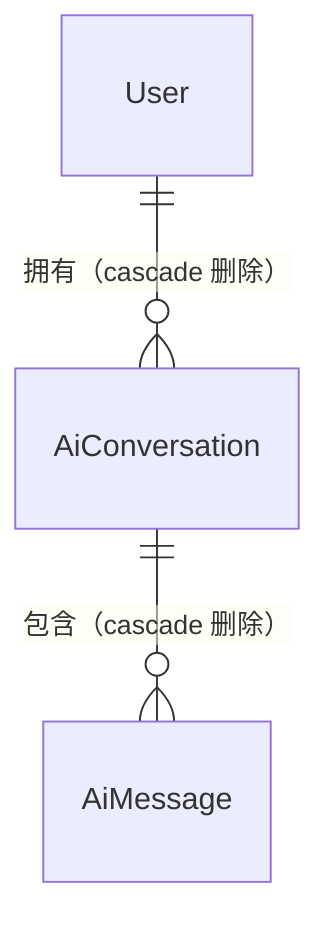

# 技术方案：AI 助手（对话 + LangGraph ReAct Agent）【v2，经三视角审核修订】

> 需求规格：`changes/ai-assistant/规格.md`（拍板结论：LangGraph.js 内嵌 NestJS、OpenAI 兼容端点、对话按用户落库、单工具「汇率查询」支持最新+历史）。
> 关联方案：`changes/rate-chart/技术方案.md`（汇率行情页，独立交付）。
> 修订记录：v1 经架构 / 安全边界 / 测试三视角审核，38 条意见全部采纳，详见 §11。
>
> 动笔前已确认：核心场景——登录用户在菜单「AI 助手」页以自然语言查询汇率（最新/历史），会话持久化；量级——公开服务、成百上千用户（下表均为**预估**）；最大风险点——LLM 上游稳定性、流式链路无项目先例、**13/15 币对无历史回源能力**（见 §3.1）。
>
> 本次方案涉及：**新增 2 张表、5 个接口（4 JSON + 1 SSE 流式）、1 个 ReAct agent 与 1 个汇率工具；改动现有文件 6 处；预计新增代码约 1900 行（含测试），零新增依赖**。

## 1. 目标与量化约束

### 1.1 业务背景

保护区菜单新增「AI 助手」：前端聊天工作台（会话列表 + 对话区，流式输出）；后端新建 `src/ai` 模块，用已安装的 `@langchain/langgraph` 组装 ReAct agent，唯一工具为汇率数据查询（包装现有 `RateService`），会话与消息按用户落库。

### 1.2 核心指标预估

| 指标项 | 预估值 | 依据/备注 |
| -------- | -------- | ----------- |
| 数据规模 | 注册用户千级；消息年存量 **百万级**（人均年 50 会话 × 10 消息，保守） | 单表百万级无需分表，靠 `(conversation_id, created_at)` 与 `(user_id, updated_at)` 索引覆盖 |
| 并发压力 | 峰值并发流式会话 **< 50**（预估）；进程内信号量上限默认 **40**（env 可调），高峰溢出直接 429 快速失败 | LLM 上游并发/配额是真实瓶颈，宁可拒掉也不能堆积；当前单实例部署，信号量为进程内实现 |
| 响应要求 | 流式首字 < 5s（上游主导）；总时长 P99 < 60s；JSON 接口 < 500ms；汇率工具命中表缓存 < 1s，回源补齐受上游限制（ABC 源单次外呼可达 6s，工具层不等待慢回源，如实告知） | 规格性能条款已同步修订（§11 #架构-3） |
| 成本上界 | 用户级日配额 100 条/人（默认），将最坏成本钉死：千用户 × 100 条 × ~1k token ≈ 1 亿 token/日上界，实际远低于此 | 配额超出 → 429 `AI_QUOTA_EXCEEDED` 友好提示，防刷防破产 |
| 一致性 | 会话元数据**本地强一致**（事务）；流式消息**最终一致**（先落用户消息，助手消息流结束后落库，失败不落） | 流式中断不允许出现"半条"助手消息污染上下文 |

### 1.3 约束条件

- LLM key/baseURL/模型为外部依赖，由 env 注入；未配置时功能整体降级（见 §6），**不得**影响既有部署启动（env 定义为 optional，运行时检查）。
- 项目无 Redis：限流用现有 `@nestjs/throttler`（IP 级，语义为**覆盖**式配置，局限见 §4），并发闸用进程内信号量；**单实例部署假设**，未来水平扩容时需将信号量/忙碌标记/日配额外移（本期不做，仅标注）。
- LangGraph 三件套已装（`@langchain/langgraph ^1.3.7`、`@langchain/core ^1.1.48`、`@langchain/openai ^1.4.7`），版本锁定不升级；测试用假模型优先复用 `@langchain/core/utils/testing` 官方 Fake 聊天模型。
- 命名避开现有 `usage` 模块（那是换汇资金使用记录，与 token 用量无关）：模块名 `ai`，表名 `ai_conversations` / `ai_messages`。

## 2. 方案选型与取舍

| 维度 | 方案 A：LangGraph `createReactAgent` + 自管 DB 历史 | 方案 B：手写 ReAct 循环 + 自管历史 | 方案 C：LangGraph + PostgresSaver checkpointer |
| ------ | ------ | ------ | ------ |
| 性能 | 事件流内建（streamEvents v2），零包装开销 | 相当 | 相当，但每步多一次 checkpoint 落库 |
| 维护成本 | 低：工具循环/重试/事件流框架内建，后续加工具零改架构 | 高：工具调用解析、重试、中断全自担 | 中：多一套 checkpoint 存储与清理逻辑 |
| 团队熟悉度 | 已装依赖、官方预置构件 | 需自研等价物 | 需新装 `@langgraph/checkpoint-postgres` |
| 生态成熟度 | LangGraph 官方推荐路径 | 无 | 官方但 JS 侧文档较薄 |

**结论**：选 **A**。会话列表/删除/按用户隔离是硬需求，消息表本来就要自建，checkpointer（C）与之重叠且引新依赖；手写循环（B）无任何增量收益。上下文窗口策略：每请求组装「system prompt + 最近 `AI_CHAT_HISTORY_WINDOW` 条消息」传入，不依赖 agent 内置记忆。

| 维度 | 流式：fetch + ReadableStream（SSE 帧） | EventSource | WebSocket |
| ------ | ------ | ------ | ------ |
| 与现状契合 | POST 可用、可带 Authorization，单向推送足够 | 不支持 POST/自定义 header，发消息场景不可用 | 双向全双工，本场景用不上，且引入连接管理复杂度 |
| 项目先例 | 无（从零写 reader，~60 行，配套单测 §8.1） | 无 | 无 |

**结论**：选 **fetch + SSE 帧**。流式端点由 controller 持有 `res` 直写（绕过全局拦截器/过滤器，理由：`text/event-stream` 响应不适用统一 JSON 包装；先例：`app.controller.ts` 探针同样不走包装）。辅助小决策：会话标题取首条消息前 20 字截断（不额外调 LLM）；进程内信号量自写 ~20 行（不为此引 `p-limit`）；每会话同一时刻仅允许 1 个进行中的流（内存 `Set<conversationId>`，**先标记后落用户消息**，杜绝并发窗口，重复发送 409）。

## 3. 核心设计

### 3.1 发消息主流程（流式）



> 图例：实线为调用，虚线为流式数据回流；`opt` 块是 ReAct 工具环——模型可多轮查数后再作答；Note 为异常兜底分支的最终一致性约定。

要点：

- **Agent 组装**（`ai-agent.service.ts`）：`createReactAgent({ llm, tools: [queryExchangeRate] })`，llm 来自 `LlmFactory`（`ChatOpenAI`，`configuration.baseURL` 取 env，`maxRetries: 1`）；流式用 `agent.streamEvents(..., { version: "v2", signal })`，**客户端断连时把 `req.on('close')` 的 AbortSignal 透传给 agent 与上游**（防止无人消费的流继续烧 token）；过滤 `onChatModelStream` 转 token 帧、`onToolStart/onToolEnd` 转工具提示帧（前端展示"正在查询汇率…"）。
- **工具**（`tools/rate-tool.ts`）：单工具 `query_exchange_rate`，入参 zod schema：`mode: "latest" | "history"`、`base`（3 字母，须在支持币种内）、`mode=latest` 时 `targets: string[]`（1~5 个）、`mode=history` 时 `target` + `period: 7|30|90`。内部映射到 `RateService.getLatest / getHistory`；**400/422/502 一律转结构化错误文本回喂**（模型据此换参数重查一次或向用户解释），不抛出中断对话。
- **历史数据现实约束**（审核实证）：`rate-source.abc.ts` / `rate-source.erapi.ts` 的 `fetchHistory` 实际返回空数组——15 币种中仅 MYR 直连与 fallback 模式（frankfurter）具备历史回源能力，**13 个币种的历史序列只能靠 cron 逐日积累**。因此：history 工具在无积累币对上拿到空序列时，向模型返回"该币对暂无历史数据"文本，模型如实告知用户；**不做**为 AI 场景的源端改造。
- **System prompt**（`prompts/system-prompt.ts`）：角色（FXPlanner 汇率助手）、必须注明数据时间点、禁止编造数值、币种支持范围、历史查询引导语；纯静态字符串，不做配置化。
- **防注入**：用户消息仅作为 HumanMessage 参与，system prompt 不拼接任何用户输入。

### 3.2 数据模型变更



> 索引理由：会话列表按用户倒序取（`idx user_id + updated_at desc`）；消息按会话时序读（`idx conversation_id + created_at`）。

增量 DDL（经 `prisma migrate dev --name add_ai_conversation` 生成，model 写法遵循项目约定：cuid 主键、`@map` 蛇形、`onDelete: Cascade`、User 侧挂反向数组）：

```prisma
model AiConversation {
  id            String   @id @default(cuid())
  userId        String   @map("user_id")
  user          User     @relation(fields: [userId], references: [id], onDelete: Cascade)
  title         String
  lastMessageAt DateTime @default(now()) @map("last_message_at")
  createdAt     DateTime @default(now()) @map("created_at")
  updatedAt     DateTime @updatedAt @map("updated_at")
  messages      AiMessage[]
  @@index([userId, updatedAt(sort: Desc)], map: "idx_user_updated")
  @@map("ai_conversations")
}

model AiMessage {
  id             String   @id @default(cuid())
  conversationId String   @map("conversation_id")
  conversation   AiConversation @relation(fields: [conversationId], references: [id], onDelete: Cascade)
  role           String   // "user" | "assistant"
  content        String   @db.Text
  createdAt      DateTime @default(now()) @map("created_at")
  @@index([conversationId, createdAt], map: "idx_conversation_created")
  @@map("ai_messages")
}
```

> 状态说明：v1 的 `status` 列**已删除**（审核指出：流式失败即不落库，"failed 占位"是死枚举，无消费方）。一致性规则简化为一条：**助手消息只在流式成功后落库**。

### 3.3 env 新增（`src/config/env.ts` 的 zod schema）

| 变量 | 类型 | 默认 | 说明 |
| ------ | ------ | ------ | ------ |
| `AI_LLM_API_KEY` | optionalEnv | 无 | 缺失 → 全部 AI 端点 503 `AI_NOT_CONFIGURED`（运行时检查，不 fail-fast） |
| `AI_LLM_BASE_URL` | optionalUrlEnv | 无 | OpenAI 兼容端点（DeepSeek/通义/Kimi/OpenAI） |
| `AI_LLM_MODEL` | optionalEnv | `gpt-4o-mini` | 模型名 |
| `AI_CHAT_ENABLED` | `z.enum(["true","false"])` | `true` | 总开关（false → 端点 503 `AI_DISABLED`） |
| `AI_CHAT_HISTORY_WINDOW` | `z.coerce.number().int().positive()` | `20` | 上下文窗口条数 |
| `AI_CHAT_MAX_CONCURRENCY` | `z.coerce.number().int().positive()` | `40` | 进程内流式并发上限（超 → 429 `AI_BUSY`；集成测试设 1 以复现） |
| `AI_DAILY_MESSAGE_QUOTA` | `z.coerce.number().int().positive()` | `100` | 用户级日配额（进程内计数，重启清零——可接受，防刷为主） |
| `AI_E2E_FAKE_STREAM` | `z.enum(["true","false"])` | `false` | **仅 E2E**：假流式模型，不外呼；`env.ts` 用 `refine` 校验 NODE_ENV=production 时必须为 false，防误开 |
| `AI_E2E_FAKE_INTERVAL_MS` | `z.coerce.number().int().nonnegative()` | `30` | 假流式帧间隔（ms），供 E2E 流式断言采样 |

同步修改根 `.env.local.example`（补 AI 配置示例段）。

## 4. 接口契约

统一约定：全局前缀 `/api`；除流式端点外响应均为现有 `{ success: true, data, message }` 包装；错误体 `{ code, message }`（沿用项目错误码约定）；全部走 `JwtAuthGuard`（controller 级挂载）+ `CurrentUser` 取用户；完成开发后运行 `bun run generate:api` 刷新 `schema.gen.ts`（流式端点响应为 `text/event-stream`，帧协议不进 OpenAPI，前端手写类型）。

| 项 | 内容 |
| ---- | ------ |
| 路径 | `GET /api/ai/conversations` |
| 入参 | query：`limit`（1~100，默认 50；越界 → 400 ValidationPipe） |
| 出参 | `data: { items: [{ id, title, lastMessageAt, messageCount }] }`，按 `lastMessageAt` 倒序 |
| 约束 | 鉴权；仅返回本人会话；幂等只读 |

| 项 | 内容 |
| ---- | ------ |
| 路径 | `POST /api/ai/conversations`（首条消息并建会话） |
| 入参 | `{ content: string }`（1~2000 字符，trim 后非空） |
| 出参 | **SSE 流**：帧协议见下 |
| 约束 | 鉴权；路由级 `@Throttle` **覆盖**全局配置（发消息 5/min/IP）；用户级日配额超 → 429 `AI_QUOTA_EXCEEDED`；会话由服务端创建（title=content 前 20 字） |

| 项 | 内容 |
| ---- | ------ |
| 路径 | `POST /api/ai/conversations/:id/messages`（追问） |
| 入参 | path `id`；body 同上 |
| 出参 | SSE 流，同上 |
| 约束 | 鉴权；会话归属校验（非本人/不存在统一 404 防枚举）；同会话流进行中再发 → 409（**先标忙碌再落用户消息**，无并发窗口） |

| 项 | 内容 |
| ---- | ------ |
| 路径 | `GET /api/ai/conversations/:id/messages` |
| 入参 | query：`limit`（1~500，默认 200；越界 → 400），按 `createdAt` 升序 |
| 出参 | `data: { items: [{ id, role, content, createdAt }] }` |
| 约束 | 鉴权 + 归属校验（非本人/不存在 → 404）；幂等只读 |

| 项 | 内容 |
| ---- | ------ |
| 路径 | `DELETE /api/ai/conversations/:id` |
| 出参 | `{ success: true }`；消息级联删除 |
| 约束 | 鉴权 + 归属校验；流进行中 → 409 拒绝删除；物理删除（规格要求删除后所有入口不可见） |

**SSE 帧协议**（`Content-Type: text/event-stream`，前端 fetch reader 解析）：

```
event: meta   data: {"conversationId":"…","userMessageId":"…","title":"…"}
event: tool   data: {"name":"query_exchange_rate","state":"start|end"}
event: token  data: {"delta":"…"}
event: done   data: {"assistantMessage":{…},"usage":{"inputTokens":n,"outputTokens":n}}
event: error  data: {"code":"AI_UPSTREAM_FAILED","message":"回复生成失败，请稍后重试"}
```

- **序列化规则**：每帧 `data:` 行必须为 `JSON.stringify(完整载荷对象)`（delta 文本含换行时整体转义为 `\n`，SSE 行内禁止裸换行——前后端均有专门测试，见 §8）；禁止字符串模板直拼载荷。
- **终止保证**：done/error 帧写出后服务端必须 `res.end()`（否则前端 reader 与集成测试挂起）；异常路径同样 end。
- **错误信息纪律**：error 帧 `message` 为固定文案，上游/内部细节只进服务端日志，不回传浏览器。
- **错误码**：`AI_MESSAGE_EMPTY` 400 / `AI_CONVERSATION_NOT_FOUND` 404 / `AI_CONVERSATION_BUSY` 409 / `AI_BUSY` 429（系统并发满）/ `AI_QUOTA_EXCEEDED` 429（日配额超）/ `AI_DISABLED` 503（开关关闭）/ `AI_NOT_CONFIGURED` 503（未配 key）/ `AI_UPSTREAM_FAILED` 502（流中 error 帧）。

限流说明：throttler 按 IP 统计（同出口 IP 多用户互相挤占额度，公开服务下可接受，后续可升级用户级 key，本期不做）；配额与限流是两道独立闸（限流防突发、配额防日累计刷量）。

## 5. 代码影响范围

### 5.1 后端

<pre>
services/chat/
├── prisma/
│   ├── <font color="#92400e">schema.prisma</font> (M) [注: 增补 model AiConversation / AiMessage 及 User 反向关系]
│   └── migrations/<font color="#166534">2026xxxx_add_ai_conversation/</font> (A) [注: prisma migrate dev 生成，纯新增表]
├── src/
│   ├── <font color="#92400e">app.module.ts</font> (M) [注: imports 数组加一行 AiModule]
│   ├── <font color="#92400e">config/env.ts</font> (M) [注: 增补 §3.3 九个 AI_* 变量 + production 禁用 fake 的 refine]
│   └── ai/
│       ├── <font color="#166534">ai.module.ts</font> (A) [注: imports RateModule、AuthModule(JwtModule)；providers 注册工厂]
│       ├── <font color="#166534">ai.controller.ts</font> (A) [注: @ApiTags + @ApiBearerAuth + @UseGuards(JwtAuthGuard) + @Controller("ai")；流式端点持有 res 直写，绕过拦截器并自行 res.end()（先例：app.controller 探针）]
│       │   ├── <font color="#16a34a">listConversations()</font> [注: GET /ai/conversations]
│       │   ├── <font color="#16a34a">createWithMessage()</font> [注: POST /ai/conversations → SSE]
│       │   ├── <font color="#16a34a">sendMessage()</font> [注: POST /ai/conversations/:id/messages → SSE]
│       │   ├── <font color="#16a34a">listMessages()</font> [注: GET /ai/conversations/:id/messages]
│       │   └── <font color="#16a34a">deleteConversation()</font> [注: DELETE /ai/conversations/:id]
│       ├── <font color="#166534">ai.service.ts</font> [注: 事务边界在此——落用户消息/落助手消息/删会话；日配额计数在此]
│       │   ├── <font color="#16a34a">appendUserMessage()</font> [注: 归属校验 + 忙碌标记 + 配额检查 + 落库（顺序见 §4）]
│       │   ├── <font color="#16a34a">saveAssistantMessage()</font> [注: 流结束后落库 + 刷新 lastMessageAt；捕获 P2025（流式期间会话被删）→ error 帧 AI_CONVERSATION_NOT_FOUND 静默收尾]
│       │   ├── <font color="#16a34a">checkAndIncrQuota()</font> [注: 进程内 userId→当日计数，超配额 429]
│       │   └── <font color="#16a34a">assertOwned()</font> [注: 越权与不存在统一 404]
│       ├── <font color="#166534">ai-agent.service.ts</font> (A) [注: createReactAgent 组装 + streamEvents v2 → 帧流；abort 信号透传]
│       │   └── <font color="#16a34a">streamReply()</font> [注: AsyncGenerator，产出 meta/tool/token/done 帧]
│       ├── <font color="#166534">tools/rate-tool.ts</font> (A) [注: query_exchange_rate 工具；mode 分支映射 RateService；无历史积累→"暂无历史数据"文本]
│       ├── <font color="#166534">prompts/system-prompt.ts</font> (A) [注: 静态 system prompt]
│       ├── <font color="#166534">llm/llm-factory.ts</font> (A) [注: ChatOpenAI 工厂（DI token AI_LLM_FACTORY，测试 override 点）+ e2e fake 实现（帧间隔 env 可调）]
│       ├── <font color="#166534">ai-concurrency-semaphore.ts</font> (A) [注: 自写信号量，上限 AI_CHAT_MAX_CONCURRENCY]
│       ├── <font color="#166534">ai.errors.ts</font> (A) [注: HttpException 子类错误族（§4 错误码）]
│       ├── dto/<font color="#166534">ai.dto.ts</font> (A) [注: SendMessageDto(content 1..2000)、limit 查询 DTO（@Min(1) @Max 边界）]
│       └── <font color="#166534">ai-concurrency-semaphore.spec.ts</font> (A) [注: 单测，见 §8.1]
└── test/api/<font color="#166534">ai-chat.spec.ts</font> (A) [注: 接口集成，override AI_LLM_FACTORY + 关闭 ThrottlerGuard，见 §8.2]
</pre>

### 5.2 前端

<pre>
clients/chat-web/
├── app/(protected)/
│   ├── <font color="#92400e">layout.tsx</font> (M) [注: NAV_ITEMS 加 { href:"/chat", label:"AI 助手", icon: Bot }（lucide-react）]
│   └── chat/<font color="#166534">page.tsx</font> (A) [注: 瘦壳，认证守卫在 (protected)/layout.tsx 不重复]
├── components/business/chat/
│   ├── <font color="#166534">index.ts</font> (A) [注: 桶文件，named export]
│   ├── <font color="#166534">chat-workspace.tsx</font> (A) [注: 会话列表 + 对话区布局]
│   ├── <font color="#166534">conversation-list.tsx</font> (A) [注: 列表/切换/删除（确认弹窗）]
│   ├── <font color="#166534">message-list.tsx</font> (A) [注: 消息渲染 + 自动滚动]
│   ├── <font color="#166534">message-bubble.tsx</font> (A) [注: 流式气泡，复用 .chat-streaming-caret（globals.css:180）；纯文本渲染，禁用 dangerouslySetInnerHTML——AI 输出未来若支持 markdown 必须过 sanitize 并补 XSS 用例]
│   └── <font color="#166534">chat-input.tsx</font> (A) [注: 输入框；流式中禁发]
├── lib/
│   ├── api/
│   │   ├── <font color="#166534">chat.ts</font> (A) [注: REST 封装 + streamMessage()：fetch reader 解析 SSE 帧（跨 chunk 帧边界/半帧/CRLF）、data 行 JSON.parse；非 2xx 或 content-type 非 event-stream → 读取 JSON 错误体并复用 apiClient 的 401 清 token / 403 锁定跳转协议（不走全局拦截器所以必须本地复刻）；帧类型手写]
│   │   └── <font color="#92400e">schema.gen.ts</font> (M) [注: bun run generate:api 产物，禁止手改]
│   ├── hooks/
│   │   ├── <font color="#166534">use-conversations.ts</font> (A) [注: react-query 会话列表/删除（invalidate）]
│   │   └── <font color="#166534">use-chat.ts</font> (A) [注: 发送状态机 idle/streaming/error；乐观插入用户消息；token 增量拼接；AbortController 透传]
│   └── stores/<font color="#166534">chat-store.ts</font> (A) [注: zustand——当前会话 id、流式中会话集合（防重发）]
</pre>

### 5.3 E2E 与脚本

<pre>
e2e/
├── modules/<font color="#166534">14-ai-chat.spec.ts</font> (A) [注: 编号落地时按 modules/ 现有最大编号顺延（当前最大 12，行情页若先落地则本文件顺延 +1）]
└── scripts/<font color="#92400e">run-e2e-tests.sh</font> (M) [注: 启动服务前 export AI_E2E_FAKE_STREAM=true、AI_LLM_API_KEY=e2e-dummy——services/chat 的 dotenv 不覆盖已存在 process.env，export 必然生效；AI_* 变量其他模块不读，对既有 14 个用例零影响]
</pre>

### 5.4 根目录

<pre>
<font color="#92400e">.env.local.example</font> (M) [注: 补 AI_LLM_* / AI_CHAT_* 示例段与注释]
</pre>

## 6. 可靠性保障

- **超时**：LLM 首字 30s（`ChatOpenAI` timeout + 前端 AbortController）；整流 120s 硬上限（超时终止并落 error 帧）；`RateService` 沿用自身超时（ABC 源 6s 等），工具层不另设、不为慢回源阻塞对话（超时/失败转错误文本回喂）。
- **重试**：连接类错误 `maxRetries: 1`；工具查询失败不重试外呼，把结构化错误文本作为 ToolMessage 回喂模型自纠一次（换参数重查或向用户解释）；仍失败则模型基于已有信息作答或声明拿不到数据。
- **降级阶梯**：① 未配 key → 503 `AI_NOT_CONFIGURED`；② `AI_CHAT_ENABLED=false` → 503 `AI_DISABLED`（前端由 `NEXT_PUBLIC_AI_CHAT_ENABLED` 控制菜单显隐，默认 true）；③ LLM 上游不可用 → error 帧前端 toast，用户消息已保留可重发；④ 并发满 → 429 `AI_BUSY`；⑤ 日配额超 → 429 `AI_QUOTA_EXCEEDED`；⑥ 客户端断连 → abort 透传终止流，助手消息不落库。
- **回滚**：迁移为纯新增表，对旧代码零影响（回滚只需停开关，无需回滚 DDL）；紧急止血 `AI_CHAT_ENABLED=false` 一键关停整模块。
- **存量数据**：无（全新表，无回填）。
- **中断与竞态一致性**：流式中用户删除会话 → `saveAssistantMessage` 捕获 P2025，以 error 帧收尾不落库；进程崩溃 → 助手消息不落库（无半条消息），忙碌标记随进程内存消亡自动释放。

## 7. 可观测性

- **入口日志**（controller，info）：`userId`、`conversationId`、`contentLen`；**出口日志**（agent，info）：流结束时的 `usage.inputTokens/outputTokens`（来自 `usage_metadata`）、总耗时——token 用量本期只进日志不落库（规格边界）。
- **工具日志**（info）：工具名、mode、币对、耗时、命中表缓存/回源/无历史积累。
- **错误日志**（warn）：统一带错误码与阶段（auth/ownership/quota/llm/tool/stream/aborted）；上游错误详情只进日志不进 error 帧。
- **核心指标**（日志人工观测，本期不接指标系统）：流式完成率、首字耗时、token 消耗趋势、配额触达量。
- 禁止在 token 循环内打日志（仅帧转发）。

## 8. 测试策略

### 8.1 单元测试

> 项目约定“前端只测 lib/hooks，组件测试靠 E2E”：chat 组件、chat-store、system-prompt 无单测属**有意豁免**（走 E2E）；但 `streamMessage` 的 SSE 解析器是 `lib/api` 纯逻辑且为本功能前端最高风险点，**必须**有专属单测——这是对豁免口径的唯一例外，理由：非组件、非 hook，是网络协议解析。

| 测试文件 | 被测对象 | 覆盖点 |
| ---------- | ---------- | -------- |
| `ai-concurrency-semaphore.spec.ts` | 信号量 | 并发上限拒绝、释放后可再取、异常路径必释放 |
| `tools/rate-tool.spec.ts` | query_exchange_rate | mode 分支映射、入参 zod 校验（非法币种/缺 target/period 越界）、400/422/502 与空历史序列 → 错误/说明文本回喂而非抛出 |
| `lib/api/chat.spec.ts` | streamMessage | **跨 chunk 帧边界与半帧、CRLF、data 行 JSON 载荷（含 delta 换行转义）、error 帧、非 2xx JSON 错误体、非 event-stream 响应**（mock 全局 fetch 返回可控 ReadableStream） |
| `lib/hooks/use-chat.spec.tsx` | use-chat | 状态机流转、乐观插入、AbortController 透传（vi.mock `lib/api/chat`，解析器已在上一行真实覆盖） |
| `lib/hooks/use-conversations.spec.tsx` | use-conversations | 列表拉取、删除后 invalidate |

### 8.2 接口集成测试（`services/chat/test/api/ai-chat.spec.ts`）

> **装配约定**：① `createTestApp(configure)` 钩子 `overrideProvider(AI_LLM_FACTORY)` 注入假模型——优先复用 `@langchain/core/utils/testing` 官方 Fake 聊天模型 + 脚本队列编排四种档位：**纯文本流 / 先 tool_call 后作答 / 中途抛错 / 挂起（deferred promise 控制放行）**；② 同钩子 `overrideGuard` 关闭 ThrottlerGuard（限流行为不在本 spec 验证，否则十余个同 IP POST 连锁 429 污染用例；限流语义由契约评审保障）；③ 429/配额场景用 `process.env` 注入小阈值（保存/恢复手法同 `rate.spec.ts` 的 `buildRateApp`）；④ 工具场景预置 `exchange_rates` 行：`observedAt` 取当前时间（避开 5 分钟 TTL 触发回源），history 预置覆盖工作日序列（避开 `isHistoryCacheComplete` 判缺回源）。
>
> **SSE 断言手法**：流结束后解析 `res.text`，按 `\n\n` 分帧、提取 `event:`/`data:` 行，断言 event 序列与 data 载荷；前提是服务端保证 done/error 后 `res.end()`（§4 已入契约）。
>
> **并发时序手法**：首发请求不 `await`，以“用户消息已落库”为确定性门槛（轮询 `prisma.aiMessage`，替代 sleep 赌时序），再发第二发断言 409。

| 接口 | 场景 | 预期结果 |
| ------ | ------ | ---------- |
| POST /ai/conversations | 未登录 | 401 |
| POST /ai/conversations | 正常首条消息 | SSE 帧序 meta→token*→done；会话与两条消息落库；title=content 前 20 字；帧 data 行均为合法 JSON（含换行 delta 载荷用例） |
| POST /ai/conversations/:id/messages | 追问 | 助手回复能看到上文（假模型断言收到的窗口含首轮消息） |
| POST /ai/conversations/:id/messages | **窗口裁剪**：预置 window+2 条历史 | 假模型捕获的 messages 长度 ≤ window、不含最旧一条、含最新一条 |
| POST /ai/conversations/:id/messages | 假模型发起 tool_call | RateService 被调、tool 帧出现、回复基于查询结果 |
| POST /ai/conversations/:id/messages | content 空白/超 2000 字 | 400 `AI_MESSAGE_EMPTY` |
| POST /ai/conversations/:id/messages | 他人会话 id / 不存在 id | 统一 404（防枚举） |
| GET /ai/conversations/:id/messages | 他人会话 / 不存在 | 404；limit=0 / 501 → 400 |
| POST /ai/conversations/:id/messages | 同会话流进行中并发第二发（挂起档 + 落库门槛） | 409 `AI_CONVERSATION_BUSY` |
| DELETE /ai/conversations/:id | 流进行中删除（同一门槛） | 409；流结束后删除 → 200 且消息级联消失 |
| POST /ai/conversations/:id/messages | 假模型中途抛错 | error 帧 `AI_UPSTREAM_FAILED`（固定文案）；助手消息未落库；用户消息在 |
| POST /ai/conversations/:id/messages | 流式中删除会话（挂起档 + 删除后放行） | error 帧 404 收尾，助手消息不落库，无未处理异常 |
| POST /ai/conversations/:id/messages | 客户端中途 abort | 服务端终止流；助手消息不落库；上游调用被取消 |
| POST /ai/conversations | 并发上限 1（env 注入）+ 挂起流占满 → 新请求 | 429 `AI_BUSY` |
| POST /ai/conversations | 日配额=2（env 注入）第 3 条 | 429 `AI_QUOTA_EXCEEDED` |
| POST /ai/conversations | 未配 key（env 场景） | 503 `AI_NOT_CONFIGURED` |
| POST /ai/conversations | AI_CHAT_ENABLED=false | 503 `AI_DISABLED` |
| GET /ai/conversations | 多会话 | 按 lastMessageAt 倒序、仅本人数据 |

### 8.3 E2E 测试（`e2e/modules/14-ai-chat.spec.ts`，后端以 `AI_E2E_FAKE_STREAM=true` 启动，不外呼 LLM）

> 假流式帧间隔 `AI_E2E_FAKE_INTERVAL_MS=30`（env 已定）。断言策略防抖：主断言为“流式指示（caret/aria-busy）出现→消失 + 最终全文匹配”；“文本逐步增长”用 `expect.poll` 采样尽力断言，不做时间敏感的硬断言。

**场景 1：发消息与流式回复**

1. seed 注册登录 → 注入 cookie → 进入 `/chat`
2. 输入“你好”发送
3. 断言：用户气泡立即出现；流式指示出现后消失；最终完整回复气泡与假流内容一致

**场景 2：会话持久化与切换**

1. 场景 1 后刷新页面
2. 断言：会话列表含该会话（标题为首条消息摘要）；消息完整；可继续追问

**场景 3：新建与删除会话**

1. 点「新建对话」→ 发新消息 → 返回旧会话 → 删除旧会话（确认弹窗）
2. 断言：新会话独立；旧会话从列表消失；刷新后仍不出现

**场景 4：XSS 冒烟**

1. 发送含 `<script>` 标签与 `` 的消息
2. 断言：内容按纯文本渲染，DOM 中无 script 元素、无 img 元素

> ReAct 工具环的真实链路由 §8.2 集成测试覆盖；E2E 用假流式保证 UI 路径稳定不依赖外网。

## 9. 实施顺序建议

1. env + schema 迁移 + `AiModule` 骨架（controller/service/错误族）
2. 会话 CRUD JSON 端点 + 集成测试（不涉及 LLM）
3. `LlmFactory` + agent + 工具 + SSE 端点（fake 工厂先通）→ 真实 LLM 联调
4. 前端 `lib/api/chat.ts`（解析器+单测）→ hooks/store → 聊天工作台组件 → 菜单入口
5. E2E 与 `generate:api`、`.env.local.example` 收尾

## 10. 自检清单

- [x] 量化指标齐全（§1.2，均标注预估，含成本上界），选型基于量级（§2）
- [x] 只写增量，未复制现有系统描述
- [x] 零新增依赖；替代方案对比见 §2 两张表
- [x] 核心流程有 Mermaid 时序图（一图一核心）+ ER 图
- [x] 异常兜底（§6 降级阶梯）、回滚（§6）、监控（§7）覆盖；中断/竞态一致性显式交代
- [x] 代码影响范围树状清单（§5），A/M/D 清晰，`<pre>` 对齐 + `<font>` 上色，共享接口归档于 `lib/api/chat.ts` 与 §4（引用方：chat-workspace/conversation-list/chat-input）
- [x] 测试策略分单元/接口集成/E2E 三类（§8），契约逐条对照无测试空洞（§8.2 装配约定 + 用例表），E2E 按用户路径编号带断言且防抖策略明确
- [x] 已完成项目现状调研，审核实证项（throttler 语义、test-app 钩子、run-e2e-tests.sh 链路、数据源历史能力）均已核对落地
- [x] 三视角审核 38 条意见全部处理（§11）

## 11. 审核意见与修订记录

> v1 → v2：三视角审核共 38 条（去重后约 30 个独立修订点），全部采纳，下表按主题归并；「规格同步」指已回写 `changes/ai-assistant/规格.md`。

| # | 来源 | 审核意见（归并） | 处理方式 | 落点 |
| --- | ------ | ------------------ | ---------- | ------ |
| 1 | 安全#10 / 架构#1 | SSE 手写 fetch 绕过全局 401/403 协议 | 已修改 | §5.2 chat.ts：非 2xx 复用清 token/锁定跳转；§8.1 非花用例 |
| 2 | 架构#3 / 测试#1 | 规格性能指标与源能力冲突（工具<3s vs ABC 6s；period 非法实为 400） | 已修改+规格同步 | §1.2；规格 §4.1；行情方案同步修 |
| 3 | 安全#1 / 测试#11（关联行情） | 13/15 币对无历史回源能力（abc/erapi fetchHistory 返回空）为事实 | 已修改+规格同步 | §1.3/§3.1/§6；两份规格；行情方案重写相关章节 |
| 4 | 架构#5 / 测试#6 | 信号量 20 < 峰值 50 自相矛盾；AI_CHAT_MAX_CONCURRENCY 未进 env 表 | 已修改 | §1.2 上限 40；§3.3 补变量 |
| 5 | 安全#6 | 无用户级成本防护，公开服务可被刷爆 LLM 账单 | 已修改 | §1.2 成本上界 + AI_DAILY_MESSAGE_QUOTA + 429 AI_QUOTA_EXCEEDED |
| 6 | 安全#5 / 架构#4 | SSE data 行换行序列化未定义（必现协议坑） | 已修改 | §4 序列化规则（整包 JSON.stringify）+ §8 前后端专门用例 |
| 7 | 安全#8 | 忙碌标记与落用户消息存在 TOCTOU；流式中删会话竞态未定义 | 已修改 | §2/§4 先标记后落库；§5.1 P2025 捕获；§8.2 两条用例 |
| 8 | 安全#7 | abort 未透传，断连后上游继续烧 token | 已修改 | §3.1/§5.2/§6 signal 透传；§8.2 abort 用例 |
| 9 | 安全#9 | error 帧可能泄漏上游错误细节 | 已修改 | §4 错误信息纪律（固定文案）；§8.2 断言文案 |
| 10 | 安全#12 | AI_E2E_FAKE_STREAM 生产误开风险 | 已修改 | §3.3 env refine（production 必须 false） |
| 11 | 安全#11 | AI 输出渲染 XSS 面未交代 | 已修改 | §5.2 message-bubble 纯文本禁令 + §8.3 场景 4 XSS 冒烟 |
| 12 | 安全#13 / 架构#8 | throttler 覆盖语义写反；集成测试限流污染 | 已修改 | §4「覆盖」；§8.2 装配约定②关闭限流 |
| 13 | 测试#3 | 集成测试未关限流将连锁 429 | 已修改 | §8.2 装配约定②（同上） |
| 14 | 测试#4 | SSE 断言手法与 res.end 保证未交代 | 已修改 | §4 终止保证；§8.2 SSE 断言手法 |
| 15 | 测试#5 | 409 busy 无法用 await 制造；假模型缺挂起档 | 已修改 | §8.2 假模型四档 + 落库门槛手法 |
| 16 | 测试#6/架构#6 | 契约对照测试空洞（429/503/GET 404/limit 边界） | 已修改 | §8.2 补 4 类用例 |
| 17 | 测试#7 | 窗口裁剪无测试 | 已修改 | §8.2 窗口裁剪用例 |
| 18 | 测试#8 | 帧解析器测试归属错位（use-chat mock 后真实解析零覆盖） | 已修改 | §8.1 新增 lib/api/chat.spec.ts + 豁免口径说明 |
| 19 | 测试#9 | “逐步增长”断言高抖动 | 已修改 | §8.3 断言策略（主断言+尽力采样）+ 帧间隔 env |
| 20 | 测试#10/架构#2 | “后端启动脚本”指向不明（实为 run-e2e-tests.sh 共享脚本） | 已修改 | §5.3 明确改法与零影响论证 |
| 21 | 测试#15 | 工具场景预置行 TTL/工作日覆盖两个隐性坑 | 已修改 | §8.2 装配约定④ |
| 22 | 架构#5 | status 死枚举（failed 占位无消费方） | 已修改 | §3.2 删 status 列；§4/§8 同步 |
| 23 | 测试#14/架构#9 | E2E 预置编号 15/16 与自定顺延规则矛盾 | 已修改 | §5.3/§8.3 改 14 + 动态规则 |
| 24 | 审核共同确认 | 现状调研引用全部与代码吻合；DI token 设计与 test-app 钩子同构可行；分层与克制取舍获认可 | 采纳（无需改动） | — |
