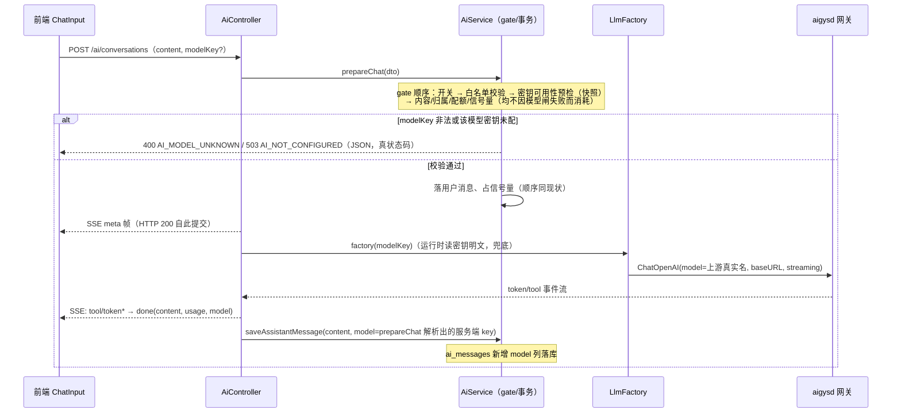
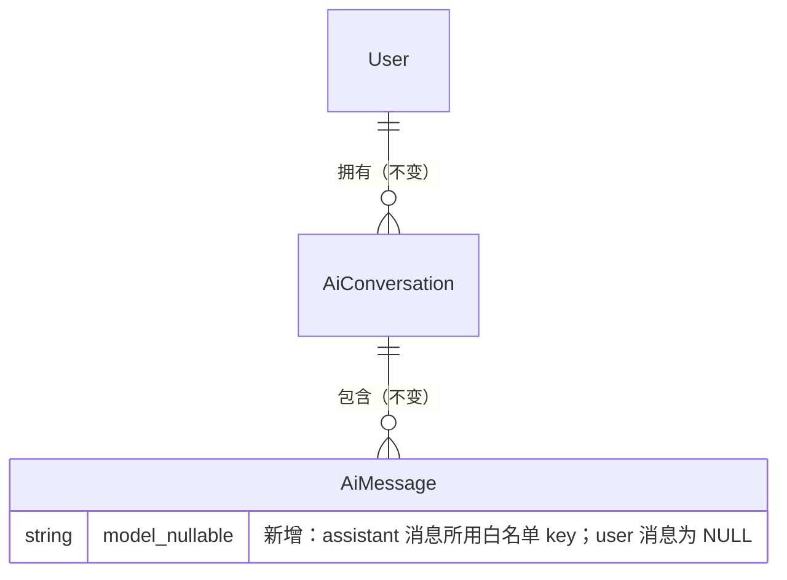

# 技术方案：AI 助手多模型白名单（对齐 LingJi）

> 动笔前已确认：核心场景——FXPlanner AI 助手从单模型升级为 LingJi 同款「多模型白名单」，用户可在 5 个聊天模型（GPT-4.1 / GPT-4.1 Mini / GPT-5.5 / Claude Sonnet 4.6 / Gemini 3 Flash）中切换，全部走 aigysd.com OpenAI 兼容网关，按上游模型区分密钥；量级预估——白名单为封闭集合（5 个），个人工具 QPS < 10，无新增高频路径；最大风险点——密钥按模型分变量后的降级语义变化，以及发消息链路 5 处（DTO → service → agent → factory → 前端）需贯通 modelKey。
>
> 本次方案涉及：新增 1 个接口（GET /api/ai/models）、修改 1 张表（`ai_messages` 加 1 列）、新增 5 个文件 / 修改 17 个文件 / 删除 3 个 env 变量，预计改动代码量约 800 行（后端 ~400 / 前端 ~230 / 测试 ~170 增量）。
>
> **裁剪说明**：按配置确认结果——包含接口契约（§4）；不含排期；含多视角审核（§10 审核意见与修订记录）。

## 1. 目标与量化约束

### 1.1 业务背景

FXPlanner AI 助手（`changes/ai-assistant/`，已上线）当前是单模型：`AI_LLM_API_KEY` / `AI_LLM_BASE_URL` / `AI_LLM_MODEL` 三变量注入一个 ChatOpenAI。为与 LingJi 保持一致的模型供给（同一 aigysd 网关、同一批模型、按模型分密钥），本次将「模型」升级为一等概念：后端白名单 + 模型列表接口 + 发消息携带 modelKey + 前端选择器 + 消息落库记录所用模型。

### 1.2 核心指标预估

| 指标项 | 预估值 | 依据/备注 |
| -------- | -------- | -------- |
| 模型规模 | 白名单封闭集合，5 个 | LingJi 同款（`ai-models.config.ts`），新增模型 = 改一行配置 |
| 数据规模 | `ai_messages` 单表 +1 列，行数不变 | 消息量级与现状一致（个人工具，万行级） |
| 并发压力 | <10 QPS，进程内并发上限不变（40） | 复用现有信号量与日配额，**不按模型分闸** |
| 响应要求 | SSE 流式，首字超时 30s 不变 | ChatOpenAI 参数随模型配置走（temperature/maxTokens） |
| 一致性等级 | 最终一致（消息落库记 model，无需跨表事务） | 单行 INSERT，事务边界与现状相同 |

### 1.3 约束条件

- **与 LingJi 同构但不照搬**：LingJi 的 `packages/contracts` 契约包、生图模型链路、多 provider adapter 体系、模型实例缓存**不引入**（理由见 §2）。差异点见 §2.2。
- **一次性破坏性 env 变更**：`AI_LLM_API_KEY` / `AI_LLM_BASE_URL` / `AI_LLM_MODEL` 删除，本地 `.env.local` 与 E2E 脚本需手工迁移（本地开发环境，可接受；无线上部署）。
- **密钥不出后端**：模型列表接口只返回展示子集（key/displayName/provider/capabilities/costTier/icon/description），`apiKeyEnvName`、baseURL、上游真实 model 名不进响应体（LingJi 同款纪律）。
- 白名单缩编（下线模型）时的服务端平滑回退（LingJi 的 fallback）**本期不实现**——FXPlanner 本期才引入 modelKey，无存量模型 key；前端残留自愈见 §5.2 model-selector。待首次缩编时再评估服务端回退（YAGNI）。

## 2. 方案选型与取舍

### 2.1 白名单配置的归属

| 维度 | 方案 A：后端 config 模块（选定） | 方案 B：新建 packages/contracts 共享包 |
| -------- | -------- | -------- |
| 与项目约定一致性 | ✅ AGENTS.md：共享类型以后端 DTO 为唯一来源 | ❌ 需新建 package + README + 双端依赖 |
| 前端消费方式 | 前端从 `GET /ai/models` 拉取，无需类型共享 | 类型共享，但 AI 域前端类型本就手写（`lib/api/chat.ts` 先例） |
| 维护成本 | 单文件 | 多一个包的构建/版本管理 |

**结论**：选 A。LingJi 用 contracts 包是因为它有生图/会话等多域共享契约；FXPlanner 的 AI 域前端类型已确立「手写 + 后端实现为准」模式（`clients/chat-web/lib/api/chat.ts:11-16` 注释），白名单唯一消费方是本服务与列表接口，无跨包共享诉求。

### 2.2 与 LingJi 的有意识差异（5 处）

| # | LingJi 做法 | FXPlanner 本期做法 | 理由 |
| ---- | ---- | ---- | ---- |
| 1 | 模型列表挂 AppController `GET /api/models`（公开） | 挂 AiController `GET /api/ai/models`（JWT 鉴权，类级守卫自动覆盖） | FXPlanner 的 `app.controller.ts` 仅做探针；AI 域端点全部鉴权是既有约定 |
| 2 | 消息/会话**不记录**所用模型 | `AiMessage` 加 `model` 列，done 帧回传 | 成本一列迁移；每条回复可溯源所用模型，为将来按模型统计铺路 |
| 3 | 非法 modelKey 静默回退默认模型 + console.warn | 非法 modelKey → 400 `AI_MODEL_UNKNOWN` | 本期无存量模型 key；静默回退会烧用户没选的模型的 token，且掩盖前端 bug |
| 4 | 前端选择状态 = useState + localStorage 手工同步 | zustand store + `persist` 中间件（partialize 仅 selectedModel） | FXPlanner chat 状态已是 zustand（`chat-store.ts`），选择器与发送 hook 跨组件共享，沿用现有形态 |
| 5 | 模型实例按 key 缓存（Map） | 维持每请求新建实例 | ChatOpenAI 无跨请求状态，缓存给测试 override 增加清理负担（现状 `llm-factory.ts` 注释明示） |

## 3. 核心设计

### 3.1 发消息链路时序图（modelKey 全链路贯通）



> 图例说明：实线为调用/数据流；两道模型相关闸（白名单、密钥可用性）**前置在 gate 内**、位于配额计数之前——配置类失败必须以 JSON 真状态码返回且不消耗配额/信号量/落库（审核修订：工厂内只保留兜底，不再承担降级主责）。

### 3.2 数据模型变更



增量 DDL（`prisma migrate dev --name add_ai_message_model` 生成；可空列，存量行 NULL，纯加列可回退）：

```prisma
model AiMessage {
  // ……现有字段不变
  model String? // assistant 消息所用的白名单 key（如 "gpt-4.1-mini"）；user 消息为 NULL
}
```

> 索引理由：无新索引——model 列仅用于单消息渲染与人工排查，无按模型查询的访问路径。

### 3.3 白名单配置（`services/chat/src/ai/ai-models.config.ts`，新增）

与 LingJi `ai-models.config.ts` 同构（模型 key、上游真实名、密钥变量、costTier、展示信息逐项对齐；**不含生图模型**）：

| key（对外） | model（上游真实名） | apiKeyEnvName | temperature/maxTokens | costTier | 展示 |
| -------- | -------- | -------- | -------- | -------- | -------- |
| `gpt-4.1` | `gpt-4.1` | `AI_PROVIDER_AIGYSD_API_KEY` | 0.7 / 8000 | 3 | GPT-4.1 🧠 |
| `gpt-4.1-mini` | `gpt-4.1-mini` | `AI_PROVIDER_AIGYSD_API_KEY` | 0.7 / 4000 | 1 | GPT-4.1 Mini ⚡（**默认**） |
| `gpt-5.5` | `gpt-5.6-luna` | `AI_PROVIDER_AIGYSD_API_KEY` | 0.7 / 8000 | 4 | GPT-5.5 🚀 |
| `claude-sonnet-4-6` | `claude-sonnet-4-6` | `AI_PROVIDER_AIGYSD_ANTHROPIC_API_KEY` | 0.7 / 8000 | 4 | Claude Sonnet 4.6 🎭 |
| `gemini-3-flash-preview` | `gemini-3-flash-preview` | `AI_PROVIDER_AIGYSD_GEMINI_API_KEY` | 0.7 / 8000 | 2 | Gemini 3 Flash ✨ |

统一 `provider: "openai"`（aigysd 网关暴露 OpenAI 兼容接口）、`capabilities: ["chat"]`（FXPlanner 无图片上传，不开放 `chat_vision`）。**条目不含 baseURL 字段**——五模型共用一个网关地址，由 `AI_RUNTIME_CONFIG.aigysdBaseUrl` 统一供给（见 §3.4，审核修订：避免模块加载期固化 env 常量，违反本项目「测试按实例注入」的装配纪律）。

模块导出：

- `CHAT_MODELS: Record<string, ChatModelConfig>`：白名单唯一事实源，条目经 zod schema 校验（LingJi `ChatModelConfigSchema` 裁剪版：provider/model/capabilities/apiKeyEnvName/temperature/maxTokens/costTier/displayName/description/icon，schema 同文件）。
- `resolveChatModelConfig(modelKey)`：白名单精确查找（无归一化、变形 key 一律 fail-closed）；未命中抛 `AiModelUnknownException`（§4.4）。
- `listChatModels()`：投影为列表接口响应子集（**不含** apiKeyEnvName/model/temperature/maxTokens），按 costTier 升序。
- `resolveProviderApiKey(envName)`：`process.env[envName]` 空串归 undefined（沿用 `ai-runtime-config.ts` 的 `orUndefined` 手法）。**仅在两处调用**：resolve 期快照可用性（§3.4）、工厂运行时兜底（§3.5）。
- 模块加载期断言 `AI_DEFAULT_CHAT_MODEL ∈ CHAT_MODELS`，不满足直接 throw（fail-fast，防 env 与白名单漂移；单测用 `vi.resetModules` + 动态 import 验证）。

### 3.4 env 与运行时配置（`config/env.ts` + `llm/ai-runtime-config.ts`）

| 变更 | 变量 | 类型/默认 | 说明 |
| ---- | ---- | ---- | ---- |
| ➕ | `AI_PROVIDER_AIGYSD_API_KEY` | optionalEnv | 主渠道密钥（gpt-4.1 / mini / 5.5 共用） |
| ➕ | `AI_PROVIDER_AIGYSD_BASE_URL` | optionalUrlEnv | `https://aigysd.com/v1` |
| ➕ | `AI_PROVIDER_AIGYSD_ANTHROPIC_API_KEY` | optionalEnv | claude-sonnet-4-6 专用 |
| ➕ | `AI_PROVIDER_AIGYSD_GEMINI_API_KEY` | optionalEnv | gemini-3-flash-preview 专用 |
| ➕ | `AI_DEFAULT_CHAT_MODEL` | default `"gpt-4.1-mini"` | 请求缺省 modelKey 时的回退锚点 |
| ➖ | `AI_LLM_API_KEY` / `AI_LLM_BASE_URL` / `AI_LLM_MODEL` | 删除 | 被白名单 + 分模型密钥取代 |
| ＝ | `AI_CHAT_ENABLED` / `AI_CHAT_HISTORY_WINDOW` / `AI_CHAT_MAX_CONCURRENCY` / `AI_DAILY_MESSAGE_QUOTA` / `AI_E2E_FAKE_STREAM` / `AI_E2E_FAKE_INTERVAL_MS` | 不变 | 与模型无关的运行参数原样保留 |

`AiRuntimeConfig` 接口调整（`resolveAiRuntimeConfig` resolve 期执行，保留「注入 → 建 app → 恢复」可测性）：

- 删除：`llmApiKey` / `llmBaseUrl` / `llmModel`。
- 新增 `aigysdBaseUrl?: string`：工厂统一网关地址（未配时 ChatOpenAI 走官方默认端点，语义同现状 `llmBaseUrl` 可选）。
- 新增 `modelKeyAvailability: Record<string, boolean>`：**resolve 期快照**——遍历 `CHAT_MODELS`，逐模型 `resolveProviderApiKey(config.apiKeyEnvName)` 是否可解析出非空值。快照而非请求期惰性读取，原因：集成测试在 `beforeAll` 建 app 后即恢复 env（`ai-chat.spec.ts:158-172` 先例），请求期读 `process.env` 会在 env 还原后失真，整个 spec 崩塌；快照手法与现状 `assertChatAvailable` 读 `this.config.llmApiKey` 同源。
- 新增派生 `hasConfiguredModel: boolean`：快照 Map 任一 true（全部模型降级判断）。

**降级三档语义**（替换原「单 key 判空」）：

1. `AI_CHAT_ENABLED=false` → 503 `AI_DISABLED`（不变）。
2. `hasConfiguredModel=false` → 全部 AI 端点 503 `AI_NOT_CONFIGURED`。
3. 请求模型在快照中不可用（其余可用）→ 该请求 503 `AI_NOT_CONFIGURED`，其余模型不受影响（分模型降级）。

`env.ts` 与 `resolveAiRuntimeConfig` 的默认值双处同步注释（现有约定）保持。

### 3.5 LLM 工厂签名改造（`llm/llm-factory.ts`）

```ts
// 前：export type AiLlmFactory = () => BaseChatModel;
export type AiLlmFactory = (modelKey: string) => BaseChatModel;
```

真实现：`resolveChatModelConfig(modelKey)` → `resolveProviderApiKey(config.apiKeyEnvName)`（**兜底**：gate 预检已挡住未配场景，此处再失败属 TOCTOU 极小窗口，抛出后由 controller 的 SSE 异常路径以 `AI_UPSTREAM_FAILED` error 帧收尾，固定文案、不泄露配置细节）→ `new ChatOpenAI({ model: config.model, apiKey, temperature, maxTokens, configuration: config.aigysdBaseUrl ? { baseURL } : undefined, maxRetries: 1, timeout: AI_LLM_FIRST_TOKEN_TIMEOUT_MS, streaming: true })`。

`AI_E2E_FAKE_STREAM=true` 时无视 modelKey 返回 FakeStreamingChatModel（E2E 不外呼语义不变）。DI token `AI_LLM_FACTORY` 与「工厂每请求返回新实例」约定不变，集成测试 override 点不变（签名顺延，ScriptedChatModel 记录收到的 modelKey 供断言）。

## 4. 接口契约

统一约定沿原方案 §4：全局前缀 `/api`、`{ success, data, message }` 包装、错误体 `{ code, message }` 固定文案、`JwtAuthGuard`；开发完成后 `bun run generate:api` 刷新契约快照。

**modelKey 校验规则（两层）**：① DTO 形状层——`@IsOptional() @IsString() @MaxLength(64) @Matches(/^[a-zA-Z0-9._-]+$/)`（白名单字符集：防换行/控制符伪造日志行，变形 key 一律 fail-closed）；② 语义层——service gate 内白名单精确查找（§3.3），不在白名单 → 400 `AI_MODEL_UNKNOWN`。缺省时服务端回退 `AI_DEFAULT_CHAT_MODEL`。

### 4.1 GET /api/ai/models（新增）

| 项 | 内容 |
| ---- | ---- |
| 路径 | `GET /api/ai/models` |
| 入参 | 无（FXPlanner 全模型具备 `chat` 能力，不设 capability 过滤参数） |
| 出参 | `data: { items: [{ key, displayName, provider, capabilities, costTier, icon, description }] }`，按 costTier 升序 |
| 约束 | 鉴权（挂 AiController 级守卫）；幂等只读；响应**不含** apiKeyEnvName/baseURL/上游 model 名/temperature/maxTokens；密钥全未配时**仍 200 返回全量列表**（可用性在发消息时判定，与 LingJi 一致） |

### 4.2 既有流式端点扩展（2 个）

| 项 | 内容 |
| ---- | ---- |
| 路径 | `POST /api/ai/conversations`、`POST /api/ai/conversations/:id/messages` |
| 入参变更 | body 增加 `modelKey?: string`（校验规则见上方两层说明） |
| 出参变更 | `done` 帧载荷增加 `model: string`（本条回复实际使用的白名单 key = 请求值或默认回退值，**以服务端 resolve 结果为准**，不透传客户端原值） |
| 约束 | 限流/忙碌语义不变；gate 顺序调整为：开关 → 白名单校验 → 密钥可用性预检 → 内容校验 → 归属校验 → 配额 → 信号量——模型相关两道闸位于配额之前，失败时不计数配额、不占信号量、不落消息 |

### 4.3 既有只读端点扩展（1 个）

| 项 | 内容 |
| ---- | ---- |
| 路径 | `GET /api/ai/conversations/:id/messages` |
| 出参变更 | `items[]` 每项增加 `model: string \| null`（user 消息恒 null；存量 assistant 消息 null） |

### 4.4 错误码

| code | HTTP | 触发 | 文案 |
| ---- | ---- | ---- | ---- |
| `AI_MODEL_UNKNOWN` | 400 | modelKey 非白名单成员（新增） | 「该模型不可用，请重新选择」 |
| `AI_NOT_CONFIGURED` | 503 | 语义扩展：①全部模型未配密钥；②请求模型的密钥未配（gate 内快照预检，真 JSON 状态码） | 沿用现有固定文案 |
| `AI_UPSTREAM_FAILED` | 502（SSE error 帧） | 工厂兑底密钥解析失败（TOCTOU 兜底）或上游异常，固定文案不变 | 不变 |
| 其余 7 个错误码 | — | 不变 | 见 `changes/ai-assistant/技术方案.md` §4 |

## 5. 代码影响范围

### 5.1 后端

<pre>
services/chat/
├── prisma/
│   ├── <font color="#92400e">schema.prisma</font> (M) [注: AiMessage 加 model String? 列，其余不动]
│   └── migrations/<font color="#166534">xxxx_add_ai_message_model/</font> (A) [注: prisma migrate dev 生成，纯加列可回退]
├── src/
│   ├── <font color="#92400e">config/env.ts</font> (M) [注: §3.4 五增三删；AI 注释块改写为 aigysd 分模型密钥说明]
│   └── ai/
│       ├── <font color="#166534">ai-models.config.ts</font> (A) [注: §3.3 白名单唯一事实源：zod schema + CHAT_MODELS + resolveChatModelConfig/listChatModels/resolveProviderApiKey + 默认模型启动断言]
│       ├── <font color="#166534">ai-models.config.spec.ts</font> (A) [注: 单测，见 §8.1]
│       ├── <font color="#92400e">ai.errors.ts</font> (M) [注: 新增 AiModelUnknownException（400 AI_MODEL_UNKNOWN）]
│       ├── <font color="#92400e">ai.service.ts</font> (M)
│       │   ├── <font color="#ca8a04">assertChatAvailable()</font> [注: 单 key 判空改为快照 hasConfiguredModel]
│       │   ├── <font color="#ca8a04">prepareChat()</font> [注: gate 插入两道模型闸（白名单 → 快照密钥预检），位于配额前；返回解析后 config（含服务端权威 key）供后续传递]
│       │   ├── <font color="#ca8a04">saveAssistantMessage()</font> [注: 落库增加 model 参数（取 prepareChat resolve 值，非客户端原值）]
│       │   └── <font color="#ca8a04">listMessages()</font> [注: 出参 projection 加 model]
│       ├── <font color="#92400e">ai-agent.service.ts</font> (M) [注: StreamReplyParams 加 modelKey；streamReply 内 llmFactory(params.modelKey)；done 帧载荷加 model]
│       ├── <font color="#92400e">ai.controller.ts</font> (M)
│       │   ├── <font color="#16a34a">listModels()</font> [注: GET /ai/models，listChatModels() 投影 + @ApiOperation(summary/description，swagger.spec 硬约束)]
│       │   ├── <font color="#ca8a04">createWithMessage()</font> / <font color="#ca8a04">sendMessage()</font> [注: dto.modelKey 透传 prepareChat/streamReply]
│       │   └── <font color="#ca8a04">streamReply()</font> [注: done 帧 writeFrame 载荷加 model]
│       ├── dto/<font color="#92400e">ai.dto.ts</font> (M) [注: SendMessageDto 加 modelKey?: string（§4.2 两层校验 + @ApiProperty）]
│       └── llm/
│           ├── <font color="#92400e">llm-factory.ts</font> (M) [注: §3.5 签名 (modelKey) => BaseChatModel；baseURL 取 runtime config.aigysdBaseUrl；密钥解析降为兑底]
│           ├── <font color="#166534">llm-factory.spec.ts</font> (A) [注: 单测，见 §8.1]
│           └── <font color="#92400e">ai-runtime-config.ts</font> (M) [注: 删 llm 三元组，加 aigysdBaseUrl + modelKeyAvailability（resolve 期快照）+ hasConfiguredModel；默认值与 env.ts 双处同步注释]
└── test/api/<font color="#92400e">ai-chat.spec.ts</font> (M) [注: 工厂 override 签名适配 + 默认 env 注入改名 + §8.2 新场景]
</pre>

### 5.2 前端

<pre>
clients/chat-web/
├── lib/
│   ├── api/<font color="#92400e">chat.ts</font> (M) [注: AI 域类型延续手写模式（chat.ts:11-16 先例）]
│   │   ├── <font color="#16a34a">ChatModelSummary / ModelsListData</font> [注: §4.1 出参类型]
│   │   ├── <font color="#ca8a04">AiMessage</font> [注: 加 model?: string | null]
│   │   ├── <font color="#ca8a04">AiStreamEvent</font> [注: done 帧载荷加 model: string]
│   │   ├── <font color="#ca8a04">chatApi.listModels()</font> [注: GET /ai/models，走统一 apiClient]
│   │   └── <font color="#ca8a04">streamMessage()</font> [注: params 加 modelKey?]
│   ├── api/<font color="#92400e">chat.spec.ts</font> (M) [注: done 帧 fixture 加 model 字段，解析用例同步]
│   ├── hooks/
│   │   ├── <font color="#166534">use-models.ts</font> (A) [注: react-query useModels()，queryKey ["ai","models"]，staleTime 5min（LingJi 同值）]
│   │   ├── <font color="#166534">use-models.spec.tsx</font> (A) [注: 单测，见 §8.4]
│   │   └── <font color="#92400e">use-chat.ts</font> (M) [注: send() 从 store 读 selectedModel 传入 streamMessage（null 则不传）；done 帧随 assistantMessage 缓存自然携带 model]
│   └── stores/<font color="#92400e">chat-store.ts</font> (M) [注: 加 selectedModel: string | null + setSelectedModel，zustand persist 落 localStorage("preferred-chat-model")（LingJi 同名 key）；partialize 仅持久化 selectedModel——运行时态（streamingIds/streamTexts/errors 等）禁止落盘，防刷新后 selectAnyStreaming 恒真锁死输入框]
└── components/business/chat/
    ├── <font color="#166534">model-selector.tsx</font> (A) [注: Button 触发 DropdownMenu（components/ui/dropdown-menu.tsx 已有）：图标+displayName+costTier 徽标；受控组件读写 store；自愈逻辑：列表加载后发现 selectedModel 不在 items 中则 setSelectedModel(null)（防白名单缩编后 localStorage 残留）]
    ├── <font color="#92400e">index.ts</font> (M) [注: 桶导出 ModelSelector]
    ├── <font color="#92400e">chat-input.tsx</font> (M) [注: 输入区左侧嵌入 ModelSelector（流式禁用）]
    └── <font color="#92400e">message-bubble.tsx</font> (M) [注: assistant 气泡下角小字显示 model → displayName（列表缺失时显示原始 key，LingJi 同款回退；null 不显示）]
</pre>

### 5.3 环境与脚本（实施时同步，防三删变量残留）

<pre>
FXPlanner-new/
├── <font color="#92400e">.env.local.example</font> (M) [注: AI 段改写——删 AI_LLM_* 三行，加 aigysd 五变量文档（值留空）+ AI_DEFAULT_CHAT_MODEL]
├── e2e/scripts/<font color="#92400e">run-e2e-tests.sh</font> (M) [注: :97 export AI_LLM_API_KEY=e2e-dummy 改为 AI_PROVIDER_AIGYSD_API_KEY=e2e-dummy（E2E 仍需过降级 gate）]
├── e2e/modules/<font color="#92400e">14-ai-chat.spec.ts</font> (M) [注: :23 头部 AI_LLM_API_KEY 注释同步 + §8.3 新场景]
└── services/chat/<font color="#92400e">.env.local</font> (M) [注: 本机真实值：AI_PROVIDER_AIGYSD_API_KEY / _BASE_URL=https://aigysd.com/v1 / _ANTHROPIC_API_KEY / _GEMINI_API_KEY / AI_DEFAULT_CHAT_MODEL=gpt-4.1-mini；与 LingJi services/chat/.env.development 同源]
</pre>

### 5.4 测试文件树（文件与被测对象一一对应）

<pre>
services/chat/
├── src/ai/
│   ├── <font color="#166534">ai-models.config.spec.ts</font> (A) [注: 测试白名单不变量，见 §8.1]
│   └── llm/<font color="#166534">llm-factory.spec.ts</font> (A) [注: 测试工厂按 modelKey 构造，见 §8.1]
└── test/api/<font color="#92400e">ai-chat.spec.ts</font> (M) [注: 新增模型场景用例，见 §8.2]
clients/chat-web/
├── lib/hooks/<font color="#166534">use-models.spec.tsx</font> (A) [注: useModels 拉取与缓存]
├── lib/hooks/<font color="#92400e">use-chat.spec.tsx</font> (M) [注: send 携带 modelKey 等用例]
└── lib/api/<font color="#92400e">chat.spec.ts</font> (M) [注: done 帧 model 解析]
e2e/modules/<font color="#92400e">14-ai-chat.spec.ts</font> (M) [注: 新增 E2E 场景 6/7，见 §8.3]
</pre>

## 6. 可靠性保障

- **超时与重试**：不变（首字 30s、整流硬超时 120s、maxRetries 1）；ChatOpenAI 的 temperature/maxTokens 改随白名单配置。
- **降级**：三档——总开关关 → 503 `AI_DISABLED`；全部模型未配密钥（resolve 快照）→ 503 `AI_NOT_CONFIGURED`；单模型密钥缺失 → 该模型请求在 gate 内 503 `AI_NOT_CONFIGURED`（真 JSON，不烧配额），其余模型不受影响；工厂兑底失败（TOCTOU）→ SSE error 帧 `AI_UPSTREAM_FAILED` 固定文案。
- **回滚机制**：代码回滚即恢复单模型版本；`ai_messages.model` 为可空加列，旧代码不读写该列，DDL 向后兼容（无数据回填）；`.env.local` 保留旧值注释一行便于手工切回。
- **存量数据**：存量消息 `model = NULL`，前端渲染跳过模型标签；无回填脚本（历史消息的模型本就无从考证，LLM 不补数据）。

## 7. 可观测性

- **日志**：白名单校验失败（400）打 warn（含 modelKey——DTO 字符集校验已保证无换行/控制符，不可伪造日志行；不含密钥）；快照判定密钥缺失（503）打 warn（含 modelKey 与 apiKeyEnvName 变量名）；工厂兑底失败打 error；done 帧日志附 model（现有 usage 日志顺带）。
- **禁止**：日志出现密钥明文；循环 token 帧内打日志（现有纪律）。

## 8. 测试策略

> 质量红线：实施必跑通全部相关测试 0 failed。E2E 环境继续用 `AI_E2E_FAKE_STREAM=true`（不外呼）；工厂假流式分支无视 modelKey，保证 E2E 稳定。

### 8.1 单元测试

| 测试文件 | 被测对象 | 覆盖点 |
| -------- | -------- | -------- |
| `src/ai/ai-models.config.spec.ts` (A) | 白名单配置 | ① 白名单恰为 5 个 key、与 LingJi 逐一对应；② key 唯一、displayName 唯一；③ claude/gemini 分别绑定 ANTHROPIC/GEMINI 专用 apiKeyEnvName（LingJi 同款断言）；④ costTier ∈ 1..5；⑤ `resolveChatModelConfig` 非法/变形 key（大小写、空白）抛 `AiModelUnknownException`（fail-closed）；⑥ `listChatModels()` 投影不含 apiKeyEnvName/model/temperature/maxTokens；⑦ `resolveProviderApiKey` 空串归 undefined；⑧ 默认模型断言：`AI_DEFAULT_CHAT_MODEL` 指向不存在 key 时模块加载 throw（`vi.resetModules` + 动态 import 手法） |
| `src/ai/llm/llm-factory.spec.ts` (A) | 工厂 | ① `factory("gpt-5.5")` 返回 ChatOpenAI 且 model=`gpt-5.6-luna`（key≠上游名的解耦）；② temperature/maxTokens 随配置；③ baseURL 来自注入的 runtime config.aigysdBaseUrl（构建期注入可验证，未配时不传 configuration）；④ 密钥从 envName 对应变量读取；⑤ 非法 key 抛 `AiModelUnknownException`；⑥ 密钥缺失抛 `AiNotConfiguredException`（兑底路径）；⑦ fake 分支无视 modelKey 返回 FakeStreamingChatModel |

### 8.2 接口集成测试（`test/api/ai-chat.spec.ts` 扩展）

> **装配变更**（审核修订）：① override `AI_LLM_FACTORY` 适配新签名 `(modelKey) => ScriptedChatModel`，假模型记录收到的 modelKey 供断言；② 默认 env 注入 `AI_LLM_API_KEY: "test-llm-key"`（ai-chat.spec.ts:233）改为 `AI_PROVIDER_AIGYSD_API_KEY`（否则 gate 快照判全未配、整 spec 503）；③ 密钥相关场景走「注入 → 建 app → 恢复」手法，且「全未配」用例必须显式 `delete process.env.AI_PROVIDER_AIGYSD_*`——本地 `.env.local` 含真实 aigysd key，dotenv 两层加载会污染断言（防假绿）。

| 接口 | 场景 | 预期 |
| ---- | ---- | ---- |
| GET /api/ai/models | 未登录 | 401 |
| GET /api/ai/models | 正常 | 200，items 恰 5 项按 costTier 升序；序列化断言不含 `apiKeyEnvName`/`baseURL`/`model`/`temperature`/`maxTokens` 字样 |
| GET /api/ai/models | 密钥全未配 | **仍 200 返回 5 项**（列表是白名单投影，可用性在发消息时判定） |
| POST /ai/conversations | 带 modelKey="gpt-5.5" | 200 SSE 全帧序；工厂收到 modelKey="gpt-5.5"；done 帧 model="gpt-5.5"；助手消息落库 model="gpt-5.5" |
| POST /ai/conversations | 不带 modelKey | 工厂收到 AI_DEFAULT_CHAT_MODEL；done 帧与落库 model 同 |
| POST /ai/conversations | modelKey="gpt-4o"（非白名单） | 400 `AI_MODEL_UNKNOWN`；配额计数不变、无消息落库、无信号量占用（gate 最前） |
| POST /ai/conversations | modelKey 含换行/空格/中文字符 | 400（ValidationPipe @Matches 拦截，日志不可伪造） |
| POST /ai/conversations | modelKey 超长（>64） | 400（ValidationPipe） |
| POST /ai/conversations/:id/messages | 追问带合法/非法 modelKey | 合法：透传工厂、done 帧 model 正确；非法：400 `AI_MODEL_UNKNOWN`（追问端点同闸） |
| POST /ai/conversations | 请求模型密钥未配（建 app 前仅删 ANTHROPIC key） | 503 `AI_NOT_CONFIGURED`（JSON 真 503，gate 预检）；配额不消耗；改发 gpt-4.1-mini 仍成功（分模型降级） |
| POST /ai/conversations | 全部密钥未配（显式 delete 四个 aigysd 变量后建 app） | 503 `AI_NOT_CONFIGURED` |
| GET /ai/conversations/:id/messages | 混合存量（model=null）与新消息 | items 含 model 字段，存量 null |

### 8.3 E2E 测试（`e2e/modules/14-ai-chat.spec.ts` 扩展）

> **限流预算核算**（审核修订）：路由级 @Throttle 硬编码 5/min/IP（ai.controller.ts:35），现有 spec 头部注释「全 spec 严格 4 次发送」为 retries 留余量。新增仅 1 次发送（场景 6 走**追问端点**，与新建端点分别计数）；场景 7 弱化为纯 UI 断言（0 次发送），服务端默认回退已由 §8.2 集成用例覆盖。实施时更新 spec 头部预算注释为「新建 4 次 + 追问 1 次」并核对分布。

**场景 6：切换模型发送与持久化**

1. 登录 → 进入 AI 助手 → 输入区打开模型选择器
2. 断言：下拉列出 5 个模型，当前项为「GPT-4.1 Mini」
3. 选择「GPT-5.5」→ 发送消息（追问端点）
4. 断言：流式回复完成；该条 assistant 气泡角标显示「GPT-5.5」；刷新页面后角标仍在（落库回读）、选择器仍显示「GPT-5.5」（persist 恢复，验证 partialize）

**场景 7：白名单缩编自愈（0 发送）**

1. localStorage 写入非法 modelKey（`preferred-chat-model="gpt-4o"`）→ 刷新 → 打开选择器
2. 断言：选择器回退显示默认「GPT-4.1 Mini」（model-selector 自愈逻辑生效）

### 8.4 前端单测（lib/hooks，沿项目「前端只测 lib/hooks」约定）

| 测试文件 | 覆盖点 |
| -------- | -------- |
| `lib/hooks/use-models.spec.tsx` (A) | useModels 调用 chatApi.listModels、queryKey 与 staleTime 5min |
| `lib/hooks/use-chat.spec.tsx` (M) | ① send() 读 store selectedModel 并传入 streamMessage；② 未选择时（null）不传 modelKey；③ done 帧带 model 时 assistantMessage 缓存含 model；④ 400 `AI_MODEL_UNKNOWN` 错误展示（防御 localStorage 残留非法 key 直发） |
| `lib/api/chat.spec.ts` (M) | done 帧 fixture 加 model 字段后的解析与透传 |

## 9. 自检清单

- [x] 量化指标齐全（§1.2），选型基于量级与项目约定（§2.1）
- [x] 只写增量/变更，未复制 LingJi 系统（contracts 包/生图/adapter/实例缓存均显式裁剪并注明理由）
- [x] 无新中间件、无新依赖（zod/react-query/zustand/dropdown-menu 均为库存）
- [x] 核心流程有 Mermaid 时序图（§3.1，一图一核心）+ ER 图（§3.2）
- [x] 覆盖异常兑底（§6 三档降级 + TOCTOU 兑底）、回滚（可空加列向后兼容）、可观测性（§7）
- [x] 代码影响范围树状清单（§5.1–5.4），A/M/D 清晰，`<pre>` 对齐 + `<font color>` 上色，文件深色方法浅色；含 env/脚本残留面（§5.3）
- [x] 测试策略分单元/接口集成/E2E 三类（§8.1–8.4），测试文件与被测对象一一对应，E2E 按用户路径编号带断言，限流预算已核算
- [x] 已完成项目现状调研（FXPlanner ai 模块全链路 + LingJi 白名单架构双线核对）
- [x] 审核意见逐条处理（§10）

## 10. 审核意见与修订记录

> 多视角审核（架构 / 安全边界 / 测试三个独立 subagent）于 2026-02-11 执行，三份原始意见逐条处理如下。

### 10.1 实施结果与已知问题（2026-02-11 实施完成后回填）

**实施结果**：

| 验证层 | 结果 |
| ---- | ---- |
| 接口测试（test/api/ai-chat.spec.ts） | 27/27 通过（含形状层/语义层 400 分层断言修正） |
| 后端全量 | 61 文件 / 762 passed / 0 failed |
| 前端全量 + typecheck | 24 文件 / 231 passed，tsc 干净 |
| 手动全链路（curl 新建+追问+modelKey 切换，读完整 SSE） | 通过 |
| E2E | T-AI-001/002/005/007 稳定绿（含发送→流式→落库→XSS→停止→缩编自愈）；T-AI-003/004/006 见已知问题 |

**实施中发现并修复的额外问题**（均超出原方案预期）：

1. **`import type` 摧毁 emitDecoratorMetadata（关键）**：ai.controller.ts 原 `import type { SendMessageDto }` 被运行时完全擦除 → tsc 的 design:paramtypes emit 全局 Function → ValidationPipe 收到 metatype=Function → plainToInstance(Function, body) 返回匿名函数 → dto.content 恒 undefined → 发送恒 400 AI_MESSAGE_EMPTY。**vitest（esbuild 无元数据）对该缺陷完全假绿**，仅真机 nest build（tsc）暴露。修复：DTO 改运行时 import + @ApiBody/@ApiExtraModels 提供运行时引用（transaction 模块同款先例）。**可复用规则：被 @Body/@Query 参数装饰器标注的 DTO 类禁止 import type**。
2. **双层校验响应体分层**：修复 1 后 DTO 形状校验（@Matches/@MaxLength）首次真机生效，形状层 400 响应体为全局 ValidationPipe 既有格式（{message:[], statusCode}），与语义层 400 的 {code, message} 不同。spec 断言已按层对齐（§8.2 对应用例名已注明）。

**已知问题（E2E 间歇性 SSE 断连，暂缓）**：

- **现象**：本地 dev 环境（tsc watch + Turbopack + headless Chromium 同机）下，流式回复进行中（~2s）偶发客户端断连（服务端 res close → abort，agent streamEvents 抛 DOMException "This operation was aborted"），前端静默（无错误 UI，乐观消息保留，assistant 未落库），T-AI-003/004/006 间歇失败；同批 T-AI-002/005 发送链路稳定绿。
- **已排除**：功能代码缺陷（手动 curl 全流正常、接口测试 27 绿、组合跑多次全绿）、auto-screenshot fixture 网络拦截、限流误伤（路由级计数在预算内）、假流模型异常（interval=0ms 时全绿）。
- **证据特征**：失败仅出现在「页面刷新/切换会话后」的流式请求；同机三 dev 服务（tsc watch、Turbopack、Playwright）高负载时段失败率升高。
- **结论**：判断为本地 dev 环境时序噪音（与多模型改造无因果——004 不含 modelKey 链路也会间歇挂）。**后续跟进**：①机器空闲时段全量复跑 T-AI 七用例确认；②若仍复现，在前端 use-chat 对「非用户主动 stop 的 abort」增加错误提示与自动重试一次；③持续存在则升级排查 Turbopack dev 的 HMR 连接管理。

| # | 来源 | 审核意见（引用章节） | 处理方式 | 说明 |
| -- | -- | -- | -- | -- |
| 1 | 架构🔴+安全🔴+测试🔴（同一根因） | 「单模型密钥未配→503」在流式端点不可达：工厂在 HTTP 200 + meta 帧之后才被调，异常只会变 SSE error 帧；且 gate 已烧配额/信号量/落库 | **已修改** | 密钥可用性预检上移进 prepareChat gate（白名单后、配额前，§3.1/§3.4/§4.2/§4.4）；工厂解析降为 TOCTOU 兑底（§3.5），失败走 `AI_UPSTREAM_FAILED` 帧不泄配置细节 |
| 2 | 测试🔴 | `hasAnyConfiguredModel` 若请求期惰性读 process.env，集成测试 env 恢复后全 spec 崩塌 | **已修改** | 改为 resolve 期快照 `modelKeyAvailability` + 派生 `hasConfiguredModel`（§3.4），与现状「注入→建 app→恢复」手法同源 |
| 3 | 测试🔴 | E2E 限流预算：新增场景致同分钟 6 次发送必触 429 | **已修改** | 场景 6 改走追问端点（路由级分别计数）仅 +1 次发送；场景 7 弱化为纯 UI 断言 0 发送；要求实施时更新 spec 头部预算注释（§8.3） |
| 4 | 架构🟡 | baseURL 模块加载期固化违反本项目「测试按实例注入」装配纪律 | **已修改** | 白名单条目删 baseURL 字段，改由 `AI_RUNTIME_CONFIG.aigysdBaseUrl` 统一供给（§3.3/§3.4/§3.5），工厂单测可注入验证 |
| 5 | 架构🟡 | 集成测试默认 env 注入点遗漏（ai-chat.spec.ts:233 AI_LLM_API_KEY）；「全未配」用例会被本地 .env.local 真实 key 污染假绿 | **已修改** | §8.2 装配变更明确：注入改名 + 「全未配」显式 delete 四个 aigysd 变量 |
| 6 | 架构🟡 | zustand persist 未声明 partialize，全量落盘会锁死输入框 | **已修改** | §5.2 明示 partialize 仅持久化 selectedModel；E2E 场景 6 步骤 4 增加 persist 恢复断言 |
| 7 | 安全🟡 | modelKey 可注入换行伪造日志 | **已修改** | DTO 增 `@Matches(/^[a-zA-Z0-9._-]+$/)` 字符集校验（§4.2），§8.2 加对应用例；§7 日志说明同步 |
| 8 | 安全🟡 | E2E 脚本 env 残留（run-e2e-tests.sh:97 导出 AI_LLM_API_KEY） | **已修改** | 纳入 §5.3：脚本导出改名 + 14-ai-chat.spec.ts:23 注释同步 |
| 9 | 安全🟢 | 落库 model 的权威来源未写明 | **已修改** | §3.1/§5.1 明确取 prepareChat resolve 后的服务端 key，非客户端原值 |
| 10 | 测试🟡 | 追问端点 modelKey 无任何用例 | **已修改** | §8.2 加追问端点合法/非法两行用例 |
| 11 | 测试🟡 | use-models.ts 无单测；done 帧 fixture 需同步未认领 | **已修改** | §5.4/§8.4 加 use-models.spec.tsx (A) 与 chat.spec.ts (M) |
| 12 | 测试🟢 | 「模块加载期 throw」需 vi.resetModules 手法；前端防 localStorage 残留 | **已修改** | §8.1⑧ 注明手法；§5.2 model-selector 自愈逻辑 + §8.3 场景 7 + §8.4 错误展示用例 |
