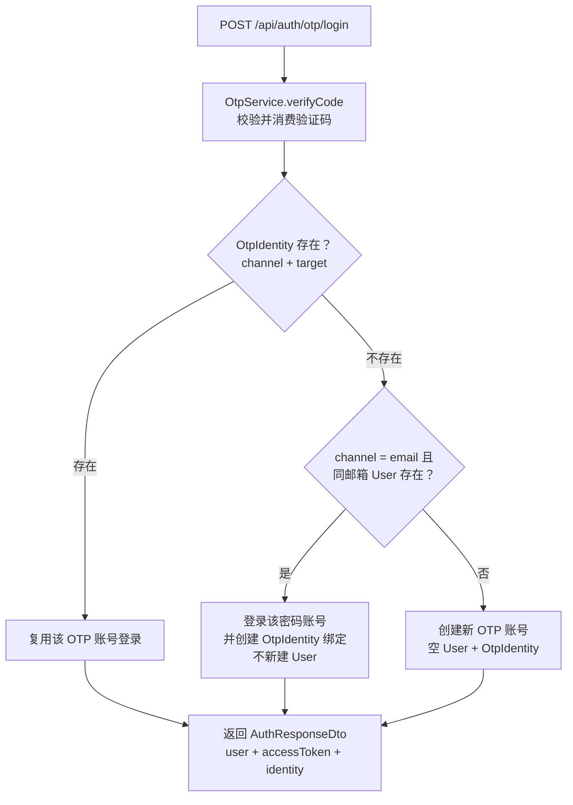

# 技术方案：OTP 登录绑定同邮箱密码账号（仅绑定不迁移）

> 依据：产品决策「仅绑定不迁移」（2026-06 拍板，见对话记录）。
> 范围：仅 `services/chat/src/auth/` 及其测试。**不改 schema、不做数据迁移、不动前端契约。**

## 1. 现状与问题

### 1.1 数据模型现状（`services/chat/prisma/schema.prisma`）

- `User.passwordHash`（schema.prisma:13）：可空。**密码账号 = 有 `email` + `passwordHash` 的 User**（仅 `register` 会写入 email/passwordHash，见 auth.service.ts:35）。
- `OtpIdentity`（schema.prisma:54-63）：`@@unique([channel, target])`，指向 `userId`。**OTP 账号 = `email`/`passwordHash` 均为 null、仅靠 OtpIdentity 标识的 User**。
- `OtpChallenge`：验证码 challenge，验证通过后在 `OtpService.verifyCode` 中消费，返回 `{ channel, target }`（已归一化：邮箱小写、手机 E.164）。

### 1.2 问题行为（`services/chat/src/auth/auth.service.ts:82-137`）

`loginWithOtp` 当前逻辑：查到 `OtpIdentity(channel, target)` → 复用其 user；查不到 → **无条件新建空 User + OtpIdentity**（auth.service.ts:114）。同一邮箱先密码注册、后 OTP 登录，会产生第二个独立 User，用户数据分裂。`auth.controller.ts:37` 的接口描述「不会与相同邮箱的 OTP 账号自动绑定或合并」即是对此现状的描述，已不满足产品预期。

## 2. 产品决策与目标行为

**仅绑定不迁移**——`loginWithOtp` 验证通过后按以下优先级判定：

1. 已有 `OtpIdentity(channel, target)` → 复用该 OTP 账号（维持现状）；
2. 否则 `channel=email` 且存在同邮箱 User（即密码账号）→ **登录该账号并绑定此 OTP 标识**（新建 `OtpIdentity` 指向该 User），不再创建新 User；
3. 否则创建新 OTP 账号（维持现状）。

不做历史重复账号的数据合并/迁移（项目未上线、无存量用户）。

## 3. 数据模型变更

**无。** 绑定只是为已有密码账号新增一条 `OtpIdentity` 记录；`OtpIdentity` 的 `userId` 外键与 `@@unique([channel, target])` 约束天然支持"一个 User 多个 OTP 标识"。不需要 migration。

> 依据说明：`User.email` 带 unique 约束，且只有 `register`（必带密码）会写 email，因此「email 匹配到的 User」必然是密码账号，无需额外过滤 `passwordHash IS NOT NULL`。

## 4. 核心流程（绑定判定）

实现要点（`auth.service.ts` `loginWithOtp`）：

- 绑定判定放在 `$transaction` 内、`otpIdentity.findUnique` 二次确认之后，与现有「先查再建 + P2002 兜底重查」的并发防护保持一致：并发下若两个请求同时走到绑定/建号，`@@unique([channel, target])` 冲突抛 P2002 → catch 中重查 identity 复用，不会产生重复 User。
- email 匹配使用 `verifyCode` 返回的已归一化 target（小写），与 `register` 的邮箱归一化（auth.service.ts:151）一致，不会因大小写错过匹配。

## 5. 边界情况

| 场景 | 行为 |
| --- | --- |
| 同邮箱既是 OTP 账号又有密码账号（先 OTP 登录、后 register 同邮箱） | `OtpIdentity` 优先级最高 → 继续复用 OTP 账号（规则 1 先于规则 2）。两账号并存，符合「仅绑定不迁移」，不做合并。 |
| OTP 账号「补设密码」 | 当前不存在设置密码接口，注册会创建新账号。**明确不做**（无产品决策支撑）。 |
| phone 渠道 OTP 登录 | `User` 无手机号列，phone 不可能匹配密码账号 → 恒走规则 3（新建）。绑定判定仅对 `channel=email` 生效。 |
| phone/email 交叉匹配（如手机号恰好等于邮箱串） | channel 参与唯一约束与匹配条件，email 渠道只查 `User.email`，不会与 phone 标识混淆。 |
| 绑定后 `loginWithOtp` 返回值 | `AuthResponseDto` 结构不变：`user`（此时 `user.email` 为该邮箱，非 null）、`accessToken`、`identity`（本次使用的 OTP 标识）。语义变化仅在 `user` 指向的对象：从「新建空账号」变为「既有密码账号」。 |
| 密码登录（`/api/auth/login`） | 不受影响：绑定不改 `passwordHash`，`login` 按 email 查同一 User，绑定前后均正常。 |
| 绑定后再次 OTP 登录 | `OtpIdentity` 已存在 → 规则 1 复用密码账号，幂等。 |

## 6. API 契约与 Swagger

- 响应结构向后兼容：`AuthResponseDto` 不增不减字段，不改 clients/。
- 更新 Swagger 描述（`auth.controller.ts`）：
  - `register`（:37）：删除「不会与相同邮箱的 OTP 账号自动绑定或合并」，改为说明同邮箱后续 OTP 登录会绑定到本账号；
  - `otp/login`（:108）：由「创建或复用独立 OTP 账号」改为三级判定描述（复用 / 绑定 / 新建）。

## 7. 测试设计

### 7.1 单元测试（`src/auth/auth.service.otp.spec.ts`，mock prisma）

| # | 用例 | Given-When-Then |
| --- | --- | --- |
| U1 | email 命中密码账号 → 绑定 | Given email 渠道、`otpIdentity.findUnique` 返回 null、`user.findUnique` 返回密码账号；When `loginWithOtp`；Then 不调用 `user.create`，`otpIdentity.create` 以密码账号 userId 创建，返回 `user.id` = 密码账号 id、`user.email` = 该邮箱 |
| U2 | 无匹配 → 新建独立 OTP 账号（回归） | Given `user.findUnique` 返回 null；When `loginWithOtp`；Then `user.create` + `otpIdentity.create`（空账号），返回 `user.email` = null |
| U3 | 已有 identity → 复用（回归） | Given `otpIdentity.findUnique` 返回 identity+user；When `loginWithOtp`；Then 不查密码账号、不建任何记录，返回同一 user |
| U4 | phone 渠道不匹配密码账号 | Given phone 渠道、identity 不存在；When `loginWithOtp`；Then 不调用 `user.findUnique`，走新建路径 |

### 7.2 接口测试（`test/api/auth-otp-bind.spec.ts`，真实 DB + AppModule，fake OTP channel 捕获验证码；共享工具进 `test/helpers/`）

| # | 用例 | Given-When-Then |
| --- | --- | --- |
| A1 | 密码账号 + 同邮箱 OTP 登录 → 登录原账号 | Given 已通过 `/auth/register` 创建密码账号（email X）；When 向 X 发验证码并 `/auth/otp/login`；Then 返回 200，`data.user.id` = 注册账号 id，`data.user.email` = X，`data.identity` = { email, X }；DB 中 email=X 的 User 只有 1 个，`otpIdentity(email, X)` 存在且指向该账号 |
| A2 | 纯 OTP 账号再次登录 → 复用（回归） | Given 全新邮箱 Y 首次 OTP 登录创建账号 U1（email null）；When 再次向 Y 发码并登录；Then 返回同一 U1，仍不产生新 User，`user.email` 仍为 null |
| A3 | 全新邮箱 → 新建账号（回归） | Given 邮箱 Z 从未注册/登录；When OTP 登录 Z；Then 新建 User（email null、passwordHash null）+ identity，`data.identity` 正确 |
| A4 | 绑定后密码登录仍正常（回归） | Given A1 已绑定；When 用 X + 密码 `/auth/login`；Then 200 且 `user.id` 与原账号一致，JWT 可访问 `/auth/me` 且 email = X |

### 7.3 基础设施测试

- schema 未变更，`test/prisma.spec.ts` 仍需回归运行（确认 0 failed）。
- `test/prisma.spec.ts` 中「OTP 账号与同目标的密码账号保持独立」断言的是**模型层**支持独立（外键无自动关联），与新语义（应用层主动绑定）不冲突，不需要修改。

### 7.4 执行方式

按 `scripts/test.ts` 套件：`bunx vitest run src/auth/`（单元）、`test/api/`（接口）、`test/prisma.spec.ts`（基础设施），全部 0 failed 为验收标准。

## 8. 明确不做的事

1. **不做历史重复账号合并/迁移脚本**（产品决策；项目未上线无存量用户）。
2. **不改前端**：`AuthResponseDto` 结构不变，不动 `clients/`（前端契约由别人同步）。
3. **不做 OTP 账号补设密码**接口。
4. **不改 schema / 无 migration**。
5. **不动 e2e/、packages/**。
