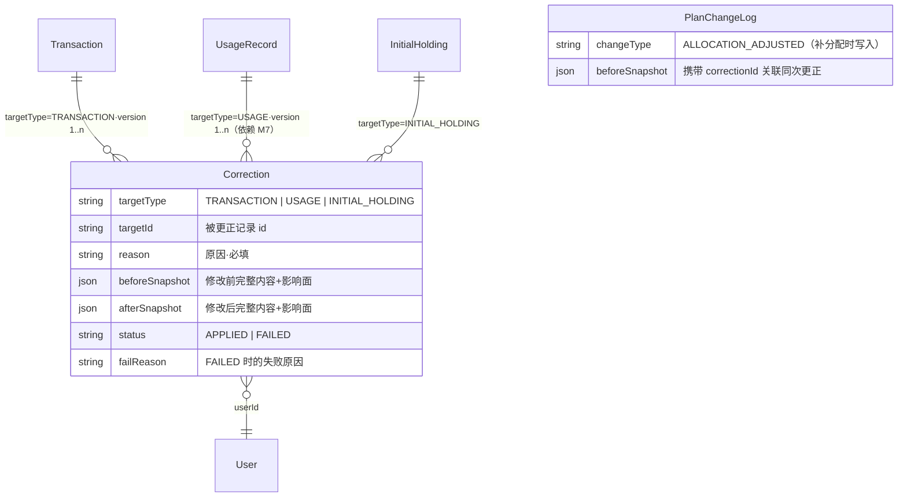
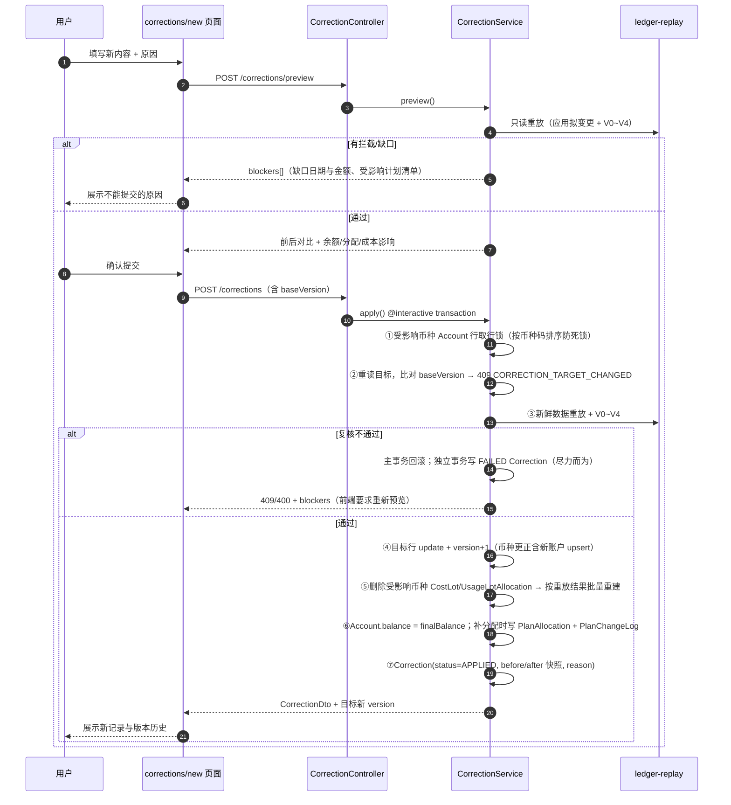

# 技术方案：更正与日志（corrections，M8）

> 动笔前已确认：核心场景——对换汇记录 / 使用记录 / 初始持仓三类记账数据做「原因必填 → 影响预览 → 确认 → 事务内复核 → 新版本 + 留痕」的通用更正，覆盖改币种 / 改日期 / 手续费补录 / 使用改小改大改日期 / 初始金额与币种更正；量级预估——个人记账工具，单用户年千条级记录、<10 QPS；最大风险点——FIFO 成本在币种 / 日期更正后的跨批次重排正确性，以及「预览通过但提交时数据已变」的一致性。
>
> 结论先行：本次 **0 张表变更**（冻结基线已含 Correction / version / PlanChangeLog 全部所需模型）、**3 个新接口**（preview / apply / list）、后端新增 `correction` 模块 + 前端新增 1 组更正页面，预计净增代码约 2500 行（含测试）。
>
> 依据：`docs/MVP功能模块&业务逻辑&专业术语/09_交易更正与日志.md`、`10_资金使用记录更正.md`、`02_初始化与录入闭环_待确认.md:100`、`13_MVP功能清单.md:34-42`（功能 20/21/28）、`14_业务逻辑清单.md:77`（§6）与例 02-05 / 10-12 / 15；`changes/mvp-completion/审查报告与开发计划.md` 阶段 2（M8）清单；实现风格对齐 `changes/transaction-entry/技术方案.md` 已落地代码。

## 1. 背景与范围

审计结论（`changes/mvp-completion/审查报告与开发计划.md` §二/§三）：M8 完全未开工——`services/chat/prisma/schema.prisma:325` 的 Correction 模型零读写；交易侧仅 `POST /transactions` 与 `GET /transactions/:id`（`services/chat/src/transaction/transaction.controller.ts`）；前端交易详情无更正入口（`clients/chat-web/components/business/transaction/transaction-detail.tsx:42` 文案已预告「可通过更正功能补录」但功能不存在）；`services/chat/src/onboarding/onboarding.service.ts:107` 报错文案「请走更正流程」为悬空引用。

本次实现 MVP 开发计划 M8 全部清单项 + 功能 21（使用更正，声明 M7 依赖边界，见 §10）+ 功能 28（初始持仓更正）：

```
入口：交易详情「更正」 / 账户流水初始持仓行「更正」 / （M7 落地后）使用详情「更正」
→ /corrections/new 更正页（按 targetType 渲染对应表单段，原因必填）
→ 「查看影响」POST /api/corrections/preview（只读重放：前后对比 + 余额/分配/成本影响 + 缺口/拦截明细）
→ 「确认」POST /api/corrections（baseVersion 乐观校验 → 事务内重放复核 → 写新版本 + 重建成本批次 + Correction 留痕）
→ 详情页展示当前记录 + 版本历史（GET /api/corrections?targetType=&targetId=）
```

**本次不做**（登记 §11）：使用金额改 0 / 超目标使用 / 已完成计划改大或改日期 / 已取消计划使用更正（doc 10 待确定项，先拦截）；结果不明的核对重试细则；全局日志页；报告「已更新」标注（M10）。

## 2. 量化指标（预估）

| 指标项 | 预估值 | 依据/备注 |
| --- | --- | --- |
| 数据规模 | 单用户年千条级事件（买入+使用），Correction 年百条级 | 个人记账工具；单币种重放事件量千级以内 |
| 并发压力 | <10 QPS | 更正为低频纠错动作 |
| 响应要求 | preview <500ms、apply <1s | 千级事件内存重放 <50ms（预估），耗时主要在事务 IO |
| 一致性 | 强一致 | 更正必须单事务原子生效：版本行 + 成本批次 + 余额 + 留痕同生共死 |

## 3. 方案选型：定点修补 vs 全量重放

| 维度 | 方案 A：定点修补（只重算受影响批次） | 方案 B：账本全量重放（按币种确定性重建） |
| --- | --- | --- |
| 正确性 | 差：改日期/币种会级联影响同币种所有后续批次的 FIFO 归属与每笔使用成本，定点修补需处理任意复杂的级联闭包，极易漏算 | 好：重放结果只由「事件全集 + 固定排序规则」决定，天然覆盖任意级联 |
| 实现成本 | 高：级联影响分析逻辑复杂且难测试 | 低：排序 + 顺序消耗一个纯函数；`services/chat/src/account/backfill-cost-lots.script.ts` 已有「从 Transaction 确定性重建 CostLot」先例 |
| 性能 | 好 | 足够：千级事件内存重放毫秒级（§2），全量重建成本批次为批量 delete+create |
| 一致性校验 | 难：无法给出「重算后是否仍满足全部历史约束」的完备证明 | 易：重放过程天然逐事件校验「当时资金是否足够」 |

**结论**：选择方案 B。更正的正确性优先级远高于性能（§2 量级下无性能风险）；重放引擎同时服务 preview（只读）与 apply（事务内复核），两阶段共用同一套计算，保证「所见即所存」。

## 4. 数据模型（0 变更）

M0 冻结基线已含全部所需模型，本次**不改表、不加列、不出迁移**：



图例：Correction 与三类目标均为逻辑关联（沿用现有裸外键风格，targetType+targetId 已有索引 `@@index([targetType, targetId])`）；`Transaction.version`（`schema.prisma:173`）与 `UsageRecord.version`（`schema.prisma:301`）为更正版本号，apply 时 +1；`InitialHolding` 无 version 列，乐观校验改用 `updatedAt` 比对（不改表）；PlanChangeLog 复用 M5 先例（`services/chat/src/plan/plan.service.ts:546`），仅在使用改大触发补分配时写入。

## 5. 核心设计

### 5.1 账本重放引擎（ledger-replay，本次的核心算法）

对**单个币种**按固定规则重排并重算全部成本与余额，纯内存计算、无 IO：

```
replayCurrencyLedger(events, mutate?) → ReplayResult
  输入 events：该币种的 InitialHolding + Transaction + UsageRecord 全集
  ① mutate?：在内存副本上应用拟更正内容（preview 与 apply 共用同一函数，所见即所存）
  ② 排序（doc 09:55-62 同日排序规则）：
     dateKey(UTC+8 日界) 升序
     → typeRank：INITIAL(0) < PURCHASE(1) < USAGE(2)
     → createdAt 升序（首次录入顺序；更正永不修改 createdAt ⇒ 最近修改的记录不会排到最后）
  ③ 重放：
     INITIAL/PURCHASE → 生成 CostLot：unitCost = (principal + (fee ?? 0)) / quantity，
       fee=null 时按已录金额计算并保留 feeKnown=false（doc 14 例12：费用未完整 ≠ 按 0 完整）
     USAGE → FIFO 消耗 remainingQty>0 的批次，生成 UsageLotAllocation 明细与该笔使用成本；
       消耗前校验「时点充足性」：累计流入(初始+买入) − 累计使用 ≥ 本次使用额，
       不足则记违规 { usageId, usedAt, shortfall }（doc 09:64-70 过去的钱是否够用）
  ④ 产出：lots[]、usageAllocations[]、每笔使用成本、finalBalance、余额时间线、violations[]
```

**重放后校验**（`correction-calculator.ts` 纯函数，preview 与 apply 共用）：

| # | 校验 | 依据 | 失败错误 |
| --- | --- | --- | --- |
| V0 | 基础参数：原因非空、内容确有变化、金额/汇率精度、日期不早于账本起点且不晚于今天（UTC+8） | doc 09:5-13、14 §6 | 400 INVALID_CORRECTION_PARAMS |
| V1 | 每币种 finalBalance ≥ 0 | doc 09:25 | 409 CORRECTION_INSUFFICIENT_FUNDS |
| V2 | 未分配余额 = finalBalance − Σ计划剩余分配 ≥ 0；**更正绝不自动减少分配**，违反时附受影响计划清单引导先去计划调整 | doc 09:25/33、14 例11 | 409 CORRECTION_ALLOCATION_CONFLICT |
| V3 | 历史时点充足性：violations 为空（每个过去的使用发生时都有足够同币种资金） | doc 09:64-70、14 例11 | 409 CORRECTION_HISTORICAL_SHORTFALL（附日期+缺口明细） |
| V4 | 待确定项拦截：使用金额改 0、改大后累计使用 > 目标、COMPLETED 计划改大/改日期、CANCELLED 计划任何使用更正 | doc 10:88-91 待确定 | 400 CORRECTION_NOT_ALLOWED |

### 5.2 各更正类型设计要点

| 类型 | 数据变更 | 重放影响 | 备注 |
| --- | --- | --- | --- |
| 手续费补录（null→金额） | Transaction.feeAmount、version+1 | 仅重算该批次 unitCost 及下游使用/剩余成本，余额不变 | doc 14 例12；快照写 `feeAmount: null→20`（未知≠0，绝不写 0→20）；金额→未知也允许（费用状态可改回） |
| 改金额（本金/数量） | Transaction 字段、version+1 | 批次成本、FIFO 消耗、余额全量重算；自洽校验复用 `assertSelfConsistent`（`services/chat/src/transaction/transaction-calculator.ts`） | 三值双向其一，口径与录入一致 |
| 改日期 | Transaction.transactedAt、version+1 | 批次重排序（§5.1 ②），使用成本/剩余成本重排（doc 14 例10：9,400→9,560） | 使用记录的日期/数量/计划不动 |
| 改币种 | Transaction.currencyCode、version+1 | 旧币种移除该批次、新币种新增批次，两币种各自全量重放+V1~V3 | 新币种无账户则事务内 upsert 建户（对齐 `transaction.service.ts` upsert+P2002 降级先例）；使用记录币种/计划不动；旧账户归零保留 |
| 使用改小 | UsageRecord.amount、version+1；PlanAllocation.amount 与 usedAmount **同减差额**（剩余分配不变，差额自然回未分配） | 该币种全量重放（使用成本/剩余成本重算），余额 = 重放结果 | doc 10:14-30、14 例02；**不写 PlanChangeLog**（doc 14 例02「没有分配变动就不写恢复分配事件」），留痕由 Correction 承载 |
| 使用改大 | UsageRecord.amount、version+1；PlanAllocation.usedAmount += diff | 同上；余额减少 diff | 原剩余分配足够时仅此（doc 14 例03） |
| 使用改大·补分配 | 上述 + PlanAllocation.amount += supplement + **PlanChangeLog(ALLOCATION_ADJUSTED)**，snapshot 携带 correctionId | 同上 | 原分配不足部分从未分配余额补入并立即使用，一次确认整体生效（doc 14 例04/05）；补分配时间=本次更正操作时间，不倒签 |
| 使用改日期 | UsageRecord.usedAt、version+1 | 重排序+V3 历史充足性 | doc 10:64-72 |
| 初始金额更正（含改 0） | InitialHolding.amount、cost；**沿用原 rate/rateSource/rateObservedAt** | 该币种全量重放+V1~V3 | doc 02:100-113；不用今天报价；无 version 列，乐观校验用 updatedAt |
| 初始币种更正/漏填补记 | InitialHolding 币种及报价三元组替换，或新增一行 | 受影响币种全量重放 | 需原确认时点前 ≤5 分钟同来源报价（§5.3），拿不到 → 400 RATE_QUOTE_UNAVAILABLE；初始日期/本位币不可改 |

### 5.3 原时点取价（初始持仓币种更正依赖）

`RateService` 新增 `findQuoteAt(currencyCode, baseCurrency, at)`：本地 `ExchangeRate` 查 `observedAt ≤ at 且 > at−5min`、方向「1 外币 = X 本位币」、现汇卖出价优先（对齐 `onboarding.service.ts` 既有取价口径）；本地无则按原来源 `provider.fetchHistory` 回补当日历史后取窗口内最后一笔（doc 02:113「取最后一笔」）；仍无 → 返回 null，上层抛 400 RATE_QUOTE_UNAVAILABLE。注意：M2 历史汇率为日级粒度（审计 §二 M2 缺口），历史确认时点常落在窗口外——该路径按 PRD 定级 Should Have，失败路径明确报错；**金额更正不受影响**（沿用原报价三元组）。

### 5.4 apply 事务编排与并发控制



图例：③在**事务内**用新鲜数据完整重跑 preview 同一套校验（doc 10:11「不能按旧结果直接扣钱」）；②的版本比对让「预览后数据已变」在写前即暴露，前端引导重新预览而非静默沿用；FAILED 留痕独立于主事务（doc 09:76-84：失败也保存尝试记录），写失败仅记日志不影响错误响应。

**一致性要点**：

- 重放是「更正时一次性重建」，非常驻机制——不改动 M4/M7 录入路径，回滚零风险（§9）。
- 全量重建 CostLot/UsageLotAllocation 为同币种 `deleteMany + createMany`，在行锁保护下与余额更新同事务，杜绝半更新。
- 账户不变式「余额 = Σ计划剩余分配 + 未分配余额」在 V1/V2 下保持；`mergeLedgerItems`（`services/chat/src/account/account-calculator.ts`）的流水展示零改动。

### 5.5 Correction 状态流转

APPLIED / FAILED 两态（创建即终态，无中间态；失败后重试 = 新的一次更正尝试新起一行）。快照内容：修改前后完整字段、影响面摘要（余额前后、受影响计划与使用、成本前后、缺口明细）、操作时间；手续费字段保留 null 语义。

## 6. 接口契约

均需登录（JwtAuthGuard），统一包装 `{ success, data, message }`，金额一律字符串（与 plan/home 模块口径一致）；错误体 `{ code, message }`，附明细走 `details` 数组。错误码经 DTO enum 进入 OpenAPI，前端 `bun run generate:api` 生成。

### 6.1 `POST /api/corrections/preview` — 影响预览（只读）

```jsonc
// 请求
{
  "targetType": "TRANSACTION",          // TRANSACTION | USAGE | INITIAL_HOLDING
  "targetId": "cmb9...",
  "baseVersion": 1,                     // TRANSACTION/USAGE 必填；INITIAL_HOLDING 传 baseUpdatedAt
  "reason": "手续费实际为 20 HKD",
  "changes": {                          // 按 targetType 校验允许的字段集（白名单外 400）
    "feeAmount": "20.00"                // null = 改回未知；缺省字段 = 不修改
    // TRANSACTION: currencyCode / principalAmount / quantity / feeAmount / transactedAt
    // USAGE:       amount / usedAt
    // INITIAL_HOLDING: amount / currencyCode（currencyCode 变更需报价，见 §5.3）
  }
}
// 响应 data：CorrectionPreviewDto
{
  "before": { /* 目标当前完整内容 */ },
  "after": { /* 应用变更后的完整内容 */ },
  "diff": [ { "field": "feeAmount", "before": null, "after": "20.00", "display": "未知 → 20.0000" } ],
  "impacts": {
    "balances": [ { "currencyCode": "USD", "before": "600.0000", "after": "600.0000" } ],
    "allocations": [ /* 受影响计划：amount/usedAmount/剩余 前后 */ ],
    "costs": [ { "usageId": "...", "costBefore": "9400.0000", "costAfter": "9400.0000" } ],
    "warnings": [ "存在其他手续费未明确的记录，成本说明继续保留" ]
  },
  "blockers": []                        // 非空 = 不能提交：{ code, message, details:[{usedAt, shortfall}|{planId}] }
}
```

错误：404 `CORRECTION_TARGET_NOT_FOUND`（不存在/非本人，不泄露存在性）、400 `INVALID_CORRECTION_PARAMS` / `CORRECTION_NOT_ALLOWED` / `RATE_QUOTE_UNAVAILABLE`、409 `CORRECTION_TARGET_CHANGED`。

### 6.2 `POST /api/corrections` — 提交更正（事务）

请求体沿用 preview 的目标、变更项和乐观校验字段。初始持仓改币种的预览另返回
`holdingQuote`（实际采用价、舍入前原始采用价、来源、观测时间和 `confirmationKey`）。
页面展示报价，提交时将 `confirmationKey` 原样放入 `previewQuoteKey`。事务中完成账本
读取后重新从缓存取报价，同一份报价参与确认校验、重放和持仓写入。确认键缺失、采用价、
来源或观测时间变化返回 409 `CORRECTION_QUOTE_CHANGED`，页面清除旧预览并要求用户重新确认。
缓存无合格报价保持 400 `RATE_QUOTE_UNAVAILABLE`，重新预览时可回补历史。上述报价拒绝
路径不会写入持仓、账户、批次或更正日志。响应 data：

```jsonc
{
  "correctionId": "cmbX...", "status": "APPLIED",
  "targetType": "TRANSACTION", "targetId": "cmb9...",
  "targetVersion": 2,                   // 更正后版本号
  "createdAt": "2026-09-20T12:00:00.000Z"
}
```

事务顺序见 §5.4。错误：preview 全部错误码 + 409 `CORRECTION_TARGET_CHANGED` / `CORRECTION_INSUFFICIENT_FUNDS` / `CORRECTION_ALLOCATION_CONFLICT` / `CORRECTION_HISTORICAL_SHORTFALL`。USAGE 类型在 M7 落地前返回 400 `CORRECTION_TARGET_TYPE_UNAVAILABLE`（§10 依赖边界）。

FX-05 回归验证使用真实 PostgreSQL 与更正 API。在持仓版本和报价观测时间不变时分别改写
卖出价、报价来源以及舍入后不变的原始价，比较拒绝前后的持仓、账户、批次和日志。报价保持
一致时验证落库金额和来源，重新预览后验证新报价生效，重复提交仍触发持仓乐观校验。
前端 hook 测试覆盖清空旧报价、保留表单输入和重新确认。金额更正沿用既有接口回归用例。

### 6.3 `GET /api/corrections?targetType=&targetId=&page=` — 修改记录列表

返回按 createdAt 倒序的 CorrectionDto 分页（含 APPLIED 与 FAILED；FAILED 附 failReason），供详情页版本历史区展示。错误：404 同上；参数缺失 400。

## 7. 代码影响范围

<pre>
services/chat/
├─ src/app.module.ts                                    <font color="#92400e">(M)</font> 注册 CorrectionModule
├─ src/correction/                                      <font color="#166534">(A)</font> 新模块（app.module 唯一注册点）
│  ├─ correction.module.ts                              <font color="#166534">(A)</font>
│  ├─ correction.controller.ts                          <font color="#166534">(A)</font> <font color="#ca8a04">preview()</font> / <font color="#ca8a04">apply()</font> / <font color="#ca8a04">list()</font>（3 端点 + Swagger，风格对齐 transaction.controller）
│  ├─ correction.service.ts                             <font color="#166534">(A)</font> <font color="#ca8a04">preview()</font>（只读重放）、<font color="#ca8a04">apply()</font>（§5.4 事务编排 + FAILED 独立留痕）、<font color="#ca8a04">list()</font>
│  ├─ ledger-replay.ts                                  <font color="#166534">(A)</font> <font color="#ca8a04">replayCurrencyLedger()</font>：排序/批次生成/FIFO 消耗/时点校验（§5.1 纯内存计算）
│  ├─ correction-calculator.ts                          <font color="#166534">(A)</font> <font color="#ca8a04">applyChanges()</font>（拟变更白名单应用）、<font color="#ca8a04">validate()</font>（V0~V4）、<font color="#ca8a04">computeAllocationDelta()</font>（改小/改大/补分配的分配调整量）
│  └─ dto/correction.dto.ts                             <font color="#166534">(A)</font> PreviewReq / ApplyReq / CorrectionPreviewDto / CorrectionDto / 错误码 enum
├─ src/rate/rate.service.ts                             <font color="#92400e">(M)</font> 新增 <font color="#ca8a04">findQuoteAt()</font>：原时点 ±5 分钟窗口取价（本地历史 → 同源 fetchHistory 回补，取最后一笔）
├─ src/onboarding/onboarding.service.ts                 <font color="#92400e">(M)</font> <font color="#ca8a04">InitialHoldingExistsException</font>（:107）文案改为指向「对应币种账户的初始记录更正入口」；controller 对应 Swagger 描述同步
└─ test/
   ├─ api/correction.spec.ts                            <font color="#166534">(A)</font> 接口测试（复用 test/helpers/test-app.ts）
   └─ integration/correction-replay.spec.ts             <font color="#166534">(A)</font> 重放一致性集成测试
clients/chat-web/
├─ lib/api/schema.gen.ts                                <font color="#92400e">(M)</font> bun run generate:api 重新生成（禁止手改）
├─ lib/api/contract.ts                                  <font color="#92400e">(M)</font> 别名：CorrectionPreviewDto / CorrectionDto / PreviewReq 等
├─ lib/api/corrections.ts                               <font color="#166534">(A)</font> correctionsApi.preview / apply / list [引用方] corrections/new 页、transaction-detail、account-ledger-table
├─ lib/hooks/
│  ├─ use-correction-form.ts                            <font color="#166534">(A)</font> 目标加载、变更收集、preview 触发、409 重新预览、confirm→apply
│  └─ use-correction-form.spec.ts                       <font color="#166534">(A)</font> 单测
├─ app/(protected)/corrections/new/page.tsx             <font color="#166534">(A)</font> 更正页（表单段 + 影响预览段，targetType/targetId 由查询参数进入）
├─ components/business/correction/                      <font color="#166534">(A)</font>
│  ├─ correction-form.tsx                               <font color="#166534">(A)</font> 按 targetType 渲染可改字段 + 原因（必填）
│  ├─ correction-impact-preview.tsx                     <font color="#166534">(A)</font> 前后对比 diff + 余额/分配/成本影响 + blockers 明细
│  ├─ correction-history-list.tsx                       <font color="#166534">(A)</font> 版本历史（含 FAILED 尝试）
│  └─ index.ts                                          <font color="#166534">(A)</font> 桶文件
├─ components/business/transaction/transaction-detail.tsx <font color="#92400e">(M)</font> 新增「更正」入口 → /corrections/new?targetType=TRANSACTION&targetId=…；挂版本历史区
└─ components/business/account/account-ledger-table.tsx <font color="#92400e">(M)</font> INITIAL 类型行新增「更正」入口（初始持仓更正）
</pre>

> 目录树同步（AGENTS.md 铁律 4）：`(protected)/corrections/` 为新增页面目录，实施时同步更新 AGENTS.md 目录树；`services/chat` 下仅新增 `src/correction/` 与 `test/` 两个既有允许位置。

## 8. 测试设计

> 断言锚定：`docs/MVP功能模块&业务逻辑&专业术语/14_业务逻辑清单.md` 例 02-05、例 10-12、例 15 的数值表，及 doc 15「先进先出的例子」（7,800/8,000 → 使用 1,200 成本 9,400）；全用例必断账户不变式「balance = Σ剩余分配 + 未分配余额」与「Σ使用成本 = Σ使用批次分摊成本」。
> 时钟隔离：涉「今天/同日排序」用例用 `vi.setSystemTime` 固定时钟；重放排序断言用显式 createdAt 序列注入，禁止依赖真实时间。

### 8.1 单元测试

| 测试文件 | 被测对象 | 覆盖点 |
| --- | --- | --- |
| `services/chat/src/correction/ledger-replay.spec.ts` | `replayCurrencyLedger` | 同日排序（初始→买入→使用、同类按 createdAt 首录顺序、更正不改首录顺序）；doc 15 FIFO 例（9,400/剩余 6,400）；例 10 改日期后（9,560/6,240）；fee=null 单位成本按已录金额且保留费用未完整标注；V3 时点缺口检测（例 11 子例 2：9 月 2 日缺 400）；余额时间线与 finalBalance；空账本/单批次边界 |
| `services/chat/src/correction/correction-calculator.spec.ts` | `applyChanges`/`validate`/`computeAllocationDelta` | 白名单外字段 400；改小差额回未分配（例 02：amount/usedAmount 同减 3,600、剩余分配 6,000 不变）；改大原分配足够（例 03）；补分配三步（例 05：+400 分配、−600−400 使用、合计 −1,000）；V4 拦截矩阵（改 0/超目标/COMPLETED 改大/COMPLETED 改日期/CANCELLED）；V1/V2 缺口与受影响计划清单；原因缺失/无变化拒绝 |
| `services/chat/src/rate/rate.service.spec.ts`（追加） | `findQuoteAt` | 窗口内取最后一笔；窗口外/无报价 → null；方向与 8 位小数；本地缺失走 fetchHistory 回补 |
| `clients/chat-web/lib/hooks/use-correction-form.spec.ts` | `use-correction-form` | 原因必填客户端拦截；preview 成功/含 blockers 两态；apply 409 TARGET_CHANGED 后自动重新预览；提交中防重复点击 |

### 8.2 接口测试 `services/chat/test/api/correction.spec.ts`

| # | 场景 | 预期 |
| --- | --- | --- |
| 1 | 未登录访问三接口 | 401 |
| 2 | preview 手续费补录（锚定例 12：1,000/7,800/未知→20） | 200；diff.display=「未知 → 20.0000」、成本 7,800→7,820、blockers 空 |
| 3 | apply 同场景 | 200；Transaction.feeAmount=20、totalCost=7,820、version=2；Correction 1 行 APPLIED；快照 before.feeAmount=null（非 0） |
| 4 | preview 币种改 CAD（例 11#1：已用 400） | 200；blockers 含 USD 缺口 400 |
| 5 | apply 交易日期（例 10 全量数据） | 200；使用成本 9,560、剩余 6,240；CostLot acquiredAt 重排、数量不变；version=2 |
| 6 | apply 改币种（有其他批次来源、无分配） | 200；新币种账户自动建、旧账户余额保留、使用记录与 UsageLotAllocation 全部按新批次归属重算 |
| 7 | apply 改币种且 V2 违反 | 409 CORRECTION_ALLOCATION_CONFLICT，details 附受影响 planId；账户/分配/批次零变化 |
| 8 | apply 改日期致历史缺口（例 11#2） | 409 CORRECTION_HISTORICAL_SHORTFALL，details={usedAt:9/2, shortfall:400}；零变化 |
| 9 | baseVersion 过期（另一请求已更正） | 409 CORRECTION_TARGET_CHANGED |
| 10 | 原因缺失 / changes 为空 / 白名单外字段 | 均 400 INVALID_CORRECTION_PARAMS |
| 11 | 使用改小（例 02 数据，依赖 M7 夹具） | 200；余额 9,600、未分配 3,600；PlanAllocation.amount/usedAmount 同减 3,600、剩余分配 6,000；无 PlanChangeLog 新行 |
| 12 | 使用改大·原分配足够（例 03） | 200；余额 −1,000、usedAmount +1,000、只扣增量 |
| 13 | 使用改大·补分配（例 05 数据） | 200；整体生效：amount 600→1,000、usedAmount 0→1,000、余额 2,600→1,600、未分配 2,000→1,600；PlanChangeLog 1 行 ALLOCATION_ADJUSTED 且 snapshot.correctionId 关联；补分配 createdAt=本次更正时间（不倒签） |
| 14 | 已完成计划使用改小（例 15） | 200；Plan.status 仍 COMPLETED、无 REOPENED 记录、差额 400 入未分配 |
| 15 | V4 拦截矩阵：改 0 / 超目标 / COMPLETED 改大 / COMPLETED 改日期 / CANCELLED 更正 | 均 400 CORRECTION_NOT_ALLOWED，零变化 |
| 16 | 使用改日期历史缺口（例 11#3） | 409 CORRECTION_HISTORICAL_SHORTFALL |
| 17 | 初始金额更正 | 200；rate/rateSource/rateObservedAt 与原值逐字节一致；cost 重算 |
| 18 | 初始改 0 且有历史使用 | 409（V3 缺口明细）；无使用时 200 且成本归 0 |
| 19 | 初始币种更正：窗口内无报价 / 有报价 | 400 RATE_QUOTE_UNAVAILABLE / 200 且新报价三元组落库 |
| 20 | 他人记录 preview/apply/list | 一律 404 CORRECTION_TARGET_NOT_FOUND |
| 21 | apply 复核失败后的失败留痕 | Correction 1 行 FAILED + failReason；目标 version 不变；余额/分配/批次零变化 |
| 22 | preview 不落任何行 | Correction/Transaction/Account 表行数与内容零变化 |
| 23 | 参数边界：JPY 金额 2 位小数 / 汇率 >8 位 / 日期早于账本起点 / 晚于今天 | 均 400，message 区分 |
| 24 | USAGE 类型在 M7 未接线时 | 400 CORRECTION_TARGET_TYPE_UNAVAILABLE |

### 8.3 集成测试 `services/chat/test/integration/correction-replay.spec.ts`

| # | 业务流 | 断言 |
| --- | --- | --- |
| 1 | 建账(初始 1,000)→两笔买入→分配→使用 1,200→更正第一笔买入日期（doc 15 + 例 10 全链路） | CostLot 重建行数/remainingQty 与重放期望一致；UsageLotAllocation 明细按新批次归属；两不变式成立；使用记录行未被修改（除成本展示数据外） |
| 2 | 使用改大补分配全链路（例 05 状态序） | 逐步对表断言计划剩余分配/未分配/余额；Correction 快照可完整还原各步骤 |
| 3 | 重放幂等：同一更正请求重放两次（第二次被 TARGET_CHANGED 拦截） | 第二次 409；数据与第一次后状态逐字段一致 |
| 4 | 跨用户隔离：用户 B 对用户 A 记录的 preview/apply/list | 全 404 |
| 5 | 并发：更正 apply 与同币种买入 create 同时提交 | 行锁串行化后两请求均成功且不变式成立（无丢更新） |

### 8.4 E2E `e2e/modules/11-correction.spec.ts`（按用户操作路径编号）

**场景 1：手续费补录**

1. 登录 → 首页快速录入一笔「费用未知」买入 → 进入交易详情
2. 点击「更正」→ 补录手续费 20、填写原因 → 查看影响（成本 7,800→7,820）→ 确认
3. 断言：详情显示总成本 7,820、记录版本 v2、版本历史含「未知 → 20」与原因

**场景 2：交易币种更正被拦截**

1. 造数：买入 1,000 且已使用 400 → 详情 → 更正改币种 CAD → 查看影响
2. 断言：页面显示 USD 缺口 400 与不能提交原因；确认按钮禁用；原记录数值不变

**场景 3：初始持仓金额更正**

1. 账户页初始持仓行 → 更正 → 改为正确金额、填原因 → 影响预览 → 确认
2. 断言：成本按原汇率重算、流水出现更正后数值、版本历史可查

**场景 4：使用更正改小**（M7 上线后启用，此前 skip 标记）

1. 计划详情使用记录 → 更正 4,000→400 → 预览显示余额 +3,600 入未分配 → 确认
2. 断言：计划保持原状态、账户余额 9,600、历史保留

> 前端组件测试依赖 E2E（AGENTS.md 约定），本次前端只测 hooks。

**验收门禁**：`services/chat` + `clients/chat-web` 全部测试 0 failed，typecheck / lint 通过（质量红线：实施必跑通测试，验收附测试日志）。

## 9. 回滚

- 摘除 `app.module.ts` 中 CorrectionModule 注册即恢复（纯增量模块；M4 录入路径零改动）。
- **无 schema 变更、无迁移**；重放是「更正时一次性重建」，非常驻机制——回滚后存量 CostLot/Correction 数据只读留存，无兼容问题；此后新买入照常按原路径落批次。
- 已 APPLIED 的更正不提供「反向更正」以外的撤销；回滚不产生数据风险（Correction 行仅是历史留痕）。

## 10. 依赖边界（并行协作声明）

| 依赖 | 边界 |
| --- | --- |
| **M7 资金使用（另一人并行撰写）** | 本方案**只消费**冻结基线的 `UsageRecord`（`schema.prisma:294`，含 version 列）与 `UsageLotAllocation`（:311）表结构，不实现 M7 的使用录入/扣减/FIFO 首次消耗逻辑。使用更正（功能 21）在 M7 落地前：接口层对 targetType=USAGE 返回 400 `CORRECTION_TARGET_TYPE_UNAVAILABLE`，前端不露出使用更正入口。M7 交付物中本方案依赖的契约仅两条：① 使用创建必须写 UsageRecord(version=1) + UsageLotAllocation + 扣减 PlanAllocation.usedAmount + Account.balance；② 使用详情前端存在可挂「更正」入口的页面。 |
| **M2 汇率** | 历史报价为日级粒度，原时点 ±5 分钟取价常不可得 → 初始持仓**币种**更正为 Should Have，失败明确报错；金额更正不受影响（§5.3）。 |
| **M10 报告** | 更正后数据经重放即为单一事实来源，M10 报告天然读到正确值；「已根据更正记录更新」标注与受影响期间提示随 M10 实现，本期 Correction 快照已携带足够信息。 |

## 11. 假设清单（实现前可推翻）

1. 更正永不修改 `createdAt`（首次录入顺序保留），排序依据 doc 09:55-62。
2. fee=null 批次的 unitCost 按 `(principal+0)/quantity` 计算并保留 feeKnown=false 标注（doc 14 例 12「按已录金额 7.8」口径）。
3. 乐观校验用 baseVersion（Transaction/UsageRecord）/ baseUpdatedAt（InitialHolding），不引入 preview token 存储。
4. 使用改小通过 `PlanAllocation.amount` 与 `usedAmount` 同减差额实现「剩余分配不变、差额回未分配」（doc 10:24-28 数值反推）。
5. 补分配写 `PlanChangeLog(ALLOCATION_ADJUSTED)`，改小不写（doc 14 例 02「没有分配变动就不写恢复分配事件」）。
6. doc 10 待确定项（改 0/超目标/已完成改大或改日期/已取消更正）本期一律拦截并提示（MVP 开发计划 M8「待确认项影响」处置口径）；结果不明场景本期以明确成功/失败返回。
7. 错误码命名沿用模块前缀惯例（`CORRECTION_*`），经 DTO enum 进 OpenAPI。

## 12. 遗留问题（本次不做）

1. 提交结果不明（断网/超时）的核对与重试细则（doc 09 待确定）。
2. V4 拦截的分支放开：使用金额改 0、超目标使用、已完成计划改大/改日期、已取消计划更正（待 doc 确认后迭代）。
3. 全局修改记录页（doc 09 待确定「是否设置单独的全局日志页」）。
4. 已使用资金补录费用后历史成本的逐笔展示粒度（doc 09 待确定；重放已保证数值正确，展示口径待定）。
5. 报告标注与受影响期间提示（M10）。
6. `test/api/plan.spec.ts` 等存量测试欠账为独立补救项，不在本方案范围。
