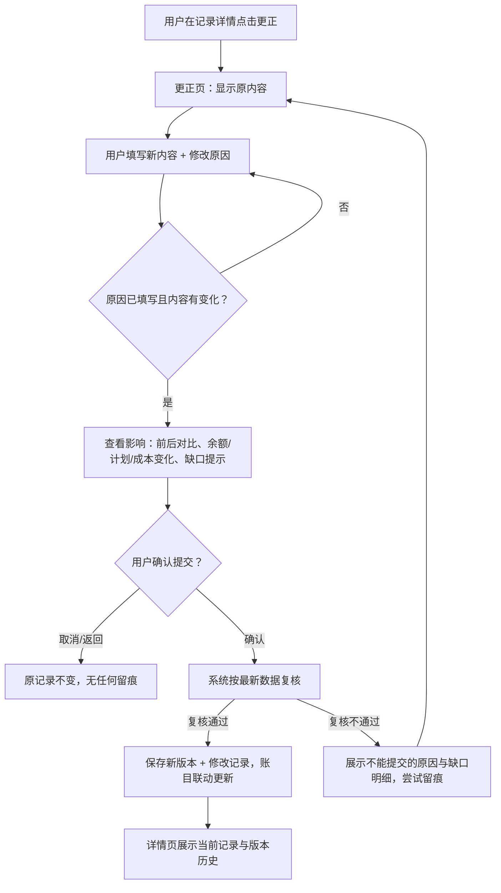
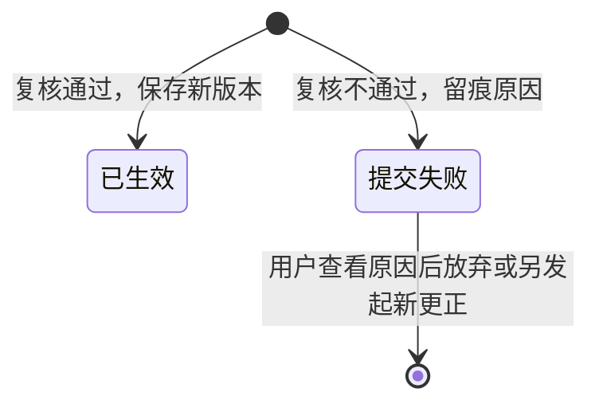

# 更正与日志（M8）需求文档

> Complex 档：全量模块。权威依据：`docs/MVP功能模块&业务逻辑&专业术语/09_交易更正与日志.md`、`10_资金使用记录更正.md`、`02_初始化与录入闭环_待确认.md:100`（初始记录更正）、`13_MVP功能清单.md:34-42`（功能 20/21/28）、`14_业务逻辑清单.md:77`（§6 更正记录和重算成本）及例 02-05、例 10-12、例 15、`15_专业术语清单.md`。
> 技术实现见同目录《技术方案.md》。

## 1. 需求概述

**用户故事**：作为记账用户，当我发现买外币、用外币或首次登记外币的记录填错了，我想在原记录上发起更正、先看清影响再确认，以便把账改对，同时原记录和每次修改都保留、随时可查。

**业务价值**：当前更正能力完全缺失——买外币、用外币、初始持仓填错后账只能一直错着；已有初始持仓时的报错还在引导用户去一个并不存在的更正入口。上线后：功能 20（修改换汇记录）、21（修改使用记录）、28（修改初始持仓）三项落地，所有更正留痕可查，账本具备自我纠错能力。

**范围边界**：

- ✅ 本次包含：更正通用流程（填原因 → 看影响 → 确认 → 系统复核 → 保存新版本并留痕）；换汇记录更正（换入币种、换出本金、换入数量、手续费补录、交易日期）；使用记录更正（改小、改大、改日期；依赖"记录使用"功能先行到位）；初始持仓更正（金额、币种填错、漏填补记）；修改记录查看；初始持仓重复录入报错文案修复
- ❌ 本次不包含：换出本位币修改（永久不可改）；初始日期、使用币种、使用所属计划的修改及整笔删除；已完成计划的改大金额与改日期、已取消计划的任何使用更正（文档待确定，本期先拦截并提示）；使用金额改为 0（待确定，先拦截）；汇总全部操作记录的独立日志页（待确定）；报告与已下载文件随更正的更新展示（随报告功能另立）

## 2. 术语对照表

| 业务术语 | 本次含义界定 |
| --- | --- |
| 更正 | 在原记录上发起的纠错：先填新内容和原因，看影响，确认后由系统复核保存；原记录保留，不直接覆盖或删除 |
| 修改记录 | 每次更正的留痕：改了什么、原来多少、现在多少、原因、时间、结果；含失败的尝试 |
| 版本 | 同一条记录被更正的次序编号，首次录入为第 1 版，每更正一次加一 |
| 先买先用（先进先出） | 计算成本时先买的外币先算使用成本；同一天先算初始持仓，再算普通买入，最后算使用，同类按首次录入顺序 |
| 首次录入顺序 | 记录第一次填进账本的先后；更正不改变它，仅用于同一天内的排序 |
| 手续费未知 | 还不知道手续费多少，与"确定没有手续费（填 0）"不同；更正时未知不阻止提交 |
| 未分配余额 | 账户中还没有留给任何计划的钱；更正产生的差额回到这里 |
| 计划剩余分配 | 留给计划、还没使用的外币金额；使用更正改小时它保持不变 |
| 补充分配后立即使用 | 使用改大而原计划的钱不够时，从未分配余额补进原计划并立刻用于本次更正；金额只扣一次 |
| 提交失败 | 确认后系统复核没有通过；留痕失败尝试与原因，不产生新版本、不改任何数字 |
| 提交结果不明 | 断网或超时导致暂时不知道是否保存成功；先查清结果，不直接重复提交 |
| 账本起点 | 首次设置完成时刻；更正后的记录日期不能早于它 |

## 3. 角色与权限

仅限登录的记账用户本人操作；只能查看和更正自己的记录，看不到他人记录的存在。

## 4. 核心业务流程

> 图例：填写、预览、取消都不改变正式记录；只有"确认 → 复核通过"才落账；复核不通过留痕失败原因并可返回修改。

## 5. 业务状态流转

更正尝试（一次"确认提交"）的生命周期：

> 已生效：新版本成为当前记录，余额/计划/成本已联动更新，可在历史中看到每一版。提交失败：原记录与数字保持原样，失败尝试（拟改内容 + 失败原因）保留可查。填写中、预览中、取消不产生任何记录。

## 6. 功能详细规则

### 6.1 通用规则（三类记录共用）

- **入口**：换汇记录详情页、使用记录详情页、账户初始记录卡片，各设"更正"入口。
- **原因必填**：不填原因不能提交。
- **先看影响**：提交前必须展示修改前后对比，以及对余额、受影响计划或使用记录、成本的预计影响；不能提交时显示缺少的金额和对应日期。
- **确认后复核**：用户确认后系统按最新数据重新核对；核对期间数据若已变化（如又有买入、使用），以最新数据为准重新展示，不按旧结果落账。
- **成功才保存**：任何环节失败都不部分保存；仅打开更正页、查看结果或取消，不改变正式记录、不留失败痕迹。
- **手续费未知不拦路**：原记录手续费未知时，只要其他核对通过仍可提交；费用未明确的提示继续保留。

### 6.2 换汇记录更正（功能 20）

**可以修改**：换入币种、换出本金（不含单列手续费）、换入数量、手续费（金额及"未知/已明确"状态）、交易日期。**不可修改**：本位币——换出金额和手续费都沿用首次设置的本位币。

**修改币种**：

- 影响已有计划分配时，先到计划中调整或解除受影响的分配，再回来重新查看更正结果；系统不会自动把一个币种的分配转成另一币种，也不按行情换算已填数量。
- 已有使用记录的币种、金额和所属计划保持不变；账户曾经用过钱不代表不能改币种，仍按余额和分配核对。
- 新币种没有账户时，先提示将新增账户，确认且更正成功后才创建；同一币种只保留一个账户，有则复用。原账户归零仍显示余额 0 并保留历史。

**修改日期**：可能改变先买先用的顺序，需重算受影响的分配成本、使用成本和剩余外币成本；只改有关记录，使用的币种、数量、计划和日期不随交易日期更正而改变。

**同一天排序**：初始持仓 → 普通买入 → 使用；普通买入按交易日期由早到晚、同日按首次录入顺序；修改后的记录放回新日期位置，落到同一天仍用原首次录入顺序，不排到最后。

**过去的钱是否够用**：改日期后若过去某笔使用发生时没有足够同币种资金，阻止提交并显示缺少数额；若当时另有足够资金则放行。不借未来买入补过去使用，不自动补一笔初始余额，也不代改使用日期。

### 6.3 使用记录更正（功能 21）

**可以修改**：使用金额、使用日期。**不可修改**：币种、所属计划；不提供整笔删除。

**金额改小**（同币种、同计划、日期不变）：

- 减少的差额回到账户未分配余额；计划剩余分配保持不变，不自动恢复原计划分配，也不生成"已恢复分配"的记录。
- 已完成的计划调小误录金额后仍保持已完成：目标与剩余分配不变，差额回未分配余额，更新实际使用与成本，保留完成记录，不要求补齐、不新增重新开启记录。

**金额改大**（同币种、同计划、日期不变，且计划允许修改）：

- 增加部分先用原计划剩余分配；不足部分在同一次确认中从未分配余额补分配给原计划并立即用于本次更正，一次看清各来源与金额，无需退出另办分配；不能动用其他计划的分配。
- 补充分配与使用必须全部成功才保存，失败不留半条有效记录，重试不重复分配或扣钱，不按总额重复扣整笔。
- 补充分配按本次操作时间记录，不倒写成过去；原使用日期保留。

**日期填错**（同币种、原计划、数量不变）：新日期当时资金不足则阻止并显示缺口；重算使用成本、剩余外币成本；使用日期不能早于账本起点，与起点同日需确认实际发生在起点之后。

### 6.4 初始持仓更正（功能 28）

- **金额填多/填少**：改为原确认那一刻实际持有的金额，可改为 0；沿用原来采用的汇率重算，不用今天的行情。
- **币种填错或漏填**：需要原确认时点之前不足 5 分钟的同来源报价重算；拿不到就不能提交。漏填币种按"初始记录更正"补记当时余额，不是新增一笔今天的买入；已有初始记录的币种只能改原记录。
- **不可修改**：初始日期、本位币。
- **核对与保存**：检查历史使用和现有分配；改小后余额不足以覆盖分配时先提示到计划中调整；更正与受影响成本一起保存，失败不部分生效。

### 6.5 修改记录查看

- 记录详情页可查看：原记录、当前记录、每次更正的内容前后值、原因、时间和结果。
- 手续费补录的日志写"未知 → 20"，不写"0 → 20"，也不写"原完整成本"。
- 提交失败同样留痕：关联记录、时间、拟修改内容、失败原因、"提交失败"；失败不产生有效新版本，不改变余额、分配或后续统计。

### 6.6 初始持仓重复录入报错文案修复

已有某币种初始记录时再次录入的报错，从"请走更正流程"改为明确指引："该币种已有初始记录；金额有误请在对应币种账户的初始记录中发起更正"——指向真实存在的入口，不再引导用户去寻找一个模糊流程。

## 7. 业务异常与边界

- **重复/并发操作**：更正确认后按最新数据复核；预览之后数据已变化（余额、分配或记录本身被修改）时重新展示结果要求再次确认，不能按旧结果扣钱。连续快速双击确认按一次提交处理。
- **前置依赖**：使用记录更正需"记录使用"功能已上线；该功能未上线前使用详情不出现更正入口。
- **中途中断/结果不明**：断网或超时时显示"正在确认结果"，先查询原请求，不直接重复提交；本期保证每次提交都有明确成功或失败结果，结果不明的核对与重试细则待后续完善。
- **留痕要求**：所有更正（含失败尝试）永久保留，不可删除；原记录版本保留。
- **失败处理**：复核不通过时展示具体原因与缺口明细，用户返回修改后可再次提交；系统不自动重试。

## 8. 验收标准

**换汇记录更正**

- **场景 1（正常）**：假如一笔买入 1,000 外币、本金 7,800 本位币、手续费原为未知，当用户更正补录手续费 20 并确认，那么保存成功，已记录成本变为 7,820，外币余额不变，修改记录写"未知 → 20"而不是"0 → 20"。
- **场景 2（边界）**：假如一笔买入 1,000 外币、已用 400、余额 600 且无剩余分配，当把买入币种改为另一币种，那么不能提交（原币种余额会变负），提示缺口 400，原余额仍为 600，已用 400 的使用记录保留不变。
- **场景 3（异常）**：假如 9 月 1 日买入 1,000、9 月 2 日使用 400，当把买入日期改为 9 月 3 日，那么不能提交，提示 9 月 2 日缺 400；原日期、余额及分配不变。
- **场景 4（正常）**：假如两笔买入各 1,000（成本 7,800 与 8,000）、9 月 4 日使用 1,200，当把第一笔日期改到第二笔之后并确认，那么使用成本按新顺序重算为 9,560、剩余成本 6,240，使用数量与日期不变，修改记录保留批次成本归属与差异。
- **场景 5（边界）**：假如改币种后的新币种没有账户，当确认更正，那么先提示将新增账户，成功后新币种账户建立，原账户保留并显示余额 0。

**使用记录更正**

- **场景 6（正常）**：假如目标 10,000、误录使用 4,000（实际 400）、账户余额 6,000，当改为 400 并确认，那么余额变为 9,600 且全部进入未分配，计划剩余分配仍 6,000，页面显示尚未备齐，不自动把 3,600 分给原计划。
- **场景 7（正常）**：假如使用 4,000 改为 5,000 且原计划剩余分配足够，当确认，那么只扣增加的 1,000，不按总额重复扣 5,000。
- **场景 8（正常）**：假如原分配 600、未分配 2,000、余额 2,600，使用增加 1,000，当一次确认，那么系统先补分配 400 再连同原分配 600 一起使用，最终余额 1,600、剩余分配 0、未分配 1,600，各步骤整体生效且留有同一次更正的明细。
- **场景 9（异常）**：假如原分配加未分配余额仍不足以覆盖增加额，当确认提交，那么不能提交，原数据保留不变。
- **场景 10（异常）**：假如 9 月 3 日买入 1,000、9 月 4 日使用 400，当把使用日期改为 9 月 2 日，那么不能提交，提示当时缺 400。
- **场景 11（边界）**：假如一个正常完成的计划中一笔误录使用从 4,000 调小为 3,600，当确认更正，那么计划仍保持已完成，差额 400 回到未分配余额，目标与剩余分配不变，不新增重新开启记录。

**初始持仓更正**

- **场景 12（正常）**：假如初始金额 1,000 填错为 1,200，当改为最初确认时刻真实持有的 1,000 并确认，那么沿用原汇率重算成本，不使用今天的报价。
- **场景 13（边界）**：假如当时实际没有该币种，当把初始金额改为 0，那么系统检查历史使用与现有分配后允许保存，并保留更正记录。
- **场景 14（异常）**：假如币种填错但拿不到原确认时点之前不足 5 分钟的同来源报价，当确认提交，那么不能提交并说明原因，原记录不变。

**通用**

- **场景 15（边界）**：假如用户未填修改原因，当点击提交，那么不能提交并提示原因必填。
- **场景 16（异常）**：假如提交后系统复核失败，当查看记录详情，那么能看到这次失败尝试的拟改内容、失败原因与"提交失败"标记，且原记录、余额、分配均无变化。
- **场景 17（边界）**：假如用户查看他人的记录，当访问该记录详情或更正页，那么看不到该记录（视同不存在），无法发起更正。
- **场景 18（正常）**：假如某币种已有初始记录，当再次尝试录入该币种初始持仓，那么报错文案明确指引到"对应币种账户的初始记录更正入口"，不再出现"请走更正流程"的模糊说法。

## 9. 优先级分层（MoSCoW）

- **Must Have**：更正通用流程（原因必填、影响预览、确认复核、版本与留痕）；换汇记录更正（手续费补录、日期、币种）；使用记录更正（改小、改大含补分配、改日期、已完成计划保持已完成）；初始持仓金额更正（含改 0）；修改记录查看；报错文案修复。
- **Should Have**：初始持仓币种填错与漏填补记（依赖原时点报价可得；拿不到报价时给出明确报错）。
- **Could Have**：报告"已根据更正记录更新"标注与更新时间展示（随报告功能落地时一并做）。
- **Won't Have**：本位币修改；使用币种/所属计划修改与整笔删除；已完成计划改大或改日期、已取消计划使用更正、使用金额改 0、超目标使用（均先拦截并提示待支持）；独立全局日志页；结果不明的核对重试细则。

## 10. 非功能要求

- **性能期望**：影响预览在账本千条记录规模下 3 秒内返回。
- **容量预估**：个人记账工具，单用户年千条级记录，无并发压力要求。
- **留痕与可回溯**：全部更正留痕不可物理删除；原记录版本永久保留。
