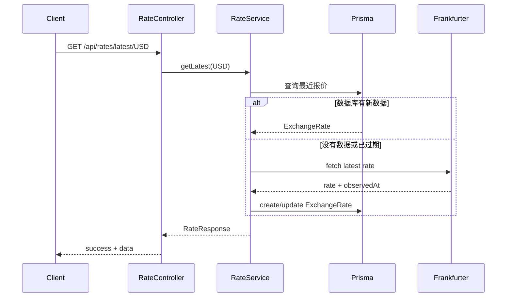
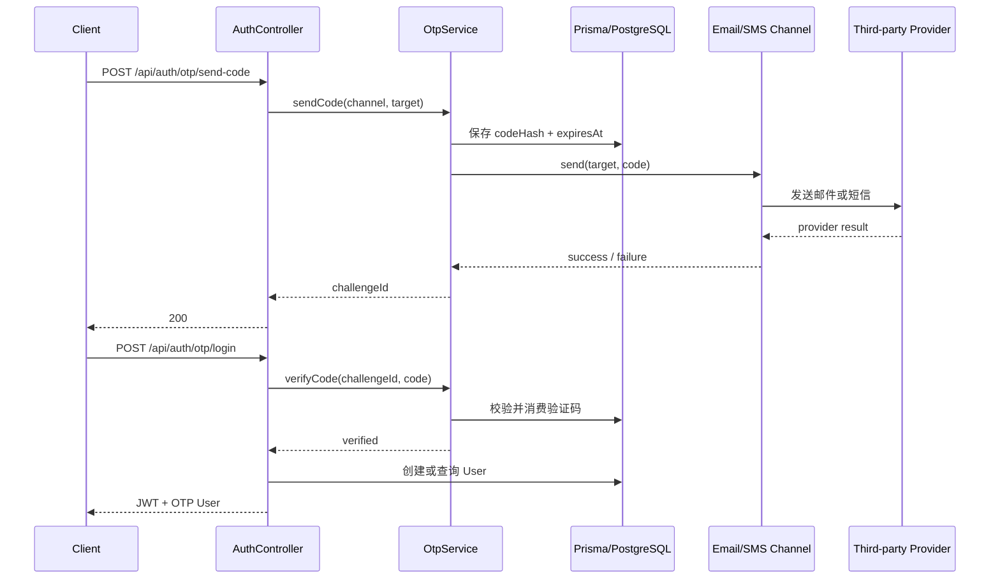
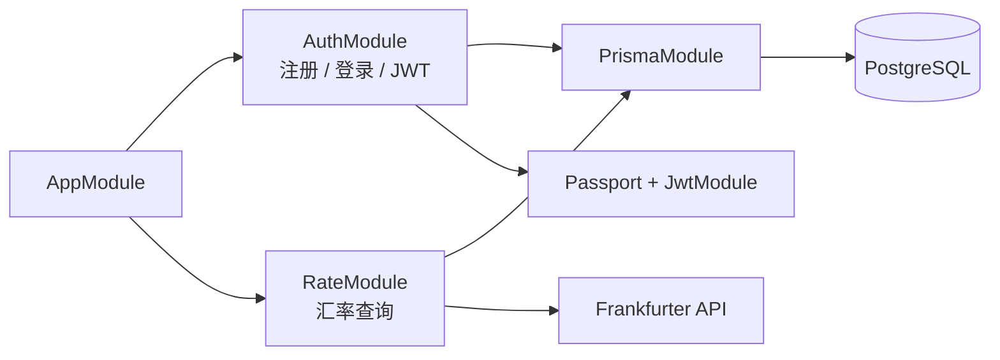

# FXPlanner 后端核心迁移执行方案（FXPlanner-new 技术栈）

## 0. 执行约束

- 目标项目：`/Users/dayu/Documents/知爻/正式的项目启动/FXPlanner-new`。
- 后端技术栈：Bun + NestJS + Prisma + PostgreSQL + JWT + Vitest + Supertest。
- 本阶段处理后端，并同步清理前端、共享契约和 E2E 中的 Project 示例代码。
- 不采用 DDD，不新增 `domain/application/infrastructure` 三层目录。
- 业务模块统一使用模板现有结构：`controller -> service -> Prisma/外部 Provider`。
- 第一阶段只保留：模板认证、汇率、健康检查、数据库基础设施。
- 第一阶段不迁移：OAuth、订阅、额度、预算、策略、银行牌价、旧 AI 解析。
- 每一步完成后先跑本步骤测试，再进入下一步。
- 方案文件位置：`changes/fxplanner-backend-core/方案.md`。

## 1. 第一步：清理模板示例模块

### 参考文件

新模板：

```text
services/chat/src/app.module.ts
services/chat/src/project/project.module.ts
services/chat/src/project/project.controller.ts
services/chat/src/project/project.service.ts
services/chat/src/project/dto/
services/chat/test/api/project.spec.ts
services/chat/test/integration/auth-project.spec.ts
services/chat/prisma/schema.prisma
services/chat/prisma/seed.ts
```

旧项目只做业务范围参考，不复制代码：

```text
backend/subscription/
backend/quota/
backend/strategy/
backend/bank_rate/
backend/ai_interaction/
```

### 目标

删除当前工作区的 `Project` 示例业务，使新应用只保留可复用的认证、Prisma、配置、健康检查和汇率能力。

### 目标目录

```text
services/chat/src/
├── auth/       # 保留：注册、登录、JWT
├── config/     # 保留：Zod 环境变量校验
├── prisma/     # 保留：PrismaService
├── rate/       # 新增：汇率查询
└── app.module.ts

services/chat/prisma/
├── schema.prisma
├── migrations/
└── seed.ts

services/chat/test/
├── api/
├── integration/
├── helpers/
└── prisma.spec.ts
```

### 执行动作

1. 删除 `services/chat/src/project/`。
2. 删除 `services/chat/test/api/project.spec.ts`。
3. 删除或拆分 `services/chat/test/integration/auth-project.spec.ts` 中依赖 Project 的测试。
4. 从 `services/chat/src/app.module.ts` 删除 `ProjectModule` import 和注册。
5. 从 `services/chat/prisma/schema.prisma` 删除 `Project` 模型。
6. 从 `User` 模型删除 `projects Project[]` 关系。
7. 从 `services/chat/prisma/seed.ts` 删除 Project seed。
8. 生成一条 Prisma migration，删除 `projects` 表。
9. 删除前端 Project 页面、业务组件、API client、React Query hooks、共享契约和 Project E2E；登录/注册成功后的默认跳转改为 `/`。
10. 全局检查是否还有运行时代码引用示例模块：

```bash
cd /Users/dayu/Documents/知爻/正式的项目启动/FXPlanner-new
rg -n "ProjectModule|ProjectService|project/|model Project" services/chat
```

### 注意事项

- 不删除 `PrismaModule`、`Config`、`AuthModule` 或测试基础设施。
- 不要把旧项目的订阅、额度、策略模型复制进新 Prisma Schema。

### 原则

- 模板 L1 核心优先保留。
- 示例业务和正式业务分开处理。
- 删除示例时同步删除模块注册、模型、seed 和测试，不能只删目录。

### 测试路径

```text
services/chat/test/prisma.spec.ts
services/chat/test/api/auth.spec.ts
```

### 测试命令

```bash
cd /Users/dayu/Documents/知爻/正式的项目启动/FXPlanner-new
bun run typecheck
bun run lint
bun run test api infra
```

### 完成标准

- `ProjectModule` 不再注册；
- `Project` 表不再出现在 Prisma Schema；
- Auth 测试仍然通过；
- Prisma migration 可以正常执行；
- `rg` 不再找到后端、前端、共享契约和 E2E 对 Project 运行时代码的引用。

## 2. 第二步：保留并收敛模板认证

### 参考文件

新模板：

```text
services/chat/src/auth/auth.controller.ts
services/chat/src/auth/auth.service.ts
services/chat/src/auth/auth.module.ts
services/chat/src/auth/dto/register.dto.ts
services/chat/src/auth/dto/login.dto.ts
services/chat/src/auth/dto/auth-response.dto.ts
services/chat/src/auth/guards/jwt-auth.guard.ts
services/chat/src/auth/strategies/jwt.strategy.ts
services/chat/src/auth/decorators/current-user.decorator.ts
services/chat/src/config/env.ts
services/chat/src/main.ts
services/chat/test/api/auth.spec.ts
services/chat/test/helpers/test-app.ts
```

旧项目登录行为仅用于对照：

```text
backend/identity/api/auth_router.py
backend/identity/application/auth_service.py
backend/identity/infrastructure/email_client.py
backend/identity/infrastructure/sms_client.py
```

### 目标

保留模板现有的邮箱密码注册/登录；邮箱/手机号 OTP 在第四步作为独立账号体系接入，不与密码账号绑定或合并。

保留接口：

```text
POST /api/auth/register
POST /api/auth/login
GET  /api/auth/me
```

### 执行动作

1. 保持 `AuthController` 的三个公开接口路径不变。
2. 保持 `RegisterDto` 的邮箱格式、密码长度和复杂度校验。
3. 保持 `AuthService` 使用 bcrypt 保存 `passwordHash`。
4. 保持 `JwtAuthGuard`、`JwtStrategy` 和 `CurrentUser` 装饰器。
5. 检查 `JWT_SECRET` 是否继续通过 `services/chat/src/config/env.ts` fail-fast 校验。
6. 检查 JWT 过期时间，不在本步骤增加 refresh token。
7. 统一返回结构：`success`、`data`、`message`。
8. 统一用户查询只返回 `id`、`email`、`name`、`avatar`、`createdAt`，不返回 `passwordHash`。
9. 删除模板 Auth 中与 Project 集成测试绑定的代码，但不改认证核心。
10. 不加入 OAuth、微信字段；邮件发送器、短信发送器和 OTP 表只在第四步的独立 OTP 流程中使用。

### 注意事项

- 密码登录按规范化后的 `User.email` 查询；OTP 登录只按 `OtpIdentity(channel,target)` 查询，两套账号不会因邮箱相同而合并。
- `test-login` 不迁移到新模板，测试使用 Nest TestingModule 和测试数据库完成。

### 原则

- 先复用模板已有的 L1 认证能力。
- 密码认证核心不依赖 OTP 表；OTP 身份通过独立表和独立用户记录隔离。
- 认证模块只负责用户、密码和 JWT，不负责邮件和短信。

### 测试路径

```text
services/chat/test/api/auth.spec.ts
services/chat/src/auth/auth.service.spec.ts
services/chat/src/auth/strategies/jwt.strategy.spec.ts
services/chat/test/helpers/test-app.ts
```

需要新增的单元测试可以放在源码同目录：

```text
services/chat/src/auth/auth.service.spec.ts
services/chat/src/auth/strategies/jwt.strategy.spec.ts
```

### 完成标准

- 注册、登录、获取当前用户全部通过；
- 重复邮箱注册返回 `409`；
- 错误密码返回 `401`；
- 无 Token 访问 `/api/auth/me` 返回 `401`；
- JWT 密钥从环境变量读取；
- 认证模块没有引用订阅、汇率代码。

## 3. 第三步：新增最小汇率模块

### 参考文件

新模板：

```text
services/chat/src/app.module.ts
services/chat/src/prisma/prisma.service.ts
services/chat/src/prisma/prisma.module.ts
services/chat/src/config/env.ts
services/chat/src/project/project.controller.ts
services/chat/src/project/project.service.ts
services/chat/src/project/project.module.ts
```

旧项目：

```text
backend/exchange_rate/api/rate_router.py
backend/exchange_rate/application/history_service.py
backend/exchange_rate/infrastructure/frankfurter_client.py
backend/exchange_rate/domain/entities.py
backend/exchange_rate/infrastructure/pg_rate_repository.py
backend/tests/test_rate_api.py
backend/tests/test_rate_history.py
```

### 目标

新增一个符合 NestJS 模板风格的 `rate` 模块，提供：

```text
GET /api/rates/supported
GET /api/rates/latest/:base
GET /api/rates/history
```

汇率模块只负责汇率数据，不负责订阅成本、额度、预算或策略。

### 执行动作

新增文件：

```text
services/chat/src/rate/rate.module.ts
services/chat/src/rate/rate.controller.ts
services/chat/src/rate/rate.service.ts
services/chat/src/rate/rate.provider.ts
services/chat/src/rate/rate.constants.ts
services/chat/src/rate/dto/rate-history.dto.ts
services/chat/src/rate/rate.service.spec.ts
services/chat/test/api/rate.spec.ts
services/chat/test/integration/rate-provider.spec.ts
```

修改文件：

```text
services/chat/src/app.module.ts
services/chat/prisma/schema.prisma
services/chat/prisma/seed.ts
```

### 文件职责

| 文件 | 方法 | 作用 |
| --- | --- | --- |
| `rate.module.ts` | `@Module()` | 注册 `RateController`、`RateService`、`PrismaModule` |
| `rate.controller.ts` | `supported()` | 返回支持的币种数组 |
| `rate.controller.ts` | `latest(base)` | 返回基础币种兑换 USD 的最新值 |
| `rate.controller.ts` | `history(dto)` | 返回历史汇率列表 |
| `rate.service.ts` | `getSupported()` | 读取币种常量 |
| `rate.service.ts` | `getLatest(base)` | 查库，无数据时调用 Provider 并保存 |
| `rate.service.ts` | `getHistory(base, target, period)` | 查历史，缺失时调用 Provider 并保存 |
| `rate.provider.ts` | `fetchLatest(base, target)` | 调用 Frankfurter 最新汇率接口 |
| `rate.provider.ts` | `fetchHistory(base, target, start, end)` | 调用 Frankfurter 历史接口 |
| `rate.constants.ts` | 常量 | 支持币种和周期白名单 |
| `dto/rate-history.dto.ts` | `class-validator` | 校验 base、target、period |

### Prisma 模型

在 `services/chat/prisma/schema.prisma` 新增：

```prisma
model ExchangeRate {
  id         String   @id @default(cuid())
  base       String
  quote      String
  rate       Decimal  @db.Decimal(20, 10)
  source     String
  observedAt DateTime @map("observed_at")
  createdAt  DateTime @default(now()) @map("created_at")

  @@unique([base, quote, observedAt])
  @@index([base, quote, observedAt])
  @@map("exchange_rates")
}
```

执行：

```bash
cd /Users/dayu/Documents/知爻/正式的项目启动/FXPlanner-new/services/chat
bunx prisma migrate dev --name add_exchange_rates
bunx prisma generate
```

### 注意事项

- 第一阶段不引入 Redis；先使用 PostgreSQL 持久化和 `observedAt` 判断数据新鲜度。
- 外部 HTTP 使用 Node 原生 `fetch`，设置 AbortController 超时。
- Provider 返回异常统一转换成 NestJS `BadGatewayException`。
- API 层不提供报价写入、修改、删除接口。
- 不把 `rate` 转成 JavaScript 浮点再写入数据库；响应可以按契约返回字符串。
- 不把历史趋势计算代码复制到 Controller，放在 `RateService` 私有方法中即可。

### 原则

- 单模块、单 Service、单 Provider；当前不抽象多个 Provider 工厂。
- Controller 只做参数接收和返回值包装。
- Prisma 查询只出现在 `RateService`。
- 所有支持币种只定义一份。

### 测试路径

```text
services/chat/src/rate/rate.service.spec.ts
services/chat/test/api/rate.spec.ts
services/chat/test/integration/rate-provider.spec.ts
services/chat/test/prisma.spec.ts
```

### 测试方式

- Service 单元测试 Mock `PrismaService` 和 `rate.provider.ts`。
- API 测试使用 Nest TestingModule + Supertest。
- Provider 测试 Mock 全局 `fetch`，禁止依赖真实外网。
- Prisma 测试验证 migration、唯一索引、Decimal 和时间排序。

### 完成标准

- `GET /api/rates/supported` 返回固定支持币种；
- `GET /api/rates/latest/USD` 能查库或调用 Provider；
- `GET /api/rates/history` 能校验 period 并返回历史序列；
- Provider 超时返回统一错误；
- 汇率模块没有引用旧订阅、额度、预算和策略模块。

### 汇率查询图



## 4. 第四步：手机号 OTP 和邮件发送能力

### 参考文件

新模板：

```text
services/chat/src/auth/auth.service.ts
services/chat/src/auth/auth.controller.ts
services/chat/src/auth/dto/
services/chat/src/config/env.ts
services/chat/src/prisma/prisma.service.ts
services/chat/src/app.module.ts
```

旧项目：

```text
backend/identity/api/auth_router.py
backend/identity/application/auth_service.py
backend/identity/infrastructure/email_client.py
backend/identity/infrastructure/sms_client.py
backend/identity/infrastructure/otp_store.py
```

### 目标

执行邮箱 OTP 和手机号 OTP。实现放在现有 `auth` 模块的 `otp/` 子目录，不创建新的架构层；OTP 账号与密码账号是两个独立账号，不绑定、不合并。

### 执行动作

新增文件：

```text
services/chat/src/auth/otp/otp.service.ts
services/chat/src/auth/otp/otp-channel.ts
services/chat/src/auth/otp/email-otp.channel.ts
services/chat/src/auth/otp/sms-otp.channel.ts
services/chat/src/auth/otp/dto/send-otp-code.dto.ts
services/chat/src/auth/otp/dto/otp-login.dto.ts
services/chat/test/api/otp.spec.ts
services/chat/test/integration/otp-auth.spec.ts
```

修改文件：

```text
services/chat/src/auth/auth.service.ts
services/chat/src/auth/auth.controller.ts
services/chat/prisma/schema.prisma
services/chat/src/config/env.ts
services/chat/src/auth/auth.module.ts
```

接口：

```text
POST /api/auth/otp/send-code
POST /api/auth/otp/login
```

### 邮件和短信封装

```typescript
export interface OtpChannel {
  send(target: string, code: string): Promise<void>;
}
```

- `email-otp.channel.ts`：调用 Resend HTTP API；
- `sms-otp.channel.ts`：调用阿里云短信 API；
- `otp.service.ts`：生成验证码、哈希存储、限流、过期和验证；
- `auth.service.ts`：OTP 成功后按 `OtpIdentity(channel,target)` 查找/创建独立 User，并签发 JWT。

### 注意事项

- `EmailSender` 和 `SmsSender` 不负责创建用户。
- Controller 不直接调用 Resend 或阿里云。
- 生产环境禁止 `DevEmailSender` 和 `DevSmsSender` 静默降级。
- OTP 验证码只保存带密钥的 HMAC 哈希，不保存明文。
- 同一个 `challengeId` 只能成功验证一次；同一目标重新请求后，旧的未消费验证码立即失效。
- 发送频率需要同时按目标地址和客户端来源限制，并在数据库事务内串行化检查和创建。
- 不在这一阶段增加 OAuth 或其他登录渠道。

### 测试路径

```text
services/chat/src/auth/auth.service.otp.spec.ts
services/chat/test/api/otp.spec.ts
services/chat/test/integration/otp-auth.spec.ts
services/chat/test/prisma.spec.ts
```

### 原则

- OTP 只作为 Auth 模块的扩展，不创建独立认证架构。
- 邮件和短信供应商只实现 `OtpChannel`，不侵入 `AuthService` 的账户逻辑。
- 未确认账号绑定规则前，不执行自动合并账户。

### 完成标准

- 邮箱和手机号可以共用 `send-code/login` 两个语义化接口；
- 首次验证可以按产品决策创建用户；
- OTP 过期、错误次数、重放和限流测试通过；
- Resend/阿里云调用使用 Mock 测试；
- 真实供应商只在手工验收环境测试；
- 密码登录和 OTP 登录并行保留，但按独立账号体系隔离。

### OTP 流程图



## 5. 第五步：测试和验收

### 参考文件

```text
README.md
AGENTS.md
scripts/test.ts
services/chat/package.json
services/chat/test/helpers/test-app.ts
services/chat/test/api/auth.spec.ts
services/chat/test/prisma.spec.ts
.github/workflows/ci.yml
```

### 目标

用模板已有测试体系验收，不新造 pytest、Alembic 或 FastAPI 测试体系。

### 注意事项

- 只执行模板已有的 Bun/Vitest/Prisma 命令，不引入 pytest、Alembic 或 FastAPI 工具链。
- 本阶段不启动真实外部供应商，不把测试输出写入 `services/chat/` 下的运行产物目录。
- AI 执行时遵守模板规则，不自动启动 dev server 或 Docker Compose。

### 原则

- 每一步先测试再进入下一步。
- 失败先修复，不以“功能暂时不用”为理由跳过类型检查和 migration 检查。
- 验收证据只记录实际执行过的命令和结果。

### 执行动作

1. 删除示例模块后跑认证和 Prisma 回归。
2. 新增汇率模块后跑单元、接口和 Provider 集成测试。
3. 生成并校验 Prisma Client。
4. 执行 migration deploy。
5. 执行 TypeScript 类型检查、lint 和 build。
6. 验收证据写入：

```text
changes/fxplanner-backend-core/验收报告.md
```

### 测试路径

```text
services/chat/src/auth/auth.service.spec.ts
services/chat/src/auth/auth.service.otp.spec.ts
services/chat/src/auth/strategies/jwt.strategy.spec.ts
services/chat/src/rate/rate.service.spec.ts
services/chat/test/api/auth.spec.ts
services/chat/test/api/rate.spec.ts
services/chat/test/api/otp.spec.ts
services/chat/test/integration/rate-provider.spec.ts
services/chat/test/integration/otp-auth.spec.ts
services/chat/test/prisma.spec.ts
```

### 测试命令

```bash
cd /Users/dayu/Documents/知爻/正式的项目启动/FXPlanner-new
bun run typecheck
bun run lint
bun run test unit api integration infra
bun run build
```

Prisma 检查：

```bash
cd /Users/dayu/Documents/知爻/正式的项目启动/FXPlanner-new/services/chat
bunx prisma validate
bunx prisma generate
bunx prisma migrate deploy
```

本次修改删除了 Project E2E；由于 AI 不启动 dev server，未在本轮运行 Playwright。前端接入汇率后再增加：

```text
e2e/modules/03-rates.spec.ts
```

### 完成标准

- Auth 原有测试全部通过；
- Project 示例模块彻底移除；
- Rate API 的三条接口通过接口测试；
- Provider 测试不依赖真实外网；
- Prisma migration 和 Client 生成通过；
- `bun run typecheck`、`bun run lint`、`bun run build` 通过；
- 新后端没有引入 DDD、Redis 和旧业务模块。

### 图形选择

| 图 | 什么时候使用 | 本方案是否使用 |
| --- | --- | --- |
| 模块依赖图 | 确认 `app.module.ts` 注册关系和模块边界 | 使用 |
| 时序图 | 外部 API 或第三方服务调用顺序 | 汇率使用；OTP 条件使用 |
| ER 图 | Prisma 表结构发生变化时 | OTP 方案确认后使用 |
| 流程图 | 表达迁移步骤和分支 | 使用文字步骤，不额外复杂化 |
| 部署图 | 部署组件和网络关系明确后 | 本阶段不需要 |

### 第一阶段模块依赖图



第一阶段的模块关系到此为止，不增加 RedisModule 或 EventBus。

## 6. 已确认的产品决策

本次执行采用“双入口、双账号体系”：

```text
邮箱 + 密码注册/登录：继续使用 users.email + users.password_hash
邮箱 OTP + 手机号 OTP：使用 otp_identities(channel,target) 查找或创建独立 users 记录
两类账号不绑定、不合并；即使邮箱相同，也分别对应不同的 userId
OAuth、订阅、额度、预算、策略：继续暂缓
```

OTP 验证码使用六位数字，保存带独立密钥的 HMAC 哈希；`OTP_CODE_SECRET` 必填且不得复用 `JWT_SECRET`。Resend 和阿里云短信只在真实供应商验收环境中启用，自动化测试继续 Mock。
