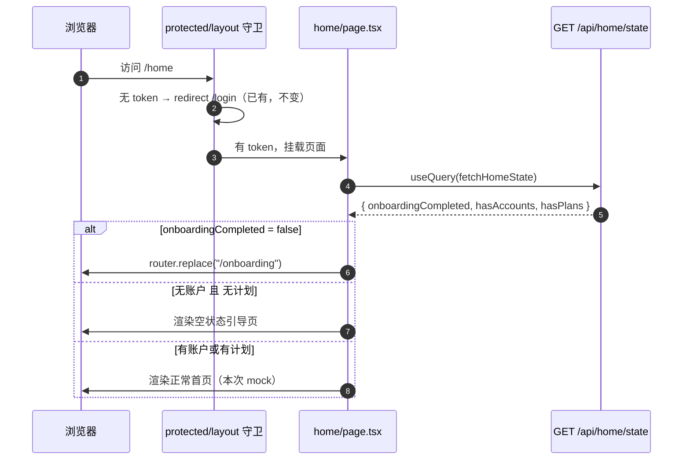

# 技术方案：首页分流与空状态（home-state-routing）

> 结论先行：本次涉及 **0 张新表**（M0 表已齐备）、**1 个新接口**（`GET /api/home/state`，返回分流三布尔 + 账户/计划摘要 + 最新汇率观测时间）、**1 个既有模块小增量**（rate.service 新增可复用查询方法）、前端 **1 页改造 + 1 个新组件**，预计净增代码约 500 行（含测试）。

## 1. 背景与目标

`/home` 当前为静态 mock，无任何状态判断。目标：进入首页前按账号数据状态三分流——

```
访问 /home
  │ ① 认证守卫（已有 (protected)/layout.tsx：无 token → /login）
  │ ② GET /api/home/state（一次请求）
  ├─ onboardingCompleted = false        → 跳 /onboarding 首次设置
  ├─ completed && 无账户 && 无计划       → 空状态引导首页（本次新做 UI）
  └─ completed && (有账户 || 有计划)     → 正常数据首页（本次仍渲染现有 mock）
```

「空账本」判定条件为 `!hasAccounts && !hasPlans`（已拍板）。依据：文档 02 允许完成首次设置时跳过外币填写，「完成设置但 0 数据」是合法状态；「有计划无账户」亦合法（创建计划可先不分配），归入正常首页处理。

## 2. 量化指标（预估）

| 指标项 | 预估值 | 依据/备注 |
| -------- | -------- | ----------- |
| 数据规模 | 单用户账户 ≤ 10 币种、计划个位数 | 个人工具，无分页必要 |
| 并发压力 | <10 QPS | 登录后进入首页时各调一次 |
| 响应要求 | <100ms | 全部走索引的简单查询（findUnique/findMany/aggregate） |
| 一致性 | 允许秒级陈旧 | 纯只读，无副作用 |

## 3. 接口契约

### 3.1 `GET /api/home/state` — 查询首页状态（分流 + 摘要）

需登录（JwtAuthGuard）。只读、无副作用、幂等。**一次请求返回分流判断 + 账号下全部业务摘要**。

**响应 200 · 示例 A：空账本**（完成设置但无外币、无计划）：

```json
{
  "success": true,
  "data": {
    "onboardingCompleted": true,
    "hasAccounts": false,
    "hasPlans": false,
    "accounts": [],
    "plans": [],
    "latestRateObservedAt": "2026-09-24T01:30:00.000Z"
  },
  "message": "首页状态查询成功"
}
```

**响应 200 · 示例 B：有数据**：

```json
{
  "success": true,
  "data": {
    "onboardingCompleted": true,
    "hasAccounts": true,
    "hasPlans": true,
    "accounts": [
      { "currencyCode": "USD", "balance": "1500.0000" },
      { "currencyCode": "JPY", "balance": "120000.0000" }
    ],
    "plans": [
      {
        "id": "cmex5g2h70000abcd",
        "targetCurrency": "USD",
        "targetAmount": "10000.0000",
        "allocatedAmount": "4000.0000",
        "remainingAmount": "6000.0000",
        "expectUseDate": "2026-10-01T00:00:00.000Z",
        "latestPrepDate": "2026-09-25T00:00:00.000Z",
        "status": "ACTIVE"
      }
    ],
    "latestRateObservedAt": "2026-09-24T01:30:00.000Z"
  },
  "message": "首页状态查询成功"
}
```

**字段说明**：

| 字段 | 类型 | 说明 |
| --- | --- | --- |
| `onboardingCompleted` | boolean | `user_settings` 中存在该用户记录 |
| `hasAccounts` | boolean | `accounts` 表该用户记录数 > 0，与 `accounts.length > 0` 恒一致 |
| `hasPlans` | boolean | `plans` 表该用户记录数 > 0，与 `plans.length > 0` 恒一致 |
| `accounts[]` | AccountSummary[] | 全量账户摘要，按 `currencyCode` 升序 |
| `accounts[].currencyCode` | string | 币种代码（ISO 4217） |
| `accounts[].balance` | string | 账户余额，金额字符串（见 §3.3 规范） |
| `plans[]` | PlanSummary[] | 全量计划摘要，按 `createdAt` 降序，不分页 |
| `plans[].id` | string | 计划 ID（cuid） |
| `plans[].targetCurrency` | string | 目标币种 |
| `plans[].targetAmount` | string | 目标金额 |
| `plans[].allocatedAmount` | string | 已分配金额（来自 `plan_allocations.amount`，无分配记录时不返回该计划行内此字段为 `"0.0000"`） |
| `plans[].remainingAmount` | string | 剩余可分配 = allocatedAmount − usedAmount（服务端计算，遵循 schema 注释「业务层计算，不存列」） |
| `plans[].expectUseDate` | string | 期望用汇日，ISO 8601 UTC |
| `plans[].latestPrepDate` | string | 最晚备汇日（服务端按 expectUseDate − prepLeadDays 推得，存量列） |
| `plans[].status` | string | 枚举大写：`ACTIVE` / `COMPLETED` / `CANCELLED` |
| `latestRateObservedAt` | string \| null | `exchange_rates.observed_at` 全表最大值；无任何汇率数据时为 `null`（顶栏「最新刷新」数据源） |

**错误**：`401` 未登录（全局守卫统一行为，模块不额外处理）。无其他业务错误分支——接口不抛 404/400，任何登录用户都能得到完整状态。

**前端分流决策表**（契约的消费方式，前后端以此对齐）：

| onboardingCompleted | hasAccounts | hasPlans | 前端行为 |
| --- | --- | --- | --- |
| false | 任意 | 任意 | `router.replace("/onboarding")` |
| true | false | false | 渲染空状态引导页 |
| true | 任意 true | 任意 | 渲染正常首页（本次 mock） |

**本次前端消费范围**：仅消费分流三布尔；`accounts[]` / `plans[]` / `latestRateObservedAt` 为正常首页接入真实数据预留（下阶段 `home-dashboard` 替换 mock 时直接使用，联调成本为零），本次不渲染。

DTO（后端唯一类型来源，前端经 `bun run generate:api` 生成）：

```ts
export class AccountSummaryDto {
  currencyCode: string;
  balance: string; // Decimal(20,4) → 字符串
}

export class PlanSummaryDto {
  id: string;
  targetCurrency: string;
  targetAmount: string;
  allocatedAmount: string;
  remainingAmount: string;
  expectUseDate: string; // ISO 8601 UTC
  latestPrepDate: string;
  status: "ACTIVE" | "COMPLETED" | "CANCELLED";
}

export class HomeStateDto {
  onboardingCompleted: boolean;
  hasAccounts: boolean;
  hasPlans: boolean;
  accounts: AccountSummaryDto[];
  plans: PlanSummaryDto[];
  latestRateObservedAt: string | null;
}
```

### 3.2 接口格式约束现状（调研结论）

| 项 | 现状 |
| --- | --- |
| 成功包装 `{ success, data, message }` | ✅ 事实约定：auth / rate / onboarding 三个既有模块手写遵守 |
| 强制机制 | ❌ 无全局响应拦截器/异常过滤器，全局仅有 `ValidationPipe`（whitelist + transform） |
| 错误响应 | NestJS 默认 `{ statusCode, message, error }`，与成功格式不对称 |
| 前缀与文档 | 全局前缀 `/api`；Swagger 挂 `/docs`（仅 dev），DTO 即 OpenAPI 模型 |

### 3.3 接口格式规范（本次起明文执行，新增接口必须遵守）

1. **成功包装**：`{ success: true, data, message }`，controller 手写包装（对齐既有模块；全局 Interceptor 强制化列为遗留建议，见 §8）。
2. **错误响应**：业务错误抛 `HttpException` 子类，走 Nest 默认 `{ statusCode, message, error }`；401 由全局守卫统一返回，模块不重复处理。
3. **字段命名**：接口层一律 camelCase；Prisma `@map` 的 snake_case 不得外泄。
4. **金额**：一律字符串传输，保留 Decimal(20, 4) 精度（如 `"1500.0000"`）；禁止 number（IEEE 754 浮点误差不可接受，与 `packages/money` 精度约定配套）。
5. **汇率/单位成本**：字符串，保留 Decimal(20, 10) 精度。
6. **日期时间**：ISO 8601 UTC（`toISOString()`），客户端本地化时区。
7. **枚举**：大写字符串（如 `ACTIVE`），与 Prisma 存量值一致。
8. **空集合**：返回 `[]`，不返回 `null`；「无数据」用 `null` 或布尔字段表达。

## 4. 实现设计

### 4.1 分流时序



图例：②号请求为本方案唯一新增网络调用；守卫（①）不改动。

### 4.2 后端（services/chat）

新增 `home` 模块，三层齐备但每层极薄：

- `HomeService.getState(userId)`：四组查询并行（`Promise.all`）——
  1. `userSettings.findUnique({ where: { userId } })` → `onboardingCompleted`
  2. `account.findMany`（取 `currencyCode` + `balance`，orderBy currencyCode）→ `accounts` + `hasAccounts`
  3. `plan.findMany`（include `planAllocation`，orderBy createdAt desc）→ `plans`（含 `remainingAmount = amount − usedAmount` 服务端计算）+ `hasPlans`
  4. 调用 `rateService.getLatestObservedAt()` → `latestRateObservedAt`
- **方法封装判定（按约定说明）**：
  - **抽方法**：`latestRateObservedAt`（「最晚日期」类查询，首页/仪表盘等他处复用预期明确）→ 抽为 `rate.service` 公开方法 `getLatestObservedAt()`（`aggregate({ _max: { observedAt: true } })`，单行实现）；汇率域数据归 rate 模块，home 模块不直接查 `exchange_rates` 表。
  - **内联**：settings 查询与账户/计划摘要查询为一次性简单读取，内联在 `HomeService`；账户/计划业务模块落地后由各自模块的 service 接管，届时本接口重构为调用方。
- `HomeController`：`@Controller("home")` + `@UseGuards(JwtAuthGuard)` + `@CurrentUser()`，响应包装与文案风格对齐 `onboarding.controller.ts`。
- `app.module.ts` 注册 `HomeModule`（模块唯一注册点）。
- 空状态判定**只返回原始事实**（三布尔），不在后端写「是否空账本」业务规则——分流规则属于前端展示层关注点，后端保持数据中立，规则调整不用动后端。

### 4.3 前端（clients/chat-web）

- `lib/api/home.ts`：`homeApi.getState()`，复用 `apiClient` 封装（模式同 `authApi`）；类型优先取 `bun run generate:api` 产物，生成链路未覆盖时临时在 `contract.ts` 补类型（与 auth 现状一致）。
- **本次仅消费分流三布尔**（§3.1 消费范围说明）；`accounts[]` / `plans[]` / `latestRateObservedAt` 下阶段接入 `home-dashboard`。
- `app/(protected)/home/page.tsx`：改为 `useQuery` 拉取 state 的瘦壳——
  - 加载中：整页骨架屏（沿用「最新刷新」区位置，避免布局跳动）；
  - 请求失败：整页错误态 + 重试按钮（react-query `refetch`），不跳转不误判；
  - 成功：按 §3 决策表三分支。
- 现有 mock 首页内容抽为 `components/business/home/home-dashboard.tsx`（原样搬移，不改内容）。
- 新增 `components/business/home/home-empty-state.tsx`：截图版空状态引导页（标题「先建立第一笔跨币种资金准备」、中央卡片「从目标或持仓开始」、右侧三步引导、底部免责条），带 `index.ts` 桶文件。
- **CTA 跳转（受限于目标页不存在）**：「创建第一个目标」「录入已有持仓」本次渲染为禁用态 + tooltip「功能开发中」，不做路由跳转；目标页落地后接 `router.push`。理由：跳占位空页比明确禁用更伤体验。

## 5. 代码影响范围

<pre>
FXPlanner-new/
├─ services/chat/
│  ├─ src/
│  │  ├─ app.module.ts                                    <font color="#5b3cc4">(M)</font> 注册 HomeModule
│  │  ├─ rate/rate.service.ts                             <font color="#5b3cc4">(M)</font> 新增 getLatestObservedAt() 公开方法
│  │  └─ home/                                            <font color="#1a5c2a">(A)</font> 新模块
│  │     ├─ home.module.ts                                <font color="#1a5c2a">(A)</font> imports RateModule
│  │     ├─ home.controller.ts                            <font color="#1a5c2a">(A)</font> GET /home/state
│  │     ├─ home.service.ts                               <font color="#1a5c2a">(A)</font> getState：四组查询
│  │     └─ dto/home.dto.ts                               <font color="#1a5c2a">(A)</font> HomeStateDto + 摘要 DTO
│  └─ test/api/
│     └─ home.spec.ts                                     <font color="#1a5c2a">(A)</font> 接口测试
├─ clients/chat-web/
│  ├─ lib/api/
│  │  ├─ contract.ts                                      <font color="#5b3cc4">(M)</font> 视生成链路补 HomeState 类型
│  │  └─ home.ts                                          <font color="#1a5c2a">(A)</font> homeApi.getState
│  ├─ app/(protected)/home/
│  │  └─ page.tsx                                         <font color="#5b3cc4">(M)</font> 瘦壳 + 三分流
│  └─ components/business/home/                           <font color="#1a5c2a">(A)</font>
│     ├─ home-dashboard.tsx                               <font color="#1a5c2a">(A)</font> 原 mock 内容搬移
│     ├─ home-empty-state.tsx                             <font color="#1a5c2a">(A)</font> 空状态引导页
│     └─ index.ts                                         <font color="#1a5c2a">(A)</font> 桶文件
</pre>

不改动：认证守卫、onboarding 模块、Prisma schema、路由结构。

## 6. 测试设计

### 6.1 接口测试 `services/chat/test/api/home.spec.ts`

| # | 场景 | 预期 |
| --- | ------ | ------ |
| 1 | 未携带 token 访问 | 401 |
| 2 | 新注册用户（无设置/账户/计划） | 200，三布尔全 false，`accounts=[]`，`plans=[]` |
| 3 | 完成首次设置但跳过外币、无计划 | `onboardingCompleted=true`，余 false，列表全空 |
| 4 | 完成设置 + 有 1 个账户、无计划 | `hasAccounts=true`，`accounts` 含该账户且 `balance` 为字符串 |
| 5 | 完成设置 + 无账户、有 1 个计划（有分配） | `hasPlans=true`，`remainingAmount = amount − usedAmount` |
| 6 | 完成设置 + 无账户、有 1 个计划（无分配记录） | `allocatedAmount="0.0000"`，`remainingAmount="0.0000"` |
| 7 | 数据隔离：用户 A 有账户/计划，查用户 B | B 全空，A 数据不泄露 |
| 8 | `latestRateObservedAt`：库中有汇率记录 | 返回全表最大 `observed_at`（ISO 8601） |
| 9 | `latestRateObservedAt`：库中无汇率记录 | 返回 `null` |
| 10 | 重复调用（幂等） | 两次结果一致，无副作用 |

另：`getLatestObservedAt()` 经场景 8/9 间接覆盖（经 home 接口出），不在 rate 模块单独加测试文件。

### 6.2 前端

- **单元测试**：分流逻辑收敛进 `lib/hooks/use-home-state.ts`（useQuery 封装 + 三态归一），按「前端只测 lib/hooks」约定补 `use-home-state.spec.ts`——覆盖 加载/错误/三分支返回值。
- **E2E**：本次不新增。理由：正常首页为 mock、空状态 CTA 为禁用态，E2E 断言价值低且目标页缺失；待账户/计划模块落地后一并补（登记到遗留问题）。

### 6.3 验收门禁

接口测试 + 前端单测全绿（0 failed），附测试日志。

## 7. 回滚

纯增量变更，无数据迁移：后端摘除 `app.module.ts` 中 `HomeModule` 注册即恢复；前端 `git revert` page.tsx 与新组件。无配置项、无环境变更。

## 8. 遗留问题（本次不做，需登记）

1. **「录入已有持仓」入口的产品缺口**：文档 02 规定初始持仓仅可「更正」不可「新增」；完成设置时跳过外币的用户事后无补录路径。需产品拍板：走「快速录入（买入）」还是开放初始记录补录入口。
2. **空状态 CTA 目标页**（/plans 新建、持仓录入）不存在，本次按钮禁用；页面落地后回归此组件接线。
3. **正常首页真实数据**：`/home/state` 已返回 `accounts[]` / `plans[]` / `latestRateObservedAt`（§3.1），下阶段 `home-dashboard` 替换 mock 时直接消费，无需后端改动；涉及持仓总成本等聚合统计时再扩展接口或由账户模块提供。
4. **接口格式强制化**：全局 `TransformInterceptor` + `ExceptionFilter` 统一包装成功/错误响应（消除手写包装与格式不对称），涉及存量接口响应路径回归，建议单独立项。
