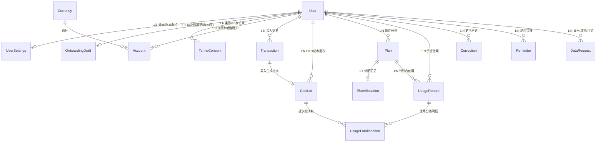

# 技术方案：M0 基础设施

> 已确认：核心场景——为全部 12 个模块提供「币种单一来源、金额/汇率计算标准、数据模型地基、契约生成管线」；量级——个人工具级，用户 <1,000、交易记录万级/年；最大风险点——精度规则实现错误（钱算错）与 schema 一次冻结后的返工。
>
> 本次涉及：**新增 15 张业务表（一次冻结）+ 1 个公开接口 + 1 个共享包（`packages/money`）+ 删除 1 个包（`packages/contracts`）**，预计改动约 1,800 行（含 schema 与测试）。

**与既有文档的三处不一致，本方案已裁决**：

| # | 不一致 | 裁决 |
|---|--------|------|
| 1 | 开发计划写「汇率 4 位小数」，doc 02/05 写 8 位 | 以 **8 位** 为准，修订开发计划 |
| 2 | `services/chat/src/rate/rate.constants.ts` 硬编码 12 币种，doc 13 为 15 币种 | 补齐 **15 币种**，来源收敛到 `packages/money` |
| 3 | 开发计划 M0 含「contracts 扩展」任务，用户决策移除 contracts 包 | 改为 **OpenAPI 生成 + `packages/money`**，修订开发计划与 AGENTS.md |

## 1. 目标与量化约束

### 1.1 业务背景

FXPlanner 是个人换汇规划工具，M0 为所有模块提供四块地基：① 15 币种清单的唯一定义与下发；② 金额/汇率精度计算标准（十进制、最终舍入一次、舍 0 拦截）；③ 全量 Prisma schema（W1 起 schema 冻结，只此一次机会）；④ 前后端类型契约管线（删除 contracts 包，改为 OpenAPI 生成）。

### 1.2 核心指标预估

| 指标项 | 预估值 | 依据/备注 |
| -------- | -------- | ----------- |
| 数据规模 | 用户千级、交易/使用记录万级/年 | 个人工具，预估 |
| 并发压力 | 峰值 QPS < 10 | 单用户自用为主，预估 |
| 响应要求 | 同步 < 500ms | 币种清单为静态字典，可长缓存 |
| 一致性等级 | 强一致（本地事务） | 单库单服务，无跨服务事务；后续入账类操作用 Prisma 事务 |

### 1.3 约束条件

- **schema 冻结纪律**：W1 起 schema 只读，M0 必须一次设计到位；但 M6「分批准备安排表」依赖待确认项（工作日日历），提前设计风险大于收益，届时按冻结流程回主分支增表（纪律允许）。
- 项目已有 `@nestjs/swagger` 11.x、`class-validator` DTO 风格、Prisma 5.x + PostgreSQL，方案不引入新技术栈。
- AI 禁止启动服务，接口联调验证由人工执行。

## 2. 方案选型与取舍

### 2.1 决策一：contracts 包的替代（用户已决策移除）

| 维度 | A：前后端各自定义、人工同步 | B：后端为唯一来源，OpenAPI 生成前端类型 |
| ------ | --------------------------- | ---------------------------------------- |
| 类型一致性 | 靠人肉，必然漂移（本次 12 vs 15 币种漂移即实证） | 工具生成，零漂移 |
| 成本 | 立即零成本 | 后端 DTO 已带 `@ApiProperty`（现状已就位 90%），前端加 `openapi-typescript` 一条命令 |
| 维护成本 | 每个接口两端各改一遍 | 只改后端 DTO，重新生成 |
| 行业惯例 | 无（反模式） | Contract-First / API-First，REST 契约事实标准 |

**结论**：选 **B**。后端 `@nestjs/swagger` 已启用（`services/chat/src/main.ts:20`），边际成本≈0；contracts 包删除，共享类型由生成文件承担。

### 2.2 决策二：精度计算代码放哪里

类型可以生成，**可执行的正确性逻辑不能生成**。精度规则（舍入、舍 0 拦截）前后端都需要（前端录入实时预览，后端入账权威）。

| 维度 | A：两端各自实现 + 同源测试用例对齐 | B：零依赖 workspace 共享包 `packages/money` |
| ------ | ----------------------------------- | --------------------------------------------- |
| 一致性 | 靠测试用例约束，实现仍可能漂移 | 同一份代码，结构性消除漂移 |
| 维护成本 | 规则每改一次两端同步 | 改一处 |
| 与用户「删包」决策的关系 | 符合 | 需说明：与 contracts 本质不同 |

**结论**：选 **B**。contracts 是「需要人工同步的类型副本」（已被生成取代）；money 是「纯函数正确性逻辑」（无法生成）。monorepo 共享纯函数库是行业标准（等价于发布一个 npm 内部包），且为 `packages/*` 既有 workspace 模式的正常使用，不属于恢复 contracts。

### 2.3 决策三：十进制库选型

| 维度 | 原生 number | BigInt 手写 | decimal.js | Prisma.Decimal（decimal.js-light） |
| ------ | ------------ | ------------- | ------------ | ----------------------------------- |
| 小数精度 | 二进制浮点，0.1+0.2≠0.3，不可接受 | 无小数，需自己实现定点 | 完整任意精度十进制 | 同族，功能子集 |
| 舍入模式 | 不可控 | 手写 | ROUND_HALF_UP 等 8 种现成 | 有 |
| 团队熟悉度 | — | 低 | 高（npm 周下载千万级） | 中 |

**结论**：`packages/money` 显式依赖 **decimal.js**。理由：舍入模式与有效位控制是本项目的生命线，需要全功能库；Prisma 内部同族（decimal.js-light），序列化兼容；不选 Prisma.Decimal 是因为不想让纯前端可用的 money 包依赖 `@prisma/client`。

### 2.4 决策四：币种清单存哪里（用户已决策：存后端、接口下发）

| 维度 | A：各端硬编码常量 | B：数据库 Currency 表 + 接口下发 | C：仅 money 包常量、无表 |
| ------ | ------------------- | -------------------------------- | -------------------------- |
| 增删币种 | 两端发版 | seed 改一处（seed 引用 money 常量） | 前端要重新拉包 |
| 与汇率/账户等表的外键一致性 | 无约束 | 可做外键/校验 | 无约束 |
| 复杂度 | 最低 | 低（静态字典 + 内存缓存） | 低 |

**结论**：选 **B**，且 **seed 数据从 `packages/money` 的币种常量生成**——单一事实来源在 money 包（类型安全、前端可用），Currency 表是它的数据库物化（供外键校验与下发接口），两者由 seed 保证一致。

## 3. 核心设计

### 3.1 契约生成管线（本方案的架构核心）

```mermaid
sequenceDiagram
  participant Dev as 开发者
  BE as services/chat（NestJS）
  Gen as openapi-typescript
  FE as clients/chat-web

  Dev->>BE: 启动后端（dev）
  BE-->>Dev: GET /docs-json（OpenAPI JSON，由 DTO 装饰器自动生成）
  Dev->>Gen: bun run generate:api
  Gen->>BE: 拉取 /docs-json
  Gen-->>FE: 生成 lib/api/schema.gen.ts（纯类型，提交入库）
  FE->>FE: 业务代码 import 类型 from "@/lib/api/schema.gen"
```

> 图例说明：后端 DTO（class + `@ApiProperty`）是唯一契约来源；`schema.gen.ts` 是生成产物（文件头标注「禁止手改」），提交入库使前端构建/CI 不依赖后端运行。运行时数据契约（如币种清单本身）走接口下发，不进类型。

### 3.2 数据模型（一次冻结，16 模型）



> 索引理由：FIFO 取批次按 `(userId, currencyCode, acquiredAt, createdAt)` 顺序扫描，该复合索引是 M7/M8 重算成本的高频路径。

**模型清单与关键字段**（金额列统一 `Decimal(20,4)`，汇率/单位成本统一 `Decimal(20,10)`，与现有 `ExchangeRate.rate` 精度一致）：

| 模型 | 状态 | 关键字段与设计说明 |
| ------ | ------ | -------------------- |
| `User` | 已有，不改 | 认证身份 |
| `UserSettings` | 新 | `baseCurrency`（本位币，设置后业务层禁止更新）、`locale`、`region`、`prepPreference`（默认 balanced）、`reminderEnabled`、`ledgerStartedAt`（账本起点，M11 清空时重置） |
| `Currency` | 新 | `code`（唯一，3 位大写）、`nameZh`、`nameEn`、`decimalPlaces`、`sortOrder`、`isActive`；seed 引用 money 包常量 |
| `OnboardingDraft` | 新 | `userId` 唯一、`payload Json`、`expiresAt`（最后修改 +30 天）；M1 使用，表在此建（schema 冻结） |
| `TermsConsent` | 新 | `termsVersion`、`consentType`（terms / age18）、`consentedAt`；`@@unique([userId, termsVersion, consentType])` |
| `Account` | 新 | `userId + currencyCode` 唯一（同币种单虚拟账户）、`balance`；余额 0 保留不删 |
| `Transaction` | 新 | `quantity`（到账外币）、`principalAmount`（本金）、`feeAmount Decimal?`（**null=未知，0=无**，语义区分）、`exchangeRate`、`rateSource`、`rateObservedAt`、`planId?`（仅标记）、`transactedAt`、`version`（更正版本号，从 1 递增） |
| `CostLot` | 新 | `sourceType`（INITIAL / PURCHASE）、`sourceId`、`quantity`、`remainingQty`、`unitCost(20,10)`、`totalCost`、`acquiredAt`；FIFO 排序键 `(acquiredAt, createdAt, id)` 实现同日「先初始持仓→再买入→同类按录入顺序」 |
| `Plan` | 新 | `targetCurrency`、`targetAmount`、`expectUseDate`、`prepLeadDays`（默认 3）、`latestPrepDate`、`status`（ACTIVE / COMPLETED / CANCELLED） |
| `PlanAllocation` | 新 | `planId` 唯一（一计划一币种一条分配汇总）、`amount`、`usedAmount`；剩余 = amount − usedAmount（业务层计算） |
| `UsageRecord` | 新 | `planId`、`amount`、`usedAt`、`version`；分次使用=多行 |
| `UsageLotAllocation` | 新 | `usageId + lotId` 唯一、`quantity`、`cost`；一笔使用消耗多个批次的明细 |
| `Correction` | 新 | `targetType`（TRANSACTION / USAGE / PLAN）、`targetId`、`reason`（必填）、`beforeSnapshot Json`、`afterSnapshot Json`、`status`（APPLIED / FAILED）、`failReason?`；按 `targetId` 查询即修改历史，FAILED 保留失败尝试 |
| `Reminder` | 新 | `type`（7 类场景）、`planId?`、`dedupKey`、`scheduledFor`（Date）；`@@unique([userId, dedupKey, scheduledFor])` 实现同计划同日合并防打扰 |
| `DataRequest` | 新 | `type`（EXPORT / CLEAR / DELETION）、`status`、`requestedAt`、`dueAt`（7 自然日）、`downloadExpiresAt`（24 小时）、`fileUrl?` |
| `ExchangeRate` / `OtpChallenge` / `OtpIdentity` / `WorkflowCheckpoint` | 已有，不改 | — |

**明确不建**：分批准备安排表（M6 按冻结流程增建）；本位币不存 Transaction 冗余列（取自 UserSettings，避免双写不一致）。

### 3.3 关键状态机（schema 内含 ≥3 状态的实体）

`Plan.status`：`ACTIVE → COMPLETED`（用户确认，例 13）、`ACTIVE → CANCELLED`（取消释放分配）、`COMPLETED → ACTIVE`（重开并提高目标，例 14）；`CANCELLED` 为终态（能否重开属待确认项，M5 裁决）。`DataRequest.status`：`PENDING → PROCESSING → READY → COMPLETED / EXPIRED`（下载过期限）。两者流转规则在所属模块（M5/M11）方案中细化，M0 仅冻结字段与取值。

## 4. 接口契约（M0 唯一新接口）

| 项 | 内容 |
| ---- | ------ |
| 路径 | `GET /api/currencies` |
| 鉴权 | 公开（首次设置在登录后但需在未选本位币前使用；清单非敏感） |
| 缓存 | 服务端内存缓存（进程内单例）；响应头 `Cache-Control: public, max-age=3600` |
| 幂等 | 只读，天然幂等 |

入参：无。

出参：

```json
{
  "items": [
    {
      "code": "HKD",
      "nameZh": "港币",
      "nameEn": "Hong Kong Dollar",
      "decimalPlaces": 2,
      "sortOrder": 1
    },
    {
      "code": "JPY",
      "nameZh": "日元",
      "nameEn": "Japanese Yen",
      "decimalPlaces": 0,
      "sortOrder": 14
    }
  ]
}
```

约束：仅返回 `isActive = true`，按 `sortOrder` 升序；`decimalPlaces` 取值仅 0 / 2。前端币种选择、精度校验提示、后端各模块 `IsIn` 校验（如 `RateHistoryDto`）均以该清单及 money 包常量为唯一来源。

## 5. 代码影响范围

### 5.1 共享包与工程配置

<pre>
packages/
├── <font color="#991b1b">contracts/</font> (D) [注: 整包删除，职能由 OpenAPI 生成 + money 承接]
└── <font color="#166534">money/</font> (A) [注: 新增零依赖级共享包（仅依赖 decimal.js），前后端共用精度逻辑]
    ├── package.json / tsconfig.json (A)
    └── src/
        ├── <font color="#166534">currencies.ts</font> (A) [注: 15 币种常量（code/nameZh/nameEn/decimalPlaces/sortOrder），单一事实来源]
        ├── <font color="#166534">round.ts</font> (A) [注: roundToCurrency / assertNotRoundToZero / assertAmountLimit]
        ├── <font color="#166534">rate.ts</font> (A) [注: roundRateTo8（四舍五入 8 位，ROUND_HALF_UP）]
        ├── <font color="#166534">calc.ts</font> (A) [注: 到账金额与反算汇率，中间全精度、最终舍一次]
        ├── <font color="#166534">errors.ts</font> (A) [注: RoundToZeroError / AmountLimitExceededError / InvalidAmountError]
        └── <font color="#166534">index.ts</font> (A) [注: 桶文件]
</pre>

### 5.2 后端 services/chat

<pre>
services/chat/
├── prisma/
│   ├── <font color="#92400e">schema.prisma</font> (M) [注: 新增 12 模型（见 3.2 清单），W0 冻结基线]
│   ├── <font color="#166534">migrations/&lt;ts&gt;_m0_schema_baseline/</font> (A) [注: 建表迁移]
│   └── <font color="#92400e">seed.ts</font> (M) [注: 从 @fxplanner-new/money 币种常量生成 Currency 15 行，upsert 幂等]
└── src/
    ├── <font color="#92400e">app.module.ts</font> (M) [注: 注册 CurrencyModule]
    ├── <font color="#166534">currency/</font> (A) [注: 新模块，币种字典下发]
    │   ├── <font color="#166534">currency.module.ts</font> (A)
    │   ├── <font color="#166534">currency.controller.ts</font> (A) [注: GET /api/currencies，公开路由]
    │   ├── <font color="#166534">currency.service.ts</font> (A) [注: 查询 + 进程内缓存，isActive 过滤排序]
    │   └── dto/
    │       └── <font color="#166534">currency-response.dto.ts</font> (A) [注: 出参 DTO，@ApiProperty 全标注]
    └── rate/
        └── <font color="#92400e">rate.constants.ts</font> (M) [注: SUPPORTED_CURRENCIES 12→15，改从 @fxplanner-new/money 导入；isSupportedCurrency 保留]
</pre>

### 5.3 前端 clients/chat-web（契约管线切换）

<pre>
clients/chat-web/
├── package.json (M) [注: 移除 @fxplanner-new/contracts；devDeps 加 openapi-typescript；scripts 加 generate:api]
├── <font color="#92400e">next.config.ts</font> (M) [注: transpilePackages 移除 contracts]
├── <font color="#92400e">app/login/page.tsx</font> (M) [注: 类型 import 改 @/lib/api/schema.gen]
└── lib/
    ├── <font color="#166534">api/schema.gen.ts</font> (A) [注: openapi-typescript 生成产物，文件头「禁止手改」，提交入库]
    ├── <font color="#92400e">api/auth.ts</font> (M) [注: 类型 import 切换到 schema.gen]
    ├── <font color="#92400e">stores/auth-store.ts</font> (M) [注: 同上]
    └── <font color="#92400e">query/hooks/use-auth.ts</font> (M) [注: 同上]
</pre>

> [引用方] `schema.gen.ts`：lib/api/auth.ts、lib/stores/auth-store.ts、lib/query/hooks/use-auth.ts、app/login/page.tsx；后续所有模块的 api 封装统一从该文件取类型。

### 5.4 文档与规范同步修订

<pre>
├── <font color="#92400e">AGENTS.md</font> (M) [注: 目录树删除 packages/contracts、新增 packages/money；「新共享类型」归属改为「后端 DTO + OpenAPI 生成」]
└── <font color="#92400e">docs/开发计划/MVP开发计划.md</font> (M) [注: M0「contracts 扩展」改为「money 包 + OpenAPI 契约管线 + Currency 表/接口」；「汇率 4 位小数」改 8 位；W0 隔离性描述同步]
</pre>

### 5.5 测试文件树（文件与被测对象一一对应）

<pre>
├── packages/money/
│   └── src/
│       ├── <font color="#166534">round.spec.ts</font> (A) [注: 各币种舍入、JPY/KRW 整数、舍 0 拦截、上限校验]
│       └── <font color="#166534">calc.spec.ts</font> (A) [注: 到账互算、反算汇率、中间不舍入（doc 02 规则全量断言）]
├── services/chat/
│   ├── src/currency/
│   │   └── <font color="#166534">currency.service.spec.ts</font> (A) [注: 缓存、过滤、排序]
│   ├── test/api/
│   │   └── <font color="#166534">currency.spec.ts</font> (A) [注: GET /api/currencies 状态码/结构/15 币种/精度值]
│   └── test/
│       └── <font color="#92400e">prisma.spec.ts</font> (M) [注: 增补 schema 基线断言（唯一约束、精度标度）]
└── e2e/
    └── [无] [注: M0 无用户操作路径，E2E 自 M1 起按《15个计算例子-测试用例清单》逐步覆盖]
</pre>

## 6. 可靠性保障

- **舍 0 拦截**：`assertNotRoundToZero` 在入账前调用，抛 `RoundToZeroError`，调用方（M1/M4）不产生任何写入。
- **seed 幂等**：Currency 用 `upsert` 按 `code` 对齐，重复执行不产生重复行；`isActive=false` 采取软停用，不做物理删除，保历史记录外键有效。
- **契约管线回退**：`schema.gen.ts` 提交入库，后端不可用时前端仍可构建；生成失败不影响现有代码（仅类型层面）。
- **schema 回滚**：迁移为纯新增表/列，兼容旧代码；`packages/contracts` 删除属于编译期破坏性变更，与前端 import 切换同一 PR 原子提交，不设双轨期。
- **存量数据**：现有库仅含演示用户与汇率数据，新表无回填需求；`ExchangeRate` 不动。

## 7. 可观测性

- `GET /api/currencies` 走全局日志中间件（入口 Info 一条），无外部调用出口。
- money 包为纯函数，不做日志；错误一律以类型化 Error 抛出，由调用方决定呈现。
- 本模块无核心监控指标，告警体系随 M1+ 的入账链路建设。

## 8. 测试策略（三类分写）

### 8.1 单元测试

| 测试文件 | 被测对象 | 覆盖点 |
| ---------- | ---------- | -------- |
| `packages/money/src/round.spec.ts` | `roundToCurrency` / `assertNotRoundToZero` / `assertAmountLimit` | JPY/KRW 整数与其余 2 位；四舍五入（ROUND_HALF_UP）；正数舍 0 抛错；999.999 超上限边界（< 100,000,000,000）；负数/0/NaN 拒绝 |
| `packages/money/src/calc.spec.ts` | `finalAmountOf` / `impliedRate` | 本金+汇率→到账；本金+到账→反算汇率；中间不舍入（如 0.01×0.5 链式后舍一次）；汇率 8 位舍入；汇率 ≤0 拒绝 |
| `services/chat/src/currency/currency.service.spec.ts` | `currency.service.ts` | isActive 过滤、sortOrder 排序、进程内缓存命中 |

> 精度规则全部业务断言（doc 02 金额与小数规则表）在 money 包内闭环跑通，前端不再重复实现，天然同源。

### 8.2 接口集成测试

| 接口 | 场景 | 预期结果 |
| ------ | ------ | ---------- |
| GET /api/currencies | 正常请求（无需登录） | 200，`items.length = 15`，含 NZD/TWD/CHF |
| GET /api/currencies | 结构与精度 | 每个 item 含 code/nameZh/nameEn/decimalPlaces/sortOrder；JPY、KRW 为 0，其余为 2；sortOrder 严格递增 |
| GET /api/currencies | 重复请求（缓存） | 两次结果一致，缓存命中不回源 |
| schema 基线（`test/prisma.spec.ts`） | 唯一约束 | Account `userId+currencyCode`、PlanAllocation `planId` 唯一冲突报错 |
| schema 基线 | Decimal 标度 | 金额列存 4 位小数不丢精度，汇率列存 10 位 |
| schema 基线 | Correction | `status=FAILED` 行可写入并保留 `failReason`（失败尝试留痕） |

### 8.3 E2E 测试

本模块无用户操作路径，不新增 E2E。产出《15个计算例子-测试用例清单.md》作为后续 E2E 断言依据：例 01/06/07/10/12/13/14 随所属模块进入 `e2e/modules/`，W7 全链路串联。

**质量红线执行**：实施完成的标准 = 上述单测 + 接口测试全部通过（0 failed），验收时附测试运行日志。

## 9. 排期与资源

| 阶段 | 人/天 | 依赖/阻塞 |
| ------ | ------- | ----------- |
| money 包 + 单测 | 1 | 无 |
| schema 设计 + 迁移 + seed + 基线测试 | 1.5 | money 包（币种常量） |
| currency 模块 + 接口测试 | 0.5 | schema |
| contracts 删除 + 前端生成管线切换 + 联调 | 0.5 | 后端可启动（人工执行） |
| 文档修订（AGENTS.md / 开发计划） | 0.25 | 决策一落地 |
| 缓冲（×1.3）+ 自测复核 | 1.25 | — |
| **总计** | **约 5 人天** | W0 串行，单人 |

外部阻塞依赖：无（汇率服务商选型属 M2，不在本模块）。

## 10. 自检清单

- [x] 量化指标齐全（1.2），选型基于量级（2.1–2.4 均给出对比与理由）
- [x] 只写增量：未复制系统架构，仅 16 模型清单 + 1 接口 + 1 包
- [x] 新依赖仅 decimal.js 与 openapi-typescript（devDep），均有选型对比（2.3 / 2.1）
- [x] 核心流程有图：契约生成管线时序图 + ER 图，一图一核心
- [x] 覆盖兜底与回滚（第 6 节）：舍 0 拦截、seed 幂等、生成产物入库兜底、原子 PR 回退
- [x] 代码影响范围：树状清单含前端/后端/共享包/文档/测试五部分，A/M/D 清晰，`<pre>`+`<font>` 格式，共享类型标注引用方
- [x] 测试策略分单元/接口集成/E2E 三类，覆盖正常/边界/异常，测试文件与被测对象一一对应
- [x] 排期含缓冲系数 1.3 与自测
- [x] 已完成项目现状调研（swagger 已启用、DTO 风格、8 处 contracts 引用点逐一核实）
- [x] 审核意见：用户跳过多视角审核，未执行

## 11. 待办与后续衔接

- [ ] 实施前按裁决修订 `AGENTS.md` 与 `docs/开发计划/MVP开发计划.md`（5.4 节）——已完成（2026-09-08）
- [x] 实施裁决存档：① `impliedRate` 方向为「本金 ÷ 实际到账外币」（doc 05 反算填法，72480÷10000=7.248，即 1 外币＝X 本位币）；② OpenAPI 导出脚本 `scripts/export-openapi.ts` 用 `NestFactory.create` 不监听端口导出（不违反「禁止启动服务」红线）；③ bun 无 `emitDecoratorMetadata`，DTO 已补显式 `type:` 标注，契约不依赖转译器行为；④ money 为源码包（exports→src），当前 bun/vitest/nest build 均可用，若未来改纯 node 跑 dist 需补构建步骤
- [ ] 快照同步纪律：后端 DTO 变更后重跑 `bun run generate:api`；建议后续 CI 增加「生成后 `git diff --exit-code lib/api/`」防契约漂移
- [ ] seed 含 `deleteMany` 破坏性操作，需人工择时执行（Currency 15 行 upsert + 演示用户）
- [ ] M6 开工前：按 schema 冻结流程回主分支新增「分批准备安排表」，并新建 `packages/prep-schedule`（节奏权重/零头拆分/WorkCalendar 接口）
- [ ] `generate:api` 脚本端口读 `services/chat` 的 `API_PORT` 配置，实施时以 `services/chat/src/main.ts` 实际值为准
- [ ] M6 开工前：按 schema 冻结流程回主分支新增「分批准备安排表」
