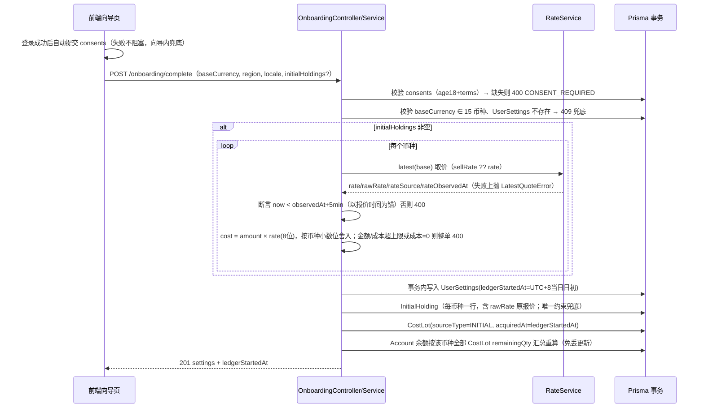
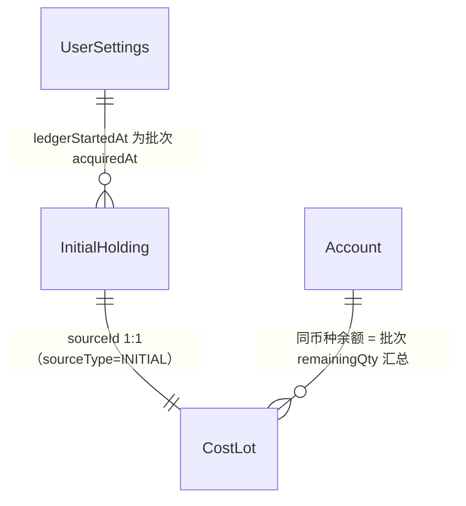

# 技术方案：首次设置重构（登录即用 + 最小建账 + 偏好后置）

> 核心场景：新用户登录即用，建账只强制确认一次本位币，初始持仓可跳过后补录，偏好归设置页随时改。
> 量级预估：个人工具，预估注册用户 < 1,000（标注：预估），数据量万级，峰值 QPS < 10。
> 最大风险点：初始持仓入账涉及 CostLot 成本批次与 FIFO 消耗顺序，错序会污染成本计算。
>
> 结论先行：本次**新增 1 个数据模型**（`InitialHolding`）、**2 个新接口**（补录、设置读写）+ **2 个接口扩展**（complete 带可选初始持仓、home/state 加一布尔），后端改 3 个模块（onboarding 扩展、新增 settings、home），前端改 4 处（登录勾选、新向导页、设置实装、首页引导卡），预计改动约 1,200 行（含测试）。**无新增依赖、无新增中间件**。

## 1. 目标与量化约束

### 1.1 业务背景

现登录后无强制向导（home-dashboard 拍板空状态页兼任引导），但用户可绕过本位币确认直接靠买入记账，初始持仓（`CostLot sourceType=INITIAL`）无任何写入方；偏好（准备偏好/提醒）随 complete 一次定型且完成后无处可改。本变更：合规勾选前置到登录页、建账向导两步化、初始持仓支持「建账时选填 + 建账后补录」、新增 settings 常驻模块承接偏好修改。

### 1.2 核心指标预估

| 指标项 | 预估值 | 依据/备注 |
| -------- | -------- | ----------- |
| 数据规模 | 万级以内 | InitialHolding ≤ 14 行/用户（15 币种减本位币）；CostLot 万级 |
| 并发压力 | QPS < 10 | 单用户个人工具，无并发热点 |
| 响应要求 | 同步 < 500ms | complete 事务含 1 次汇率获取，现有 rate latest 接口已达标 |
| 一致性等级 | 强一致（本地事务） | settings + InitialHolding + CostLot + Account 同库，Prisma `$transaction` 足够，无需 MQ |

### 1.3 约束条件

1. `onboarding.constants.ts` 头注「schema 冻结：不新增任何模型与字段」为 M1 期约束，**本变更显式解除**（仅新增 `InitialHolding` 及 `User` 反向关系字段，不改现有模型）；schema.prisma 头注的冻结流程同效，新增表按该流程回主分支增建。
2. `CONSENT_TYPES = ["age18", "terms"]` 两类**不扩展**：登录页两项勾选（「已满 18 周岁」「已阅读并同意服务条款与隐私说明」），隐私同意并入 terms 确认记录（与 V2.5 原型 pyTkx 两个勾选框一致；需求文档按此修订）。
3. usage 录入模块未上线（`UsageLotAllocation` 无写入方），docs 02 的「补录回溯资金检查」**预留不实现**，随 usage 模块立项落地；本方案保证 INITIAL 批次的排序键满足未来检查的前置条件。
4. 验证码、导出/清空/注销流程不在本方案范围（沿用现状）。

## 2. 方案选型与取舍

### 2.1 初始持仓入账的挂载方式

| 维度 | 方案 A：complete 扩展可选 `initialHoldings[]` | 方案 B：向导完成后独立接口逐笔录入 |
| ------ | ------ | ------ |
| 一致性 | settings 与初始批次同事务，原子 | 建账与入账分离，存在「已建账但入账失败」中间态 |
| 契约复杂度 | complete 入参变大，但字段可选，向后兼容 | 接口多一个，前端需串两个请求 |
| 与补录的关系 | 补录接口需另建，逻辑重复 | 与补录天然同构 |

**结论**：**A + B 组合**——complete 扩展可选字段（向导第二步一次事务），补录走新接口 `POST /onboarding/initial-holdings`，两者调用 onboarding 服务内**同一个私有入账方法**，避免逻辑分叉。

### 2.2 初始记录实体化 vs 复用 CostLot

docs 02 要求初始记录保存「金额、采用的 8 位汇率、原报价、来源、报价时间、初始成本、确认时刻」，且每币种仅一笔、可被「更正」引用。CostLot 缺少 rateSource/rateObservedAt/confirmedAt，且每币种唯一约束无处安放（CostLot 允许多批次）。**结论**：新增 `InitialHolding` 模型承载初始记录，CostLot.sourceId 指向它（与 PURCHASE→Transaction 同构），无备选。

### 2.3 settings 独立模块 vs 挂在 onboarding

onboarding 是一次性流程（完成后应可整体下线），settings 是常驻能力且未来会扩账号与数据功能。**结论**：新增 `src/settings/` 模块，app.module 注册一次（项目铁律）。

## 3. 核心设计

### 3.1 建账（含初始持仓）时序图



> 图例：实线为同步调用；`alt/loop` 为初始持仓可选分支与逐币种取价；取价项级失败（`LatestQuoteError` 等异常）统一捕获映射 400 `RATE_UNAVAILABLE`，任何一步失败整体回滚（无有效报价不得用 0 或手填价替代，沿 docs 02）。5 分钟窗口以**报价来源标注时间（observedAt）**为锚，非数据接收时间。

补录接口 `POST /onboarding/initial-holdings` 复用同一入账方法，仅前置校验不同：要求 UserSettings 已存在（409 反向语义）、传入币种均无 InitialHolding 记录（409 `INITIAL_HOLDING_EXISTS`）。

### 3.2 数据模型变更



变更语句（仅增量）：

```prisma
/// 初始持仓记录（docs 02：每币种仅一笔；rate 采用价 8 位小数，rawRate 为来源原值）
model InitialHolding {
  id             String   @id @default(cuid())
  userId         String   @map("user_id")
  currencyCode   String   @map("currency_code")
  amount         Decimal  @db.Decimal(20, 4)
  rate           Decimal  @map("rate") @db.Decimal(20, 10)
  rawRate        Decimal  @map("raw_rate") @db.Decimal(20, 10)
  rateSource     String   @map("rate_source")
  rateObservedAt DateTime @map("rate_observed_at")
  cost           Decimal  @db.Decimal(20, 4)
  confirmedAt    DateTime @map("confirmed_at")
  createdAt      DateTime @default(now()) @map("created_at")
  updatedAt      DateTime @updatedAt @map("updated_at")
  user           User     @relation(fields: [userId], references: [id], onDelete: Cascade)

  @@unique([userId, currencyCode])
  @@map("initial_holdings")
}
```

> 变更说明：`User` 模型同步增加反向关系字段 `initialHoldings InitialHolding[]`（Prisma 关系双侧声明）；原报价存 `rawRate`（docs 02 要求「原报价和来源一并保存」；ExchangeRate 同 observedAt upsert 会覆盖原值，不可依赖回溯）。采用价 `rate` 取 `sellRate ?? rate`（对齐 rate-latest 录入价口径），四舍五入到 8 位。
>
> 索引理由：`@@unique([userId, currencyCode])` 同时承担「每币种仅一笔」业务规则与补录并发防重（P2002 → 409），无需额外索引。

### 3.3 状态流转

无新增状态机。初始持仓「待补录/已录入」由 `InitialHolding` 记录是否存在表达（布尔事实），不满足状态机建模条件（≥3 状态），不硬造。

## 4. 接口契约

> 统一前缀 `/api`（`main.ts` 全局前缀），统一包装 `{ success, data, message }`；全部需 JWT（`JwtAuthGuard`）。

### 4.1 POST /api/onboarding/complete（扩展，向后兼容）

| 项 | 内容 |
| ---- | ------ |
| 入参变更 | `prepPreference`、`reminderEnabled` 改为**可选**（缺省 `balanced`/`true`，向导不再收集）；新增可选 `initialHoldings?: Array<{ currencyCode: string; amount: string }>`（金额字符串，最多 2 位小数/JPY·KRW 整数，> 0 且 < 10¹¹（复用 money 包 `AMOUNT_UPPER_LIMIT`/`assertAmountLimit`），币种 ∈ 15 币种且 ≠ baseCurrency，数组内 currencyCode 去重） |
| 出参 | 不变：`{ settings, ledgerStartedAt }` |
| 约束 | 幂等：已建账 409 `ONBOARDING_ALREADY_COMPLETED`（现有）；holdings 任一币种已有 InitialHolding → 400（理论不可达，建账前置保证）；折算成本 ≥ 10¹¹ 或舍入为 0 → 400 `RATE_UNAVAILABLE`/`INVALID_AMOUNT`，整单回滚 |

### 4.2 POST /api/onboarding/initial-holdings（新增，补录）

| 项 | 内容 |
| ---- | ------ |
| 入参 | `{ holdings: Array<{ currencyCode: string; amount: string }> }`（校验规则同 4.1，含金额上限） |
| 出参 | `{ created: Array<{ currencyCode, amount, rate, rawRate, rateSource, rateObservedAt, cost }>, ledgerStartedAt }` |
| 约束 | 未建账 → 409 `ONBOARDING_NOT_COMPLETED`；任一币种已有初始记录 → 409 `INITIAL_HOLDING_EXISTS`（整单拒绝，不做部分成功）；事务与 4.1 同一入账方法 |

### 4.3 GET /api/settings（新增）

| 项 | 内容 |
|----|------|
| 出参 | `{ email, region, locale, baseCurrency, prepPreference, reminderEnabled, ledgerStartedAt }`；未建账 → 409 |
| 约束 | baseCurrency 只读来源，无更新通道 |

### 4.4 PATCH /api/settings（新增）

| 项 | 内容 |
| ---- | ------ |
| 入参 | `{ region?, locale?, prepPreference?, reminderEnabled? }` 全可选，至少一项；**DTO 不含 baseCurrency 字段**（锁定由「无写路径」保证） |
| 出参 | 更新后的完整设置（同 4.3 出参） |
| 约束 | 枚举校验：region ∈ {HK, CN}/locale ∈ {zh-CN, en}/prepPreference ∈ {cautious, balanced, proactive}；重复提交幂等（同值更新无副作用） |

### 4.5 GET /api/home/state（扩展）

| 项 | 内容 |
|----|------|
| 出参变更 | 新增布尔 `hasInitialHoldings`（该用户存在 sourceType=INITIAL 的 CostLot 即 true） |
| 约束 | 维持「后端数据中立」约定，只加原始事实；判定供首页补录引导卡分流 |

## 5. 代码影响范围（树状变更清单）

> 记号：`(A)` 新增 / `(M)` 修改 / `(D)` 删除。上色遵循模板约定：文件/目录深色、方法/组件/接口浅色，均不加粗。

### 5.1 后端 services/chat

<pre>
services/chat/
├── prisma/
│   ├── <font color="#92400e">schema.prisma</font> (M) [注: 新增 InitialHolding + User.initialHoldings 反向关系（双侧声明）]
│   │   ├── <font color="#16a34a">model InitialHolding</font> [注: 初始记录实体（含 rawRate），@@unique([userId,currencyCode])]
│   │   └── <font color="#ca8a04">User.initialHoldings</font> [注: 反向关系字段，机械性增量]
│   └── <font color="#16a34a">migrations/&lt;timestamp&gt;_add_initial_holdings/</font> (A) [注: 纯新增表，可回退]
│       └── <font color="#16a34a">migration.sql</font>
└── src/
    ├── onboarding/
    │   ├── <font color="#92400e">onboarding.service.ts</font> (M) [注: complete 扩展 + 入账逻辑收敛到单一私有方法]
    │   │   ├── <font color="#ca8a04">complete()</font> [注: 事务内追加 holdings 入账分支（可选）]
    │   │   ├── <font color="#16a34a">recordInitialHoldings()</font> [注: 取价→上限/时效断言→算成本→写 InitialHolding+CostLot+按批次汇总重算 Account；complete 与补录共用]
    │   │   └── <font color="#16a34a">assertHoldings()</font> [注: 币种合法/≠本位币/去重/金额&gt;0 且 &lt;10¹¹（money 包 assertAmountLimit）/小数位校验]
    │   ├── <font color="#92400e">onboarding.controller.ts</font> (M) [注: 新增补录入口]
    │   │   └── <font color="#16a34a">saveInitialHoldings()</font> [注: POST /onboarding/initial-holdings，409 语义见 §4.2]
    │   ├── <font color="#92400e">dto/onboarding.dto.ts</font> (M) [注: prepPreference/reminderEnabled 改 @IsOptional；新增 InitialHoldingItemDto/SaveInitialHoldingsDto]
    │   └── <font color="#92400e">onboarding.constants.ts</font> (M) [注: 删除「schema 冻结」头注，改为指向本方案]
    ├── <font color="#16a34a">settings/</font> (A) [注: 新模块，app.module 注册一次；控制器显式挂 JwtAuthGuard + @ApiBearerAuth（全局仅 ThrottlerGuard，无全局 JWT）]
    │   ├── <font color="#16a34a">settings.module.ts</font>
    │   ├── <font color="#16a34a">settings.controller.ts</font> [注: GET /settings、PATCH /settings]
    │   ├── <font color="#16a34a">settings.service.ts</font> [注: 字段白名单更新；baseCurrency 无写路径]
    │   └── dto/
    │       └── <font color="#16a34a">update-settings.dto.ts</font> [注: 全可选+至少一项；枚举校验；不含 baseCurrency]
    ├── home/
    │   └── <font color="#92400e">home.service.ts</font> (M) [注: state 查询追加 hasInitialHoldings（costLot.count sourceType=INITIAL）]
    └── <font color="#92400e">app.module.ts</font> (M) [注: 注册 SettingsModule]
</pre>

### 5.2 前端 clients/chat-web

<pre>
clients/chat-web/
├── app/(protected)/
│   ├── <font color="#16a34a">onboarding/page.tsx</font> (A) [注: 建账向导页（需登录，未建账分流到此）]
│   ├── <font color="#92400e">settings/page.tsx</font> (M) [注: 占位页实装，分区按 PRD 模块 4]
│   └── <font color="#92400e">home/page.tsx</font> (M) [注: 未录初始持仓时展示补录引导卡]
├── components/business/
│   ├── auth/
│   │   └── <font color="#92400e">login-form.tsx</font> (M) [注: 两项勾选（年龄/条款与隐私），密码与 OTP 双模式均拦截；登录成功后自动提交 consents]
│   ├── <font color="#16a34a">onboarding/</font> (A) [注: 新业务组件目录，带 index.ts 桶文件]
│   │   ├── <font color="#16a34a">wizard-step-base-currency.tsx</font> [注: 第一步地区+本位币+不可更换提示]
│   │   └── <font color="#16a34a">wizard-step-holdings.tsx</font> [注: 第二步有无外币→填写/核对/跳过]
│   ├── <font color="#16a34a">settings/</font> (A) [注: 偏好表单+本位币只读行，带 index.ts]
│   │   └── <font color="#16a34a">preferences-form.tsx</font>
│   └── <font color="#92400e">home/</font> (M) [注: 目录已存在（home-dashboard/home-empty-state）]
│       ├── <font color="#16a34a">initial-backfill-card.tsx</font> (A) [注: 补录引导卡]
│       └── <font color="#92400e">home-dashboard.tsx</font> (M) [注: 挂载引导卡（首页经其分流，非直接改 page.tsx）]
└── lib/
    ├── api/
    │   ├── <font color="#92400e">onboarding.ts</font> (M) [注: complete 入参扩展；新增 saveInitialHoldings()]
    │   ├── <font color="#16a34a">settings.ts</font> (A) [注: GET/PATCH /settings 封装；引用方 settings/page.tsx]
    │   └── <font color="#92400e">contract.ts</font> (M) [注: HomeState 加 hasInitialHoldings]
    └── hooks/
        └── <font color="#92400e">use-home-state.ts</font> (M) [注: 透传新布尔，供引导卡分流]
</pre>

### 5.3 测试文件树

<pre>
├── services/chat/
│   ├── src/
│   │   ├── onboarding/
│   │   │   └── <font color="#92400e">onboarding.service.spec.ts</font> (M) [注: 补测 holdings 校验/取价失败回滚/409 幂等]
│   │   └── settings/
│   │       └── <font color="#16a34a">settings.service.spec.ts</font> (A) [注: 白名单/枚举/至少一项/未建账409]
│   └── test/
│       ├── api/
│       │   ├── <font color="#92400e">onboarding.spec.ts</font> (M) [注: complete 带 holdings、补录 409 语义]
│       │   └── <font color="#16a34a">settings.spec.ts</font> (A) [注: GET/PATCH 全场景]
│       └── integration/
│           └── <font color="#16a34a">initial-holding-cost.spec.ts</font> (A) [注: 成本口径：8位汇率舍入与 rawRate/来源/报价时间落库断言、本位币小数位舍入（JPY 取整）、成本=amount×rate、收益排除口径]
├── clients/chat-web/
│   └── lib/hooks/
│       └── <font color="#92400e">use-home-state.spec.tsx</font> (M) [注: hasInitialHoldings 透传与分流]
└── e2e/modules/
    ├── <font color="#16a34a">08-onboarding-wizard.spec.ts</font> (A) [注: 登录→向导两步→首页]
    ├── <font color="#16a34a">09-settings-preferences.spec.ts</font> (A) [注: 偏好修改→保存→刷新持久]
    └── <font color="#16a34a">10-initial-backfill.spec.ts</font> (A) [注: 空账本→补录→引导卡消失]
</pre>

> 设计说明：入账逻辑收敛在 `recordInitialHoldings()` 单一私有方法（complete 与补录共用，模板方法式复用）。INITIAL 批次消耗优先的真实保证 = `acquiredAt=ledgerStartedAt(UTC+8 日初) ≤ 同日 PURCHASE 的 acquiredAt=transactedAt`，配合现有 CostLot 索引 `[userId,currencyCode,acquiredAt,createdAt]` 即成立；`account-calculator.ts` 的 `mergeLedgerItems()` 为展示排序（该文件注释明示「展示顺序不是 FIFO 成本计算顺序」），本变更仅将其扩展为三源合并（PURCHASE+USAGE+INITIAL），不改成本计算口径（usage/消耗逻辑随 M7 立项）。

## 6. 可靠性保障

- **取价失败**：RateService 过期自动回源，仍无可用报价时项级异常（`LatestQuoteError` 等）统一捕获映射 400 `RATE_UNAVAILABLE` 并整单回滚，前端保留已填金额供重试；事务内显式断言 `now < observedAt + 5min`（报价来源时间锚点，非接收时间），不用 0/手填价（沿 docs 02）。
- **余额一致性**：complete 与补录事务内 `Account.balance` 按该币种全部 CostLot `remainingQty` 汇总重算（非增量累加），双端并发补录不同币种不会丢更新；同币种并发由 `@@unique` 兜底 409。
- **本位币锁定不变式**：现状成立（全库无 UserSettings 更新写路径，唯一写为 onboarding create）；防回归约束：a) settings PATCH DTO 不含 baseCurrency 且枚举白名单校验；b) 未来「清空业务记录」实现时必须保留 UserSettings（docs 02：清空后保留完成标记与原本位币），不得静默重开本位币选择；c) 集成测试断言 PATCH /settings 后 baseCurrency 与建账时一致。
- **回滚机制**：无 Feature Toggle——`initialHoldings` 为可选入参、`InitialHolding` 为纯新增表，回滚 = 旧版本代码直接兼容（新表闲置无害）；migration 可 down。
- **存量数据**：现网无任何 INITIAL 批次（功能未上线），无回填脚本；`prepPreference/reminderEnabled` 改可选对已建账存量无影响。
- **预留**：补录回溯资金检查依赖 usage 录入上线，届时在同一事务入口追加检查（接口签名预留，见 §1.3-3）；本期需求文档场景 10 随之豁免（见 §8.3）。

## 7. 可观测性

- 本次**新立**日志口径（现有 onboarding/transaction/otp 代码无 Logger 调用，无既有口径可沿）：`complete` / `saveInitialHoldings` / `PATCH /settings` 入口打 Info：userId、币种代码列表、报价来源与报价时间；**金额、成本、baseCurrency 值不落日志**（币种代码不含数量，可落）。
- 事务失败打 Warn（含失败阶段：CONSENT/RATE/LIMIT/UNIQUE），便于区分合规拦截与数据问题；单测断言日志内容不含金额。
- 无新增指标与告警（个人工具，沿用现有日志排查路径）。

## 8. 测试策略

### 8.1 单元测试

| 测试文件 | 被测对象 | 覆盖点 |
| ---------- | ---------- | -------- |
| onboarding.service.spec.ts | complete/recordInitialHoldings | holdings 校验（非法币种/≠本位币/去重/金额≤0/超 10¹¹ 上限/小数位）、成本超上限、成本舍入为 0 拒绝、observedAt 时效断言、取价失败整单回滚、prepPreference 缺省 balanced |
| settings.service.spec.ts | GET/PATCH settings | 字段白名单（DTO 无 baseCurrency）、全空入参拒绝、枚举校验、未建账 409 |
| use-home-state.spec.tsx | 首页状态 hook | hasInitialHoldings 透传、引导卡分流布尔派生 |

### 8.2 接口集成测试

| 接口 | 场景 | 预期结果 |
| ------ | ------ | ---------- |
| POST /api/onboarding/complete | 带 2 币种 holdings 正常建账 | 201；InitialHolding×2（含 rawRate/rateSource/rateObservedAt）、CostLot×2、Account 余额按批次汇总重算；ledgerStartedAt=当日日初 |
| POST /api/onboarding/complete | holdings 含本位币 | 400，整单回滚，UserSettings 不存在 |
| POST /api/onboarding/complete | 金额 ≥ 10¹¹ 或成本舍入为 0 | 400，整单回滚 |
| POST /api/onboarding/complete | 重复调用 | 409 ONBOARDING_ALREADY_COMPLETED |
| POST /api/onboarding/initial-holdings | 未建账调用 | 409 ONBOARDING_NOT_COMPLETED |
| POST /api/onboarding/initial-holdings | 币种已有初始记录 | 409 INITIAL_HOLDING_EXISTS，无部分成功 |
| POST /api/onboarding/initial-holdings | 并发同币种双请求（P2002） | 一个 201 一个 409，批次仅一条 |
| POST /api/onboarding/initial-holdings | 正常补录 | 201；CostLot.acquiredAt=ledgerStartedAt；余额增加；已建账 baseCurrency 不变 |
| POST /api/onboarding/initial-holdings | 无 token | 401 |
| PATCH /api/settings | 改 locale+prepPreference+reminderEnabled | 200；TermsConsent 记录数不变（同版本条款不重签）；baseCurrency 不变 |
| PATCH /api/settings | 改 prepPreference+reminderEnabled | 200，home/state 与 GET /settings 同步反映 |
| PATCH /api/settings | 空 body / 含 baseCurrency 字段 | 400（baseCurrency 被白名单拒绝） |
| GET /api/home/state | 补录前后 | hasInitialHoldings false→true |

### 8.3 E2E 测试（按用户操作路径）

> 编号说明：现有 e2e/modules 为 01–06，07 已预留给 changes/plan-creation，本变更用 08–10。

**场景 1：新用户登录即用（跳过持仓，需求场景 1/2/5）**

1. 打开登录页 → 不勾选 → 断言发送按钮不可用且有提示；勾选两项 → 发送验证码 → 输码登录
2. 向导第一步确认本位币（默认 CNY）→ 第二步选「没有，直接开始」
3. 断言：进入首页，出现补录引导卡；设置页本位币只读

**场景 2：建账时填写初始持仓（需求场景 3/4）**

1. 登录 → 向导第二步选「有，填写」→ 填 USD 1,000 → 核对页显示汇率/来源/时间/成本
2. 返回第一步改本位币再改回 → 断言：汇率与成本重新展示，金额保留
3. 确认入账 → 断言：首页出现 USD 账户卡，无补录引导卡

**场景 3：向导中断无残留（需求场景 6）**

1. 向导第二步中途关闭页面 → 重新登录
2. 断言：重新从第一步开始，无上次填写残留

**场景 4：偏好随时改（需求场景 12/13/14）**

1. 设置页改准备偏好「安心」+ 关闭提醒 + 改语言英文 → 保存
2. 断言：刷新后仍生效；外汇账户/计划页无任何数据变化

### 8.4 验收场景映射与豁免

| 需求文档场景 | 测试落点 |
| -------------- | ---------- |
| 场景 1/2（登录门槛） | E2E 场景 1 + §8.2 无 token 401 |
| 场景 3/4/5/6（向导） | E2E 场景 2/3 + §8.2 complete 用例 |
| 场景 7（本位币只读） | E2E 场景 1 断言 + §8.2 PATCH 含 baseCurrency 400 |
| 场景 8（拒绝新版条款只读） | 本期豁免：无新版条款流程（CURRENT_TERMS_VERSION 唯一版本），随条款版本机制立项补测 |
| 场景 9/10/11（补录） | §8.2 补录用例全集；场景 10 回溯资金检查本期豁免（usage 未上线，§1.3-3 预留），需求文档场景 10 随预留逻辑上线启用 |
| 场景 12/13/14（设置页） | §8.2 PATCH 用例 + E2E 场景 4 |

## 9. 自检清单（交付前逐项打钩）

- [x] 量化指标齐全，选型基于量级（§1.2：QPS<10 → 本地事务，不引 MQ）
- [x] 只写增量/变更（现有 onboarding/auth/rate/home 一笔带过）
- [x] 无新增中间件/依赖
- [x] 核心流程有 Mermaid 图（时序 §3.1、ER §3.2，一图一核心）
- [x] 覆盖异常兜底、回滚（§6）
- [x] 代码影响范围树状清单 + A/M/D + `<pre>`/`<font>` 上色；共享方法 recordInitialHoldings 单点归档
- [x] 测试策略三类分写，测试文件与被测对象一一对应
- [x] 排期：按用户配置省略
- [x] 已完成项目现状调研（onboarding 三接口/CONSENT_TYPES 两类/usage 未上线/login-form 双模式均实读确认）
- [x] 审核意见已回填（§10，18 条全部处理）

## 10. 审核意见与修订记录

> 三视角审核：架构（通过，6 条）/ 安全边界（不通过，7 条）/ 测试（不通过，5 条）；另 PRD 审核两项口径问题已同步修订需求文档与规格。

| # | 来源 | 审核意见（引用章节） | 处理方式 | 说明 |
| --- | ------ | ---------------------- | ---------- | ------ |
| 1 | 架构 | §5.1「仅新增模型」违反 Prisma 双侧声明 | 已修改 | User 加 initialHoldings 反向字段，清单如实标注 |
| 2 | 架构 | §5.3 INITIAL 优先落点失准（mergeLedgerItems 是展示排序） | 已修改 | 改述为「acquiredAt 前置 + 现有索引保证；本变更仅扩展三源展示合并，不改成本口径」 |
| 3 | 架构/安全 | §3.1/§6 取价失败路径与 rate.service 现状不符 | 已修改 | 改为捕获项级异常映射 400；时效断言以 observedAt 为锚 |
| 4 | 架构 | §1.3-2 两项口径规格未同步 | 已修改 | 规格模块 1、5.1、5.2、验收总原则已同步为两项 |
| 5 | 架构 | §5.2 components/business/home/ 已存在 | 已修改 | 改 (M)；引导卡挂载点改为 home-dashboard.tsx |
| 6 | 架构 | §1.3-1 需按 schema.prisma 头注冻结流程执行 | 已修改 | 补充说明 |
| 7 | 安全 | 金额/成本上限校验缺失 | 已修改 | 复用 money 包 assertAmountLimit，金额与成本双侧校验，新增 §8.2 用例 |
| 8 | 安全 | JwtAuthGuard 非全局，settings 控制器需显式挂载 | 已修改 | §5.1 标注守卫 + @ApiBearerAuth；补 401 用例 |
| 9 | 安全 | 5 分钟窗口锚点（observedAt vs createdAt） | 已修改 | 事务内显式断言 now < observedAt+5min |
| 10 | 安全 | 采用价口径与原报价缺口 | 已修改 | rate=sellRate??rate；InitialHolding 新增 rawRate 字段 |
| 11 | 安全 | 并发补录不同币种余额丢更新风险 | 已修改 | Account 余额改为事务内按批次汇总重算 |
| 12 | 安全 | baseCurrency 不变式防回归 | 已修改 | §6 补三条防回归约束（DTO 白名单/清空保留/集成断言） |
| 13 | 安全 | §7 日志口径无据 | 已修改 | 改为「本次新立口径」，金额/成本/baseCurrency 不落日志，单测断言 |
| 14 | 测试 | 验收场景 3/5/8/10 无测试覆盖 | 已修改 | E2E 补场景 2 改币重核、场景 3 中断无残留；场景 8/10 显式豁免并注明理由（§8.4） |
| 15 | 测试 | docs 02 成本边界用例缺失 | 已修改 | 集成测试注释扩充：8 位舍入/rawRate 落库/JPY 取整/成本=0 拒绝；§8.2 补用例 |
| 16 | 测试 | 补录并发 P2002 无用例 | 已修改 | §8.2 补并发同币种双请求用例 |
| 17 | 测试 | E2E 编号跳过 07 未说明 | 已修改 | §8.3 编号说明（07 预留 plan-creation） |
| 18 | 测试 | 三项 vs 两项口径影响 E2E 断言 | 已修改 | 已统一为两项（需求文档/规格同步），E2E 场景 1 按两项断言 |
