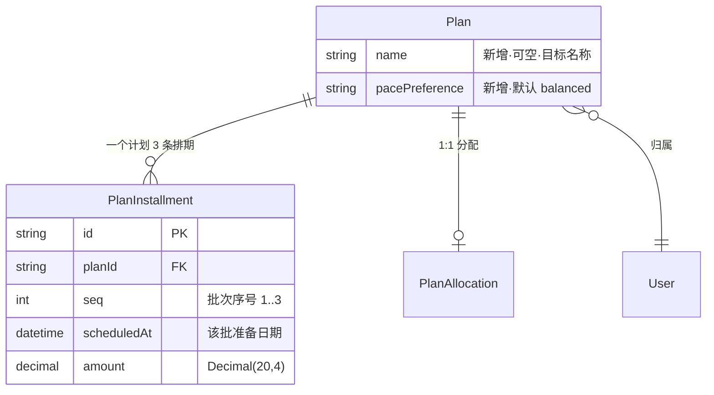
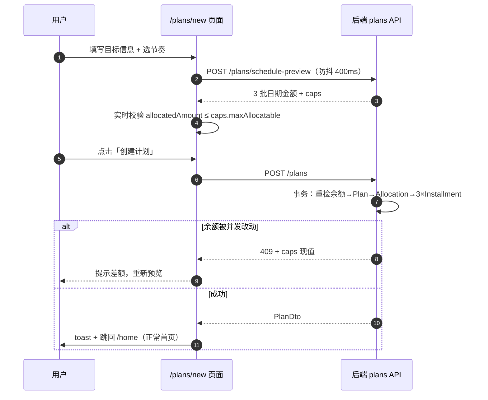

# 技术方案：创建换汇计划全链路（plan-creation）

> 结论先行：本次涉及 **1 张新表**（`plan_installments` 分批排期）、**2 列新增**（`plans.name` / `plans.pace_preference`）、**2 个新接口**（排期预览 + 创建计划）、前端 **1 个新页面** + 首页 CTA 解锁，预计净增代码约 1200 行（含测试）。

## 1. 背景与范围

首页空状态「创建第一个目标」的目标页不存在（当前按钮禁用）。本次实现创建换汇计划的**首次创建闭环**：

```
首页空状态 →「创建第一个目标」→ /plans/new 创建页（单页三段）
  ① 目标信息表单（名称/币种/净到账金额/用途日期/提前天数/计入已有外币/本位币只读）
  ② 资金准备节奏 单选三档（安心/均衡/主动，默认取首次设置的偏好）
  ③ 分批排期实时预览（防抖调 preview 接口：3 批日期 + 金额）
→ 「创建计划」（事务：重检余额 → Plan + PlanAllocation + 3 条排期）
→ 成功跳回 /home（hasPlans=true 自动切换正常首页）
```

**设计基准（已与用户对齐，标注供复核）**：业务规则以需求文档 `06_创建换汇计划` / `07_分批准备计划` 为准（节奏 = 安心/均衡/主动，固定 3 批）；UI 吸收 V2.4 原型（「目标名称」字段、偏好简化为单选控件、目标信息与偏好同页不分步）。

**本次不做**（登记 §11）：修改目标/取消/重新开启（文档 06 后半部）、草稿保存（按钮置灰）、排期执行状态、录入已有持仓、E2E。

## 2. 量化指标（预估）

| 指标项 | 预估值 | 依据/备注 |
| -------- | -------- | ----------- |
| 数据规模 | 单用户计划个位数、每计划 3 条排期 | 个人工具 |
| 并发压力 | <10 QPS | 创建为低频动作；preview 随表单输入防抖调用 |
| 响应要求 | 同步 <300ms | preview 纯计算；create 一个本地事务 |
| 一致性 | 强一致（create 事务内重检余额） | 文档 06：确认时重新检查余额，检查通过才保存 |

## 3. Schema 变更



图例：`Plan` 加 2 列、新增 `PlanInstallment`；`PlanAllocation`/`Account` 结构不变。

- `Plan` 新增：`name String? @map("name")`（文档「名称」仍为待确定项，可空兜底）；`pacePreference String @default("balanced") @map("pace_preference")`（**计划级**节奏——文档 07 允许创建后修改安排时改节奏，故不入仅存于 UserSettings）。
- 新表 `PlanInstallment`：`@@unique([planId, seq])` + `@@index([planId, scheduledAt])`，级联删除随 Plan。MVP 不加执行状态列（哪批已买由后续 Transaction 关联迭代解决，防过度设计）。
- 枚举：`pacePreference ∈ "conservative" | "balanced" | "aggressive"`（安心/均衡/主动；值集包含存量 `UserSettings.prepPreference` 的 `"balanced"`）。存量 `prepPreference` 无 IsIn 校验，本次新字段收严，存量字段对齐登记遗留。

## 4. 业务规则设计（来源：文档 06/07，实现为纯函数 + 事务校验）

### 4.1 分批排期算法（纯函数 `buildInstallments`，置于 plan 模块内，依赖 `@fxplanner-new/money` 精度）

| # | 规则 | 内容 |
| --- | ------ | ------ |
| R1 | 可安排日期 | 从开始准备日到最晚准备日之间的**工作日**（MVP 日历 = 跳过周六日；节假日日历待定，以常量注入便于替换） |
| R2 | 批次日期 | 取可安排日期的第 1、中间、最后 3 个；日期总数为偶数时中间取靠前 |
| R3 | 批次金额 | conservative 50/30/20；balanced 三等分；aggressive 20/30/50（分批总额 = 目标金额 − 已使用 − 剩余分配；首次创建已使用=0，剩余分配=本次 allocatedAmount） |
| R4 | 零头 | 按币种 `decimalPlaces`（money 包）向下取整，余数全部入最后一批，合计恒等于分批总额 |
| R5 | 退化 | 可安排日 2 天：60/40、50/50、40/60；1 天：单批 100%；0 天：无法生成 → 报错 `NO_AVAILABLE_DATES` |
| R6 | 金额过小 | 某批取整后为 0 → 不生成方案，报错 `AMOUNT_TOO_SMALL` |
| R7 | 最晚准备日 | = 用途日期起往前数 `prepLeadDays` 个工作日（跳过非工作日）；`prepLeadDays` 允许 1~30（文档待确定范围，**假设值**） |

### 4.2 分配校验（创建事务内重检，文档 06 算法）

| 算法 | 公式 |
| ------ | ------ |
| 可分配余额 | 该币种账户余额 − 其他计划剩余分配之和（剩余分配 = amount − usedAmount） |
| 本次分配上限 | min(可分配余额, 目标金额)；首次创建无已使用 |
| 校验 | `allocatedAmount > 上限` → 409 `INSUFFICIENT_ALLOCATABLE_BALANCE`（响应附 caps 现值，前端据此提示差额） |
| 容许 | `allocatedAmount = 0` 合法（不占用余额，纯新建目标） |

### 4.3 入参校验

目标金额 > 0 且 ≤ money 包 `AMOUNT_UPPER_LIMIT`；币种 ∈ 15 币种清单；用途日期 > 今天（**假设**，文档未明确）；`prepLeadDays` ∈ [1,30]。

## 5. 接口契约

均需登录（JwtAuthGuard），包装 `{ success, data, message }`，金额字符串（§格式规范见 home-state-routing 方案 §3.3，本次沿用）。

### 5.1 `POST /api/plans/schedule-preview` — 排期预览（只读，不落库）

```jsonc
// 请求
{ "targetCurrency": "USD", "targetAmount": "50000.00", "expectUseDate": "2027-08-01T00:00:00.000Z",
  "prepLeadDays": 3, "pacePreference": "balanced", "startDate": null }   // startDate 缺省=最早可安排日
// 响应 data
{ "latestPrepDate": "2027-07-27T00:00:00.000Z",
  "installments": [ { "seq": 1, "scheduledAt": "...", "amount": "16666.66" },
                    { "seq": 2, "scheduledAt": "...", "amount": "16666.66" },
                    { "seq": 3, "scheduledAt": "...", "amount": "16666.68" } ],
  "caps": { "allocatableBalance": "12000.00", "maxAllocatable": "12000.00" } }
```

`caps` 随预览返回（该币种可分配余额 / 本次分配上限），供前端对「计入已有外币」输入做实时校验。错误：400 `INVALID_PLAN_PARAMS` / `NO_AVAILABLE_DATES` / `AMOUNT_TOO_SMALL`。

### 5.2 `POST /api/plans` — 创建计划（事务）

请求 = 5.1 全部字段 + `name?: string` + `allocatedAmount: string`（默认 "0"）。
响应 data = `PlanDto`：`{ id, name, targetCurrency, targetAmount, allocatedAmount, remainingAmount, expectUseDate, latestPrepDate, prepLeadDays, pacePreference, status: "ACTIVE", installments: [...] }`。
事务顺序：重检余额（4.2）→ 插入 Plan（latestPrepDate 服务端重算，不信任前端）→ PlanAllocation(usedAmount=0) → 3 条 PlanInstallment；任一失败全部回滚。错误：409 余额类 / 400 参数类。

## 6. 实现设计



图例：②预览不落库可反复调；⑥服务端重检是并发安全的关键（前端 caps 仅作体验层预检）。

- **后端** `services/chat/src/plan/`：`PlanModule` / `PlanController`（2 端点 + Swagger）/ `PlanService`（create 事务 + preview）/ `schedule-builder.ts`（纯函数 R1~R7，Decimal 运算走 money 包）/ `dto/`。app.module 注册。
- **前端** `clients/chat-web`：页面 `app/(protected)/plans/new/page.tsx`（单页三段：表单 / 节奏单选 radio-group / 排期预览卡）；hooks `use-plan-form`（表单状态+校验）与 `use-schedule-preview`（防抖+caps 预检）；API `lib/api/plans.ts` + contract 类型；业务组件 `components/business/plan/`（表单段、节奏选择段、排期预览段，桶文件导出）。
- **首页解锁** `home-empty-state.tsx`：「创建第一个目标」`disabled` 移除 → `router.push("/plans/new")`；「录入已有持仓」保持禁用；同时移除该按钮的 `disabled:pointer-events-auto`（用户反馈悬停 title 不可见，禁用态语义本就不应依赖原生 title）。
- 默认节奏：页面加载时经 `GET /onboarding/status` 取 `prepPreference` 作为单选默认值（存量接口，不新增）。

## 7. 代码影响范围

<pre>
FXPlanner-new/
├─ services/chat/
│  ├─ prisma/
│  │  └─ schema.prisma                                    <font color="#5b3cc4">(M)</font> Plan+2列、新表 PlanInstallment
│  ├─ src/
│  │  ├─ app.module.ts                                    <font color="#5b3cc4">(M)</font> 注册 PlanModule
│  │  └─ plan/                                            <font color="#1a5c2a">(A)</font> 新模块
│  │     ├─ plan.module.ts                                <font color="#1a5c2a">(A)</font>
│  │     ├─ plan.controller.ts                            <font color="#1a5c2a">(A)</font> POST /plans、/plans/schedule-preview
│  │     ├─ plan.service.ts                               <font color="#1a5c2a">(A)</font> create 事务 + preview
│  │     ├─ schedule-builder.ts                           <font color="#1a5c2a">(A)</font> 纯函数 R1~R7
│  │     └─ dto/plan.dto.ts                               <font color="#1a5c2a">(A)</font> CreatePlanDto 等 5 DTO
│  ├─ test/
│  │  ├─ api/plan.spec.ts                                 <font color="#1a5c2a">(A)</font> 接口测试
│  │  └─ prisma.spec.ts                                   <font color="#5b3cc4">(M)</font> 新表迁移断言（若有基础设施用例）
│  └─ src/plan/schedule-builder.spec.ts                   <font color="#1a5c2a">(A)</font> 算法单测（与源码同目录）
├─ clients/chat-web/
│  ├─ lib/api/
│  │  ├─ contract.ts                                      <font color="#5b3cc4">(M)</font> Plan/Installment/Caps 类型
│  │  └─ plans.ts                                         <font color="#1a5c2a">(A)</font> plansApi.preview / create
│  ├─ lib/hooks/
│  │  ├─ use-plan-form.ts                                 <font color="#1a5c2a">(A)</font> + use-plan-form.spec.ts
│  │  └─ use-schedule-preview.ts                          <font color="#1a5c2a">(A)</font> + use-schedule-preview.spec.ts
│  ├─ app/(protected)/plans/new/page.tsx                  <font color="#1a5c2a">(A)</font> 创建页（单页三段）
│  └─ components/business/plan/                           <font color="#1a5c2a">(A)</font> 三段组件 + index.ts
│     └─ （home-empty-state.tsx                           <font color="#5b3cc4">(M)</font> CTA 解锁跳转）
</pre>

## 8. 测试设计

### 8.1 单元测试 `src/plan/schedule-builder.spec.ts`（纯函数，覆盖 R1~R7）

正常三批取日（含偶数天取靠前中间）；R3 三种节奏金额分布；R4 零头入末批（33.33/33.33/33.34 类）与整数币种 JPY；R5 三档退化表 + 0 天报错；R6 某批为 0 报错；R7 跨周末回推最晚准备日。

### 8.2 接口测试 `test/api/plan.spec.ts`

| # | 场景 | 预期 |
| --- | ------ | ------ |
| 1 | 未登录访问两接口 | 401 |
| 2 | preview：正常参数 | 3 批 + latestPrepDate + caps，不落库 |
| 3 | preview：参数非法/0 天/金额过小 | 400 对应 code |
| 4 | create：无分配（0）成功 | Plan+3 排期，无 Allocation 占用 |
| 5 | create：带分配成功 | Allocation(usedAmount=0)，账户余额不变 |
| 6 | create：分配超可配余额 | 409 + caps 现值 |
| 7 | create：并发改动后重检 | 预览后另一计划占用余额，再 create → 409（事务重检生效） |
| 8 | create：latestPrepDate 服务端重算 | 篡改前端值不影响落库 |
| 9 | create：name 缺省 | name=null 正常创建 |
| 10 | home/state 联动 | 创建后 `hasPlans=true`、`plans[]` 含新计划与 remainingAmount |

### 8.3 前端（只测 hooks，组件靠后续 E2E）

`use-plan-form.spec.ts`：必填/金额上限/日期规则校验与错误暴露；`use-schedule-preview.spec.ts`：防抖、caps 预检拦截、失败态。验收门禁：全部测试 0 failed + typecheck/lint 通过。

## 9. 回滚

前端整页与组件为纯增量，git revert 即恢复；后端摘除 PlanModule 注册即恢复接口。schema 迁移向前兼容（新增可空列 + 新表，不改动存量列）：回滚代码后存量数据不受影响，迁移 Down（删列删表）仅在需要时单独执行。

## 10. 假设清单（实现前可推翻）

1. 节奏枚举英文值 `conservative/balanced/aggressive`（存量仅 "balanced" 可考）。
2. `prepLeadDays` 允许 1~30；用途日期必须晚于今天；MVP 工作日 = 跳过周六日。
3. 草稿功能不实现（按钮置灰 + 遗留）。

## 11. 遗留问题（本次不做）

1. 修改目标/取消/重新开启（文档 06 后半部全部规则）；排期修改与执行状态。
2. 草稿机制与保留时长（文档待确定）；「查看审计记录」（文档 09 日志）。
3. 节假日工作日日历（当前仅跳周末，常量已注入便于替换）。
4. 「录入已有持仓」入口（产品缺口，沿用 home-state-routing 方案 §8）；存量 `UserSettings.prepPreference` 枚举校验收严。
5. E2E 用例（待创建页稳定后按用户路径补：空首页→创建目标→正常首页）。
