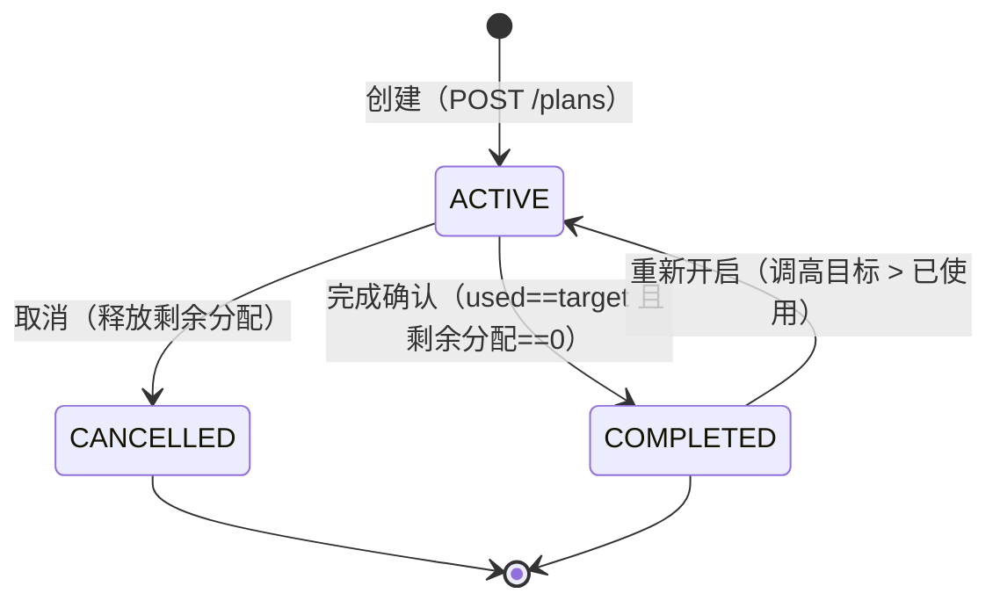
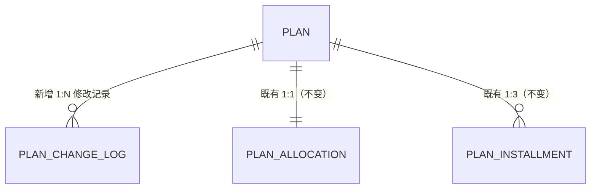

# 技术方案：换汇计划管理（M5 补全：列表 / 详情 / 修改 / 取消 / 完成）

> 已确认：核心场景——用户对已创建的换汇计划做全生命周期管理（查看进度、调整目标与分配、取消、完成确认）；量级——个人记账工具，单用户计划数十级、全站千级以下，峰值 QPS < 10（均预估）；最大风险点——修改/取消/重新开启时的**分配释放与未分配余额一致性**，以及状态流转的非法跳转。
>
> 本次方案涉及：**新增 1 张表（plan_change_logs）/ 0 列变更、6 个新接口、2 个新页面，预计改动约 2600 行（含测试约 1100 行）**。
>
> 裁剪说明：沿用 transaction-entry 方案配置（L2 + 多视角审核 + 接口契约 + 不含排期）。

## 术语与口径（全篇统一，执行会话必读）

依据 `docs/MVP功能模块&业务逻辑&专业术语/15_专业术语清单.md`（唯一权威）。**技术字段名与官方 UI 术语的映射如下，代码注释、DTO swagger 描述、前端文案一律用官方名；报错文案对用户展示官方名。**

### 资金与账户

| 官方术语 | 白话定义（15 清单） | 技术落点 |
| ---- | ---- | ---- |
| 本位币 | 统一计算成本的货币（如 CNY） | `baseCurrency`；页面/字段 `plan-base-currency` |
| 目标币种 | 计划要准备、或本次买入的外币 | `targetCurrency` |
| 虚拟外汇账户 | 记录某种外币还剩多少；同币种合并、不按银行拆分、仅记账 | `Account` 模型（user+currency 唯一） |
| 持仓 | 当前还持有的外币（账户余额） | `Account.balance` |
| 初始持仓 | 首次设置时已持有的外币，成本按确认时汇率定格 | M9 初始化录入（onboarding），本方案只读 |
| 记账起点 | 首次设置完成时刻；起点前买入不可补录 | `ledgerStartedAt`（M4 已实现校验） |
| **未分配余额** | 账户中还没留给任何计划的钱 = `balance − Σ所有计划剩余分配`（含本计划） | 本方案 caps 字段 `unallocatedBalance`；⚠️ 初稿误称"可分配余额"，已统一改名 |
| 分配 | 把账户一部分钱留给某计划，**总余额不变** | `PlanAllocation.amount` |
| 释放分配 | 不再留给原计划，回到未分配余额，总余额不变 | 本方案 §3.3/§3.4 releasedAmount |
| 计划剩余分配 | 留给该计划、还没使用的金额 | `remainingAllocation = max(0, amount − usedAmount)` |
| 累计已使用 | 该计划至今实际使用的外币总额 | `PlanAllocation.usedAmount`（写入方为 M7） |
| 还需使用金额 | 目标 − 已使用，最低 0 | `stillNeeded`（caps 内） |
| 还需准备金额 | 还需使用 − 计划剩余分配，最低 0 | 创建时 caps 计算用（"还缺多少"） |
| 钱已备齐 | 还需使用的钱已全部有分配 | 详情页 `gap = 0` 状态描述 |

### 计划与排期

| 官方术语 | 白话定义 | 技术落点 |
| ---- | ---- | ---- |
| **换汇计划** | 为某用途分批准备外币的完整计划 | `Plan` 模型；⚠️ UI 文案"目标"（如首页"创建第一个目标"）即指计划，**不存在独立的 Goal 实体**；"目标金额"是计划属性 `targetAmount` |
| 预计使用日期 | 预计实际花这笔外币的日期 | `expectUseDate` |
| **准备缓冲** | 提前准备的工作日天数，默认 3；与分几次准备是两回事 | `prepLeadDays`（此前稿写"提前准备天数"，官方名为准备缓冲） |
| **最晚准备日期／最晚安全日期** | 到这天应把外币备齐；默认使用日前一天往前数 3 个工作日 | `latestPrepDate` |
| 开始准备日期 | 从哪天开始安排分批准备 | schedule-builder 内部量 |
| **准备节点** | 某一次建议准备的日期和金额 | `PlanInstallment`（⚠️ 初稿称"批次"，官方名为准备节点；`installments[]`） |
| **安心／均衡／主动** | 前期多／各次差不多／后期多准备，默认均衡 | `pacePreference` 枚举值 `conservative/balanced/aggressive`；**UI 展示必须用安心/均衡/主动**（⚠️ 初稿误写"保守/平衡/激进"） |
| 准备逾期 | 超过最晚准备日期仍未备齐 | 08 提醒模块（M8 后），本方案仅在详情页可展示判定 |

### 交易与使用

| 官方术语 | 白话定义 | 技术落点 |
| ---- | ---- | ---- |
| **换汇记录（买入）** | 实际发生的兑换，记本金/汇率/到账/手续费 | `Transaction`（M4 已交付）；"录入"即创建换汇记录 |
| 关联计划 | 某笔换汇记录与哪个计划有关；**仅关联，不自动分配钱** | `Transaction.planId`（M4 定为仅标记） |
| 本金 / 到账金额 / 汇率 / 手续费未知 | 兑换四要素；手续费未知 ≠ 0 | M4 字段，本方案只读展示 |
| **确认使用** | 记一笔已发生的计划用途支出，**减少账户余额及计划分配金额** | `UsageRecord`（M7 未实现）；⚠️ 注意其"减少分配金额"语义，见 §3.4 口径声明 |
| 先进先出（FIFO）/ 成本批次 / 单位成本 / 平均成本 | 成本核算规则 | M8 报告域，本方案不涉及 |
| 更正 / 补充分配后立即使用 | 改错记录，原记录与原因保留 | M8 更正（09/10 文档），本方案不涉及 |

### 状态与动作

| 官方术语 | 白话定义 | 技术落点 |
| ---- | ---- | ---- |
| 计划完成 | 使用总额达目标且剩余分配为 0，**用户点击确认** | `status=COMPLETED`；`POST /plans/:id/complete` |
| 取消计划 | 解除未使用分配，保留此前买入和使用记录 | `status=CANCELLED`；`POST /plans/:id/cancel` |
| 重新开启 | 已完成计划提高目标，确认后回到进行中 | `PATCH` + `confirmReopen` |
| 修改记录 | 改了什么、原来多少、现在多少、原因和时间 | 本方案新增 `plan_change_logs` 表 |
| 提交结果不明 | 不知是否保存成功时先查清，**不可直接重复记账** | 前端提交超时语义：重新 GET 详情核对，禁止盲目重发 PATCH |

> 范围外术语（本方案不出现，勿混用）：比较基准、多换目标币、PDF 报告、站内提醒（报告/提醒模块）。

### 前端错误态交互规格（采纳自原型优秀设计，评审 2026-09-15）

| 错误码 | 交互（原型 E8gWF「可分配余额已变化」模式） |
| ------ | ------ |
| `PLAN_ALLOCATION_LIMIT(400)` | 不只报错：内联提示「当前未分配余额为 X，最多可分配 Y（还需使用 Z）」，**预填 `caps.limit` 新值**让用户在此基础上改，不清空已填表单 |
| `PLAN_STATE_CHANGED(409)` | 「计划已被其他修改更新」+「重新预览」按钮，点击后用最新数据重开预览对话框，已填参数保留到预填 |
| `PLAN_TARGET_BELOW_USED` / `PLAN_ALLOCATION_BELOW_USED` | 附 used 与差额，红色内联提示，焦点定位到目标/分配字段 |

> M8 更正模块的余额不足场景（原型 sadD5「暂时无法保存」：列出受影响计划 + 差额 + 管理入口）登记为 M8 方案参考，本方案不涉及。

## 1. 目标与量化约束

### 1.1 业务背景

M2 已交付计划创建（`POST /plans/schedule-preview` + `POST /plans`），但计划创建后即"失联"：无列表页（首页入口 404 死链）、无详情页、无法修改目标/分配、无法取消。按 `docs/MVP开发计划.md` M5 清单与《06_创建换汇计划》《07_分批准备计划》，本方案补齐全生命周期管理。

### 1.2 核心指标预估

| 指标项 | 预估值 | 依据/备注 |
| -------- | -------- | ----------- |
| 数据规模 | 单用户计划数十级，plan_change_logs 年增千级 | 个人工具，预估 |
| 并发压力 | < 10 QPS | 单用户操作，无并发热点 |
| 响应要求 | 同步 < 500ms | 纯本地库操作，无外部依赖 |
| 一致性等级 | 强一致（本地事务） | 分配释放必须与目标修改原子 |

### 1.3 约束条件

- `usedAmount`（已使用金额）的写入方是 M7 资金使用记录（未实现）。本方案所有"已使用"判断读取 `PlanAllocation.usedAmount` 现值——M7 上线前该值恒为 0，完成/重新开启功能将自然生效于 M7 之后，**无需等待**。
- 计划**使用日期**修改：《06》明确标注"待确定"，本方案非目标（`expectUseDate`/`latestPrepDate` 不可改）；但 **MVP 清单 M5 要求"改日期留接口"由 `startDate` 入参覆盖**（见 §3.4/§4.4）——`prepLeadDays`（准备缓冲）属节奏参数可改，其语义是"往前往后数缓冲天数"而非改使用日期，边界判断：不属"日期修改待确定"范畴。
- **不拆 Goal（目标）实体（原型评审决议 2026-09-15）**：原型（FXplanner-V2.5-MVP用户交互原型.pen）将"目标"设计为独立实体（独立页面 6 屏、可"未制定计划"），与文档体系（15 术语清单无此术语、06 一体创建）及现有 Plan 模型冲突，**经评审不采纳**；"先记一笔想法"诉求由现有能力承载（计划分配可填 0）。原型中以下设计同样**不采纳**：历史版本快照页（06 只要求变更记录）、提醒设置页（08 为系统自动提醒）、"关联已有换汇记录"独立入口（05 定义关联为录入时属性）。**执行会话不得参考原型自行引入上述设计**。
- schema 冻结基线不允许改既有列；新增 `plan_change_logs` 表为正向演进（新 migration）。
- 完成后纠正使用金额（"仍保持已完成"语义）属 M8 更正范围，本方案不涉及。

## 2. 方案选型与取舍

| 维度 | 方案 A：独立 adjust-preview + PATCH 两段式 | 方案 B：PATCH 带 dryRun 参数一步式 |
| ------ | ------------------------------------------ | ----------------------------------- |
| 与文档吻合度 | 精确对应《06》"先显示影响，用户确认后保存" | 语义混杂，预览与提交耦合 |
| 接口复用 | 预览可被前端多次调用重算，与既有 schedule-preview 风格一致 | — |
| 防误操作 | 预览结果 + 提交时乐观锁双保险 | 仅乐观锁 |
| 维护成本 | 多 1 个端点，逻辑同源（同一计算函数） | 略少 |

**结论**：选择方案 A。两段式是《06》的明确交互契约，且与 M2 已有的 schedule-preview → create 模式完全同构，用户（产品）已验证过该流程。计算逻辑抽公共函数，预览与提交共用，杜绝两处公式漂移。

## 3. 核心设计

### 3.1 计划状态机（必画：3 状态 + 回边）



> 图例说明：实线为合法流转，全部走显式接口 + 服务端校验；任何其他跳转抛 `PLAN_INVALID_TRANSITION`。重新开启是 COMPLETED → ACTIVE 的唯一回边，且仅当新目标 > 已使用金额。

**状态语义**：

- `ACTIVE`：进行中。可修改（目标/分配/节奏/提前天数）、可取消、可完成确认。
- `COMPLETED`：已完成。不可修改/取消；唯一出口是重新开启（并入 PATCH，见 §4.2）。
- `CANCELLED`：已取消。终态，只读（《06》"已取消计划如何编辑"待确定，本方案不开放）。

### 3.2 修改预览与提交时序（一图一核心）

```mermaid
sequenceDiagram
  participant U as 前端
  participant C as PlanController
  participant S as PlanService
  participant DB as Prisma

  U->>C: POST /plans/:id/adjust-preview（新目标/新分配/节奏/提前天数）
  C->>S: preview(userId, planId, dto)
  S->>DB: 读计划+分配+账户+Σ其他计划剩余分配
  S->>S: plan-calculator 计算：校验/释放额/新缺口/新排期
  S-->>U: 影响预览（不变更任何数据）
  U->>C: PATCH /plans/:id（同参数 + expectedUpdatedAt）
  S->>DB: $transaction{
    条件更新 UPDATE plans SET ... WHERE id+userId+updatedAt=expected（行数=0 → 409）
    → 事务内重算重校验 → 更新 PlanAllocation → 重建 installments → 写 changeLog
  }
  alt 条件更新命中且校验通过
    S-->>U: PlanDetailDto（含本次变更记录）
  else expectedUpdatedAt 不匹配或状态已变
    S-->>U: 409 PLAN_STATE_CHANGED（前端重新拉取并重弹预览）
  end
```

> 图例说明：预览为纯只读计算；提交的**乐观锁比对与写入合并为单条条件更新**（`updateMany({ where: { id, userId, updatedAt: expectedUpdatedAt } })` 判受影响行数），在事务内原子完成，消除"检查后、提交前"的丢失更新窗口；事务内对业务规则**重算并重校验**（预览结果不作为提交依据，防预览与提交间数据变化）；兜底《06》"提交时如果数据已经变化，重新显示结果"。

### 3.3 数据模型变更（1 新表，0 列变更）



新增表 `plan_change_logs`（《06》"保留原目标及每次修改记录"）：

```sql
CREATE TABLE plan_change_logs (
  id            TEXT PRIMARY KEY,
  plan_id       TEXT NOT NULL REFERENCES plans(id) ON DELETE CASCADE,
  change_type   TEXT NOT NULL,            -- TARGET_ADJUSTED | ALLOCATION_ADJUSTED | COMPLETED | CANCELLED | REOPENED
  before_target DECIMAL(20,4) NOT NULL,
  after_target  DECIMAL(20,4) NOT NULL,
  before_alloc  DECIMAL(20,4) NOT NULL,
  after_alloc   DECIMAL(20,4) NOT NULL,
  released_amount DECIMAL(20,4) NOT NULL DEFAULT 0,
  before_snapshot JSONB NOT NULL,          -- 全量字段快照（含 pacePreference/prepLeadDays/startDate），对齐 Correction.beforeSnapshot 先例
  after_snapshot  JSONB NOT NULL,
  created_at    TIMESTAMPTZ(3) NOT NULL DEFAULT now()
);
CREATE INDEX idx_plan_change_logs_plan ON plan_change_logs(plan_id, created_at DESC);
ALTER TABLE plans ADD COLUMN plan_start_date TIMESTAMPTZ(3);  -- 冻结基线加列（可回退）：M2 创建时 startDate 只算不存（plan.service.ts:172 遗留），本方案起落库
```

> 索引理由：详情页按计划倒序取变更历史，`(plan_id, created_at DESC)` 一索引覆盖。金额沿用 Decimal(20,4)；时间戳风格对齐既有表（Prisma `DateTime @db.Timestamptz(3)`）。`change_type` 保留主类型用于筛选，同时改多字段时以目标金额变化优先归类；完整变更明细由 JSON 快照承载（审计粒度问题采纳架构视角建议 3）。存量计划的 `plan_start_date` 为 NULL，重建时回退"明天起首个工作日"（与创建时不传 startDate 行为一致）。

**Prisma model 决策（走裸外键先例）**：对齐 `PlanAllocation` 先例——`PlanChangeLog` 仅声明普通字段（`planId String`）+ 索引，**不声明 Prisma relation**（不触碰冻结基线的 Plan model），级联删除由 migration SQL 的 `REFERENCES plans(id) ON DELETE CASCADE` 保证；查询侧按 planId 直查。变更历史在 service 层拼装（与 PlanAllocation 现有拼装风格一致）。**唯一例外**：`plan_start_date` 加列需在 Plan model 内新增字段 `planStartDate DateTime?`（加列属冻结基线允许的正向演进，双侧 relation 依旧不加）。

**释放分配语义**（贯穿全部写操作）：释放 = `PlanAllocation.amount` 下调（下调后不低于 `usedAmount`），**账户余额与真实记录不动**；全局恒等式 `账户余额 = Σ各计划剩余分配 + 未分配余额` 始终成立（15 清单"常用计算"原文）。

### 3.4 核心计算规则（plan-calculator 纯函数，预览/提交共用）

记 `target` 目标金额、`used` 累计已使用、`alloc` 本计划分配总额、`unallocated` 未分配余额 = `balance − Σ同币种各计划剩余分配`（含本计划；⚠️ 存量 computeCaps 即按 targetCurrency 过滤，**恒等式为同币种口径**，跨币种互不影响）、`balance` 同币种账户余额（均为 Decimal）：

| 量（官方名） | 公式 |
| ---- | ------ |
| 还需使用金额 | `max(0, target − used)` |
| 计划剩余分配 | `max(0, alloc − min(used, alloc))`（口径见下注） |
| 未分配余额 | `balance − Σ所有计划剩余分配`（含本计划剩余） |
| 新增分配上限（创建时） | `min(未分配余额, 还需准备金额)`；还需准备金额 = `max(0, 还需使用 − 本计划剩余分配)`（15 清单"常用计算"第 1 条） |
| **修改分配总额上限** | `min(还需使用金额, 未分配余额 + 本计划原分配总额 alloc)`（15 清单"常用计算"第 2 条；⚠️ 加回的是**原分配总额**而非原剩余——已使用部分沉淀在 usedAmount，不占未分配余额，修订初稿"+原剩余分配"的口径错误） |
| 调低目标的释放额 | `max(0, alloc − (新目标 − used))` |
| 资金缺口 | `max(0, 还需使用金额 − 调整后剩余分配)` |

> 剩余分配口径注：《06》"已使用4,000，目标不能改成3,000"表明**已用金额恒从分配中优先扣减**；因此 `剩余分配 = max(0, alloc − min(used, alloc))`，已使用超出分配的超用部分（M8 纠正前可能存在）不计入剩余。该口径在 plan-calculator 中实现并单测锁定。**computeCaps 迁移口径**：迁移后统一采用本 max(0) 口径；§6"逐位一致"限定为 `usedAmount = 0` 域（M7 上线前全域成立），存量回归测试断言域同步注明——超出该域（used>0）新旧口径本就不同，以新口径为准。**唯一实现约束**：创建/修改共用 plan-calculator 唯一实现，存量 computeCaps 的无 clamp 裸减法废止；M7 写入 usedAmount 时**不得另行实现剩余分配计算**，必须复用本口径，防公式漂移（架构视角建议 4）。

> **分配记账语义声明（M7 对齐点）**：本方案按"语义一"实现——`amount` 仅被"分配/释放"改写，确认使用（M7）只累加 `usedAmount`。15 清单对确认使用的定义是"减少账户余额及计划分配金额"，若 M7 方案选定"语义二"（确认使用时同步下调 amount），则本方案"剩余分配 = amount − usedAmount"的口径须同步修订。**M7 设计前，两语义的差异必须先由产品确认**；本方案全部公式在语义一下自洽并有单测锁定。

**非法提交拦截**（预览与提交同一函数内判断，共 5 条）：

1. 新目标 < used → `PLAN_TARGET_BELOW_USED`（提示已用与差额，例 08）
2. 新分配 > 修改总额上限 → `PLAN_ALLOCATION_LIMIT`（响应携带 caps 三值：上限/未分配余额/还需使用金额，**不截断用户输入**，例 09）
3. **新分配 < used → `PLAN_ALLOCATION_BELOW_USED`（附 used 与差额）**——否则 amount 落到已使用之下，裸减法口径的 Σ剩余分配出现负数，未分配余额凭空虚增，击穿资金恒等式；边界 `新分配 == used` 合法（承认全部已用沉淀）
4. COMPLETED 计划 PATCH 且非"调高目标" → `PLAN_INVALID_TRANSITION`
5. 完成确认时 `used ≠ target` 或剩余分配 ≠ 0 → `PLAN_COMPLETE_NOT_READY`

**重新开启**（COMPLETED → ACTIVE）：触发条件对齐《06》全量口径——`COMPLETED 且 used == target 且 剩余分配 == 0 且 新目标 > used`（M8 前两口径等价；M8 纠正后可能出现 used < target 的 COMPLETED 计划，届时本条件拒绝其 reopen，保证只从"严格完成态"重开）。满足后：目标更新 + 状态回 ACTIVE + 写 `REOPENED` 变更记录；分配不动（保持 usedAmount 沉淀），新增部分体现为缺口（《06》例 14）。**参数组合规则**：请求须带 `confirmReopen: true`（缺失则 400）；`confirmReopen: true` 时若同时携带 `newAllocAmount`/`pacePreference`/`prepLeadDays` → 400 `INVALID_PLAN_PARAMS`（重开只改目标，分配与节奏不动）；ACTIVE 计划携带 `confirmReopen` → 忽略不报错。

**排期重建**：修改目标/节奏/准备缓冲导致缺口变化时，复用 `buildInstallments` 生成新 3 批，事务内 `deleteMany + createMany` 重建 `PlanInstallment`。**起始日基准（架构视角阻断 1 修正）**：earliest 优先取 `plan_start_date`（本方案新增落库，创建时写入；修改接口 `startDate?` 可一并改），为 NULL 时回退"明天起首个工作日"（schedule-builder 现行为）——禁止无基准重建导致批次日期漂移。《07》"确认后才替换；保留旧安排和实际换汇、分配、使用记录"——交易/使用记录持有 planId 外键与金额快照，不受重建影响（架构视角已实证：二者外键均指向 Plan 非 installment）。**显式取舍声明**：重建重排全部批次（含日期已过者），历史安排本身不留存，可追溯性由 plan_change_logs 快照承载；"已部分执行后怎样更新剩余安排"属《07》待确定项，M7 设计时另议。缺口为 0 时不生成排期（清空 installments）。排期不可生成（金额太小/无可安排日）时整单失败回滚并返回既有 `NO_AVAILABLE_DATES` / `AMOUNT_TOO_SMALL`。

**取消**：`amount → max(used, 0)`（即释放全部剩余分配），状态 → CANCELLED，installments 清空，写 `CANCELLED` 记录。已用部分沉淀在 usedAmount，不恢复（《06》"已经使用的金额不会恢复"）。

**完成**：仅状态流转 + 写 `COMPLETED` 记录；数据不变。幂等保护：非 ACTIVE 抛 `PLAN_INVALID_TRANSITION`（机制：条件更新 `WHERE status="ACTIVE"`，见 §4.5）。**超用边界显式决策（测试视角 P7）**：`used > alloc`（超额使用，06 列为待确定、M8 更正前可能出现）时完成确认拒绝，返回 `PLAN_COMPLETE_NOT_READY(400)` 附"存在超用，请先通过更正流程处理"——防带病完成；`used == target 且 alloc ≥ used` 才放行。

## 4. 接口契约

通用约定：JWT 鉴权；金额字段一律 **4 位小数字符串**（`toFixed(4)`，对齐 transaction 模块）；**金额入参超过 4 位小数（如 `10000.00005`）在解析层直接拒绝**（`INVALID_PLAN_PARAMS`，提示最多 4 位），禁止依赖 Postgres numeric 静默舍入；日期/时间字段 ISO 8601 UTC，非法格式 → 400（复用 parseUtcDate 风格）；错误响应 `{ code, message }`（沿用 plan 模块 HttpException 风格）。所有接口校验资源归属（非本人按 404 处理，防枚举）。

### 4.1 `GET /plans?status=`——计划列表

| 项 | 内容 |
| ---- | ------ |
| 入参 | `status?: "ACTIVE" \| "COMPLETED" \| "CANCELLED"`（缺省全部；DTO 校验 `@IsIn` 三值枚举，非法值 400）；无分页（个人工具量级），服务端 limit 100 兜底 |
| 出参 | `{ items: PlanListItemDto[] }`，按 `updatedAt desc` |
| PlanListItemDto | `id, name, status, targetCurrency, targetAmount(目标金额), usedAmount(累计已使用), allocatedAmount(=amount 分配总额), remainingAllocation(计划剩余分配), gap(资金缺口), latestPrepDate(最晚准备日期), nextInstallmentAt(下一准备节点，无排期为 null), updatedAt` |

### 4.2 `GET /plans/:id`——详情

出参 `PlanDetailDto = PlanListItemDto` + `pacePreference(安心/均衡/主动), prepLeadDays(准备缓冲), expectUseDate(预计使用日期), installments[{seq, scheduledAt, amount}]（准备节点）, changeLogs[...]（修改记录）, canModify, canCancel, canComplete, canReopen`（布尔标记由服务端按状态与数据计算，前端据此显隐操作按钮）。

### 4.3 `POST /plans/:id/adjust-preview`——修改预览（只读）

| 项 | 内容 |
| ---- | ------ |
| 入参 | `newTargetAmount?, newAllocAmount?, pacePreference?, prepLeadDays?, startDate?`（金额 `@IsOptional + @IsString`，节奏 `@IsIn` 枚举，天数/日期 `@IsOptional`；"至少一项"由 service 首行判空抛 400 `INVALID_PLAN_PARAMS`，不用自定义装饰器；startDate 为 MVP"改日期留接口"要求的落点，复用 parseUtcDate 校验） |
| 出参 | `{ valid, error?, caps?{limit, unallocatedBalance, stillNeeded}, impact{releasedAmount, newGap, newSchedule[{seq,scheduledAt,amount}] \| null, scheduleDropped}, before{...}, after{...} }` |
| 约束 | 仅 ACTIVE 可预览（COMPLETED 调高目标场景也走本预览，`valid:true` 且带 reopen 标记）；CANCELLED 调预览 → 409 `PLAN_INVALID_TRANSITION`；不写任何数据。错误码：`PLAN_NOT_FOUND(404)`（不存在与他人的均 404）、`PLAN_INVALID_TRANSITION(409)`、`INVALID_PLAN_PARAMS(400)` |

### 4.4 `PATCH /plans/:id`——提交修改 / 重新开启

| 项 | 内容 |
| ---- | ------ |
| 入参 | 同 4.3 + `expectedUpdatedAt`（乐观锁，`@IsString`，service 层复用 parseUtcDate 校验非法 ISO）+ `confirmReopen?: boolean`（`@IsOptional + @IsBoolean`；⚠️ 全局 ValidationPipe 为 `whitelist: true`，漏标装饰器的字段会被静默剥离，装饰器清单必须逐项落地） |
| 出参 | `PlanDetailDto` |
| 约束 | 幂等性：事务内**条件更新** `updateMany({ where: { id, userId, updatedAt: expectedUpdatedAt } })`，受影响行数 = 0 → 409 `PLAN_STATE_CHANGED`（检查与写入原子，防并发双 PATCH 同 expected 值双成功）；事务内重算重校验；变更写 plan_change_logs（同一事务） |
| 错误码 | `PLAN_NOT_FOUND(404)` `PLAN_STATE_CHANGED(409)` `PLAN_INVALID_TRANSITION(409)` `PLAN_TARGET_BELOW_USED(400)` `PLAN_ALLOCATION_LIMIT(400, 附caps)` `PLAN_ALLOCATION_BELOW_USED(400, 附used与差额)` `INVALID_PLAN_PARAMS(400)` `NO_AVAILABLE_DATES/AMOUNT_TOO_SMALL(400)`；存量 create/schedule-preview 保留既有码 `INSUFFICIENT_ALLOCATABLE_BALANCE(409, 附caps现值)`（plan.service.ts:38，不改，基线回归锁定） |

### 4.5 `POST /plans/:id/complete`——完成确认

出参 `PlanDetailDto`；校验 `used == target 且 剩余分配 == 0`（《06》"资金已使用完成"），不满足 `PLAN_COMPLETE_NOT_READY(400)` 附当前差值。**实现机制（条件更新）**：事务内 `updateMany({ where: { id, userId, status: "ACTIVE" } })`，受影响行数 = 0 → 409 `PLAN_INVALID_TRANSITION`——READ COMMITTED 下 Postgres UPDATE 基于最新已提交行重估 WHERE，天然防"并发取消+完成"双写窗口（裸 findUnique→update 检不住）。错误码：`PLAN_NOT_FOUND(404)`、`PLAN_INVALID_TRANSITION(409)`、`PLAN_COMPLETE_NOT_READY(400)`。

### 4.6 `POST /plans/:id/cancel`——取消

出参 `PlanDetailDto`；事务内释放剩余分配 + 状态流转 + 记录。**实现机制同 4.5 条件更新**（`where: { id, userId, status: "ACTIVE" }`，行数 = 0 → 409），保证与 complete/其他 PATCH 并发时恰一成功。错误码：`PLAN_NOT_FOUND(404)`、`PLAN_INVALID_TRANSITION(409)`。与 4.5 一样为显式确认接口，无请求体。

> 现有 `POST /plans/schedule-preview` 与 `POST /plans` 不变；create 的 caps 计算迁入 plan-calculator 后行为不变（由存量测试锁定，见 §8）。

## 5. 代码影响范围（树状变更清单）

> 记号：`<font color="#166534">绿=新增</font>`、`<font color="#92400e">黄=修改</font>`、`<font color="#991b1b">红=删除</font>`。文件/目录深色，方法/组件浅色，均不加粗。

### 5.1 后端

<pre>
services/chat/
├── prisma/
│   ├── <font color="#92400e">prisma/schema.prisma</font> (M) [注: 新增 model PlanChangeLog（裸外键）+ Plan.planStartDate 字段（加列）；relation 不动]
│   └── <font color="#166534">migrations/&lt;ts&gt;_add_plan_change_logs/</font> (A) [注: 新表+索引+plans 加列]
│       └── <font color="#16a34a">migration.sql</font>
├── src/plan/
│   ├── <font color="#92400e">plan.service.ts</font> (M) [注: 事务边界与编排，计算全部下沉 calculator]
│   │   ├── <font color="#ca8a04">list()</font> / <font color="#ca8a04">getDetail()</font> [注: 归属校验，非本人 404]
│   │   ├── <font color="#ca8a04">previewAdjust()</font> [注: 只读预览，调 calculator]
│   │   ├── <font color="#ca8a04">adjust()</font> [注: 事务：乐观锁→重算校验→更新→重建排期→changeLog]
│   │   ├── <font color="#ca8a04">complete()</font> / <font color="#ca8a04">cancel()</font> [注: 事务内状态流转]
│   │   └── <font color="#dc2626">computeCaps() 内联公式</font> [注: 迁往 plan-calculator，此处改为调用]
│   ├── <font color="#166534">plan-calculator.ts</font> (A) [注: 纯函数层，**对齐 schedule-builder 范式**——抛领域错误类型（如 PlanCalcError），由 service 映射 HTTP，零框架依赖（不 import @nestjs/common）；⚠️ transaction-calculator 实际耦合 HttpException，不作范式]
│   │   ├── <font color="#16a34a">computeAdjustPreview()</font> [注: §3.4 全部公式+5 条拦截]
│   │   ├── <font color="#16a34a">computeCaps()</font> [注: 从 service 迁入，创建/修改两套上限公式]
│   │   └── <font color="#16a34a">computeDerived()</font> [注: 剩余分配/缺口/还需使用，列表详情复用]
│   ├── <font color="#92400e">plan.controller.ts</font> (M) [注: 挂 6 个新端点，@ApiExtraModels 对齐]
│   ├── <font color="#92400e">dto/plan.dto.ts</font> (M) [注: 新增 AdjustPreviewDto/AdjustPlanDto 及各出参 DTO，金额 @IsString，装饰器清单见 §4.3/4.4]
│   ├── <font color="#92400e">plan.module.ts</font> (M) [注: 无新 provider，仅注释更新（calculator 仍为纯函数）]
│   └── <font color="#16a34a">AGENTS.md 目录树同步</font> [注: 铁律 4——本次仅新增业务路由子目录 plans/、plans/[id]/，无新增顶层目录/包；若人类要求逐路由登记则同步目录树]
└── test/
    ├── <font color="#166534">api/plan.spec.ts</font> (A) [注: 存量 create/preview + 全部新端点，一个 controller 一文件]
    └── <font color="#166534">helpers/plan-test-helper.ts</font> (A) [注: 造数/直改 usedAmount 模拟 M7 + `cleanupPlanData()` 清理无级联的 allocation 孤儿行（§8.2 数据隔离）]
</pre>

### 5.2 前端

<pre>
clients/chat-web/
├── app/(protected)/plans/
│   ├── <font color="#166534">page.tsx</font> (A) [注: 列表页，修复首页 /plans 死链]
│   └── <font color="#166534">[id]/page.tsx</font> (A) [注: 详情页（进度/排期/变更历史/操作）]
├── components/business/plan/
│   ├── <font color="#166534">plan-list.tsx</font> (A) [注: 列表卡片+状态徽标+「新建计划」按钮]
│   ├── <font color="#166534">plan-detail-card.tsx</font> (A) [注: 目标/已用/分配/缺口/准备节点进度]
│   ├── <font color="#166534">plan-adjust-dialog.tsx</font> (A) [注: 修改表单→预览影响→确认提交 两段式]
│   ├── <font color="#166534">plan-change-log-list.tsx</font> (A) [注: 变更历史]
│   ├── <font color="#92400e">index.ts 桶文件</font> (M) [注: 追加导出]
│   └── <font color="#92400e">schedule-preview-card.tsx</font> (M) [注: 抽出复用于预览结果展示]
├── lib/api/
│   ├── <font color="#92400e">plans.ts</font> (M) [注: list/getDetail/adjustPreview/adjust/complete/cancel]
│   └── <font color="#92400e">schema.gen.ts</font> (M) [注: bun run generate:api 重新生成，禁手写]
└── lib/hooks/
    ├── <font color="#166534">use-plan-list.ts</font> (A) [注: 列表查询+状态筛选]
    └── <font color="#166534">use-plan-adjust.ts</font> (A) [注: 两段式状态机（编辑→预览→提交）+409 重放处理 + 超限错误预填 caps 引导改值（见下交互规格）]
</pre>

### 5.3 测试文件树

<pre>
├── services/chat/src/plan/
│   ├── <font color="#166534">plan-calculator.spec.ts</font> (A) [注: 纯函数单测——两套上限公式/释放额/5 条拦截/超用口径/同币种隔离]
│   └── <font color="#166534">schedule-builder.spec.ts</font> (A) [注: M2 存量函数首次补测——R1–R6 全分支（节奏分布/退化/零头/零金额）]
├── services/chat/test/api/
│   └── <font color="#166534">plan.spec.ts</font> (A) [注: 接口测试——存量2端点回归+新6端点，含事务回滚与乐观锁]
├── clients/chat-web/lib/hooks/
│   └── <font color="#166534">use-plan-adjust.test.ts</font> (A) [注: 两段式流转/409 重放/金额字符串组装]
└── e2e/ [注: 本期不写，待 E2E 环境任务，§8.3 仅登记路径]
</pre>

## 6. 可靠性保障

- **超时与重试**：纯本地库操作，无外部依赖；前端对 GET 类查询走 react-query 默认重试，写操作不自动重试。
- **降级**：无外部依赖，不涉及。
- **回滚**：migration 仅新增表，旧代码不受影响，可回退；接口层面无 Feature Toggle 必要（新增端点，无行为切换）。
- **存量数据**：既有 ACTIVE 计划无 changeLogs 历史，详情页历史区显示"暂无变更记录"；`computeCaps` 迁移后统一 max(0) 口径，"逐位一致"限定 `usedAmount = 0` 域（M7 前全域，见 §3.4 口径注；存量测试断言域同步注明）。
- **并发**：写操作全部走**条件更新**（UPDATE ... WHERE 带状态/乐观锁谓词，判受影响行数）——PATCH 带 `updatedAt = expected` 谓词，complete/cancel 带 `status = "ACTIVE"` 谓词；READ COMMITTED 下 Postgres 基于最新已提交行重估 WHERE，后到者行数 = 0 返回 409，无裸读-写覆盖窗口。金额累加无 read-modify-write 竞态（分配改写仅限本计划行）。

## 7. 可观测性

- Controller 各端点入口 Info 日志（userId、planId、动作摘要）；事务失败 Warn 含错误码。
- 不打印金额明文以外敏感信息；无循环内日志。

## 8. 测试策略

> 验收门禁：`bun run test`（services/chat + packages/money + clients/chat-web）**0 failed** + `bun run typecheck` 0 错误。**plan 模块存量 0 测试为挂账项，本方案一并补齐。**

### 8.1 单元测试（plan-calculator.spec.ts 纯函数 + schedule-builder.spec.ts 排期）

> #9/#10 及 R5/R6 系 `buildInstallments`（M2 存量、当前 0 单测）行为，新建 `services/chat/src/plan/schedule-builder.spec.ts` 承接（R1–R6 全分支）；其余归 plan-calculator.spec.ts。

| # | 场景 | 预期 |
| --- | ------ | ------ |
| 1 | 创建上限（还缺=target 口径）：target=4,000、可分配10,000、alloc=0 | 上限=4,000（现状公式锁定） |
| 1b | 追加/修改上限（06 原文口径）：还需10,000、原剩余6,000 | 新总额上限10,000，即最多新增4,000（例06） |
| 2 | 修改总额上限：未分配余额+原分配总额参与（used>0 时含沉淀） | `min(还需使用, 未分配余额+原分配总额)`；与 15 清单"常用计算"例6 00 全留案例一致 |
| 3 | 调低目标释放：目标10,000→8,000、已用4,000、分配6,000 | 释放2,000（例06） |
| 4 | 目标低于已用：已用4,000 改3,000 | 拦截，附差额（例08） |
| 5 | 超上限不截断（**总额口径**）：上限10,000 输11,000 | 标记超限1,000（06"新增超1,000"换算为总额口径，例09） |
| 6 | 调高目标：分配不动、缺口+2,000（例06） | impact 正确 |
| 7 | 重新开启：目标10,000→12,000 | `valid:true` + reopen 标记 + 缺口2,000（例14；"回 ACTIVE"系 service 行为，由 §8.2 reopen 用例覆盖，不在纯函数断言内） |
| 8 | 超用口径：used > alloc 时剩余=0 | 恒等式成立 |
| 9 | 零头入尾批：缺口100 均分 | 33.33/33.33/33.34（例07；schedule-builder.spec） |
| 10 | 缺口为0 → scheduleDropped | installments 清空 |
| R5 | 退化路径：2天→60/40、1天→单批、0天→不可安排 | 各分支可达（修改场景调准备缓冲同样触发；schedule-builder.spec） |
| R6 | 某批取整为 0 | `AMOUNT_TOO_SMALL`（schedule-builder.spec） |
| 11 | 新分配 < 已使用：alloc 6000→3000、used 4000 | 拦截 `PLAN_ALLOCATION_BELOW_USED`，附差额；边界 == used 合法（安全 #1） |
| 12 | 同币种口径：USD 计划与 JPY 计划互不挤占未分配余额 | 恒等式按币种独立成立（安全 #9） |
| 13 | 重建起始日：带 plan_start_date 的计划重建 | 第一批 = 原开始日逻辑，非"明天起"（架构 #1） |
| 11 | **新分配 < 已使用**：alloc=6000、used=4000、提交3000 | 拦截 `PLAN_ALLOCATION_BELOW_USED`，附差额（安全审核阻断1） |
| 12 | 边界：新分配 == used | 合法通过（全部沉淀语义） |
| 13 | 跨币种隔离：USD 计划分配变化不影响 EUR 计划 caps | 恒等式按同币种闭合 |

### 8.2 接口集成测试（test/api/plan.spec.ts）

| 接口 | 场景 | 预期 |
| ------ | ------ | ------ |
| 存量 | POST /plans、schedule-preview 回归（含 caps 与错误码） | 在 `usedAmount = 0` 域内与迁移前逐位一致（§3.4 口径注） |
| GET /plans | 全量/按 status 过滤/他人计划不可见/空列表/非法 status 400 | 仅本人数据 |
| GET /plans/:id | 正常/404（不存在与他人的均 404） | 归属校验 |
| PATCH | 调低+释放原子生效；调高缺口更新；目标<已用 400；**新分配<已用 400 附差额**（含 == 边界合法）；超上限 400 附 caps；expectedUpdatedAt 过期 409；COMPLETED 非 reopen 409；reopen 带分配/节奏参数 400；事务内排期失败全回滚；**重建后第一批=原开始日逻辑；changeLog 快照含节奏/缓冲变更** | §3.4 全部 5 条拦截规则 + 架构修正项 |
| POST /:id/complete | 未达标 400 附差值；达标（helper 置 usedAmount）→ COMPLETED + 记录；重复 complete 409；**超用（used>alloc）→ 400 拒绝完成，防带病完成（§3.4 显式决策）** | 例13 + 测试视角 P7 |
| POST /:id/cancel | 释放剩余、amount→used、余额不动；重复 409 | 例06 |
| PATCH reopen | confirmReopen 缺失 400；带确认 → ACTIVE + REOPENED 记录 | 例14 |
| 并发（安全审核阻断3） | 事务内交错 cancel+complete（如两事务先后读 ACTIVE 后各自写）；并发双 PATCH 同 expectedUpdatedAt | **恰一成功，另一 409**；changeLog 无矛盾记录 |
| **链路 a（预览过期不采信）** | preview(valid) → 直改他计划 allocation 收紧可分配余额（复用 transaction.spec #10 直改 DB 范本，**本计划 updatedAt 不变**）→ PATCH | 乐观锁通过但事务内重算拦截：400 `PLAN_ALLOCATION_LIMIT` 附**最新 caps**（证明预览结果未被采信） |
| **链路 b（提交前本计划被改）** | preview(valid) → 提交前对本计划再写一次 → 用预览时 expectedUpdatedAt PATCH | 409 → 重新预览后提交成功（端到端重放） |
| 存量回归补充断言 | caps 两字段精确值 4 位小数、`INSUFFICIENT_ALLOCATABLE_BALANCE(409)` 附 caps、`NO_AVAILABLE_DATES`/`AMOUNT_TOO_SMALL`/`INVALID_PLAN_PARAMS` 各分支、amount=0 仍建 allocation 行 | 与迁移前逐位一致 |

**回归基线先行（测试视角 P1，强制时序）**：实施第一步先写存量 create/schedule-preview 基线回归并跑绿留档 → 迁移 computeCaps → 重跑对照，作为"逐位一致"验收证据（对应质量红线"验收必附测试日志"）。

**数据隔离（测试视角 P3）**：每用例独立用户；`plan_allocations` 无外键无级联（migration 20260908035726 实证），`cleanupUser` 后孤儿行残留——helper 封装 `cleanupPlanData(prisma, planIds)` 批量 `planAllocation.deleteMany`，afterAll 显式调用。技术债注记：plan_allocations 缺 FK，建议后续 migration 补齐（不在本方案范围）。

时钟策略：沿用 transaction.spec #11 的 `vi.useFakeTimers({ toFake: ["Date"], now: Date.now() })` 局部冻结模式（`vi.setSystemTime` 脱离 fake 环境无效，全局 fake 干扰 supertest），禁止依赖真实时间。时间敏感断言清单：用途日期晚于今天、排期起点=明天首个工作日、`NO_AVAILABLE_DATES` 判定、adjust 重建排期。

### 8.3 E2E（本期范围裁剪，登记待补）

> 范围裁剪说明：E2E 环境已交付可用（`e2e/modules/01-auth.spec.ts`、`playwright.config.ts` 均在），本期不做系前端 hook 单测已覆盖核心逻辑（符合"前端只测 lib/hooks"约定），避免写后无法在本期跑通违反质量红线；补齐时点：M5 实施验收通过后、M7 开工前。

1. 首页 → 计划列表 → 详情 → 修改目标（预览→确认）→ 详情更新（两段式冒烟，优先补齐）
2. 详情 → 取消 → 列表状态徽标变已取消、未分配余额回升
（登记 `e2e/modules/05-plan-management.spec.ts`，由实施会话在验收阶段交付）

## 9. 自检清单

- [x] 量化指标齐全，选型基于量级（个人工具，无分页/无 MQ/本地事务）
- [x] 只写增量：不动既有表列，计算公式抽纯函数，未复制系统架构
- [x] 无新中间件
- [x] Mermaid：状态机（必画项）+ 修改时序图，一图一核心
- [x] 异常兜底（乐观锁/事务回滚/状态重检）、回滚（仅加表可回退）、可观测性
- [x] 树状变更清单（`<pre>` + `<font>`，文件深色方法浅色），共享计算层单列
- [x] 测试三类分写：单测（含挂账的存量公式）/接口集成（含存量回归）/E2E 登记
- [x] 项目现状调研：公式出处（06/07 文档）、既有错误码风格、schedule-builder 零依赖范式对齐（架构视角建议 5）
- [x] 审核意见逐条处理（三视角共 25 条已回填 §10.1–10.3）

## 10. 审核意见与修订记录

### 10.1 安全与边界视角（结论：不通过 → 已逐条修订）

| # | 审核意见（引用章节） | 级别 | 处理方式 | 说明 |
| --- | --- | --- | --- | --- |
| 1 | §3.4 拦截清单缺"新分配 < 已使用"，PATCH 可致负剩余击穿资金恒等式 | 阻断 | 已修改 | 拦截清单增第 3 条 `PLAN_ALLOCATION_BELOW_USED`（附 used 与差额），边界 `== used` 合法；§8.1 补用例 #11/#12 |
| 2 | computeCaps 迁移 max(0) 口径与"逐位一致"要求互斥，实施者无所适从 | 阻断 | 已修改 | §3.4 口径注明确：迁移后统一 max(0)，"逐位一致"限定 `usedAmount=0` 域；§6/§8.2 同步注明 |
| 3 | complete/cancel 无乐观锁，READ COMMITTED 下 findUnique→update 检不住"并发取消+完成"双写窗口 | 阻断 | 已修改 | §4.5/4.6 改为**条件更新**（`updateMany WHERE status="ACTIVE"` 判行数）；§3.2 时序图/§6/§8.2 并发用例同步 |
| 4 | 时序图乐观锁比对在事务外，存在"检查后提交前"丢失更新窗口 | 建议 | 已修改 | 合并为单条条件更新（`WHERE updatedAt=expected`），检查与写入原子（与 #3 同一机制） |
| 5 | reopen 条件仅"新目标>used"与《06》"严格完成态"口径分歧；参数组合语义未定义 | 建议 | 已修改 | 条件改为 `COMPLETED 且 used==target 且 剩余分配==0 且 新目标>used`；confirmReopen 时携带分配/节奏参数 → 400；ACTIVE 忽略 confirmReopen |
| 6 | DTO 装饰器清单缺失（ValidationPipe whitelist 会静默剥离漏标字段）；"至少一项"无实现方式；status 枚举、金额小数位未定义 | 建议 | 已修改 | §4.1/4.3/4.4 逐字段补装饰器；"至少一项"service 首行判空；status `@IsIn`；金额 >4 位小数解析层拒绝（§4 通用约定） |
| 7 | 404 错误码未落全 §4.3/4.5/4.6；CANCELLED 预览行为未定义 | 建议 | 已修改 | 三处错误码补 `PLAN_NOT_FOUND(404)`；CANCELLED 预览 → 409 `PLAN_INVALID_TRANSITION`（写死） |
| 8 | plan_change_logs 未给 Prisma model，与冻结基线衔接不明（双侧 relation vs 裸外键二选一） | 建议 | 已修改 | 走裸外键先例（对齐 PlanAllocation）：不声明 relation、不碰 Plan model，级联由 migration SQL FK 保证；§3.3 已补决策块 |
| 9 | 公式表 Σ剩余分配未标"同币种"口径（存量实现按 targetCurrency 过滤） | 建议 | 已修改 | §3.4 unallocated 定义改"同币种各计划剩余分配之和"；§8.1 补跨币种隔离用例 #13 |

> 注：本表所引"阻断 1/2"基于初稿版本审核；公式口径（修改总额上限加回原分配总额）与术语体系已在初稿阶段自行修订，审核意见中的相关引用以现版为准。

### 10.2 架构视角（结论：不通过 → 已逐条修订）

| # | 审核意见（引用章节） | 级别 | 处理方式 | 说明 |
| --- | --- | --- | --- | --- |
| 1 | 排期重建缺 startDate 输入（Plan 无 start_date 列，M2 只算不存），重建后批次日期漂移 | 阻断 | 已修改 | 加列 `plan_start_date`（§3.3 DDL + Prisma model 加字段），创建落库；§4.3/4.4 入参加 `startDate?`（同步满足 MVP"改日期留接口"）；§3.4 重建段补 earliest 基准与 NULL 回退；§8.2 补断言 |
| 2 | complete/cancel 并发兜底"事务内状态重检"机制不成立（READ COMMITTED 检查-写入窗口） | 阻断 | 已修改（同 10.1 #3） | 与安全视角同源发现，条件更新机制已在 10.1 落实 |
| 3 | §5.1 遗漏 schema.prisma 变更条目及 AGENTS.md 目录树同步 | 建议 | 已修改 | 树补 schema.prisma (M)；AGENTS.md 按"仅新增路由子目录"评估后注明 |
| 4 | 排期重建"保留旧安排"语义张力未声明：已过日期批次被重排且历史安排零留存 | 建议 | 已修改 | §3.4 补显式取舍声明（重建重排全部批次、可追溯性由 change_logs 承载，已执行批次策略属《07》待确定项 M7 另议） |
| 5 | change_logs 审计粒度：change_type 单值枚举多字段同改歧义；节奏/缓冲变更不留痕 | 建议 | 已修改 | 增加 before/after_snapshot JSONB（对齐 Correction.beforeSnapshot 先例），change_type 保留主类型筛选 |
| 6 | clamp 口径唯一来源未点名：M7 写入 usedAmount 后无 clamp 裸减法会让超用虚假回加可分配余额 | 建议 | 已修改 | §3.4 口径注补"唯一实现约束"：存量裸减法废止，M7 禁止另行实现 |
| 7 | "对齐 transaction-calculator 模式"说法不准：它实际耦合 HttpException，schedule-builder 才是零依赖范式 | 建议 | 已修改 | §5.1 calculator 注释改为对齐 schedule-builder 范式（领域错误 + service 映射 HTTP）；§9 自检清单同步 |

> 审核重点中两项被独立验证为正确：①剩余分配 clamp 口径与《06》例 08/09 及恒等式闭合；②与 transaction 模块（planId 仅标记）耦合正确。本表基于公式/术语修订后的版本审核（含初稿已自行修正的修改总额上限公式，审核者独立推导确认其闭合）。

### 10.3 测试视角（结论：不通过 → 已逐条修订）

| # | 审核意见（引用章节） | 级别 | 处理方式 | 说明 |
| --- | --- | --- | --- | --- |
| 1 | §6/§8.2 "逐位一致"无可操作对照办法（实为本次新增回归，未定先写后迁时序）；存量超限码是 `INSUFFICIENT_ALLOCATABLE_BALANCE(409)` 而方案只列新码 | 阻断 | 已修改 | §8.2 增"回归基线先行"强制时序（先写基线跑绿留档→迁移→重跑对照）；§4.4 补存量码说明；存量行补断言清单（caps 精确值/409 附 caps/各错误分支/amount=0 仍建行） |
| 2 | 缺"预览通过但提交前数据已变化"链路用例：他计划分配变动不改本计划 updatedAt，乐观锁测不到，§3.2 重算防线零覆盖 | 阻断 | 已修改 | §8.2 补链路 a（预览→直改他计划→PATCH→400 附最新 caps）与链路 b（预览→本计划被改→409→重新预览重放） |
| 3 | plan_allocations 无外键无级联（migration 实证），cleanupUser 后孤儿行残留，helper 设计不完整 | 阻断 | 已修改 | helper 补 `cleanupPlanData()` 显式清理；§8.2 写明隔离策略；技术债注记（后续 migration 补 FK，不在本方案范围） |
| 4 | §8.1 #1 场景标注错位（创建 vs 06 追加例）；#5 新增量/总额口径含混 | 建议 | 已修改 | #1 拆为 1（创建，target=4,000）与 1b（06 原文追加例）；#5 改总额口径（上限10,000 输11,000 超1,000）并注明换算 |
| 5 | #9/#10 系 buildInstallments 行为却挂 plan-calculator 名下，且 schedule-builder 同样 0 单测；R5/R6 退化路径零覆盖 | 建议 | 已修改 | 新建 schedule-builder.spec.ts 承接（R1–R6 全分支）；§8.1 补 R5（2天/1天/0天）与 R6（某批为 0） |
| 6 | #7 "回 ACTIVE"越出纯函数职责（系 service 行为） | 建议 | 已修改 | #7 预期改为 valid:true + reopen 标记 + 缺口，状态流转归 §8.2 reopen 用例 |
| 7 | 超用场景 complete 行为未定义即无用例（06 列待确定） | 建议 | 已修改 | §3.4 显式决策：超用拒绝完成（附"先走更正流程"提示）防带病完成；§8.2 补用例 |
| 8 | 时钟策略 `vi.setSystemTime` 脱离 fake 环境无效；时间敏感断言未列全 | 建议 | 已修改 | 改用 transaction.spec #11 的 `useFakeTimers({ toFake:["Date"] })` 范本模式，并列 4 项时间敏感断言清单 |
| 9 | §8.3 "待 E2E 环境任务交付"失实（e2e/modules/01-auth.spec.ts 已存在） | 建议 | 已修改 | 改述为范围裁剪 + 给补齐时点（M5 验收后、M7 开工前）+ 优先补两段式冒烟用例 |

### 10.4 原型评审（2026-09-15，与用户对齐后决议）

对 FXplanner-V2.5-MVP用户交互原型.pen 中换汇相关原型（78 屏）逐屏比对 01–15 文档，结论：**原型整体流向可用，但存在与文档体系的结构性冲突，本方案以文档为准**。

| # | 原型设计 | 决议 | 依据 |
| --- | --- | --- | --- |
| 1 | 「目标」独立实体（6 屏、可未制定计划、Goal 1:0..1 Plan） | **不采纳，不拆 Goal** | 15 术语清单无此术语；06 一体创建；MVP 复杂度翻倍；用户确认 |
| 2 | 换汇保存成功页「为计划分配资金」按钮 | 不采纳 | 混淆分配（Allocation 记账额度）与关联（planId 仅标记）；分配在创建计划时已完成 |
| 3 | 计划详情 8-9 个操作按钮一字排开；计划管理页与之重叠 | 不采纳（以方案 §7 页面树为准） | 信息架构过载，详情页只留「修改/取消/完成确认/重新开启」由 canXxx 标记控制 |
| 4 | 历史版本快照页 / 提醒设置页 / 关联已有换汇记录独立入口 | 不采纳 | 文档无出处（06=变更记录、08=系统自动提醒、05=关联是录入属性） |
| 5 | E8gWF「可分配余额已变化」超限预填新值 | **采纳** | 方案 §前端错误态交互规格表 |
| 6 | sadD5「暂时无法保存」恒等式保护交互 | 采纳（登记 M8 参考） | 不属本方案范围 |
| 7 | 术语「提前准备天数/批次/换汇计划页内三个称谓混用」 | 以本方案术语表为准 | 15 清单官方术语 |