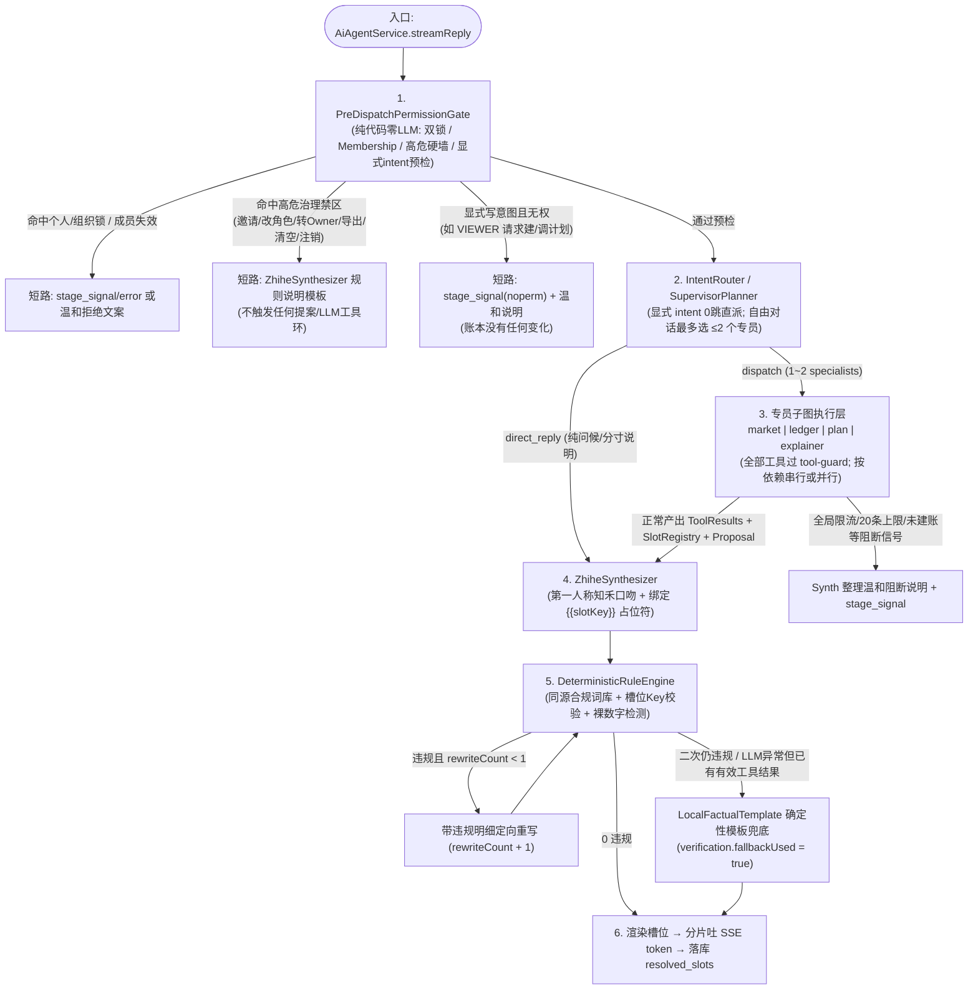
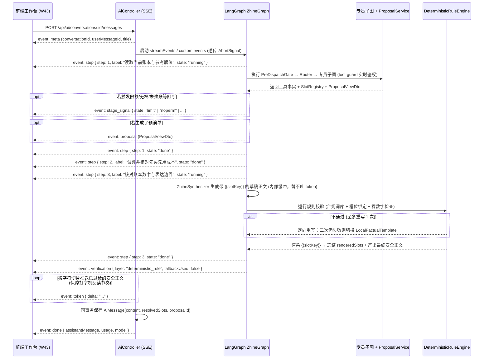

# 知禾（Zhihe）Agent 工程设计规格（上下文 · 记忆 · 工具 · 编排 · 降级）

> **状态**：已定稿（Goal #7 · Stage 1 `W42` 详细设计真源；§9 全部 5 项核心决策已按方案 A 锁定，作为 `W40`–`W44` 执行基线）  
> **上游真源**：
> - 产品与架构边界：[需求文档.md](./需求文档.md)、[技术方案.md](./技术方案.md)
> - 现网 Agent 基线：[changes/ai-assistant/技术方案.md](../ai-assistant/技术方案.md)、[changes/tob-agent-workspace/技术方案.md §8](../tob-agent-workspace/技术方案.md#8-agent-技术-spec)
> - 视觉、人设与合规真源：[design-harness/README.md](../../design-harness/README.md)、[zhihe-persona.md](../../design-harness/intelligence/zhihe-persona.md)、[policy.md](../../design-harness/intelligence/policy.md)、[writing.md](../../design-harness/foundations/writing.md)
> - 运行时合规词库：[compliance-lexicon.ts](../../services/chat/src/ai/compliance/compliance-lexicon.ts)

---

## 1. 文档定位与现网基线对齐

### 1.1 本文档解决什么问题
`changes/product-harness-agent/技术方案.md` 仅用一段概述了 `services/chat/src/ai/agents/`，不足以支撑无歧义的工程实现。本文档在**不推翻既有契约**的前提下，锁定 `Goal #7 (W42)` 知禾多子图 Agent 的全部工程细节，重点覆盖：
1. LangGraph `StateGraph` 拓扑、状态结构、步数与防死循环硬边界；
2. 五层输入上下文组装、Token 预算裁剪、`Solo-First` 与跨组织隔离；
3. 四层用户记忆架构（区分确定性真源、会话冻结槽位、与 L3 跨会话软偏好的隔离/注销边界）；
4. 4 个专员子图的工具调用、缺参澄清、报错自纠与 `tool-guard.ts` 鉴权时序；
5. 「进度实时流式 + 正文先检后吐」SSE 协议、`DeterministicRuleEngine` 槽位防幻觉与合规校验、以及 `resolved_slots` 冻结机制；
6. 9 级全链路降级与容错矩阵、`E2eFakeAgentChatModel` 兼容与 ≥80 条中文评测集设计。

### 1.2 与现网代码及后续 Stage 的边界

| 阶段 / 模块 | 现状（已合入 `dev`） | Stage 1（Goal #7 · `W40–W44`）目标态 | Stage 2 / Stage 3 预留接口 |
| :--- | :--- | :--- | :--- |
| **编排内核** | `services/chat/src/ai/ai-agent.service.ts` 使用单 `createReactAgent` | 改为 `services/chat/src/ai/agents/` LangGraph `StateGraph` 多子图编排（`W42`） | Stage 2 仅向 `ledger` / `plan` 子图注册 `TX_BUY` / `USAGE_RECORD` / `CORRECTION_APPLY` 工具；Stage 3 扩展 `explainer` |
| **提案生命周期** | 无状态 `ai_messages.plan_draft` JSON 列 + `draft_fx_plan` | 独立 `ProposalModule`（`services/chat/src/proposal/`）+ `agent_proposals` 8 态 + `ledger_revisions`（`W40`–`W41`） | Stage 2 在 `ProposalModule` 复用同一 8 态与 `LedgerRevision` 机制接入买入/使用/更正 |
| **工具鉴权** | `services/chat/src/ai/tools/tool-guard.ts`（双锁 → 实时 Membership → `AI_ORG_TOOLS_ENABLED` → RBAC → `AuditLog`） | 100% 沿用并前置 `PreDispatchPermissionGate` 节省无效 LLM 派单 | 无变化，所有新工具均过同一 `tool-guard.ts` |
| **合规与防幻觉** | `compliance-lexicon.ts` + 静态 CI 门禁 `scripts/check-compliance-copy.ts` | 接入第 1 层 `DeterministicRuleEngine`（同源词库 + 槽位裸数字拦截 + 确定性事实模板兜底） | Stage 3（`W50`）叠加第 2 层可选 `ComplianceReviewerAgent` 与 `ReportSnapshotProjector` |
| **SSE 与前端** | `meta / tool / draft / token / done / error` | 扩展 `step / proposal / verification / stage_signal`，向后兼容旧 `draft` 帧与 `14-ai-chat` / `16-agent-organization` E2E | Stage 2/3 复用同一 `proposal` 与 `verification` 帧协议 |

---

## 2. LangGraph `StateGraph` 总架构与状态机拓扑

### 2.1 图拓扑与节点职责



### 2.2 状态定义（规划态：`services/chat/src/ai/agents/zhihe.state.ts`）

```ts
export type SpecialistId = "market" | "ledger" | "plan" | "explainer";

export type PageContextType = "home" | "account" | "plan" | "report";
export type ExplicitIntent = "plan_create" | "plan_adjust" | "ask";

export interface ResolvedSlot {
  /** 如 "acct.USD.unallocated" / "rate.CNY.USD.latest" / "plan.p1.target" */
  key: string;
  /** 原始精确数值字符串或日期 ISO（非展示格式化串） */
  value: string;
  /** 规范展示串，例如 "1,200,000 JPY" 或 "7.1850" */
  display: string;
  /** 币种或量纲，如 "USD" / "CNY/USD" / "ISO_DATE" / "COUNT" */
  unit: string;
  /** 工具来源标识，如 "get_account_summary" / "query_exchange_rate" */
  source: string;
  /** 数据观测或查询时间（UTC ISO） */
  asOf: string;
  /** 所属币种当刻 LedgerRevision（公共汇率或无涉币种时为 null） */
  baseRevision: string | null;
}

export interface StageSignalPayload {
  state: "limit" | "noperm" | "onboarding_required" | "org_tools_disabled";
  code: string;
  message: string;
  /** 如 noperm 时提供替代安全入口；limit 时携带当前待处理提案数 */
  meta?: Record<string, unknown>;
}

export interface ZhiheGraphState {
  // ── 不可变请求与身份上下文（外部注入，图内严禁覆盖） ──
  actor: ActorContext;
  conversationId: string;
  agentRunId: string;
  requestId: string | null;
  memberCount: number;
  baseCurrency: string | null;
  prepPreference: string | null;
  onboardingCompleted: boolean;
  orgToolsEnabled: boolean;

  // ── 页面锚点与会话工作记忆 ──
  pageContext: {
    type: PageContextType;
    id: string;
    /** 后端按 orgId 实时鉴权加载的最小只读摘要；用户文本字段均带 untrusted* 标记 */
    loadedSummary: Record<string, unknown> | null;
  } | null;
  explicitIntent: ExplicitIntent | null;
  activeProposalsSummary: Array<{
    id: string;
    kind: string;
    status: string;
    currencyCode: string;
    targetAmount: string;
    supersedeKey: string | null;
    updatedAt: string;
  }>;

  // ── 对话输入（经窗口与预算裁剪） ──
  historyMessages: Array<{
    role: "user" | "assistant";
    content: string;
    createdAt: string;
    hasFrozenSlots: boolean;
  }>;
  userContent: string;

  // ── 编排路由与执行态 ──
  routedSpecialists: SpecialistId[]; // 硬上限 length <= 2
  executionMode: "parallel" | "sequential";
  shortCircuitReason:
    | null
    | "HIGH_RISK_GOVERNANCE"
    | "LOCKED_OR_DISABLED"
    | "PERMISSION_DENIED"
    | "LIMIT_EXCEEDED";
  stageSignal: StageSignalPayload | null;

  // ── 确定性事实与提案产出 ──
  slotRegistry: Record<string, ResolvedSlot>;
  specialistFindings: Array<{
    specialist: SpecialistId;
    toolName: string;
    ok: boolean;
    errorCode?: string;
    rawJson: Record<string, unknown>;
  }>;
  /** W42 经 ProposalService.createPendingFromAgent 创建的提案视图 */
  createdProposal: ProposalViewDto | null;

  // ── 合成与合规门禁态 ──
  draftReply: string;
  rewriteCount: number; // 最大为 1
  ruleViolations: Array<{
    type: "COMPLIANCE_TERM" | "UNKNOWN_SLOT" | "UNBOUND_NUMBER" | "BUREAUCRACY_TERM";
    detail: string;
  }>;
  finalReply: string;
  renderedSlots: Record<string, ResolvedSlot>;
  usedFactualFallback: boolean;
  verificationLayer: "deterministic_rule";
}
```

### 2.3 执行步数与防死循环硬边界

| 约束维度 | 硬上限 | 兜底机制 |
| :--- | :--- | :--- |
| 单轮路由专员子图数量 | **≤ 2 个** | `IntentRouter` 输出经 Zod `.max(2)` 校验，超限裁剪为前 2 个并记录 warn 日志 |
| 单个专员子图内部 ReAct 循环 | **≤ 4 步**（至多 1 次参数自纠） | 每个专员子图编译时显式传 `recursionLimit: 8`（`agent → tool → agent` 为 2 步）；阻断错误立即返回 `ToolMessage` 并标记终止信号 |
| 整张主图全局步数上限 | **≤ 20 步** | 沿用并收紧 [ai-agent.service.ts](../../services/chat/src/ai/ai-agent.service.ts#L66) `AGENT_RECURSION_LIMIT`；无图内回环边（`Exec` 不可回跳 `Router`） |
| 规则重写次数 | **≤ 1 次** | `rewriteCount >= 1` 后若仍存在任何 1 条 `ruleViolations`，强制切入 `LocalFactualTemplate` 确定性输出 |
| 并发信号量与流式硬超时 | `AI_CHAT_MAX_CONCURRENCY=40`，首字 `30s`，整流 `120s` | 沿用 [ai.controller.ts](../../services/chat/src/ai/ai.controller.ts#L71) 与 [ai-runtime-config.ts](../../services/chat/src/ai/llm/ai-runtime-config.ts#L37)，`AbortSignal` 贯通所有节点与子图 |

---

## 3. 上下文工程设计（Context Assembly & Token Budget）

### 3.1 五层输入上下文组装顺序（Prompt Cache 友好 + 防注入隔离）

每次调用大模型节点（`IntentRouter`、`Specialist`、`ZhiheSynthesizer`）均遵循**「静态规则在前、结构化不可信边界在后、绝不在 System Prompt 拼接用户输入」**的五层组装顺序：

| 层级 | 角色与内容 | 缓存/安全策略 |
| :--- | :--- | :--- |
| **Layer 1：静态人格与合规边界** | 按 `memberCount === 1` vs `> 1` 选择两份静态常量 `ZHIHE_SOLO_SYSTEM_PROMPT` / `ZHIHE_TEAM_SYSTEM_PROMPT`（包含知禾温和第一人称、严禁暴露后台专员/总控/审计词、严禁择时预测、数字必须以 `{{slotKey}}` 引用） | **纯静态常量**，最大化上游 Prefix Cache 命中；零变量插值，杜绝 System Prompt 注入 |
| **Layer 2：只读运行时环境锚**（`SystemMessage` 或固定结构头） | `{ baseCurrency, prepPreference, onboardingCompleted, memberCount, orgToolsEnabled, nowUtcIso, displayTimezone: "Asia/Shanghai" }` | 由后端数据库/配置直接构造，不含任何用户自由文本；`baseCurrency` 用于让模型默认知道本位币 |
| **Layer 3：页面与会话工作锚**（仅在存在时注入） | ① **URL 上下文**（`/chat?ctx=plan:<id>&intent=plan_adjust`）：后端通过 `PlanService.getDetail(actor, id)` / `AccountService.detail(actor, code)` **按当前组织鉴权拉取**最小只读摘要（计划名称严格包进 `untrustedPlanName` 并附防注入声明；若跨组织/不存在则静默丢弃锚点，绝不报错泄露）；<br>② **本会话活跃提案列表**：拉取本会话最近 3 条 `PENDING`/`STALE` 提案摘要 `{ proposalId, kind, currencyCode, targetAmount, status, supersedeKey }`，支持连续追问修改同一张单 | 只进 `HumanMessage`/专用上下文块，所有用户输入字段统一命名 `untrusted*` |
| **Layer 4：裁剪后的历史消息窗口** | 最近 `AI_CHAT_HISTORY_WINDOW`（默认 20 条）消息；**防旧值误用处理**：若历史 `assistant` 消息含 `resolved_slots` 且非空，在该条历史消息末尾由服务端附加不可伪造系统注记：`[系统注记：该回复中的数值为 <createdAt> 历史冻结快照，若用户继续询问当前余额、汇率或试算，必须重新调用工具获取最新数据]` | 防止模型把 3 天前的历史余额直接抄作今日余额（对应 `policy.md` #6 与需求 `GWT-H5`） |
| **Layer 5：本轮用户消息** | `HumanMessage(userContent)`（长度已在 `AiService.prepareChat` 校验 `1..2000` 字符） | 与指令严格隔离 |

### 3.2 Token / 字符预算与裁剪算法

现网 `AiService.getHistoryWindow` 仅按条数 `take: config.historyWindow`（默认 20 条）截断。在多子图 + 页面摘要 + 活跃提案注入后，需升级为**双维预算裁剪**（纯函数，无外部 tokenizer 依赖误差可控）：

1. **硬条数上限**：SQL 层仍按 `createdAt DESC` 取最多 `AI_CHAT_HISTORY_WINDOW`（20 条）后反序。
2. **字符预算软上限**：以保守估算（中文 `1 char ≈ 1.5 tokens`，预留 `Layer 1–3` ~ 2,500 chars + 工具定义 ~ 2,000 chars + 输出 `maxTokens`），规定历史窗口总字符预算 `MAX_HISTORY_CHARS = 12_000`：
   - 第 1 优先级保留：**最近 4 轮（8 条）完整消息**（如单条历史本身超 2,000 chars——虽然用户消息限制 2,000，助手长回复可能更长——超长助手消息尾部保留摘要，头尾各留 800 chars）；
   - 第 2 优先级保留：从较近往较远累加，超出 `12_000` 字符预算的更早消息整条丢弃，确保不截断成残缺半句话。
3. **工具回传结果裁剪**：`list_plan_exposure` / `get_plan_cost_summary` / `list_upcoming_actions` 若返回超过 `20` 条计划，由工具/专员适配层截断前 20 条并附加 `{ truncated: true, totalCount }`，防止单次工具响应撑爆上下文窗口。

### 3.3 上下文隔离红线（多组织切换与并发）

- **请求入口强绑**：所有上下文读取（`pageContext`、`activeProposalsSummary`、工具闭包）一律绑定通过 `OrganizationContextGuard` 与 `OrganizationLockGuard` 校验的 `actor`（`userId + organizationId`）。
- **切组织前端联动**：沿用 [chat-store.ts](../../clients/chat-web/lib/stores/chat-store.ts#L215-L219) `abortActiveStream()`，切换组织或登出时立刻中断旧流并清空工作台运行时状态；即使客户端断连信号延迟，下一次工具调用也会在 `tool-guard.ts` 实时校验中拦截失效成员。

---

## 4. 用户记忆设计（四层分级记忆架构）

### 4.1 金融账本场景的核心记忆原则

> [!IMPORTANT]
> **铁律：绝不用 LLM 向量记忆 / 自由文本摘要来记忆账本数字、汇率或成员权限。**
> 金融换汇系统中，余额、计划缺口、汇率、权限角色时刻随账本写入和管理员操作变化；使用模糊文本记忆不仅会导致数字幻觉，还会在多组织场景下造成跨组织越权泄露。

因此，知禾采用**四层严格分级的记忆架构**，明确区分「真源」「冻结快照」与「可演进的软偏好」：

| 层级 | 名称 | 存储载体 | 隔离作用域 | 写入者 | 读取时机 | 数据注销/清空处理 | 落地阶段 |
| :--- | :--- | :--- | :--- | :--- | :--- | :--- | :--- |
| **L0** | 单轮工作台临时记忆 | 内存 `ZhiheGraphState`（URL `ctx`、`intent`、中间 `slotRegistry`） | 单次 `agentRunId` 请求 | 服务端与工具 | 仅本轮图执行期间 | 请求结束自动 GC 销毁 | **Stage 1 (`W42`)** |
| **L1** | 确定性结构化真源记忆 | `OrganizationSettings`（本位币/准备偏好/提醒开关）、`UserSettings`（语言/地区）及实时账本表 | 组织级设置按 `organizationId`；个人展示偏好按 `userId` | 用户经确定性设置/向导接口写入（AI 只读） | 每次请求组装 Layer 2 环境块时实时查库 | `ORGANIZATION CLEAR` 重置 `ledgerStartedAt`；`DELETION` 随各自域清理 | **已存在，Stage 1 直接接入** |
| **L2** | 会话工作记忆与永久冻结槽位 | `ai_conversations`、`ai_messages`、`ai_messages.resolved_slots`、`agent_proposals` | 严格 `(userId, organizationId)`（组织级共享账本的个人对话视角） | 服务端流成功落库 & `ProposalService` | ① 前端历史回看直读 `resolved_slots`（**永不重算**）；<br>② 续聊取活跃提案锚点 + 加旧快照注记的历史窗口 | `PERSONAL DELETION` 物理删本人会话（`agent_proposals.conversation_id` 优雅 `SetNull`）；`ORGANIZATION DELETION` 清理组织下所有会话与提案 | **Stage 1 (`W40–W42`) 必落** |
| **L3** | 跨会话软偏好记忆（可控结构化键值） | 独立结构化表 `ai_user_memories`（非黑盒向量库），严格限白名单键 | 严格 `(userId, organizationId)` 复合作用域（同用户在 A/B 组织互不串用） | 经正则/结构化提取器 + 用户显式确认（可选） | 组装 Layer 2 环境块时注入 ≤ 5 条高频稳定偏好 | 接入 `DataRequest`：个人注销删本人全部记录；组织删除删该组织下记录；设置页提供「清空知禾记忆」按钮 | **Stage 2 / 独立增量（需在 §9 拍板确认）** |

### 4.2 L3 跨会话软偏好的严格白名单与黑名单（若启用）

- **允许记（仅 4 类非敏感软偏好，值长度 ≤ 64 字且过 `compliance-lexicon` 扫描）**：
  1. `frequent_currencies`：用户常关注/常备款外币清单（如 `["JPY", "USD"]`，最多 5 个）；
  2. `common_purpose_tags`：常见换汇用途标签（如 `"留学学费"`、`"旅行备款"`，最多 5 个）；
  3. `default_prep_lead_habit`：用户常偏好的提前准备缓冲天数习惯（如 `7` 天，仅作预演单缺省值参考，用户仍可覆盖）；
  4. `reply_verbosity`：表达详略偏好（`"concise"` 简洁要点 vs `"detailed"` 附原理说明）。
- **绝对禁止记（黑名单硬拦截）**：
  - 任何账户余额、目标金额、买入价、汇率数字、手续费金额；
  - 任何成员姓名、邮箱、电话、成员角色（`OWNER`/`ADMIN`/`FINANCE`/`OPERATOR`/`VIEWER`）；
  - 任何市场观点、涨跌倾向或合规封杀词。

> **Stage 1 默认取舍建议**：在 `Goal #7 (W40–W44)` 中先扎实落地 **L0 + L1 + L2**（覆盖建账偏好、当前页面锚点、同一会话连续追问改提案、跨会话永久冻结数字），避免为尚未验证需求的 L3 表增加 `W40` 迁移面与个人注销测试复杂度；待 Stage 1 验收后，在 Stage 2 按白名单引入 `ai_user_memories`。

---

## 5. 工具调用与安全执行契约

### 5.1 专员子图与工具映射矩阵

| 专员子图 | 负责工具 | 工具作用域 | 所需 RBAC 权限点 | Stage 1 行为约束 |
| :--- | :--- | :--- | :--- | :--- |
| **`market`（行情）** | `query_exchange_rate`（复用 [rate-tool.ts](../../services/chat/src/ai/tools/rate-tool.ts)） | `public` | `agent.use` | 查最新价（1~5 目标币种）或历史区间（7/30/90 天）；13/15 币对无历史回源时如实告知「暂无历史数据」；**`AI_ORG_TOOLS_ENABLED=false` 时唯一保留可用** |
| **`ledger`（账本实况）** | `get_account_summary`<br>`list_plan_exposure`<br>`get_plan_cost_summary`<br>`list_upcoming_actions` | `organization` | `agent.use` + `agent.business_read` + 各自读权限（`account.read` / `plan.read` / `report.read`） | 完全复用现网 4 个只读工具，内部直接调对应业务 Service；强制保留 `hasUnknownFee=true` 最低估计提示与 `untrustedPlanName` 防注入包裹 |
| **`plan`（预演提案）** | **`propose_plan_create`**（新，接替 `draft_fx_plan`）<br>**`propose_plan_adjust`**（新） | `organization` | 创建：`agent.use`, `agent.business_read`, `agent.draft`, `plan.create`<br>调整：`agent.use`, `agent.business_read`, `agent.draft`, `plan.adjust` | **绝不调 `PlanService.create` / `adjust`**；仅调只读 `PlanService.preview` / `previewAdjust` + `ProposalService.createPendingFromAgent`；结果写入 `state.createdProposal` 并推 SSE `proposal` 帧 |
| **`explainer`（规则与解读）** | 复用只读查询 + 静态规则说明片段（FIFO 先买先用、排期节奏定义、预演单确认规则） | `organization`（若查账本）/ `public`（纯规则问答） | 纯规则问答仅需 `agent.use`；查具体计划/账本同 `ledger` | Stage 1 先支持针对单计划/账本的通俗规则解释；Stage 3（`W49–W51`）接入 `ReportSnapshotProjector` |

> **向后兼容过渡说明**：现有 `draft_fx_plan`（`draft-plan-tool.ts`）与 `ai_messages.plan_draft` 仍被 E2E `16-agent-organization.spec.ts` 覆盖。`W42` 期间可通过 `propose_plan_create` 同时写入 `AgentProposal` 与同步返回兼容结构（或由 `AiAgentService` 保持兼容 `draft` 帧输出直到 `W43/W44` 完成测试迁移），确保在旧前端未切换前的中间切片期间零破坏。

### 5.2 工具调用全链路铁律（继承并强化 `tool-guard.ts`）

1. **前置门控 + 实时双保险**：
   - 图入口 `PreDispatchPermissionGate` 先查一次锁/成员/高危治理硬墙；
   - 进入子图后，**每次工具调用仍必须经过 `tool-guard.ts`** 执行完整的 6 步顺序：双锁检查 → 实时重查 `Membership`（流中途降权/移除立即生效）→ `AI_ORG_TOOLS_ENABLED` 开关 → `can(freshRole, perm)` → 业务入参校验 → 执行 + `AuditLog(actorType="AGENT", agentRunId)`。
2. **入参 Schema 硬纪律**：所有工具 schema 必须 `.strict()`，严禁出现 `userId`、`organizationId`、`role`、`permission` 字段；`freshActor` 仅由服务端闭包注入。
3. **缺参澄清原则（Anti-Guessing Rule）**：
   - 用户说“帮我建一个去日本旅游的换汇计划”但未说明金额或用汇日期时：`propose_plan_create` 的必填参数（`targetCurrency`、`targetAmount`、`expectUseDate`）缺失，**严禁模型自行编造“下个月 15 号”或“10000 元”直接生成预演单**——必须温和反问缺失项；
   - 用户说“把我的计划金额改大一点”但组织内存在多张 `ACTIVE` 计划且未在 URL 指定 `ctx=plan:<id>` 时：先调用 `list_plan_exposure` 列出候选计划名称与当前目标，请用户确认要调整哪一张，再生成 `PLAN_ADJUST` 提案；
   - 若同一会话已有活跃 `PENDING`/`STALE` 提案且用户说“改成 150 万日元”或“分配调成 0”，`plan` 子图从 Layer 3 活跃提案锚点自动继承其余参数，沿用同一 `supersedeKey`（例如 `conv:<conversationId>:PLAN_CREATE` 或 `conv:<conversationId>:PLAN_ADJUST:<planId>`）生成新提案并自动将旧稿置为 `SUPERSEDED`。
4. **工具报错分类处理**：
   - **可恢复参数错误**（`INVALID_PARAMS` / 日期格式略偏差）：回喂结构化错误文本，子图至多自纠重试 **1 次**；
   - **阻断型业务/安全错误**：`PERMISSION_DENIED`、`ORGANIZATION_DATA_LOCKED`、`ACCOUNT_PENDING_DELETION`、`AI_ORG_TOOLS_DISABLED`、`ONBOARDING_NOT_COMPLETED`、`PROPOSAL_ACTIVE_LIMIT_EXCEEDED`（20 张上限）→ 立即设置 `state.shortCircuitReason` 与 `state.stageSignal`，**停止子图继续调工具**，交由 `ZhiheSynthesizer` / `LocalFactualTemplate` 生成带「你的账本没有任何变化」的温和说明。

---

## 6. 槽位防幻觉、合规校验与 SSE 流式协议

### 6.1 核心时序：「进度实时流式 + 正文先检后吐」

为彻底解决「流式首字已发往浏览器后，规则引擎才拦截到合规词或未绑定数字」的矛盾，采用如下双通道协同机制：



> **体验与安全兼顾**：用户在等待大模型合成的 1–3 秒内，第一时间看到知禾 3 步安静核对进度条与右侧已就绪的存折预演单卡片（`proposal` 帧）；正文通过毫秒级确定的规则门禁后立即按自然节奏流式吐出，**保证 0 违规词、0 编造数字触达屏幕**。

### 6.2 强类型槽位（`ResolvedSlot`）与确定性抽取规则

专员子图每成功执行一个工具，立即由**纯确定性 Extractor**（不经 LLM）把工具 JSON 结果写入 `state.slotRegistry`：

| 工具名 | 注册的典型槽位 Key 规范 | 关键元数据 |
| :--- | :--- | :--- |
| `query_exchange_rate` | `rate.<base>.<target>.latest`、`rate.<base>.<target>.hist.start/end/high/low` | `unit: "<base>/<target>"`, `asOf: observedAt`, `baseRevision: null` |
| `get_account_summary` | `acct.<ccy>.balance`、`acct.<ccy>.allocated`、`acct.<ccy>.unallocated`、`acct.<ccy>.avg_cost` | `unit: ccy`, `baseRevision` 取自 `ledger_revisions` |
| `list_plan_exposure` | `plan.<planId>.target`、`plan.<planId>.allocated`、`plan.<planId>.used`、`plan.<planId>.gap`、`plan.<planId>.latest_prep` | `unit: targetCurrency` / `"ISO_DATE"` |
| `get_plan_cost_summary` | `cost.<planId>.used_qty`、`cost.<planId>.used_total`、`cost.<planId>.used_unit` | `unit: baseCurrency`, 若 `hasUnknownFee=true` 强制附加不可省略标记 |
| `propose_plan_create` / `adjust` | `prop.<proposalId>.target`、`prop.<proposalId>.allocated`、`prop.<proposalId>.latest_prep`、`prop.<proposalId>.max_allocatable` | `baseRevision` 绑定提案生成时刻的修订号 |

**渲染与历史冻结**：
- `ZhiheSynthesizer` 在正文中用 `{{slotKey}}` 引用业务数字，渲染器将其替换为 `slot.display`（并将实际使用到的子集写入 `ai_messages.resolved_slots`）。
- 若模型未写 `{{slotKey}}` 而是直接写出数字，只要该数字与 `slotRegistry` 中某个已注册值精确匹配（归一化千分位后完全相等），RuleEngine 自动将其反绑到对应 `ResolvedSlot`；**若在 `slotRegistry` 中找不到任何精确匹配源，一律判为 `UNBOUND_NUMBER` 裸数字违规**！

### 6.3 `DeterministicRuleEngine` 校验细节

1. **合规词拦截**：直接调用 [compliance-lexicon.ts](../../services/chat/src/ai/compliance/compliance-lexicon.ts#L272) `scanTextForComplianceViolations(text)`（自动掩蔽合法否定白名单如「不构成投资建议」「不预测涨跌」，且**绝不识别**源码注解 `compliance-allow`）。
2. **后台官僚词拦截**：覆盖 `LEGACY_BRAND_OR_BUREAUCRACY` 词类（`灵积`、`总控`、`记账专员`、`规划专员`、`审查员`、`圆桌派单`），以及在 `memberCount === 1`（Solo-First）态额外检查禁用企业词（`组织审计`、`管理员角色`、`需要.*?权限`）。
3. **裸业务数字防幻觉检测**：
   - 检测目标：金额数字、带小数的汇率、百分比、带年份/月日的具体业务日期；
   - **显式豁免白名单**（避免误杀正常中文语法与固定规则说明）：
     - 有序列表标号（行首 `1.`、`2.`、`3.`）；
     - 系统固定规则常量（`5 分钟`、`24 小时`、`20 张`、`3 批`、`1~30 天`、`18 岁`、`第 1 步`/`第 2 步`/`第 3 步`）；
     - 用户原话中复述的尚未试算参数（仅限澄清反问场景，如“你刚刚提到准备 10,000 USD，还缺预期用汇日期”——由输入数字白名单精确匹配）。
4. **本地确定性事实模板兜底（`factual-template.ts`）**：
   覆盖 7 类确定性模板：`rate_result`、`account_summary`、`plan_exposure`、`proposal_ready`、`clarify_missing_params`、`blocked_with_safe_ledger`（统一含「你的账本没有任何变化」）、`empty_ledger`。确保二次重写失败或模型合成超时时仍能交付精准、温和、零幻觉的回复。

### 6.4 `Solo-First` 与 `Team-on-Demand` 自适应转译规则

| 场景 | `memberCount === 1`（个人默认态） | `memberCount > 1`（多人团队态） |
| :--- | :--- | :--- |
| 称呼账本 | 「你的账本」「当前账户」 | 「当前团队账本」 |
| 确认后说明 | 「确认后会留存一条账本变更记录，随时可在流水里更正」 | 「确认后会记入团队账本并保留操作记录，随时可在流水里更正」 |
| 权限不足（理论上 `memberCount === 1` 恒为 `OWNER`） | 不应触发；若防御触发仍不暴露角色名 | 温和展示团队角色分工说明，提示「你的账本没有任何变化」及安全替代入口（如调整计划/联系发起人） |

---

## 7. 全链路分级降级与容错策略（9 级降级矩阵）

| 级别 | 故障 / 受限场景 | 触发条件与判定层 | HTTP / SSE 响应形态 | 是否消耗配额 | 账本与数据状态 | 前端呈现与用户恢复路径 |
| :--- | :--- | :--- | :--- | :--- | :--- | :--- |
| **D1** | 全部模型密钥未配 | `AiService.assertChatAvailable()` (`!hasConfiguredModel`) | HTTP `503 AI_NOT_CONFIGURED` | 否 | 零写入 | 展示温和降级提示卡（`chat-service-unavailable`），禁止发消息 |
| **D2** | AI 总开关关闭 | `AI_CHAT_ENABLED=false` | HTTP `503 AI_DISABLED` | 否 | 零写入 | 同上，引导去常规表单页面操作 |
| **D3** | 单模型密钥缺失 / 模型非法 | `resolveModelConfig(modelKey)` | 非法 key `400 AI_MODEL_UNKNOWN`；单密钥缺 `503 AI_NOT_CONFIGURED` | 否 | 零写入 | 提示切换白名单内其他可用模型（分模型降级） |
| **D4** | 组织工具独立开关关闭 | `AI_ORG_TOOLS_ENABLED=false` | 对话正常建立；`tool-guard` 放行 `market`、拒绝组织工具（`AI_ORG_TOOLS_DISABLED`）+ `stage_signal(org_tools_disabled)` | 是 | 零写入 | 保留公共汇率查询与规则说明，右侧展示「账本协作工具暂未开启，你的账本没有任何变化」 |
| **D5** | 个人/组织双锁或成员失效/无权 | `OrganizationLockGuard`（请求前）/ `PreDispatchPermissionGate` & `tool-guard`（流中实时重查） | 请求前 `403 ACCOUNT_PENDING_DELETION` / `ORGANIZATION_DATA_LOCKED`；流中无权短路 `stage_signal(noperm)` | 视阶段 | 锁住或无权，零写入，写 `DENIED` 审计 | 请求前 403 自动跳 `/data-requests`；流中 `noperm` 展示替代可操作入口 |
| **D6** | 限流 / 日配额 / 并发 / 会话忙碌 | `@Throttle`（5/min/IP）、`dailyQuota`（100）、`ConcurrencySemaphore`（40）、`busyConversations` | `429 AI_QUOTA_EXCEEDED` / `429 AI_BUSY` / `409 AI_CONVERSATION_BUSY` | 否（超额拦截） | 零创建会话、零留空消息 | Toast / 行内提示稍后重试；已输入文案保留在输入框 |
| **D7** | 业务异常（未建账 / 20 张上限 / 汇率源不可用） | `ONBOARDING_NOT_COMPLETED`、`PROPOSAL_ACTIVE_LIMIT_EXCEEDED`、`RATE_SOURCE_UNAVAILABLE` | `stage_signal(onboarding_required \| limit)` 或受控 Tool 错误回喂 | 是 | 20 张上限绝不静默删旧稿；账本零改动 | `limit` 态展示批量勾选「收起不记」清理清单；未建账引导去 `/onboarding` |
| **D8** | LLM 上游故障 / 首字 `30s` / 整流 `120s` / 规则二次拦截 | 上游异常 / 超时 / `rewriteCount >= 1` 仍违规 | **若本轮已生成有效 `createdProposal`**：自动走 `factual-template.ts` 完成文案 + `done` 帧（保底不丢预演单）；**若无有效工具成果**：下发 `error` 帧 `AI_UPSTREAM_FAILED`（固定文案，上游细节仅进日志） | 是 | `error` 帧时不落助手消息（保留用户消息可重发） | 检视台切 `error` 态写明「还没有生成预演单，你的账本没有任何变化」+ 重试/去常规表单入口 |
| **D9** | 客户端断连 / 组织切换 | `res.on("close")` 触发 `AbortController` / 前端 `abortActiveStream()` | 静默终止图执行与上游请求，不落助手消息、不发错误帧，finally 释放信号量与忙碌标记 | 已计一次 | 零半条消息污染上下文 | 新组织上下文洁净，无旧流残留帧 |

---

## 8. 测试策略、假模型兼容与 ≥80 条中文评测集

### 8.1 E2E 假模型兼容矩阵（[llm-factory.ts](../../services/chat/src/ai/llm/llm-factory.ts)）

- **保留 `[R2-E2E]` 零破坏**：`E2eFakeAgentChatModel` 继续支持原有 `[R2-E2E]` 路由与返回值，确保既有 [14-ai-chat.spec.ts](../../e2e/modules/14-ai-chat.spec.ts) 与 [16-agent-organization.spec.ts](../../e2e/modules/16-agent-organization.spec.ts) 全绿通过。
- **新增 `[S1-E2E]` 确定性驱动**：支持在 E2E（`AI_E2E_FAKE_STREAM=true`）中免外呼驱动完整 Stage 1 链路：
  - `[S1-E2E] 新建计划` / `[S1-E2E] 调整计划` → 经过真实 `PreDispatchPermissionGate`、`ProposalService.createPendingFromAgent`、`DeterministicRuleEngine`、`resolved_slots` 落库与 SSE `step / proposal / verification / token / done`；
  - `[S1-E2E] 诱导` → 验证假模型故意吐出封杀词或编造裸数字时，被 `DeterministicRuleEngine` 拦截并重写或回退确定性模板，前端永不展示违规文案。

### 8.2 分层测试清单（`W42` & `W44`）

| 测试层级 | 目标文件（规划态） | 核心覆盖点 |
| :--- | :--- | :--- |
| **L1+ 属性测试** | `services/chat/src/ai/agents/slot-freeze.property.spec.ts` | `fast-check` 生成随机金额/日期/修订号序列与后续账本变动，验证 `ai_messages.resolved_slots` 回放恒等不变 |
| **L1+ 单元测试** | `deterministic-rule-engine.spec.ts`、`context-budget.spec.ts`、`zhihe-graph.spec.ts` | 合规词库拦截、合法否定句豁免、裸数字拦截与白名单放行、1 次重写 + 模板回退、5 层上下文裁剪优先级、`Solo/Team` 提示词切换、历史快照注记注入 |
| **L2 集成测试** | `services/chat/test/integration/agent-tool-authorization.spec.ts`（扩展） | 流中途成员降权/移除、双锁阻断、组织切换隔离、`AI_ORG_TOOLS_ENABLED=false` 仅留汇率、高危治理 0 提案 |
| **L2 中文评测门 (`W44`)** | `services/chat/test/integration/zhihe-routing-eval.spec.ts` + `fixtures/zhihe-eval-cases.json` | **≥ 80 条样本**（单域 ≥30 / 跨域 ≥15 / 越权 ≥15 / 高危治理 ≥10 / Prompt Injection & 投顾诱导 ≥15）：<br>• **CI 离线模式（默认）**：确定性检验权限门、高危硬墙、路由规则快道、槽位防幻觉、合规词库与模板回退；<br>• **可选真模型模式（`EVAL_LIVE_LLM=true`）**：调用白名单模型实测端到端路由。<br>• **量化红线**：单域/跨域路由准确率 **≥ 95%**；越权/高危/注入误派单 **= 0**；槽位外裸数字 **= 0**；合规词漏放 **= 0** |

---

## 9. 已锁定设计决策清单（`D-A1`–`D-A5`，全部按方案 A 定稿）

以下 5 项核心实现决策已于 2026-11-28 对齐确认并全部按推荐方案 A 锁定，后续 `W40`–`W44` 严格照此执行：

1. **D-A1 正文流式输出策略（§6.1）**：**锁定方案 A（进度实时流式 + 正文先检后吐）**——编排进度 `step` 与右侧预演单 `proposal` 实时下发；文字正文经 `DeterministicRuleEngine` 全文过检后再按片推送 `token`，100% 杜绝违规词或裸数字短暂上屏。
2. **D-A2 用户记忆分期范围（§4）**：**锁定方案 A（Stage 1 落地 L0 + L1 + L2）**——Stage 1 落地单轮工作台记忆、结构化真源（`OrganizationSettings` / `UserSettings`）与会话工作记忆（`ai_messages.resolved_slots` 永久冻结快照 + 本会话活跃提案锚点）；L3 跨会话软偏好表 `ai_user_memories` 放 Stage 2 作为独立可控增强落地，不膨胀 `W40` 数据库迁移与个人注销零级联范围。
3. **D-A3 跨轮续聊历史数字防误用（§3.1）**：**锁定方案 A**——组装历史窗口时，对附带 `resolved_slots` 的历史助手消息自动加注 `[系统注记：该回复中的数值为 <createdAt> 历史冻结快照，若用户继续询问当前余额、汇率或试算，必须重新调用工具获取最新数据]`，同时保持前端历史回看直读冻结原值。
4. **D-A4 建/调计划缺参处理策略（§5.2）**：**锁定方案 A**——缺少必填 `targetCurrency` / `targetAmount` / `expectUseDate` 或存在多张活跃计划未指定调整目标时，仅温和反问澄清（或先调 `list_plan_exposure` 列出候选计划），**严禁猜测默认日期乱出预演单**。
5. **D-A5 工具已产出有效提案但后续合成超时的容错（§7 D8）**：**锁定方案 A**——若 `propose_plan_create` / `adjust` 已成功写入 `PENDING` 提案，即使后续 `ZhiheSynthesizer` 超时或二次规则拦截，也自动走 `factual-template.ts` 保底输出确定性说明并推送 `done` 帧，避免已生成的预演单丢失。
