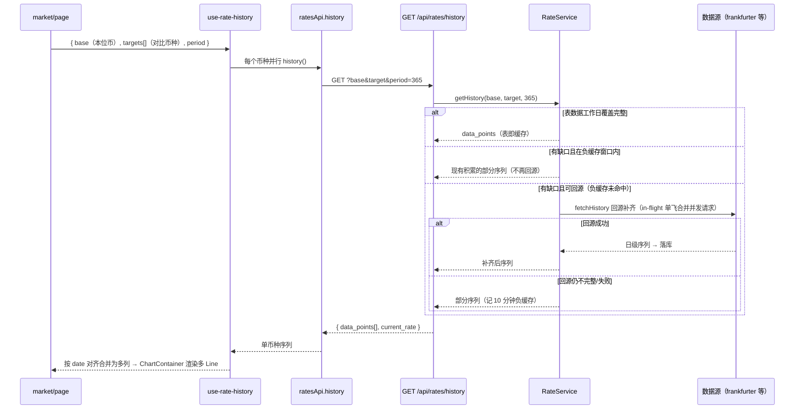

# 技术方案：汇率行情（图表页）【v2，经三视角审核修订】

> 需求规格：`changes/rate-chart/规格.md`（拍板结论：recharts 折线图、本位币基准、多币种叠加对比、7/30/90/365 天档位）。
> 关联方案：`changes/ai-assistant/技术方案.md`（两者共用 `RateService` 数据底座，互相独立交付）。
> 修订记录：v1 经架构 / 安全边界 / 测试三视角审核，与本方案相关的意见全部采纳，详见 §11。
>
> 动笔前已确认：核心场景——登录用户在菜单「汇率行情」页查看本位币对多币种的汇率折线走势并切换时间档位；量级——公开服务、成百上千用户（下表均为**预估**）；最大风险点——**13/15 币对无历史回源能力，365 档数据覆盖取决于币对**（见 §1.3，审核实证）。
>
> 本次方案涉及：**新增 0 张表、0 个新接口**（复用 `GET /api/rates/history`，仅扩展 `period` 枚举 +365）；**后端 2 个文件修改 + 测试辅助扩展，前端新增 1 页 + 1 hook + 4 组件**；预计新增代码约 700 行（含测试），**零新增依赖**（recharts 3.8.0 与 shadcn Chart 封装已就位）。

## 1. 目标与量化约束

### 1.1 业务背景

现有汇率模块已具备多源采集（ABC/erAPI/frankfurter，`exchange_rates` 表即缓存 + cron 30 分钟刷新）与 `GET /api/rates/history`（日级序列）。本次把数据可视化：新菜单页「汇率行情」，本位币为基准，叠加对比多币种，四个时间档位。前端 `components/ui/chart.tsx`（shadcn ChartContainer/ChartTooltip/ChartLegend 封装）已存在但**尚无业务使用先例**，本功能是首个消费方。

### 1.2 核心指标预估

| 指标项 | 预估值 | 依据/备注 |
| -------- | -------- | ----------- |
| 数据规模 | 0 新表；单请求最大 **366 个数据点**（365 天档 × 日级） | 约 25KB JSON，无需分页/降采样 |
| 并发压力 | 峰值 QPS < 50 | 读多写少；后端表即缓存，仅在缺口时回源 |
| 响应要求 | 7/30/90 天档 < 3s；365 天档：**有回源能力币对首次 ≤ 15s**（预估，frankfurter time-series），之后命中缓存 < 1s；**无回源能力币对**展示 cron 积累的部分序列（快，但起始日受服务运行时长限制） | 规格性能条款已按此分层修订（§11 #1） |
| 一致性 | 允许脏读（行情数据本就 5 分钟窗口） | 无事务需求 |

### 1.3 约束条件（含审核实证的关键事实）

- **历史回源能力事实**（v1 审核实证）：`rate-source.abc.ts` 与 `rate-source.erapi.ts` 的 `fetchHistory` 实际返回空数组（ABC 无历史接口、erAPI 免费档受限）——15 币种中仅 **MYR 直连 + fallback 模式（frankfurter）具备历史回源能力**，其余 13 个币种的历史序列**只能靠 cron 逐日积累，永远补不齐**。因此 365 档是"尽力展示"语义：有积累多少展示多少 + 起始日标注（规格边界已同步）。
- `GET /api/rates/history` 现仅支持 `period ∈ {7,30,90}`（`rate.constants.ts` 的 `VALID_PERIODS`），规格要求 1 年档 → 后端扩展枚举。**注意**：period 非法（如 180）走 ValidationPipe 返回 **400**，`422 RATE_PAIR_UNSUPPORTED` 仅用于不支持币对（既有断言 `test/api/rate.spec.ts:328` 佐证）。
- **回源放大器风险**：`isHistoryCacheComplete` 对永远补不齐的币对会每次请求都触发回源尝试（外呼放大器）→ 本方案在 `getHistory` 回源路径补两个小防护（§6）：**in-flight 单飞**（并发请求共享同一次回源）+ **负缓存**（回源后仍不完整的币对，10 分钟内不再重试回源）。
- 币种支持范围由 `packages/money` 的 `CURRENCIES`（15 币种）单一事实来源决定，前端币种选择器从 `GET /api/rates/supported` 取，不硬编码。
- 本位币只读（onboarding 写入，`GET /settings` 返回 `baseCurrency`，无更新通道），前端复用 `settingsApi` 读取。

## 2. 方案选型与取舍

| 维度 | 方案 A：后端扩展 period=365，前端一次拉全 | 方案 B：前端拉 4 次 90 天自行拼接 |
| ------ | ------ | ------ |
| 性能 | 一次请求 366 点 | 4 次请求 + 前端拼接去重，逻辑重复 |
| 维护成本 | `VALID_PERIODS` 加一个枚举值 + 回源路径两个小防护 | 拼接边界（工作日缺口、时区）易错，且绕不开同样的回源放大器问题 |
| 团队熟悉度 | 沿用现有 history 链路 | 引入前端数据加工新范式 |
| 生态成熟度 | 复用已验证的缓存/补齐判定逻辑（补齐能力仅覆盖 frankfurter 可供数币对，事实见 §1.3） | 无 |

**结论**：选 **A**。history 服务按天数换算起点，365 是通用输入，无档位白名单分支（实施时验证）；回源能力的币对差异是数据源事实而非本方案可改造项（规格边界已声明不为可视化改采集层）。

| 维度 | recharts（已装 3.8.0 + shadcn 封装） | echarts（未装） |
| ------ | ------ | ------ |
| 依赖成本 | 零新增 | 新增 ~1MB 依赖 |
| 契合度 | `components/ui/chart.tsx` 已提供 Container/Tooltip/Legend 与主题变量 | 需自建主题与封装 |
| 能力 | 声明式多 Line 折线，满足本需求 | 能力更强（本需求用不到） |

**结论**：选 **recharts**（shadcn 生态默认，规格已拍板）。多币种叠加 = 单 `<LineChart>` 内多个 `<Line series>`，颜色由 ChartContainer 主题变量 `--color-<key>` 分配。

## 3. 核心设计

### 3.1 数据流时序图

> 图例：实线为同步调用；`alt` 分支在现有缓存/回源决策之上，仅新增"负缓存"一档（v2 审核补充，防外呼放大器）。前端只新增"多币种并行 + 按 `date` 对齐合并"这一步纯函数加工（`merge-series.ts` 独立成文件，便于单测）。

### 3.2 数据模型变更

无新增表/字段。读取现有 `exchange_rates`（`observedAt ∈ [start, end]`），ER 图省略。

### 3.3 前端状态与交互设计

- **档位**：`7 | 30 | 90 | 365`，UI 为四个 Tab（`ui/tabs` 或按钮组），默认 30 天（规格）。
- **币种选择**：基准锁定为用户本位币（不可改，页面注明"以本位币计价"）；对比币种多选（1~5 个），默认选中 1 个（USD，若本位币即 USD 则取 EUR）；选择器基于 `ui/select` 组合 + 已选标签行（可增删），币种清单来自 `ratesApi.supported()`。
- **数据加工**：`mergeSeries(points[][]) → { date, [currencyCode]: rate }[]`——以并集日期为轴（缺失日期该币种为 `null`，折线断点而非补 0），**严禁把缺口补成 0**。
- **悬停浮层**：ChartTooltip 展示日期 + 各币种当日汇率（保留数据源精度，`rate` 为字符串转 `number` 展示，不做二次舍入——展示不参与计算，不进 `packages/money`）。
- **空态与部分数据**：某币种请求 422/502 或返回空序列 → 该币种标签置灰并标注"暂无数据"；返回部分序列（无回源能力的币对）→ 正常渲染已有区间 + 图表下方标注"数据自 YYYY-MM-DD 起"（取 `data_points` 首个日期）。页面任何情况下不白屏（规格验收路径）。

## 4. 接口契约（复用现有接口，仅扩展枚举）

| 项 | 内容 |
| ---- | ------ |
| 路径 | `GET /api/rates/history`（现有，公开 `skipAuth`，走全局 Throttler 10/min/IP） |
| 入参 | query：`base`（默认 USD）、`target`（默认 CNY）、`period`（枚举 **7/30/90/365**，默认 30）——唯一变更：枚举 +365 |
| 出参 | `{ success: true, data: { base, target, period, data_points: [{ date: "YYYY-MM-DD", rate: string }], current_rate: string \| null } }`；365 档点数 ≤ 366，**允许部分序列**（无回源能力币对） |
| 错误 | 400 校验错误（period 不在枚举等，ValidationPipe）；422 `RATE_PAIR_UNSUPPORTED`（不支持币对）；502 `RATE_SOURCE_UNAVAILABLE`（带 `lastObservedAt`） |
| 约束 | 幂等只读；多币种由前端并行发 N 个请求（N ≤ 5），**后端不做批量 history**（避免为 UI 改协议） |
| Swagger | 现有 DTO 的 `@IsIn([...VALID_PERIODS])` 引用常量自动生效；`bun run generate:api` 刷新 `schema.gen.ts` |

> 前端类型注意：`schema.gen.ts` 中该端点响应体当前为 `content?: never`（后端历史 DTO 未打响应注解），`lib/api/rates.ts` 的 `history` 方法**手写响应类型**（与 §4 出参一致），不改后端注解（避免为生成器扩大改动面）。

## 5. 代码影响范围

### 5.1 后端

<pre>
services/chat/
├── src/rate/
│   ├── rate.constants.ts (M) [注: VALID_PERIODS = [7, 30, 90, 365]；DTO @IsIn 引用此常量自动生效]
│   └── rate.service.ts (M) [注: getHistory 回源路径补 in-flight 单飞 + 10 分钟负缓存（Map 即可，进程内）——防"永远补不齐币对"的回源放大器]
└── test/
    ├── api/rate.spec.ts (M) [注: 追加 365 档用例（§8.2），非法 period 仍 400]
    └── helpers/rate-source-fixtures.ts (M) [注: frankfurter 路由扩展 time-series URL 应答（现有 routes.frankfurter(href) 按 href 区分 latest/history 的签名已支持）]
</pre>

> 实施验证点（不改代码的前提）：`getHistory` 内部按 `period` 天数换算起点、无 `7/30/90` 的 if 分支白名单；若有则同步修改并在 PR 注明。

### 5.2 前端

<pre>
clients/chat-web/
├── app/(protected)/
│   ├── layout.tsx (M) [注: NAV_ITEMS 加 { href:"/market", label:"汇率行情", icon: TrendingUp }（lucide-react），置于「我的报告」后]
│   └── market/page.tsx (A) [注: 瘦壳——本位币读取（settingsApi）+ 档位/币种状态 + 渲染面板]
├── components/business/market/
│   ├── index.ts (A) [注: 桶文件]
│   ├── rate-chart-panel.tsx (A) [注: ChartContainer + LineChart 多 Line + ChartLegend；加载/空态/部分数据起始日标注/错误重试]
│   ├── period-tabs.tsx (A) [注: 7/30/90/365 切换]
│   ├── currency-multi-select.tsx (A) [注: 币种多选（1~5 个），清单来自 ratesApi.supported]
│   ├── merge-series.ts (A) [注: 纯函数——多序列按 date 对齐合并，缺口为 null 不补 0]
│   └── merge-series.spec.ts (A) [注: 与源码同目录（单测与被测文件同目录的项目约定）；豁免口径——"前端只测 lib/hooks"约束的是组件渲染测试，本文件是纯数据处理函数，无渲染无交互，走 E2E 无法有效断言合并正确性]
├── lib/
│   ├── api/rates.ts (M) [注: 补 history(base, target, period) 方法 + 手写 RateHistoryResponse 类型（§4 说明）]
│   ├── api/schema.gen.ts (M) [注: generate:api 产物]
│   └── hooks/use-rate-history.ts (A) [注: react-query 并行拉取多币种（queryKey ["rates","history",base,target,period]），staleTime 10min，导出合并后的图表数据]
</pre>

### 5.3 E2E 与测试文件树

<pre>
clients/chat-web/lib/hooks/use-rate-history.spec.tsx (A) [注: 单测——并行请求组装、单币种失败隔离、staleTime（vi.mock lib/api/rates，沿用现有 hook 测试范式）]
e2e/modules/13-market.spec.ts (A) [注: 编号落地时按 modules/ 现有最大编号顺延（当前最大 12；AI 助手若先落地则本文件顺延 +1）；E2E 启动配置注入 RATE_SOURCE=frankfurter（既有降级开关，rate.constants.ts 的 resolveRateSourceMode 支持）]
</pre>

## 6. 可靠性保障

- **超时与重试**：7/30/90 天档请求超时 10s + react-query `retry: 1`；365 天档超时 **15s + retry: 0**（首次回源慢，重试只会加剧回源放大）；前端加载态明示"正在加载历史数据"。
- **降级**：单币种 400/422/502 → 该币种"暂无数据"标签，不拖垮整页（§3.3）；部分序列 → 正常渲染 + 起始日标注；全部失败 → 空态 + 重试按钮。
- **回源防护**（v2 新增，`rate.service.ts`）：in-flight 单飞（同币对并发缺口请求合并为一次回源）+ 负缓存（回源后仍不完整 → 10 分钟内不再尝试，直接返回积累序列）。两个防护对 7/30/90 档同样生效（行为增强，非仅 365）。
- **回滚**：`VALID_PERIODS` 移除 365 即回退（前端档位同步隐藏）；负缓存为纯进程内 Map，无状态可回滚；无 DDL，无存量兼容问题。

## 7. 可观测性

- 复用 rate 模块现有日志（回源补齐 warn 日志）；负缓存命中时打一条 debug（不进热路径）。
- 365 档上线后观察一次真实回源耗时（日志/手动验证），作为 §1.2 预估值的修正输入。

## 8. 测试策略

### 8.1 单元测试

| 测试文件 | 被测对象 | 覆盖点 |
|----------|----------|--------|
| `merge-series.spec.ts` | merge-series 纯函数 | 多序列按 date 对齐、缺口 → null（不补 0）、重复/乱序日期、单序列退化 |
| `use-rate-history.spec.tsx` | use-rate-history | 多币种并行请求参数组装、单币种失败隔离、staleTime 内不发重复请求 |

### 8.2 接口集成测试（扩展 `test/api/rate.spec.ts`）

> **stub 手法与既有先例对齐**：不走 `stub fetchHistory`（provider 门面无法在 api 层直替），而是扩展 `rate-source-fixtures.ts` 的 frankfurter 路由支持 time-series URL（`RATE_SOURCE=multi`，`overrideProvider(RateProvider)` + fetch 按 href 路由，现有签名已支持）。

| 接口 | 场景 | 预期结果 |
| ------ | ------ | ---------- |
| GET /api/rates/history | period=365，表无数据，frankfurter 路由返回完整长序列 | 200，`data_points` 覆盖预期区间、`current_rate` 为末点，回源数据落库 |
| GET /api/rates/history | period=365，路由只返回部分序列（缺尾部） | 200 **部分序列**；第二次请求**不再触发外呼**（`countSourceCalls` 计数为零增量——负缓存生效，行为级断言） |
| GET /api/rates/history | period=365，同币对并发 3 个请求 | 回源外呼仅 1 次（in-flight 单飞，计数断言） |
| GET /api/rates/history | period=180（不在枚举） | **400** 校验错误（ValidationPipe；422 仅留给不支持币对） |
| GET /api/rates/history | 不支持币对（如单源模式下 TWD）+ period=365 | 422 `RATE_PAIR_UNSUPPORTED` |
| GET /api/rates/history | 7/30/90 档回归 | 既有用例全绿不受枚举扩展影响 |

### 8.3 E2E 测试（`e2e/modules/13-market.spec.ts`）

> 前置与稳定性：用户经 `seedRegisterAndLogin` + `seedOnboarding(token, "CNY")` 固定本位币；E2E 配置注入 `RATE_SOURCE=frankfurter`（确定性窄化数据源）；**不做 cron-refresh 预热**（它只刷新最新价不补历史），接受首访 365 档真实回源，图表出现断言超时放宽至 **≥ 15s**；对比币种锚定 frankfurter 覆盖的 **USD / EUR**。

**场景 1：默认图表**

1. 登录 → 点菜单「汇率行情」
2. 断言：进入 `/market`、菜单高亮；出现本位币为基准的折线图（有坐标轴与图例）、默认档位 30 天

**场景 2：档位切换与叠加对比**

1. 点「1年」（断言超时 15s）→ 添加 EUR 为第二个对比币种
2. 断言：曲线与图例更新为两条、颜色可区分；无旧曲线残留

**场景 3：空态确定性复现**

1. 同一 `RATE_SOURCE=frankfurter` 配置下选择 **TWD**（frankfurter 不覆盖，稳定 422——既有 rate.spec 断言佐证）
2. 断言：TWD 标签"暂无数据"、USD/EUR 曲线正常、页面无错误弹窗、不白屏

## 9. 实施顺序建议

1. 后端 `VALID_PERIODS` + 单飞/负缓存 + rate.spec 用例（含 fixtures 扩展，独立小步）
2. 前端 `ratesApi.history` + `use-rate-history` + `merge-series` 及单测
3. 行情页组件（面板/档位/币种选择）+ 菜单入口
4. E2E 与 `generate:api` 收尾

## 10. 自检清单

- [x] 量化指标齐全（§1.2，按档位分层，标注预估），选型基于量级
- [x] 只写增量（后端 1 常量 + 1 服务小改 + fixtures；前端 1 页），未复制系统描述
- [x] 零新增依赖；recharts vs echarts 对比见 §2
- [x] 核心流程有 Mermaid 时序图（含 v2 新增的负缓存分支）；无新表故无 ER 图（§3.2 已说明）
- [x] 异常兜底（分层降级）、回滚（枚举回退）、可观测性覆盖；回源放大器有防护（§6）
- [x] 代码影响范围树状清单（§5），A/M/D 清晰，`<pre>` 对齐 + `` 上色；测试文件与被测对象同目录对齐
- [x] 测试策略分单元/接口集成/E2E 三类（§8），stub 手法与既有 fixtures 先例对齐，E2E 场景确定性可构造、断言超时明确
- [x] 已完成项目现状调研（数据源历史能力、400/422 语义、fixtures 路由签名均实证核对）
- [x] 三视角审核相关意见全部处理（§11）

## 11. 审核意见与修订记录

> v1 → v2：三视角审核中与本方案相关的意见全部采纳；架构/测试审核中与 AI 方案重叠的条目（SSE 协议、限流语义、E2E 编号等）已同步在 AI 方案 §11 归档。

| # | 来源 | 审核意见 | 处理方式 | 落点 |
| --- | ------ | ---------- | ---------- | ------ |
| 1 | 架构#3 | 规格性能指标与源能力冲突（图表<3s vs 365 首次回源<10s）；且 13/15 币对无回源能力（安全#1 实证） | 已修改+规格同步 | §1.2/§1.3 分层指标；规格 §4.1 改为分层表述+起始日标注；规格边界补“不为可视化改采集层” |
| 2 | 安全#2/测试#11 | “stub fetchHistory”与既有注入先例不符（provider 门面无法在 api 层直替）；365 只有 frankfurter 能供数 | 已修改 | §5.1 fixtures 扩展 time-series 路由；§8.2 重写 stub 手法 |
| 3 | 安全#2/测试#11 | 永远补不齐的币对每次请求都触发回源尝试（外呼放大器） | 已修改 | §1.3/§3.1/§6 in-flight 单飞 + 10 分钟负缓存；§8.2 负缓存与单飞两条行为级用例（countSourceCalls） |
| 4 | 安全#4 | 前端超时重试会加剧慢回源 | 已修改 | §6 365 档 15s/retry:0，其余 10s/retry:1 |
| 5 | 测试#1/架构#3 | 非法 period 预期状态码写错（422 → 实际 400，rate.spec.ts:328 佐证） | 已修改 | §1.3/§4/§8.2 全部更正；422 仅保留给不支持币对 |
| 6 | 测试#2/架构#7 | merge-series.spec.ts 路径错误（lib/components/ 不存在），违反目录铁律 | 已修改 | §5.2 改为与源码同目录 + 豁免口径说明 |
| 7 | 测试#12/架构#10 | E2E“无数据币种”场景不可确定性构造（15 币种全有源覆盖，“选冷门”不可执行） | 已修改 | §5.3/§8.3 注入 RATE_SOURCE=frankfurter + TWD 稳定 422，确定性复现空态 |
| 8 | 测试#13 | cron-refresh 预热与图表数据需求不匹配（只刷新价不补历史），首访回源影响 E2E 稳定 | 已修改 | §8.3 前置重写：接受首访回源、断言超时 ≥15s、对比币种锚定 USD/EUR |
| 9 | 测试#14/架构#9 | E2E 预置编号 15/16 与自定顺延规则矛盾 | 已修改 | §5.3 改 13 + 动态规则说明 |
| 10 | 审核共同确认 | 现状引用抽查全部吻合；行为级断言手法（外呼计数）获认可 | 采纳（无需改动） | — |
