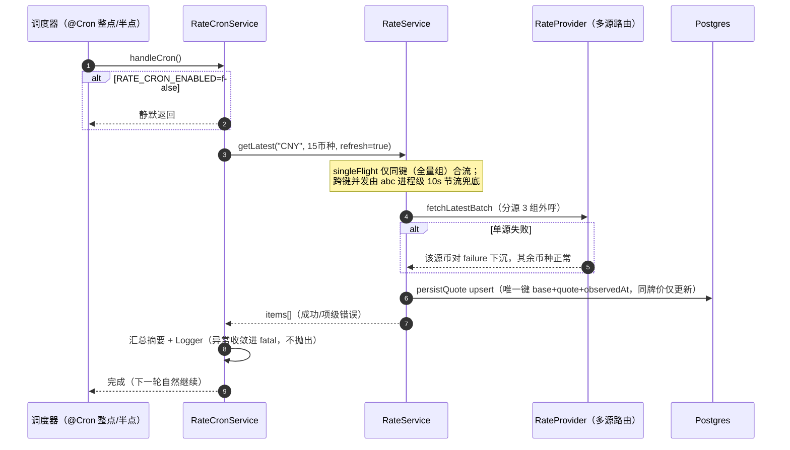

# 汇率定时刷新技术方案

> 依据：[规格.md](./规格.md)（已拍板 2026-09-16）；场景等级 L1；本次涉及 **0 张表变更、1 个新增端点、1 个新依赖**，预计改动代码量 ≈ 170 行（含测试）。
> 审核状态：三视角（架构/安全/测试）审核后修订，修订记录见文末附录。

## 一、背景与目标

当前汇率完全按用户请求按需回源（5 分钟窗口缓存），无人查询即永不落库，导致 TWD 等币种历史数据始终为空。本方案为系统增加**定时拉取能力**：每整点、每半点自动按既有多源路由拉取 15 币种（CNY 视角）最新报价并落库，使历史数据自上线日起持续积累。

核心结论（调研所得，方案成立的依据）：

1. **回源链路零新增**：`RateService.getLatest(base, targets, refresh=true)` 已实现"强制整组回源 → 多源路由（abc 主源 / frankfurter 补 MYR / er-api 补 TWD）→ 逐币对 upsert 落库 → 单源失败不拖垮同组"，定时任务只是该链路的一个无人触发调用方。
2. **重复牌价天然去重**：三源 `observedAt` 均取自源端时点（abc=PublishTime，`rate-source.abc.ts:300`；frankfurter=响应 date，`rate-source.frankfurter.ts:61`；er-api=`time_last_update_unix`，`rate-source.erapi.ts:66`），同一块牌价不同轮次 observedAt 相同，`persistQuote` 的 upsert 唯一键 `base_quote_observedAt` 命中同一行仅更新（`rate.service.ts:603`），满足规格"重复牌价不产生冗余存储"。
   - 边界取舍（如实写明）：整轮外部源全失败时 `groupObservedAt` 为空，恒等项（CNY→CNY, rate=1）以 `now` 落库，全失败日最多多 48 行恒等冗余行——与规格"错过的时点如实缺失"同级别的可接受损耗，不做特殊处理。
3. **并发行为如实描述**：`getLatest` 内部 `refreshWithSingleFlight`（`rate.service.ts:414`）以 base+**完整 targets 排序串**为键——定时轮（全量 15 币种）与用户请求（通常子集）**键不同，不合流**；仅用户恰好请求全量组时复用同一回源。跨键并发的重复外呼由 abc 源进程级 10s 节流（`ABC_MIN_FETCH_INTERVAL_MS`）兜底；frankfurter/er-api 无节流，但定时轮 2 次/小时 + 用户手动触发量极小，不做额外处理。

## 二、量化指标（预估）

| 指标项 | 预估值 | 依据/备注 |
| -------- | -------- | ----------- |
| 数据规模 | ≈700 行/天上限（48 轮 × ~15 币对），同牌价去重后更低；年存量 <30 万行 | 单表远低于分表阈值，无分表需求 |
| 外呼频率 | 每轮**最多 3 次**外呼（`fetchMultiSource` 按 target 分源分 3 组：abc 批量 / er-api 补 TWD / frankfurter 补 MYR），2 轮/小时 | abc 受进程级 10s 最小间隔保护（`rate.constants.ts:41`）；frankfurter/er-api 无节流但频次极低 |
| 部署形态 | 单实例（个人项目/dev） | 无需分布式锁；多实例场景见 §七 风险 |
| 响应要求 | 后台异步，无 SLA；手动触发接口同步返回轮次摘要 | 定时任务失败仅日志，不打扰用户（规格 §3.4） |
| 一致性 | 落库 upsert 幂等，最终一致 | 错过的时点如实缺失（规格边界） |

## 三、设计方案

### 3.1 定时框架选型

引入 `@nestjs/schedule@^6`（NestJS 官方调度包，node-cron 官方封装；已核实 peerDeps `^11.0.0 || ^12.0.0` 与项目 NestJS 11 兼容）：

- **为什么现有栈不可替代**：当前 `package.json` 无任何调度依赖，NestJS 服务内定时任务的标准解即此包；裸用 node-cron 需自行管理模块生命周期与优雅关停，`@nestjs/schedule` 与 DI/关停钩子已集成，无更轻的合理替代。
- 不引入 BullMQ/Redis 队列：单实例、每 30 分钟一次的轻量任务，规格已明确排除 Redis（规格 §2.3）。

### 3.2 核心设计：RateCronService（rate 模块内，不新建模块）

定时刷新是 rate 模块既有职责的无人触发形态，放 `services/chat/src/rate/` 内，复用 `RateService`/`RateProvider`，不经过 controller 层（cron 本身即是入口）。**`rate.service.ts` 零改动**（其多目标返回 items 结构已足以支撑摘要汇总）。

```ts
// rate-cron.service.ts（新增，签名示意）
@Injectable()
export class RateCronService {
  // 整点 + 半点：EVERY_30_MINUTES = "0 */30 * * * *"，时区无关（每 0/30 分触发语义全球一致）
  @Cron(CronExpression.EVERY_30_MINUTES)
  async handleCron(): Promise<void> {
    if (!this.cronEnabled) return;   // RATE_CRON_ENABLED=false 时静默跳过
    // runOnce 自身不抛异常（见下），此处 catch 仅防御 runOnce 意外实现缺陷
    await this.runOnce().catch((e) => this.logger.warn("cron 轮次异常兜底", e));
  }

  /** 单轮刷新：定时与手动触发共用。异常全部就地收敛，方法不抛。 */
  async runOnce(): Promise<CronRunSummary> {
    const triggeredAt = new Date();
    try {
      const res = await this.rateService.getLatest("CNY", [...SUPPORTED_CURRENCIES], true);
      // items 多数成功/项级失败下沉；汇总 → { triggeredAt, succeeded, failed }，Logger 记录
      // ⚠️ 实施注意：Logger.warn 仅输出 target/code/上游状态码摘要，禁止打印完整响应体
    } catch (e) {
      // 逃逸路径兜底：恒等项 persistQuote 在 refreshExternalTargets 的 try-catch 之外
      // （rate.service.ts:449），DB 故障时异常直接逃逸 getLatest → 收敛为 fatal 摘要，不向上抛
      return { triggeredAt, succeeded: [], failed: [], fatal: (e as Error).message };
    }
  }
}

// CronRunSummary = { triggeredAt: string; succeeded: string[]; failed: {target,code}[]; fatal?: string }
```

设计要点：

- **异常兜底职责单一**：`runOnce` 就地收敛全部异常（项级失败在 `failed`，逃逸异常进 `fatal` 字段），方法签名承诺不抛；`handleCron` 的 catch 仅防御性兜底。定时轮次永不中断进程、下一轮自然继续（规格 §3.4）。
- **强制回源**：`refresh=true` 绕过 5 分钟窗口，保证每轮真实落库（定时任务语义就是攒数据）。
- **CNY 视角**：`base="CNY"`、`targets=SUPPORTED_CURRENCIES` 全量 15 币种，恒等项 CNY→CNY 由现有 `refreshGroup` 本地生成（`rate.service.ts:449`）。
- **开关进配置**：`RATE_CRON_ENABLED`（可选 env，缺省 `"true"`），运行时回滚不发版（设计铁律 7）。schema 写法与既有 `OTP_EMAIL_MOCK` 同风格：`z.enum(["true","false"]).optional()` + 代码 `?? "true"`。
  - ⚠️ 注意：项目 env 校验为 zod `safeParse` 失败即 `process.exit(1)`——该值拼写错误（如 `"TURE"`）会**拒绝整个服务启动**而非静默停用，运维回滚时若只改 env 务必核对取值。

### 3.3 手动触发/验证端点

规格验收依赖"无需用户触发的自动落库"，但定时行为不可等待验证，故提供同语义手动端点（与 `runOnce` 共用执行体，等价于一轮定时任务）：

- `POST /api/rates/cron-refresh` → `{ success, data: { triggeredAt, succeeded, failed, fatal? } }`
- **防护**：公开端点（与现有 rate 端点一致，rate 模块无 JWT 守卫），但**端点级 `@Throttle` 单独收紧至 2 次/分钟/IP**（Throttler 全局 10 次/分钟/IP 对"全量回源+落库"操作偏宽；frankfurter/er-api 无源级节流，此端点限流是它们的唯一闸门）。调用幂等（upsert），无副作用积累。
- 公网生产部署前置项：届时为本端点增加 header token 门控（一行守卫成本）；当前无生产环境，暂不实施（见 §七）。

### 3.4 时序图



图例：3→4 强制回源绕过 5 分钟缓存窗口；6→7 失败下沉保证单源失败不拖垮同组；8 的 upsert 幂等实现"重复牌价不冗余"（整轮全失败的恒等项边界见 §一.2）。

## 四、代码影响范围

后端 only，前端零改动，无 schema/迁移变更，**`rate.service.ts` 零改动**。

<pre>
services/chat/
├─ package.json                          <font color="#7c3aed">(M)</font> <font color="#6b7280">dependencies 增加 @nestjs/schedule@^6</font>
├─ vitest.config.ts                      <font color="#7c3aed">(M)</font> <font color="#6b7280">test.env 注入 RATE_CRON_ENABLED="false"（测试环境禁调度，仿 OTP 先例）</font>
├─ src/
│  ├─ app.module.ts                      <font color="#7c3aed">(M)</font> <font color="#6b7280">imports 注册 ScheduleModule.forRoot()</font>
│  ├─ config/env.ts                      <font color="#7c3aed">(M)</font> <font color="#6b7280">schema 增加 RATE_CRON_ENABLED：z.enum(["true","false"]).optional()</font>
│  └─ rate/
│     ├─ rate-cron.service.ts            <font color="#065f46">(A)</font> <font color="#4b5563">RateCronService：@Cron 整点/半点 + runOnce 单轮刷新 + 异常收敛摘要</font>
│     ├─ rate.module.ts                  <font color="#7c3aed">(M)</font> <font color="#6b7280">providers 注册 RateCronService</font>
│     ├─ rate.controller.ts              <font color="#7c3aed">(M)</font> <font color="#4b5563">新增 POST /rates/cron-refresh（@Throttle 2/min，调用 runOnce，Swagger 注解）</font>
│     └─ rate-cron.service.spec.ts       <font color="#065f46">(A)</font> <font color="#4b5563">单元测试（见 §六）</font>
└─ test/api/
   └─ rate.spec.ts                       <font color="#7c3aed">(M)</font> <font color="#4b5563">新增 cron-refresh 端点用例（buildRateApp 装配，见 §六）</font>
</pre>

## 五、接口契约

### POST /api/rates/cron-refresh

手动触发一轮定时等价刷新（验证用；与定时任务共用 `runOnce`，行为完全一致）。

- **请求**：无参数、无 body
- **限流**：端点级 2 次/分钟/IP（`@Throttle`），叠加全局 10 次/分钟/IP
- **响应 200**（无论部分失败还是整体失败，恒 200）：

```json
{
  "success": true,
  "data": {
    "triggeredAt": "2026-09-17T03:30:00.000Z",
    "succeeded": ["USD", "JPY", "EUR", "..."],
    "failed": [{ "target": "TWD", "code": "RATE_SOURCE_UNAVAILABLE" }],
    "fatal": "（仅 getLatest 整体逃逸异常时出现，如 DB 故障）"
  }
}
```

- **语义**：单源失败不整体报错（错误在 `failed` 数组如实呈现）；全部失败亦 200（`succeeded` 为空）；`fatal` 字段出现表示整轮未执行成功。`runOnce` 承诺不抛异常，故本端点无 500 路径。

## 六、测试设计（红线：实施必跑通 0 failed）

### 6.0 测试环境隔离（高危前置项）

`ScheduleModule.forRoot()` 注册于 AppModule，`test/api` 各套件经 `createTestApp` 启动真实 AppModule；若测试进程跨 :00/:30 边界，缺省开启的 cron 会**真实外呼+落库**，污染 rate.spec 的行数/计数断言（vitest `fileParallelism: false` 串行长跑风险更高）。

处置：`vitest.config.ts` 的 `test.env` 注入 `RATE_CRON_ENABLED: "false"`（优先级高于 .env.local 自动加载，与既有 OTP_ 常量注入先例同款；注释注明"与 rate-cron.service.ts 缺省值保持一致，改常量须同步这里"）。

### 6.1 单元测试（新增 `rate-cron.service.spec.ts`，与源码同目录）

| 用例 | 覆盖点 |
| ------ | -------- |
| `runOnce 成功轮次` | 调用 `getLatest("CNY", 15 币种, true)`；摘要 `succeeded/failed` 正确归类 items |
| `runOnce 混合失败` | items 含项级 error 时归入 `failed`，不抛异常 |
| `runOnce 整体逃逸异常` | `getLatest` 抛错（如恒等项 persistQuote DB 故障）→ 摘要含 `fatal`，方法不向上抛 |
| `异常后下一轮继续` | 首轮 `getLatest` 抛错后，再次调用 `handleCron` 仍发起新一轮 `getLatest` 调用（验证轮次不被中断） |
| `handleCron 开关关闭` | `RATE_CRON_ENABLED=false` 时不调用 `getLatest` |
| `handleCron 开关开启` | 缺省 env 时正常执行（缺省 true） |
| `cron 表达式锁定` | 装配 `ScheduleModule.forRoot()` + `RateCronService`，经 `SchedulerRegistry.getCronJobs()` 断言 `cronTime.source === "0 */30 * * * *"`（整点+半点节奏，规格验收①的测试证据） |

### 6.2 接口测试（修改 `test/api/rate.spec.ts`）

装配方式：复用既有 `buildRateApp` + `overrideProvider(RateProvider)` mock 先例（新端点依赖 `RateCronService`，须真实装配而非仅 controllers+useValue，否则 DI 报错；vitest env 已注入开关 false，测试内通过直接调用 `runOnce`/显式触发验证，不依赖真实调度）。

| 场景 | 接口 | 预期 |
| ------ | ------ | ------ |
| 手动触发成功（mock provider 正常） | `POST /rates/cron-refresh` | 200；`success=true`；`succeeded` 覆盖 15 币种；库内新增 `exchange_rates` 行（CNY 视角） |
| 手动触发部分失败（mock 单源 502） | 同上 | 200；失败币种进 `failed`，其余进 `succeeded`；库内仅成功币种有新行 |
| 手动触发整体异常（mock provider 抛错） | 同上 | 200（无 500 路径）；`fatal` 字段存在 |
| 重复触发去重（同牌价两轮） | 连续两次 | 第二轮不新增行数，仅更新既有行（upsert 幂等） |

### 6.3 集成/E2E 边界说明

- 多源路由、单源失败下沉、404 降级单查等链路行为已由既有 `test/integration/rate-source-routing.spec.ts`（"失败源下沉进 batch.failures：TWD/MYR 照常返回"）、`rate-provider.spec.ts` 覆盖；定时任务复用同一 `getLatest` 链路，不重复建设集成用例。
- E2E 不新增：定时触发不可等待验证；手动端点属内部验证接口，非用户路径。
- **规格验收清单映射**：
  - ①整点/半点触发 → §6.1 cron 表达式锁定用例 + 手动端点等价验证；
  - ②单源失败不影响其他源 → §6.1 混合失败 + §6.2 部分失败 + 既有集成；
  - ③重复牌价不冗余 → §6.2 重复触发去重 + 三源 observedAt 源端时点证据（§一.2）；
  - ④测试 0 failed → **本次范围命令：`bun run test unit api integration`（免交互指定套件；前置 `bun run db:up`）**；不含 web/e2e（本次无前端改动，手动端点非用户路径）。
- 实施附加验证：本地启动 dev 后于整点/半点观察日志真实触发一轮（人工一次性确认，不进自动化）。

## 七、风险与回滚

| 风险 | 应对 |
| ------ | ------ |
| 外部源整轮失败 | 项级下沉 + `fatal` 收敛，日志可查；下一轮自动重试（规格 §3.4，不告警） |
| 手动端点被滥用刷外呼 | 端点级 2/min/IP 限流（frankfurter/er-api 无源级节流，此为唯一闸门）+ abc 进程级 10s 间隔 + 幂等无副作用 |
| 公网生产部署后端点暴露 | 前置项：届时增加 header token 门控（§3.3）；当前无生产环境不实施 |
| 未来多实例部署重复拉取 | upsert 幂等，重复拉取无害仅浪费外呼；届时再加分布式锁（当前单实例，YAGNI） |
| env 值拼写错误 | zod 校验失败拒绝启动（既有行为）——回滚只动 env 时务必核对取值合法性 |

**回滚**：

1. 运行时：`RATE_CRON_ENABLED=false` + 重启，即停不发版（注意 env 取值合法性，见上表末行）。
2. 代码级：revert 提交即可。无 schema 变更、无迁移、无前端联动，零残留；已落库的历史报价为有效资产，无需清理。

## 附录：审核意见与修订记录

三视角并行审核（2026-09-17），共 16 条意见，逐条处理如下：

| # | 来源/严重度 | 意见摘要 | 处理 |
| --- | ------------ | --------- | ------ |
| 1 | 安全 [中] | catch 应收敛在 `runOnce`（恒等项 persistQuote 在 try-catch 外会逃逸致端点 500），摘要加 `fatal` 字段 | **已修改**：§3.2 重构异常职责，`runOnce` 承诺不抛 + `fatal` 字段；§5 端点恒 200 |
| 2 | 安全 [中] | frankfurter/er-api 零节流，Throttler 全局 10/min 偏宽，端点需单独收紧 | **已修改**：§3.3/§5 端点级 `@Throttle` 2 次/分钟/IP |
| 3 | 安全 [低] / 架构 [中] | "singleFlight 天然合流"表述不成立（键含完整 targets 串，全量与子集不同键） | **已修改**：§一.3 与时序图改为如实表述（仅同键合流，跨键靠 abc 节流兜底） |
| 4 | 安全 [低] | env 非法值 → safeParse 失败拒绝整个服务启动，须写明 | **已修改**：§3.2 注意项 + §七 风险表 |
| 5 | 安全 [低] | 日志敏感信息：已确认无泄露；叮嘱 warn 不打完整响应体 | **接受**：§3.2 实施注意注明 |
| 6 | 架构 [中] | 手动端点建议 prod 禁用或 header token | **部分接受**：限流已收紧（#2）；header token 列为公网部署前置项（§3.3/§七），当前无生产环境不实施 |
| 7 | 架构 [低] | 整轮全失败时恒等项 observedAt=now 产生冗余行，与规格去重有出入 | **接受**：§一.2 如实写明边界取舍（≤48 行/天，可接受） |
| 8 | 架构 [低] | "每轮 1 次批量组呼"不实，实际按源分 3 组最多 3 次 | **已修改**：§二 量化表改为"每轮最多 3 次外呼" |
| 9 | 架构 [低] | `rate.service.ts` "(M) 尽力零改动"含糊 | **已修改**：§四 明确承诺零改动并从清单移除；§3.2 说明 items 结构已够用 |
| 10 | 架构 [低] | cron 断言勿自证（比较常量与自身）；注明 @nestjs/schedule 版本 | **已修改**：§6.1 采用 SchedulerRegistry 装配断言；§3.1 注明 ^6 且已核实 peerDeps 兼容 Nest 11 |
| 11 | 测试 [高] | 测试环境 cron 会被真实调度（createTestApp 启动真实 AppModule），跨 :00/:30 边界污染断言 | **已修改**：新增 §6.0 高危前置项——vitest `test.env` 注入 `RATE_CRON_ENABLED="false"`（仿 OTP 先例）；§四 vitest.config.ts (M) |
| 12 | 测试 [中] | 验收①"单测 cron 表达式"无用例无手段 | **已修改**：§6.1 新增"cron 表达式锁定"用例（SchedulerRegistry.getCronJobs 断言 `cronTime.source`） |
| 13 | 测试 [中] | 验收④"0 failed"范围含糊（bun run test 交互全量含 web+e2e） | **已修改**：§6.3 写明 `bun run test unit api integration` + `db:up` 前置，不含 web/e2e 及理由 |
| 14 | 测试 [低] | "任务异常不中断后续轮次"未验证"下一轮继续" | **已修改**：§6.1 新增"异常后下一轮继续"用例 |
| 15 | 测试 [低] | §6.2 现有 useValue 装配不含 RateCronService 会 DI 报错 | **已修改**：§6.2 注明走 `buildRateApp` + `overrideProvider(RateProvider)` 先例 |
| 16 | 架构（核实项） | 行号引用、upsert 键、三源 observedAt、15 币种、@nestjs/schedule 兼容性均属实；模块归属合理、无过度设计 | **确认通过** |
