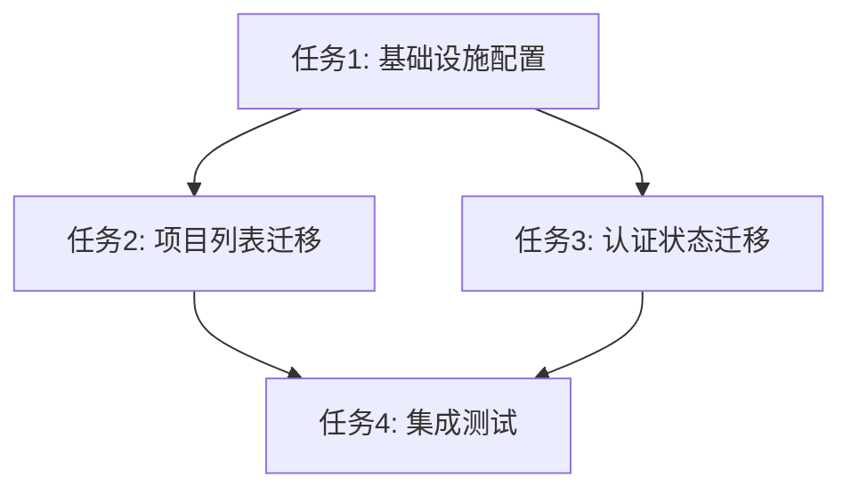

# React Query 数据请求升级 - 任务分配

## 依赖关系图



## 任务列表

### 任务1：React Query 基础设施配置 ⚡ 可先行

**对应模块**：方案模块1

**执行内容**：

1. 创建 `clients/chat-web/lib/query/config.ts` - QueryClient 配置
2. 创建 `clients/chat-web/lib/query/provider.tsx` - QueryProvider 组件
3. 修改 `clients/chat-web/app/layout.tsx` - 包裹 QueryProvider
4. 编写单元测试 `clients/chat-web/lib/query/config.spec.ts`
5. 运行测试验证配置正确

**验收标准**：

- ✅ 应用启动无报错
- ✅ 开发环境可打开 React Query Devtools
- ✅ 单元测试通过

**预计工作量**：30 分钟

---

### 任务2：项目列表查询与 Mutation 迁移 🔗 依赖任务1

**对应模块**：方案模块2

**执行内容**：

1. 创建 `clients/chat-web/lib/query/hooks/use-projects.ts` - 封装 4 个 hooks
   - useProjects (查询)
   - useCreateProject (乐观更新)
   - useDeleteProject (乐观更新)
   - useUpdateProject (乐观更新)
2. 修改 `clients/chat-web/app/(protected)/projects/page.tsx` - 替换手动状态管理
3. 编写单元测试 `clients/chat-web/lib/query/hooks/use-projects.spec.ts`
4. 手动测试项目列表页各功能

**验收标准**：

- ✅ 列表加载显示 loading 状态
- ✅ 创建项目时卡片立即出现（乐观更新）
- ✅ 删除项目时卡片立即消失
- ✅ 离开页面再返回，立即显示缓存数据
- ✅ 单元测试覆盖查询成功/失败、乐观更新/回滚场景

**预计工作量**：1 小时

---

### 任务3：认证状态查询迁移 🔗 依赖任务1，可与任务2并行

**对应模块**：方案模块3

**执行内容**：

1. 创建 `clients/chat-web/lib/query/hooks/use-auth.ts` - useCurrentUser / useLogout hooks
2. 修改 `clients/chat-web/app/(protected)/layout.tsx` - 替换手动获取用户逻辑
3. 修改 `clients/chat-web/app/(protected)/projects/page.tsx` - handleLogout 调用 useLogout
4. 编写单元测试 `clients/chat-web/lib/query/hooks/use-auth.spec.ts`

**验收标准**：

- ✅ 刷新页面时用户信息从缓存立即显示
- ✅ 登出时清除所有缓存
- ✅ 单元测试通过

**预计工作量**：30 分钟

---

### 任务4：E2E 集成测试 🔗 依赖任务2、3

**对应模块**：方案第四节

**执行内容**：

1. 修改 `e2e/modules/02-projects.spec.ts` - 补充缓存与乐观更新验证
   - 验证列表页缓存命中
   - 验证创建项目乐观更新
   - 验证删除项目乐观更新
2. 修改 `e2e/modules/01-auth.spec.ts` - 补充认证状态缓存验证
   - 验证刷新页面缓存命中
   - 验证登出清除缓存
3. 运行完整 E2E 测试套件

**验收标准**：

- ✅ 链路 A（项目列表增删改查）全部通过
- ✅ 链路 B（认证状态与缓存刷新）全部通过
- ✅ 无回归问题

**预计工作量**：45 分钟

---

## 执行顺序建议

**串行路径**（关键路径）：

```
任务1 → 任务2 → 任务4
```

**可并行**：

- 任务1 完成后，任务2 和任务3 可同时进行

**总预计工作量**：2.5 - 3 小时

---

## 风险提示

1. **乐观更新逻辑复杂** - 需仔细处理快照与回滚，建议先完成单元测试再集成
2. **缓存失效时机** - invalidateQueries 调用时机要准确，避免数据不一致
3. **TypeScript 类型推导** - React Query 泛型较复杂，可能需要显式标注类型

---

## 下一步

请确认任务分配是否合理，确认后我将创建 workflow 自动执行。
