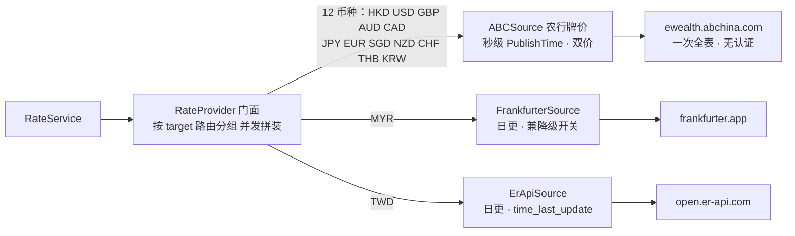
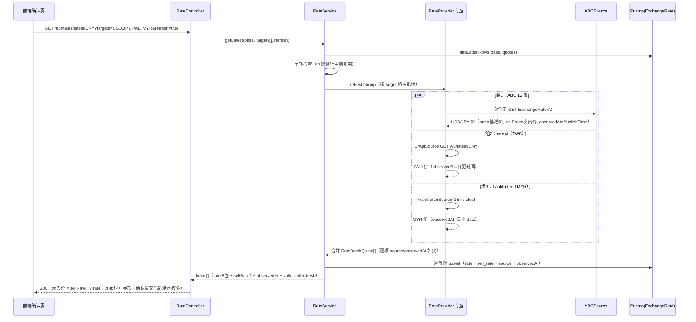
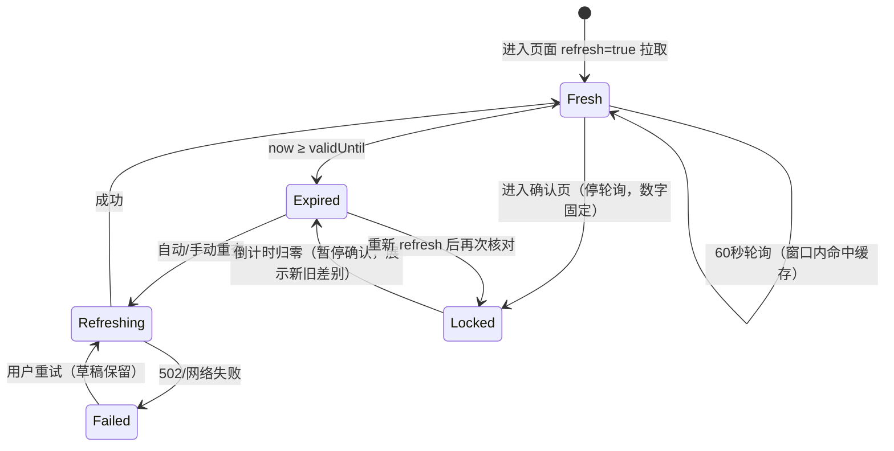

# 技术方案：实时汇率升级（旧项目数据源组合 + 前端消费层）

> 动笔前已确认：核心场景——录入/初始持仓时基于**最新可得报价**计算金额，前端按 doc 02 行为表（60 秒轮询、切后台暂停、确认前重查、确认页锁数）消费；数据源组合由用户拍板——**农行牌价为主源 + frankfurter 补 MYR + er-api 补 TWD，全免费、不注册任何 key**；窗口语义由用户裁决——**「确认时刻起 5 分钟」硬门槛（M1.2 机制保留），报价发布时间在 UI 如实展示**（对 doc 02 字面规则的修订，见 §9 裁决 1）。
>
> 本次方案涉及：**新增 4 个后端文件（数据源抽象 + 三源实现）与 2 个前端文件，修改 5 个后端文件 + 1 个 schema migration，预计改动代码量约 1,200 行（含测试约一半）**。
>
> 依据：`docs/MVP功能模块&业务逻辑&专业术语/02_初始化与录入闭环_待确认.md`（下称 doc 02）、`05_汇率查询与录入计算.md`（下称 doc 05）、`13_MVP功能清单.md`、`changes/m2-rate/技术方案.md`（下称 M1.2 方案）、旧项目 `/Users/dayu/Documents/知爻/正式的项目启动/FXPlanner` 的 `backend/exchange_rate`、`backend/bank_rate`、`src/services/exchangeRate.ts`（仅参考数据源，代码可参考不强制复用）。
>
> **裁剪说明**：含接口契约章节（§4）；不含排期章节（用户确认）。

## 1. 目标与量化约束

### 1.1 业务背景与问题

M1.2 已落地汇率服务：单一数据源 frankfurter（ECB 数据，**每交易日仅更新一次，时间戳只有日精度**），且**不支持 TWD**（422）。本节目标：

1. **数据源多元化（用户拍板的全免费组合）**：主源切换为**农行外汇牌价**（秒级 `PublishTime`、无需认证、真实银行对客价——与换汇记账业务天然贴合）；frankfurter 补 MYR；ExchangeRate-API（er-api）补 TWD。**15 币种全覆盖，零注册、零 key、零配额成本**。
2. **双价语义落地**：农行牌价同时提供基准价（≈中间价）与现汇卖出价——用户裁决**两种都存**：录入场景（用户买入外币的实际成本）用**现汇卖出价**，报告与计划对比用**基准价**。
3. **前端消费层**：60 秒轮询、切后台暂停、确认前重查、确认页锁数等 doc 02 行为表能力的通用 hook。

窗口语义裁决（§9 裁决 1）：5 分钟有效门槛的基准为**本系统确认时刻**（M1.2 机制原样保留）；农行 `PublishTime` 作为「报价发布时间」逐项返回、UI 如实展示，供用户自行判断新旧。此裁决修订 doc 02 的「自来源报价时间起 5 分钟」字面规则——原因：农行牌价更新间隔实测可能 >5 分钟、TWD/MYR 仅有日更源，字面规则将导致大部分时间不可入账、TWD/MYR 录入功能残废。

### 1.2 核心指标预估

| 指标项 | 预估值 | 依据/备注 |
| -------- | -------- | ----------- |
| 数据规模（日增） | 每币对 ≈ 农行牌价更新次数/天（估 3~10 行），日增 <500 行 | 同一 `PublishTime` 反复回源走 upsert update 分支（同一行），仅银行实际更新时落新行。单表无压力 |
| 并发压力（峰值） | <10 QPS | MVP 小范围用户；M1.2 窗口 + 单飞已把外呼压到每 base 组 ≤12 次/小时 |
| 外呼配额 | ABC 农行：**无配额限制**（公开 JSON API）；frankfurter：无配额；er-api：1500 次/月（仅 TWD 使用，窗口机制下月消耗 ≪ 配额） | er-api 用量列为 §6 观察项 |
| 响应要求 | 缓存命中 <100ms；回源 <2s（ABC 超时 6s，沿用旧项目取值） | ABC 一次请求返回**全部币种牌价**，整组一次外呼 |
| 一致性等级 | 只读缓存 + 入账快照，最终一致 | 入账时冗余存储 rate/source/observedAt（既有设计），不依赖 ExchangeRate 行存活 |

### 1.3 约束条件

- **项目未上线、无存量数据**：加列 migration 无兼容负担。
- **15 币种含 TWD** 必须可查（doc 13）；本位币两种可能（CNY/HKD），base 必须可任选。
- **无任何 API key**（用户拍板）；旧项目前端「离线硬编码备用汇率」模式违背 doc 05「禁止编造数字」，**不采纳**。
- 项目铁律：AI 不启动服务；方案必含测试设计；改动仅限 `services/chat/src/rate/`、`services/chat/prisma/`、`clients/chat-web/lib/`。

## 2. 方案选型与取舍

### 2.1 候选数据源全貌（按用户要求交叉分类：免费/付费 × 时效 × 来源）

**免费的**：

| 数据源 | 时效 | 来源 | 关键事实 |
| -------- | -------- | -------- | -------- |
| **农行外汇牌价** `ewealth.abchina.com` | **秒级** PublishTime（工作日银行多次更新） | 🔵 旧项目 `bank_rate` 模块 | 实测可用（`2026-09-15T09:26:54+08:00`）；基准/买入/卖出价，百外币单位对 CNY；24 币种覆盖 15 清单的 12 个，**缺 TWD、MYR**；无需认证；一次请求全表 |
| **Twelve Data** 免费档 | 分钟级 | 🟡 本次调研 | 全 15 币种含 TWD；需注册 key；8 credits/分、800/天 |
| Yahoo Finance 非官方 | 分钟级 | 🟡 本次调研 | 含 TWD；非官方无 SLA，不进生产 |
| frankfurter.app | 天级（ECB 日更） | 🔵 旧项目主源（M1.2 现状） | 14/15 币种，**无 TWD**；免费无配额；历史序列 1999 起 |
| open.er-api.com | 天级（每 24h） | 🔵 旧项目前端源 | **15 币种全覆盖含 TWD**；免费 1500 次/月 |
| frankfurter.dev / CurrencyFreaks / exchangerate.host / Open Exchange Rates / Alpha Vantage | 天级~小时更 | 🟡 本次调研 | 均因配额过小或时效不达标被排除 |

**付费的**（本方案不采用，仅备忘）：ExchangeRate-API $30/月档 5 分钟更（最贴合业务窗口）；exchangerate.host $14.99/月小时更；Twelve Data 付费档（高配额 + SLA）。

### 2.2 结论

用户拍板**全免费组合**：

- **主源 = 农行牌价（ABC）**：秒级报价时间、无需认证、一次全表、真实银行对客价；
- **frankfurter 补 MYR**（M1.2 实现直接复用）；
- **er-api 补 TWD**（日更价，`source` 如实标注）；
- 放弃 Twelve Data（需注册 key）与 Yahoo（非官方）。

**不自动降级**：某源失败只影响其负责的币对（502 项级下沉），其余币对正常返回；跨源整体降级靠 `RATE_SOURCE` 开关切回 frankfurter 单源（= M1.2 行为，代码原样保留为降级路径）。

架构取舍（防过度设计）：

- **不做多源并发取优/比价**：按币对静态路由，来源确定可审计。
- **不做令牌桶/配额守卫**：三源均无 credits 概念；ABC 防滥用用轻量「全局并发 1 + 最小外呼间隔」即可（§3.4）。
- **不做历史行清理**：日增 <500 行无需治理。
- **不引入 Redis/内存缓存库**：DB 即缓存（M1.2 既有决策）。
- **不采纳旧项目「离线硬编码备用汇率」**：违背 doc 05。

## 3. 核心设计

### 3.1 数据源抽象与路由

**策略接口 + 按币对路由**（面向抽象；对 RateService 完全透明）：



> 图例：门面按 target 把请求拆成 ≤3 组并发外呼，合并为统一 `RateBatchQuote[]`；对 `RateService` 的接口签名与 M1.2 完全一致。

- `RateSource` 接口：`fetchLatestBatch(base, targets)` / `fetchHistory(base, target, start, end)` / `source` 标识。三个实现：
  - `ABCSource`（新增，参考旧项目 `abc_client.py`）：一次请求全表，解析 `CurrName` 正则提取币种码；`BenchMarkPrice → rate`（基准价）、`SellPrice → sellRate`（现汇卖出价）；**百外币单位 ÷ 100 换算**；`PublishTime → observedAt`（ISO 带时区，转 UTC）；`ErrorCode != "0"` → 源异常（502）。**折算自理**：任意 base 的币对由同一次全表响应内的两张对 CNY 牌价折算（`X→base = X→CNY ÷ base→CNY`，同一 `PublishTime`，满足「同一时点」）；base=CNY 时为直接价。
  - `FrankfurterSource`（现 `rate.provider.ts` 逻辑原样迁入）：负责 MYR；保留为整体降级开关路径。
  - `ErApiSource`（新增，参考旧项目前端 `open.er-api.com/v6/latest/{base}`）：负责 TWD；`time_last_update_unix → observedAt`（日更，如实标注）。
- **恒等币对**（base=target）不外呼，本地生成 `source="identity"`（M1.2 语义不变）。
- **双价映射规则**：`rate` 列恒为「基准价语义」（ABC=基准价，frankfurter/er-api=其中间价性质的市场价，identity=1）；`sell_rate` 列**仅 ABC 源填充**，其余源为 NULL——录入场景取 `sellRate ?? rate` 并如实提示「非银行卖出价」（§4 契约、§9 裁决 4）。
- **响应有效性校验**（doc 02「汇率必须是大于 0 的有效数字；时间在未来、方向不匹配或缺少时间的报价不能采用」），任一不满足按源异常（502）处理，不入库不返回：价格缺失/不可解析/≤0；`PublishTime` 缺失/不可解析/`> now + 60s`（时钟漂移容差，恰好 +60s 放行）。

### 3.2 报价有效期与落库（M1.2 机制原样保留）

- **窗口机制不改**：`fresh = now < createdAt + 5min`（createdAt 物化「最后确认时刻」，回源成功刷新、缓存命中不重置）——即 §9 裁决 1 的「确认时刻起 5 分钟」硬门槛，`rate.service.ts` 的 `getLatest/persistQuote` 核心逻辑**零改动**。
- **`observedAt` 回归纯「发布时间」语义**：ABC=秒级 PublishTime；frankfurter/er-api=日精度。逐项返回供 UI 展示「报价发布于」，不参与窗口判定。
- **落行行为**：同一 `PublishTime` 的反复回源命中 `@@unique([base, quote, observedAt])` 走 upsert update 分支（同一行），仅银行实际更新时落新行——日增从上一版预估的万级降至数百行。
- **history 无污染问题**：每币对每日仅数行且同日同源，M1.2 的 `getHistory`（按日去重 + 本地优先 + 外呼补缺）**零改动**。
- 多币种组：窗口逐项检查（同组同时点确认 → 同一 createdAt），响应逐项携带 `validUntil = 确认时刻 + 5min`；前端以最早过期项决定整组剩余有效时间（doc 02）。

### 3.3 核心流程：确认前整组重查（refresh=true）



> 图例：三组并发外呼、任一源失败仅其币对下沉 502 项级错误，不拖垮同组其余币对（M1.2 项级下沉语义沿用）；TWD/MYR 的日更 `observedAt` 与 ABC 秒级 `observedAt` 并存且如实返回。

### 3.4 ABC 防滥用（轻量）

- **全局并发 1 + 最小外呼间隔 10s**（进程内时间戳 + 互斥，非令牌桶）：间隔内的并发请求**直接复用最近一次成功响应的落库数据**（等价于强制走缓存分支，`fresh` 如实），既保护农行接口不被刷封 IP，又不产生错误。`refresh=true` 同样受此约束（公开接口无鉴权，防遍历放大）。
- er-api 1500 次/月仅 TWD 消耗，窗口机制下正常用量极低；用量观察列入 §6，不做守卫。
- 上一版方案的令牌桶、日配额守卫、回源节流**全部删除**（无 credits 概念 + 窗口基准回归确认时刻后 M1.2 机制天然限流）。

### 3.5 前端消费层：use-latest-rates hook

不建页面（录入页属后续波次），本次交付**通用数据层**，将 doc 02 行为表完整物化为 hook 能力：



> 图例：`Locked` 态由 `locked` 参数启用（`enabled:false` 停轮询）；过期判定纯前端按 `validUntil` 计算，不请求后端；`Failed` 态携带 `lastObservedAt` 供展示「最后报价时间与原因」（doc 05）。

能力规格（与 doc 02 行为表逐条对应）：

| doc 02 场景 | hook 实现 |
| --- | --- |
| 打开录入页/换币种/继续草稿 | `refresh` 一次性查询（`refreshLatest` 内部走 `queryClient.fetchQuery`，**该查询显式 `staleTime: 0`**——否则全局默认 5 分钟 staleTime 会让「强制回源」直接吃缓存） |
| 停留可编辑页每 60 秒刷新 | `refetchInterval: 60_000`（走后端 5 分钟窗口缓存，命中不外呼） |
| 切后台暂停 / 返回前台重查 | `refetchIntervalInBackground: false` + `refetchOnWindowFocus: true`（live 模式沿用全局默认） |
| 进入确认页重查并锁定 | `locked: true` → 停轮询；先 `refresh=true` 取数，之后数字固定，暴露 `validUntil` 供倒计时；**locked 时显式 `refetchOnWindowFocus: false`**（doc 02「核对页返回前台只检查过期，不自动换数」） |
| 改回前面修改金额/币种 | 消费组件把 `locked` 切回 `live` 并触发 `refreshLatest`：queryKey 随 `locked` 变化 + 强制重查，**原核对结果天然作废** |
| 报价过期 | 前端按 `validUntil` 判定 `isExpired`，暂停提交，引导重查后再次核对 |
| 查询失败 | `error`（`ApiError`）含 `code` 与 `lastObservedAt`，草稿天然保留（表单状态独立于 hook） |
| 防覆盖手填 | hook 只产出报价数据，**不持有表单状态**；参考汇率/预计成本由消费组件从 `data` 派生，用户手填的实际到账金额字段独立存储，报价刷新不触碰 |
| 发布时间展示 | 逐项暴露 `observedAt`（农行秒级/TWD·MYR 日更）与 `sellRate` 供 UI 标注「银行现汇卖出价发布于 XX:XX」或「非银行卖出价」 |

### 3.6 数据模型变更（加列，向后兼容）

`ExchangeRate` 新增一列：

```sql
ALTER TABLE exchange_rates ADD COLUMN sell_rate DECIMAL(20,10) NULL;
-- 注释：现汇卖出价（仅 abc 源填充，百外币单位已换算为 1 外币）；NULL = 该源无卖出价，录入场景回退 rate
```

- `rate` 列语义收敛为「基准价」（报告/对比）；`sell_rate` 为「现汇卖出价」（录入成本）。
- 未上线无存量，加列无回填；既有索引与 `@@unique([base, quote, observedAt])` 不变。

## 4. 接口契约

### 4.1 后端 HTTP 契约（字段增量，语义明确）

`GET /api/rates/latest/:base`（公开接口，M1.2 契约保持 + 增量字段）：

| 项 | 内容 |
| ---- | ------ |
| 变化点 | ① items 项与单目标响应**新增可选字段 `sellRate`**（string，8 位小数；仅 `source="abc"` 返回，其余源缺省）；② `source` 值域扩展：`"abc" | "frankfurter" | "er-api" | "identity"`；③`observedAt` 语义明确为「报价发布时间」（ABC 秒级 / TWD·MYR 日精度）；④ `fresh/validUntil` 语义确认为「确认时刻起 5 分钟」（§9 裁决 1） |
| 入参 | `targets`（query，逗号分隔，≤15 个清单内币种，缺省 USD）、`refresh`（query，默认 false，true 强制回源） |
| 出参（单目标） | `{ base, target, rate, sellRate?, source, observedAt, validUntil, fresh }` |
| 出参（多目标） | `{ base, items: [{ target, rate?, sellRate?, observedAt?, validUntil?, fresh?, error?: { code, message } }] }` |
| 录入价取法 | `sellRate ?? rate`（消费方规则；前端在 UI 标注「银行现汇卖出价」或「非银行卖出价」） |
| 错误 | `400` 参数非法；`422 RATE_PAIR_UNSUPPORTED`（清单外币种；三源组合下 15 币种内不再出现）；`502 RATE_SOURCE_UNAVAILABLE`（响应体含 `lastObservedAt`；多目标时按项下沉，单目标上抛） |
| 幂等/鉴权 | 只读幂等；公开（与现状一致） |

`GET /api/rates/history`：**零变更**（数据源按币对路由，MYR/TWD 走各自源的历史能力——frankfurter 历史支持 MYR；er-api 免费档含 30 年按日历史，本次 TWD 历史走 er-api 或按 §6 实测结论降级为仅本地落库，实施时定）。

`GET /api/rates/supported`、`GET /api/rates/observed-at/latest`：不变。

### 4.2 前端内部契约（新增）

`lib/api/rates.ts`：

```ts
export const ratesApi = {
  /** 最新报价；targets 缺省 ["USD"]；refresh=true 强制回源（打开页/确认前） */
  async latest(base: string, targets?: string[], refresh?: boolean): Promise<LatestRateResponse | LatestRateGroupResponse>;
};
```

`lib/hooks/use-latest-rates.ts`（消费层唯一入口）：

```ts
export function useLatestRates(params: {
  base: string;
  targets: string[];
  /** 确认页锁定模式：停轮询，数字固定，仅暴露 validUntil 倒计时 */
  locked?: boolean;
}): {
  rates: LatestRateItem[] | null;        // 含 rate/sellRate?/source/observedAt/validUntil/fresh
  isExpired: boolean;                    // 前端按组内最早 validUntil 计算
  isLoading: boolean;
  error: { code: string; message: string; lastObservedAt: string | null } | null;
  /** 一次性强制重查（refresh=true），打开页面/过期重试/确认前由消费方触发 */
  refreshLatest: () => Promise<void>;
};
```

> 约定：hook 不持有任何表单状态（§3.5 防覆盖手填）；`queryKey = ["rates", "latest", base, targets.join(","), locked ? "locked" : "live"]`；**hook 内所有查询显式 `staleTime: 0`**（报价新鲜度由 `fresh/validUntil` 元数据表达，不依赖 react-query 的 stale 语义）。

## 5. 代码影响范围

### 5.1 后端

<pre>
services/chat/
├── prisma/
│   ├── <font color="#92400e">schema.prisma</font> (M) [注: ExchangeRate 新增 sell_rate Decimal(20,10)? 列（§3.6）]
│   └── <font color="#166534">migrations/xxx_add_sell_rate/</font> (A) [注: ALTER TABLE 加列 migration]
└── src/
    ├── config/
    │   └── env.ts [注: 不动——无新增 key/开关；RATE_SOURCE 开关沿用 M1.2 机制（frankfurter 单源降级路径）]
    └── rate/
        ├── <font color="#92400e">rate.constants.ts</font> (M) [注: 三源 URL 与超时常量（ABC 6s 沿用旧项目取值）；ABC 最小外呼间隔 10s 常量；SUPPORTED_CURRENCIES 不变]
        ├── <font color="#166534">rate-source.ts</font> (A) [注: RateSource 接口（fetchLatestBatch/fetchHistory/source 标识/sellRate 能力声明）+ RateBatchQuote（含 sellRate 可选）类型]
        ├── <font color="#166534">rate-source.abc.ts</font> (A) [注: 主源——一次全表、CurrName 正则解析、百单位÷100、BenchmarkPrice→rate / SellPrice→sellRate、PublishTime→observedAt（UTC）、任意 base 经 CNY 同时刻折算、ErrorCode!=0→502、有效性校验（>0/未来时间+60s 容差）、全局并发1+最小间隔10s]
        ├── <font color="#166534">rate-source.erapi.ts</font> (A) [注: TWD——open.er-api.com/v6/latest/{base}、time_last_update_unix→observedAt、错误码映射同 ABC]
        ├── <font color="#166534">rate-source.frankfurter.ts</font> (A) [注: 现 rate.provider.ts 逻辑原样迁入，负责 MYR + 整体降级开关路径]
        ├── <font color="#92400e">rate.provider.ts</font> (M) [注: 改造为门面——按 target 路由分组（abc/er-api/frankfurter）、并发外呼、结果合并；RATE_SOURCE=frankfurter 时整组走单源（M1.2 行为）]
        ├── <font color="#92400e">rate.service.ts</font> (M) [注: ①窗口/单飞/persistQuote 核心逻辑零改动（§3.2）；②QuoteToPersist 与落库增列 sellRate 透传；③混合源组的 observedAt/sellRate 逐项透传（toItem 组装）]
        ├── <font color="#92400e">rate.controller.ts / dto/</font> (M) [注: 响应 DTO 增 sellRate 可选字段（LatestRateResponseDto/LatestRateItemDto）；错误语义不变]
        ├── rate.errors.ts / rate.module.ts [注: 不动]
</pre>

> 环境无新增必填项（无 key），`RATE_SOURCE` 缺省行为切换为多源路由（frankfurter 单源=降级模式）。

### 5.2 前端

<pre>
clients/chat-web/
├── lib/
│   ├── api/
│   │   ├── <font color="#166534">rates.ts</font> (A) [注: ratesApi.latest 封装（§4.2）；skipAuth 公开接口；history 留待报告波次]
│   │   ├── <font color="#92400e">openapi.json / schema.gen.ts</font> (M) [注: 后端 DTO 增 sellRate 后重跑 bun run generate:api]
│   └── hooks/
│       ├── <font color="#166534">use-latest-rates.ts</font> (A) [注: §3.5 能力规格——60s 轮询/后台暂停/聚焦刷新/locked 锁数/isExpired/refreshLatest/staleTime 0]
│       └── <font color="#166534">use-latest-rates.spec.tsx</font> (A) [注: 见 §8.1]
</pre>

> 录入页/确认页组件**不在本次范围**（属 onboarding 录入与首页快速录入波次），本方案仅约定其消费方式（§3.5）。

### 5.3 测试文件树（文件与被测对象一一对应）

<pre>
services/chat/
├── src/rate/
│   ├── <font color="#166534">rate-source.abc.spec.ts</font> (A) [注: fixture 取自 §6 实测归档样本——CurrName 正则与币种过滤/百单位换算/双价映射/PublishTime 时区转换/任意 base 折算（HKD base、base=CNY 直接价）/ErrorCode!=0→502/价格≤0 与未来时间→502（含+60s 等值放行）/最小间隔与并发复用]
│   ├── <font color="#166534">rate-source.erapi.spec.ts</font> (A) [注: time_last_update 解析/TWD 取值/非 2xx→502]
│   ├── <font color="#166534">rate-source.frankfurter.spec.ts</font> (A) [注: 现 provider 用例迁移回归（MYR 路由、日精度 date、批量 404 降级）]
│   └── <font color="#92400e">rate.service.spec.ts</font> (M) [注: 窗口/单飞用例沿用（机制未动）；新增——混合组（ABC+TWD+MYR）逐项 source/observedAt/sellRate 透传；sell_rate 落库断言；identity 恒等不外呼；502 项级下沉（单目标上抛）；400 回归]
└── test/
    ├── api/<font color="#92400e">rate.spec.ts</font> (M) [注: 契约回归 + sellRate 字段断言（abc 项有、er-api/frankfurter 项无）+ source 值域 + 降级开关（RATE_SOURCE=frankfurter）整组单源]
    ├── integration/<font color="#92400e">rate-provider.spec.ts</font> (M) [注: 三源路由分组与合并（mock server）；frankfurter 既有集成回归]
    └── prisma.spec.ts [注: sell_rate 列存在性与可空性（既有基建测试补一条）]

clients/chat-web/lib/hooks/<font color="#166534">use-latest-rates.spec.tsx</font> (A) [注: QueryClientProvider 包裹 + fake timers（advanceTimersByTimeAsync 推进轮询，react-query 官方 testing 范式）]
</pre>

> 设计模式附注：数据源多实现用**策略 + 币对路由**；ABC 防滥用用**互斥 + 最小间隔**；前端复用 **react-query**（不新造轮询框架）。

## 6. 可靠性保障

- **超时与重试**：ABC 超时 6s（沿用旧项目取值）、frankfurter/er-api 沿用既有 5s；服务层**不自动重试**（重试由前端 60s 轮询/用户手动触发）。
- **降级与熔断**：源失败 → 该源币对 502 项级下沉（多目标）/上抛（单目标），**其余币对不受影响**（多源天然部分降级）；整体降级 = 运维切 `RATE_SOURCE=frankfurter` 重启（M1.2 行为，代码原样保留）；禁止用过期缓存/编造数字兜底（doc 05）。
- **回滚机制**：`RATE_SOURCE` 开关切回 frankfurter 单源；`sell_rate` 为可空加列，回滚不删列（旧代码忽略该列即可，兼容）。
- **实施前置实测**（外部阻塞依赖，实测产物同时约束 mock fixture 与验收）：
  1. **Node fetch 直连 ABC**：旧项目 Python 需 legacy TLS 重协商选项（`SSL_OP_LEGACY_SERVER_CONNECT`），须实测 Node/undici 能否直接调通；不通则用 `node:https` + `secureOptions` 定制（隔离在 ABCSource 内部）；
  2. **农行牌价更新频率**：工作日观察 PublishTime 变化间隔（决定「发布时间」UI 文案与用户预期管理）；
  3. **er-api 免费档 TWD 可得性 + time_last_update 字段格式**核实；
  4. **er-api 月配额用量**观察（TWD 专用，异常增长再治理）；
  5. ABC 一次全表在 15 币种内目标币种的 SellPrice/BenchMarkPrice 完整性（缺字段币对的处理路径验证）。

## 7. 可观测性

- **关键日志**：source 层外呼打 Info（source、symbol 数、耗时、observedAt）；ABC `ErrorCode != "0"`、非 2xx、超时打 Warn（含 base+targets）；禁止循环体内逐 symbol 打日志（ABC 全表一次一条）。三源均无 key，无凭据泄漏面。
- **核心指标**：各源成功率、ABC 复用缓存次数（防滥用生效度量）、422/502 计数；日志经既有 dev-log 体系采集（dev 生效）。
- **审计要求**：入账记录冗余 `rate/source/observedAt`（doc 02），本次新增落库 `sell_rate`，入账快照语义完整。

## 8. 测试策略

> 质量红线：实施完成 = 下列全部通过（0 failed），且 `services/chat` vitest 用例数不低于实施当日实测基线（**2026-09-14 口径约 120 用例，src 53 + test 67**；实施时以 `vitest list` 实测为准）且无失败；`packages/money` 不动不重测。前端只测 `lib/hooks`（项目约定，组件测试靠 E2E；录入页 E2E 留待其所属波次）。**验收证据**：全量测试日志 + §6 实测记录（含 ABC 直连冒烟）。

### 8.1 单元测试

| 测试文件 | 被测对象 | 覆盖点 |
| ---------- | ---------- | -------- |
| rate-source.abc.spec.ts | ABCSource | 全表解析与币种过滤；百单位÷100；BenchMarkPrice→rate / SellPrice→sellRate 双价映射；PublishTime 时区转 UTC；任意 base 经 CNY 折算（HKD base、base=CNY 直接价、同 PublishTime 时点一致）；ErrorCode 非 0→502；价格缺失/≤0/未来时间（>now+60s 异常、恰好 +60s 放行）→502；最小间隔 10s 内并发复用缓存；超时 6s |
| rate-source.erapi.spec.ts | ErApiSource | time_last_update 解析；TWD 取值；非 2xx/缺字段→502 |
| rate-source.frankfurter.spec.ts | FrankfurterSource（迁入后） | 现 provider 用例迁移回归：日精度 date 解析、批量 404 降级、超时 |
| rate.service.spec.ts | RateService | 窗口/单飞/恒等/400 用例沿用（机制未动）；新增：混合组（ABC+TWD+MYR）逐项 source/observedAt/sellRate 透传；sell_rate 落库（upsert 新旧分支）；部分源失败项级下沉、单目标上抛；RATE_SOURCE=frankfurter 整组单源 |
| use-latest-rates.spec.tsx | useLatestRates | 初次挂载 refreshLatest（refresh=true、staleTime:0 不吃缓存）；60s 轮询触发 refetch（fake timers `advanceTimersByTimeAsync`）；切后台暂停；locked=true 不轮询**且 refetchOnWindowFocus 关闭**（回前台不换数）；locked→live 切换旧锁定数据不复用（核对作废）；isExpired 按 validUntil 计算（含恰好过期边界、locked 下随时间翻转）；502 时 error.lastObservedAt 透传；sellRate 缺省时消费回退 rate 的纯函数行为；卸载无泄漏 |

### 8.2 接口集成测试

> 装配说明：外呼拦截沿用既有手法——`RateProvider` 门面透传注入的 fetchImpl stub；ABC/er-api 用 mock server（fixture 取自 §6 实测归档样本）；不发真实网络请求。无新增 env（无 key），测试环境零配置变更。

| 接口 | 场景 | 预期结果 |
| ------ | ------ | ---------- |
| GET /api/rates/latest/CNY | 恒等（targets 缺省 USD→ABC 源） | 200，rate 为 ABC 基准价换算、sellRate 返回、source="abc" |
| GET /api/rates/latest/HKD?targets=USD,TWD,MYR | 混合组 | 200，items 三项：USD/TWD/MYR 分别 source=abc/er-api/frankfurter，observedAt 精度各异且如实，仅 abc 项含 sellRate |
| GET /api/rates/latest/CNY?targets=TWD&refresh=true | ABC 不涉及、er-api mock 失败 | 502 单目标上抛，含 lastObservedAt |
| GET /api/rates/latest/CNY?targets=USD,TWD | ABC 失败、er-api 成功 | 200，USD 项 error 下沉、TWD 项正常（部分降级） |
| GET /api/rates/latest/CNY?targets=USD&refresh=true（10s 内重复） | ABC 最小间隔复用 | 200，第二次无真实外呼（日志/计数断言） |
| GET /api/rates/latest/CNY | 非法币种 / targets 超量 | 400 |
| GET /api/rates/history?base=CNY&target=MYR&period=30 | frankfurter 历史 | 200，序列结构与现契约一致 |
| RATE_SOURCE=frankfurter 整组 | 降级开关 | 全组单源，行为与 M1.2 一致；TWD 422（回归） |

### 8.3 E2E 测试

本次无。理由：汇率属数据层能力，页面载体（初始持仓录入页、首页快速录入）属后续波次；前端行为表（轮询/锁数/过期）已由 hook 单测覆盖。后续录入页波次的 E2E 需引用本方案 §3.5 断言轮询与锁数行为。

## 9. 文档冲突裁决（已含用户拍板项，需评审确认）

1. **doc 02「自来源报价时间起 5 分钟」修订为「自确认时刻起 5 分钟」**（用户已拍板）：硬门槛基准 = 本系统最后一次从源成功获取报价的时刻（M1.2 机制保留）；农行 `PublishTime` 等发布时间逐项返回并在 UI 如实展示，供用户判断新旧。修订原因：农行更新间隔可能 >5 分钟、TWD/MYR 仅有日更源，字面规则将导致大部分时间不可入账与功能残废。**需同步回写 doc 02/05 的规则表述**（归档阶段处理）。
2. **周末/假日休市可用旧牌价入账**：窗口基准为确认时刻，休市期间（农行周末不更新、外汇市场收盘）仍可正常录入，UI 展示「市场休市/报价发布于周五 XX:XX」提示，风险由用户知情判断。较 doc 02「来源休市不可入账」的严格语义放宽，依据裁决 1 同一修订。
3. **TWD/MYR 为日更价可正常录入**：`source` 如实标注 `er-api`/`frankfurter`，发布时间展示日精度；录入场景无 `sellRate` 时回退 `rate` 并提示「非银行卖出价」。
4. **双价语义**：`rate` = 基准价（报告/计划对比），`sell_rate` = 现汇卖出价（录入成本，仅 abc 源）；恒等币对无买卖价。与 doc 05「1 单位外币 = 多少本位币」的统一展示口径兼容（展示哪个价由消费场景定，已在 §4.1 约定）。
5. **交叉折算语义**：非 CNY base 的 ABC 币对由同一次全表响应（同一 PublishTime）内两张对 CNY 牌价折算，用于估值/计划场景；用户实际换汇的银行成交价以银行牌价单边价为准，折算价不用于宣称「银行成交价」。
6. **公开接口防滥用残余风险**：`/rates/latest` 公开且可匿名访问，ABC 最小间隔 + 并发 1 可防打挂农行接口，但无法阻止恶意高频消耗；无资金/数据风险。接口鉴权/限流加固列为后续独立事项。
7. **doc 05 待确定项回应**：汇率服务选型 → 农行牌价为主 + frankfurter/er-api 补缺（已实测/旧项目验证）；「普通买入刷新方式」→ doc 02 行为表由 §3.5 hook 全量支撑；「查询失败是否允许手填」→ 不允许（doc 05 明文禁止，维持）；「报价来源和时间展示」→ 契约已含 `source/observedAt/validUntil/sellRate`，展示由消费组件承担。

## 10. 自检清单

- [x] 量化指标齐全（§1.2），选型基于量级、配额与用户拍板（§2）
- [x] 只写增量/变更：rate 模块内策略化 + 前端两个新文件 + 一列 migration，未复制系统架构
- [x] 无新中间件/新依赖：策略接口为进程内抽象，防滥用为进程内互斥，前端复用既有 react-query
- [x] 核心流程有 Mermaid 图：架构图（§3.1）、时序图（§3.3）、状态图（§3.5），一图一核心
- [x] 异常兜底（502/422/400 三态、部分降级）、回滚（RATE_SOURCE 开关 + 可空加列兼容）、监控（§7）齐备
- [x] 代码影响范围树状清单（§5），A/M/D 清晰，共享接口（rates.ts）单独归档
- [x] 测试策略三类分写（§8），测试文件与被测对象一一对应；E2E 缺席理由明确
- [x] 项目现状调研完成：新旧两项目 rate/bank_rate 实代码、schema、money 包、前端 react-query/封装模式均已核对；ABC/er-api 均经实测
- [x] 审核意见逐条处理（§11 两轮审核记录，含拒绝/部分采纳理由）

## 11. 审核意见与修订记录

### 第 1 轮：多视角审核（架构/安全与边界/测试，共 17 条）

初审针对 Twelve Data 版方案，结论均不通过；其中与窗口基准强绑定的意见（休市外呼放大、history 分钟行污染、令牌桶测试）随数据源改版**自然消解**（§3.2/§3.4），其余意见处置如下并已吸收进本版：

| # | 视角 | 意见摘要 | 处理方式 |
| --- | ------ | ---------- | ---------- |
| 1 | 架构 | config 文件名脱节、key 必填性 | 已吸收：本版无 key 无 env 变更；测试环境零配置变更（§5.1/§8.2） |
| 2 | 架构 | 前端全局 staleTime 架空 refresh 语义 | 已吸收：hook 显式 staleTime: 0（§3.5/§4.2/§8.1） |
| 3 | 安全 | price 缺失/≤0 未校验 | 已吸收：三源统一有效性校验（§3.1） |
| 4 | 安全 | 公开接口 DoS/排队堆积 | 已吸收并简化：ABC 并发 1 + 最小间隔 10s 复用缓存，无队列堆积（§3.4）；残余风险声明（§9.6） |
| 5 | 安全 | locked 态未关焦点重取、核对作废无机制 | 已吸收：locked 显式关 focus、locked→live 作废（§3.5/§8.1） |
| 6 | 安全 | 401/403 与「200+error body」误判 | 部分吸收：三源均无 key（401/403 场景消失）；ABC ErrorCode != 0 与非 2xx 一律 502（§3.1） |
| 7 | 测试 | 令牌桶测试缺失 | 消解（令牌桶已删除，改为 ABC 防滥用单测，§8.1） |
| 8 | 测试 | mock 假阳性，实测未与验收联动 | 已吸收：fixture 取自实测归档样本、真实冒烟列入验收证据（§6/§8） |
| 9 | 测试 | 基线数字失实 | 已吸收：以实施当日实测为准（2026-09-14 口径约 120）（§8 红线） |
| 10 | 测试 | persistQuote 改动面未盘点 | 消解：窗口机制零改动，原断言沿用（§3.2/§8.1） |
| 11 | 测试 | 双模式装配未说明 | 已吸收：RATE_SOURCE 开关整组单源用例（§8.2） |
| 12 | 测试 | fake timers 手法未注明 | 已吸收：advanceTimersByTimeAsync 范式注明（§5.3/§8.1） |

### 第 2 轮：数据源改版（用户拍板驱动）

| # | 决策 | 处理方式 |
| --- | ------ | ---------- |
| 1 | 用户要求参考旧项目数据源 | 已执行：梳理旧项目 3 源（frankfurter/er-api/农行牌价）+ 本次调研 8 源全貌（§2.1），农行 API 实测可用、币种覆盖核对 |
| 2 | 用户拍板全免费组合（农行主 + frankfurter 补 MYR + er-api 补 TWD，不注册 key） | 已执行：§2.2 选型、§3.1 三源路由架构，Twelve Data/Yahoo/付费档全部移除 |
| 3 | 用户拍板双价并存（录入用卖出价、报告用基准价） | 已执行：schema 加 `sell_rate` 列（§3.6）、契约 `sellRate?`（§4.1）、消费回退规则 |
| 4 | 用户裁决窗口语义（确认时刻起 5 分钟 + 发布时间展示） | 已执行：§3.2 机制保留、§9 裁决 1/2 记录对 doc 02 的修订；令牌桶/回源节流/history 归并三段设计随之删除，方案简化 |
