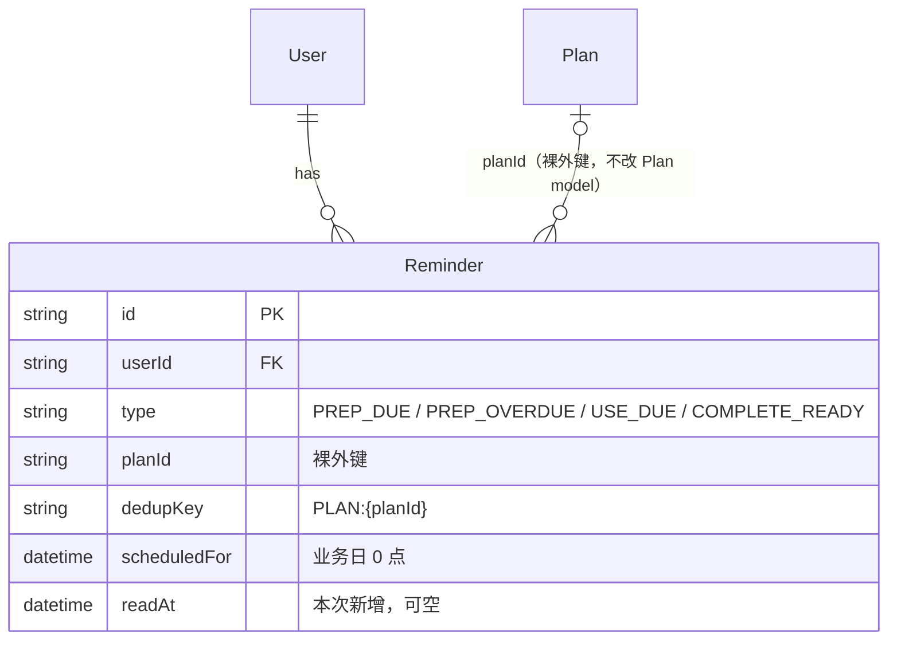
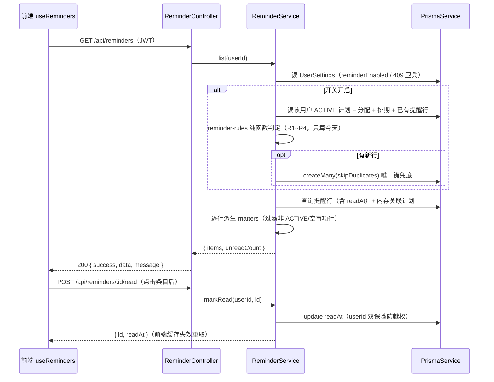

# 技术方案：站内提醒与到期处理（reminders）

> 结论先行：本次 **1 张既有表加 1 列**（`reminders` 增加 `read_at`，1 个 migration）、**3 个新接口**
> （`GET /api/reminders`、`POST /api/reminders/:id/read`、`POST /api/reminders/read-all`）、
> 后端 **1 个新模块**（`src/reminder/`，含纯函数规则层）、前端 **1 个新页面 + 3 个业务组件 + 1 个 hook**。
> 提醒生成采用**读时懒生成 + 唯一键幂等落库**，不引入定时任务设施（§4 决策记录）。
> 需求依据：`changes/reminders/需求文档.md`；规格原文：`docs/MVP功能模块&业务逻辑&专业术语/08_提醒与到期处理.md`。

## 1. 背景与目标

现状（MVP 审计 `changes/mvp-completion/审查报告与开发计划.md` §二 M9 行）：

- `services/chat/prisma/schema.prisma:344` 已建 `Reminder` 表（`type`/`planId`/`dedupKey`/`scheduledFor`，唯一键 `[userId, dedupKey, scheduledFor]` 注释明示「同计划同日合并防打扰」），**全仓零读写**。
- 提醒开关已通：`services/chat/src/settings/settings.service.ts:72`（`reminderEnabled` 白名单四字段之一），前端 `clients/chat-web/components/business/settings/preferences-form.tsx:313`。
- 首页已有焦点计划横幅（状态展示，非提醒）：`clients/chat-web/components/business/home/home-dashboard.tsx:164`；焦点计划派生在 `clients/chat-web/lib/hooks/use-home-state.ts:155`。
- 审计 M12 行：首页缺提醒中心；功能 24 未落地。

目标：补齐功能 24——提醒生成规则、同计划同日合并、提醒中心与已读流转、到期状态联动，并与首页横幅/设置开关整合。**不改**既有计划、交易、账户模块的任何业务规则。

## 2. 量化指标（预估）

| 指标项 | 预估值 | 依据/备注 |
| --- | --- | --- |
| 数据规模 | 千级用户 × 人均计划 <10 × 每计划提醒行 ≤5 行/活跃期 → 总量远低于百万行 | 个人工具；无需分表 |
| 单用户单次生成查询 | 每计划 1 次批量读 + 1 次 `createMany`（仅在有新行时） | 计划数个位数，代价可忽略 |
| 并发压力 | GET /reminders QPS <100 | 读时生成挂只读接口，无锁竞争 |
| 响应要求 | 同步 <500ms（实际预期 <50ms） | 与既有 home/state 同量级 |
| 一致性等级 | 幂等最终一致（唯一键兜底） | 生成失败不补偿，下次请求重算（§11） |

## 3. 现状调研与约束

1. **无定时任务设施**：`services/chat/package.json` 无 `@nestjs/schedule`；`changes/rate-refresh-cron/规格.md` 已拍板的定时刷新状态为「待技术方案与实施」，尚无任何 cron 代码。AGENTS.md 约定 AI 禁止启动服务；部署形态为 Next.js + NestJS（Docker Compose），无常驻 worker。
2. **规格与懒生成天然兼容**（这是不引入定时器的根本依据）：
   - `08_提醒与到期处理.md:29`「错过的日期不补发，只显示当前状态」→ 生成只算「今天」，天然不回填；
   - `08_提醒与到期处理.md:27`「……只更新内容」→ 内容不落库、读取时按计划当前状态派生；
   - `08_提醒与到期处理.md:26`「逾期状态持续展示，不每天重发」→ 事件首日生成一次，靠唯一键防重。
3. **纯函数范式先例**：`services/chat/src/plan/plan-calculator.ts`、`schedule-builder.ts`（零框架依赖、领域错误、`*.spec.ts` 同目录锁定口径）——提醒规则层完全对齐该范式。
4. **裸外键先例**：`services/chat/prisma/schema.prisma:272-274`（PlanChangeLog 对冻结的 Plan model 不声明 Prisma relation）。`Reminder.planId` 已是裸外键，沿用：查询按 `planId` 直查 + 内存关联，**不动 Plan model**。
5. **类型链路**：后端 DTO → `bun run generate:api` → `clients/chat-web/lib/api/schema.gen.ts`，前端零手写共享类型（对齐 `changes/home-dashboard/技术方案.md` §6）。
6. **接口约定**：全局前缀 `/api`（`services/chat/src/main.ts:14`）、`JwtAuthGuard` 控制器级挂载（`plan.controller.ts:76-77` 先例）、响应包装 `{ success, data, message }`、金额字符串 4 位小数、未建账 409 `ONBOARDING_NOT_COMPLETED`（`settings.controller.ts:76` 先例——提醒依赖 `UserSettings.reminderEnabled`，同样需要 settings 存在）。

## 4. 提醒生成时机机制设计（核心）

### 4.1 方案对比与决策

| 备选 | 说明 | 结论 |
| --- | --- | --- |
| A. 常驻定时任务 | 引 `@nestjs/schedule` 每日为全量用户生成 | **否**：项目无该设施，为单人提醒引入进程内调度器属过度设计；且多实例部署下还需加分布式锁，复杂度失控 |
| B. 外部触发（MQ/云函数） | 事件驱动生成 | **否**：MVP 无消息设施；功能 24 是纯站内展示，无异步解耦诉求 |
| C. 读时懒生成（选定） | 用户请求提醒数据时，先幂等生成「今天」应存在的提醒行，再返回列表 | **是**：部署形态零新增设施；规格三条防打扰条款恰好都指向「只算今天 + 唯一键 + 内容派生」；个人量级下同步生成 <50ms（§2） |

**决策：读时懒生成。** 代价是「用户不开 App 就没有提醒行」——这正是规格要求的「错过不补发」，非缺陷。

### 4.2 懒生成挂载点

- `GET /api/reminders` 服务端入口先执行 `generateDueReminders(userId)` 再查询返回。首页铃铛与「今日提醒」区块、提醒中心页共用该接口（前端 react-query 同 key 共享缓存），因此**首页打开即触发生成**，无需改动既有 `GET /home/state` 契约（保持 `changes/home-dashboard` 契约不动）。
- 生成与查询都在同一请求内完成，不做跨请求异步。

### 4.3 判定规则（纯函数 `reminder-rules.ts`）

对每个 `ACTIVE` 计划，输入快照 + 业务日「今天」，输出「今日允许新生成的事件行」集合。**只生成事件首日 == 今天 的行**：

| # | 条件（全部含） | 生成行 | 对应规格 |
| --- | --- | --- | --- |
| R1 | 今天 ∈ 该计划排期节点日（`PlanInstallment.scheduledAt` 截日比较）且 缺口 > 0 | `type=PREP_DUE`，`scheduledFor=今天` | 08:11 准备日提醒；备齐停止 |
| R2 | 今天 == `latestPrepDate` 的次日历天 且 缺口 > 0 | `type=PREP_OVERDUE`，`scheduledFor=今天` | 08:14 逾期从次日起；之后日期不满足 R2 → 不重发 |
| R3 | 今天 == `expectUseDate` | `type=USE_DUE`，`scheduledFor=今天` | 08:15 使用日提醒；备齐也提醒 |
| R4 | `usedAmount == targetAmount` 且 剩余分配 == 0 且 该计划尚无 `COMPLETE_READY` 行 | `type=COMPLETE_READY`，`scheduledFor=今天` | 08:17 提示确认完成 |

- 缺口口径复用 `plan-calculator.ts` 既有 `computeDerived`（`gap = max(0, 还需使用 − 剩余分配)`），**零新公式**，杜绝口径漂移。
- **同计划同日合并**：`dedupKey = "PLAN:" + planId`（不含 type），唯一键 `[userId, dedupKey, scheduledFor]` 保证同计划同日仅一行；R1/R3 同日命中时第二条被 `skipDuplicates` 丢弃，行内 `matters` 读时并列展示两事项（§4.5）。
- **防重复生成**（对齐 08:25-29 五条防打扰）：
  - 生成前按计划批量读已有行；R2/R3/R4 只在「事件首日行不存在」时写入 → 逾期只发一次；
  - R4 检查「该计划已存在任一 COMPLETE_READY 行」→ 持续满足期间不逐日重发；
  - 开关往返、刷新、重开均不删除行 → 唯一键天然防重发；
  - 只算今天 → 错过不补发。

### 4.4 业务日与时区（假设声明）

「今天」= **UTC+8 日历天**（对齐 `14_业务逻辑清单.md` §6「记录日期按UTC+8判断」既有口径；08 规格待确定项，§12 显式标注）。`scheduledFor` 存该业务日 00:00 (+08:00) 对应的 UTC 时刻，截日比较一律用 UTC+8 取整函数（与 `schedule-builder.ts` 的 `utcMidnight` 同思路，新增 `utcPlus8Midnight`，纯函数可测）。

### 4.5 内容读时派生（「只更新内容」）

`Reminder` 行不存文案。`GET /reminders` 返回时对每行重算 `matters`（事项数组，复用 §4.3 规则的查询态版本，不限「今天」——覆盖 `scheduledFor=今天` 的历史行）：

- `matters` 为空的行（如排期更新后原节点日已无节点、备齐后原 PREP_DUE 行）→ **不返回**（前端无感）；
- 计划非 `ACTIVE`（已完成/已取消）→ 该计划全部行**过滤不返回**（08:18 停止主动提醒；行保留不删，重开后按 §4.3 规则自然恢复）；
- 已读行（`readAt` 非空）正常返回并带 `readAt`，前端区分未读/已读样式。

## 5. 数据模型变更

- `services/chat/prisma/schema.prisma:344` `Reminder` 增加 `readAt DateTime? @map("read_at") @db.Timestamptz(3)`；新增 migration `prisma/migrations/<ts>_add_reminder_read_at`（`ALTER TABLE reminders ADD COLUMN read_at timestamptz(3);`，可逆：对应 `DROP COLUMN`）。
- 新增索引 `@@index([userId, scheduledFor])`：列表查询 `WHERE user_id AND (read_at IS NULL OR 范围) ORDER BY scheduled_for DESC`；既有唯一键 `[userId, dedupKey, scheduledFor]` 不动（生成幂等的根基）。
- 不新增任何表；`User`/`Plan` model 零改动。

## 6. 核心时序：打开首页触发懒生成

图例：生成阶段在 `list()` 内同步完成且开关关闭时跳过；`skipDuplicates` 保证重复请求与并发请求无副作用。

## 7. 接口契约

错误码沿用项目约定：金额字符串固定 4 位小数；未知字段被全局 ValidationPipe 剥离；响应包装 `{ success, data, message }`。

### 7.1 GET /api/reminders —— 列表（内置懒生成）

- 鉴权：JWT；未建账 → `409 ONBOARDING_NOT_COMPLETED`（对齐 settings 先例）。
- 响应 `data`：

| 字段 | 类型 | 说明 |
| --- | --- | --- |
| `items` | `ReminderItem[]` | 未读全量 + 已读近 30 天，按 `scheduledFor desc` 排序，上限 100 条 |
| `unreadCount` | `number` | 未读且 matters 非空且计划 ACTIVE 的行数 |

`ReminderItem`：

| 字段 | 类型 | 说明 |
| --- | --- | --- |
| `id` | `string` | 行 id |
| `planId` | `string` | 关联计划 |
| `planName` | `string \| null` | 计划名（null 前端回退「{币种} 换汇计划」，对齐 home 先例） |
| `targetCurrency` | `string` | 目标币种 |
| `scheduledFor` | `string` | ISO 8601 业务日 |
| `readAt` | `string \| null` | 已读时间 |
| `recordedType` | `string` | 首写类型（PREP_DUE / PREP_OVERDUE / USE_DUE / COMPLETE_READY），诊断用途 |
| `matters` | `ReminderMatter[]` | 读时派生的事项数组（可并列多条） |

`ReminderMatter`：`{ kind, installmentAmount?, gapAmount, isFundsReady, daysOverdue? }`

- `kind`：`PREP_DUE`（今日准备节点，附 `installmentAmount`）｜`PREP_OVERDUE`（附 `daysOverdue`）｜`USE_DUE`（今日为预计使用日）｜`COMPLETE_READY`（可确认完成）
- `gapAmount` / `isFundsReady`：当前缺口与备齐状态（复用 computeDerived，`toFixed(4)`）
- 文案由前端组装（项目 i18n 前文案在前端的既有先例），后端只回结构化事实。

### 7.2 POST /api/reminders/:id/read —— 单条已读

- `data: { id, readAt }`；行不存在或非本人 → `404 REMINDER_NOT_FOUND`（越权与不存在同响应，不泄露存在性）。
- 幂等：重复调用返回既有 `readAt`，不报错。

### 7.3 POST /api/reminders/read-all —— 全部已读

- `data: { updatedCount }`；仅更新当前用户未读行（`updateMany where readAt: null`），天然幂等。

### 7.4 错误码汇总

| HTTP | code | 场景 |
| --- | --- | --- |
| 401 | — | 未登录（全局 JWT） |
| 404 | `REMINDER_NOT_FOUND` | 行不存在 / 非本人 |
| 409 | `ONBOARDING_NOT_COMPLETED` | 未完成首次设置（无 settings 记录） |

## 8. 前端设计

- **数据层**：`lib/api/reminders.ts` 封装三端点（类型取 `Schemas["RemindersView"]` 等生成别名）；`lib/hooks/use-reminders.ts` 一个 hook 对齐 `use-home-state` 范式——列表查询（staleTime 30s，避免首页/铃铛/提醒中心重复触发生成）+ `markRead` / `markAllRead` mutation 成功后 `invalidateQueries`。
- **组件层**（`components/business/reminder/`，带桶文件）：
  - `reminder-card.tsx`：单条提醒卡——matters 并列渲染事项行、未读圆点、点击整卡跳 `/plans/:id` 并调 markRead；
  - `reminder-bell.tsx`：首页顶栏铃铛 + 未读角标（`reminderEnabled=false` 不渲染角标）；
  - `reminder-section.tsx`：首页「今日提醒」区块（取 items 中 `scheduledFor=今天` 的前 3 条 + 「查看全部」；开关关闭时渲染一行关闭提示 + 设置入口；无提醒不渲染）。
- **页面**：`app/(protected)/reminders/page.tsx` 提醒中心——列表（未读优先）、全部已读按钮、空态/关闭态；守卫由 `(protected)/layout.tsx` 承担，页面零校验代码。
- **整合点**：`home-dashboard.tsx` 顶栏挂 `ReminderBell`、横幅区上方挂 `ReminderSection`；既有焦点横幅/统计卡/分流逻辑零改动（「关闭提醒后页面仍显示状态」由横幅天然满足）。
- **设置页**：`preferences-form.tsx` 开关说明文案补一句（§7.3 需求），逻辑不改。
- 不新增侧边栏导航项（提醒中心经首页铃铛与今日提醒区到达，维持 home-dashboard 方案锁定的 5 项导航）。

## 9. 代码影响范围（树状变更清单）

<pre>
后端 services/chat/
├─ prisma/
│  ├─ schema.prisma                                   (M) Reminder 增 readAt + @@index([userId, scheduledFor])
│  └─ migrations/&lt;ts&gt;_add_reminder_read_at/migration.sql  (A) ADD/DROP COLUMN read_at
├─ src/
│  ├─ reminder/                                      (A) 新模块
│  │  ├─ reminder.module.ts                         (A)
│  │  ├─ reminder.controller.ts                     (A) GET /reminders POST /:id/read POST /read-all
│  │  ├─ reminder.service.ts                        (A) list()（内置 generateDueReminders）markRead() markAllRead()
│  │  ├─ reminder-rules.ts                         (A) 纯函数：R1~R4 判定 + matters 派生 + utcPlus8Midnight（零 IO，对齐 plan-calculator 范式）
│  │  ├─ reminder-rules.spec.ts                    (A) 单测（§10.1）
│  │  └─ dto/reminder.dto.ts                       (A) RemindersView / ReminderItem / ReminderMatter DTO
│  └─ app.module.ts                                   (M) 注册 ReminderModule（模块唯一注册点）

前端 clients/chat-web/
├─ lib/
│  ├─ api/reminders.ts                               (A) 三端点封装（类型走 generate:api）
│  └─ hooks/use-reminders.ts                          (A) 列表查询 + 已读 mutation
│     └─ use-reminders.spec.tsx                       (A) hook 单测
├─ components/
│  ├─ business/reminder/                            (A)
│  │  ├─ reminder-card.tsx                          (A)
│  │  ├─ reminder-bell.tsx                           (A)
│  │  ├─ reminder-section.tsx                        (A)
│  │  └─ index.ts                                   (A) 桶文件
│  ├─ business/home/home-dashboard.tsx              (M) 顶栏挂 ReminderBell + 横幅区挂 ReminderSection（其余零改动）
│  └─ business/settings/preferences-form.tsx      (M) 开关说明文案补一句（逻辑不改）
└─ app/(protected)/
   └─ reminders/page.tsx                             (A) 提醒中心页

测试
├─ services/chat/test/api/reminder.spec.ts           (A) 接口测试
├─ services/chat/test/integration/reminder-plan-lifecycle.spec.ts  (A) 集成测试
└─ e2e/modules/11-reminders.spec.ts                (A) E2E
</pre>

共享接口归档：`GET /api/reminders` 被首页（铃铛/今日提醒区）与提醒中心页共用，仅在上表后端条目归档一次，`[引用方] reminder-bell.tsx、reminder-section.tsx、reminders/page.tsx（经 use-reminders 共享缓存）`。

不改动：`plan/`、`transaction/`、`account/`、`home/` 后端模块；`GET /home/state` 契约；焦点横幅与统计卡逻辑；侧边栏导航。

## 10. 测试设计

质量红线：实施完成必须本地全量 0 failed；测试文件与被测对象一一对应。

### 10.1 单元测试：`services/chat/src/reminder/reminder-rules.spec.ts`

锁定 §4.3 判定表与 §4.5 派生规则（纯函数直接断言，无 mock）：

| # | 用例 | 预期 |
| --- | --- | --- |
| 1 | 今天为节点日且缺口>0 | 生成 PREP_DUE |
| 2 | 今天为节点日但缺口=0（已备齐） | 不生成（08:11 备齐停止） |
| 3 | 今天==latestPrepDate 次日且缺口>0 | 生成 PREP_OVERDUE（scheduledFor=今天） |
| 4 | 逾期第 3 天（非首日）且缺口>0 | 不再生成（不每天重发） |
| 5 | 缺口=0 后查看原逾期行 | matters 为空 → 行隐藏（需求文档 GWT 开关与状态联动第 4 条） |
| 6 | 今天==expectUseDate 且已备齐 | 生成 USE_DUE（备齐也提醒） |
| 7 | 今天==expectUseDate 且同为节点日且缺口>0 | 仅一行，matters=[PREP_DUE, USE_DUE]（同日合并） |
| 8 | used==target 且剩余分配==0 | 首次生成 COMPLETE_READY；传入已有 COMPLETE_READY 行 → 不再生成 |
| 9 | 计划 status=COMPLETED/CANCELLED | 生成阶段跳过；列表阶段过滤（08:18） |
| 10 | 已有行 (dedupKey, scheduledFor=今天) 重复生成 | 幂等不新增（唯一键语义） |
| 11 | 今天为节点日但该日行已存在且 matters 变化 | 不新发，读时 matters 更新（只更新内容） |
| 12 | UTC+8 截日：UTC 16:00（北京次日 0 点） | 业务日进位正确 |

### 10.2 接口测试：`services/chat/test/api/reminder.spec.ts`

沿用 `test/api/` 既有基建（app 起服 + supertest）：

| # | 场景 | 预期 |
| --- | --- | --- |
| 1 | GET /reminders 未登录 | 401 |
| 2 | GET 未建账 | 409 ONBOARDING_NOT_COMPLETED |
| 3 | 建计划（构造今天为节点日）后 GET | 返回 1 行 PREP_DUE，unreadCount=1，字段契约完整 |
| 4 | 连续两次 GET | items 数量不变（幂等），金额 toFixed(4) |
| 5 | POST /:id/read 本人行 | 200 返回 readAt；重复调用幂等 |
| 6 | POST 他人 reminder id | 404 REMINDER_NOT_FOUND（不泄露存在性） |
| 7 | POST /read-all | updatedCount=未读数；再调 updatedCount=0 |
| 8 | PATCH /settings reminderEnabled=false 后 GET | 不再生成新行；既有行仍返回 |
| 9 | GET 返回的 matters 不含非 ACTIVE 计划 | 计划取消后行不可见 |

### 10.3 集成测试：`services/chat/test/integration/reminder-plan-lifecycle.spec.ts`

跨模块生命周期联动（真库，事务回滚清理）：

| # | 流程 | 断言 |
| --- | --- | --- |
| 1 | 建计划→取消→GET | 该计划提醒不再返回；行未删 |
| 2 | 使用达标（直接写库模拟，M7 未建）→GET→确认完成→GET | COMPLETE_READY 出现一次；确认完成后行消失 |
| 3 | 完成后更正调小使用（M8 流程未建，用直接写库模拟 usedAmount 回退）→重开路径 | 按 §4.3 规则自然恢复/隐藏，无补发 |
| 4 | 调整分配使缺口 0→再调回缺口>0，同一节点日 | 无新行；matters 随状态更新 |

### 10.4 前端单测：`clients/chat-web/lib/hooks/use-reminders.spec.tsx`

- 列表查询成功/失败分支；markRead 成功后缓存失效；unreadCount 派生；staleTime 内不重复请求。

### 10.5 E2E：`e2e/modules/11-reminders.spec.ts`

按用户操作路径编号（登录与建计划复用既有 fixtures/helpers；开始准备日显式传「今天」使首个节点命中当天）：

1. **路径 1 准备提醒出现与合并**：建计划（节点日含今天）→ 打开首页 → 断言今日提醒区可见、铃铛角标为 1；同日再建第二事项不可行（同计划），改断言两次进入首页角标不增长（不重复打扰）。
2. **路径 2 已读流转**：点提醒条目 → 断言跳转 `/plans/:id` → 返回提醒中心 → 断言该条已读、角标归零；点「全部标为已读」断言未读清零。
3. **路径 3 开关闭环**：设置页关提醒 → 回首页 → 断言无角标且显示关闭提示、焦点横幅仍在 → 重新开启 → 断言无重复提醒（角标不回增）。

### 10.6 测试文件树

<pre>
services/chat/src/reminder/reminder-rules.spec.ts        → reminder-rules.ts 判定/派生/时区
clients/chat-web/lib/hooks/use-reminders.spec.tsx        → use-reminders.ts 查询/缓存/角标
services/chat/test/api/reminder.spec.ts                  → 3 端点契约/鉴权/越权/幂等/开关
services/chat/test/integration/reminder-plan-lifecycle.spec.ts → 取消/完成/重开/缺口往返联动
e2e/modules/11-reminders.spec.ts                         → 3 条用户路径 + 断言
</pre>

## 11. 异常兜底、回滚与监控

- **生成失败兜底**：`generateDueReminders` 任何异常捕获后降级为「跳过生成、直接返回既有列表」（日志可查，下次请求重算；规格允许「错过不补」，漏一轮无业务损失），列表查询本身失败才走整页错误态。
- **并发安全**：唯一键 `createMany skipDuplicates`；无锁、无事务边界扩张（生成非资金操作，无需与计划事务同界）。
- **回滚**：migration 可逆（DROP COLUMN）；功能开关粒度 = 用户级既有 `reminderEnabled`（关闭即回到「仅状态展示」的现状行为），无需发版回滚。
- **零新依赖**：不引 `@nestjs/schedule`、不引消息设施；将来 rate-refresh-cron 落地引入调度器时与本方案正交（其调度对象是汇率拉取，不是提醒）。

## 12. 待确认项与假设

| # | 事项 | 本方案假设 | 影响 |
| --- | --- | --- | --- |
| 1 | 时区/当天截止（08 规格待确定） | UTC+8 日历天，对齐 14 §6 既有口径 | 拍板后仅改 `utcPlus8Midnight` 一处纯函数 |
| 2 | 跨天处理（08 规格待确定） | 以请求时刻所在业务日为准，无跨天滚动 | 同上 |
| 3 | 修改计划日期后的提醒对应（13 功能 29 规划为待确定，本次未实现日期修改） | 不涉及；未来功能 29 落地时按 §4.3「只算事件首日」规则重新评估 | 无 |
| 4 | 工作日日历（14 §4 待确定） | 沿用 schedule-builder 既有「跳周六日」口径，不在本模块改动 | 无 |
| 5 | i18n | 后端回结构化事实、前端组装文案；阶段 3 i18n 接入时仅改前端文案层 | 无 |
