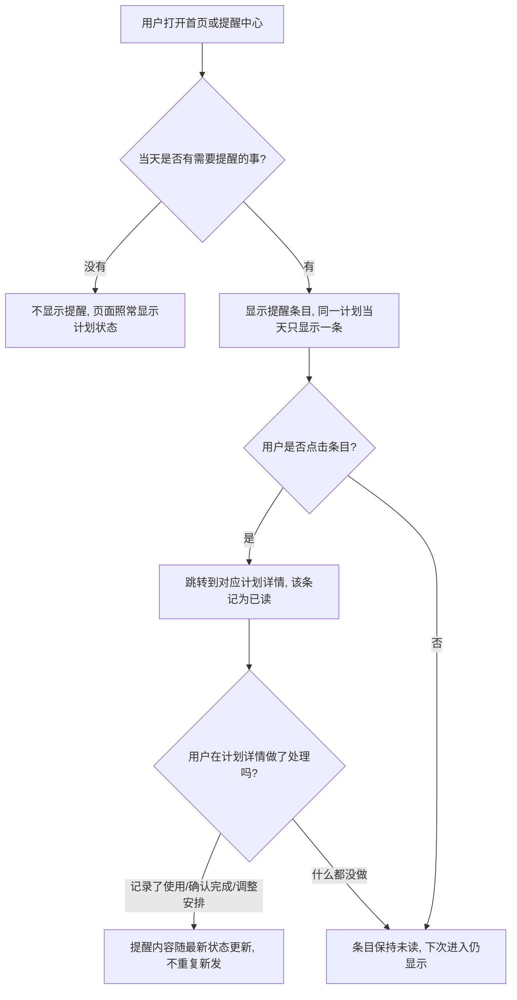
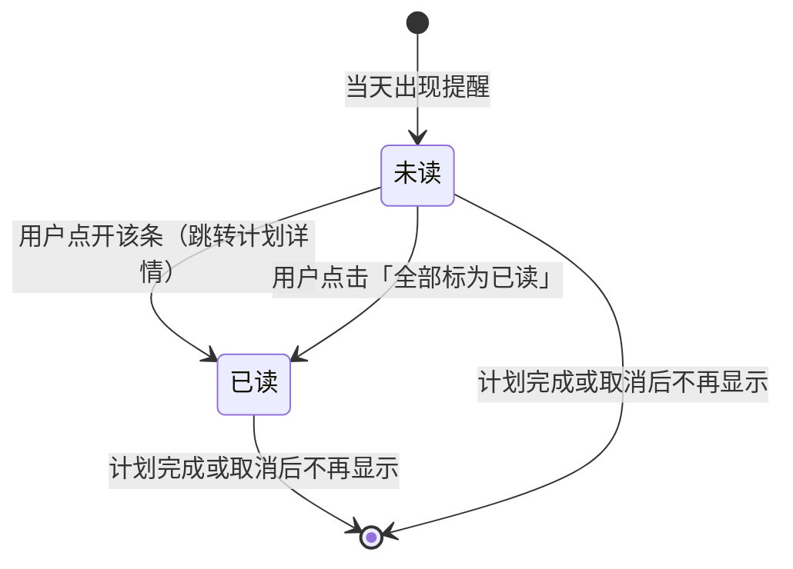

# 需求文档：站内提醒与到期处理（M9）

> 版本：v1.0（2026-09-18）
> 依据规格：`docs/MVP功能模块&业务逻辑&专业术语/08_提醒与到期处理.md`、`13_MVP功能清单.md` 功能 24、`14_业务逻辑清单.md` §4、`15_专业术语清单.md`
> 关联现状：`changes/mvp-completion/审查报告与开发计划.md`（M9 提醒未实现；功能 24 未落地）

## 一、概述

### 1.1 背景

用户制定换汇计划后，需要记住「哪天该准备钱」「哪天要把钱用出去」「钱备齐了没有」。目前产品只在首页显示一条焦点计划的倒计时横幅，没有任何主动提醒：到了准备日没人告诉用户，逾期了也没人提示，钱备齐了用户也不知道可以停手。

### 1.2 目标

1. 对进行中的计划，在正确的日子提醒用户查看准备安排、核对实际使用情况。
2. 同一计划同一天只打扰一次，逾期不重复催办，错过不补发。
3. 提供一个提醒中心，集中查看、逐条或一键处理提醒。
4. 计划到期后（钱备齐、已逾期、使用日已过），首页与计划详情同步显示当前状态。
5. 用户可以随时关闭提醒；关闭后页面照常显示日期、缺口和进度。

### 1.3 范围（本次做 / 不做）

| 本次做 | 本次不做 |
| --- | --- |
| 进行中计划的提醒判定与展示 | 邮件、推送等站外通知（规格明确后续版本，见 08 规格待确定） |
| 同计划同日合并、防重复打扰 | 错过日期的补发（规格明确不补发，只显示当前状态） |
| 提醒中心页：列表、已读、处理跳转 | 首次设置向导中的提醒步骤（属 M1 补全范围，本模块只保证设置页开关可用） |
| 计划到期状态与首页、计划详情的联动 | 逾期催办的升级手段（如多次催办、加重提示） |
| 与现有首页横幅、设置页提醒开关的整合 | 修改计划日期后的提醒对应规则（规格待确定项，见 08 规格末尾） |

## 二、角色

仅单一角色：登录用户本人。用户只能看到和操作自己的提醒（一句话覆盖，无权限矩阵）。

## 三、术语表

| 术语 | 白话说明 |
| --- | --- |
| 站内提醒 | 在产品内部显示的提醒消息，可以关闭；关闭后仍可查看计划状态（15 清单） |
| 准备节点 | 某一次建议准备的日期和金额（15 清单） |
| 最晚准备日期 | 到这一天应该把需要的外币准备好；默认从使用日前一天往前数 3 个工作日（15 清单） |
| 准备逾期 | 超过最晚准备日期，钱还没有备齐（15 清单） |
| 预计使用日期 | 预计实际花这笔外币的日期（15 清单） |
| 钱已备齐 | 计划还需要使用钱，但已分配的钱已经足够（15 清单） |
| 缺口 | 目标金额 − 已使用金额 − 本计划剩余分配，最低为 0（08 规格 §还缺多少钱） |
| 提醒条目 | 提醒中心里的一条记录，关联一个计划和一个日期 |

## 四、总体流程

图例：菱形为系统或用户判断；方框为用户看到的结果。核心是「当天检查一次、合并为一条、处理即已读」。

### 提醒条目的状态

用户在未读/已读状态下能做的事：查看提醒内容、点击跳转计划；已读条目在近期列表中仍可查看。

## 五、提醒规则

### 5.1 谁会收到提醒

- 只有**进行中**的计划会产生提醒；已完成、已取消的计划停止一切主动提醒（08 规格场景表）。
- 用户关闭提醒总开关后，系统不再产生新提醒；页面（首页横幅、计划详情）仍照常显示日期、缺口与进度（14 清单 §4）。
- 提醒只通过产品内部展示，不含任何站外渠道。

### 5.2 什么时候提醒（场景对照）

以下场景均以「用户的当天」为准（时区口径见 §八 假设与待确认）：

| 场景 | 提醒/显示内容 | 来源规格 |
| --- | --- | --- |
| 当天到了某次准备日期 | 提醒查看本次准备安排（含本次建议准备金额）；钱已备齐则不再提醒准备 | 08 场景表第 1 行 |
| 当天恰好是最晚准备日的次日、仍缺钱 | 提醒一次「准备已逾期」；此后逾期状态持续显示，不再每天重发提醒 | 08 场景表第 4 行 + §避免重复打扰 |
| 当天是预计使用日 | 提醒核对实际用了多少钱；钱已备齐也照样提醒 | 08 场景表第 5 行 |
| 预计使用日已过 | 从次日起页面显示「预计使用日已过」状态，不另发新提醒 | 08 场景表第 6 行 |
| 已用金额等于目标、剩余分配为 0 | 提醒一次「可以确认完成计划」，跳转计划详情完成确认 | 08 场景表第 7 行 |
| 最晚准备日当天仍缺钱 | 计划详情与首页显示「未备齐」 | 08 场景表第 3 行 |
| 旧安排需要更新 | 提醒始终基于用户已确认的最新安排；本产品修改安排须当场确认后生效，不存在「旧日期继续提醒」的情况 | 08 场景表第 2 行（实现形态说明见 §八） |
| 计划重新开启 | 按当前状态恢复提醒，不补发以前漏掉的提醒 | 08 场景表第 9 行 |

边界语义（08 规格明示）：准备提醒不表示已经换汇；使用日提醒不会自动记账，也不判断用户是否已付款。

### 5.3 避免重复打扰（合并与去重）

1. **同计划同日合并**：同一计划同一天无论有几件事（如既是准备日又是使用日），只显示一条提醒，条目内并列显示各事项。
2. **逾期不重发**：准备逾期只发一条，之后状态持续展示。
3. **内容常新**：用户刷新页面、更新安排、重新开启计划，当天已有的提醒不会重复出现，但内容随最新状态更新。
4. **开关往返**：关闭提醒后再打开，同一天不会把关掉的提醒再发一遍。
5. **错过不补**：某天没有打开产品，那天的提醒不再补发，只显示当前状态；以后的新日期照常提醒。

### 5.4 缺口口径

- 缺口 ＝ 目标金额 − 已使用金额 − 本计划剩余分配，最低为 0（08 规格）。
- 账户里未分配的余额不会自动抵扣缺口；用户主动分配后才计入（08 规格示例）。
- 缺口为 0（钱已备齐）后停止一切准备类提醒；到预计使用日仍会提醒核对用途。
- 已完成计划纠正误录使用金额后，差额不标记为待补资金，不触发任何补齐提醒（08 规格 §完成后纠正使用金额、14 清单例 15）。

## 六、到期状态展示联动

提醒之外，下列状态始终直接显示在页面上（不受提醒开关影响）：

| 计划状态 | 首页 | 计划详情 |
| --- | --- | --- |
| 最晚准备日仍缺钱 | 焦点计划横幅显示倒计时与「未备齐」 | 显示「未备齐」与缺口金额 |
| 准备逾期 | 横幅红字显示「已逾期 X 天」 | 显示「准备逾期」 |
| 预计使用日已过 | 横幅显示「预计使用日已过」 | 显示「预计使用日已过」 |
| 钱已备齐（仍有剩余目标） | 统计卡与横幅显示备齐状态 | 显示「钱已备齐」 |
| 已用完且剩余分配为 0 | 提醒中心出现「可确认完成」条目 | 显示「确认完成」入口（既有功能） |
| 已完成 / 已取消 | 停止主动提醒，横幅不再展示该计划 | 保留历史记录 |

## 七、页面与交互

### 7.1 首页整合

- 顶栏新增提醒入口（铃铛样式），显示未读数量角标；点击进入提醒中心。
- 横幅区新增「今日提醒」区块：显示今天的提醒条目（最多 3 条）与「查看全部」；没有提醒时不显示。
- 现有焦点计划横幅保持不变：继续显示分配进度、备汇日倒计时（逾期红色），承担「关闭提醒后页面仍显示状态」的职责。
- 提醒开关关闭时：不显示未读角标与今日提醒条目，改为一行提示「站内提醒已关闭」并附设置页入口。

### 7.2 提醒中心页（新页面）

- 列表按日期倒序展示提醒条目；未读条目有视觉标记并排在前面。
- 每条条目显示：关联计划名称与币种、提醒事项（可并列多条）、日期、未读/已读状态。
- 点击条目：跳转对应计划详情，该条自动记为已读。
- 提供「全部标为已读」操作。
- 空状态：显示「暂无提醒」；开关关闭时显示关闭说明与设置入口。
- 已完成或已取消计划的旧提醒不再显示。

### 7.3 设置页开关（既有能力整合）

- 设置页已有「准备提醒」开关（首次设置偏好中同名），本模块沿用：
  - 开：按 §5 规则产生提醒。
  - 关：不再产生新提醒；当天已出现的提醒保留可查，不再新增打扰；页面状态显示不受影响。
- 开关说明文案补充一句：「关闭后仍可在计划页查看日期与进度」。

### 7.4 计划详情联动

- 提醒条目跳转进入计划详情后，用户可直接执行对应处理：记录使用、确认完成、调整安排（均为既有功能，本模块不改其规则）。
- 计划详情顶部状态区显示 §六 表格中的到期状态。

## 八、假设与待确认

以下为规格 `08_提醒与到期处理.md` 末尾「待确定」事项，本方案按最保守假设推进，拍板后无需返工结构：

| 待确认项 | 本文档采用假设 |
| --- | --- |
| 时区与当天截止 | 「当天」按 UTC+8 日历天判断（与既有记账日期口径一致，见 14 清单 §6） |
| 跨天处理 | 以用户打开页面那一刻所在的自然日为准，不做跨天滚动 |
| 旧安排更新后的日期对应 | 本产品修改安排为当场确认生效，提醒一律基于确认后的最新安排；不存在待确认的中间安排 |
| 通知渠道扩展 | 邮件等站外渠道明确留给后续版本 |

## 九、验收标准（Given-When-Then）

**提醒产生**

1. 假如用户有一个进行中计划且当天是某次准备日期、计划仍有缺口，当用户打开首页或提醒中心，那么看到一条「查看本次准备安排」的提醒，内容含本次建议准备金额。
2. 假如计划在准备日前已钱备齐（缺口为 0），当当天到达某次准备日期，那么不出现准备类提醒。
3. 假如当天是计划的预计使用日，当用户打开首页，那么出现「核对实际使用」提醒；即使钱已备齐也出现。
4. 假如计划已用金额等于目标且剩余分配为 0，当用户打开提醒中心，那么出现一条「可确认完成」提醒，点击后进入计划详情的完成确认。

**合并与去重**

1. 假如同一天某计划既是准备日又是预计使用日，当用户打开提醒中心，那么该计划只显示一条提醒，条目内并列两项事项。
2. 假如准备逾期提醒已出现，当用户第二天及以后继续打开产品，那么不再出现新的逾期提醒，页面持续显示逾期状态。
3. 假如当天提醒已显示，当用户刷新页面或调整安排后再回首页，那么不重复新增当天提醒，提醒内容反映最新安排。
4. 假如用户关闭提醒后又重新打开，当继续使用产品，那么同一天不会把已发过的提醒再发一遍。
5. 假如用户三天没有打开产品、期间错过了准备日提醒，当用户再次打开，那么不出现错过日期的补发提醒，页面显示当前状态。

**已读与处理**

1. 假如提醒中心有一条未读提醒，当用户点击该条目，那么跳转到对应计划详情，返回提醒中心后该条显示为已读。
2. 假如存在多条未读提醒，当用户点击「全部标为已读」，那么所有条目变为已读，未读角标消失。

**开关与状态联动**

1. 假如用户关闭提醒开关，当当天到达新的准备日期，那么不产生新提醒；首页横幅仍显示该计划的日期、缺口与进度。
2. 假如计划被取消或确认完成，当用户打开提醒中心，那么该计划的提醒条目不再显示。
3. 假如已完成计划重新开启（提高目标），当用户打开产品，那么按当前状态产生新提醒，且不出现过去的补发提醒。
4. 假如准备逾期后用户补齐了钱（缺口变为 0），当用户查看页面，那么准备逾期提醒与逾期状态消失。

## 十、非功能要求

无特殊要求。数据量与响应预期由技术方案评估；提醒在用户打开页面时即可见，不要求秒级推送。
