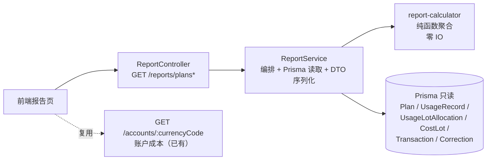
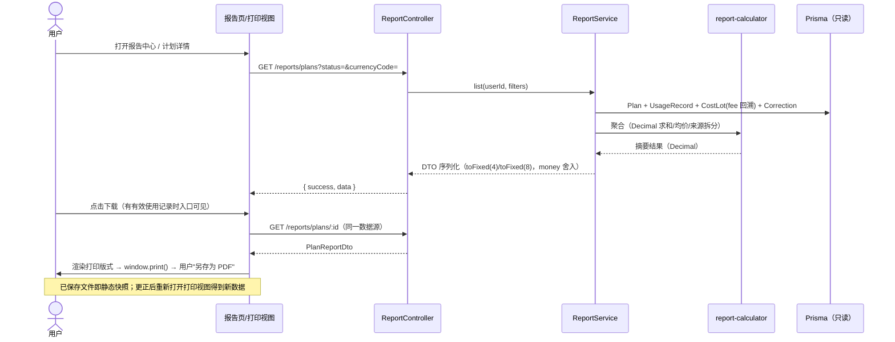

# 技术方案：M10 成本摘要与报告

> 依据：`changes/reports/需求文档.md`、《11_成本摘要与报告_待确认》、《12_收益指标与报告细则_待确认》、《13_MVP功能清单》功能 25、《changes/mvp-completion/审查报告与开发计划.md》阶段 4。
> 范围：新增只读报告模块 `services/chat/src/report/` + 前端报告页。**0 张新表、0 个迁移、2 个新只读端点 + 1 个复用端点**，预估新增约 12 个文件、800~1000 行（含测试，预估）。
> ⚠️ 本模块上游 spec 标记"待确认"，待确认点全部集中在 §12，实施前需逐项人工确认；默认方案仅用于不阻塞开发。

---

## 0. 结论先行

- **数据策略**：M10 是纯只读聚合层，**不重跑 FIFO**——使用成本直接读 M7/M8 落库的 `UsageLotAllocation` 分摊事实（`services/chat/prisma/schema.prisma:311`），与流水/账户侧成本同源，杜绝第二份 FIFO 实现漂移。
- **账户成本零后端改动**：剩余成本与平均成本已在 `AccountDetailDto`（`services/chat/src/account/dto/account.dto.ts:82`），前端直接复用。
- **PDF 默认走前端打印视图**（浏览器"另存为 PDF"）：零新增依赖、中文渲染由浏览器承担、版式与摘要同源；渲染器可替换（§7）。
- **收益比较本期不出数值**（算法待确认），只落区块占位与"不计算收益比较"规则。

## 1. 现状调研（事实）

| 事实 | 位置 |
| --- | --- |
| 后端无 report 目录，现有模块：account/auth/config/currency/home/onboarding/plan/prisma/rate/settings/transaction | `services/chat/src/` |
| 前端 `/reports` 为纯占位页（"功能开发中"） | `clients/chat-web/app/(protected)/reports/page.tsx:1` |
| `UsageRecord`/`UsageLotAllocation` 表已建但零读写（M7 未开工）；账户流水注释明示"USAGE 行 M7 上线前不出现" | `services/chat/prisma/schema.prisma:294`、`schema.prisma:311`、`services/chat/src/account/dto/account.dto.ts:118` |
| `CostLot` 已有 FIFO 读取索引 `(userId, currencyCode, acquiredAt, createdAt)` | `services/chat/prisma/schema.prisma:221` |
| 批次成本口径：`totalCost = principal + (fee ?? 0)`，手续费未知即只计本金 | `services/chat/src/account/account-calculator.ts:63` |
| 账户剩余成本 = Σ(remainingQty × unitCost)、平均单位成本（0 余额 → null）已实现 | `services/chat/src/account/account-calculator.ts:9`、`account.dto.ts:82-96` |
| 序列化约定：金额 `toFixed(4)`、单位成本 `toFixed(8)`，一律在 service DTO 层做，计算层返回 Decimal | `services/chat/src/account/account-calculator.ts:15` |
| 纯函数层 + Service 编排的模块分层先例（transaction/plan/account 三个模块一致） | `services/chat/src/plan/plan-calculator.ts` 等 |
| 金额/汇率精度纯函数库（`roundToCurrency`/`roundRateTo8`/`getCurrency`） | `packages/money/src/round.ts:24`、`rate.ts:16`、`currencies.ts:146` |
| 前端契约链路：后端 DTO → OpenAPI → `bun run generate:api` → `schema.gen.ts` → `contract.ts` 别名层 | `clients/chat-web/lib/api/contract.ts:1` |
| E2E 编号现有最大 `10-initial-backfill.spec.ts` | `e2e/modules/` |

## 2. 量化指标（预估，选型依据）

| 指标项 | 预估值 | 依据/备注 |
| --- | --- | --- |
| 数据规模 | 单用户记录 ≤ 万级；单次聚合读取 ≤ 千行 | 个人记账工具；账户流水无分页先例（`account.dto.ts:126` 注释） |
| 并发压力 | <10 QPS | 单用户自用产品 |
| 响应要求 | 同步 <500ms | 现有索引覆盖（CostLot FIFO 索引、UsageRecord `(userId, usedAt)`），聚合为内存 Decimal 求和 |
| 一致性 | 强一致读（直读已落库事实，无缓存层） | 与 account/rate 模块先例一致；报告无需缓存 |

结论：无需引入 MQ/缓存/物化表，常规 NestJS 只读端点即可。

## 3. 总体设计与数据依赖边界

### 3.1 架构：纯函数层 + Service 编排（对齐现有三模块先例）

图例：实线为本次新增调用链；虚线为复用既有端点。分层与 `plan-calculator`/`account-calculator` 先例一致：入口层不碰数据层，聚合逻辑全部下沉纯函数层（可单测、零 IO）。

### 3.2 数据依赖边界（与 M7/M8 并行的契约声明）

| 方向 | 声明 |
| --- | --- |
| M10 读 | `Plan`、`PlanAllocation`、`UsageRecord`（按当前 version 过滤）、`UsageLotAllocation`、`CostLot`（sourceType/sourceId 回溯）、`Transaction`（feeAmount 探测）、`InitialHolding`、`Correction`、`UserSettings`（本位币） |
| M10 不写 | 任何表。无迁移、无 seed 变更 |
| 依赖 M7（写侧） | M7 确认使用时必须写 `UsageLotAllocation(quantity, cost)`，`cost` 为 FIFO 消耗的全精度成本（买入批次含手续费）；FIFO 顺序（同日初始持仓→普通买入，按 `acquiredAt`+录入顺序）由写侧保证，索引 `schema.prisma:221` 支撑 |
| 依赖 M8（写侧） | M8 更正后重放/改写分摊明细并留痕 `Correction`；M10 因直读分摊事实而自动反映最新结果，无需感知更正逻辑 |
| 解耦保证 | M7 未上线时 `UsageRecord`/`UsageLotAllocation` 为空集，M10 全链路表现为"尚未使用"状态——**M10 可先行开发与测试（测试自行种分摊数据），不被 M7 阻塞** |

## 4. 计算口径（复用 packages/money）

### 4.1 口径表

| 指标 | 公式 | 精度与空值 |
| --- | --- | --- |
| 已使用数量 | `Σ UsageRecord.amount`（当前版本） | Decimal 全精度；DTO `toFixed(4)` |
| 已使用成本 | `Σ UsageLotAllocation.cost` | 全精度加总；无分摊 → `null`（不显示 0）；DTO `toFixed(4)` |
| 使用均价 | 已使用成本 ÷ 已使用数量 | 无使用 → `null`；`roundRateTo8` 后 `toFixed(8)`（`packages/money/src/rate.ts:16`） |
| 来源拆分 | 分摊明细 join `CostLot.sourceType`（INITIAL/PURCHASE）分组求 quantity/cost | cost 为空的概念不适用（批次必有成本）；数量恒展示 |
| 手续费未明确标记 | ∃ 分摊批次：`sourceType=PURCHASE ∧ Transaction.feeAmount=null` | true → 前端展示固定说明文案（需求 5.2 条 5） |
| 计划差额 | `targetAmount − usedQuantity`（完成后调小场景的"差额"） | `max(0, ·)` 由调用方语义决定，计算层返回原值 |
| 账户剩余成本/均价 | 复用 `account-calculator` 既有实现，**零改动** | `null` 语义沿用（余额 0 不显示均价） |
| 币种展示舍入 | `roundToCurrency(x, getCurrency(code).decimalPlaces)`（`packages/money/src/round.ts:24`） | JPY/KRW 0 位、其余 2 位；ROUND_HALF_UP（与 money 包规则一致） |
| 跨币种 | 永不合计；按 `currencyCode` 分组展示 | — |

### 4.2 关键决策

1. **不重算 FIFO**：doc 11 的 FIFO 顺序规则是写侧（M7 消耗、M8 重放）的职责，其结果已固化为 `UsageLotAllocation` 行。M10 只做 Σ，口径与账户流水（USAGE 行 totalCost）天然一致。FIFO 正确性由 M7 的集成测试锁定，M10 测试不重复验证 FIFO 本身，只验证"读分摊求和"。
2. **小数策略（待确认点 11 的默认）**：分摊落库即全精度 `Decimal(20,4)`，展示层按币种精度**一次舍入**（money 包规则），无逐项累积误差；合计按全精度加总后舍入，与逐项舍入值之和可能有 ≤1 最小单位的显示差，接受并在报告页脚注明。收益率小数位随待确认点 12（算法定稿前不实现）。
3. **updatedAt 口径（展示用，非审计）**：`max(该计划全部 UsageRecord.updatedAt, Correction.createdAt where targetType=USAGE ∧ targetId∈该计划使用, Correction.createdAt where targetType=TRANSACTION ∧ targetId∈planId=该计划的交易)`；无记录 → `null`。跨账户共享批次被间接更正的传播不追踪，审计追溯以修改记录入口为准。
4. **缺成本不按零**：分摊/批次成本理论不缺失（CostLot 构造时强制带 cost）；若历史数据异常导致空集，返回 `null` 由前端显示"暂无法计算"，绝不补 0（需求 5.3 条 3）。

### 4.3 口径自检示例（doc 11/15 原例，单测锁定）

| 场景 | 输入 | 期望输出 |
| --- | --- | --- |
| doc 11 成本示例 | 7,000 本金 + 100 手续费买 1,000；用 400 | 已使用成本 2,840、均价 7.10 |
| doc 15 FIFO 例 | 1,000@7,800 + 1,000@8,000，用 1,200 | 已使用成本 9,400；账户剩余成本 6,400、均价 8.00 |
| ROUND_HALF_UP | 单位成本 2.845（2 位币种） | 显示 2.85（不逢双进位） |
| JPY 整数 | 已使用 123,456.7 JPY 成本 89,000.5 | 数量显示 123,457、成本 89,001 |

## 5. 接口契约

统一包装 `{ success, data, message }`；鉴权走全局 JWT 守卫（401）；错误体 `{ code, message }`（对齐 account/plan 模块风格）。

### 5.1 GET /api/reports/plans —— 报告中心列表

查询参数（均可选）：

| 参数 | 类型 | 校验 | 非法值 |
| --- | --- | --- | --- |
| `status` | string | 枚举 `ACTIVE`/`COMPLETED`/`CANCELLED` | 400 `INVALID_REPORT_PARAMS` |
| `currencyCode` | string | 3 位字母，`getCurrency` 校验（`packages/money/src/currencies.ts:146`） | 400 `INVALID_REPORT_PARAMS` |

出参 `ReportPlanListDto`：

| 字段 | 类型 | 说明 |
| --- | --- | --- |
| `baseCurrency` | string \| null | 取 `userSettings.baseCurrency`；新用户 null |
| `items[].planId` | string | 计划 ID |
| `items[].name` | string \| null | 计划名 |
| `items[].status` | string | ACTIVE/COMPLETED/CANCELLED |
| `items[].currencyCode` | string | 目标币种 |
| `items[].targetAmount` | string | 目标金额，`toFixed(4)` |
| `items[].usedQuantity` | string | 累计已使用，`toFixed(4)` |
| `items[].usedTotalCost` | string \| null | 已使用成本（本位币）；无有效使用 → null |
| `items[].usedUnitCost` | string \| null | 使用均价 `toFixed(8)`；无使用 → null |
| `items[].hasUnknownFee` | boolean | 是否涉及手续费未明确的买入 |
| `items[].updatedAt` | string \| null | 信息更新时间（ISO 8601，§4.2 口径 3） |

排序：`createdAt` 倒序。`items[].hasUsage = usedQuantity > 0`（前端据此决定下载入口，亦可由前端直接推导，不单独出字段）。

### 5.2 GET /api/reports/plans/:id —— 单计划报告（页面摘要与打印视图共用数据源）

| 异常 | 场景 |
| --- | --- |
| 404 `PLAN_NOT_FOUND` | 不存在或非本人计划（对齐 plan 模块） |
| 400 `INVALID_REPORT_PARAMS` | id 格式非法 |

出参 `PlanReportDto`：

| 字段 | 类型 | 说明 |
| --- | --- | --- |
| `plan.id/name/status/currencyCode/baseCurrency` | — | 基本信息；baseCurrency 为 null 时前端成本列退化为纯金额（沿用 account 先例） |
| `plan.targetAmount` | string | 目标金额 `toFixed(4)` |
| `plan.usedQuantity` | string | 累计已使用 `toFixed(4)` |
| `plan.remainingToUseAmount` | string | `max(0, 目标−已使用)`，完成后调小场景的"差额"展示 |
| `cost.usedTotalCost` | string \| null | 已使用总成本 |
| `cost.usedUnitCost` | string \| null | 使用均价 `toFixed(8)`，无使用 null |
| `cost.hasUnknownFee` | boolean | 手续费说明文案开关 |
| `sourceSplit.initial.quantity/cost` | string / string | 初始持仓来源的数量与成本（无则 quantity="0.0000"） |
| `sourceSplit.purchase.quantity/cost` | string / string | 后续买入来源的数量与成本 |
| `yieldSection.displayType` | string | `INITIAL_ONLY_NO_COMPARISON`（纯初始持仓）\| `NOT_SUPPORTED_YET`（含买入来源，算法待确认） |
| `meta.updatedAt` | string \| null | 信息更新时间 |
| `meta.generatedAt` | string | 本次生成时间（ISO 8601，报告页脚用） |

DTO 全部显式 `@ApiProperty({ type })`；金额 string、单位成本 string（对齐 `account.dto.ts` 文件头约定）；前端类型经 `bun run generate:api` 生成，`contract.ts` 加业务别名。

### 5.3 复用端点（零改动）：GET /api/accounts/:currencyCode

账户成本（剩余成本 + 平均成本）已在 `AccountDetailDto.remainingTotalCost/averageUnitCost`（`services/chat/src/account/dto/account.dto.ts:82-96`）。报告中心逐币种调用（个人数据 ≤15 币种，前端 `Promise.all` 并发）。币种数增长后再考虑聚合端点（防过度设计，本期不做）。

## 6. 前端设计

| 页面/组件 | 职责 |
| --- | --- |
| `app/(protected)/reports/page.tsx`（重写占位页） | 报告中心：账户成本卡（逐币种）+ 计划成本列表（状态/币种筛选、下载入口、空状态引导）。认证守卫仍在 `(protected)/layout.tsx`，不重复 |
| `components/business/report/plan-cost-summary-card.tsx` | 计划成本摘要卡：已使用成本/均价/来源拆分/手续费说明/更新时间/修改记录入口；计划详情与打印视图复用 |
| `components/business/report/account-cost-card.tsx` | 账户成本卡：复用 `accountsApi` 数据，`null` → "暂无法计算" |
| `components/business/report/report-plan-list.tsx` | 列表 + 筛选器（react-query，参数变化重查） |
| `components/business/report/plan-report-print-view.tsx` | 打印视图：A4 纵向版式（Tailwind `print:` 变体，含 `print:hidden` 控件隐藏），数据与摘要同源；`window.print()` 触发 |
| `components/business/report/index.ts` | 桶文件（目录规范） |
| `app/(protected)/plans/[id]/page.tsx`（修改） | 计划详情增挂摘要卡 + 下载入口（有有效使用才显示） |
| `lib/api/reports.ts`（新增） | `reportsApi.listPlans/detail`（对齐 `lib/api/plans.ts` 风格） |

不做图表（recharts 已有但 doc 11 未要求任何图形，防过度设计）。组件无独立单测（AGENTS.md：前端只测 lib/hooks，组件靠 E2E）。

## 7. PDF 导出方案

| 方案 | 新增依赖 | 中文渲染 | 版式成本 | 交互 | 结论 |
| --- | --- | --- | --- | --- | --- |
| **A. 前端打印视图（默认）** | 0 | 浏览器字体，天然完美 | 复用 React 组件 + `print:` 样式，最低 | 打印对话框中"另存为 PDF" | ✅ 采用 |
| B. 客户端 @react-pdf/renderer | +1 客户端依赖 + 中文 OTF 字体资产（约 5~10 MB） | 需注册字体文件 | 声明式 React，中等 | 一键下载 blob | 备选（待确认点 3 若要求"一键直下"） |
| C. 服务端 pdfkit | +1 服务端依赖 + 字体资产；Bun 兼容性需验证 | 需内嵌字体 | PDF 坐标系手绘，最高 | 真下载链接 | 不采用（成本最高，收益不成立） |

选 A 的理由（铁律 6：现有栈能满足时禁止引入新组件）：报告含大量中文与表格，浏览器渲染零字体成本；打印版式与页面摘要共用同一数据 DTO 与组件，口径天然一致；"已下载文件不变化"（需求 5.5 条 7）天然满足——文件一经保存即静态快照。

**可替换边界**：报告数据以 `GET /reports/plans/:id` DTO 为唯一事实源，打印视图只是渲染器之一；未来切换 B/C 方案只动渲染层，计算与契约零改动。

## 8. 核心时序（查看 + 下载）

图例：Service 层负责 IO 与序列化，聚合逻辑全部在纯函数层；打印不经过任何后端新端点。

## 9. 代码影响范围

<pre>
services/chat/（后端）
├─ src/
│  ├─ report/                                          (A) 新模块
│  │  ├─ report.module.ts                               (A) 模块声明
│  │  ├─ report.controller.ts                           (A) GET /reports/plans、GET /reports/plans/:id、withLog
│  │  ├─ report.service.ts                              (A) 编排：Prisma 只读 + DTO 序列化（toFixed 约定）
│  │  ├─ report-calculator.ts                           (A) 纯函数：Σ分摊成本/均价/来源拆分/hasUnknownFee/updatedAt
│  │  ├─ report-calculator.spec.ts                      (A) 单元测试（§10.1）
│  │  └─ dto/report.dto.ts                              (A) ReportPlanListDto / PlanReportDto 等
│  └─ app.module.ts                                   (M) 注册 ReportModule（模块唯一注册点）
├─ test/
│  ├─ api/report.spec.ts                              (A) 接口测试（§10.2）
│  ├─ integration/report-cost-summary.spec.ts         (A) 集成测试（§10.3）
│  └─ helpers/report-test-helper.ts                   (A) 种子工具：UsageRecord + UsageLotAllocation 构造
clients/chat-web/（前端）
├─ app/(protected)/
│  ├─ reports/page.tsx                                (M) 占位页 → 报告中心
│  └─ plans/[id]/page.tsx                             (M) 挂载成本摘要卡 + 下载入口
├─ components/business/report/
│  ├─ index.ts                                       (A) 桶文件
│  ├─ report-plan-list.tsx                            (A) 列表 + 筛选
│  ├─ plan-cost-summary-card.tsx                      (A) 计划成本摘要卡（详情/打印复用）
│  ├─ account-cost-card.tsx                           (A) 账户成本卡
│  └─ plan-report-print-view.tsx                       (A) 打印视图（渲染器，可替换）
└─ lib/api/
   ├─ reports.ts                                     (A) reportsApi
   └─ contract.ts                                    (M) 报告类型别名（generate:api 生成后映射）
e2e/
└─ modules/11-reports.spec.ts                              (A) E2E（§10.4）
</pre>

不改动：`schema.prisma`、account/plan/transaction 等既有模块的任何业务文件（契约冻结）。

## 10. 测试设计

> 质量红线：实施必跑通 0 failed。M7 未上线不阻塞测试——单元/接口/集成测试均通过 helper 直接种 `UsageRecord`/`UsageLotAllocation`；E2E 在阶段 4（M7 之后）执行。

### 10.1 单元测试：`services/chat/src/report/report-calculator.spec.ts`

被测对象 `report-calculator.ts`（纯函数）——覆盖点：

1. 无使用（空分摊）→ `usedTotalCost=null`、`usedUnitCost=null`、`hasUsage=false`；
2. 单批次消耗 → 成本 = Σ分摊 `cost`（含手续费批次口径 `principal + fee`）；
3. doc 15 FIFO 例（1,000@7,800 + 1,000@8,000 用 1,200 → 9,400）作为输入直接给分摊行，断言求和；
4. 来源拆分：INITIAL 与 PURCHASE 各自 quantity/cost 独立正确；
5. `hasUnknownFee`：涉未知手续费买入批次 → true；全明确 → false；纯初始持仓 → false；
6. 使用均价：全精度相除后 `roundRateTo8`；`2.845`@2 位币种 → `2.85`（ROUND_HALF_UP）；
7. 币种精度：JPY/KRW 数量与成本舍入到 0 位；USD/CNY 2 位；
8. `remainingToUseAmount`：目标 − 已使用，负值场景（完成后调小）clamp 0；
9. `updatedAt`：多来源取 max；全空 → null；
10. 收益区块：纯初始持仓 → `INITIAL_ONLY_NO_COMPARISON`；含买入 → `NOT_SUPPORTED_YET`；
11. 序列化边界：`toFixed(4)`/`toFixed(8)` 位数固定；null 字段不串写为 "0.0000"。

### 10.2 接口测试：`services/chat/test/api/report.spec.ts`

| 场景 | 预期 |
| --- | --- |
| 未登录访问两个端点 | 401 |
| 新用户（无计划）列表 | 200，`items=[]`、`baseCurrency` 按 settings |
| `status=ACTIVE`/`currencyCode=USD` 过滤 | 200，仅返回匹配项 |
| `status=FOO` / `currencyCode=XYZ` | 400 `INVALID_REPORT_PARAMS` |
| 他人计划 id / 随机 id | 404 `PLAN_NOT_FOUND` |
| 种子（初始持仓 + 买入 + 使用分摊 + 未知手续费交易）取详情 | 200，成本/均价/来源拆分/hasUnknownFee/updatedAt 逐字段断言（§4.3 示例数值） |
| 响应包装 | `{ success, data, message }`；OpenAPI schema 含新 DTO（对齐 `test/integration/swagger.spec.ts` 风格抽断言） |

### 10.3 集成测试：`services/chat/test/integration/report-cost-summary.spec.ts`

一个业务流一个文件：初始持仓 → 买入（含一笔未知手续费）→ 建计划分配 → 两次使用（分摊跨 INITIAL/PURCHASE 批次）→ 模拟 M8 更正（直接改写分摊行 + 写 Correction）→ 断言：摘要与列表联动更新、updatedAt 前移、完成计划调小使用后 `status` 仍 COMPLETED 且差额正确。断言"读侧无缓存"（同一请求两次，第二次反映改写后数据）。

### 10.4 E2E：`e2e/modules/11-reports.spec.ts`（依赖 M7 上线，阶段 4 执行）

按用户操作路径编号（断言附后）：

1. **空状态**：新用户打开"我的报告" → 断言空状态文案与"去创建计划"引导可见；
2. **列表与筛选**：存在进行中(USD)/已完成(JPY)计划 → 断言列表行字段完整；切状态/币种筛选 → 断言列表只剩匹配项，金额按各自币种显示且无跨币种合计；
3. **无使用无下载**：打开未使用计划 → 断言摘要显示"尚未使用"、无下载入口；
4. **摘要与说明**：打开含未知手续费的计划详情 → 断言成本数值与"部分交易费用未明确"文案、"不计算收益比较"/"后续版本提供"占位文案正确；
5. **下载**：点击有使用记录计划的下载 → 断言打印视图渲染出报告版式（隐藏页面控件）、`window.print` 被触发（拦截断言）；
6. **已取消可下载**：已取消但曾有使用的计划 → 断言报告中心与详情均可进入下载流程。

### 10.5 测试文件树（文件 ↔ 被测对象一一对应）

<pre>
services/chat/src/report/report-calculator.ts        ← report-calculator.spec.ts（单元）
services/chat/src/app.module.ts                    ← services/chat/test/api/report.spec.ts（接口）
services/chat/src/report/report.service.ts          ← services/chat/test/integration/report-cost-summary.spec.ts（集成）
clients/chat-web/app/(protected)/reports/page.tsx   ← e2e/modules/11-reports.spec.ts（E2E）
</pre>

## 11. 异常兜底、回滚与监控

- **异常兜底**：成本空集 → `null`（前端"暂无法计算"）；越权/不存在 → 404；参数非法 → 400；共享批次间接更正不追踪（§4.2 口径 3，展示口径）。
- **回滚**：无 schema 变更、无新依赖——回滚 = revert 提交并从 `app.module.ts` 摘除 `ReportModule`，占位页可从 git 历史还原。新增只读功能，不引入 Feature Toggle（无外部依赖可关）。
- **监控**：沿用模块级 `withLog` + Logger warn 先例（`services/chat/src/account/account.controller.ts:80` 附近模式）；分摊成本为负等数据破坏信号如实返回并 warn（对齐 account 模块"不 clamp、warn"原则）。

## 12. 待确认点汇总（实施前逐项确认）

与需求文档第八节一一对应，技术侧补充默认实现立场：

| # | 待确认点 | 默认立场（未确认前） |
| --- | --- | --- |
| 1/2 | 报告页面结构与 PDF 版式 | 按 §5/§6/§7 实现，确认后仅调版式 |
| 3 | 下载交互（打印另存 vs 文件直下） | 方案 A；要求"直下"时切方案 B，仅动渲染层 |
| 4~8、12 | 收益算法族（公式/统计范围/基数/手续费/汇率时点/缺汇率显示/小数位） | `yieldSection` 只出占位枚举，算法定稿后在 report-calculator 增补纯函数，不动契约结构 |
| 9 | 改日期后的比较汇率与旧报告 | 依赖功能 29，落地前不触发 |
| 10 | 历史报告保存/归档 | 不做；已下载文件即快照 |
| 11 | 分摊小数处理 | 全精度计算 + 展示单次舍入 + 页脚注明（§4.2 口径 2） |

## 13. 实施顺序

1. 后端：`report-calculator` + 单测（不依赖 M7，纯函数先行）→ DTO/Service/Controller + 接口测试 → 集成测试；
2. 前端：`generate:api` → `reports.ts` → 报告中心三组件 → 计划详情挂载 → 打印视图；
3. E2E `11-reports.spec.ts`（M7 上线后）；
4. 待确认点人工确认后，修订本方案对应小节再合入相应部分（收益算法、PDF 交互方式）。

外部依赖：M7 写入契约（§3.2）需 M7 方案评审时交叉确认；无其他阻塞。
