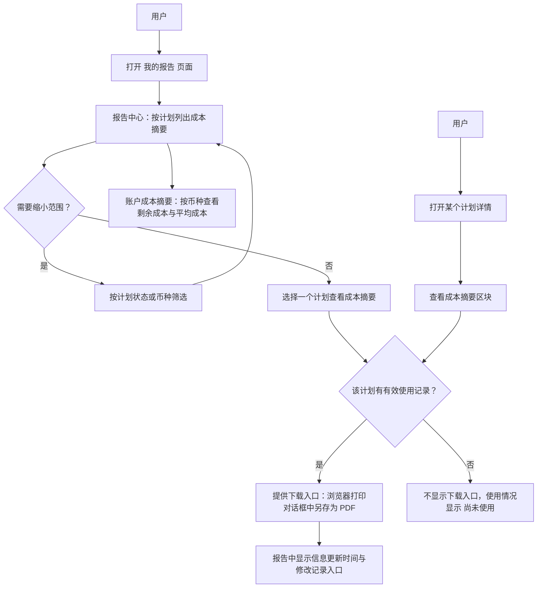

# 需求文档：M10 成本摘要与报告

> 依据：《11_成本摘要与报告_待确认》《12_收益指标与报告细则_待确认》《13_MVP功能清单》功能 25、《15_专业术语清单》、《changes/mvp-completion/审查报告与开发计划.md》阶段 4。
> 档位：Standard。
> ⚠️ 特别说明：上游需求文件均标记为"待确认"。本文只把**已明确的规则**写成正式需求；所有未定稿事项集中列入「八、待确认点清单」，未确认前一律不得当作定稿需求实施。

---

## 一、概述

### 1.1 背景

记账闭环已能记录买入（钱怎么来的）与使用（钱怎么花的），但用户看不到两件最关心的事：

1. **这个计划最终花了多少本位币**——分好几次买入、分几次使用之后，每单位外币的真实成本是多少；
2. **账户里剩下的外币当初花多少钱买的**——剩余持仓的平均成本是多少。

同时，留学缴费等场景需要把单个计划的成本凭证留存或出示（如给家人核对），目前没有任何导出手段。

### 1.2 目标

提供**成本摘要**（按计划、按币种两个视角）与**单计划报告下载**，完成 MVP 功能 25。

### 1.3 范围

| 做 | 不做 |
| --- | --- |
| 报告中心页（计划成本列表 + 状态/币种筛选） | 收益率、节省金额的数值计算（算法待确认，见第八节） |
| 计划成本摘要（计划详情内 + 报告中心进入） | 报告分享、历史报告归档/重命名 |
| 账户成本摘要（每币种剩余成本与平均成本） | 独立的成本批次页面（MVP 清单已排除） |
| 收益比较区块的占位说明（规则已定、数值未定） | 跨计划汇总报表、图表分析 |
| 单计划报告下载（PDF） | 已下载文件的云端管理 |

---

## 二、角色

单一角色：**已登录用户**。每人只能看到自己记录的数据，无其他角色。

---

## 三、术语对照

| 术语 | 白话说明 |
| --- | --- |
| 本位币 | 统一计算成本的货币，成本、手续费都用它表示 |
| 初始持仓 | 首次设置时已有的外币，按最后确认时的汇率记一个成本起点，不代表当年真实花费 |
| 成本批次 | 每次取得外币分别记下数量和成本，方便算用了哪一笔 |
| 先进先出（FIFO） | 同日先用初始持仓，再按买入日期先后；同日买入按首次录入顺序 |
| 使用成本 | 已经用于某个计划的外币，对应当初花了多少钱 |
| 使用均价 | 已使用外币的总成本 ÷ 已使用数量；从未使用时不显示 |
| 账户剩余成本 | 账户里还没使用的外币，对应原来花了多少钱 |
| 平均成本 | 剩余外币的总成本 ÷ 剩余数量；余额为 0 时不计算 |
| 最晚安全时间 | 计划最晚准备日期对应的比较时间（取当天几点待确认） |
| 比较基准 | 假设等到最晚安全时间再一次性换汇的结果 |
| 多换目标币 | 花同样多的本位币，实际多得到多少目标币 |
| 有效使用记录 | 该计划下真实发生过、当前有效的使用记录 |
| PDF 报告 | 可下载的单计划报告文件；之后修改了记录，已下载的文件不会变化 |

---

## 四、业务流程

图例：菱形为判断；报告有两个入口——「我的报告」页与计划详情页，数据一致。

---

## 五、功能规则

### 5.1 报告中心

1. 列出本人全部计划（进行中、已完成、已取消都显示），每行展示：计划名称、状态、币种、目标金额、累计已使用数量、已使用成本（本位币）、使用均价、能否下载、信息更新时间。
2. 可按**计划状态**筛选（全部 / 进行中 / 已完成 / 已取消），可按**币种**筛选。
3. **不同币种的金额绝不加在一起显示**；列表不提供跨计划、跨币种的合计行。
4. 没有任何计划时，显示空状态并引导去创建计划。

### 5.2 计划成本摘要

1. 显示该计划**已经使用**的外币：总成本（本位币）与每单位外币成本（使用均价）。
2. 只统计已实际使用的部分；**仅分配给计划、还没使用的钱不计入已使用成本**。
3. 从未使用过外币时，**不显示使用均价**（显示"尚未使用"，不显示 0）。
4. 混合来源时，**分开显示初始持仓来源与后续买入来源**各自的使用数量与成本；全部来自初始持仓时，收益区块显示"不计算收益比较"（不得显示 0%）。
5. 涉及的买入中有手续费未明确的，固定显示说明："按已录入金额计算，部分交易费用未明确，实际成本可能有所不同。"
6. 计划正常完成后又调小使用金额的：**仍显示已完成**，并显示目标金额、调整后的使用金额和差额，不重新提醒补足。
7. 显示**信息更新时间**，并提供**修改记录入口**（查看该计划的变更与更正历史）。
8. 成本示例（口径自检用）：花 7,000 元本位币、另付 100 元手续费，买入 1,000 外币——总成本 7,100、每单位 7.10；使用 400 → 成本 2,840；剩余 600 → 成本 4,260。

### 5.3 账户成本摘要

1. 按币种显示：剩余外币数量、剩余成本（本位币）、每单位平均成本。
2. **余额为零时，不显示平均成本**（不显示 0）。
3. **缺少的成本不得按零计算**——无法算出成本时显示"暂无法计算"，绝不显示 0 或编造数字。
4. 初始持仓按记账起点汇率计算的成本参与账户成本，并注明"初始成本为记账起点，不代表当年实际买入花费"。

### 5.4 收益与节省（占位区块）

1. 已确定的规则：收益比较的基准是"**到了最晚安全时间才一次性换汇**"的结果；**不能用**创建计划当天、今天或各批买入当天的汇率作基准；初始持仓**不参与**收益比较。
2. 数值算法（收益率公式、统计范围、汇率时点等）**尚未确定**，本期不出数值：含真实买入来源的计划显示"收益比较将在后续版本提供"；全部来自初始持仓的显示"不计算收益比较"。
3. 上述第 2 条为待确认期间的默认表现，见第八节待确认点 4。

### 5.5 下载报告

1. **有有效使用记录的计划即可下载**；进行中、已完成、已取消都适用。
2. **没有有效使用记录时，不生成使用报告**——报告中心与计划详情都不出现下载入口。
3. 下载方式：打开该计划的报告打印版式，通过浏览器的打印对话框"另存为 PDF"（交互方式为待确认点 3）。
4. 报告内容：计划基本信息（名称、状态、币种、目标金额）、成本摘要（已使用成本与均价）、来源拆分（初始 / 买入）、手续费说明、目标与使用进度、信息更新时间、报告生成时间。
5. **更正成功后**：相关成本摘要与之后新下载的报告随之更新；页面显示更新时间和修改记录入口。
6. **更正失败时**：保持原来的结果，摘要不变。
7. **已下载保存的 PDF 文件永不变化**；要看最新结果需重新打开打印版式。

---

## 六、异常与边界

| 场景 | 表现 |
| --- | --- |
| 无任何计划 | 报告中心空状态，引导创建计划 |
| 计划无使用记录 | 摘要显示"尚未使用"，无下载入口 |
| 成本数据缺失（无法计算） | 显示"暂无法计算"，不显示 0 |
| 手续费未明确 | 固定说明文案，成本按已录入金额计算 |
| 全部来源为初始持仓 | 显示"不计算收益比较"，不显示 0% |
| 用户取消打印 | 无任何影响，页面原样 |
| 他人计划 / 不存在的计划 | 提示不存在，不显示任何数据 |

---

## 七、验收标准（Given-When-Then）

1. **报告中心列表**：假如用户已录入买入并记录了使用，当打开"我的报告"，那么看到按计划排列的成本摘要（名称、状态、币种、目标、已使用数量、已使用成本、使用均价），且每个计划金额都以各自币种显示，无跨币种合计。
2. **状态与币种筛选**：假如存在进行中（USD）与已取消（JPY）两个计划，当按"已完成"或"USD"筛选，那么列表只剩匹配项；切回"全部"恢复完整列表。
3. **分配不等于使用**：假如某计划已分配 1,000 外币但只使用了 400，当查看计划成本摘要，那么已使用成本只按 400 计算，分配未用的 600 不出现在已使用成本中。
4. **未使用不显示均价**：假如某计划从未记录使用，当查看摘要，那么使用情况显示"尚未使用"，不显示使用均价，也不出现下载入口。
5. **FIFO 成本正确**：假如先买 1,000 外币花 7,800、再买 1,000 花 8,000，当记录使用 1,200，那么已使用成本显示 9,400，剩余 800 的账户剩余成本显示 6,400。
6. **来源拆分**：假如使用的 400 中有 100 来自初始持仓、300 来自买入，当查看摘要，那么初始来源与买入来源的数量、成本分别显示。
7. **纯初始持仓不比较**：假如某计划的使用全部来自初始持仓，当查看收益区块，那么显示"不计算收益比较"，绝不显示 0%。
8. **手续费未明确说明**：假如使用的成本来自一笔手续费未填的交易，当查看摘要与报告，那么显示"按已录入金额计算，部分交易费用未明确，实际成本可能有所不同。"
9. **完成后调小仍完成**：假如一个已完成计划的使用金额被调小，当查看摘要，那么状态仍为已完成，并显示目标金额、调整后使用金额和差额，无补足提醒。
10. **账户成本**：假如某币种账户剩 600 外币、对应成本 4,260，当打开账户成本摘要，那么显示剩余数量 600、剩余成本 4,260、平均成本 7.10；假如余额为 0，那么不显示平均成本。
11. **缺成本不按零**：假如某账户成本数据无法计算，当查看账户成本摘要，那么显示"暂无法计算"，不显示 0。
12. **更正联动**：假如一笔使用记录被成功更正，当回到成本摘要或重新下载报告，那么数值为更正后的结果，且显示新的更新时间与修改记录入口。
13. **更正失败不变**：假如一次更正失败，当查看摘要与已下载的 PDF，那么都保持原结果。
14. **已下载文件不变化**：假如用户已保存某计划 PDF，之后又更正了记录，当打开之前保存的文件，那么内容仍是保存时的旧数据。
15. **越权防护**：假如用户直接访问他人的计划报告，那么得到"不存在"提示，看不到任何数据。

---

## 八、待确认点清单与建议默认方案

以下各项**均未定稿**，实施前需人工确认；"建议默认"仅用于不阻塞开发的过渡方案。

| # | 待确认点 | 出处 | 建议默认（过渡） |
| --- | --- | --- | --- |
| 1 | 报告页面结构与展示的信息项 | doc 11「后续补充」 | 按本文 5.2/5.4/5.5 第 4 条执行 |
| 2 | PDF 版式样式 | doc 11「后续补充」 | A4 纵向、单计划单页起，信息项按 5.5 第 4 条 |
| 3 | 下载交互：浏览器打印另存 PDF，还是一键直接得到文件 | 功能 25"下载"未定义交互 | 打印对话框另存为 PDF（见技术方案对比） |
| 4 | 收益指标具体计算办法（收益率公式、统计范围、比例基数、手续费口径） | doc 11/12「待确定」 | 本期不出数值：初始持仓来源显示"不计算收益比较"，其余显示"后续版本提供" |
| 5 | "最晚安全时间"取当天几点汇率 | doc 12 | 未确认前不预置任何时点，仅在报告中预留该信息的位置 |
| 6 | 比较用汇率的来源与时区 | doc 12 | 同上，待收益算法一并确认 |
| 7 | 收益统计范围：只算已使用部分，还是含未使用 | doc 12 | 待收益算法一并确认 |
| 8 | 最晚安全时间未到或缺对应汇率时显示什么 | doc 12 | 显示"暂无法计算"（与账户成本缺数据口径一致） |
| 9 | 修改计划日期后报告采用哪个时点的汇率、旧报告如何保留 | doc 12 | 依赖功能 29（本身待确定）；日期修改落地前本项不触发 |
| 10 | 历史报告的保存、重命名、归档 | doc 11「后续补充」 | 不做：报告随时按最新数据生成，已下载文件即历史快照 |
| 11 | 分批成本分摊产生小数时的处理 | doc 11「后续补充」 | 计算保留全精度，展示时按币种精度一次舍入；合计按全精度加总后舍入（与逐项舍入值可能有极小显示差，接受并在报告中注明） |
| 12 | 收益率保留几位小数 | doc 12 | 随待确认点 4 一并确认（建议 2 位，仅在算法定稿后实施） |

> 注：初始持仓不参与收益比较、纯初始持仓显示"不计算收益比较"、更正失败保持原结果、已下载 PDF 不变化——这几条在 doc 11/12 中已明确，**不是**待确认项，按定稿需求处理。

---

## 九、非功能要求

- 数据权限：只能查看本人计划的成本摘要与报告。
- 语言：页面与报告文案随应用语言（简体中文 / 英文，默认简体中文）；报告遵循同样的货币显示规则（日元、韩元整数，其余最多 2 位小数）。
- 性能：摘要与报告为本人数据，打开即可见，无明显等待。
