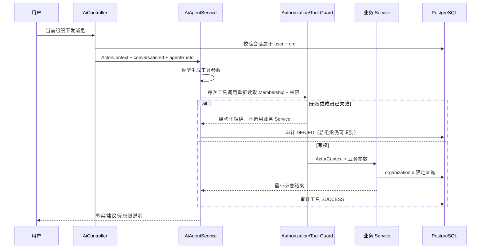

# 技术方案与实施 Spec：ToB 组织工作台与 Agent 换汇协作

> 状态：已实施（R1 组织工作台与权限地基 + R2 可控组织 Agent P7–P8 已交付，验收见 `changes/tob-agent-workspace/验收记录.md`；R3/R4 不在承诺范围）。需求依据：`changes/tob-agent-workspace/需求文档.md`。
> 本文同时是技术 spec、现状整改清单、迁移计划、测试设计和实施计划。所有实施结论以代码与实测证据为准（`验收记录.md`）。
> 核心取舍：保留 Bun + Next.js + NestJS + Prisma + PostgreSQL，采用共享库共享表的 Organization 多租户与固定角色 RBAC；不拆微服务、不引入权限中心、不改写现有账本算法。

## 0. 结论先行

1. 现有 `userId` 同时承担身份和数据归属，ToB 改造必须把它拆成 `organizationId`（租户边界）与 `createdById`（审计操作者）。
2. JWT 继续只证明用户身份；组织、成员状态和角色由服务端每次请求解析，不能信任前端提交，也不固化在长期 token 中。
3. 组织业务接口保留现有 URL，通过 `X-Organization-Id` 选择当前组织；Service 统一接收 `ActorContext`，所有数据访问带组织条件。
4. 首版使用 Organization / Membership / OrganizationInvitation / OrganizationSettings / AuditLog，以及业务表组织字段和必要索引。PostgreSQL RLS、每租户数据库、自定义权限均不进入首版。
5. Agent 工具通过闭包注入不可由模型修改的 `ActorContext`；R1 无企业工具，R2 先只读、再计划草稿，真实资金执行不在范围。
6. 迁移采用“加表加列 → 默认组织回填 → 双写/核对 → 切换读取 → 收紧约束 → 清理旧语义”，不能一次性把 userId 改名后赌全量调用点正确。
7. 使用记录更正先在 MVP-F0-3 补齐个人版闭环并验收，再由 R1 P4 接入组织边界。阶段依赖见 §15 和 `docs/ITERATION-REFACTOR-ROADMAP-20261119.md`。

## 1. 现状事实与改造差距

### 1.1 已核实的代码事实

| 现状事实 | 证据 | 改造含义 |
| --- | --- | --- |
| User 直接拥有账户、交易、计划、使用、更正、提醒、数据请求和 AI 会话 | `services/chat/prisma/schema.prisma:10-34` | 需要 Organization 与 Membership，不应继续新增纯 userId 业务归属 |
| Account 以 `(userId, currencyCode)` 唯一 | `services/chat/prisma/schema.prisma:149-160` | 改为组织唯一；userId 不再承担租户隔离 |
| Transaction、UsageRecord、Correction 以 userId 归属并建立索引 | `services/chat/prisma/schema.prisma:163-182`、`:296-345` | 查询、索引、写操作和更正重放均须按组织迁移 |
| PlanAllocation、PlanChangeLog、UsageLotAllocation 存在裸外键/派生关系 | `services/chat/prisma/schema.prisma:263-327` | 删除、导出和迁移不能只处理主表，必须保留派生一致性 |
| JWT payload 只有 userId/email | `services/chat/src/auth/auth.service.ts:187-188` | 身份认证可复用，但不能从现有 token 得到组织授权 |
| JwtStrategy 每请求查 User 并注入 request.user | `services/chat/src/auth/strategies/jwt.strategy.ts:22-49` | 可在此基础上组合组织上下文 Guard，不必换认证框架 |
| DataRequest 与锁均按 userId | `services/chat/prisma/schema.prisma:367-388`、`services/chat/src/data-request/data-request-lock.guard.ts:68-118` | 必须区分个人锁与组织锁，避免个人注销锁整个公司 |
| AI 当前唯一工具是公共汇率 | `services/chat/src/ai/ai-agent.service.ts:62-67` | 框架可复用，新增工具必须接入 ActorContext 和权限 |
| AI 会话与配额按 userId | `services/chat/src/ai/ai.service.ts:60-101` | 会话增加组织绑定；组织会话查询按 user + org |
| 前端保护布局无条件请求提醒与设置 | `clients/chat-web/app/(protected)/layout.tsx:155-158`、`clients/chat-web/components/business/reminder/reminder-bell.tsx:18-24` | 组织/建账状态应进入查询 enabled 条件，消除预期 409 |
| 前端仍手写计划和账户影子类型 | `clients/chat-web/lib/api/contract.ts:92-150`、`:210-236`、`clients/chat-web/lib/api/accounts.ts:14-68` | 迁移契约前先清理，防止多租户字段出现第二套事实来源 |
| USAGE 更正入口被统一拒绝 | `services/chat/src/correction/correction.service.ts:1080-1085` | MVP-F0-3 先验收个人版闭环，R1 P4 再适配组织 |
| 全局数据锁普通请求包含到期候选查询和活动锁查询 | `services/chat/src/data-request/data-request-lock.guard.ts:68-118` | 重构锁时合并查询，不保留每请求两次固定开销 |
| 最新汇率读取全部历史后内存去重 | `services/chat/src/rate/rate.service.ts:460-475` | 独立小改为数据库端每币种取最新，不与组织迁移耦合 |

### 1.2 已有文档与代码冲突的处理原则

`README.md:15` 与 `changes/mvp-completion/审查报告-20261103.md:32` 将使用更正标为降级待修。服务端仍拒绝 `USAGE`，`e2e/modules/11-correction.spec.ts:249` 的 `T-CORR-004` 仍跳过。旧开发计划保留原有规划记录。此次实施必须：

- 以可执行行为和测试为准，不以文档勾选作为完成证据。
- 在新功能完成前更新“已交付”表述或附明确偏差，不新增另一份虚假完成记录。
- 验收记录必须附实际测试日志；本 spec 写作本身不等于功能交付。

## 2. 范围、量化假设与非功能预算

### 2.1 本 spec 承诺范围

- R1：组织、成员、邀请、固定角色、共享账本、组织设置、审计、数据请求拆分、存量迁移。
- R2：Agent 组织只读工具和计划草稿确认。
- 承接个人版前置整改：MVP-F0-3 的 USAGE 更正，以及 MVP-F1/F2 的数据锁查询、OpenAPI 影子类型、未建账无效查询和最新汇率全历史读取。R1 在组织边界下补回归验证。
- 不承诺 R3/R4 的电商订单模型、卖出方向、真实执行、SSO 或双人审批。

### 2.2 量级假设（用于选型，不是生产实测）

| 项目 | 首版设计假设 | 设计结论 |
| --- | --- | --- |
| 组织规模 | 千级组织，每组织 1~20 名活跃成员 | 共享表 + organizationId 索引足够，无需分库 |
| 成员规模 | 多数组织 1~5 人 | 固定角色，无自定义权限编辑器 |
| 业务数据 | 单组织年千至万级账本行 | 单库事务与现有 replay 可复用，按组织建索引 |
| Agent | 沿用现有限流和单实例部署 | 不先引入分布式 Agent 调度；扩容另评 |
| 权限请求 | 每个组织请求 1 次 Membership 查询，组织锁可合并查询 | 首版不做权限缓存，避免降权延迟 |
| 迁移 | 个人存量数据，一对一默认组织 | 可确定性回填，不需要人工映射 |

上线前必须以实际备份数据量复核迁移时长和锁窗口；当前没有生产数据分析，本 spec 不虚构迁移耗时承诺。

## 3. 方案选型

| 维度 | 选定方案 | 备选与否决理由 |
| --- | --- | --- |
| 租户隔离 | 共享数据库、共享表、organizationId + 服务端鉴权 | 每组织独立库对千级小团队运维过重；Postgres RLS 可作为未来纵深防御，但首版与 Prisma 连接/事务上下文结合成本高 |
| 权限 | 固定五角色 RBAC + 权限点策略表 | 自定义角色/ABAC 首版无明确需求；分散 role 判断不可接受 |
| 组织选择 | `X-Organization-Id` 请求头 + 服务端 Membership 校验 | URL 全改 `/organizations/:id/...` 会扩大所有接口和 E2E 改动；JWT 写组织/角色会产生切换与降权陈旧 |
| 数据归属 | organizationId 表示租户，createdById 表示人 | 保留 userId 作为租户会阻止多成员共享；完全删操作者会损失审计 |
| 业务算法 | 复用计划、FIFO、账户、报告与 preview/apply | 重写核心账本没有证据支持，风险高于收益 |
| Agent | 保留 LangGraph，工具工厂注入 ActorContext | 手写 ReAct 不解决授权问题；把 orgId 暴露给模型参数有串租户风险 |
| 数据请求 | 同一 DataRequest 增加 scope/org 语义，个人锁与组织锁分开 | 为个人/组织各建一套请求系统会重复状态机和导出设施 |
| 迁移 | 增量、多阶段、可核对、可回退读取 | 一次性停服大改虽代码少，但错误难回滚且无法证明金额一致 |

## 4. 目标架构与请求上下文

### 4.1 模块边界

```text
auth                 用户身份、JWT、OTP；不决定组织权限
organization         组织、成员、邀请、组织切换所需视图
authorization        ActorContext、权限点、角色策略、组织上下文/权限 Guard
audit                审计写入与查询；不提供修改能力
account/plan/...     现有业务模块，改为消费 ActorContext
ai                   会话与 Agent；工具复用业务 Service 的授权上下文
data-request         个人与组织请求状态机、两类锁和导出
```

模块依赖保持单向：

```text
auth → identity
organization → auth + authorization 的基础类型
authorization → organization membership 查询
business modules → authorization context + audit
ai → authorization + 业务模块公开 Service
data-request → auth + organization + authorization + audit
```

禁止业务模块反向依赖 `ai`；禁止把权限规则复制进前端当唯一判断。

### 4.2 ActorContext

```ts
type OrganizationRole = "OWNER" | "ADMIN" | "FINANCE" | "OPERATOR" | "VIEWER";

type ActorContext = {
  userId: string;
  organizationId: string;
  membershipId: string;
  role: OrganizationRole;
  authMethod: "USER" | "API";
};
```

Agent 不构造另一个高权限 Actor。Agent 调用记录额外携带 `agentRunId/conversationId`，但授权仍使用上述 Actor。

### 4.3 请求链与 Guard 顺序

组织业务 Controller 使用明确顺序：

```text
JwtAuthGuard
→ OrganizationContextGuard
→ OrganizationLockGuard（组织请求）
→ PermissionGuard
→ Controller
→ Service（再次使用 ActorContext 作为数据范围）
```

- `OrganizationContextGuard` 读取 `X-Organization-Id`，查询有效 Membership 并构造 ActorContext。
- `PermissionGuard` 读取 `@RequiresPermission()` 元数据和集中策略，不接受客户端 role。
- 个人端点 `/auth/me`、组织列表和邀请接受不使用组织 Guard。
- 组织锁进度/撤回/下载使用允许锁定访问的元数据，但仍需有效成员和相应权限。
- 现有全局 DataRequestLockGuard 不再承担“自己验签 + 所有锁”的混合职责。个人账号锁和组织锁的挂载点在迁移 spec 中分开实现，并保留公开端点/OTP 白名单。
- 不为节省一次 JWT 验签而模糊 Guard 顺序；所有新顺序由接口测试验证。

### 4.4 Service 数据访问纪律

1. 业务 Service 签名从 `userId: string` 改为 `actor: ActorContext`；确需创建者时显式使用 `actor.userId`。
2. 所有详情、更新、删除使用 `{ id, organizationId }` 条件；跨组织和不存在统一 404。
3. 列表、汇总、报告、FIFO 加载、清理、导出、提醒生成均加 `organizationId`，不能只改用户可见 Controller。
4. 子表按父 ID 操作时必须验证父记录属于当前组织；直接提供子表 ID 的入口同样带组织条件。
5. 不在 Prisma 外层做“先按 ID 查出，再比较组织后返回”的越权读取；查询本身即限定组织。
6. 不强制为每个模块新建 Repository 层。可抽 `organization-scope.ts` 纯函数生成 where/断言，但禁止用一个不透明的全局 Prisma 包装掩盖实际查询。
7. 公共汇率、币种字典无 organizationId；个人账号资料仍按 userId。

## 5. 数据模型 Spec

### 5.1 新增核心模型

以下为逻辑模型，字段类型和最终 Prisma 关系以 migration 评审为准；主键沿用 cuid，时间沿用现有 UTC DateTime 约定。

```prisma
model Organization {
  id        String   @id @default(cuid())
  name      String
  createdAt DateTime @default(now()) @map("created_at")
  updatedAt DateTime @updatedAt @map("updated_at")
  @@map("organizations")
}

model Membership {
  id             String   @id @default(cuid())
  organizationId String   @map("organization_id")
  userId         String   @map("user_id")
  role           String   // OWNER/ADMIN/FINANCE/OPERATOR/VIEWER
  status         String   @default("ACTIVE") // ACTIVE/DISABLED
  joinedAt       DateTime @default(now()) @map("joined_at")
  createdAt      DateTime @default(now()) @map("created_at")
  updatedAt      DateTime @updatedAt @map("updated_at")
  @@unique([organizationId, userId])
  @@index([userId, status])
  @@index([organizationId, status, role])
  @@map("memberships")
}

model OrganizationInvitation {
  id             String    @id @default(cuid())
  organizationId String    @map("organization_id")
  email          String
  role           String
  tokenHash      String    @unique @map("token_hash")
  invitedById    String    @map("invited_by_id")
  expiresAt      DateTime  @map("expires_at")
  acceptedAt     DateTime? @map("accepted_at")
  declinedAt     DateTime? @map("declined_at")
  revokedAt      DateTime? @map("revoked_at")
  createdAt      DateTime  @default(now()) @map("created_at")
  @@index([organizationId, email, createdAt])
  @@map("organization_invitations")
}

model OrganizationSettings {
  id              String    @id @default(cuid())
  organizationId  String    @unique @map("organization_id")
  baseCurrency    String    @map("base_currency")
  prepPreference  String    @default("balanced") @map("prep_preference")
  reminderEnabled Boolean   @default(true) @map("reminder_enabled")
  ledgerStartedAt DateTime? @map("ledger_started_at")
  createdAt       DateTime  @default(now()) @map("created_at")
  updatedAt       DateTime  @updatedAt @map("updated_at")
  @@map("organization_settings")
}

model AuditLog {
  id             String   @id @default(cuid())
  organizationId String   @map("organization_id")
  actorUserId    String?  @map("actor_user_id")
  actorType      String   @map("actor_type") // USER/API/AGENT
  action         String
  targetType     String?  @map("target_type")
  targetId       String?  @map("target_id")
  result         String   // SUCCESS/DENIED/FAILED
  requestId      String?  @map("request_id")
  agentRunId     String?  @map("agent_run_id")
  detail         Json?
  createdAt      DateTime @default(now()) @map("created_at")
  @@index([organizationId, createdAt(sort: Desc)])
  @@index([organizationId, actorUserId, createdAt(sort: Desc)])
  @@map("audit_logs")
}
```

规则：

- Organization 不另存 `ownerId`，所有权以 Membership 为唯一来源，避免双写不一致。
- 一个组织恰好一个 OWNER；最后 Owner 约束由事务和数据库部分唯一索引共同保护。
- 邀请只存 `tokenHash`，原始 token 仅出现在邀请链接；邮箱统一规范化后比较。
- Membership 移除采用 DISABLED，保留历史归属；重新邀请可事务内恢复并设置新角色。
- AuditLog `detail` 只存白名单摘要和必要快照，禁止凭证、token、验证码、完整会话或密钥。
- AuditLog 无 update/delete API；组织清空/删除对审计的保留策略按 DATA 需求与法务清单执行，不默认写“永久”。

### 5.2 既有模型归属调整

| 模型 | 新租户字段/约束 | 操作者与特殊处理 |
| --- | --- | --- |
| Account | `organizationId`；唯一改 `(organizationId, currencyCode)` | 保留创建者可选；不再按 userId 建户 |
| Transaction | `organizationId`；索引 `(organizationId, transactedAt)` | `createdById` 来源原 userId |
| InitialHolding | `organizationId`；唯一改 `(organizationId, currencyCode)` | `createdById`；原 confirmedAt 不变 |
| CostLot | `organizationId`；索引以 org + currency + acquiredAt | 必须随来源记录同组织 |
| Plan | `organizationId`；索引 `(organizationId, status)` | `createdById`；不改变状态机 |
| PlanInstallment | 随父 Plan 隔离 | 若清理/导出直查则增加 orgId，并校验与父一致 |
| PlanAllocation | 随父 Plan 隔离 | 同上；orgId 不是另一份分配金额来源 |
| PlanChangeLog | `organizationId` 或通过父 Plan 强制验证 | 增加 `actorUserId`；旧记录由默认组织/用户回填 |
| UsageRecord | `organizationId`；索引 `(organizationId, usedAt)` | `createdById`；version 语义保留 |
| UsageLotAllocation | 随 Usage 与 CostLot 双父一致性 | 清理/导出不得留孤儿 |
| Correction | `organizationId`；索引 `(organizationId, targetType, targetId)` | `actorUserId`；历史 userId 转为操作者 |
| Reminder | 业务事件带 organizationId | readAt 拆到成员级 ReminderRead 状态，不能继续只按 user 生成后共享 |
| AiConversation | 增加 organizationId | userId 仍是会话所有者；查询 `(userId, organizationId)` |
| AiMessage | 随会话组织和所有者 | 不允许通过 messageId 跨会话读写 |
| DataRequest | 增加 scope + 可空 organizationId | requesterUserId 保留；见 §9 |
| UserSettings | locale/region 等个人字段保留 | baseCurrency/prep/reminder/ledgerStartedAt 迁到 OrganizationSettings |
| ExchangeRate/Currency | 不加 organizationId | 全局共享 |
| TermsConsent/OtpIdentity | 保持用户归属 | 个人注销处理 |

### 5.3 租户完整性与索引

1. 业务查询索引必须以 organizationId 开头，不能只新增未使用列。
2. 父/子派生行必须满足 `child.organizationId = parent.organizationId`；可通过组合外键或服务端事务断言实现，但必须有集成测试。
3. 所有组织唯一约束均含 organizationId；不得留下 userId 唯一约束阻塞共享账户。
4. `createdById` 可空，成员移除/用户注销不级联删除组织账本。
5. Organization 删除采用显式事务清理派生表，不依赖 User 级联。
6. RLS 不在首版开启；若未来启用，必须覆盖事务内 tenant 设置、后台任务和迁移连接，不得只加策略不测试。

## 6. 权限策略 Spec

### 6.1 权限点

```text
organization.read / organization.update / organization.delete
member.read / member.invite / member.update / member.remove / owner.transfer
settings.read / settings.update
account.read
plan.read / plan.create / plan.adjust
transaction.read / transaction.create
usage.read / usage.create
correction.read / correction.preview / correction.apply
report.read
audit.read
data.export / data.clear
agent.use / agent.business_read / agent.draft
```

角色映射必须集中在一个纯函数策略表，Controller 用权限点装饰器，前端从后端 capabilities 获取展示能力。前端不得复制一份角色逻辑作为授权依据。

### 6.2 角色映射

| 权限域 | Owner | Admin | Finance | Operator | Viewer |
| --- | --- | --- | --- | --- | --- |
| 全部业务 read | ✓ | ✓ | ✓ | ✓ | ✓ |
| plan.create/adjust、agent.draft | ✓ | ✓ | ✓ | ✓ | — |
| transaction/usage 写、correction 写 | ✓ | ✓ | ✓ | — | — |
| audit.read、data.export | ✓ | ✓ | ✓ | — | — |
| organization.update、member 普通管理、data.clear | ✓ | ✓ | — | — | — |
| owner.transfer、organization.delete | ✓ | — | — | — | — |
| agent.use、business_read | ✓ | ✓ | ✓ | ✓ | ✓ |

`data.export` 等敏感权限只决定能否进入流程，OTP/二次验证仍是独立必要条件。

### 6.3 权限决策规则

纯函数输入：

```ts
can(role, permission)
canManage(actorRole, targetRole, action)
canAcceptInvitation(actorEmail, invitationEmail, now, invitationState)
canTransferOwnership(actor, targetMembership)
canDeleteOrganization(actor, organizationLock)
```

- 无权限业务写操作返回 403 `PERMISSION_DENIED`。
- 跨组织资源或无效组织上下文统一 404/403 的组织选择语义见 §7，不能泄露记录存在性。
- Admin 对 Owner 的修改、移除、降权一律拒绝。
- 最后 Owner 退出/降权/注销返回 409 `LAST_OWNER_REQUIRED`。
- 所有权转移、组织删除、成员移除和审计必须同事务。

## 7. API 契约 Spec

### 7.1 通用约定

- 统一前缀 `/api`，保留 `{success,data,message}` 和现有错误体。
- 组织业务请求带 `X-Organization-Id: <cuid>`；个人身份端点不需要。
- 后端 DTO 为唯一类型来源，完成后 `bun run generate:api`，禁止新增手写共享类型。
- 组织上下文缺失：400 `ORGANIZATION_REQUIRED`。
- 用户不是该组织有效成员：404 `ORGANIZATION_NOT_FOUND`，避免暴露组织。
- 成员被禁用：404 同上；权限不足：403 `PERMISSION_DENIED`。
- 个人 token 无效仍由 JwtAuthGuard 返回 401。
- 组织锁返回 403 `ORGANIZATION_DATA_LOCKED`，个人注销保留 `ACCOUNT_PENDING_DELETION`。

### 7.2 组织与成员端点

| 方法与路径 | 上下文/权限 | 行为 |
| --- | --- | --- |
| GET `/organizations` | 登录用户 | 列出本人有效组织、角色和建账状态 |
| POST `/organizations` | 登录用户 | 创建组织 + 当前用户 OWNER + 空设置/待建账状态，事务写审计 |
| GET `/organizations/current` | organization.read | 当前组织、当前角色、capabilities、设置状态 |
| PATCH `/organizations/current` | organization.update | 修改名称等业务允许字段 |
| DELETE `/organizations/current` | organization.delete + OTP | 创建组织删除请求，不同步硬删 |
| GET `/organizations/current/members` | member.read | 当前组织成员及角色/状态 |
| PATCH `/organizations/current/members/:id` | member.update | 角色调整/禁用；Owner 规则见 §6 |
| DELETE `/organizations/current/members/:id` | member.remove | 禁用成员，不物理删历史 |
| POST `/organizations/current/invitations` | member.invite | 创建或返回现有有效邀请 |
| DELETE `/organizations/current/invitations/:id` | member.invite | 撤销有效邀请 |
| GET `/organization-invitations/:token` | 登录用户 | 仅返回本人可处理的邀请摘要，不含业务数据 |
| POST `/organization-invitations/:token/accept` | 登录用户 + 邮箱匹配 | 事务接受邀请、创建/恢复 Membership、写审计 |
| POST `/organization-invitations/:token/decline` | 登录用户 + 邮箱匹配 | 标记拒绝 |
| POST `/organizations/current/transfer-ownership` | owner.transfer | 事务转移所有权 |
| GET `/organizations/current/audit-logs` | audit.read | 分页、按时间/成员/动作过滤 |

### 7.3 既有业务端点

保留 `/accounts`、`/plans`、`/transactions`、`/corrections`、`/reports`、`/reminders`、`/ai` 等 URL，统一增加组织上下文要求与权限点。DTO 业务字段原则上不因组织迁移改变；返回可增加创建者/更新者摘要，但必须走 OpenAPI。

迁移期若需兼容旧客户端，只能由服务端在明确版本窗口内映射到“用户唯一默认组织”；用户已有多个组织后禁止猜测默认组织，必须返回 ORGANIZATION_REQUIRED。兼容窗口结束前更新全部前端和 E2E。

### 7.4 Agent 草稿契约

R2 复用 `/plans/schedule-preview` 与 `POST /plans`：

1. Agent 工具只生成结构化草稿，不调用正式创建。
2. 前端以草稿参数调用现有排期预览，展示最新余额与分配影响。
3. 用户确认时调用 `POST /plans`，带 actor 和现有防重语义。
4. 不新增模型可调的 `create_plan` 写工具；`draft_plan` 只返回建议数据。
5. 草稿无需新增数据库表；只有用户确认后才创建 Plan。

## 8. Agent 技术 Spec

### 8.1 工具上下文

```ts
type AgentToolContext = {
  actor: ActorContext;
  conversationId: string;
  agentRunId: string;
};
```

`AiAgentService.streamReply` 接收已鉴权上下文，工具工厂在当前请求的闭包内捕获它。工具 zod 入参只含业务筛选条件，**不含 userId、organizationId、role 或 permission**。

### 8.2 R2 工具清单

| 工具 | 包装 Service | 权限 | 输出约束 |
| --- | --- | --- | --- |
| `query_exchange_rate` | 现有 RateService | agent.use | 保持现有公共汇率行为 |
| `get_account_summary` | AccountService | account.read | 当前组织账户、未分配余额、成本摘要 |
| `list_plan_exposure` | PlanService | plan.read | 当前组织有效计划、目标、已分配/已用、缺口、日期 |
| `get_plan_cost_summary` | ReportService | report.read | 与报告页同口径，保留费用未知状态 |
| `list_upcoming_actions` | Reminder/Plan 只读查询 | plan.read | 当前组织到期事项，不读取其他成员私人消息 |
| `draft_fx_plan` | 纯草稿组装 + Plan preview 数据 | agent.draft | 只返回草稿，不落 Plan |

工具返回使用结构化 JSON 或严格格式文本；金额保持字符串，不让 LLM 用浮点重算。工具只 select 必需字段，不能将完整数据库行无差别交给模型。

### 8.3 授权与审计时序



### 8.4 会话、配额和流式安全

- AiConversation 加 organizationId；所有 list/get/delete/send 都校验 `(id, userId, organizationId)`。
- 切换组织后前端取消旧流；后端即便未收到取消，下一次工具调用仍重新鉴权。
- 配额首版保留用户级，另记录组织维度日志；不在本次引入分布式配额系统。
- 组织锁时禁止组织 Agent 工具；个人会话能否使用公共汇率按 DATA 锁规则处理。
- 工具失败返回受控错误文本，不把 SQL、堆栈、其他组织 ID 或上游密钥回喂模型。
- R2 草稿不落业务数据；保存仍走业务 API 与人工确认。

## 9. 数据请求与锁重设计

### 9.1 DataRequest 逻辑模型

新增/调整：

```text
scope: PERSONAL | ORGANIZATION
requesterUserId: 原 userId 的重命名语义
organizationId: nullable；scope=ORGANIZATION 时必填
type: EXPORT | CLEAR | DELETION
```

合法组合：

| scope | 允许 type | 锁范围 |
| --- | --- | --- |
| PERSONAL | EXPORT、DELETION | 个人身份；PERSONAL EXPORT 不锁业务 |
| ORGANIZATION | EXPORT、CLEAR、DELETION | 当前组织；EXPORT 不锁写 |

约束：CHECK 保证 scope/type 组合和 organizationId 非空规则；索引分别服务个人请求与 `(organizationId, status)` 锁查询。

### 9.2 个人与组织规则

- 原个人“清空业务记录”迁移为默认组织的 ORGANIZATION CLEAR；保留其 7 日、撤回、记账起点和 OTP 语义。
- PERSONAL DELETION 不级联删除 Organization 业务表。
- 最后 Owner 发起个人注销时返回 409，并列出需要转移/删除的组织，不自动替用户选择。
- ORGANIZATION DELETION 只由 Owner 发起；成员关系可禁用/删除，用户身份保留。
- 导出文件访问同时检查请求者、scope、organizationId、当前权限、状态和过期时间。
- 组织锁进度页允许有效成员查看，但写/撤回权限仍按角色；锁不影响其他组织。

### 9.3 查询优化同步落地

重构 `DataRequestLockGuard` 时合并“到期候选”和“活动锁”查询：

- 一次取活动请求及推进字段，同结果用于到期判断和锁判断。
- 只有确有到期候选才进入清理及必要重查。
- 白名单仍必须推进到期组织/个人请求。
- 目标：无活动请求的普通请求至多 1 条 data_requests 查询，而非现有固定 2 条。
- 用 Prisma query log 做前后对比，不能只凭代码行数宣称优化完成。

## 10. 前端 Spec

### 10.1 组织上下文

- `lib/stores/organization-store.ts`：仅保存当前组织 ID 和展示状态，不保存可信角色。
- `lib/hooks/use-organizations.ts`：组织列表、当前组织、创建/切换；React Query 作为服务端状态来源。
- `lib/api/client.ts`：组织业务请求统一附 `X-Organization-Id`；SSE 封装同样附头。
- 所有组织 React Query key 采用 `[domain, organizationId, ...]`；切换时取消旧查询并移除旧组织敏感缓存。
- 组织切换期间显示明确加载态，不允许旧数据与新组织名称同时出现。
- `current.capabilities` 只控制显示；实际授权始终由后端执行。

### 10.2 页面与组件

| 位置 | 设计 |
| --- | --- |
| `app/login/page.tsx`、`app/register/page.tsx` | 保留个人邮箱 OTP 与条款确认；仅调整协作定位文案，不接收角色或组织业务数据 |
| `app/(protected)/layout.tsx` | 顶栏组织名称/切换器；保留统一认证守卫；登录后按有效 Membership 路由单组织、多组织选择或无组织创建，不在子页面重写鉴权 |
| `app/(protected)/organization/page.tsx` | 组织基本信息与设置入口；无组织时提供创建，多组织选择复用 organization-switcher |
| `app/(protected)/organization/members/page.tsx` | 成员、邀请、角色和移除 |
| `app/(protected)/organization/audit/page.tsx` | 审计分页与筛选 |
| `app/(protected)/invitations/[token]/page.tsx` | 邀请摘要、接受/拒绝；若需登录则带 redirect |
| `components/business/organization/` | organization-switcher、organization-form、member-table、invite-form、role-select，带 index.ts |
| `components/business/audit/` | audit-log-table、audit-filter，带 index.ts |
| `components/business/settings/` | 拆分个人偏好与组织设置，不让用户误改其他组织 |
| `components/business/chat/` | 当前组织标识、工具错误、草稿确认入口；不自行实现权限算法 |

新增页面均位于现有保护区，符合目录归属；若评审决定减少页面，可将设置/成员/审计作为组织设置页分区，但权限与 API 不变。

### 10.3 查询降噪

- ReminderBell、ReminderSection、settings 查询以“当前组织已完成建账”为 enabled 前提。
- 未建账时展示建账入口，不发必然 409 的 reminders/settings 请求。
- `apiClient` 将预期业务 4xx 与网络/5xx 分级；不是屏蔽所有 4xx。
- 401、权限失效、组织锁仍走统一处理，SSE 非 2xx 路径复用同一语义。

## 11. 既有问题的同步整改计划

以下不是另起一批无关重构，而是为避免 ToB 迁移把旧缺口复制到组织模型。

| ID | 问题与证据 | 处置 | 收益 | 范围 | 验证 |
| --- | --- | --- | --- | --- | --- |
| DEBT-01 | USAGE 更正统一 400，`services/chat/src/correction/correction.service.ts:1080-1085`，前端已有入口 | MVP-F0-3 接通 load/evaluate/apply、分配影响、version 和 FIFO replay，R1 P4 接入组织范围 | 完成核心闭环，避免迁移后返工 | correction、usage 纯函数、API/集成/E2E、完成度文档 | 改小/改大/改日期、缺口、同日 FIFO、并发版本、报告一致、失败零副作用 |
| DEBT-02 | replay 与 usage 各自实现 FIFO 消耗循环 | 随 DEBT-01 抽一个纯分摊内核，不单独重写账本 | 消除算法漂移 | ledger-replay、usage-calculator、fifo-mirror 测试 | 原 15 类计算例子和镜像测试全部通过 |
| DEBT-03 | 数据锁包含到期和活动锁两次查询，见 `services/chat/src/data-request/data-request-lock.guard.ts:68-118` | MVP-F1 先合并查询，R1 按 §9 拆个人/组织锁 | 降低每请求固定成本 | data-request guard/service/rules | SQL 数对比 + 全锁矩阵 + 白名单推进 |
| DEBT-04 | 最新汇率读全部历史，`rate.service.ts:460-475` | PostgreSQL DISTINCT ON 或等价分组，仅取每 quote 最新行 | 返回行数从历史规模降为目标币种数 | RateService 单函数与 rate 测试 | 多历史结果一致、同 observedAt、新鲜度、sellRate、EXPLAIN/返回行数 |
| DEBT-05 | 计划和账户手写影子类型 | 组织迁移前改为 schema.gen 别名 | 防止组织字段出现双事实来源 | 前端 lib/api 与引用 | generate:api、typecheck、相关 hooks 测试 |
| DEBT-06 | 未建账仍请求 reminders/settings，所有 4xx 报 error | 按组织建账状态 enabled，业务 4xx 分级 | 减少无效请求，提高日志信噪比 | layout、reminder hooks、apiClient | 未建账零无效 409，正常提醒/错误上报不回归 |
| DEBT-07 | AI 单实例配额/忙碌状态 | 本期保留并显式记录，不引入分布式设施 | 避免过度设计 | ai 配置与文档 | 现有限流/并发测试通过；水平扩容另立项 |
| DEBT-08 | WorkflowCheckpoint 和无引用依赖疑似冗余 | 后置，不与多租户迁移捆绑 | 降低本次风险 | 无本阶段改动 | 将来以构建体积/生产引用证据决定删除 |

完成度文档整改：DEBT-01 验收前不得继续把 USAGE 更正写为已完成；所有本 spec 任务只有在对应测试实际执行后才能标记完成。

## 12. 数据迁移与上线计划

### 12.1 迁移阶段

| 阶段 | 数据库/代码动作 | 兼容策略 | 退出条件 |
| --- | --- | --- | --- |
| MIG-A 增量结构 | 新增组织表；业务表加 nullable organizationId、createdById；新索引 | 旧代码仍按 userId 读写 | migration 在备份副本通过，旧全量测试 0 failed |
| MIG-B 默认组织回填 | 每用户创建默认 Organization + OWNER Membership；迁移设置；按 userId 回填所有业务行 | 回填可重复执行，以用户默认组织映射幂等 | 每用户恰好一个默认组织，所有历史业务行 orgId 非空 |
| MIG-C 双写与核对 | 新写同时写 org/user；读仍可对账；建立迁移审计计数和金额快照 | 新旧读取并行但只向用户展示一种 | 连续核对无孤儿、无跨 org 父子、金额/FIFO 一致 |
| MIG-D 切换读取 | 新 Guard/ActorContext 和组织 API 上线；前端带组织头 | 单默认组织旧客户端短期兼容 | 全模块组织 API/E2E 通过，跨组织测试通过 |
| MIG-E 收紧约束 | organizationId 改 non-null；替换唯一约束；删旧索引/旧兼容分支 | 只在新读稳定后执行 | 约束、查询计划和全量回归通过 |
| MIG-F 清理 | 清理已迁移 UserSettings 业务字段和旧锁语义 | 保留必要历史备份 | 无生产代码再读旧字段，文档同步 |

如项目当前尚未上线且可接受一次性维护窗口，可在同一发布中执行 A–F，但仍需保留上述回填、核对和回滚步骤，不能省略验证。

### 12.2 默认组织回填规则

1. 每个 User 创建组织 ID 映射，组织名为其工作台式默认名称。
2. 创建 OWNER/ACTIVE Membership。
3. UserSettings 有记录则复制 baseCurrency/prepPreference/reminderEnabled/ledgerStartedAt 到 OrganizationSettings；无记录则组织保持待建账，不虚构本位币。
4. Account、Transaction、InitialHolding、CostLot、Plan、UsageRecord、Correction、Reminder、AiConversation 等按原 userId 回填 organizationId，并把原 userId 写入 createdById/actorUserId。
5. PlanInstallment、PlanAllocation、PlanChangeLog、UsageLotAllocation 等通过父记录回填，父缺失则作为迁移异常阻止发布，不能随意归到某组织。
6. 原业务 ID、金额、汇率、版本、createdAt/updatedAt 和业务时间不得改变。
7. DataRequest 按语义映射：EXPORT/DELETION 为 PERSONAL；历史 CLEAR 转为该默认组织的 ORGANIZATION CLEAR。进行中的历史请求需在专项迁移用例验证，不允许突然解锁。

**实现修订（评审 R2-I03 / R2-I05，2026-11-24）**：

- **默认组织的识别口径** = 用户**创建的最早的组织**：该组织的第一个成员，且成员关系与组织同事务创建（`memberships.created_at = organizations.created_at`）。不采用「最早的 ACTIVE OWNER 成员关系」——它会随所有权转移漂移：用户把默认组织转给他人后，后建的组织立即被当成默认组织，其个人设置与存量 NULL 行整批进入后建组织，回填重跑也会把行灌错组织；受邀加入的组织不算默认组织（存量用户若在回填前先受邀，回填仍为其新建个人工作台）。运行时 `resolveDefaultOrganizationId` 与回填 / 核对 SQL 的 `defaults` CTE 必须同口径。真源与理由见 `services/chat/src/authorization/default-organization.ts`。
- **建组织必须用嵌套写入**（组织与其首位成员在同一事务创建）：注册 / 验证码首登兜底、显式新建、MIG-B 回填三个路径均如此，上述识别口径依赖这一点。
- **所有权转移前固化组织偏好**：组织的设置仍靠「所有者个人设置」兼容回落支撑时，转移事务内先落成该组织自己的 OrganizationSettings（字段与规则 3 一致）；回落以所有者为锚，换了所有者组织会凭空变回未建账。
- **回填 dry-run 估算与真实写入逐项同口径**（组织与首个 OWNER 成员关系、待补建的已读行、历史 CLEAR、PlanChangeLog 的父计划归属）；全库 dry-run 不按用户 id 绑定参数。
- **核对不静默丢弃**：无默认组织的用户，其业务行、数据请求与个人设置一律计为未映射 / 缺失差异（此前被内连接丢弃，回填前假报接近 0 差异）。

### 12.3 一致性核对

迁移前后按用户/默认组织生成并比较：

- 每币种 Account.balance。
- 每计划 target、allocation、usedAmount、状态与批次。
- Transaction/UsageRecord/Correction 数量、版本与金额合计。
- CostLot remainingQty、unitCost、UsageLotAllocation 数量/成本。
- 报告输入快照与 FIFO 结果。
- 组织设置与记账起点。
- 所有派生行父子 organizationId 一致。

迁移核对输出只进合规的迁移日志，不写根目录 test-results/logs。

### 12.4 回滚与故障

- A 为纯增量，可回滚代码；B/C 的回滚不得删除已经核验的新数据。
- D 前发现不一致，停止切换并修复回填；不得把空账本当成功。
- D 后回滚旧代码需保证新写仍保留 userId 兼容字段，直到 E；E 后不再支持简单旧代码回滚。
- 组织删除本身不可逆，回滚指应用版本和迁移阶段，不承诺恢复已按用户确认删除的数据。
- 上线前使用可恢复备份演练；生产执行不由 AI 自动进行。

## 13. 可靠性、安全与可观测性

### 13.1 事务边界

必须同事务：

- 创建 Organization + Owner Membership + 初始设置状态 + AuditLog。
- 接受邀请 + Membership upsert + 邀请状态 + AuditLog。
- 所有权转移 + 两个 Membership 更新 + AuditLog。
- 业务写/更正 + 账本派生更新 + AuditLog。
- 组织数据请求创建/撤回/锁状态 + AuditLog。

审计写失败时业务写失败，不能出现“业务已改但不知道谁改的”。

### 13.2 安全控制

- 邀请 token 使用高熵随机值，只存 hash；接受、拒绝、撤销均做状态和邮箱校验。
- 权限拒绝不返回目标业务快照；跨组织详情统一 404。
- 导出链接在权限/成员失效后不可用。
- Agent 工具参数和返回都做白名单；系统提示词不是授权机制。
- 审计 detail 做字段白名单和大小上限，不记录敏感凭证。
- 组织缓存 key、SSE、文件下载、后台清理均纳入跨租户测试。

### 13.3 日志与指标

记录 requestId、organizationId、actorUserId、action、result、latency；公共日志避免金额明细。

至少观察：

- Membership/permission 拒绝量与异常突增。
- 邀请创建/接受/过期/失败。
- 组织请求锁状态与 FAILED。
- Agent 工具按 name/org/result 的耗时和拒绝，不记录完整提示词。
- 迁移各阶段行数、失败数、核对差异。
- data_requests 每请求 SQL 数和最新汇率返回行数，验证 DEBT 优化。

## 14. 测试设计

> 质量门槛：实施覆盖范围内 unit/api/integration/web/E2E 必须实际运行且 0 failed；验收记录附命令和日志。E2E 由项目统一脚本运行，不由 AI 单独启动 dev/compose 服务。

### 14.1 单元测试

| 文件/被测对象 | 必须覆盖 |
| --- | --- |
| `src/authorization/permission-policy.spec.ts` | 五角色 × 全权限点矩阵、未知角色默认拒绝、Admin 不可管 Owner |
| `src/organization/organization-rules.spec.ts` | 最后 Owner、所有权转移、成员恢复、退出、组织删除权限 |
| `src/organization/invitation-rules.spec.ts` | 过期、撤销、接受、拒绝、重复邀请、邮箱规范化、token 单次使用状态 |
| `src/data-request/data-request-rules.spec.ts` | PERSONAL/ORGANIZATION 合法组合、锁范围、最后 Owner 注销、下载权限 |
| `src/ai/tools/*` | 工具 schema、Actor 闭包注入、模型不能传 orgId、错误文本不泄密 |
| `src/correction/correction-calculator.spec.ts` 等 | USAGE 校验、分配增量、组织 replay 不变式 |
| 前端 `lib/hooks/use-organizations.spec.tsx` | 切换、缓存 key、capabilities、失效和错误状态 |
| 前端 `lib/api/client.spec.ts` | 组织头、401/403/404、业务 4xx 日志分级、SSE 非 2xx 同语义 |

### 14.2 API 测试

按 Controller 分文件：organization、membership、authorization、audit、data-request、ai，以及现有 account/plan/transaction/usage/correction/report/reminder API 回归。

通用参数化矩阵：

| 场景 | 预期 |
| --- | --- |
| 无 token | 401 |
| 组织业务请求无组织头 | 400 ORGANIZATION_REQUIRED（兼容窗口除外） |
| 非成员选择组织 | 404 ORGANIZATION_NOT_FOUND |
| DISABLED 成员 | 404，不返回组织业务数据 |
| 角色无权限 | 403 PERMISSION_DENIED，业务零副作用 |
| 用他组织记录 ID | 404，不泄露存在性 |
| 有效成员只读 | 仅本组织数据 |
| 组织锁 | 当前组织按状态锁，其他组织正常 |
| 旧 JWT 在降权后使用 | 按最新角色决定 |

专项用例：

- 创建组织产生唯一 Owner；并发接受同一邀请只产生一个 Membership。
- Admin 不能邀请 Owner、修改 Owner 或转移所有权。
- 最后 Owner 退出/降权/注销均 409。
- 邀请邮箱不匹配、过期、撤销、重复接受均拒绝。
- 审计写失败导致业务事务回滚。
- 导出下载在移除/降权后失效。
- Agent 会话用其他组织头访问返回 404。

### 14.3 集成测试

一个业务流一个文件：

1. `organization-lifecycle.spec.ts`：创建组织 → 邀请 → 接受 → 角色变更 → 所有权转移 → 移除 → 组织删除请求。
2. `organization-ledger-isolation.spec.ts`：A/B 两组织造同币种、同计划数据，执行买入、计划分配、使用、更正和报告，断言余额/FIFO/日志不串联。
3. `organization-data-lifecycle.spec.ts`：个人导出/注销、组织导出/清空/删除，覆盖最后 Owner、其他组织不受影响、FAILED 锁保持。
4. `organization-migration.spec.ts`：构造完整个人账本 → 回填 → 核对 §12.3 → 新组织读取；重复回填幂等，孤儿派生行阻止发布。
5. `correction-replay.spec.ts`：恢复并扩展 USAGE 改小、改大、改日期、并发 baseVersion、失败零副作用。
6. `agent-tool-authorization.integration.spec.ts`：真实业务 Service + 假模型，验证每个工具的组织和角色，模型参数无法覆盖 Actor。

### 14.4 E2E

新增编号按实施时 `e2e/modules/` 最大编号顺延，至少包含：

- 组织创建、切换和缓存隔离。
- Owner 邀请 Finance/Operator/Viewer，受邀接受与退出。
- 五角色关键路径和直接无权限提示。
- Finance 共享录入，Operator 查看，Viewer 只读。
- 成员移除后旧页面失效。
- 跨组织页面与导出不可达。
- Agent 查询当前组织数据、切组织后不串话、草稿预览与人工保存。
- 组织清空与个人注销的不同结果。
- 恢复 `T-CORR-004` 使用更正 E2E，不再以“依赖 M7”为由跳过。

E2E 不只验证按钮隐藏，越权直接请求由 API/集成测试覆盖。

### 14.5 性能与迁移验证

- 普通请求 Prisma query log：无活动 data request 时目标至多 1 条锁查询。
- 最新汇率：每 quote 多条历史，返回行数不超过 quote 数；记录 EXPLAIN ANALYZE。
- 权限新增 Membership 查询使用索引；给出迁移前后同数据量 P50/P95，不只报单次主观体验。
- 在备份副本执行完整迁移并比较 §12.3；测试运行产物只进 `e2e/test-results` 或既有受控测试机制。

## 15. 分阶段实施计划

### 15.1 ToB 启动前的 MVP 修复门控

以下批次先于本文 P0–P8 执行；它们是个人 MVP 的独立修复，不以 ToB 上线为验收前提。这里只冻结依赖与验收门，不替代各缺陷的实施 spec。

| 批次 | 必含范围 | 实施约束 | 放行证据 |
| --- | --- | --- | --- |
| MVP-F0 正确性与闭环 | ErApi/Frankfurter 方向统一；日级报价时效与原时点回补；USAGE 更正；生产导出目录权限；CSV 本位币精度 | USAGE 不是只删挡板：必须实现目标读取、预览/提交一致、UsageRecord 与 PlanAllocation 同事务持久化及历史重放；日级时效按来源粒度，不伪造 observedAt | 跨源等价测试；非 08:00–08:05 建账和回补测试；T-CORR-004 取消 skip 且通过；容器 bun 用户真实导出；JPY/KRW 交易的 CNY 本金/手续费精度测试 |
| MVP-F1 请求与查询收敛 | 锁 Guard 复用认证身份；data request 查询合并；最新报价常数行；重复快照和串行批次写；建账/锁定期请求门控；集中缓存失效；预览超限回填 | Guard 顺序需保留无效 token 401、白名单推进和锁语义；createMany 前预生成 ID 并保持映射；性能优化不得改变 FIFO 结果 | 接口/集成/E2E 回归；Prisma query log 与计数；建账和锁定期无预期外 409/403；预览超限单测 |
| MVP-F2 契约与结构收敛 | 共享 UTC+8/三值互算/FIFO；删手写影子 DTO；清理确认零引用依赖与死脚本；盘点并补齐 Prisma relation | 先核对数据库已有 FK 与 schema drift；plan_change_logs 已有手写数据库 FK，不能重复添加；迁移前查孤儿数据并演练；CostLot.sourceId、Correction.targetId 多态引用不强拆 | money 边界与 FIFO mirror 测试；generate:api/typecheck/build/test；备份副本迁移与数据核对；依赖清理后完整构建 |

额外约束：

- F0 全部通过是组织写迁移的硬门；F1 至少完成 Guard、缓存失效和请求门控，避免组织上下文复制现有问题。
- F2 的 relation 改造可与 P0/P1 准备并行评审，但迁移和合入须在 F0 账本正确性回归通过后进行。
- 不引入 Redis、Event Sourcing 或增量逆运算作为上述修复的前置；保留单实例缓存与确定性重放。
- 文档中的 SQL 行数、代码删减和性能收益均为待实测目标，不作为已完成结论。

### 15.2 阶段总览

| 阶段 | 任务 | 依赖 | 可独立验收交付 |
| --- | --- | --- | --- |
| P0 契约与行为基线 | DEBT-05；补现有行为/跨模块基线；更正文档假完成状态 | MVP-F0 全通过；F1 指定项完成 | 类型单一来源、现有行为测试可运行、缺口不再被标绿 |
| P1 组织身份地基 | Organization/Membership/Invitation/Settings/Audit schema；ActorContext；权限策略 | P0 | 新表迁移、角色单测、默认组织回填脚本在副本验证 |
| P2 组织只读迁移 | 组织列表/当前组织/切换；业务 GET 与报告按 org；缓存隔离 | P1 | 存量用户只读看到原账本，A/B 无泄漏 |
| P3 成员与组织管理 | 邀请、接受、角色、移除、所有权、组织设置页面和审计查询 | P1 | 完整成员生命周期和角色 API/E2E |
| P4 业务写与账本整改 | 所有写接口 Actor 化；组织化 USAGE 适配；共享 FIFO 回归；审计同事务 | P1，建议 P2 后；复用 F0 已验收 USAGE | 多人共享账本闭环，个人 USAGE 能力不回归 |
| P5 数据请求拆分 | PERSONAL/ORGANIZATION 请求、两类锁、导出权限、锁查询优化 | P1 + P4 | 个人/组织数据生命周期隔离 |
| P6 迁移切换与收紧 | 双写核对、切读、旧约束替换、旧字段清理 | P2–P5 | 全量迁移核对、全量回归、回滚演练 |
| P7 Agent 只读 | 会话 org 绑定、只读工具、工具级鉴权和审计 | P6 | 当前组织事实问答，无越权 |
| P8 Agent 草稿 | draft 工具、排期预览、人工确认保存 | P7 | 草稿到单计划创建闭环，无自动资金写 |
| 独立小项 | DEBT-04 最新汇率；DEBT-06 查询降噪可随 P2 | 不依赖组织写迁移 | SQL/日志证据与既有测试 |

P0–P6 是共享组织账本的完整发布单元。不得只上线“邀请成员”而仍有业务 Service 按 userId 查询。

### 15.3 每个实施 PR 的交付要求

- 对应需求 ID、schema/API/前端/测试范围明确。
- 新增模块在 `app.module.ts` 唯一注册；业务组件带桶文件。
- DTO 生成 OpenAPI，不手写共享类型。
- 每个 PR 包含对应测试并实际执行；不能留“后续补权限测试”。
- 涉及迁移的 PR 必须有备份副本验证、幂等说明和回滚说明。
- 验收后更新 PRD/spec 状态、`README.md` 和开发计划；不能以方案文档代替验收记录。
- 如新增/调整目录归属，先同步 `AGENTS.md` 目录树与文件归属规则。

### 15.4 发布顺序和开关

1. 先部署增量 schema 和回填，不开组织写入口。
2. 开启默认组织只读，完成存量核对。
3. 开启业务写和成员管理，观察权限拒绝与审计。
4. 完成数据请求拆分和最终迁移收紧。
5. 最后开放 Agent 组织工具；提供独立 AI 开关，Agent 故障可关闭而不影响账本。
6. 不用一个总开关掩盖半成品；每阶段以测试和运行指标为准。

## 16. 代码影响范围

### 16.1 后端

<pre>
services/chat/
├─ prisma/
│  ├─ schema.prisma                                      (M) 组织/成员/邀请/设置/审计；业务 org 字段与索引
│  └─ migrations/&lt;ts&gt;_organization_workspace/...         (A) 按 MIG-A~F 拆分，禁止只改 schema 无 migration
├─ src/
│  ├─ app.module.ts                                      (M) 新模块唯一注册与 Guard 调整
│  ├─ auth/                                              (M) 保留身份认证；个人注销与组织上下文协作
│  ├─ organization/                                      (A) controller/service/rules/dto；组织、成员、邀请、设置
│  ├─ authorization/                                     (A) ActorContext、policy、decorator、guard、错误族与同目录单测
│  ├─ audit/                                             (A) audit writer/query/controller/dto；无修改 API
│  ├─ account/ transaction/ plan/ usage/ correction/      (M) userId → ActorContext；org 查询、createdBy、审计
│  ├─ report/ reminder/ home/ onboarding/ settings/       (M) 组织设置、汇总、提醒和建账状态
│  ├─ data-request/                                      (M) scope、两类锁、导出权限、查询合并
│  └─ ai/                                                (M) 会话 org、AgentToolContext、只读/草稿工具与授权
└─ test/
   ├─ api/organization.spec.ts 等                        (A/M) 一个 controller 一个文件
   ├─ integration/organization-*.spec.ts                 (A) 隔离/生命周期/迁移/账本/数据请求
   └─ helpers/                                           (M) 组织与成员造数，禁止 spec 间复制
</pre>

### 16.2 前端

<pre>
clients/chat-web/
├─ app/(protected)/organization/...                      (A) 组织/成员/审计页面
├─ app/(protected)/invitations/[token]/page.tsx           (A) 邀请处理；路由形态按现有认证跳转惯例复核
├─ components/business/organization/                     (A) 组织切换、成员、邀请组件 + index.ts
├─ components/business/audit/                            (A) 审计组件 + index.ts
├─ components/business/chat/                             (M) 当前组织、工具状态、草稿确认
├─ lib/api/                                              (M) 生成类型、组织 API、统一组织头；清理影子类型
├─ lib/hooks/                                            (A/M) 组织 hooks 及单测；reminder 查询 enabled
└─ lib/stores/organization-store.ts                      (A) 仅当前组织 UI 状态
</pre>

### 16.3 E2E 与文档

- `e2e/modules/<编号>-organization.spec.ts`、`<编号>-agent-organization.spec.ts`。
- `e2e/modules/11-correction.spec.ts` 恢复使用更正场景。
- `changes/tob-agent-workspace/验收记录.md` 在实际实施后创建，当前不伪造。
- `README.md`、`docs/开发计划/MVP开发计划.md` 在对应阶段验收后更新。

## 17. 需求—设计—测试追踪

| 需求 ID | 设计章节 | 核心验证 |
| --- | --- | --- |
| ORG-01/02/03 | §4、§5、§7、§10 | 默认组织、切换缓存、新建隔离、最后 Owner |
| MEM-01/02 | §5.1、§6、§7.2 | 邀请状态机、邮箱匹配、降权/移除即时生效 |
| AUTH-01/02 | §4、§6、§7 | 权限矩阵、Service org 条件、旧 token 降权 |
| LEDGER-01/02/03/04 | §5.2、§10、§11 | 共享一致性、组织设置、个人已读、USAGE 并发更正 |
| AGENT-01/02/03/04 | §7.4、§8 | 会话 org、工具权限、草稿不落库、提示注入不越权 |
| AUDIT-01/02/03 | §5.1、§13 | 同事务、敏感字段白名单、只读分页 |
| DATA-01/02 | §9 | 个人/组织请求组合、锁范围、导出降权 |
| MIG-01 | §12、§14.3/14.5 | 默认组织回填、幂等、金额/FIFO 一致、回滚演练 |

## 18. 风险与明确不做

| 风险 | 控制 |
| --- | --- |
| 只改 Controller，Service 子查询仍按 userId | 全模块 API/集成矩阵；审查所有 Prisma 查询和清理/导出/报告旁路 |
| 大迁移造成空账本或父子错组织 | 分阶段回填、幂等、金额/FIFO 核对、备份副本演练 |
| 前端缓存跨组织泄漏 | org 进入 query key；切换取消旧请求；E2E 迟到响应测试 |
| Agent 工具绕过角色 | 每次工具重新鉴权；Actor 闭包注入；直接工具集成测试 |
| 权限缓存导致降权延迟 | 首版每请求查 Membership，不做角色缓存 |
| 个人注销误删企业账本 | 数据请求 scope；createdBy 不级联；最后 Owner 限制 |
| 为 ToB 一次性重做所有技术栈 | 明确保留 monorepo、NestJS、Prisma、FIFO 和 LangGraph |
| 文档再次先于功能标绿 | 需求 ID 到测试追踪；验收必须附实际日志 |

本阶段不实施：自定义角色/ABAC、RLS、多数据库、SSO、双人审批、真实换汇、电商订单同步、收款卖出模型、分布式 Agent 配额。上述能力如有真实客户和合规需求，再单独立项，不阻塞 R1/R2。
