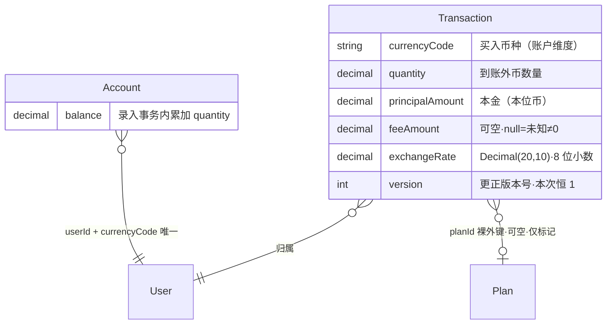
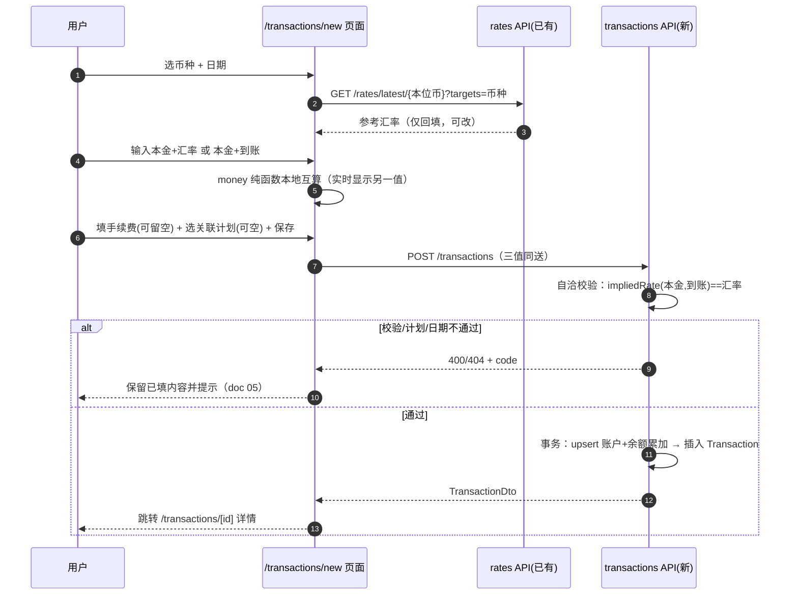

# 技术方案：买入交易录入（transaction-entry，M4）

> 动笔前已确认：核心场景——用户从首页「快速录入」填写本位币买入外币的账本记录（两种填法互算、手续费单列、可关联计划、首次自动建户）；量级预估——个人工具，单用户年交易数百条、<10 QPS；最大风险点——金额精度（汇率 8 位、币种精度最终舍入一次、正数舍 0 拦截）与两种填法提交数据的一致性。
>
> 结论先行：本次涉及 **0 张表变更**（schema 冻结基线已含全部所需模型）、**2 个新接口**（创建 + 详情；列表接口经评审推迟至 M3）、money 包 **1 个新增纯函数**、前端 **2 个新页面**，预计净增代码约 2000 行（含测试）。
>
> 依据：`docs/MVP功能模块&业务逻辑&专业术语/05_汇率查询与录入计算.md`、`14_业务逻辑清单.md` §2、`04_外汇账户.md`、`03_首页与导航.md`；《MVP开发计划》M4 清单；实现风格对齐 `changes/plan-creation/技术方案.md` 已落地代码。

## 1. 背景与范围

换汇账本的第一笔数据来自买入录入。当前系统已能创建换汇计划（plan-creation 已上线），但**没有任何买入记录入口**：首页 `home-dashboard.tsx` 仅有静态展示，`Transaction` / `Account` 表自 M0 冻结后无模块写入。本次实现 MVP 计划 M4 全部清单项：

```
首页（快速录入入口）→ /transactions/new 录入页（单页）
  ① 选币种 + 交易日期（允许补录历史，不晚于今天）
  ② 两种填法切换：本金+汇率 → 自动算到账；本金+到账 → 反算汇率
     （money 包纯函数本地互算，零请求；汇率参考值进页时调已有 rate 接口显示，可改）
  ③ 手续费（本位币）：0 = 无手续费；留空 = 未知（null），未知≠0
  ④ 关联计划（可选下拉，仅标记不触发分配）
→ 「保存」POST /api/transactions（事务：参数校验 → 自动建户+余额累加 → 落交易记录）
→ 跳转 /transactions/[id] 交易详情（数量/本金/手续费/成本 + 费用未明确提示）
```

**本次不做**（登记 §11）：交易更正（M8）、账户完整模块（M3：查询/平均成本/分配视图，本次只做录入所需的最小建户）、CostLot 成本批次生成（M7 前置，见 §4.6）、资金使用录入（M7）、E2E（W7 统一）。

## 2. 量化指标（预估）

| 指标项 | 预估值 | 依据/备注 |
| --- | --- | --- |
| 数据规模 | 单用户年增数百条，存量万级以内 | 个人记账工具 |
| 并发压力 | <10 QPS | 录入为低频动作；互算在前端本地完成，无预览接口流量 |
| 响应要求 | 同步 <300ms | create 为一个本地事务（upsert 账户 + insert 交易） |
| 一致性 | 强一致 | 余额累加与交易落库必须同事务，任一失败全部回滚 |

## 3. 数据模型（无 schema 变更）

M0 冻结基线已含全部所需模型，本次**不改表、不加列、不出迁移**：



图例：`Transaction.planId` 为裸外键（与 `PlanAllocation.planId` 同风格，无 Prisma relation，业务层校验归属与币种）；`Account` 首次买入时 upsert 自动建立（doc 04：余额 0 保留不删）。

**CostLot 不在本次写入**（防过度设计）：FIFO 成本批次是 M7 使用成本 / M3 平均成本的前置，但 `CostLot.sourceId` 指向 Transaction，`acquiredAt = transactedAt`、入库顺序由 `createdAt` 保留，事后可从交易记录确定性重建，无数据丢失风险。推迟决策登记 §11。

## 4. 业务规则设计

### 4.1 两种填法互算（money 包纯函数，前后端同源）

| 填法 | 输入 | 计算 | 精度规则（doc 05） |
| --- | --- | --- | --- |
| A：本金+汇率 | principalAmount、exchangeRate | `quantity = principalAmount ÷ exchangeRate` | 除法不先截短，全精度相除后按**买入币种**精度四舍五入一次；正数舍 0 拦截 |
| B：本金+到账 | principalAmount、quantity | `exchangeRate = principalAmount ÷ quantity` | 全精度相除后按汇率精度（8 位小数）四舍五入一次 |

- money 包已有 `impliedRate`（填法 B，`packages/money/src/calc.ts:47`）；**缺填法 A 的除法函数**，本次新增 `receivedAmountOf(principal, rate, decimalPlaces)`，与 `finalAmountOf`（× 方向）对称，复用 `roundToCurrency` / `RoundToZeroError`。
- 互算发生在**前端本地**（表单实时显示，零请求）；提交时 `principalAmount + exchangeRate + quantity` 三者一起上送，后端做**双向自洽校验**——以下两个条件**满足其一**即通过：
  - 方向一（填法 A 口径）：`receivedAmountOf(principalAmount, exchangeRate, 精度) == quantity`；
  - 方向二（填法 B 口径）：`impliedRate(principalAmount, quantity) == exchangeRate`。

  > 评审修正（架构+安全双视角）：原设计「`impliedRate(p, q)` 严格等于 r」不成立——填法 A 的 `quantity` 是 `round₂(p/r)` 后的近似值，反算汇率一般不等于用户输入（如 1000 ÷ 7.31 → 136.80，重算 7.30994152 ≠ 7.31），会系统性误杀合法录入。双向其一覆盖两种填法的合法提交；用户只改三值之一导致两方向均不满足时才 400，提示重新核对。

### 4.2 手续费语义（doc 05 / 例 12）

| 用户输入 | 落库 `feeAmount` | 语义 |
| --- | --- | --- |
| 填 "0" | `0` | 无手续费 |
| 留空 | `null` | 未知≠0；详情页显示「费用未明确」提示；成本显示「本金 + 未知费用」 |
| 填数字 | 该值 | 明确费用，币种恒为本位币（不可改，doc 14 §5） |

交易总成本 = `principalAmount + feeAmount`（feeAmount 为 null 时成本不完整，详情页明示，**绝不当 0 计算**）。

### 4.3 汇率参考与采用（doc 05）

- 进录入页时前端调**已有** `GET /api/rates/latest/{baseCurrency}?targets=<买入币种>` 显示参考汇率（统一「1 外币 = X 本位币」），仅作默认回填值，用户可改。
- 提交的 `exchangeRate` 一律视为**实际成交数据**（doc 14：「历史买入记录应填写实际成交数据」），落库 `rateSource = "MANUAL"`、`rateObservedAt = transactedAt`。报价来源/时间是否随买入落库为 doc 05 待确定项，登记 §11；字段已预留，后续按需启用，本次不暴露给 DTO。
- 汇率必填、> 0、≤ 8 位小数（超出位数 400 提示修改，不静默截断）。

### 4.4 自动建户与余额累加（doc 04）

创建事务内 `account.upsert`（`userId + currencyCode` 唯一）：无户则建（balance = 0），再累加到账数量。不变式「账户余额 = Σ计划剩余分配 + 未分配余额」天然满足（买入增量全部进入未分配）。余额 0 的账户保留不删。

**并发安全（评审修正）**：累加必须用 Prisma 原子自增 `balance: { increment: quantity }`（生成 `SET balance = balance + x`），禁止「先读 balance 再写回」（READ COMMITTED 下并发同币种买入会丢更新）。并发首次建户的 upsert 竞态（同币种两笔同时首购）会抛 P2002，捕获后降级为 update + increment 重试一次。

### 4.5 关联计划（doc 14 §2：仅标记，不触发分配）

`planId` 可空。非空时事务内校验：计划存在且属于本人（否则 404，不泄露他人数据）、`plan.targetCurrency === currencyCode`（币种不匹配 400）。**不校验分配、不改动计划任何数据**——「关联交易不代表已经分配资金」。

### 4.6 入参校验汇总

| 字段 | 规则 | 失败错误码 |
| --- | --- | --- |
| currencyCode | ∈ money 包 15 币种 | 400 INVALID_TRANSACTION_PARAMS |
| principalAmount | 有效数字、> 0、< 单笔上限 1e11（money 包） | 同上 |
| exchangeRate | 有效数字、> 0、≤ 8 位小数 | 同上 |
| quantity | 有效数字、> 0、小数位 ≤ 币种精度（JPY/KRW 整数）、< 1e11 | 同上 |
| 三者自洽 | §4.1 双向其一：`receivedAmountOf(p, r) == q` 或 `impliedRate(p, q) == r` | 同上（message 指明两方向均不满足） |
| 到账舍 0 | `receivedAmountOf` 抛 RoundToZeroError | 400 ROUND_TO_ZERO |
| transactedAt | 有效 ISO 日期；UTC+8 口径不晚于今天；不早于 `UserSettings.ledgerStartedAt`（账本起点，未设置时不做下界校验） | 同上 |
| feeAmount | 缺省 = 未知(null)；提供则有效数字、≥ 0、< 1e11 | 同上 |
| planId | 可空；非空须存在、本人、币种一致 | 404 PLAN_NOT_FOUND / 400 PLAN_CURRENCY_MISMATCH |

- **金额解析口径**（对齐 `plan.service.ts` `parseDecimalOrThrow` 先例）：金额/汇率字段 DTO 强制 string（`@IsString`，拒绝 JSON number 引入浮点误差）；解析统一 try/catch + `isFinite` + 上限校验，非法字符串（含 "abc"、"1e999" 超上限）一律 400，不泄漏堆栈。
- **日期口径（显式决策）**：plan 模块日期字段取 UTC 0 点（`utcMidnight`）；本模块「今天」判断按 UTC+8 日界（doc 14：记录日期按 UTC+8 判断）。两口径并存属业务语义差异（排期日 vs 交易时刻），UTC+8 以常量注入（对齐 M9 提醒「先固定 UTC+8 并配置化」先例），后续确认后统一替换。

## 5. 接口契约

均需登录（JwtAuthGuard），统一包装 `{ success, data, message }`，金额一律字符串（与 plan/home 模块口径一致）；错误体 `{ code, message }`。错误码经 DTO enum 进入 OpenAPI，前端 `bun run generate:api` 生成。

### 5.1 `POST /api/transactions` — 创建买入记录（事务）

```jsonc
// 请求
{
  "currencyCode": "USD",
  "principalAmount": "72480.00",     // 本金（本位币）
  "exchangeRate": "7.24800000",      // 汇率，≤8 位小数
  "quantity": "10000.00",            // 到账外币（填法 A 由前端互算回填）
  "feeAmount": "42.00",              // 可选；缺省 = 未知(null)；"0" = 无手续费
  "transactedAt": "2026-09-20T00:00:00.000Z",
  "planId": "cmb1..."                // 可选；仅标记
}
// 响应 data：TransactionDto
{
  "id": "cmb9...", "currencyCode": "USD",
  "quantity": "10000.00", "principalAmount": "72480.00",
  "feeAmount": "42.00",              // null = 未知
  "totalCost": "72522.00",           // principal + fee；fee 未知时 null
  "feeKnown": true,                  // false 时前端显示「费用未明确」
  "exchangeRate": "7.24800000",
  "planId": "cmb1...", "planName": "学费计划",
  "transactedAt": "2026-09-20T00:00:00.000Z",
  "version": 1
}
```

事务顺序：参数与自洽校验 → 计划归属/币种校验 → `account.upsert`（原子 increment，见 §4.4）→ 插入 Transaction（version=1）；任一失败全部回滚。
错误：400 `INVALID_TRANSACTION_PARAMS` / `ROUND_TO_ZERO` / `PLAN_CURRENCY_MISMATCH`、404 `PLAN_NOT_FOUND`。

> 金额序列化口径（评审修正）：所有金额字段响应统一 `toFixed(4)`（对齐 plan 模块 `toCapsDto`/`toInstallmentDto`，底座 Decimal(20,4)），示例中 2 位仅为文档示意。

### 5.2 `GET /api/transactions/:id` — 交易详情

响应 data = `TransactionDto`；不存在或不属于本人 → 404 `TRANSACTION_NOT_FOUND`。

> 互算不设独立预览接口：计算为 money 包纯函数、零 IO，前端本地完成（plan-creation 的 preview 接口存在是因为排期依赖服务端日历与 caps，二者场景不同）。
>
> 列表接口（评审后移出本次）：本迭代仅录入页 + 详情页（保存后直达详情），列表无消费方，随 M3 账户页实现。届时必须显式按 `userId` 过滤并在接口测试补跨用户不可见断言（防越权漏网）。

## 6. 实现设计



图例：②参考汇率失败不阻塞录入（doc 05 待确定项按保守处理——用户直接手填实际成交汇率）；⑥服务端自洽校验是账实一致的权威防线，前端互算仅作体验层。

- **后端** `services/chat/src/transaction/`：`TransactionModule` / `TransactionController`（2 端点 + Swagger，风格对齐 `plan.controller.ts`）/ `TransactionService`（create 事务 + detail）/ `transaction-calculator.ts`（双向自洽校验与金额解析纯函数，Decimal 走 money 包）/ `dto/transaction.dto.ts`。在 `app.module.ts` 注册一次。
- **money 包** `packages/money/src/calc.ts` 新增 `receivedAmountOf`（§4.1 填法 A），补 `calc.spec.ts` 用例；README「职责/边界」无需变更（仍为零 IO 纯函数）。
- **前端** `clients/chat-web`：页面 `app/(protected)/transactions/new/page.tsx` 与 `app/(protected)/transactions/[id]/page.tsx`；hooks `use-transaction-form`（表单状态、填法切换、本地互算、校验）；API 封装 `lib/api/transactions.ts`；业务组件 `components/business/transaction/`（录入表单段、填法切换段、详情卡，桶文件导出）。类型走 `bun run generate:api` 生成 → `contract.ts` 别名。
- **首页入口** `home-dashboard.tsx` 顶部操作区新增「快速录入」入口 → `/transactions/new`（完整首页整合仍归 M12/W7，本次只接通路径）。

## 7. 代码影响范围

<pre>
FXPlanner-new/
├─ packages/money/
│  ├─ src/calc.ts                                        <font color="#92400e">(M)</font> 新增 <font color="#ca8a04">receivedAmountOf()</font>：本金÷汇率→到账，币种精度舍入一次，正数舍 0 抛 RoundToZeroError
│  ├─ src/calc.spec.ts                                   <font color="#92400e">(M)</font> 追加 <font color="#ca8a04">receivedAmountOf 用例</font>（2 位/0 位币种、舍 0、非法入参）
│  └─ README.md                                          <font color="#92400e">(M)</font> 函数清单补一行（职责边界不变）
├─ services/chat/
│  ├─ src/app.module.ts                                  <font color="#92400e">(M)</font> 注册 TransactionModule
│  ├─ src/transaction/                                   <font color="#166534">(A)</font> 新模块
│  │  ├─ transaction.module.ts                           <font color="#166534">(A)</font>
│  │  ├─ transaction.controller.ts                       <font color="#166534">(A)</font> <font color="#ca8a04">create()</font> / <font color="#ca8a04">detail()</font>（POST /transactions、GET /transactions/:id）
│  │  ├─ transaction.service.ts                          <font color="#166534">(A)</font> <font color="#ca8a04">create()</font>（事务：双向自洽校验→计划校验→upsert 建户原子累加→落记录）、<font color="#ca8a04">detail()</font>
│  │  ├─ transaction-calculator.ts                       <font color="#166534">(A)</font> <font color="#ca8a04">assertSelfConsistent()</font>（双向其一）/ <font color="#ca8a04">parseAmountParams()</font>（纯函数，money 包封装）
│  │  └─ dto/transaction.dto.ts                          <font color="#166534">(A)</font> CreateTransactionDto / TransactionDto / 错误码 enum
│  └─ test/api/transaction.spec.ts                       <font color="#166534">(A)</font> 接口测试（复用 test/helpers/test-app.ts）
├─ clients/chat-web/
│  ├─ lib/api/
│  │  ├─ schema.gen.ts                                   <font color="#92400e">(M)</font> bun run generate:api 重新生成（禁止手改）
│  │  ├─ contract.ts                                     <font color="#92400e">(M)</font> 别名：TransactionDto / CreateTransactionReq 等
│  │  └─ transactions.ts                                 <font color="#166534">(A)</font> transactionsApi.create / detail [引用方] transactions/new、transactions/[id]
│  ├─ lib/hooks/
│  │  ├─ use-transaction-form.ts                         <font color="#166534">(A)</font> 表单状态 + 填法切换 + 本地互算 + 校验
│  │  └─ use-transaction-form.spec.ts                    <font color="#166534">(A)</font> 单测
│  ├─ app/(protected)/transactions/
│  │  ├─ new/page.tsx                                    <font color="#166534">(A)</font> 快速录入页（单页三段）
│  │  └─ [id]/page.tsx                                   <font color="#166534">(A)</font> 交易详情页
│  ├─ components/business/transaction/                   <font color="#166534">(A)</font>
│  │  ├─ transaction-entry-form.tsx                      <font color="#166534">(A)</font> 录入表单段（币种/日期/本金/手续费/关联计划）
│  │  ├─ rate-fill-mode-toggle.tsx                       <font color="#166534">(A)</font> 两种填法切换段（汇率↔到账）
│  │  ├─ transaction-detail-card.tsx                     <font color="#166534">(A)</font> 详情卡（数量/本金/手续费/成本 + feeKnown=false 提示）
│  │  └─ index.ts                                        <font color="#166534">(A)</font> 桶文件
│  └─ components/business/home/home-dashboard.tsx        <font color="#92400e">(M)</font> 顶部操作区新增「快速录入」入口 → /transactions/new
</pre>

## 8. 测试设计

> 断言依据：除自造边界值外，数值型断言锚定 `changes/m0-infrastructure/15个计算例子-测试用例清单.md` 开头「断言公式（全用例共用）」与 doc 05 例子；账户不变式「余额 = Σ计划剩余分配 + 未分配余额」为全用例必断项（M4 无分配场景简化为 balance = 未分配余额）。
> 时钟隔离：涉「今天」的用例（日期边界）用 `vi.setSystemTime` 固定时钟，禁止依赖真实当前时间（防午夜 flaky）。

### 8.1 单元测试

| 测试文件 | 被测对象 | 覆盖点 |
| --- | --- | --- |
| `packages/money/src/calc.spec.ts`（追加） | `receivedAmountOf` | doc 05 例（72,480 ÷ 7.2480 = 10,000）；JPY/KRW 0 位币种；正数舍 0 抛 RoundToZeroError；非法/非正入参 |
| `services/chat/src/transaction/transaction-calculator.spec.ts` | 双向自洽校验、入参解析 | 填法 A 提交（方向一成立）/填法 B 提交（方向二成立）均通过；非整除例（1000÷7.31→136.80）不被误杀；三值两方向均不满足报错；金额非数字/科学计数法超上限/小数超位数拒绝；feeAmount 三态（0/缺省/数值）；日期边界（vi.setSystemTime 固定 UTC+8 今天、早于账本起点）。接口层 DTO 校验路径由 §8.2 #13 承担 |

### 8.2 接口测试 `services/chat/test/api/transaction.spec.ts`

| # | 场景 | 预期 |
| --- | --- | --- |
| 1 | 未登录访问两接口 | 401 |
| 2 | 填法 A 创建（含手续费 42，锚定 doc 05 例） | 201；quantity=10000、totalCost=72522、feeKnown=true |
| 3 | 填法 B 创建（fee 留空，非整除例 1000÷7.31） | 201；feeAmount=null、totalCost=null、feeKnown=false，不被自洽校验误杀 |
| 4 | feeAmount="0" | 落库 0（无手续费），区别于 null |
| 5 | 首次买入自动建户 | Account 创建且 balance=quantity；断言不变式 balance = Σ剩余分配(0) + 未分配(quantity) |
| 6 | 同币种第二笔买入 | 不新建户，余额累加，不变式保持 |
| 7 | 并发：两请求同时首购同币种 | 两笔均 201，账户仅一行，balance=两笔之和（increment 原子性 + P2002 降级生效） |
| 8 | 三值不自洽（仅改 quantity，两方向均不满足） | 400 INVALID_TRANSACTION_PARAMS，账户无变化 |
| 9 | 到账金额正数舍 0（极小本金×低汇率） | 400 ROUND_TO_ZERO |
| 10 | 关联计划：正常 / 他人计划 / 币种不匹配 / 不存在 | 201 / 404 / 400 / 404，且计划数据零改动 |
| 11 | 日期晚于今天（固定时钟）/ 早于账本起点 | 400，message 区分 |
| 12 | JPY 传入 2 位小数 quantity | 400（超币种精度） |
| 13 | 汇总参数校验：非 15 币种、汇率超 8 位、principal≤0/≥1e11、feeAmount 负数、金额非数字字符串 | 均 400 INVALID_TRANSACTION_PARAMS；DTO 拒绝 JSON number |
| 14 | 详情：本人可见 / 他人记录 | 200 / 404 |

### 8.3 E2E（本次不做，登记遗留）

按 MVP 计划 W7 统一补全链路「登录 → 首次设置 → 买入 → 建计划 → 分批 → 使用 → 完成 → 报告」，买入段路径：首页 → 快速录入 → 两种填法各录一笔 → 详情核对；首页账户摘要联动依赖 M12 首页真实数据接入后验证（当前 home-dashboard 为静态 mock）。组件测试依赖 E2E（AGENTS.md 前端约定），本次前端只测 hooks。

**验收门禁**：`packages/money` + `services/chat` + `clients/chat-web` 全部测试 0 failed，typecheck / lint 通过。

## 9. 回滚

- 后端摘除 `app.module.ts` 中 TransactionModule 注册即恢复（纯增量模块，无存量依赖）。
- money 包新增函数为纯增量导出，不影响既有调用方。
- **无 schema 变更、无迁移**，回滚无数据风险；已产生的交易数据保留在原表中，不阻塞回滚。

## 10. 假设清单（实现前可推翻）

1. 买入币种必须与关联计划目标币种一致（doc 未明说，语义推断）。
2. `transactedAt` 允许补录历史，但不晚于今天（UTC+8）、不早于账本起点 `ledgerStartedAt`；账本起点未设置时不做下界校验。
3. `rateSource` 本次固定 "MANUAL"、`rateObservedAt = transactedAt`，不暴露给 DTO（doc 05 待确定项确认后放开）。
4. 参考汇率获取失败不阻塞录入（用户手填实际成交汇率），页面提示「参考汇率获取失败，请填写实际成交数据」。
5. 交易列表（含分页 pageSize 上限 50、全量导出归 M11 数据权利）随 M3 账户页实现时再定（见 §11 #7）。

## 11. 遗留问题（本次不做）

1. 交易更正（M8）：币种/日期/手续费补录、version 快照、FIFO 重排（例 10~12）。
2. CostLot 成本批次生成：M7 资金使用前统一从 Transaction 回填（sourceId 可重建，无数据丢失）；M3 平均成本同批实现。
3. 账户完整模块（M3）：余额/分配/平均成本查询、分配视图。
4. 报价来源与时间是否随买入落库、录入页 60 秒刷新是否适用普通买入（doc 05 待确定项）。
5. 超出计划目标的使用、分次使用对应具体买入（doc 04 待确定项）→ M7。
6. E2E 用例（W7 统一）。
7. 交易列表接口（`GET /api/transactions`）：随 M3 账户页实现（本迭代无消费方）；实现时必须显式按 `userId` 过滤，并在接口测试补跨用户不可见断言（评审安全视角要求）。
8. plan 模块缺失测试（`test/api/plan.spec.ts`、`schedule-builder.spec.ts`）为独立补救项，不在本方案范围内，建议单独排期。

## 12. 审核意见与修订记录

> 三视角并行审核（架构 / 安全与边界 / 测试），逐条处理如下。

| # | 来源 | 审核意见（引用章节） | 处理方式 | 说明 |
| --- | ------ | ---------------------- | ---------- | ------ |
| 1 | 架构#1 + 安全#1 | §4.1/§4.6 自洽校验「严格相等」对填法 A 系统性误杀（quantity 舍入后反算汇率必漂移） | ✅ 已修改 | 改为双向其一：`receivedAmountOf(p,r)==q` 或 `impliedRate(p,q)==r`（§4.1/§4.6）；§8.2 #3 补非整除正反用例 |
| 2 | 安全#2 | §4.4 并发同币种买入丢更新；首购 upsert 竞态 P2002 未处理 | ✅ 已修改 | §4.4 明确 `balance: { increment }` 原子累加 + P2002 捕获降级 update；§8.2 #7 补并发用例 |
| 3 | 架构#3 | §5.2 列表接口本迭代无消费方，违反防过度设计 | ✅ 已修改 | 移出本次范围，随 M3 账户页实现（§11 #7），接口数 3→2 |
| 4 | 安全#3 | 列表越权面（userId 过滤）未声明 | ✅ 随 #3 消解 | 要求写入 §11 #7（实现时的强制断言） |
| 5 | 架构#2 | §5.1 金额序列化位数未定义，与 plan 模块 toFixed(4) 冲突 | ✅ 已修改 | §5.1 注明统一 toFixed(4) |
| 6 | 安全#4 | 金额字符串解析异常未声明（500 风险、JSON number 精度） | ✅ 已修改 | §4.6 补解析口径（@IsString + try/catch + isFinite + 上限）；§8.1/§8.2 #13 纳入覆盖 |
| 7 | 安全#5 | UTC+8 与 plan 模块 utcMidnight 双口径未登记 | ✅ 已修改 | §4.6 显式决策注记（排期日 vs 交易时刻语义差异，doc 14 为依据） |
| 8 | 测试#1 | §8 遗漏「账户不变式」断言依据 | ✅ 已修改 | §8 开头显式引用断言公式清单；#5/#6 补不变式断言 |
| 9 | 测试#2 | §4.6 多条校验规则无接口用例对应 | ✅ 已修改 | §8.2 #13 汇总参数校验用例 |
| 10 | 测试#3 | §8.2 #14 条件式场景不可直接落地 | ✅ 已修改 | 删除 #14，表状态断言由 #5/#6 承担，UI 联动归 §8.3 E2E 说明 |
| 11 | 测试#4 | 时间依赖用例缺时钟隔离策略，午夜边界 flaky | ✅ 已修改 | §8 开头写明 vi.setSystemTime 固定时钟；同毫秒排序问题随列表移出消解 |
| 12 | 架构-勘误 | impliedRate 引用行号 calc.ts:37 应为 :47 | ✅ 已修改 | §4.1 更正 |
