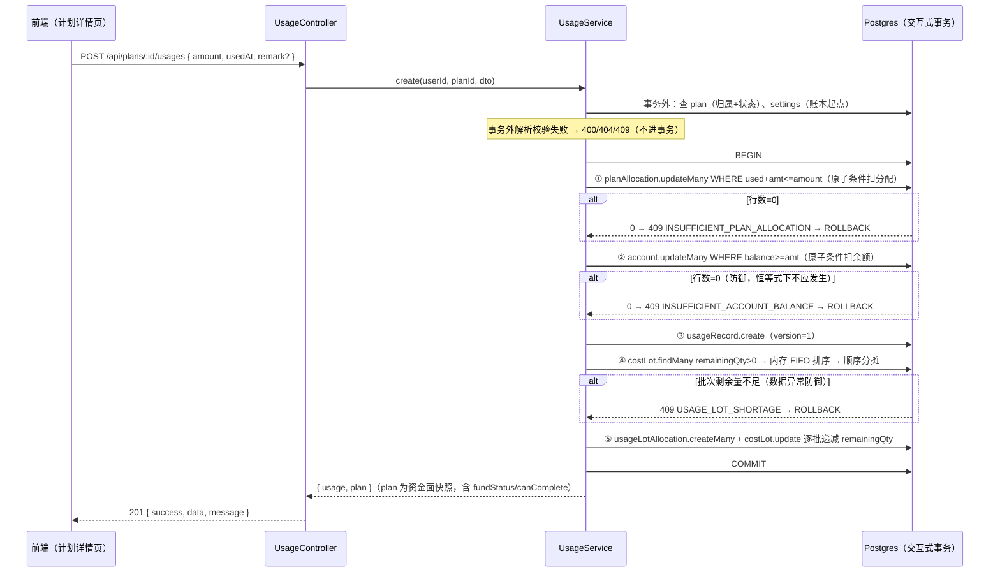
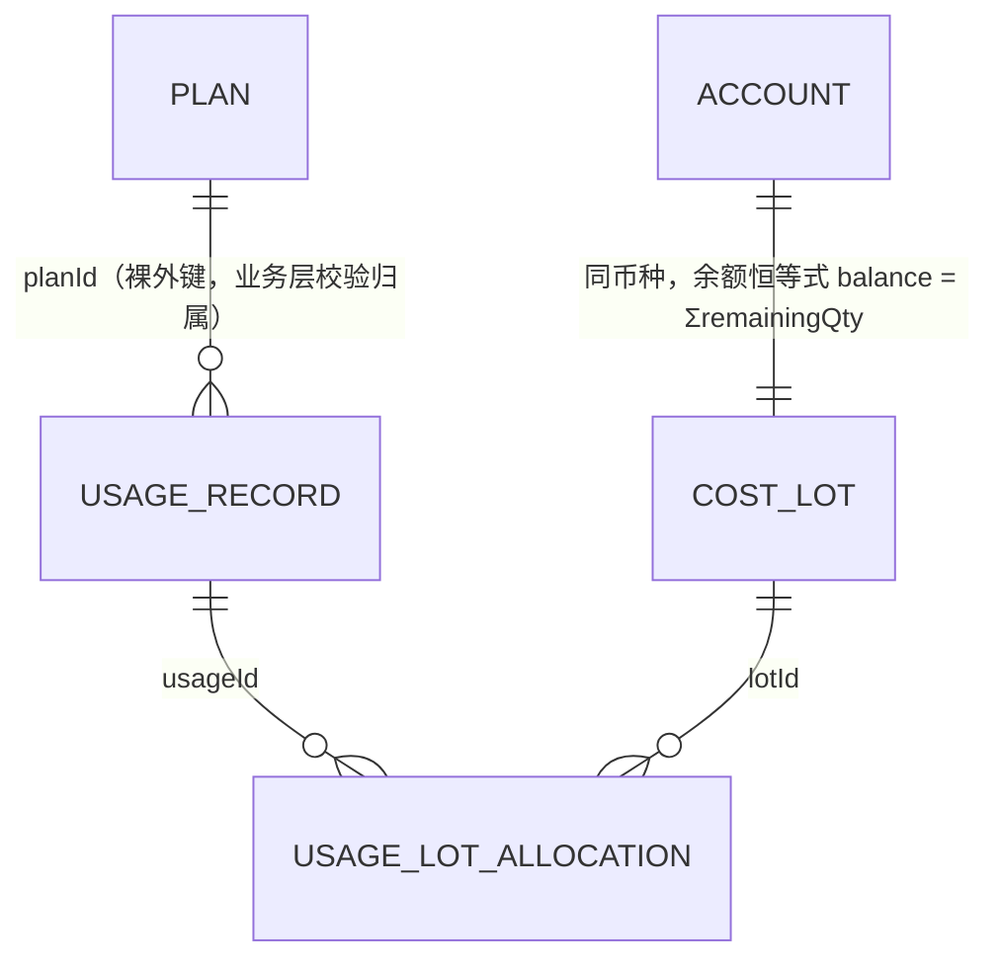

# 技术方案：M7 资金使用（记录实际使用）

> 动笔前已确认：核心场景——用户在计划内记录一笔实际发生的外币支出，系统扣余额、扣分配、按 FIFO 消耗成本批次；量级——个人工具，单用户使用记录量级百条内、峰值并发个位数（预估）；最大风险点——余额/分配/批次三方扣减的一致性与并发竞争。
>
> 结论先行：本次新增 2 个接口（`POST /api/plans/:id/usages`、`GET /api/plans/:id/usages`），schema 仅 1 列增量（`usage_records.remark` 可空列，走冻结流程），新增 1 个后端模块 + 前端 2 个业务组件，预计改动代码量约 1,200 行（含测试约 600 行）。需求文档见 `changes/usage-recording/需求文档.md`。

## 1. 目标与量化约束

### 1.1 业务背景

FXPlanner 资金流为「买入流入（M4 已实现）→ 分配给计划（M5 已实现，不动余额）→ 使用流出（本期）」。使用记录是第一个真正扣减账户余额的动作，同时按 FIFO 消耗 `CostLot` 批次产生使用成本，为 M10 报告（功能 25）供数。审计报告（changes/mvp-completion/审查报告与开发计划.md 阶段 1）将其定为 P0 最大功能断点。

### 1.2 核心指标预估

| 指标项 | 预估值 | 依据/备注 |
| -------- | -------- | ----------- |
| 数据规模 | 单用户百条级、全库万级（预估） | 个人工具，每计划分次使用 ≤ 数十笔 |
| 并发压力 | <10 QPS（预估） | 单用户操作，无高并发场景；但仍需防同账户并发提交 |
| 响应要求 | 同步 <500ms | 单库事务，无外部调用 |
| 一致性等级 | 强一致 | 余额/分配/批次必须同事务原子变更；单实例 Postgres 本地事务足够，禁止引入 MQ/分布式事务 |

### 1.3 约束条件

- schema M0 冻结基线（`services/chat/prisma/schema.prisma:82`）：14 个模型只读，增量走冻结流程回主分支；本次仅 `UsageRecord` 增加可空列 `remark`，不动既有列。
- 金额列 `Decimal(20, 4)`、单位成本 `Decimal(20, 10)`；金额字符串传输固定 4 位小数；日期一律 ISO 8601 UTC 0 点（对齐 `services/chat/src/plan/dto/plan.dto.ts:5` 头注释口径）。
- 错误契约统一 `{ code, message, data? }`，风格与 plan 模块一致（`services/chat/src/plan/plan.service.ts:26`）。
- AI 禁止启动服务；测试本地跑通 0 failed 为完成标准（AGENTS.md 质量红线）。
- FIFO 排序规则必须遵守：同日先初始持仓、再按买入录入顺序（docs/MVP功能模块&业务逻辑&专业术语/02_初始化与录入闭环_待确认.md:78）。

## 2. 方案选型与取舍

| 维度 | 方案 A | 方案 B | 结论 |
| ------ | -------- | -------- | ------ |
| 后端模块归属 | 新建 `services/chat/src/usage/` 模块 | 并入 plan 模块 | **A**。plan 模块已 900+ 行；使用是独立业务动作（读账户/批次，写三张表），职责不同；审计报告与文件归属规则均按独立模块组织（新后端模块 → `src/<模块>/` + `app.module.ts` 注册一次） |
| FIFO 算法位置 | 模块内纯函数 `usage-calculator.ts` | 放 `packages/money/` | **A**。money 包只收跨端共享纯函数（AGENTS.md 文件归属规则），FIFO 仅后端消费；对齐 `plan-calculator.ts` 先例（纯函数 + 错误类 + 独立 spec） |
| `remark` 备注 | schema 增可空列 | 不加，纯金额/日期 | **A**。审计报告阶段 1 明确表单含备注；可空列向后兼容，走冻结流程 |
| 并发扣减防线 | 条件更新（WHERE 内比较）+ 事务 | 先读后写 | **A**。READ COMMITTED 下「先读再写回」会丢更新（transaction.service §4.4 结论）；余额用 `updateMany where balance >= amt`、分配用 `$executeRaw` 单语句原子条件更新，行数 0 即失败回滚 |
| 日期校验实现 | 复制 `assertTransactedAtInRange` 语义进 usage 模块 | 直接 import transaction 模块函数 | **A**。该函数抛的是 transaction 模块专属错误码 `INVALID_TRANSACTION_PARAMS`，跨模块 import 会耦合错误契约；语义复制约 15 行，单测锁定两侧行为一致，模块边界干净 |
| 使用创建幂等 | 不做服务端幂等（每次提交即一笔新记录） | 幂等键去重 | **A**。与「创建买入」同语义：一次确认 = 一笔新使用；重复点击由前端 pending 态拦截 + 余额/分配条件扣减兜底（第二次提交因额度已扣减而自然失败或成功为下一笔，不存在双扣同一笔） |
| 详情接口资金状态 | `PlanDetailDto` 增加 `fundStatus`/`stillNeeded` | 前端自行推导 | **A**。派生量口径必须服务端唯一（禁止公式漂移），前端仅展示；plan 模块增量约 15 行 |

**无备选、唯一路径的部分**：`UsageLotAllocation` 写入与 `CostLot.remainingQty` 递减必须同事务（schema 已定，零迁移）；使用必须挂计划（13_MVP功能清单.md:57 MVP 暂不提供无计划使用）。

## 3. 核心设计

### 3.1 记录使用事务时序（一图一核心）



> 图例说明：①② 为并发安全权威防线（条件更新一行语句同时完成「检查 + 扣减」，后到事务基于最新已提交行重估 WHERE，行数 0 即失败，对齐 `plan.service.ts` complete/cancel 的 `updateMany` 先例）；④⑤ 中任一失败随事务整体回滚，绝不留半条记录。

### 3.2 数据模型变更（仅 1 列增量，零新表）



- 变更语句（唯一增量）：`ALTER TABLE usage_records ADD COLUMN remark TEXT;`（可空，无默认值，兼容存量）。
- 迁移目录：`services/chat/prisma/migrations/202609xxxx_add_usage_remark/`，命名对齐现有 `20260915120000_add_plan_change_logs` 风格。
- 索引：`usage_records` 已有 `@@index([userId, usedAt])`，列表按 `planId` 查询走全表万级数据量可接受；如后续报告模块需要再加 `@@index([planId, usedAt])`（本期不加，避免过度设计）。
- `UsageRecord.planId`、`UsageLotAllocation.usageId/lotId` 维持裸外键先例（对齐 `PlanChangeLog`/`PlanAllocation`，不触碰冻结基线的 Plan/CostLot model），归属校验在业务层。

### 3.3 FIFO 消耗算法（usage-calculator 纯函数）

```text
输入：lots: CostLot[](remainingQty > 0)、need: Decimal、decimalPlaces: 0|2
排序：acquiredAt 升序 → sourceType（INITIAL=0，PURCHASE=1）→ createdAt 升序 → id 升序
      （02 文档 :78 同日顺序：初始持仓 → 普通买入；同类按首次录入顺序）
循环：slice = min(need, lot.remainingQty)
      sliceCost = (slice × lot.unitCost).toDecimalPlaces(4, ROUND_HALF_UP)
      累计写入 UsageLotAllocation{lotId, quantity=slice, cost=sliceCost}，
      并记 lot 递减量；need 归零即止
输出：slices[] + totalCost = Σ sliceCost
need 未归零（ΣremainingQty < 需求量）→ 抛 UsageLotShortageError
```

- 舍入复用 money 包 `roundToCurrency` 语义（ROUND_HALF_UP，`packages/money/src/round.ts:21`）；每片只在金额列精度上舍入一次。
- 批次量级为百条级，全取内存排序即可，不加 SQL 窗口函数复杂度。
- 该函数设计为无 IO 纯函数：M8 使用更正（改金额/改日期重算）直接复用同一分摊实现，保证首次记账与更正重算口径一致。

### 3.4 派生量与资金状态（口径唯一）

- 金额派生量全部复用 `plan-calculator.computeDerived`（`services/chat/src/plan/plan-calculator.ts:106`）：`stillNeeded`（还需使用）、`remainingAllocation`（剩余分配）、`gap`（缺口）。usage 模块以纯函数级 import 复用，禁止另行实现公式。
- `fundStatus` 映射（服务端计算，前端只展示）：

| fundStatus | 条件 | 展示 |
| ------------ | ------ | ------ |
| `PREPARING` | stillNeeded > 0 且 gap > 0 | 准备中（有缺口） |
| `READY` | stillNeeded > 0 且 gap = 0 | 资金已备齐 |
| `USED_UP` | stillNeeded = 0 且 remainingAllocation = 0 | 资金已使用完成（出现完成确认入口，复用现有 `canComplete`） |

- 边界：`stillNeeded = 0` 但 `remainingAllocation > 0`（理论不可达的防御态）不判 `USED_UP`，归 `PREPARING` 并由 `canComplete = false` 拦截完成，与 `checkCompleteReady` 口径一致。
- 双进度：准备进度 =（目标 − 缺口）/ 目标；使用进度 = 累计已使用 / 目标。修正 `clients/chat-web/components/business/plan/plan-detail-card.tsx:29` 现状（当前把已使用/目标混当准备进度）。

### 3.5 账户流水 USAGE 行成本补齐（既有遗留落地）

`services/chat/src/account/account.service.ts:135` 注释预留：USAGE 行 `totalCost` 恒 null，M7 上线时按 `UsageLotAllocation` 按 `usageId` 聚合补齐，「契约与前端零改动」。本次落地：ledger 查询并行追加 `usageLotAllocation.groupBy({ by: usageId, _sum: cost })`，USAGE 行 `totalCost` 填实；响应结构不变。

## 4. 接口契约

统一包装 `{ success, data, message }`；错误统一 `{ code, message, data? }`；全部需登录（JwtAuthGuard）。

### 4.1 记录使用

| 项 | 内容 |
| ---- | ------ |
| 路径 | `POST /api/plans/:id/usages` |
| 入参 | `{ "amount": "4000.0000", "usedAt": "2026-09-20T00:00:00.000Z", "remark": "秋季学费第一期" }`<br>amount：正数字符串，≤4 位小数，< 单笔上限 100,000,000,000；usedAt：ISO 日期，服务端截取 UTC 0 点；remark：可选 ≤200 字符 |
| 出参 | `data: { usage: UsageDto, plan: PlanFundSummaryDto }` |
| 约束 | 非幂等（一次确认 = 一笔新使用）；并发由事务内条件更新保证正确性 |

`UsageDto`：

```json
{
  "id": "cme…",
  "planId": "cmd…",
  "currencyCode": "USD",
  "amount": "4000.0000",
  "usedAt": "2026-09-20T00:00:00.000Z",
  "remark": "秋季学费第一期",
  "cost": "28800.0000",
  "version": 1,
  "createdAt": "2026-09-20T08:00:00.000Z"
}
```

`cost` = 本笔使用成本（FIFO 分摊合计，本位币，4 位小数字符串）。`version` 恒 1，为 M8 使用更正预留（本期只写不改）。

`PlanFundSummaryDto`（提交后资金面快照，前端一次往返即可刷新进度区，免二次请求）：

```json
{
  "targetAmount": "10000.0000",
  "usedAmount": "4000.0000",
  "allocatedAmount": "10000.0000",
  "remainingAllocation": "6000.0000",
  "stillNeeded": "6000.0000",
  "gap": "0.0000",
  "fundStatus": "READY",
  "canComplete": false
}
```

### 4.2 使用记录列表

| 项 | 内容 |
| ---- | ------ |
| 路径 | `GET /api/plans/:id/usages` |
| 入参 | 无（路径参数 planId；个人工具量级不分页，服务端 limit 100 兑底，对齐 plan 列表约定） |
| 出参 | `data: { items: UsageDto[] }`，usedAt 倒序、同刻 createdAt 倒序 |
| 约束 | 只读；plan 不存在或不属于本人 → 404 防枚举（对齐 plan 详情口径） |

### 4.3 错误码契约

| HTTP | code | 场景 | data |
| ------ | ------ | ------ | ------ |
| 400 | `INVALID_USAGE_PARAMS` | 金额非法/超 4 位小数/超上限；usedAt 晚于今天（UTC+8 口径）/早于账本起点/格式非法；remark 超 200 字；币种不在 15 币种 | 无 |
| 404 | `PLAN_NOT_FOUND` | 计划不存在或不属于本人（防枚举，对齐 `plan.service.ts:93`） | 无 |
| 409 | `PLAN_INVALID_TRANSITION` | 仅 ACTIVE 可记录使用（COMPLETED/CANCELLED） | 无 |
| 409 | `INSUFFICIENT_PLAN_ALLOCATION` | 本次金额 > 计划剩余分配（事务内条件更新判定） | `{ remainingAllocation, requestedAmount }` |
| 409 | `INSUFFICIENT_ACCOUNT_BALANCE` | 账户余额不足（恒等式下不应发生，防御兜底） | `{ balance, requestedAmount }` |
| 409 | `USAGE_LOT_SHORTAGE` | FIFO 批次剩余量合计不足（数据异常防御） | `{ lotRemaining, requestedAmount }` |

### 4.4 既有接口增量

| 接口 | 变更 |
|------|------|
| `GET /api/plans/:id` | `PlanDetailDto` 追加 `stillNeeded`、`fundStatus` 两字段（服务端计算）；不改既有字段 |
| `GET /api/accounts/:currencyCode/transactions` | USAGE 行 `totalCost` 由 null 改为聚合成本；响应结构不变（§3.5 遗留落地） |

前端类型一律 `bun run generate:api` 从 OpenAPI 生成，禁止手写共享类型（AGENTS.md 文件归属规则）。

## 5. 代码影响范围（树状变更清单）

> 记号：`(A)` 新增 / `(M)` 修改 / `(D)` 删除；文件/目录用深色，方法/组件/接口用浅色，均不加粗。

### 5.1 后端

<pre>
services/chat/
├── prisma/
│   ├── <font color="#92400e">schema.prisma</font> (M) [注: 唯一 schema 增量，走冻结流程]
│   │   └── <font color="#16a34a">UsageRecord.remark</font> [注: String? 可空备注列]
│   └── <font color="#166534">migrations/202609xxxx_add_usage_remark/</font> (A) [注: ALTER TABLE 增列]
│       └── <font color="#166534">migration.sql</font>
├── src/
│   ├── <font color="#166534">usage/</font> (A) [注: 新后端模块，app.module.ts 注册一次]
│   │   ├── <font color="#166534">usage.module.ts</font> (A)
│   │   ├── <font color="#166534">usage.controller.ts</font> (A) [注: 入口层，JwtAuthGuard，withLog 观测对齐 plan.controller]
│   │   │   ├── <font color="#16a34a">create()</font> [注: POST /plans/:id/usages，201]
│   │   │   └── <font color="#16a34a">list()</font> [注: GET /plans/:id/usages]
│   │   ├── <font color="#166534">usage.service.ts</font> (A) [注: 业务层，事务边界在此]
│   │   │   ├── <font color="#16a34a">create()</font> [注: §3.1 五步事务：条件扣分配→条件扣余额→插记录→FIFO 分摊→写分摊明细]
│   │   │   ├── <font color="#16a34a">list()</font> [注: usedAt 倒序 limit 100，按 usageId 聚合成本]
│   │   │   ├── <font color="#16a34a">loadPlanContext()</font> [注: 事务外归属/状态/币种/账本起点装载]
│   │   │   └── <font color="#16a34a">toUsageDto()</font> [注: 金额 toFixed(4)、日期 ISO 序列化]
│   │   ├── <font color="#166534">usage-calculator.ts</font> (A) [注: 纯函数零 IO，M8 更正重算复用同一实现]
│   │   │   ├── <font color="#16a34a">allocateLotsFifo()</font> [注: FIFO 排序 + 顺序分摊 + 总成本]
│   │   │   ├── <font color="#16a34a">compareLots()</font> [注: acquiredAt→INITIAL 优先→createdAt→id 排序键]
│   │   │   ├── <font color="#16a34a">assertUsedAtInRange()</font> [注: UTC+8 不晚于今天、不早于账本起点（语义复制自 transaction-calculator，单测锁定一致）]
│   │   │   ├── <font color="#16a34a">computeFundStatus()</font> [注: derived → PREPARING/READY/USED_UP]
│   │   │   └── <font color="#16a34a">UsageCalcError / UsageLotShortageError</font> [注: 领域错误类]
│   │   └── <font color="#166534">dto/usage.dto.ts</font> (A) [注: OpenAPI 契约唯一来源，@ApiProperty 显式 type]
│   │       ├── <font color="#16a34a">CreateUsageDto</font> [注: amount/usedAt/remark]
│   │       ├── <font color="#16a34a">UsageDto</font> [注: 含 cost/version]
│   │       ├── <font color="#16a34a">UsageListRespDto</font> [注: { items }]
│   │       └── <font color="#16a34a">PlanFundSummaryDto</font> [注: 资金面快照 + fundStatus + canComplete]
│   ├── <font color="#92400e">app/app.module.ts</font> (M) [注: UsageModule 注册一次]
│   ├── <font color="#92400e">plan/plan.service.ts</font> (M) [注: getDetail 追加两派生字段]
│   │   └── <font color="#ca8a04">toPlanListItemDto()/getDetail()</font> [注: stillNeeded + fundStatus（computeDerived 已有，仅透出）]
│   ├── <font color="#92400e">plan/dto/plan.dto.ts</font> (M) [注: PlanDetailDto + stillNeeded/fundStatus]
│   └── <font color="#92400e">account/account.service.ts</font> (M) [注: §3.5 遗留落地]
│       └── <font color="#ca8a04">ledger()</font> [注: usageLotAllocation groupBy 聚合，USAGE 行 totalCost 填实]
└── test/
    ├── <font color="#166534">api/plan-usage.spec.ts</font> (A) [注: usage.controller 接口测试（审计报告指定名）]
    └── <font color="#166534">integration/usage-fifo-cost.spec.ts</font> (A) [注: 使用扣减 FIFO 集成测试（审计报告指定）]
</pre>

### 5.2 前端

<pre>
clients/chat-web/
├── app/(protected)/plans/[id]/
│   └── <font color="#92400e">page.tsx</font> (M) [注: 详情页装使用区]
│       ├── <font color="#ca8a04">PlanDetailPage()</font> [注: 「记录使用」按钮（canModify 控制）+ UsageRecordDialog + 使用记录 section]
│       └── <font color="#ca8a04">DetailHeader()</font> [注: 新增记录使用入口]
├── components/business/usage/ (A) [注: 新业务领域目录，带桶文件]
│   ├── <font color="#166534">index.ts</font> (A)
│   ├── <font color="#166534">usage-record-dialog.tsx</font> (A) [注: 表单（金额/日期/备注）+ 提交前变化摘要 + 确认]
│   │   └── <font color="#16a34a">UsageRecordDialog()</font> [注: 409 分配不足时展示 data.remainingAllocation]
│   └── <font color="#166534">usage-record-list.tsx</font> (A) [注: 列表（日期/金额/备注/成本）+ 空状态]
│       └── <font color="#16a34a">UsageRecordList()</font>
├── components/business/plan/
│   └── <font color="#92400e">plan-detail-card.tsx</font> (M) [注: 功能 17 双进度修正]
│       └── <font color="#ca8a04">PlanDetailCard()</font> [注: 准备进度=(目标−缺口)/目标、使用进度=已使用/目标、fundStatus 徽标]
└── lib/api/
    ├── <font color="#166534">usages.ts</font> (A) [注: usagesApi.create/list 封装]
    │   ├── <font color="#16a34a">create()</font> [注: POST /plans/:id/usages；[引用方] usage-record-dialog.tsx]
    │   └── <font color="#16a34a">list()</font> [注: GET /plans/:id/usages；[引用方] page.tsx]
    ├── <font color="#92400e">schema.gen.ts</font> (M) [注: bun run generate:api 生成物]
    └── <font color="#92400e">contract.ts</font> (M) [注: 导出 Usage/PlanFundSummary 等生成类型]
</pre>

> 不改动说明：首页/计划列表已消费 `usedAmount`/`gap` 派生量，使用后自动生效，零改动；完成确认按钮沿用现有 `canComplete` 标记，零改动。

### 5.3 测试文件树

<pre>
测试文件（与被测对象一一对应）/
├── services/chat/src/usage/
│   └── <font color="#166534">usage-calculator.spec.ts</font> (A) [注: 测试 allocateLotsFifo/assertUsedAtInRange/computeFundStatus 纯函数]
├── services/chat/test/
│   ├── <font color="#166534">api/plan-usage.spec.ts</font> (A) [注: 测试 usage.controller 全部入口与错误码]
│   ├── <font color="#166534">integration/usage-fifo-cost.spec.ts</font> (A) [注: 测试买入→使用→批次/余额/分配一致性]
│   └── <font color="#92400e">api/account.spec.ts</font> (M) [注: 追加 USAGE 行 totalCost 断言]
└── e2e/modules/
    └── <font color="#166534">11-plan-usage.spec.ts</font> (A) [注: 用户路径 E2E，编号顺延现有 10]
</pre>

> 前端组件不写组件单测（AGENTS.md：前端只测 lib/hooks，组件测试靠 E2E）；本期无新增 hooks。

## 6. 可靠性保障

- **原子性**：扣分配、扣余额、写记录、FIFO 分摊、写分摊明细五个写操作同一交互式事务，任一失败整体回滚，不留半条记录（需求 §7 中途中断）。
- **并发防线**：①分配扣减 `$executeRaw`（`UPDATE plan_allocations SET used_amount = used_amount + $amt WHERE plan_id = $id AND used_amount + $amt <= amount`，列间比较 Prisma 无法表达，单语句原子）；②余额扣减 `updateMany WHERE balance >= amt`（列对常量，原生表达）。行数 0 → 对应 409 回滚。READ COMMITTED 下后到事务基于最新已提交行重估 WHERE，与 `plan.service.ts` complete/cancel 先例同构。
- **防御兜底**：余额/批次不足在恒等式（balance = Σ剩余分配 + 未分配 ≥ 剩余分配；批次 ΣremainingQty = 余额）下不应发生，命中即 409 并提示数据异常——宁可拒绝不可错账。
- **重复提交**：前端确认按钮 pending 禁用；服务端不设幂等键（一次确认即一笔新使用，第二次提交按独立请求处理，额度不足自然被条件更新拦截）。
- **回滚机制**：纯增量功能，无存量数据迁移风险；`remark` 可空列对旧代码透明，迁移可回退（新增列不破坏）。
- **存量数据**：`UsageRecord` 现为空表（account.service.ts:134 注释），无历史回填。

## 7. 可观测性

- Controller 入口/失败日志对齐 `plan.controller.ts` 的 `withLog` 先例：Info 记 `userId/planId/动作`，失败 Warn 记错误码。
- 关键业务量：每次记账成功 Warn 级无需、Info 级记 `amount/usedAt/批次数/总成本`，便于对账排查。
- 禁止循环体内打日志（FIFO 分摊循环内不落日志，循环外记一次汇总）。

## 8. 测试设计（质量红线：实施必跑通 0 failed）

### 8.1 单元测试（与源码同目录）

`services/chat/src/usage/usage-calculator.spec.ts` 测试 FIFO 与校验纯函数——覆盖点：

| 用例组 | 覆盖点 |
| -------- | -------- |
| FIFO 排序 | acquiredAt 升序；同日 INITIAL 先于 PURCHASE；同日同类按 createdAt；id 兜底稳定排序 |
| 顺序分摊 | 单批次整耗；跨批次（先尽最早批次）；末批次部分消耗 remainingQty 递减正确；恰好耗尽清零 |
| 成本计算 | 每片 cost = quantity×unitCost 按 4 位 HALF_UP；总成本 = Σ片成本；日元 0 位精度币种 |
| 不足拦截 | ΣremainingQty < 需求量抛 UsageLotShortageError，且不产出部分分摊结果 |
| 日期校验 | 晚于今天（UTC+8 口径）拒；早于账本起点拒；等于起点当日放行；起点为 null 跳过下界 |
| 资金状态 | PREPARING/READY/USED_UP 三态映射；stillNeeded=0 且剩余分配>0 的防御态不判 USED_UP |
| 与 transaction 侧一致性 | `assertUsedAtInRange` 与 `assertTransactedAtInRange` 同输入同判定（互为镜像用例） |

### 8.2 接口测试 `services/chat/test/api/plan-usage.spec.ts`

| 接口 | 场景 | 预期 |
| ------ | ------ | ------ |
| POST /plans/:id/usages | 正常记账（金额/日期/备注齐全） | 201，usage.cost 正确，plan.fundStatus/remainingAllocation 正确 |
| POST /plans/:id/usages | remark 缺省 | 201，remark = null |
| POST /plans/:id/usages | 金额超剩余分配 | 409 INSUFFICIENT_PLAN_ALLOCATION，data.remainingAllocation 正确，无落库 |
| POST /plans/:id/usages | 金额 ≤ 0 / 5 位小数 / 非数字 / 超上限 | 400 INVALID_USAGE_PARAMS |
| POST /plans/:id/usages | usedAt 明天 / 早于账本起点 / 非法格式 | 400，三类 message 可区分 |
| POST /plans/:id/usages | remark 超 200 字 | 400 INVALID_USAGE_PARAMS |
| POST /plans/:id/usages | COMPLETED / CANCELLED 计划 | 409 PLAN_INVALID_TRANSITION |
| POST /plans/:id/usages | 他人计划 / 不存在 id | 404 PLAN_NOT_FOUND（防枚举，两场景响应一致） |
| POST /plans/:id/usages | 日元金额带小数 | 400 INVALID_USAGE_PARAMS |
| GET /plans/:id/usages | 空列表 | 200 { items: [] } |
| GET /plans/:id/usages | 多笔混排（补录历史日期） | 200 usedAt 倒序、同刻 createdAt 倒序、含 cost/version/remark |
| GET /plans/:id/usages | 他人计划 | 404 |
| GET /plans/:id（既有） | 使用后拉详情 | 含 stillNeeded/fundStatus 新字段且值正确 |

### 8.3 集成测试 `services/chat/test/integration/usage-fifo-cost.spec.ts`

一个业务流一个文件（AGENTS.md），验证跨表资金一致性：

| 场景 | 步骤与断言 |
| ------ | ----------- |
| 全链路 FIFO（15 术语清单 :64 算例） | 初始 0 → 买 1,000（成本 7,800）→ 买 1,000（成本 8,000）→ 使用 1,200。断言：usage_lot_allocations 两行（1,000/7,800 + 200/1,600）、cost=9,400、两 lot remainingQty = 0/800、账户余额 800、PlanAllocation.usedAmount=1,200 |
| 同日顺序（02 文档 :78） | 同日先建初始持仓（INITIAL lot）再买入，同日使用：断言先耗 INITIAL 批次再耗 PURCHASE 批次 |
| 分次使用累计 | 目标 10,000 分配 10,000，分三笔 4,000/4,000/2,000。断言每笔后余额/usedAmount/stillNeeded 递进，第三笔后 fundStatus=USED_UP、canComplete=true，随后走完成接口成功 |
| 恒等式守恒 | 任意场景断言：账户余额 = Σ各计划剩余分配 + 未分配余额；ΣCostLot.remainingQty = 账户余额 |
| 失败整笔回滚 | 构造批次不足（人工改 remainingQty）触发 USAGE_LOT_SHORTAGE：断言 usage_records/usage_lot_allocations 零新增、余额与 usedAmount 不变 |
| 账本起点边界 | 起点 9-10，使用 9-9 拒；9-10 当日需确认语义放行 |

### 8.4 E2E `e2e/modules/11-plan-usage.spec.ts`（按用户操作路径编号）

**场景 1：分次使用全程**

1. 登录 → 建计划（目标 10,000 USD，分配 10,000）→ 录入一笔买入 10,000
2. 计划详情 → 点「记录使用」→ 填 4,000/今天 → 确认
3. 断言：进度区刷新为已使用 4,000/10,000、双进度条分开显示、状态徽标「资金已备齐」、还需使用 6,000；使用记录列表出现一行（金额 4,000 + 成本）
4. 再记一笔 6,000 → 断言状态变「资金已使用完成」、出现「完成确认」按钮
5. 点完成确认 → 断言计划状态变为已完成、按钮区更新

**场景 2：超额拦截**

1. 建计划（分配 2,000）→ 录入买入 → 记录使用 2,500
2. 断言：出现剩余分配不足提示（含当前剩余 2,000）、余额与进度不变、列表无新增

**场景 3：日期拦截**

1. 记录使用填明天日期 → 断言提示「不能晚于今天」，不记账

**场景 4：账户流水成本展示**

1. 完成场景 1 的使用后进入该币种账户页流水
2. 断言：USAGE 行出现且 totalCost 显示本笔成本（不再是空）

### 8.5 测试数据与工具约定

- 测试工具进 `services/chat/test/helpers/`，禁止 spec 间复制；已有 seed/夹具复用，不新造平行工厂。
- E2E 产物只进 `e2e/test-results/`，`services/` 与 `clients/` 下禁止出现运行产物（AGENTS.md 测试约定）。

## 9. M8 使用更正边界预留（本期只预留，不实现）

依据 docs/MVP功能模块&业务逻辑&专业术语/10_资金使用记录更正.md，本期明确不做并预留：

- `UsageRecord.version` 从 1 递增：本期创建恒写 1，更新接口 M8 提供（更正 = version+1 新版本语义）。
- `Correction` 表 `targetType="USAGE"` 语义预留，本期零读写。
- `allocateLotsFifo` 设计为纯函数：M8「改金额重算」「改日期重算」直接以新参数重放同一实现，保证首记与更正口径一致；更正涉及的成本冲销（按 usageId 反向恢复 remainingQty）在 M8 方案单独设计。
- 不提供删除/撤销端点（13_MVP功能清单.md:55：不提供单独撤销整笔使用）。
- 「已完成计划调小误录仍保持已完成」（功能 21）依赖更正流程，本期完成判定不含此分支。

## 10. 排期与资源

| 阶段 | 人/天 | 依赖/阻塞 |
| ------ | ------- | ----------- |
| 后端（模块 + 契约 + 迁移） | 2 | 无 |
| 前端（表单 + 列表 + 双进度） | 1.5 | 后端契约冻结 |
| 联调 + 契约生成 | 0.5 | 前后端就绪 |
| 测试（单元/接口/集成/E2E 编写与跑通） | 1.5 | 与开发并行 0.5，收口 1 |
| 缓冲（×1.2） | 0.5 | — |
| **总计** | **约 6 人天** | 对齐审计报告「阶段 1：1 个迭代」 |

外部阻塞依赖：无（无第三方服务）。

## 11. 自检清单

- [x] 量化指标齐全（§1.2），并发方案基于「同账户并发提交」风险而非臆想高并发
- [x] 只写增量：plan/account 模块仅最小增量，未复制系统架构
- [x] 未引入任何新中间件/新依赖（`$executeRaw` 为 Prisma 既有能力）
- [x] 核心流程有 Mermaid 时序图（§3.1），一图一核心
- [x] 覆盖异常兜底（§4.3 六个错误码）、回滚（§6）、观测（§7）
- [x] 代码影响范围树状清单（§5），A/M/D 清晰，`<pre>` 对齐 + `<font>` 上色，共享接口归档并标注引用方
- [x] 测试设计分单元/接口/集成/E2E 四层（§8），文件与被测对象一一对应，E2E 按路径编号带断言
- [x] 排期含测试与缓冲（§10）
- [x] 已完成项目现状调研：schema 裸外键先例、plan/account/transaction 模块范式、前端 business 组件与 api client 组织均已核对
- [x] M8 边界预留显式声明（§9），防实现越界

## 12. 需求依据与关键代码索引

| 依据 | 位置 |
| ------ | ------ |
| 「记录实际使用」定义（确认才扣减、分次、FIFO、只记账不代付） | docs/MVP功能模块&业务逻辑&专业术语/04_外汇账户.md:37-45 |
| 「已备齐/已使用完成」与还需金额公式 | docs/MVP功能模块&业务逻辑&专业术语/04_外汇账户.md:47-55 |
| 功能 15/16/17/18 | docs/MVP功能模块&业务逻辑&专业术语/13_MVP功能清单.md:29-32 |
| 同日成本顺序：初始持仓→普通买入→实际使用 | docs/MVP功能模块&业务逻辑&专业术语/02_初始化与录入闭环_待确认.md:76-82 |
| FIFO 术语与算例 | docs/MVP功能模块&业务逻辑&专业术语/15_专业术语清单.md:17、docs/MVP功能模块&业务逻辑&专业术语/15_专业术语清单.md:64 |
| 例01 分次使用仍备齐 | docs/MVP功能模块&业务逻辑&专业术语/14_业务逻辑清单.md:110-124 |
| M7 未开工审计结论与阶段 1 计划 | changes/mvp-completion/审查报告与开发计划.md（模块总览、阶段 1 表） |
| 余额原子累加/先读后写禁令先例 | services/chat/src/transaction/transaction.service.ts:100 |
| 条件更新防并发先例 | services/chat/src/plan/plan.service.ts:588（complete 的 updateMany WHERE status） |
| 「M7 前为空表」遗留注释 | services/chat/src/account/account.service.ts:134 |
| caps 校验与 409 错误模式 | services/chat/src/plan/plan.service.ts:80 |
| 现有计划详情页（双进度改造点） | clients/chat-web/app/(protected)/plans/[id]/page.tsx、clients/chat-web/components/business/plan/plan-detail-card.tsx:29 |
