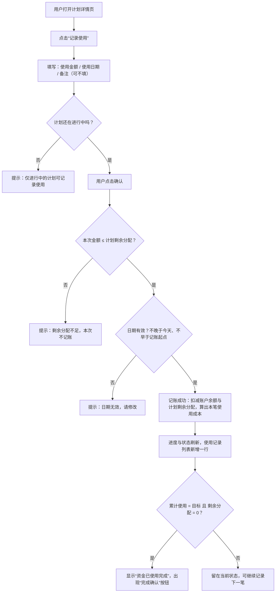
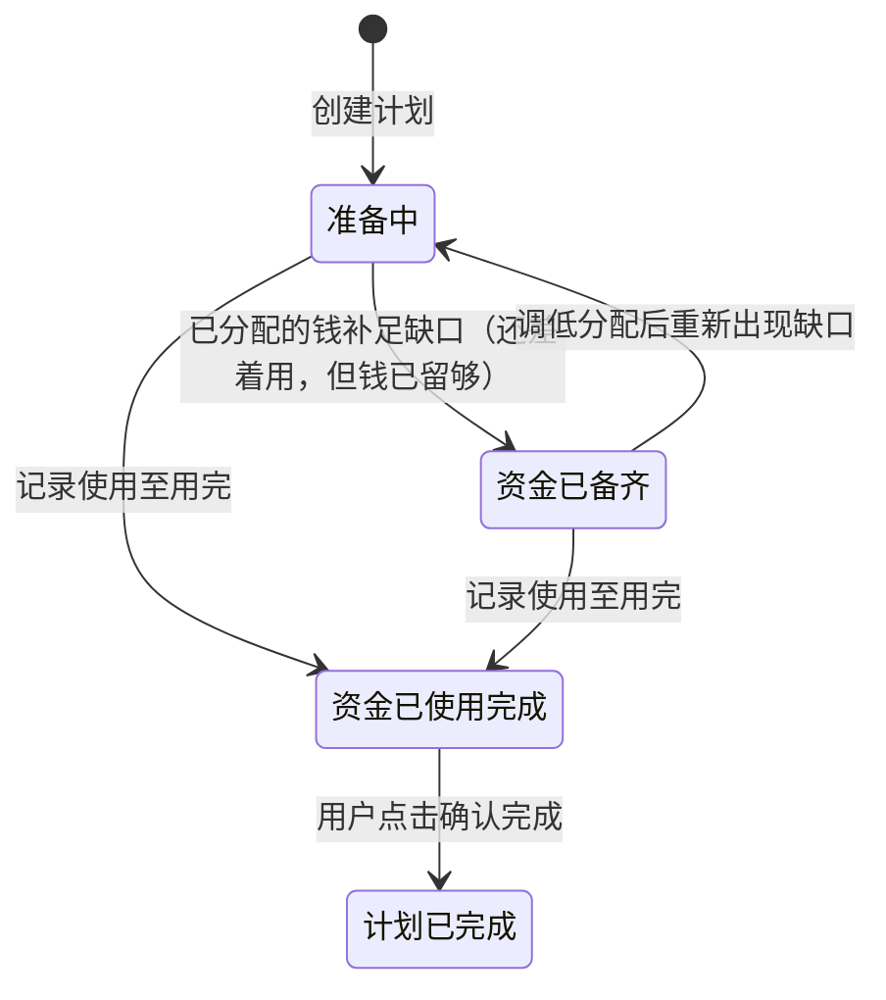

# 记录实际使用（M7 资金使用）需求文档

> 档位：Complex（涉及资金扣减、解锁 15/16/17/18 四项功能及完成判定，异常场景必展开）。
> 空章节写"无"，禁止编造。需求依据见文末附录，引用均带原文路径与行号。

## 1. 需求概述（限 200 字）

**用户故事**：作为正在执行换汇计划的用户，我想要把"这笔外币已经实际花出去了"记到对应的计划里，以便计划能反映真实的使用进度、账户余额保持准确，并在用完后由我确认计划完成。

**业务价值**：补上资金闭环的"出"方向（现有录入只记"进"）。上线后：计划不再永远停在"准备完成却无进展"的状态；账户余额与真实持有一致；"这个计划最终花了多少本币"有了数据来源。

**范围边界**：

- ✅ 本次包含：记录一笔实际使用（金额/日期/备注）、分次使用、按先进先出自动算使用成本、使用记录列表、准备与使用双进度、还需使用金额与"资金已备齐/资金已使用完成"状态、与"确认完成"的联动、账户流水页使用行显示成本。
- ❌ 本次不包含：修改/更正使用记录（下一期更正能力）、撤销整笔使用、不属于任何计划的使用记录、卖出外币、独立成本批次页面（依据 docs/MVP功能模块&业务逻辑&专业术语/13_MVP功能清单.md:55 "MVP暂不提供"）。

## 2. 术语对照表

以下定义沿用 docs/MVP功能模块&业务逻辑&专业术语/15_专业术语清单.md，本文全文严格遵照。

| 业务术语 | 本次含义界定 |
| ---------- | -------------- |
| 【确认使用】 | 记下一笔已经发生的计划用途支出，减少账户余额及计划分配金额（15_专业术语清单.md:32）。本文简称"记录使用"。 |
| 【累计已使用】 | 这个计划到目前为止实际使用的外币总额。 |
| 【还需使用金额】 | 目标金额减去累计已使用金额，最低记为 0。 |
| 【计划剩余分配】 | 留给这个计划、还没使用的外币金额。 |
| 【未分配余额】 | 账户中还没有留给任何计划的钱。 |
| 【钱已备齐】 | 计划还需要使用钱，但已分配的钱已经足够。 |
| 【资金已使用完成】 | 累计使用达到目标总额、剩余分配为 0 时的状态。 |
| 【先进先出】 | 同日先用初始持仓的成本，再按买入日期先后计算普通买入的使用成本；用户不必选择具体哪一笔钱。 |
| 【使用成本】 | 已经用于某个计划的外币，对应当初花了多少本位币。 |

## 3. 角色与权限

仅限已登录的计划所有者本人操作；只能给自己名下的计划记录使用，看不到也改不了别人的计划。

## 4. 核心业务流程

> 说明：判断顺序仅为展示；任一检查不过，本次都不记账。

## 5. 业务状态流转（计划资金状态）

计划详情页始终显示以下资金状态之一（与计划本身"进行中/已完成/已取消"是两个维度）：

> 各状态下用户能做什么：
>
> - **准备中（还有缺口）**：继续买入并分配、调整分配、记录使用（用多少记多少）。
> - **资金已备齐**：停止准备提醒；可记录使用；也可先不使用。
> - **资金已使用完成**：出现"完成确认"按钮；不点确认计划仍是进行中，系统绝不自动完成（14_业务逻辑清单.md:69）。
> - **计划已完成**：正常情况下不再有使用动作；误录调小属于下一期更正能力，本次不做。

## 6. 功能详细规则

### 6.1 记录使用入口与表单

- **入口**：计划详情页头部"记录使用"按钮，仅进行中的计划显示。
- **填写内容**：
  - 使用金额：必填，大于 0；日元、韩元为整数，其余币种最多 2 位小数（与录入买入的金额规则一致）；不能超过该计划剩余分配。
  - 使用日期：必填，默认今天；可以补录过去的真实日期，不能填未来日期，不能早于记账起点；与记账起点同一天时，需用户额外确认"发生在记账起点之后、且未包含在初始金额里"。
  - 备注：可不填，方便备注"9 月学费"之类的用途。
- **确认前**：表单就地显示本次将产生的变化摘要（余额减少多少、剩余分配变多少、还需使用剩多少），用户点确认才生效；填写或查看过程不占用、不扣减任何金额。

### 6.2 分次使用与扣减规则

- 每次只扣本次使用的金额，其余金额继续留给计划（13_MVP功能清单.md:30）。
- 确认后同时发生三件事：账户余额减少本次金额；计划剩余分配减少本次金额；累计已使用增加本次金额。
- 资金准备够了不会自动扣减，必须由用户记录（04_外汇账户.md:39）。
- 例：给计划分配 6,000 美元，本次使用 4,000 后，账户余额减少 4,000，计划仍保留 2,000 待用（04_外汇账户.md:41）。

### 6.3 使用成本怎么算（先进先出）

- 系统按"先买入的资金先算使用成本"自动分摊，用户不必选择具体哪一笔，也没有单独的成本批次页面（04_外汇账户.md:43）。
- 同一天内先用初始持仓、再按买入先后；多笔使用同日按第一次录入顺序（02_初始化与录入闭环_待确认.md:78）。
- 例（15_专业术语清单.md:64）：先买 1,000 美元花 7,800 港币，再买 1,000 美元花 8,000 港币。使用 1,200 美元时，先算第一笔 1,000 的成本 7,800，再算第二笔 200 的成本 1,600，本笔使用成本 9,400 港币；剩下 800 美元对应成本 6,400 港币。
- 记录使用不删除、不改动任何原买入记录（04_外汇账户.md:43）。

### 6.4 计划进度与状态显示（准备、使用分开）

- **两条进度分开显示**：钱准备好了不等于已经花完（13_MVP功能清单.md:31）。
  - 准备进度：已分配的钱相对目标的比例（缺口为 0 即"资金已备齐"）。
  - 使用进度：累计已使用相对目标的比例。
- **还需使用金额** = 目标 − 累计已使用，最低为 0；目标不会被系统改写成还需金额（04_外汇账户.md:49）。
- **资金已备齐**：还需使用金额大于 0，且剩余分配已经够用；账户里的其他余额不自动计入。
- **资金已使用完成**：累计使用达到目标总额、剩余分配为 0；之后由用户确认计划完成。
- 现状修正：当前计划详情把"累计已使用/目标"当成准备进度显示，本次起两条进度各归各位。

### 6.5 使用记录列表

- 位置：计划详情页"使用记录"区。
- 每行显示：使用日期、金额、备注（未填则不显示）、本笔使用成本（本位币）。
- 排序：按使用日期由近到远；同一天按录入先后倒序。
- 空状态：显示"还没有使用记录"，并保留"记录使用"入口。
- 已取消的计划：历史使用记录仍然可见（13_MVP功能清单.md:33 功能 19）。
- 账户流水页：使用行显示本笔成本（此前无使用数据故留空，本次补齐显示）。

### 6.6 与"确认完成"的衔接

- 达到"资金已使用完成"后，详情页出现"完成确认"按钮；点击后二次确认，计划变为已完成。
- 未达标（含存在超额记录的异常情况）时按钮不出现，系统给出还差多少的提示。
- 完成永远由用户点击触发，系统不自动完成（14_业务逻辑清单.md:69）。

## 7. 业务异常与边界（资金场景）

- **金额超出剩余分配**：提示剩余分配不足并展示当前剩余，本次不记账；引导用户先调整分配。不能"先透支再补买入"（02_初始化与录入闭环_待确认.md:82）。
- **日期异常**：晚于今天、早于记账起点，分别给出可区分的提示；与起点同日需额外确认。
- **重复操作**：确认按钮点击后立即置为处理中，处理期间不能再次提交；同一笔确认只记一笔。
- **中途中断**：记账是一次完整动作，要么整笔成功，要么整笔不生效；绝不出现"余额扣了但没有这笔使用记录"或相反的半条状态。
- **已取消/已完成的计划**：不显示"记录使用"入口；直接尝试也只会得到"仅进行中的计划可记录使用"的提示。
- **留痕**：每笔使用记录保留日期、金额、备注与成本；本期内记录不可改不可删（更正能力下一期提供，原记录永远保留）。
- **失败处理**：失败时明确提示原因（金额超了/日期不对/计划状态不对），不自动重试；数据保持原样。

## 8. 验收标准（Given-When-Then）

- **场景 1（分次使用扣减）**：假如计划目标 10,000、已分配 10,000、尚未使用，当用户记录一笔 4,000 的使用，那么账户余额减少 4,000、剩余分配变为 6,000、累计已使用变为 4,000、还需使用显示 6,000，计划仍显示"资金已备齐"（14_业务逻辑清单.md:110 例01）。
- **场景 2（先进先出算成本）**：假如先买 1,000 美元花 7,800 港币、再买 1,000 美元花 8,000 港币，当用户记录使用 1,200 美元，那么本笔使用成本显示 9,400 港币，剩余 800 美元对应 6,400 港币，全程无需用户选择用哪笔钱。
- **场景 3（用完与完成确认）**：假如累计使用已等于目标且剩余分配为 0，当用户打开详情页，那么显示"资金已使用完成"并出现"完成确认"；当用户点击并二次确认，那么计划变为已完成；假如用户不点，那么计划保持进行中。
- **场景 4（超额拦截）**：假如计划剩余分配为 2,000，当用户填入 2,500 并确认，那么提示剩余分配不足，余额、分配、进度全部不变，列表不新增记录。
- **场景 5（日期拦截）**：假如用户把使用日期填成明天，当提交时，那么提示"不能晚于今天"且不记账；假如填成记账起点之前的日子，那么提示"不能早于记账起点"且不记账。
- **场景 6（状态拦截）**：假如计划已取消，当用户尝试记录使用，那么得到"仅进行中的计划可记录使用"的提示，数据不变。
- **场景 7（重复提交）**：假如用户快速连点确认两次，当两次请求先后到达，那么只有第一笔记账成功，第二笔被拦截，余额只扣一次。
- **场景 8（还需金额与状态联动）**：假如目标 10,000、已使用 10,000、剩余分配 0，当查看计划详情，那么还需使用金额显示 0、状态显示"资金已使用完成"；假如已使用 11,000（异常超额），那么还需仍显示 0 且不出现完成确认按钮。
- **场景 9（使用记录列表）**：假如用户已记录两笔使用，当打开使用记录列表，那么按日期由近到远显示每笔的日期、金额、备注与成本；假如一笔都没记过，那么显示空状态提示。
- **场景 10（整笔生效）**：假如记账过程中任何一步失败，当用户回到计划详情，那么看不到半条记录，余额与分配保持原样。

## 9. 优先级分层（MoSCoW）

- **Must Have**（没有则本模块无意义）：记录使用（金额/日期）、分次使用、余额与分配扣减、先进先出算成本、双进度显示、还需使用金额与两个资金状态、使用记录列表、完成确认联动。
- **Should Have**（可协商延后但强烈建议）：备注项；列表与账户流水中显示每笔使用成本。
- **Could Have**：无。
- **Won't Have**（本次明确不做）：使用更正与撤销、无计划使用、独立成本批次页面、自动完成计划、卖出外币。

## 10. 非功能要求

个人工具量级，无特殊性能与容量要求；操作响应与现有页面一致。记账类操作必须整笔生效或整笔不生效（见 §7 中途中断）。

## 11. 需求依据（权威原文出处）

| 依据 | 位置 |
| ------ | ------ |
| 「记录实际使用」「区分已备齐和已使用完成」定义 | docs/MVP功能模块&业务逻辑&专业术语/04_外汇账户.md:37、docs/MVP功能模块&业务逻辑&专业术语/04_外汇账户.md:47 |
| 功能 15/16/17/18 定义 | docs/MVP功能模块&业务逻辑&专业术语/13_MVP功能清单.md:29-32 |
| 使用记录规则与完成不自动判定 | docs/MVP功能模块&业务逻辑&专业术语/14_业务逻辑清单.md:66-74 |
| 同日处理顺序：初始持仓→普通买入→实际使用 | docs/MVP功能模块&业务逻辑&专业术语/02_初始化与录入闭环_待确认.md:78 |
| 术语定义 | docs/MVP功能模块&业务逻辑&专业术语/15_专业术语清单.md:31-33 |
| 算例（例01 分次使用仍备齐） | docs/MVP功能模块&业务逻辑&专业术语/14_业务逻辑清单.md:110-124 |
| 使用更正规则（下一期范围，本期仅预留边界） | docs/MVP功能模块&业务逻辑&专业术语/10_资金使用记录更正.md |
| 现状审计（M7 未开工、阶段 1 计划） | changes/mvp-completion/审查报告与开发计划.md 阶段 1 |
