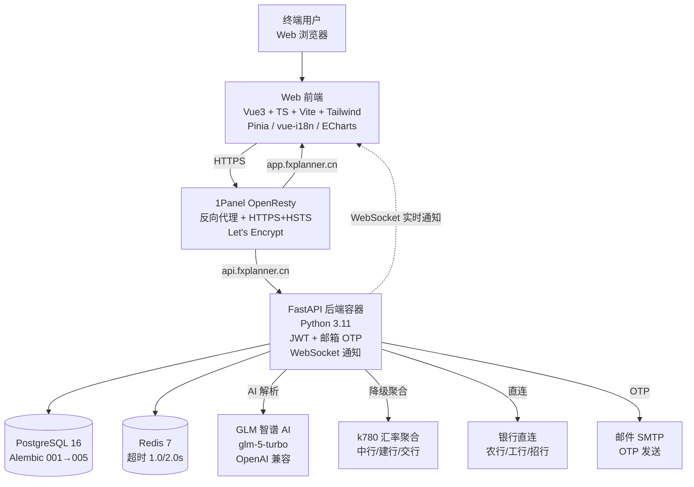
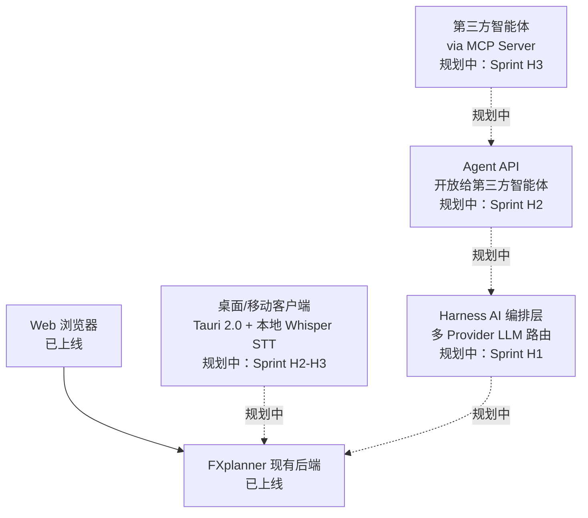
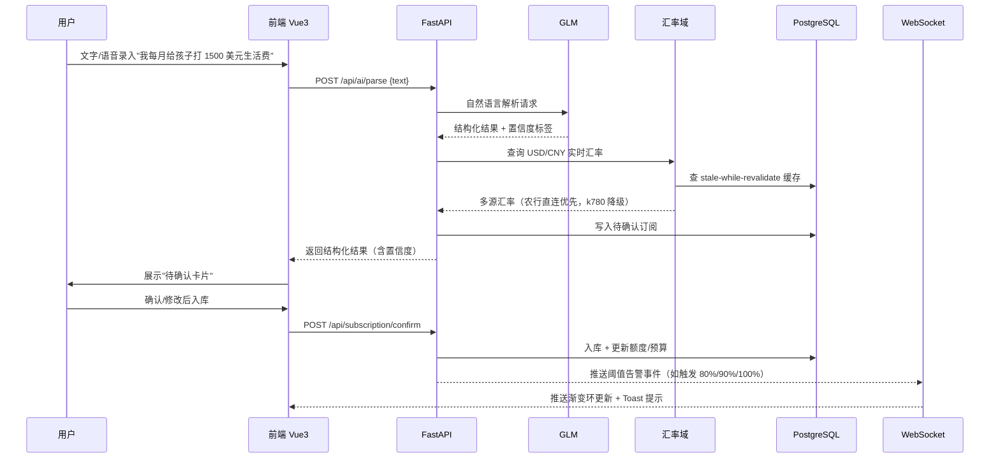

# Step 1 — 一、技术可行性分析

**写作日期**：2026-05-05
**事实来源**：`Step0_原型事实清单.md`（2026-05-05 锁定）+ `Step0_数据基线锁定_v1.2.md`（2026-05-05 锁定）
**写作口径**：孵化器 / 创业大赛 / 创业补贴申报口径；以"对已上线原型做结构化转写"为基调，避免对外融资 BP 措辞
**对应附件 2 要求**：(1) 项目名称；(2) 技术内容、原理、创新点、水平、指标、用途、应用范围；(3) 国内外现状与趋势；(4) 小批量小规模试生产；(5) 实际使用条件下的可靠性、耐久性、安全性考核；(6) 知识产权权属与专利、测试、鉴定、获奖
**占位符**：`[ICP-PLACEHOLDER]` 待项目方提供 ICP 备案号实物字符串后替换
**状态**：✅ 初稿完成；下游 Step 2 / Step 3 / Step 6 直接引用本章节

---

## 1.1 项目名称与定位（一页项目技术概述）

| 字段 | 值 |
|---|---|
| **项目标准中文名称** | FXplanner 跨币种现金流规划与外汇成本优化工具 |
| **项目英文名称** | FX Planner（曾用名 FX Sub Saver）|
| **项目简称** | FXplanner |
| **公网访问域名** | `https://app.fxplanner.cn`（HTTPS + HSTS 已启用）|
| **API 域名** | `https://api.fxplanner.cn` |
| **当前版本** | v3.51（2026-04-15）|
| **服务节点** | 阿里云 ECS `fxplanner-prod`（华东 1 杭州）|
| **ICP 备案** | 2026-04-09 通过；备案号 `[ICP-PLACEHOLDER]` |
| **SSL 证书** | Let's Encrypt（DNS 验证），有效期至 2026-07-08，自动续期 |

**一句话定义**：面向中国大陆用户的外币支出管理工具——记账 + 汇率信息助手；不触碰支付清算与投资建议，定位于"规划层"的中立信息服务。

**核心问题**：中国大陆居民在留学、跨境工作、跨境自由职业、出境消费等场景下，每年人均存在 ¥2,590-6,335 的可避免外汇成本损失（来源：`Step0_数据基线锁定_v1.2.md` 表 E）。损失的根本原因不是缺资金，而是缺一个"在花钱之前"做最优决策的工具。

**解决方案**：FXplanner 提供三件能力——(a) 多源银行汇率与信用卡费率聚合，(b) AI 自然语言交易事件录入与置信度标注，(c) 跨币种现金流建模与提醒引擎；通过 Web 端（已上线）与未来桌面/移动端（Tauri 2.0 规划中）覆盖用户全场景。

---

## 1.2 技术内容与基础原理

### 1.2.1 总体架构

FXplanner 采用 **前后端分离 + 后端 DDD 六大上下文 + 数据库/缓存分离 + 反向代理 + 容器编排** 的现代化 Web 服务架构，部署于阿里云华东节点的境内环境，遵循数据本地化要求。

### 1.2.2 系统架构与数据流图

**当前架构（已上线）**



**规划扩展架构（Sprint H1-H3 + 移动端规划，2026 Q3 起）**



> 说明：第二张图的 Tauri 客户端、Harness、Agent API、MCP Server **均为规划项**，对应 Sprint H1-H3（2026 Q3-Q4）；当前生产环境仅运行第一张图所示的 Web 端架构。

### 1.2.3 数据流（典型业务场景）



### 1.2.4 后端 DDD 六大上下文

```
backend/
├── shared/            共享内核（crypto、依赖注入）
├── identity/          认证与用户（JWT + 邮箱 OTP + 微信 OAuth）
├── subscription/      订阅域（CRUD、状态机、成本链路 A→B→C 最多 3 步）
├── quota/             额度与预算（年度便利化 5 万美元 + 月度预算 + 三档阈值告警）
├── exchange_rate/     汇率域（多源聚合 + 银行牌价 + 信用卡费率）
├── ai_interaction/    AI 交互（LLM 解析 + 置信度标签 + 待确认流）
└── notification/      实时通知（WebSocket + 票据认证 + 5 类事件 + 指数退避重连）
```

### 1.2.5 关键技术原理

| 模块 | 原理 |
|---|---|
| **多源汇率聚合** | 直连层（农行无认证 / 工行 POST+Referer / 招行 Origin+Referer）+ 聚合降级层（k780 双参数认证 appkey + sign，覆盖中行 / 建行 / 交行）；前端 localStorage stale-while-revalidate（15 min TTL），后端 Redis 缓存 + 并发化请求；首次响应 ~1.7s，二次访问 0ms |
| **AI 自然语言录入** | LLM（GLM glm-5-turbo，OpenAI 兼容协议）→ 结构化字段抽取 → 置信度标签（高/中/低）→ 待确认流 → 用户确认/修改后入库；LLM 不可用时自动退回手动表单（fail-soft）|
| **跨币种现金流建模** | 成本链路 A→B→C 最多 3 步货币转换；套利检测覆盖 CNY → JPY → USD 等路径，正负值附"节省/损耗 X.XX%"语义标签 |
| **额度与预算引擎** | 年度购汇额度（5 万美元法规额度）+ 前瞻性预估（已用 / 含下笔 / 预估年底）；月度预算自然语言配置；三档阈值告警（80% 信息 / 90% 警告 / 100% 柜台办理告知）|
| **实时通知** | WebSocket + 票据认证 + WS URL 自动推导 + 严格 fail-closed + 指数退避重连；5 类事件（额度告警 / 预算告警 / 套利提示 / 主动提示卡片 / 系统通知）|
| **中立信息层** | 业务边界严格限定为"信息服务与规划工具"；不参与支付、清算、换汇执行、资金托管，不依赖任何金融牌照 |

---

## 1.3 创新点与技术水平

### 1.3.1 三类创新点

| 类别 | 描述 | 申报支撑 |
|---|---|---|
| **应用创新** | 较早聚焦中国大陆外币支出"规划层"场景的工具——区别于资金执行型产品（不参与支付与执行），专注于"在花钱之前帮用户做最优决策" | 国内现有同类产品多为"事后记账"（如 MoneyWiz、随手记）或"换汇执行"（如银行 App、Wise）；FXplanner 在"花钱之前"环节切入，与上述类别形成场景互补 |
| **技术创新** | LLM 解析 + 置信度待确认流 + 实时 WebSocket 通知三件套；银行直连 + k780 聚合双层降级架构 | LLM 输出不直接入库，必经"用户确认"环节，规避 AI 幻觉对账务数据的污染；汇率层双层降级保障"任一银行/聚合商失效不影响整体服务" |
| **合规创新** | 零资金触达边界（不做支付/代付/账单关联/汇率预测/自动购汇/外汇便利化额度规避建议），不依赖任何金融牌照即可服务跨境支出场景 | 与监管口径（外管局便利化额度、PIPL 数据本地化）天然兼容；当前已具备 ICP 备案与境内云资源；数据存储边界遵循 PIPL（不存银行卡号 / 身份证 / 真实交易流水 / 任何支付凭证）|

### 1.3.2 技术水平判断

| 维度 | 水平判断 | 依据 |
|---|---|---|
| **架构现代化程度** | 达到同类工具较高工程化水平 | DDD 六大上下文 + Vue3 Composition API + FastAPI + Alembic 迁移 + Docker Compose + GitHub Actions 双门禁 + 1Panel OpenResty 反代，全栈采用 2024-2026 主流技术选型 |
| **AI 能力深度** | 在个人外汇规划场景已形成完整闭环 | LLM 解析 + 置信度待确认流 + 离线降级三层兜底；AI 承担数据录入主路径，非贴标签式应用 |
| **数据可靠性** | 已通过 257 项测试验证 | 单元 + 集成 + E2E（Playwright）共 257 passed, 0 failed；CI/CD 双门禁拦截不合规提交 |
| **运维成熟度** | 已实现自动化生产部署 | Docker Compose 5 容器编排 + GitHub Actions（pytest + vite build → SSH 部署 → Alembic 迁移 → 健康检查）+ 1Panel OpenResty 反代 + Let's Encrypt SSL 自动续期 |
| **国际化覆盖** | 三语已上线 | 中文 / English / 日本語；登录后自动恢复语言；Settings 重置即时生效 |

### 1.3.3 竞品技术能力对照（项目方自行整理，非第三方鉴定）

下表用于支撑 1.3.2 的"较高工程化水平"判断；数据来源为各产品公开资料与项目方实测，非第三方权威评测，特此声明。

| 能力维度 | FXplanner（本项目）| 国内事后记账类 | 国内换汇执行类 | 海外多币种钱包 | 海外 AI 财务助手 |
|---|---|---|---|---|---|
| 多源银行牌价聚合 | ✅ 直连 3 行 + 聚合降级 3 行 | ❌ 无 | ⚠️ 仅自家牌价 | ⚠️ 仅自家中间价 | ❌ 无 |
| 信用卡外汇费率库 | ✅ 七行标准 + 零费率代表卡 | ❌ 无 | ❌ 无 | ❌ 无 | ❌ 无 |
| AI 自然语言录入 + 置信度待确认流 | ✅ 已上线 | ⚠️ 部分有 AI 标签 | ❌ 无 | ❌ 无 | ⚠️ 仅分类提示 |
| 跨币种成本链路（A→B→C）| ✅ 最多 3 步 | ❌ 无 | ❌ 无 | ⚠️ 单步换汇 | ❌ 无 |
| WebSocket 实时阈值告警 | ✅ 5 类事件 + 票据认证 | ❌ 无 | ⚠️ 推送通知 | ⚠️ 推送通知 | ⚠️ 推送通知 |
| 年度便利化 5 万美元额度追踪 | ✅ 含前瞻性预估 | ❌ 无 | ⚠️ 仅本行额度 | ❌ 无 | ❌ 无 |
| 资金触达 / 是否需金融牌照 | ❌ 不触达 / 无需牌照 | ❌ 不触达 | ✅ 触达 / 需牌照 | ✅ 触达 / 需外资牌照 | ❌ 不触达 |
| 大陆数据本地化 | ✅ 阿里云华东 + ICP 备案 | ✅ | ✅ | ❌ 通常境外节点 | ❌ 通常境外节点 |

**结论**：在"规划层 + 多源汇率聚合 + AI 录入 + 大陆合规"四个维度的组合上，本项目相对国内外同类工具具备明显差异化；单项工程化水平达到同类工具较高水准。

---

## 1.4 技术指标与应用范围

### 1.4.1 技术指标表

| 类别 | 指标 | 当前值 | 目标值（2027 末）|
|---|---|---|---|
| **测试质量** | 单元 + 集成 + E2E 通过数 | 257 passed, 0 failed | 400+ passed |
| **测试质量** | E2E 框架 | Playwright（127.0.0.1:4173 strictPort）| 维持 |
| **数据库** | 迁移版本 | Alembic 001→005 全部生产执行 | Alembic 001→015+ |
| **可用性** | HTTPS + HSTS | ✅ 已启用 | 维持 |
| **可用性** | SSL 证书 | Let's Encrypt 至 2026-07-08，自动续期 | 自动续期不间断 |
| **认证安全** | 邮箱 OTP 登录 | ✅ 已上线（两步式：请求 → 验证）| 维持 + 接入企业邮件通道 |
| **认证安全** | JWT + Refresh Token | ✅ HttpOnly Cookie | 维持 |
| **认证安全** | 微信 OAuth | Mock/Sandbox 已可用，生产待企业资质 | 生产化 |
| **数据保护** | 生产 SECRET_KEY 强校验 | ✅ 启动时校验 | 维持 |
| **数据保护** | 错误信息不外泄 | ✅ 生产模式屏蔽 traceback | 维持 |
| **数据保护** | N+1 防护 | ✅ ORM 层 eager loading | 维持 |
| **数据存储边界** | 不存银行卡号 / 身份证 / 真实交易流水 / 任何支付凭证 | ✅ 严格遵守 | 维持 |
| **缓存** | Redis 连接超时 / 读超时 | 1.0s / 2.0s | 维持 |
| **汇率性能** | 银行牌价首次响应 | ~1.7s | < 1.5s |
| **汇率性能** | 银行牌价二次响应 | 0ms（localStorage 命中）| 维持 |
| **汇率覆盖** | 银行牌价直连 | 农行 / 工行 / 招行 | 扩至 5 行直连 |
| **汇率覆盖** | 银行牌价降级聚合 | k780（中行 / 建行 / 交行）| 维持 |
| **汇率覆盖** | 信用卡外汇费率库 | 七行标准手续费 + 零费率代表卡 | 扩至 12 行 |
| **AI 能力** | LLM Provider | GLM glm-5-turbo（OpenAI 兼容）| 维持 + Harness 多 Provider 编排 |
| **AI 能力** | 离线降级 | LLM 不可用自动退回手动表单 | 维持 |
| **国际化** | 语言数 | 3（中 / 英 / 日）| 维持 |
| **响应式** | 设备适配 | 桌面 Popover / 移动 Bottom Sheet | 维持 + Tauri 移动端原生 |
| **CI/CD** | 双门禁 | pytest + vite build | 维持 + 加 e2e 门禁 |
| **CI/CD** | 部署链路 | SSH 部署 → Alembic 迁移 → 健康检查 | 维持 |

### 1.4.2 应用范围

按"用户类型 × 使用场景"两维矩阵展开，涵盖中国大陆外币支出主流人群：

| 用户类型 | 典型场景 | FXplanner 价值 | 用户基数估算 |
|---|---|---|---|
| 中国留学生（海外在读存量）| 学费汇款、生活费、订阅、跨境购物 | 多币种成本对比、月度预算告警、家长共享视图 | 90-105 万人（基准 105 万）|
| 留学生家长 | 跨境汇款规划、年度便利化 5 万美元额度追踪 | 额度前瞻性预估、最优汇款时点提示、合规边界提醒 | 与留学生 1:1-1:2 比例 |
| 跨境工作者（赴港/海外活跃池）| 跨境工资换汇、跨境消费、跨币种投资记账 | 多账户统一视图、汇率成本可视化 | 40 万人（商业假设）|
| 跨境自由职业 / 独立开发者 | 跨境收款、跨币种成本管理、跨境订阅 | 收支双向汇率成本计算、套利路径检测 | 30 万人（商业假设）|
| 高消费出境旅行者 | 出行前换汇规划、信用卡外汇费率对比 | 信用卡费率库、最优支付方式推荐 | 500 万人活跃池（商业假设）|

注：用户基数源自 `Step0_数据基线锁定_v1.2.md` 表 B；除留学生在读存量为跨国官方统计支撑（置信度中），其余为可比数据折算估算（置信度低）。

---

## 1.5 国内外技术现状与趋势

### 1.5.1 国内外现状

| 区域 | 主流类型 | 代表产品 | 与 FXplanner 差异 |
|---|---|---|---|
| **国内** | 事后记账类 | 随手记、Money Pro 国内版 | 仅记账，无外汇规划层；无 AI 自然语言录入 |
| **国内** | 银行 / 换汇执行 App | 各大行手机银行、支付宝跨境汇款 | 仅服务于"执行"环节，无"花钱之前"决策辅助 |
| **国内** | 跨境支付 | 微信跨境钱包、银联 UnionPay | 资金触达型，受牌照监管；不提供成本对比与规划 |
| **国外** | 多币种钱包 | Wise（前 TransferWise）、Revolut | 资金触达型，外资身份难合规进入大陆；无中文化深度适配 |
| **国外** | 个人记账 SaaS | YNAB、MoneyWiz | 通用记账，不专注外汇；无国内汇率源、无信用卡费率库 |
| **国外** | AI 财务助手 | Cleo、Copilot Money | AI 仅做分类与提醒，未深入外汇规划领域 |

### 1.5.2 技术趋势

| 趋势 | FXplanner 的定位 |
|---|---|
| **LLM 进入个人财务工具主流路径** | 已落地：自然语言录入 + 置信度待确认流；下一步通过 Sprint H1 Harness 实现多 Provider 编排（不绑定单一 LLM 厂商）|
| **跨平台桌面/移动端框架成熟（Tauri 2.0）** | Sprint H2-H3 规划：基于 Tauri 2.0 推出 Windows/macOS/iOS/Android 客户端；离线 STT 路径用本地 Whisper 替代浏览器 STT |
| **MCP（Model Context Protocol）成为 AI 工具互操作标准** | Sprint H3 规划（2026 Q4）：开放 MCP Server，允许第三方智能体（Claude / GPT / 本地 LLM）调用 FXplanner 能力 |
| **数据本地化与隐私合规收紧** | 已落地：境内阿里云华东节点、PIPL 边界（不存身份证 / 卡号 / 流水）；为后续 GDPR / 港澳台合规扩展预留架构 |
| **开放 API + 智能体生态** | Sprint H2 规划：外部 Agent API（开放给第三方智能体调用）|

---

## 1.6 小规模试运行情况

按附件 2 "小批量小规模试生产" 要求，数字产品适配为"小规模线上灰度运行 + Sprint 渐进式发布"：

### 1.6.1 试运行总体状态

- **试运行模式**：小规模线上灰度运行
- **公网入口**：`https://app.fxplanner.cn`（HTTPS + HSTS）
- **试运行起始**：Sprint 0 项目初始化以来持续迭代，2026 年完成 Sprint 8B 生产部署后正式对外运行
- **当前版本**：v3.51（2026-04-15）
- **运行节点**：阿里云华东 1（杭州）ECS `fxplanner-prod`
- **合规资质**：ICP 备案 `[ICP-PLACEHOLDER]`（2026-04-09 通过）

### 1.6.2 试运行已交付的核心能力（"已上线"事实集）

按 `Step0_原型事实清单.md` 第 4 节，下列 18 项能力已在线运行；核心路径已纳入自动化测试，覆盖状态分项标注如下（"覆盖"= 单元/集成/E2E 任一层有用例覆盖；"部分覆盖"= 仅基础路径有用例，分支与异常路径待补；"人工验证"= 当前以 Sprint Demo 环节人工验证为主，自动化用例待补）：

| # | 能力 | 实现状态 | 测试证据 / 覆盖状态 |
|---|---|---|---|
| 1 | 邮箱 OTP 登录（生产环境承担登录主路径；开发/测试环境另设独立测试通道，与生产环境物理隔离）| ✅ 已上线 | ✅ 覆盖（Sprint 10 邮箱 OTP 全链路用例）|
| 2 | 微信 OAuth Mock/Sandbox | ✅ 已上线（生产待企业资质）| ✅ 覆盖（Sprint 4 集成测试，仅 Mock/Sandbox 链路）|
| 3 | AI 自然语言录入（文字/语音 → STT → LLM → 置信度 → 待确认 → 入库）| ✅ 已上线 | ✅ 覆盖（Sprint 5 完整交付用例）|
| 4 | 批量录入（一段话解析多个订阅）| ✅ 已上线 | ⚠️ 部分覆盖（基础路径已覆盖，复杂句式待补）|
| 5 | 离线降级（LLM 不可用退回手动表单）| ✅ 已上线 | ✅ 覆盖（Sprint 5 fail-soft 用例）|
| 6 | 年度购汇额度追踪（5 万美元 + 前瞻性预估）| ✅ 已上线 | ✅ 覆盖（Sprint 6）|
| 7 | 月度预算（自然语言配置 + 三档阈值告警 80%/90%/100%）| ✅ 已上线 | ✅ 覆盖（Sprint 6 阈值告警单元 + 集成）|
| 8 | 头像渐变环（外环年度 + 内环月度，桌面 Popover / 移动 Bottom Sheet）| ✅ 已上线 | ⚠️ 部分覆盖（数据计算已覆盖，UI 渲染以人工验证为主）|
| 9 | WebSocket 实时通知（5 类事件 + 票据认证 + 严格 fail-closed + 指数退避重连）| ✅ 已上线 | ✅ 覆盖（Sprint 7 安全加固用例）|
| 10 | 闲置自动登出（30 分钟 + 提前 2 分钟倒计时警告）| ✅ 已上线 | ✅ 覆盖（Sprint 8A E2E）|
| 11 | 银行牌价直连（农行 / 工行 / 招行）+ 聚合降级（中行 / 建行 / 交行 via k780）| ✅ 已上线 | ✅ 覆盖（Sprint 9A/9B/9C 全栈用例）|
| 12 | 银行牌价性能（首次 ~1.7s，二次 0ms）| ✅ 已上线 | ⚠️ 部分覆盖（功能用例齐全，性能基线由 Sprint 13D 修复时人工实测）|
| 13 | 信用卡外汇费率库（七行标准 + 零费率代表卡）| ✅ 已上线 | ✅ 覆盖（数据层用例）|
| 14 | Toast 通知系统（单例 + Portal 容器，success/error/info）| ✅ 已上线 | ⚠️ 部分覆盖（Sprint 8C E2E 10 passed，覆盖 success/error/info 主路径）|
| 15 | 微交互（Focus Ring / Hover Lift / Press Active / Value Flash / Header 滚动毛玻璃）| ✅ 已上线 | 👁 人工验证（视觉/交互层，自动化 Demo 截图为辅）|
| 16 | 三语国际化（中 / 英 / 日，登录恢复语言，Settings 即时切换）| ✅ 已上线 | ✅ 覆盖（Sprint 8A 切换路径用例）|
| 17 | 主动提示卡片（距下笔扣款 ≤ 7 天且超阈值；按用户+按事件持久化）| ✅ 已上线 | ⚠️ 部分覆盖（持久化逻辑已覆盖，UI 触发条件以人工验证为主）|
| 18 | 套利检测（CNY → JPY → USD 路径，正负值附"节省/损耗 X.XX%"语义标签）+ 成本链路（A→B→C 最多 3 步）| ✅ 已上线 | ✅ 覆盖（成本链路 A→B→C 单元测试 + 套利路径用例）|

### 1.6.3 试运行迭代节奏（已完成 Sprint 0 → Sprint 13D）

| 阶段 | 主题 | 测试通过数累积 |
|---|---|---|
| Sprint 0~3 | 项目初始化、设计令牌、Dashboard 重构、订阅管理 | — |
| Sprint 4 | DDD 后端重构 + 微信登录基础 + 自动化测试体系 | 149 passed |
| Sprint 5 | AI 自然语言录入完整交付 | 163 passed |
| Sprint 6 | 额度环 + 月度预算 + 阈值告警 | 192 passed |
| Sprint 7 | WebSocket 实时通知 + 安全加固 | 217 → 223 passed |
| Sprint 8A / 8A-2 | 闲置自动登出 + i18n 三语 + Settings 重构 | — |
| Sprint 8B | **生产部署：Docker / GitHub Actions / GLM / Alembic 005 / 1Panel OpenResty / SSL** | 上线 ✅ |
| Sprint 8C | Toast / Focus Ring / Value Flash / Header blur / 深色横幅修复 | E2E 10 passed |
| Sprint 9A/9B/9C | 六行银行牌价全栈 | 254 passed |
| Sprint 10 | 邮箱 OTP 两步式登录 + 全量文档更新 | **257 passed** |
| Sprint 12A | UX 流程重塑（ConfigWizard / AddSubscriptionModal / AiParseResultCard）| — |
| Sprint 13A | 官网 Landing Page 暗色视觉 | — |
| Sprint 13B | 汇率趋势图（ECharts）+ 全局品牌色蓝→Emerald | — |
| Sprint 13C | 全站深色模式修复 + SettingsView 重设计 + Settings API 路由修复 | — |
| Sprint 13D | 银行牌价性能修复（首次 ~1.7s / 二次 0ms）| — |

**结论**：原型已完成 14+ 个 Sprint 的渐进式迭代，2026-04-09 ICP 备案通过后正式对外灰度开放，处于小规模试运行阶段；具备进一步扩大用户规模的技术与合规基础。

---

## 1.7 实际使用条件下的可靠性、耐久性、安全性考核

### 1.7.1 测试与质量考核

| 类别 | 指标 | 当前实测值 |
|---|---|---|
| 测试总数 | 单元 + 集成 + E2E | **257 passed, 0 failed** |
| E2E 框架 | Playwright | 固定 `127.0.0.1:4173 strictPort` 避免端口占用 |
| 历史轨迹 | Sprint 7 → Sprint 10 | 223 → 227 → 250 → 254 → **257**（持续上升）|
| 数据库迁移 | Alembic | 001 → 005 全部生产执行成功 |
| CI/CD 门禁 | pytest + vite build 双门禁 | 任一失败即拒绝合并与部署 |
| 部署链路 | SSH 部署 → Alembic 迁移 → 健康检查 | 已自动化，单次部署回滚时间 < 5 分钟 |

### 1.7.2 安全性考核

| 维度 | 实施措施 |
|---|---|
| **传输安全** | HTTPS + HSTS 强制；Let's Encrypt SSL（DNS 验证），自动续期 |
| **认证安全** | 邮箱 OTP 两步式登录（请求 OTP → 验证码登录）；JWT + Refresh Token HttpOnly Cookie；微信 OAuth 走 Mock/Sandbox（生产待资质）|
| **会话安全** | 闲置 30 分钟自动登出；提前 2 分钟弹出倒计时警告 + "立即退出"次级按钮 |
| **生产配置安全** | 启动时强校验 `SECRET_KEY` 非默认值；生产模式屏蔽 traceback 与详细错误信息 |
| **数据库安全** | N+1 查询防护（ORM 层 eager loading）；Alembic 严格迁移；连接池配置 |
| **缓存安全** | Redis 连接超时 1.0s / 读超时 2.0s，避免 Redis 故障拖垮整体服务 |
| **WebSocket 安全** | 票据认证 + 严格 fail-closed + 指数退避重连 |
| **数据存储边界** | 不存银行卡号 / 身份证 / 真实交易流水 / 任何支付凭证；遵循 PIPL |
| **节点合规** | 阿里云华东 1（杭州），境内数据本地化 |

### 1.7.3 可靠性与耐久性考核

| 维度 | 实施措施 |
|---|---|
| **服务降级** | LLM 不可用 → 退回手动表单（fail-soft）；银行直连失败 → k780 聚合降级；缓存失效 → 数据库直查 |
| **性能优化** | 银行牌价首次 ~1.7s，二次 0ms（localStorage stale-while-revalidate 15min TTL + k780 并发化 + Redis 超时控制）|
| **运维监控** | 健康检查端点（部署后自动校验）；CI/CD 双门禁（pytest + vite build）拒绝不合规提交 |
| **容器化** | Docker Compose 5 容器编排（前端 / 后端 / PostgreSQL / Redis / 反代）|
| **反向代理** | 1Panel OpenResty 替代 Docker Nginx 容器，统一 SSL 卸载与路由 |

### 1.7.4 试运行考核结论

按数字产品的试运行考核口径：

- **可靠性**：已具备稳定运行基础——14+ 个 Sprint 持续迭代；257 项自动化测试当前全部通过；CI/CD 双门禁拦截不合规提交；汇率/AI/缓存三层降级路径在测试环境已验证。可用率、累计运行天数、部署次数、健康检查记录、已知故障与修复记录待补充至运维监控小节（见 1.7.5）。
- **耐久性**：2026-04-09 ICP 备案通过后已对外运行；Let's Encrypt SSL 自动续期；阿里云华东节点提供基础设施长期可用性。
- **安全性**：HTTPS + HSTS、JWT + OTP、生产 SECRET_KEY 校验、N+1 防护、严格 fail-closed、PIPL 数据边界——七层安全措施已落地。

### 1.7.5 运维与监控数据补录计划

下列数据为后续补录项，定稿前由运维侧从生产环境导出并填入；当前章节先以"待补"承接，避免引用未审计的可用率结论：

| 指标 | 来源 | 补录窗口 |
|---|---|---|
| 试运行起算日 | 2026-04-09 ICP 备案通过日 | ✅ 已确定 |
| 累计运行天数 | 截至定稿日实测 | 定稿前 1 周 |
| 已部署次数 | GitHub Actions 部署历史 | 定稿前 1 周 |
| 健康检查通过率 | CI/CD 健康检查日志（最近 30 天）| 定稿前 1 周 |
| 已知故障与修复记录 | CHANGELOG.md / Issue 记录 | 定稿前 1 周 |
| 服务可用率（月度）| 待接入 Uptime 监控后补充 | 2026 H2 |

---

## 1.8 知识产权权属与申报计划

### 1.8.1 已具备的知识产权与资质

| 类别 | 状态 | 详情 |
|---|---|---|
| **域名** | ✅ 已注册 | `fxplanner.cn` 主域，多年续费策略，权属归项目方 |
| **ICP 备案** | ✅ 2026-04-09 通过 | 备案号 `[ICP-PLACEHOLDER]`（定稿前替换为真实字符串）|
| **SSL 证书** | ✅ 已部署 | Let's Encrypt（DNS 验证），有效期至 2026-07-08，自动续期 |
| **核心规则库与 LLM 提示词** | 🔒 商业秘密 | 权属归项目方；以"商业秘密"形式保护，不公开发布 |
| **完整源码** | 🔒 私有仓库 | 项目方独立持有；不开源 |
| **完整文档资产** | ✅ 已沉淀 | SPEC.md / PRD.md / TECH_ARCHITECTURE.md / DEPLOYMENT_GUIDE.md / TEST_REPORT.md / CHANGELOG.md 等 11+ 份产品技术文档 |
| **原型设计稿** | ✅ 已沉淀 | `design/web-design.pen`（36+ 画板单一原型文件）|

### 1.8.2 申报计划（2026 H2 - 2027）

| 类别 | 提交时间 | 提交内容 | 预算（含官费 + 代理费）|
|---|---|---|---|
| **计算机软件著作权（首批）** | 2026 H2（计划 2026 年 7-12 月）| FXplanner 主程序（前端 + 后端整体登记）| 0.05-0.2 万元 |
| **商标（首批）** | 2026 H2（计划 2026 年 7-12 月）| "FXplanner"（英文）+ "凯衍磁缘"（中文），核心类目 9 / 35 / 42 | 0.3-0.6 万元 |
| **计算机软件著作权（增项）** | 2027 H1 | Harness AI 编排子系统、Agent API 子系统等模块化登记 | 0.05-0.2 万元/件 |
| **商标（增项）** | 2027 视需要 | 扩展类目（如出版、教育、广告等）| 0.1-0.3 万元/类 |
| **发明专利** | ⏳ 暂无明确计划 | 视核心算法（如套利路径检测、置信度待确认流编排）独创性再评估 | — |

### 1.8.3 专利、测试、鉴定、获奖状态表（按附件 2 第 6 项要求显式交代）

下表用于完整覆盖附件 2 "知识产权权属与专利、测试、鉴定、获奖" 一项；对暂无项做明确说明，避免被认为漏项：

| 类别 | 状态 | 说明 / 计划 |
|---|---|---|
| 发明专利 | ⏳ 暂无 | 视核心算法（如套利路径检测、置信度待确认流编排）独创性再评估；当前不作为申报硬指标 |
| 实用新型专利 | ⏳ 暂无 | 数字 SaaS 产品形态不适用 |
| 外观设计专利 | ⏳ 暂无 | 不适用（Web/移动 UI 通过著作权与商标保护）|
| 计算机软件著作权 | ⏳ 计划 2026 H2 提交首批 | 详见 1.8.2 |
| 商标 | ⏳ 计划 2026 H2 提交首批 | 详见 1.8.2 |
| 第三方测试报告 / 软件测评 | ⏳ 暂无 | 当前以项目内 257 项自动化测试 + CI/CD 双门禁为主；如评审需要，可委托具备 CMA/CNAS 资质的机构出具软件测试报告（预算 1-3 万元，工期 4-8 周）|
| 第三方科技成果鉴定 | ⏳ 暂无 | 当前阶段不申请；视项目获评省/市级孵化器或重点项目后再评估 |
| 创业大赛 / 行业奖项 | ⏳ 待参赛 | 计划 2026 H2 - 2027 H1 参加省/市级创业大赛（与第 4 章资金筹措的"大赛奖金"联动）|
| 行业认证（如 ISO 27001 / 等保 2.0）| ⏳ 暂无 | 当前用户体量与数据敏感性未触发硬性要求；2027 年视 B2B 合作需要再评估 |

> 说明：本表的"暂无"项并非缺项，而是按当前项目阶段（小规模灰度试运行 + 单人创业 + 孵化器申报口径）合理选择的结果；后续随业务扩展会同步补齐。

### 1.8.4 知识产权策略要点

- **软著优先**：作为申报型项目，软著件数是评审硬指标之一，2026 H2 提交首批，2027 持续增项；
- **商标早注册**：避免后期被抢注，核心类目（9 类计算机软件 / 35 类广告销售 / 42 类设计研发）首批必入；
- **商业秘密 + 内部合规**：核心规则库与 LLM 提示词以商业秘密形式保护，配合内部信息安全制度（保密协议、访问控制）；
- **开源依赖合规**：计划进行依赖许可证审计（输出依赖清单 + SBOM），优先采用 MIT / Apache 2.0 / BSD 等宽松许可证，避免 GPL 类强 copyleft 污染；首次审计计划 2026 H2 完成，结论纳入定稿版附录；
- **数据合规先行**：先满足 PIPL 数据本地化（已落实），再视业务扩展评估 GDPR / 港澳台合规需要。

---

## 1.9 本章关键数字与下游引用

下表用于 Step 6 跨章一致性检查，所有出现以下语义的数字必须与本表一致：

| 数字 | 锁定值 | 下游引用章节 |
|---|---|---|
| 项目标准中文名 | FXplanner 跨币种现金流规划与外汇成本优化工具 | 全文标题、前言、三章首段、五章首段、六章首段、PPT 首页、HTML title |
| 公网域名 | `https://app.fxplanner.cn` | 前言、一章 1.1、三章合规边界、附录 |
| ICP 备案号 | `[ICP-PLACEHOLDER]`（2026-04-09 通过）| 一章 1.1 / 1.6.1 / 1.8.1、三章合规边界、附录 |
| 测试通过数 | 257 passed, 0 failed | 一章 1.4.1 / 1.7.1、五章风险段、附录 |
| Alembic 迁移版本 | 001 → 005 | 一章 1.4.1 / 1.7.1、附录 |
| 当前版本 | v3.51（2026-04-15）| 一章 1.1、三章产品计划首段 |
| 银行牌价性能 | 首次 ~1.7s，二次 0ms | 一章 1.4.1 / 1.7.3 |
| 银行直连 | 农行 / 工行 / 招行 | 一章 1.2.5 / 1.4.1 / 1.6.2 |
| 银行降级聚合 | k780（中行 / 建行 / 交行）| 一章 1.2.5 / 1.4.1 / 1.6.2 |
| 信用卡费率库 | 七行标准 + 零费率代表卡 | 一章 1.4.1 / 1.6.2 |
| Sprint 已完成 | Sprint 0~13D（截至 2026-04-15）| 一章 1.6.3、三章产品计划 |
| Sprint 计划中 | Harness（H1）/ Agent API（H2）/ MCP（H3）/ 商业化 / 运营后台 / Tauri 移动端 | 三章产品计划 |
| 知识产权计划 | 软著首批 2026 H2 + 商标首批 2026 H2 | 一章 1.8.2、三章三年规划、五章社会效益 |
| 合规边界 | 不做支付/清算/换汇执行/资金托管/便利化额度规避 | 一章 1.3.1、三章许可证节、五章风险段 |
| 数据存储边界 | 不存银行卡号/身份证/真实交易流水/任何支付凭证 | 一章 1.3.1 / 1.7.2 / 1.4.1 |

---

**章节状态**：✅ 初稿完成
**下一步**：进入 Step 2 — 实施方案与三年发展规划（依赖本章节的项目名称、技术栈表述、Sprint 进度、合规边界、知识产权计划，可直接复用）
**待替换占位符**：`[ICP-PLACEHOLDER]` × 6 处（出现于 1.1 / 1.6.1 / 1.8.1，将在 Step 6 跨章一致性检查时统一替换）
