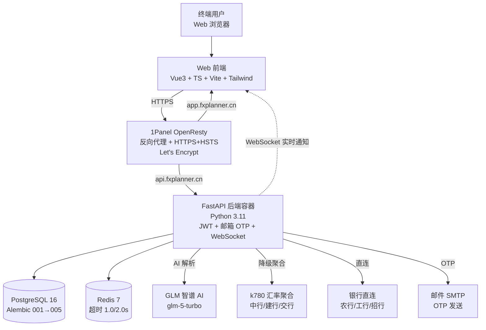

# Step 2 — 三、实施方案和发展规划

> **v1.1 修订说明**（2026-05-07）：本文件中"情景 A"为 v1.0 时期内部数据索引名（与 `Step0_数据基线锁定_v1.2.md` 表 C 索引一致）。v1.1 起 BP 主源 `BP_主源.md` 已统一以"自然增长版申报主线"为唯一对外口径，原"情景 B 融资加速版"已物理废弃；本文件作为内部底稿保留"情景 A"作为历史索引名，不再被对外申报材料引用。

**写作日期**：2026-05-05（v1.0 时期）；**v1.1 修订说明追加**：2026-05-07
**事实来源**：
- `Step0_原型事实清单.md`（2026-05-05 锁定，原型与 Sprint 事实）
- `Step0_数据基线锁定_v1.2.md`（2026-05-05 锁定，用户/收入/价格/营销基线）
- `Step1_技术可行性分析.md`（2026-05-05 初稿，技术栈、合规边界、IP 计划）
- `市场部分审查与补充计划.md`（市场调查与市场预测章节责任在该计划，本章节仅做实施落地）

**写作口径**：孵化器 / 创业大赛 / 创业补贴申报口径；单人创业 + AI 工具放大；按"低成本自营内容 + 社群冷启动"安排营销
**对应附件 2 要求**：(1) 生产计划（技术开发、试验生产、生产计划、设备设施需求、生产线布局）；(2) 营销计划（目标市场、占有率、主要客户、销售渠道、价格策略）；(3) 特殊行业许可证报批；(4) 三年发展规划
**占位符**：`[ICP-PLACEHOLDER]` / `[ALIYUN-BILL-PLACEHOLDER]` / `[AI-TOOLS-BILL-PLACEHOLDER]`（账单实数补录于 Step 3）
**状态**：✅ 初稿完成；下游 Step 3 / Step 4 / Step 5 / Step 6 直接引用本章节

---

## 3.1 产品开发与上线计划（生产计划数字产品适配版）

### 3.1.1 总体节奏

按附件 2 "生产计划（技术开发 / 试验生产 / 生产计划）"要求，数字 SaaS 形态适配为"开发 + 上线 + 灰度运营 + 商业化"四段式：

| 阶段 | 时间窗 | 主题 | 交付状态 |
|---|---|---|---|
| 开发期 | 2025 H2 - 2026 Q1 | Sprint 0 → Sprint 7：从项目初始化到 WebSocket 实时通知 + 安全加固 | ✅ 已完成 |
| 上线期 | 2026 Q1 - 2026 Q2 | Sprint 8B 生产部署、ICP 备案、Sprint 8C - 13D UX 与性能打磨 | ✅ 已完成 |
| 灰度运营期 | 2026 Q2 - 2027 Q1 | Sprint H1-H3：Harness 编排 / Agent API / MCP Server；同步开展用户验证 | ⏳ 进行中 / 计划中 |
| 商业化期 | 2027 Q1 - 2028 Q4 | 微信支付接入 + 付费墙 + 试用转付费 + 运营后台 + Tauri 桌面/移动端 + B2B 合作 | ⏳ 计划中 |

### 3.1.2 已完成 Sprint（截至 2026-04-15，v3.51）

来源：`Step0_原型事实清单.md` 第 6 节；`Step1_技术可行性分析.md` 1.6.3。

| 编号 | 主题 | 测试通过数累积 |
|---|---|---|
| Sprint 0~3 | 项目初始化、设计令牌、Dashboard 重构、订阅管理 | — |
| Sprint 4 | DDD 后端重构 + 微信登录基础 + 自动化测试体系 | 149 passed |
| Sprint 5 | AI 自然语言录入完整交付 | 163 passed |
| Sprint 6 | 额度环 + 月度预算 + 阈值告警 | 192 passed |
| Sprint 7 | WebSocket 实时通知 + 安全加固 | 217 → 223 passed |
| Sprint 8A / 8A-2 | 闲置自动登出 + i18n 三语 + Settings 重构 | — |
| Sprint 8B | **生产部署：Docker / GitHub Actions / GLM / Alembic 005 / 1Panel OpenResty / SSL（上线 ✅）** | 上线 |
| Sprint 8C | Toast / Focus Ring / Value Flash / Header blur / 深色横幅修复 | E2E 10 passed |
| Sprint 9A/9B/9C | 六行银行牌价全栈 | 254 passed |
| Sprint 10 | 邮箱 OTP 两步式登录 + 全量文档更新 | **257 passed** |
| Sprint 12A | UX 流程重塑（ConfigWizard / AddSubscriptionModal / AiParseResultCard） | — |
| Sprint 13A | 官网 Landing Page 暗色视觉（Stitch / Space Grotesk / 电路板纹理） | — |
| Sprint 13B | 汇率趋势图（ECharts）+ 全局品牌色蓝→Emerald | — |
| Sprint 13C | 全站深色模式修复（10 组件）+ SettingsView 重设计 + Settings API 路由修复 | — |
| Sprint 13D | 银行牌价性能修复（首次 ~1.7s / 二次 0ms） | — |

**累计交付**：14+ 个 Sprint、18+ 项核心能力、257 项自动化测试通过、6 行银行牌价聚合、3 语国际化、1 套实时通知。

### 3.1.3 计划中 Sprint（2026 Q3 - 2028 Q4）

| 编号 | 主题 | 时间窗 | 关键交付物 | 依赖 |
|---|---|---|---|---|
| Sprint H1 | Harness AI 基础设施（统一 LLM 编排）| 2026 Q3 | 多 Provider LLM 路由、调用追踪、Token 计量 | 现有 ai_interaction 上下文 |
| Sprint H2 | 外部 Agent API（开放给第三方智能体调用）| 2026 Q3-Q4 | RESTful API、API Key 管理、配额限流 | Sprint H1 |
| Sprint H3 | MCP Server（Model Context Protocol）| 2026 Q4 | MCP 协议适配、可被 Claude/GPT/本地 LLM 调用 | Sprint H2 |
| 商业化 Sprint M1 | 微信支付接入 + 付费墙 | 2027 Q1 | 微信商户号对接、订阅订单流、付费墙拦截 | 微信支付端到端依赖（企业主体注册 + 商户号开通 + 支付域名报备 + 回调域名配置 + 退款 / 对账流程文案 + 支付合规审查），任一环节缺失即触发过渡方案（详见 §3.6.2）|
| 商业化 Sprint M2 | 试用转付费 + 留存优化 | 2027 Q1-Q2 | 7 天试用、付费提醒、留存埋点、流失挽回 | M1 |
| 运营后台 Sprint | 用户/订阅/汇率/通知后台管理 | 2027 Q1-Q2 | 内部运营工作台、客服工单、对账中心 | M1 |
| 移动端 Sprint T1 | Tauri 2.0 桌面端（Windows/macOS）| 2027 Q2 | 本地 Whisper STT、桌面通知、托盘菜单 | Sprint H1 |
| 移动端 Sprint T2 | Tauri 2.0 移动端（iOS/Android） | 2027 Q2-Q3 | 应用商店上架、推送、相机扫码 | T1 |
| B2B Sprint | 留学机构 / 财务顾问 B2B 接入 | 2027 Q3 - 2028 Q1 | 多租户、子账户、对账报告 | 运营后台 |
| 自动化 Sprint | 账单导入 / OCR / 银行流水识别 | 2028 Q1-Q2 | 银行账单 OCR、CSV 导入、规则引擎 | M2 |
| 国际版 Sprint | 港澳台 + 东南亚版本 | 2028 H2 | 多区域部署、本地汇率源、本地化合规 | 国际版可用性评估 |

### 3.1.4 试运行状态对接附件 2 "试验生产"要求

按附件 2 "小批量小规模试生产" 的数字产品适配（详见 `Step1_技术可行性分析.md` 1.6 节）：

- **试运行模式**：非强邀请制、小规模公开灰度运行（任何用户可凭邮箱 OTP 自助注册）；当前以自然访问、创始人精准触达和种子用户验证为主，尚未进行规模化付费投放——首批显式投放与种子推广动作见 §3.4.6 经营落地闭环
- **公网入口**：`https://app.fxplanner.cn`（HTTPS + HSTS 已启用）
- **试运行起算**：2026-04-09 ICP 备案通过日
- **当前版本**：v3.51（2026-04-15）
- **已交付能力**：18+ 项（详见 Step 1 1.6.2）
- **测试基线**：257 passed, 0 failed
- **运维数据补录窗口**：累计运行天数、部署次数、健康检查通过率等指标在定稿前 1 周补录（详见 Step 1 1.7.5）

---

## 3.2 线上服务架构与运维流程（生产线布局适配版）

按附件 2 "生产线布局" 要求，数字 SaaS 适配为"线上服务架构 + 运维流程"。

### 3.2.1 线上服务架构

> 完整架构图（含 Sprint H1-H3 规划层）见 `Step1_技术可行性分析.md` 1.2.2。

### 3.2.2 容器编排（应用层）与宿主侧反向代理

**Docker Compose 应用容器**（已知应用层，完整清单以仓库 `docker-compose.yml` 为准）：

| 容器 | 镜像 / 服务 | 角色 |
|---|---|---|
| frontend | Vite 构建后的静态资源容器 | 前端静态资源托管（仅承载静态文件分发，不在容器内自建反代）|
| backend | FastAPI + Python 3.11 | 业务后端 |
| postgres | PostgreSQL 16 | 主数据库 |
| redis | Redis 7 | 缓存 + WebSocket pub/sub |

**宿主侧反向代理**：1Panel OpenResty 部署于宿主机（不纳入 Docker Compose 编排），承担反向代理与 SSL 卸载，替代了早期方案中的 Docker Nginx 容器；`app.fxplanner.cn` / `api.fxplanner.cn` 路由分发由 OpenResty 完成（来源：`Step0_原型事实清单.md` 第 1 节 / 第 2 节）。

### 3.2.3 运维流程

| 环节 | 工具 / 方式 |
|---|---|
| 代码托管 | GitHub 私有仓库（双分支：main / production） |
| 持续集成 | GitHub Actions：pytest（后端）+ vite build（前端）双门禁 |
| 持续部署 | GitHub Actions → SSH → Docker Compose pull & up → Alembic 迁移 → 健康检查 |
| 数据库迁移 | Alembic 严格版本化（当前 001 → 005 全部生产执行）|
| 证书管理 | Let's Encrypt（DNS 验证），自动续期 |
| 反向代理配置 | 1Panel OpenResty 可视化管理 |
| 故障回滚 | Docker 镜像版本切换 + Alembic downgrade，单次回滚时间 < 5 分钟 |
| 健康检查 | `/health` 端点 + 部署后自动校验 |
| 备份策略 | PostgreSQL 每日逻辑备份 + 异地保存（计划接入阿里云 OSS）|
| 日志与监控 | 容器日志 + 计划接入 Uptime 监控（详见 Step 1 1.7.5）|

---

## 3.3 设备设施与第三方 API 清单（设备设施需求）

按附件 2 "设备设施需求" 要求，本项目作为线上 SaaS 无生产线设施需求；设备清单聚焦"开发设备 + 云资源 + 第三方 API"。

### 3.3.1 设备清单

| 类别 | 项目 | 数量 / 规格 | 说明 |
|---|---|---|---|
| 开发设备 | 笔记本电脑（创始人主力机）| 1 台 | 已自有，开发 + 部署 + 客服 |
| 测试设备 | 测试手机（iOS / Android）| 2 台（计划 2027 H1 配齐）| 移动端 Sprint T1/T2 启动前补齐 |
| 测试设备 | 外接显示器 | 1 台（计划 2026 H2 视需要）| 提升多文档撰写效率 |
| 办公场所 | 孵化器工位 | 1 个工位（拟入驻零界魔方）| 入驻申请表已对接 |

### 3.3.2 云服务清单（阿里云华东 1 杭州）

| 服务 | 规格 | 用途 |
|---|---|---|
| ECS 弹性计算 | `fxplanner-prod`（建议 2C4G 起步，按真实账单 `[ALIYUN-BILL-PLACEHOLDER]` 校准） | 后端 + 反代容器宿主 |
| RDS PostgreSQL | PostgreSQL 16（小规格起步） | 主数据库；待 2027 商业化期后视用户量升配 |
| Redis | Redis 7（小规格） | 缓存 + WebSocket pub/sub |
| 对象存储 OSS | 标准存储 | 后续接入：用户头像 / 备份归档 |
| 域名 | `fxplanner.cn`（已注册）| 主域 + `app.` / `api.` 子域 |
| ICP 备案 | `[ICP-PLACEHOLDER]`（2026-04-09 通过）| 已落实 |
| SSL 证书 | Let's Encrypt（DNS 验证） | 有效期至 2026-07-08，自动续期 |

### 3.3.3 第三方 API / 数据源清单

来源：`Step0_原型事实清单.md` 第 7 节。

| 类别 | 选型 | 用途 | 资费口径 |
|---|---|---|---|
| LLM | GLM（智谱 AI）glm-5-turbo（OpenAI 兼容） | AI 自然语言录入解析 | 按 Token 计费，月均用量 `[AI-TOOLS-BILL-PLACEHOLDER]` |
| 汇率聚合（生产必配） | k780（双参数认证 appkey + sign） | 中行 / 建行 / 交行牌价聚合 | 按调用计费，已接入 |
| 汇率直连（无密钥） | ExchangeRate-API、Frankfurter ECB | 国际汇率参考 | 免费层 |
| 银行汇率直连 | 农行（无认证）/ 工行（POST+Referer）/ 招行（Origin+Referer）| 牌价直连 | 免费 |
| 邮件 SMTP | 阿里云邮件推送或第三方 SMTP | OTP 验证码发送 | 按发送量计费 |
| 短信通道 | 拟接入（视用户增长）| 备用 OTP 通道 | 按发送量计费 |
| 浏览器 STT | Web Speech API | Web 端语音录入 | 免费（浏览器原生） |
| 本地 Whisper | 计划随 Tauri 桌面端落地 | 离线 STT 路径 | 免费（开源） |

### 3.3.4 协作与生产力工具

| 类别 | 选型 | 用途 |
|---|---|---|
| 代码编辑 / AI 辅助 | Claude Code / Cursor 等 | AI 辅助编程，单人覆盖全栈关键支撑 |
| 代码托管 | GitHub | 私有仓库 |
| 设计 | `design/web-design.pen`（36+ 画板单一原型文件）| 唯一原型源 |
| 文档 | Markdown + 仓库内 docs/ | SPEC / PRD / TECH_ARCHITECTURE 等 11+ 份 |
| 项目管理 | CHANGELOG.md + ITERATION_PLAN.md | 轻量化排期，与 Sprint 对齐 |

---

## 3.4 营销计划（目标市场、占有率、主要客户、销售渠道、价格策略）

> 说明：完整的市场调查与市场预测在"二、市场可行性分析"章节展开（参见 `市场部分审查与补充计划.md`）；本节聚焦"实施方案侧"的渠道与预算落地，所有数字与基线引用 `Step0_数据基线锁定_v1.2.md`，不重复市场预测推导。

### 3.4.1 目标市场与主要客户

来源：`Step0_数据基线锁定_v1.2.md` 表 B；`Step1_技术可行性分析.md` 1.4.2。

| 客户分层 | 用户基数（SOM 内）| 价值主张 | 优先级 |
|---|---|---|---|
| 中国留学生（海外在读存量）| 90-105 万（基准 105 万）| 学费 / 生活费跨币种成本对比、月度预算告警、家长共享视图 | **P0 主线** |
| 留学生家长 | 与留学生 1:1-1:2 比例 | 5 万美元年度便利化额度前瞻性预估、最优汇款时点提示 | **P0 主线**（与 P0 留学生联动获客）|
| 跨境工作者（赴港 / 海外活跃池） | 40 万（商业假设） | 多账户统一视图、汇率成本可视化 | P1 |
| 跨境自由职业 / 独立开发者 | 30 万（商业假设） | 收支双向汇率成本计算、套利路径检测 | P1 |
| 高消费出境旅行者 | 500 万活跃池（商业假设） | 信用卡费率库、最优支付方式推荐 | P2（季节性 / 峰值场景）|

**优先级解释**：留学生 + 家长是高粘性、强付费意愿、强口碑传播的双联动客群，作为 2026-2027 年度获客主线；P1/P2 客群在 2027-2028 年度按渠道成熟度逐步扩展。

### 3.4.2 三年累计注册与付费占有率目标

来源：`Step0_数据基线锁定_v1.2.md` 表 C 情景 A（自然增长版，**获客模型预算 ≈ ¥0**——指无付费投放、无 KOL 付费推广、无买量投放，纯创始人时间 + 自营内容 + 社群冷启动驱动）。

**口径分离声明**：本节及收入预测仅承接情景 A 的"获客模型预算 ≈ ¥0"。§3.4.4 列示的孵化器口径渠道预算属于"市场进入与经营落地费用"（工具订阅、设计素材、外包文案、活动小礼品、差旅、赛事报名、合规咨询等创始人推广动作的辅助支出），**不进入情景 A 获客模型，不构成本节累计注册数字的驱动因子**；该费用作为孵化器申报版的最小经营落地预算独立列示，仅用于支撑创始人主导的自营动作可执行性。

| 年份 | 阶段 | 累计注册 | 活跃订阅率 | 付费用户 | ARPU | 年收入（A 基准）| 三档区间 |
|---|---|---|---|---|---|---|---|
| 2026 | 测试验证 | 4,500 | — | — | — | 验证性流水 | — |
| 2027 | 商业化首年 | 22,500 | 2.5% | 563 | ¥150 | **¥8 万** | ¥3-19 万 |
| 2028 | 增长期 | 62,500 | 2.5% | 1,563 | ¥165 | **¥26 万** | ¥7-68 万 |

**SOM 内占有率**（按累计注册 / SOM 675 万）：

| 年份 | 累计注册 | SOM 占有率 |
|---|---|---|
| 2026 | 4,500 | ~0.07% |
| 2027 | 22,500 | ~0.33% |
| 2028 | 62,500 | ~0.93% |

**孵化器口径声明**：占有率目标按申报版主线（自然增长版）测算；申报正文的"经济效益"承诺段以本组数字为唯一对外口径，不引入额外情景。

### 3.4.3 销售渠道与年度计划

按"低成本自营内容 + 社群冷启动 + 小额 KOL 试投 + B2B 拓展"四线并行，分年度铺设：

| 渠道 | 2026 | 2027 | 2028 |
|---|---|---|---|
| 自营内容（小红书 / 知乎 / B 站 / SEO） | 创始人每周 1-2 条种子内容 | 内容外包 1-2 兼职，频率提升至每周 3-5 条 | 内容矩阵化（含视频、留学/换汇专题）|
| 社群冷启动 | 留学微信群 / 知乎话题 / 小红书评论区精准触达 | 拓展家长群、自由职业者群 | 社群运营 SOP 化，配合 B2B |
| KOL 合作 | 0 | 小额试投 3-5 位中腰部留学博主 | 视 LTV/CAC 数据扩量；优先复用 ROI > 3 的合作 |
| 应用商店 / 官网 | 官网 Landing（已上线 v3.51）| 增加移动端应用商店页（Tauri T2）| 应用商店 SEO 优化 |
| B2B 合作 | 拟接触 1-2 家留学机构（提案级）| 签约 2-3 家留学机构 / 留学财务顾问 | 拓展至 5-10 家，含港澳台机构试点 |
| 赛事 / 孵化器活动 | 参加 1-2 个省 / 市级创业大赛 | 参加 2-3 个赛事（含全国级）| 视团队规模与营收选择 |

### 3.4.4 渠道预算分配（孵化器口径，单位：万元）

**口径说明**（与 §3.4.2 一致）：本表为"市场进入与经营落地费用"——支撑创始人开展自营内容、社群、赛事、B2B 拓展、合规咨询等动作的辅助支出，**不进入情景 A 获客模型、不作为收入预测的驱动因子**。该口径下：

- 2026 年几乎以创始人时间投入为主，渠道预算趋近于零；
- 2027 起小额渠道试投以验证渠道有效性，但不依赖付费投放跑通收入预测；
- 2028 年视 LTV/CAC 实测数据决定是否扩量；若实测显示扩量 ROI > 3，再以 Step 3 投资估算更新版本承接付费投放预算。
- 预算上限与 `非市场部分审查与补充计划.md` §三-3 一致。

| 渠道类别 | 2026 | 2027 | 2028 | 用途说明 |
|---|---:|---:|---:|---|
| 自营内容（含工具订阅、设计素材、外包文案）| 0-0.3 | 0.5-1.5 | 1.5-3 | 小红书 / 知乎 / B 站持续投放 |
| 社群冷启动（含活动小礼品）| 0-0.2 | 0.2-0.5 | 0.3-0.8 | 微信群 / Discord 运营物料 |
| KOL 合作 | 0 | 0.3-1 | 1-3 | 中腰部博主小额试投，按 ROI 扩量 |
| 应用商店 / SEO | 0 | 0-0.5 | 0.5-1 | 移动端上架与 ASO |
| B2B 拓展（差旅 / 提案 / 合规咨询）| 0-0.3 | 0.3-1 | 0.5-1.5 | 留学机构 / 财务顾问拓展 |
| 赛事报名与材料 | 0-0.2 | 0.2-0.5 | 0.2-0.5 | 创业大赛报名与路演材料 |
| **小计** | **0-1** | **1-3** | **3-8** | 与 Step 3 投资估算中的"市场进入与经营落地费用"口径保持一致 |

> 全口径预算（含云资源、AI 工具、IP 申报、人员、预备费）见 `Step3_投资估算与资金筹措.md`（待写）。

### 3.4.5 价格策略

来源：`Step0_数据基线锁定_v1.2.md` 表 F；`Step1_技术可行性分析.md` 1.9 引用表。

| 项目 | 定价 |
|---|---|
| 月度订阅 | ¥19.9 / 月 |
| 季度订阅 | ¥49.9 / 季（约 ¥16.6 / 月，季付 17% 优惠）|
| 单次报告 | ¥5-10 / 份（按报告复杂度） |

**定价逻辑**：以"用户加权年节省价值 ¥2,590-6,335 / 人"（来源 `Step0_数据基线锁定_v1.2.md` 表 E）为锚点，年订阅价（按月度 ¥19.9 × 12 ≈ ¥239）相当于年节省价值的 **3.8%-9.2%**，留出明显的 ROI 空间作为付费转化驱动力。

**价格策略迭代节奏**：

- 2026：定价不动，用免费版 + 一次性报告小额试水
- 2027 H1：商业化期启动，正式开通付费墙；保留 7 天试用，月 / 季订阅同时上线
- 2027 H2 - 2028：视 LTV/CAC 与续费率数据，评估"年度套餐 / 家庭套餐 / B2B 团体套餐"扩展项

### 3.4.6 经营落地闭环（2026 灰度反馈 → 2027 试用付费 → 2028 B2C 延 B2B）

按申报评审对"经营落地"的可读性要求，本节将 §3.4.1-3.4.5 的渠道与定价拼装为三年滚动闭环；每一年的注册目标、付费目标、关键反馈采集动作均互为输入。

#### 3.4.6.1 2026：灰度反馈年（目标累计注册 4,500）

**核心目标**：验证产品-市场匹配（PMF）的早期信号——激活率、留存率、自然口碑分享率，作为 2027 商业化策略调整的输入。

**4,500 累计注册轻量拆解（孵化器口径，按渠道贡献占比估算）**：

| 渠道 | 贡献占比 | 注册量（粗估）| 落地动作 |
|---|---:|---:|---|
| 自营内容（小红书 / 知乎 / B 站 / SEO） | ~45% | ~2,000 | 创始人每周 1-2 条种子内容；留学换汇、5 万美元额度科普、信用卡费率库等长尾 SEO 选题 |
| 社群冷启动（留学微信群 / 知乎话题 / 评论区精准触达） | ~25% | ~1,100 | 创始人手工潜伏 + 答疑式触达；不做强推，仅在用户提问时附带工具说明 |
| 赛事 / 孵化器活动曝光 | ~15% | ~700 | 1-2 个省 / 市级创业大赛路演、孵化器入驻媒体曝光、产品 Demo 日 |
| B2B 早期对接（留学机构试点用户）| ~10% | ~450 | 1-2 家留学机构提案级合作，带入其学员作为种子用户 |
| 自然访问 / 口碑 | ~5% | ~250 | 域名 SEO、官网 Landing 自然流入、用户主动分享 |
| **合计** | 100% | **~4,500** | — |

> 说明：本拆解为孵化器申报版本的渠道结构性估算；占比为创始人基于资源自评，并非投放预测；实测占比将在 2026 Q4 复盘时按埋点数据校准。该拆解不改变 §3.4.2 情景 A "获客模型预算 ≈ ¥0" 的口径——所有渠道动作均由创始人时间 + §3.4.4 的"市场进入与经营落地费用"覆盖，不含付费投放。

**2026 反馈采集动作**：

| 动作 | 频次 / 节奏 | 输出 |
|---|---|---|
| 站内埋点（注册 / 激活 / 30 日留存 / NPS）| 持续 | Sprint 月度复盘表 |
| 用户访谈（5-10 位灰度用户深访）| 季度 | 用户访谈纪要，纳入 Step 0 数据基线 P2 待补项 |
| 客服工单 / 反馈收集（邮箱 + 站内反馈入口）| 持续 | 产品 Backlog 优先级输入 |
| 灰度迭代节奏（Sprint H1-H3 + UX 微调）| 每 2-4 周一个迭代窗 | CHANGELOG 沉淀 |

**2026 与 2027 的衔接**：2026 Q4 复盘要回答三个问题——(a) 真实激活率是否 ≥ 1%（Step 0 表 G 风险阈值）；(b) 30 日留存率是否 ≥ 20%；(c) 是否出现自然口碑（推荐分享 / 私信咨询）信号。任一指标低于阈值则在 2027 Q1 商业化前触发 §3.6.2 风险联动。

#### 3.4.6.2 2027：试用→付费年（目标累计注册 22,500、付费用户 563）

**核心目标**：跑通"免费灰度 → 7 天试用 → 月 / 季订阅"付费转化漏斗，建立可重复的获客与转化模型。

**关键闭环动作**：

| 阶段 | 动作 | 量化指标 |
|---|---|---|
| 拉新 | 自营内容外包扩量、移动端 T2 应用商店上架（ASO）、KOL 小额试投 3-5 位中腰部留学博主 | 累计注册 22,500；新增 18,000 |
| 激活 | ConfigWizard 3 步向导、AI 自然语言录入降低首次录入摩擦、首日成功录入率埋点 | 首日激活率 ≥ 30%（待商业化期实测校准）|
| 试用 | 7 天免费试用（无需绑卡，引导式体验完整付费功能）+ 第 5 天试用结束提醒 | 注册→试用启用率 ≥ 8% |
| 付费 | 试用结束后付费墙拦截 + 月 / 季订阅二选一 + 单次报告小额转化路径 | 试用→付费转化率 ≥ 30%；活跃订阅率 2.5%（基准）|
| 留存 | 月度账单摘要邮件、阈值告警 WebSocket 推送、流失挽回触发器 | 月流失率 ≤ 8%（待实测） |

**关键依赖与过渡**：付费墙上线依赖微信支付端到端要素（详见 §3.1.3 / §3.6.2），任一缺失启用过渡通道（支付宝 / 银联 / 国际信用卡 via Stripe 三选一）。

#### 3.4.6.3 2028：B2C 延展 B2B 年（目标累计注册 62,500、付费用户 1,563）

**核心目标**：在 B2C 跑通付费模型基础上，把"留学机构 / 财务顾问 / 港澳台第三方"作为 B2B 第二曲线，拓展 ARPU 上限并降低对单一渠道依赖。

**B2C → B2B 延展逻辑**：

1. **能力外溢**：现有"AI 自然语言录入 + 多源汇率聚合 + 信用卡费率库 + 阈值告警"四件套对留学机构的"学员财务咨询服务"具有直接复用价值。
2. **多租户支撑**：B2B Sprint（2027 Q3 - 2028 Q1）已铺设多租户架构、子账户、对账报告——为 2028 年规模化 B2B 上线奠定基础。
3. **客户清单**：留学机构（学员预算管理）、海外财务顾问（中国大陆客户外汇咨询）、港澳台中介机构（跨境支付规划）、企业 EAP 福利（高净值员工跨境消费）。
4. **B2B 价格策略**：按机构席位数定价（拟定 ¥99-299 / 席位 / 年），与 B2C 月 / 季订阅形成产品矩阵——具体价格在 2028 Q1 B2B 首签后按客户支付意愿迭代。
5. **国际版联动**：2028 H2 港澳台 / 东南亚国际版灰度（来源 §3.6.1）天然成为 B2B 海外机构的产品载体，形成"产品形态 + 客户类型 + 地理覆盖"三维扩展。

**B2C → B2B 节奏护栏**：B2B 拓展不挤占 B2C 资源——2028 全年 B2B 营收占比目标 ≤ 30%，超过该比例触发产品定位评估，避免被单一 B2B 客户绑定形成"非中立信息层"风险。

---

## 3.5 特殊行业许可证报批与合规边界声明

按附件 2 "特殊行业许可证报批" 要求，明确写出当前合规边界与已具备资质，避免被评审误判为遗漏金融牌照。

### 3.5.1 业务边界声明

**FXplanner 当前定位为"信息服务与规划工具"，不提供以下任何业务**（来源：`Step0_原型事实清单.md` 第 9 节、`Step1_技术可行性分析.md` 1.3.1）：

- ❌ 外汇买卖 / 兑换执行
- ❌ 资金划转 / 支付清算
- ❌ 理财 / 投资建议（不含汇率预测语句）
- ❌ 资金托管
- ❌ 帮助用户规避外汇便利化额度

**因此本项目无需以下牌照 / 许可证**：

- 支付业务许可证（《非金融机构支付服务管理办法》）
- 外汇业务经营许可（《外汇管理条例》）
- 银行业 / 证券 / 基金 / 保险类金融牌照
- 互联网金融信息中介相关备案

### 3.5.2 已具备的资质与数据边界

| 资质 | 状态 | 详情 |
|---|---|---|
| ICP 备案 | ✅ 2026-04-09 通过 | 备案号 `[ICP-PLACEHOLDER]`（定稿前替换为真实字符串） |
| HTTPS + HSTS | ✅ 已启用 | Let's Encrypt SSL，DNS 验证 |
| 数据本地化 | ✅ 已落实 | 阿里云华东 1（杭州）境内节点 |
| PIPL 数据存储边界 | ✅ 严格遵守 | 不存银行卡号 / 身份证 / 真实交易流水 / 任何支付凭证 |
| 域名注册 | ✅ 已注册 | `fxplanner.cn` 多年续费 |

#### 3.5.2.1 未来 OCR / 账单导入功能的预设数据边界（前置声明）

§3.1.3 计划中的"自动化 Sprint 账单导入 / OCR / 银行流水识别"（2028 Q1-Q2）天然涉及银行账单与流水信息，与上方 PIPL 数据存储边界存在表层冲突；为避免未来落地时违反本章合规边界，**功能尚未上线即在本章前置声明边界**：

| 边界类别 | 落地约束 |
|---|---|
| **解析时机与位置** | OCR 解析优先在客户端本地（Tauri 桌面端 / 移动端）完成；如需后端解析，仅做无状态临时解析（请求结束即销毁中间态），不做服务端持久化 |
| **保留范围** | 仅保留**用户人工确认后的订阅 / 预算摘要字段**（金额、币种、对手方品牌、扣款节奏），不保留原始账单图像、原始流水文本、PDF 文件本体 |
| **不保留范围** | ❌ 银行卡号 / 卡片完整 PAN ❌ 身份证 ❌ 真实交易流水（原始记录） ❌ 余额信息 ❌ 银行账户号 ❌ 任何支付凭证（验证码、签约号、CVV、密码） |
| **加密与传输** | 客户端→服务端传输全程 HTTPS；如确需上传敏感字段，仅在后端临时内存中处理，不落盘、不入库、不进入备份 |
| **用户授权** | 启用 OCR / 导入功能前显式获得用户授权同意（弹窗式 PIPL 告知 + 可撤回开关）|
| **第三方依赖审查** | OCR / 解析模型若使用第三方 API，须确认其数据驻留在境内、不留训练副本；优先选用本地模型（如端侧 Whisper / OCR）|
| **审计日志** | 启用 OCR / 导入功能的操作记录、用户授权记录单独留痕，可供合规审查 |

> 该边界声明为本章节做出的前置承诺；后续在自动化 Sprint 启动前由产品 + 法务复核，并在 SPEC.md 与 PRD.md 中固化为开发约束；如确有不可调和的功能/合规冲突，**优先放弃功能而非破坏数据边界**。

### 3.5.3 商业化前必审合规事项与拟评估增项

依据国家行政法规库收录的《互联网信息服务管理办法》：互联网信息服务分为经营性与非经营性两类，**经营性互联网信息服务**（向上网用户有偿提供信息、网页制作等服务的活动）实行**许可制度**，须取得增值电信业务经营许可证（ICP 经营许可证）。FXplanner 计划于 2027 Q1 启动微信支付付费墙、月 / 季订阅与单次报告收费（详见 §3.1.3 / §3.4.5），上述收费一旦上线即可能构成"经营性互联网信息服务"。因此本节将"ICP 经营许可"列为**商业化前必审事项**，不作为弹性增项。

#### 3.5.3.1 商业化前必审事项

| 必审事项 | 法规依据 | 处置时点 | 处置方式 |
|---|---|---|---|
| **ICP 经营许可适用性法务评估** | 《互联网信息服务管理办法》经营性 / 非经营性分类与许可制度 | **2027 Q1 商业化收费上线前完成**（不晚于付费墙、订阅、单次报告任一项收费动作上线日）| 委托具备资质的法务 / 合规机构出具书面评估意见；如评估结论构成经营性互联网信息服务，则在收费功能上线前先取得相应许可，或调整收费路径（例如下沉为非经营性内容 + 第三方支付独立结算）|
| **微信支付支付域名 / 回调配置 / 退款对账合规** | 微信支付商户号开通规则 + 资金合规要求 | 2027 Q1 商业化前 | 与微信支付合规通道对齐，配齐企业主体 / 商户号 / 支付域名报备 / 回调域名 / 退款 / 对账流程文案 |
| **PIPL 用户同意与隐私条款** | 《个人信息保护法》 | 2026 H2（先于商业化）| 上线隐私政策、用户协议、Cookie 同意；按 §3.5.2.1 OCR/账单功能上线前增量补 |

#### 3.5.3.2 拟评估的合规增项（按业务扩展节奏）

| 增项 | 触发条件 | 计划窗口 |
|---|---|---|
| 网络文化经营许可 | 若上线 UGC 社群 / 内容评论模块 | 视产品形态决定（当前不计划）|
| 跨境数据出境合规（出海港澳台 / 东南亚） | 国际版 Sprint 启动前 | 2028 H2 评估 |
| 等保 2.0 二级 | 若 B2B 客户合规要求 | 2028 视 B2B 合作需要 |
| ISO 27001 / SOC 2 | 若机构客户合规要求 | 2028 视客户合规要求 |

### 3.5.4 与外汇便利化政策的边界对接

国家外汇管理局《个人外汇管理办法》设定每年 5 万美元等值便利化额度，FXplanner 仅做"前瞻性预估 + 阈值告警"，不参与购汇执行、不提供"规避额度"的任何建议。功能层面：

- 已实现：年度购汇额度追踪（已用 / 含下笔 / 预估年底）+ 三档阈值告警（80% 信息 / 90% 警告 / 100% 柜台办理告知）
- 严格不做：拆单建议、化整为零、第三方代购汇、跨年度调度等任何规避便利化额度的提示

---

## 3.6 三年发展规划（多维量化里程碑）

按附件 2 "三年发展规划" 要求，从产品功能、用户规模、付费与营收、团队、当年/累计投入、知识产权多个维度量化展开。所有数字与口径与 Step 0 / Step 1 / 营销计划保持一致。"当年全口径投入"为 Step 2 暂定口径区间（含创始人薪酬、云资源、AI 工具 / LLM API、IP 申报、市场进入费、兼职 / 外包、预备费），最终实数将在 Step 3 投资估算章节按真实账单校准。

| 维度 | 2026（验证年）| 2027（商业化首年）| 2028（增长年）|
|---|---|---|---|
| **产品功能** | Sprint 0~13D 已上线 18+ 项核心能力；Sprint H1-H3 完成（Harness / Agent API / MCP）；257+ 测试通过 | 商业化 M1/M2（微信支付 + 付费墙 + 试用转付费）+ 运营后台 + 移动端 T1（桌面端） | 移动端 T2（iOS/Android 上架）+ B2B + 自动账单 OCR + 港澳台 / 东南亚国际版 |
| **用户规模（累计注册）** | 4,500 | 22,500 | 62,500 |
| **付费用户 / 活跃订阅率 / ARPU** | 测试验证期，免费为主 | 563 / 2.5% / ¥150 | 1,563 / 2.5% / ¥165 |
| **年营收（情景 A 自然增长版主线）** | 验证性流水 | ¥8 万（区间 ¥3-19 万）| **¥26 万**（区间 ¥7-68 万）|
| **团队** | 创始人 1 人独任（持股 100%）| +1-2 名兼职 / 外包（设计、内容、客服） | 视营收扩展至 2-3 名全职或继续外包 |
| **当年全口径投入（Step 3 校准）** | **~5-8 万元**：创始人薪酬 ~3 万 + 阿里云（2026-03 / 2026-04 可开票合计 ¥1,789.20，2026 全年保留 0.5-1 万区间，详见 Step 3 §4.5.5）+ AI 工具 / LLM API `[AI-TOOLS-BILL-PLACEHOLDER]` + IP 申报 0.5-1 万 + 市场进入费 0-1 万 + 预备 0.5-1 万 | **~7-13 万元**：创始人薪酬 ~3 万 + 云资源（按用量增长）+ AI 工具 / API + IP 增项 0.3-0.5 万 + 市场进入费 1-3 万 + 兼职/外包 0-2 万 + 预备 0.5-1 万 | **~13-25 万元**：创始人薪酬 ~3 万 + 云资源（升配）+ AI 工具 / API + IP 增项 0.3-0.5 万 + 市场进入费 3-8 万 + 兼职/外包 2-5 万 + 预备 1-2 万 |
| **累计投入（孵化器口径）** | = 当年全口径投入 | = 上一年度累计 + 当年全口径投入 | = 上一年度累计 + 当年全口径投入 |
| **知识产权（累计件数）** | 域名 1 + ICP 1 + SSL 1（已落实）；软著 1 件（首批主程序）+ 商标 2 件（"FXplanner" + "凯衍磁缘"）2026 H2 提交 | 软著 2-3 件累计（增项：Harness / Agent API 子系统）+ 商标 2-3 类累计 | 软著 4-6 件累计（增项：移动端 / 自动账单引擎）+ 商标视类目扩展 |

### 3.6.1 关键里程碑节点（按季度）

| 季度 | 关键节点 |
|---|---|
| 2026 Q2（已实现） | Sprint 8B 生产部署、ICP 备案、Sprint 13D 银行牌价性能修复 |
| 2026 Q3 | Sprint H1 Harness 上线、首批软著 + 商标提交、参加 1-2 个省 / 市级创业大赛 |
| 2026 Q4 | Sprint H2 Agent API + Sprint H3 MCP Server 上线、累计注册 4,500、入驻孵化器、2026 灰度反馈复盘（激活率 / 留存 / NPS） |
| 2027 Q1 | **商业化前合规闸门（必审事项）**：完成 ICP 经营许可适用性法务评估（详见 §3.5.3.1）；微信支付端到端要素配齐（企业主体 + 商户号 + 支付域名 + 回调 + 退款 / 对账）。**双闸门均通过后**上线微信支付 + 付费墙、启动付费墙 A/B 测试 |
| 2027 Q2 | Tauri 桌面端 T1 上线、运营后台上线、首位兼职 / 外包到岗 |
| 2027 Q3 | Tauri 移动端 T2 应用商店上架、B2B 首签 2-3 家留学机构 |
| 2027 Q4 | 累计注册 22,500、年付费用户 563、年收入 ¥8 万（A 基准） |
| 2028 Q1-Q2 | 自动账单 OCR / CSV 导入上线、B2B 扩展至 5-10 家 |
| 2028 H2 | 港澳台 / 东南亚国际版灰度、累计注册 62,500、年收入 ¥26 万（A 基准） |

### 3.6.2 三年规划的关键假设与风险联动

| 假设 | 触发的规划修订 |
|---|---|
| 活跃订阅率实测 < 1%（来源 `Step0_数据基线锁定_v1.2.md` 表 G）| 商业化 Sprint M2 触发产品定价 / 付费墙策略重大调整 |
| **微信支付端到端任一要素未在 2027 Q1 配齐**（企业主体注册 / 商户号开通 / 支付域名报备 / 回调域名配置 / 退款 / 对账流程文案 / 支付合规审查）| 商业化 Sprint M1 推迟；启用过渡通道：支付宝商家版 + 银联开放平台 + 国际信用卡（Stripe）三选一；同步以非订阅型"单次报告"小额支付路径（¥5-10）先期跑通对账流程 |
| **2026 灰度反馈复盘指标不达阈值**（激活率 < 1% / 30 日留存 < 20% / NPS 显著为负）| 推迟 2027 Q1 商业化上线，回到 §3.4.6.1 反馈采集动作扩量；产品 / 定价二次评估 |
| **ICP 经营许可法务评估结论为"构成经营性互联网信息服务"** | 在收费功能上线前先取得增值电信业务经营许可证；如时间窗冲突，则调整收费路径（下沉为非经营性内容 + 第三方支付独立结算 / 推迟商业化时点）|
| LTV/CAC < 3（情景 A 长期跌破阈值）| 暂停 KOL 试投，回归自营内容 + 社群冷启动；推迟 B2B 拓展 |
| ICP 备案号变更 / 监管口径调整 | 触发合规边界重审，由 §3.5.1 业务边界声明回溯调整 |
| B2B 营收占比超过 30%（详见 §3.4.6.3 护栏）| 触发产品定位与中立性评估，调整 B2B 客户结构或暂停新增 B2B 接入 |

---

## 3.7 本章关键数字与下游引用

下表用于 Step 6 跨章一致性检查；所有出现以下语义的数字必须与本表一致。

| 数字 / 描述 | 锁定值 | 唯一来源 | 下游引用章节 |
|---|---|---|---|
| 累计注册 2026/2027/2028（情景 A 主线） | 4,500 / 22,500 / 62,500 | `Step0_数据基线锁定_v1.2.md` 表 C | 二、三、四、五 |
| 付费用户 2027/2028 | 563 / 1,563 | 同上 | 三、四、五 |
| 活跃订阅率（基准）| 2.5%（保守 1.5% / 乐观 4%） | 同上 | 三、五 |
| ARPU 2027/2028 | ¥150 / ¥165 | 同上 | 三、五 |
| 年收入 2027/2028（情景 A 基准）| ¥8 万 / ¥26 万 | 同上 | 三、四、五 |
| 价格策略 | ¥19.9/月、¥49.9/季、报告 ¥5-10 | `Step0_数据基线锁定_v1.2.md` 表 F | 二、三、五 |
| 市场进入与经营落地费用（孵化器口径）| 0-1 / 1-3 / 3-8 万元；**不进入情景 A 获客模型** | 本章 §3.4.2 / §3.4.4 | 三、四、五 |
| 4,500 累计注册渠道结构（自营内容 / 社群 / 赛事 / B2B / 自然访问）| ~45% / 25% / 15% / 10% / 5% | 本章 §3.4.6.1 | 三、四、五 |
| 当年全口径投入（Step 3 校准）| 2026 ~5-8 万 / 2027 ~7-13 万 / 2028 ~13-25 万 | 本章 §3.6（已按 Step 3 §4.7.1 / Step 4 §5.4.1 校准；2026-05-06 Step 6 跨章一致性检查回写）| 三、四 |
| 商业化前必审合规事项 | ICP 经营许可适用性法务评估 + 微信支付端到端要素 + PIPL 用户同意 | 本章 §3.5.3.1 | 三、五 |
| OCR / 账单导入数据边界 | 本地 / 临时解析、不落盘原始流水、不存银行卡号 / 身份证 / 支付凭证、仅保留用户确认后的订阅 / 预算摘要 | 本章 §3.5.2.1 | 一、三、五 |
| 计划中 Sprint 集合 | Harness（H1）/ Agent API（H2）/ MCP（H3）/ 商业化（M1/M2）/ 运营后台 / Tauri T1/T2 / B2B / 自动化 / 国际版 | `Step1_技术可行性分析.md` 1.6.3 + 本章 §3.1.3 | 一、三、四 |
| 已上线能力数 | 18+ 项 | `Step0_原型事实清单.md` 第 4 节 | 一、三 |
| 测试通过数 | 257 passed, 0 failed | 同上 第 5 节 | 一、三、五 |
| 当前版本 | v3.51（2026-04-15） | 同上 第 1 节 | 一、三 |
| ICP 备案 | `[ICP-PLACEHOLDER]`（2026-04-09 通过） | 同上 第 1 节 | 一、三、附录 |
| 合规边界（不做）| 支付 / 清算 / 换汇执行 / 资金托管 / 便利化额度规避 | `Step1_技术可行性分析.md` 1.3.1 | 一、三、五 |
| 团队 2026/2027/2028 | 1 人 / 1+1-2 兼职外包 / 2-3 全职或继续外包 | 本章 §3.6 | 三、四、六 |
| 知识产权计划 | 软著首批 2026 H2 + 商标首批 2026 H2 + 增项 2027 | `Step1_技术可行性分析.md` 1.8.2 | 一、三、五 |

---

**章节状态**：✅ 审查修订完成（已按 P1/P2/P3 findings 加固）
**下一步**：进入 Step 3 — 投资估算与资金筹措（孵化器口径）（依赖本章节的 Sprint 排期、设备设施清单、营销预算、IP 申报计划，可直接引用）
**待补录数据**：
- `[ICP-PLACEHOLDER]` × 多处（与 Step 1 同批替换）
- `[ALIYUN-BILL-PLACEHOLDER]` / `[AI-TOOLS-BILL-PLACEHOLDER]`（在 Step 3 投资估算中按真实账单填实）
- 累计运行天数 / 部署次数 / 健康检查通过率（运维监控数据，详见 Step 1 1.7.5，定稿前 1 周补录）
