# 16 业务时序图

按功能模块描述入口、核对、提交、返回与后续处理。参与者是逻辑职责，不指定微服务、数据库或已实现API；用户在银行完成换汇后才录入，图中不执行银行交易。实体见[领域模型与实体定义](17_领域模型与实体定义.md)，迁移守卫见[实体状态机](18_实体状态机.md)。

## 功能模块对应

| 功能模块 | 对应时序 | 对应实体与状态 |
|---|---|---|
| 01 首次使用与设置 | S01、S02、S09、S13—S15 | UserProfile、SetupDraft、BaseCurrencyChange、DataRequest；SM01—03、05、08—11 |
| 02 初始化与录入 | S02、S03、S10 | InitialHolding、QuoteSnapshot、Transaction；SM03、06 |
| 03 首页与导航 | 所有时序的入口/返回；只读规则见下表 | 本人目标、计划、账户、记录身份；无独立导航业务状态机 |
| 04 外汇账户 | S02、S03、S05、S06、S10 | FXAccount、Allocation、Usage、CostLot |
| 05 汇率查询与录入计算 | S03、S10 | QuoteSnapshot、TransactionVersion、CostComponent |
| 06 创建换汇计划 | S04—S09 | Goal、Plan、PlanVersion；SM04、05 |
| 07 分批准备计划 | S04、S07、S11 | PreparationSchedule、PlanVersion |
| 08 提醒与到期处理 | S08、S09、S11 | Reminder、Plan；SM04 |
| 09 交易更正与日志 | S10 | Correction、TransactionVersion、CostConsumption；SM06 |
| 10 资金使用记录更正 | S06、S10 | UsageVersion、AllocationEvent、Correction；SM06 |
| 11 成本摘要与报告 | S09、S10、S12 | ReportSnapshot、ReportTask、ReportFile；SM07 |
| 12 收益指标与报告细则 | S12 | 来源成本与比较数据；收益算法仍待定 |
| 13 功能清单 | S01—S15覆盖的功能汇总 | 不新增实体或状态 |
| 14 业务逻辑清单 | S02—S15及原计算示例 | 资金守恒、原币成本、版本和交接约束 |
| 15 专业术语 | 所有图与17/18的术语索引 | 不新增生命周期 |

## 通用交互与提交规则

| 环节 | 规则 | 数据边界 |
|---|---|---|
| 查询与导航 | 校验本人权限与对象身份；台账行操作携带该笔记录编号进入详情；返回保持来源菜单、筛选、位置及对象 | 只读页面不生成交易、分配或计划；首添与更正使用不同标题和动作 |
| 预览 | 返回修改保留同一对象和输入；取消返回原来源，按钮名称/位置按03保持一致 | 可保存适用草稿；不提前修改正式余额、占用分配或停止计划 |
| 确认 | 校验当前权限、记录版本、配置币种、余额及业务守卫；依据改变须重新预览和再次确认 | 不能按旧预览覆盖新数据；正式写入失败不留下半笔业务结果 |
| 重复及未知结果 | 明确支持幂等的动作返回原请求结果；已有成功对象不重复创建；结果不明不当作明确失败 | 普通买入/使用更正的超时处理细节按09/10待定，不据图开放盲重试 |
| 异步任务 | 本位币交接保存报告依据及任务，PDF在业务提交后生成；导出、清空、注销按各自状态推进 | 长任务异常不冒充成功；清理过程不承诺回滚已清除的数据 |

## S01 登录注册与条款确认

对应[首次使用与设置](01_首次使用与设置_待确认.md)；状态SM01、SM02。

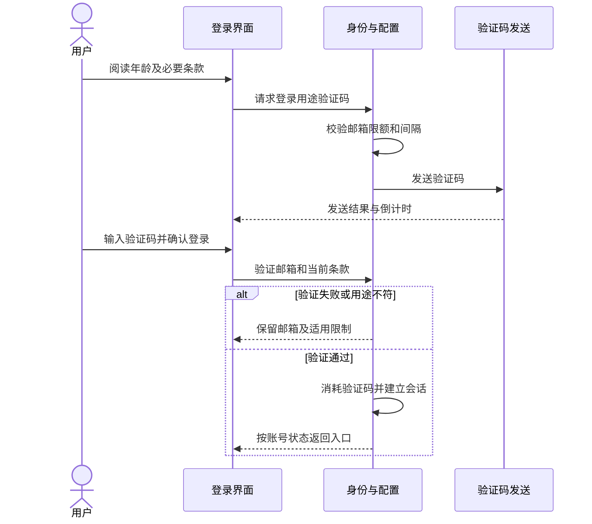

| 条件 | 处理 | 返回 |
|---|---|---|
| 首次未完成必要确认 | 不开放业务填写；明确拒绝/未成年按01清除首次草稿 | 登录/注册界面；仅阅读未勾选不清除 |
| 首次配置未完成 | 返回未过期草稿；过期重新填写 | 地区与本位币选择或上次位置 |
| 首次完成/重要条款更新/账号处理中 | 按01分别进入首页或授权原页面、条款处理、请求进度；新版拒绝保留只读及数据权利入口 | 登录成功不绕过业务写入限制 |

## S02 首次配置与初始持仓

对应[初始化与录入](02_初始化与录入闭环_待确认.md)；状态SM03。地区及本位币由用户选择；语言和风险偏好不增加首次选择步骤。

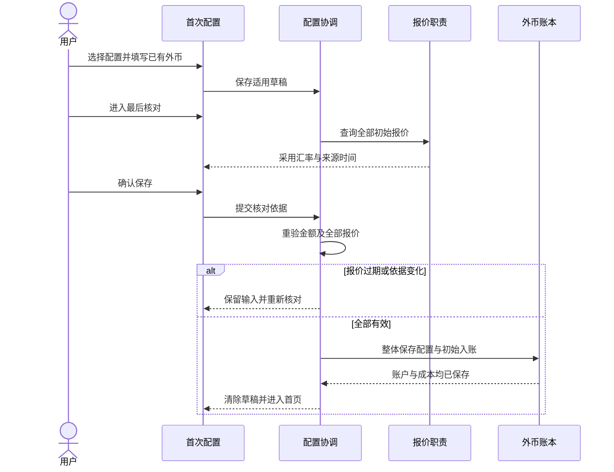

| 环节 | 原子结果 | 边界 |
|---|---|---|
| 最后提交 | 配置、各币种初始记录、成本、首次完成标记及记账起点一起生效；余额先未分配 | 无外币时不造零额初始记录；同请求不重复入账 |
| 有效报价 | 来源、方向、正值、时间及不足5分钟检查；最早过期报价决定核对有效期 | 失败不以0或手填价替代；修改草稿本位币使旧预计成本作废 |
| 后补初始持仓 | 尚无有效初始记录才走“补充初始持仓”，沿用原记账起点及原报价规则 | 已有记录走S10“更正初始持仓”，不能重复添加或改用今日成本 |

## S03 报价查询与实际换汇录入

对应[汇率查询与录入计算](05_汇率查询与录入计算.md)、[外汇账户](04_外汇账户.md)。

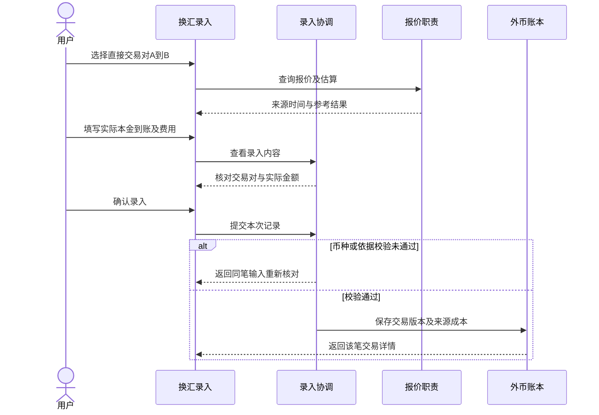

| 规则 | 提交结果 | 禁止行为 |
|---|---|---|
| 仅A→B且A≠B | 新发生交易估算按最新默认本位币；历史补录按真实原币；配置变化后重核 | 无中间币、分段成交或银行执行接口 |
| 实际金额与手续费 | Transaction及有效版本、B账户数量、来源成本一起保存；费用未知保留未知 | 参考报价不冒充实际成交；未知不记0；普通报价异常细则仍待定 |
| 可选关联计划 | 仅符合币种等条件的进行中计划可新关联，保留原归属 | 关联不自动分配；下一步分配走S05；台账“查看详情”打开对应单笔 |

## S04 独立目标与新建计划

对应[创建换汇计划](06_创建换汇计划.md)；计划状态SM04。

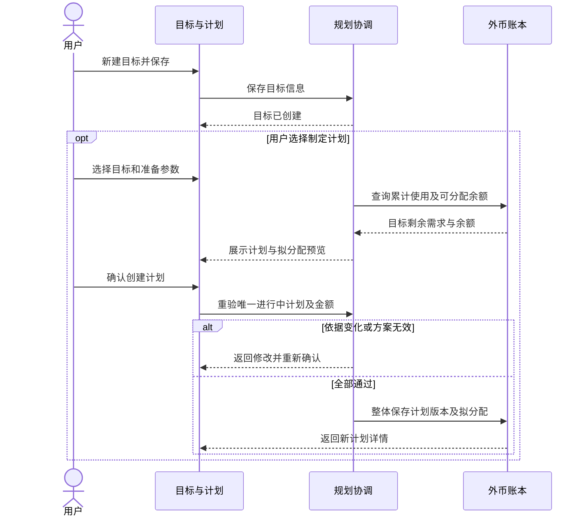

| 入口与守卫 | 保存范围 | 返回 |
|---|---|---|
| “新建目标”可独立完成 | Goal保存与后续Plan创建是分开的动作；稍后制定时目标仍存在 | “目标已创建”→“制定计划”或“稍后再说” |
| “新建计划”先选目标 | 已有active时查看已有计划，不创建第二个；A≠B且可生成安排 | 核对页返回保留同一目标和草稿；计划草稿期限仍待定 |
| 确认创建 | Plan新ID、初始版本/安排及明确选择的分配整体成功；不改变账户总余额 | 目标全历史有效使用扣除一次；创建失败不删除已独立保存的目标 |

## S05 管理分配

对应[外汇账户](04_外汇账户.md)、[创建换汇计划](06_创建换汇计划.md)。

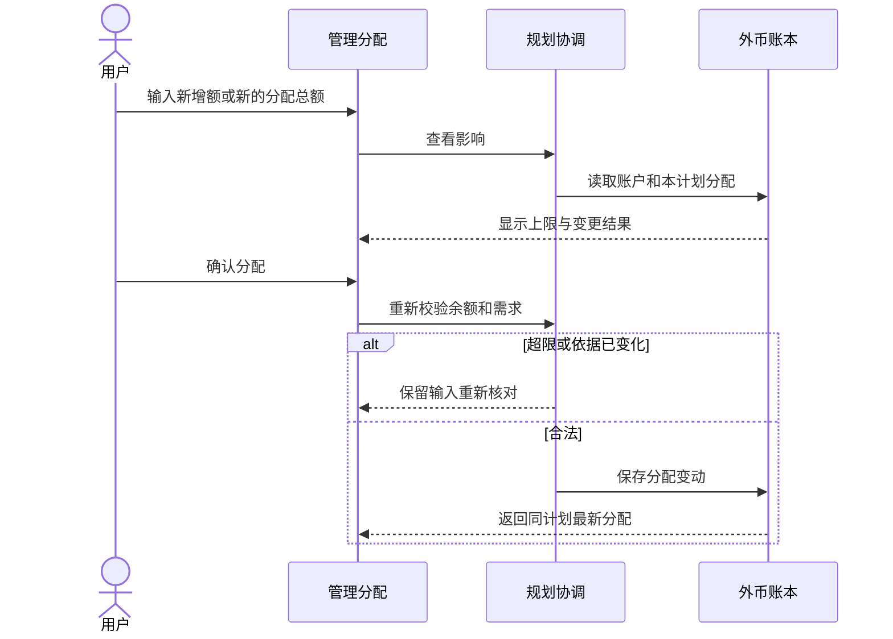

| 类型 | 上限 | 副作用 |
|---|---|---|
| 新增分配 | min(账户未分配余额，计划准备缺口) | 增加计划分配、减少未分配；账户余额不变 |
| 修改分配总额 | min(目标剩余需求，未分配余额＋本计划原分配) | 只处理差额；不能再把旧分配重复加作新增 |
| 超限、取消、冲突 | 不静默截小输入，不部分保存 | 返回同计划及管理分配入口；无有效变动不生成成功分配事实 |

## S06 记录实际使用

对应[外汇账户](04_外汇账户.md)、[资金使用记录更正](10_资金使用记录更正.md)。

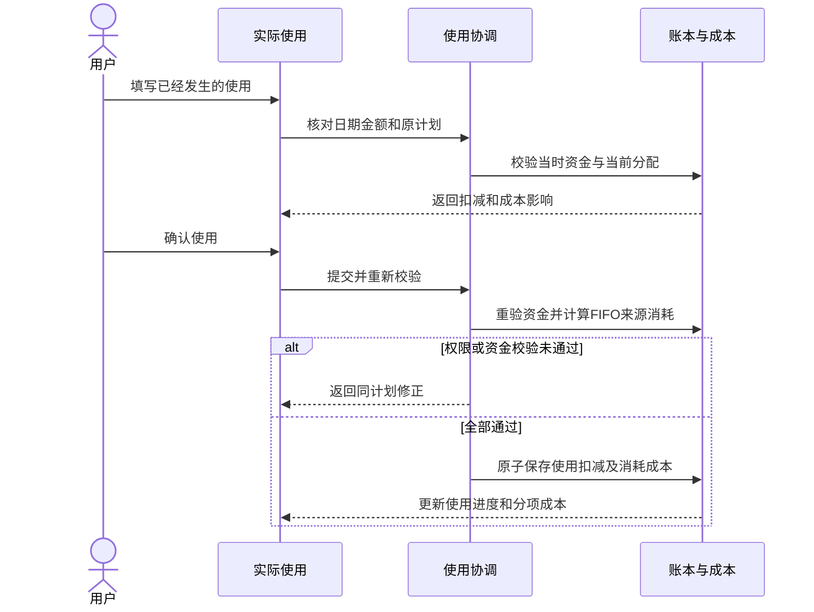

| 保存内容 | 结果 | 限制 |
|---|---|---|
| Usage/有效版本、账户扣减、分配扣减、来源消耗 | 同笔金额只扣一次；累计使用归原计划且在目标层只计一次 | 按04的计划分配/金额权限确认，不用未来买入填过去缺口 |
| 使用达到目标且分配0 | 显示资金已使用完成，可进入S08确认完成 | 不因日期到达、资金备齐或记录使用自动完成计划 |
| 后续发现误填 | 从该笔使用进入S10 | 不通过新录一笔负数、迁移计划或删除整笔来替代更正 |

## S07 修改目标与准备版本

对应[创建换汇计划](06_创建换汇计划.md)、[分批准备计划](07_分批准备计划.md)。

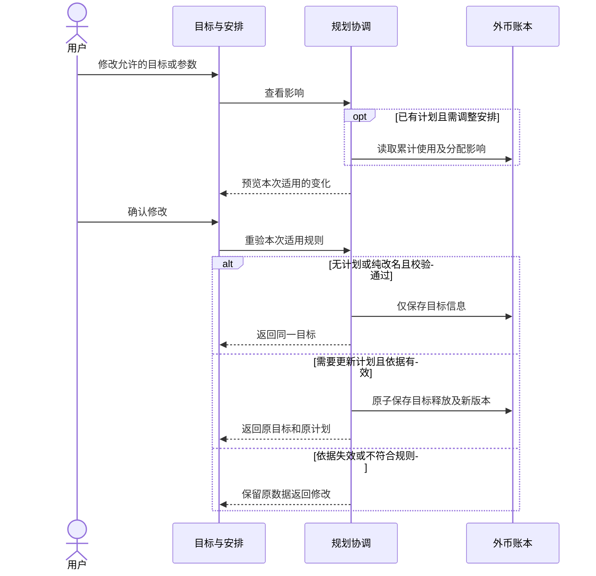

| 条件 | 同一次提交 | 边界 |
|---|---|---|
| 调低目标造成超额分配 | 新目标、释放及所需新版本一起保存，旧版本保留 | 新目标不得低于全历史有效使用；账户总余额不变 |
| 调高目标或调整节奏 | 保留planId，按规则产生版本；额外需求不自动占用余额 | 预计日期变化的字段权限、工作日日历等未定，不从图推导新规则 |
| 仅改目标名称/尚无计划 | 保存目标，显示“目标已更新” | 不生成“新计划已创建”；无计划时不强造PlanVersion |

## S08 完成取消与合规重开

对应[创建换汇计划](06_创建换汇计划.md)；状态SM04。

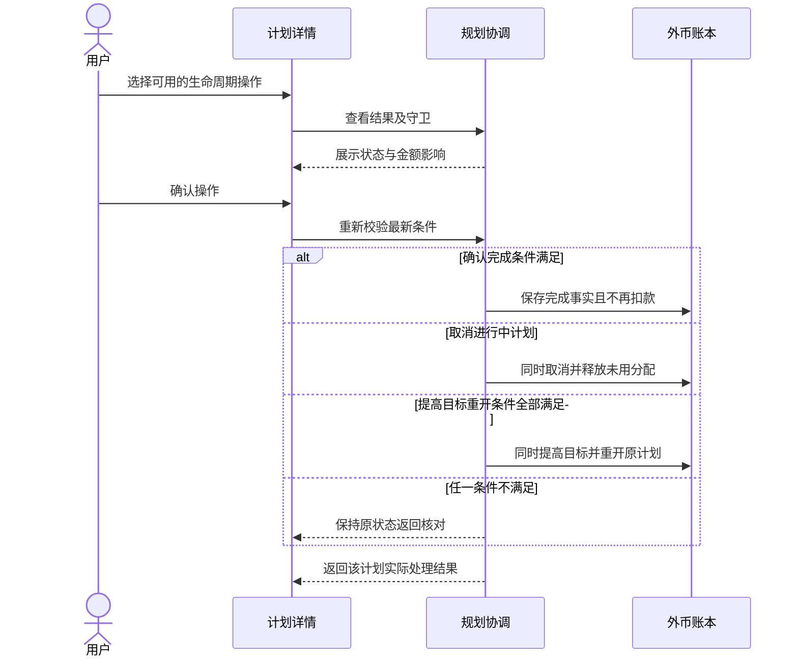

| 操作 | 守卫 | 副作用 |
|---|---|---|
| 完成 | 目标累计有效使用＝目标；当前分配0；用户确认 | 标已完成、停止提醒；不再次扣钱 |
| 取消 | 当前进行中；用户确认 | 释放尚未使用分配，原使用/成本保留；不退款 |
| 提高目标重开 | 已完成、累计使用仍＝原目标、分配0、无其他active、原计划本位币＝当前设置、新目标提高 | 同planId新版本，不自动分配；取消/停止无重开边；不满足守卫不显示可点击入口 |

## S09 本位币变更停旧建新

对应[修改默认本位币](01_首次使用与设置_待确认.md)、[创建换汇计划](06_创建换汇计划.md)；状态SM05、SM07。

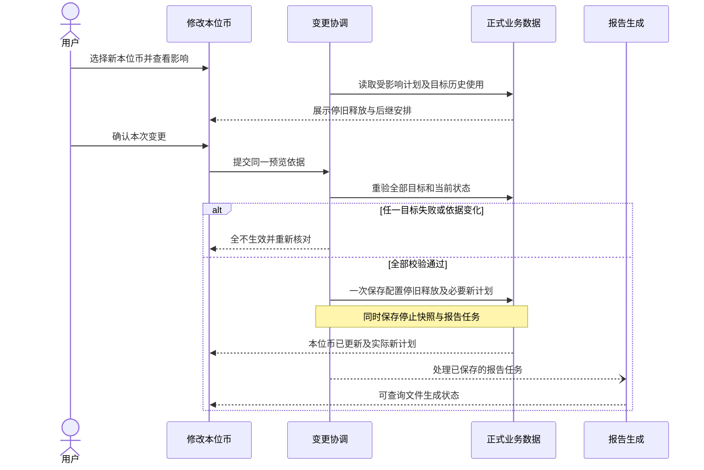

| 场景 | 原子结果 | 失败与返回 |
|---|---|---|
| 受影响范围 | 原本位币且active；目标需求=总额−全历史有效使用，后继新ID/新本位币/分配0 | 已完成、取消、停止不重复处理；切回旧币也不复活旧计划 |
| 正需求 | A≠B且安排可生成才停旧建新；原使用不迁移，余额不变 | 任一目标失败整次不生效；不部分更新配置或释放 |
| 零需求 | 仅累计使用恰等目标且分配0：停止并出报告，不造零额新计划 | 超额使用、零需求仍有分配不能当成功 |
| 无受影响计划 | 只更新默认配置 | 无空报告、空计划或强制新目标 |
| 提交及报告 | 重复提交返回原结果；PDF失败重试同任务/快照 | 成功可查看实际新计划、成本报告、返回设置；文件未生成不显示可下载 |

## S10 初始交易与使用更正

对应[交易更正与日志](09_交易更正与日志.md)、[使用更正](10_资金使用记录更正.md)、[初始更正](02_初始化与录入闭环_待确认.md)；状态SM06。

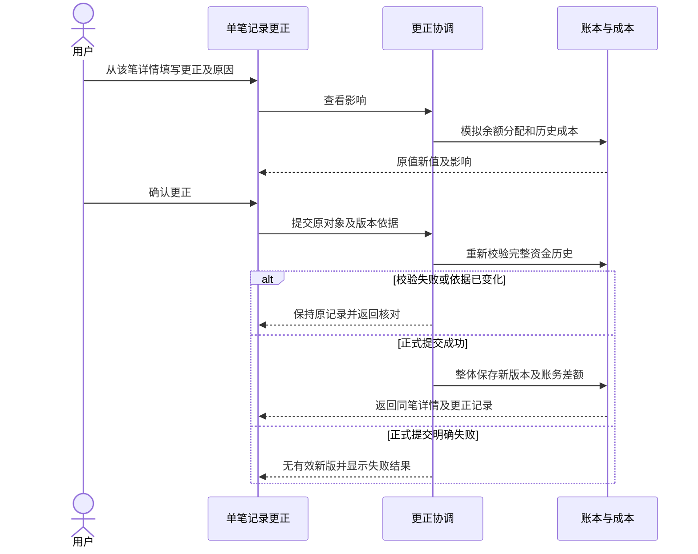

| 子类 | 必须一起处理 | 不得改变 |
|---|---|---|
| 初始记录 | 原起点报价及合法数量/币种更正；目标币变更不得形成第二条有效初始记录 | 原记账起点、原成本币；漏填新增不冒充更正 |
| 普通买入 | 合法本金/到账/费用/日期等更正及成本重算；币种影响现分配时先处理分配再更正 | 原实际币种口径不因配置改写；不自动迁移原使用 |
| 使用调小 | 原使用新版本、差额回未分配、成本和目标累计使用一起更新 | 原分配不自动恢复；原币/计划/日期不变；已结束计划不重启 |
| 使用调大 | 原分配不足时，同次补分配并立即使用；仅扣增加额 | 补分配不倒签；目标上限未定细则不当作已允许超额使用 |
| 使用改日期 | 同币同计划同数量，检查新日期资金并重算期间成本 | 不改首次录入顺序、不借未来资金 |
| 失败/结果未知 | 明确买入正式失败保留尝试记录，不产生有效新版；其他失败留存细则按正文 | 结果未知不是失败；初始更正查询原请求，普通更正超时策略待定 |

历史更正仅更新仍进行中的后继需求/缺口；后继已完成、取消或停止时只显示目标差额，不恢复提醒或分配。新报告采用新依据，旧已下载文件保持原样。

## S11 站内提醒与同日合并

对应[提醒与到期处理](08_提醒与到期处理.md)；Plan生命周期SM04，提醒资格为派生状态。

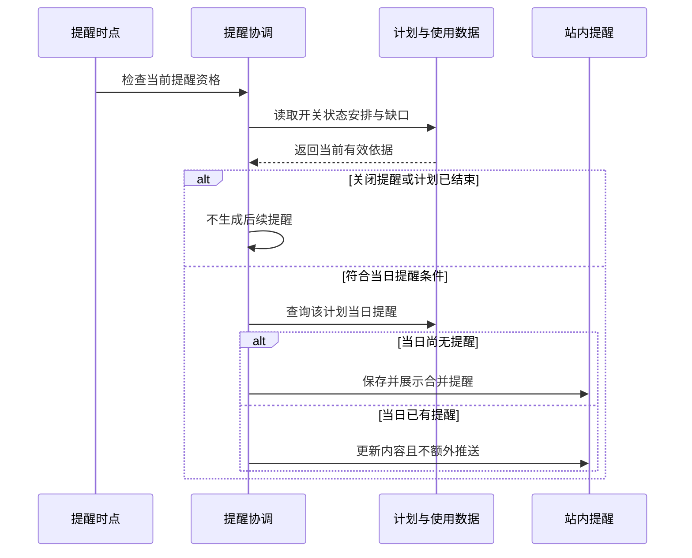

| 条件 | 处理 | 不触发 |
|---|---|---|
| 资金备齐 | 停止准备提醒；预计使用日仍可提醒核对用途 | 不自动生成使用或完成计划 |
| 安排变化/终态/重开 | 按08采用有效安排与当前状态；不补发过去提醒；原提醒不改挂后继 | 不每日反复催办、不产生邮件换汇提醒 |
| 通知入口 | 携带planId进入对应计划，返回原通知列表 | 去重不把提醒内容冻结为永不可更新；具体时区/截止边界仍待定 |

## S12 成本摘要与计划报告

对应[成本摘要与报告](11_成本摘要与报告_待确认.md)、[收益指标细则](12_收益指标与报告细则_待确认.md)；状态SM07。

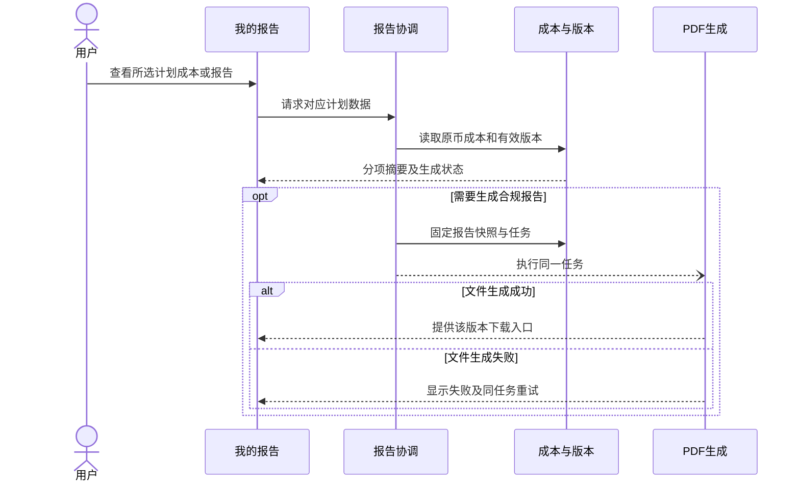

| 类型 | 依据与结果 | 限制 |
|---|---|---|
| 日常使用报告 | 符合11的有效使用条件；指定planId及版本依据 | 无实际使用不生成普通使用报告；停止报告是明确例外 |
| 停止报告 | S09已保存截至停止时快照/任务；零使用也生成 | 使用均价不适用写N/A，未知费用不作0；不凭文件失败重做交接 |
| 混币/更正/收益 | 按来源成本币分项，合法更正新快照新文件；初始来源不计收益 | 不跨币相加或重估历史；收益算法、费用分摊、基准缺值与归档等未决项按11/12保留 |

## S13 个人数据导出

对应[账号与数据](01_首次使用与设置_待确认.md)；状态SM08、SM11。

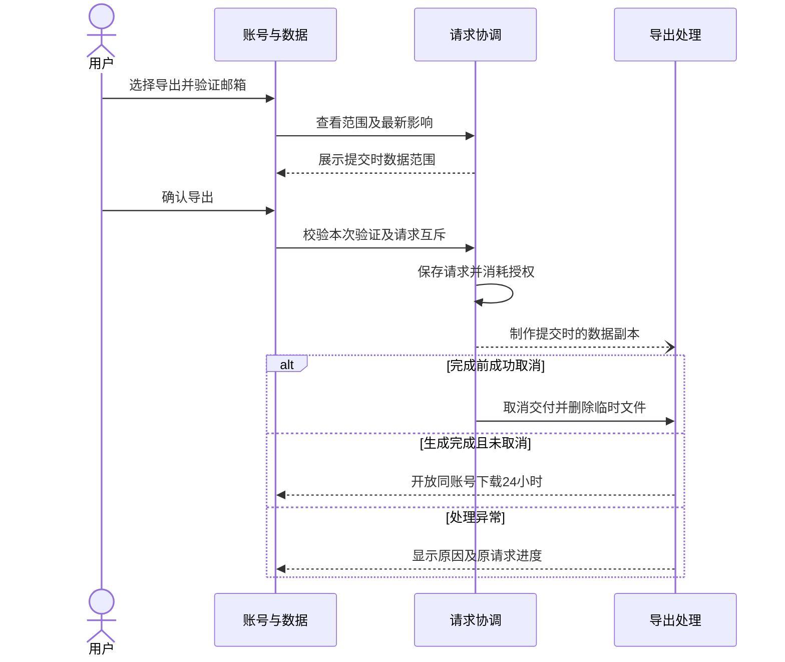

| 提交 | 处理 | 结果 |
|---|---|---|
| 导出用途验证、10分钟内确认、范围不变、无其他在办请求 | 重复点击返回同请求；输入依据变化重核；不把验证码当可复用通行证 | 无使用也可导出；不强制先导出才能清空 |
| 提交时数据边界 | 7个自然日内ZIP含CSV、字段说明及已有报告；之后变更留待下一次导出 | 金额含币种、时间含时区、不导验证码/凭证；无导回迁移功能 |
| 下载与取消竞争 | 取消成功不开放下载；24小时后关闭并删除；清空/注销提交使旧链接失效 | 已下载本地文件不远程删除；异常不要求重复提交 |

## S14 清空业务记录

对应[删除数据](01_首次使用与设置_待确认.md)；状态SM09。

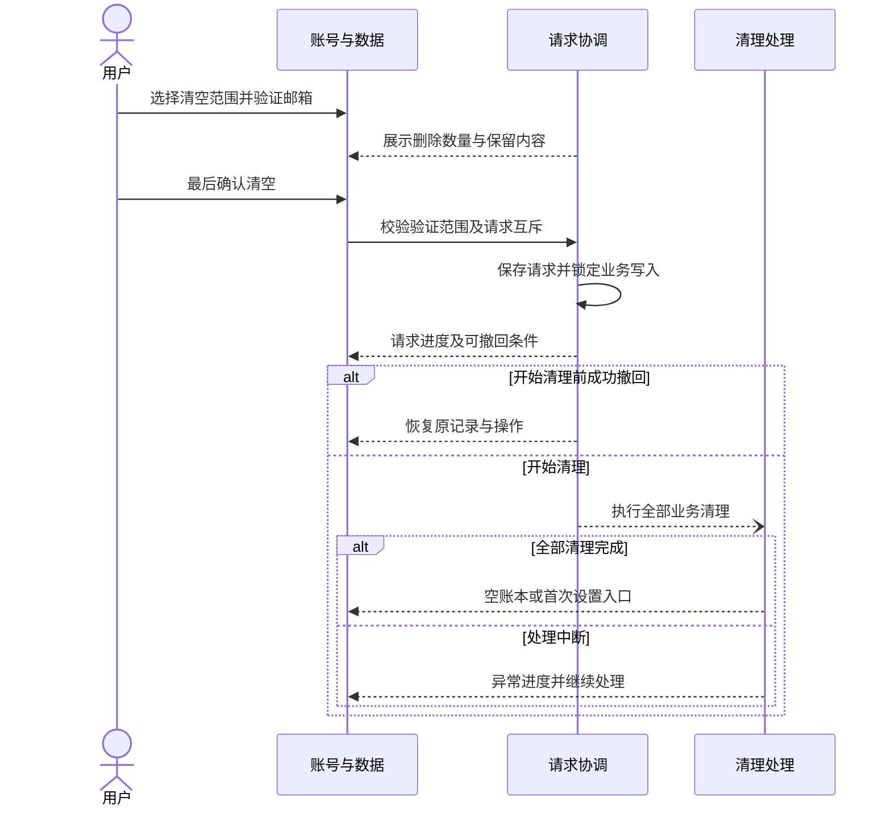

| 阶段 | 副作用 | 边界 |
|---|---|---|
| 请求提交 | 停止业务新增/修改及提醒，导出链接立即失效；7自然日内完成 | 已开始清理不再撤回；不是取消单个计划 |
| 清理中 | 不展示残留为正常账本；异步删除异常保持进度并继续 | 不承诺将已删内容回滚恢复；不能提前显示清空成功 |
| 全部完成 | 保留账号、原生效设置/本位币及适用标记；已首次完成者以清空完成时为新起点 | 未完成首次者回首次配置；备份及法定保留按01限制，非日常可见历史 |

## S15 注销账号

对应[注销账号](01_首次使用与设置_待确认.md)；状态SM10。

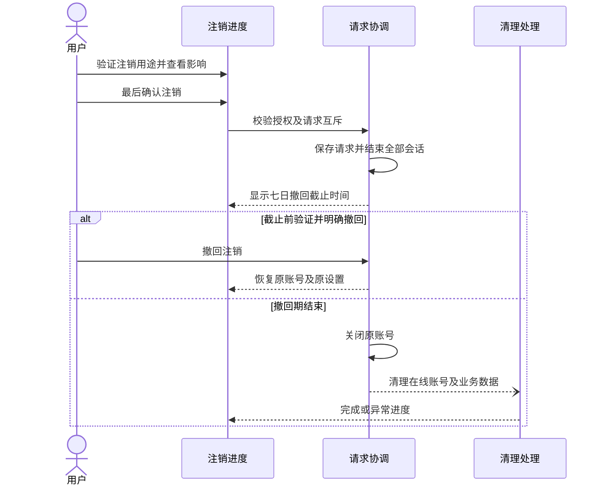

| 时间与条件 | 结果 | 禁止行为 |
|---|---|---|
| 提交后 | 停写入/提醒、全部会话失效、旧导出链接失效；新验证仅进入进度 | 登录本身不算撤回；不改邮箱取回原账号数据 |
| 7日内明确撤回 | 恢复原账号与生效本位币；未过期草稿可继续 | 不补发暂停提醒、不恢复失效导出链接 |
| 7日撤回期结束 | 原账号关闭不可恢复；在线清理期限为最初提交后30自然日内 | 未清理完同邮箱不重注册；清理完再注册是新身份 |
| 备份与例外保留 | 提交后最多90天轮换清除隔离备份；具体法定例外按01说明 | 不统一保留全部数据、不把备份继续供日常查询 |
