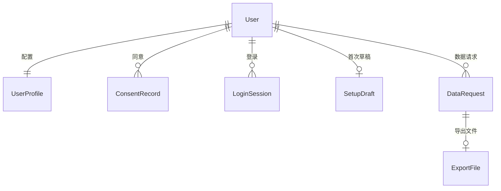
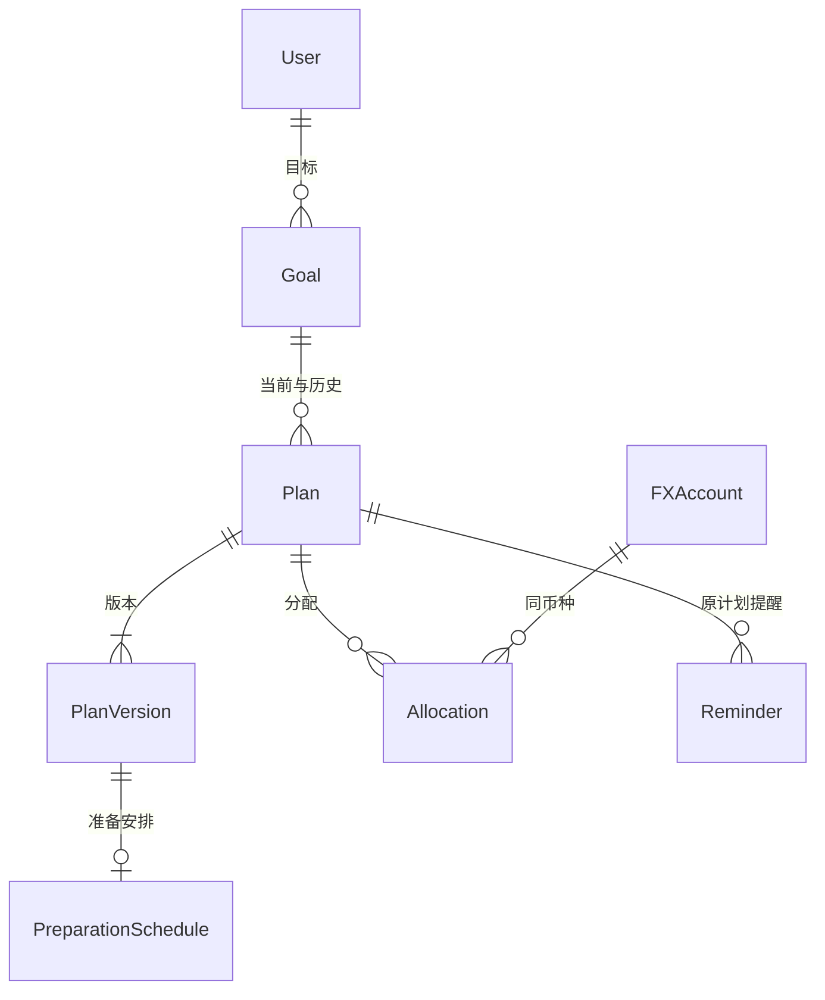
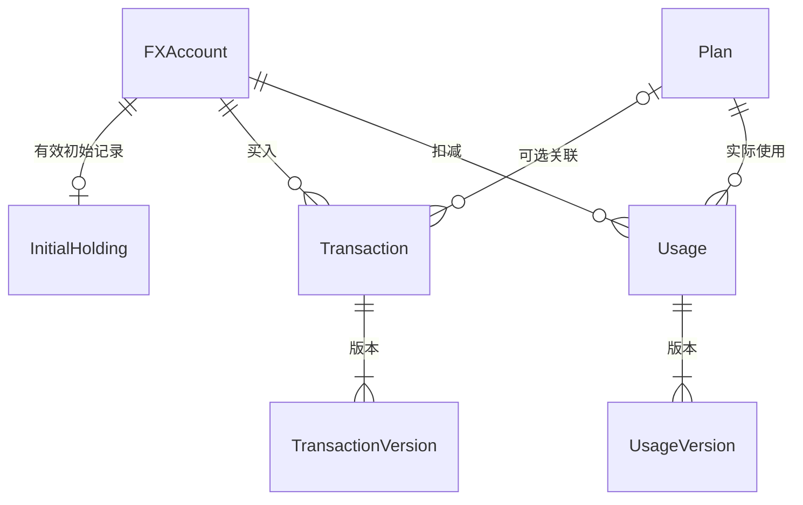
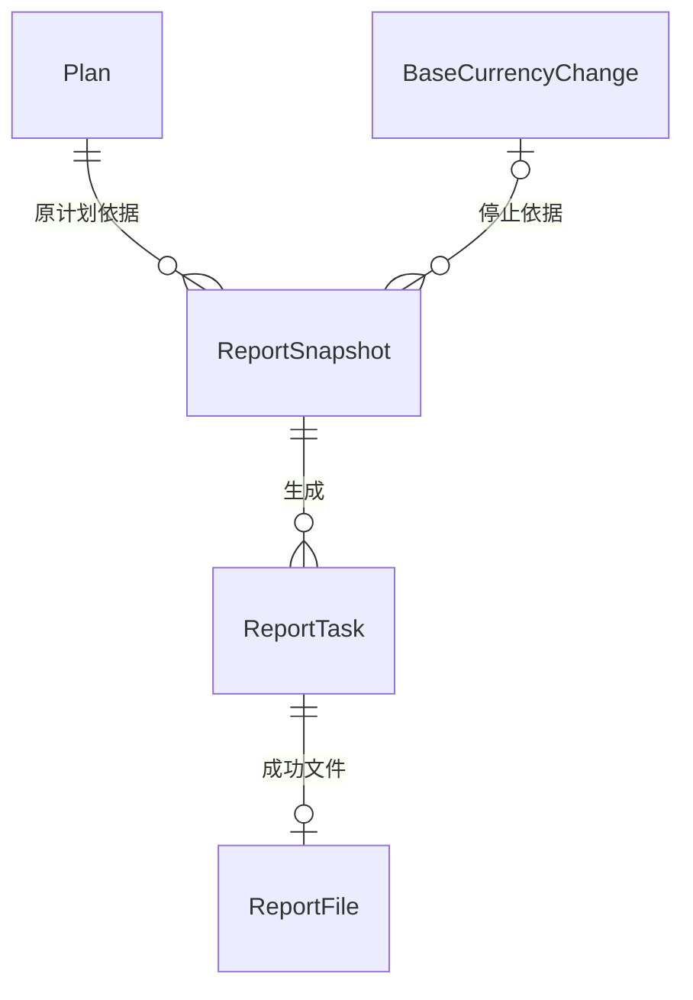
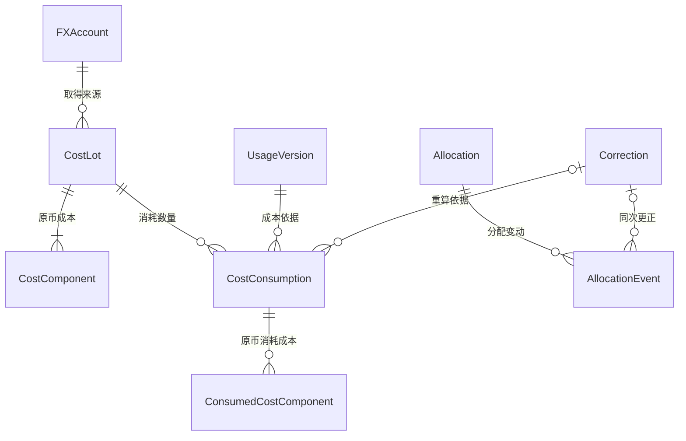

# 17 领域模型与实体定义

本章从01—15抽取逻辑模型；英文名称、ID与字段表达业务身份及约束，不承诺物理表、API、存储方式或事件溯源架构。已有规则的待确定项保持待确定。生命周期及不可变记录映射见[实体状态机](18_实体状态机.md)。

## 逻辑域边界

| 逻辑域 | 职责与对象 | 边界 | 来源 |
|---|---|---|---|
| 身份与配置 | 用户身份、会话、验证码、条款同意、首次草稿、当前设置 | 登录权限不等于业务可写；拒绝新版必要条款可只读并处理个人数据 | [01](01_首次使用与设置_待确认.md) |
| 外币账本 | 币种账户、初始持仓、真实换汇、真实使用及版本 | 记录用户已经发生的行为，不执行银行交易；账本起点前不补录 | [02](02_初始化与录入闭环_待确认.md)、[04](04_外汇账户.md)、[05](05_汇率查询与录入计算.md) |
| 目标与规划 | 目标、计划、版本、准备安排、分配、本位币变更 | 目标独立存在；同时最多一个进行中计划；准备安排不产生实际交易 | [06](06_创建换汇计划.md)、[07](07_分批准备计划.md) |
| 成本核算与更正 | 成本批次、原币分量、使用消耗对应、更正影响 | 数量FIFO，成本按来源币；更正保留历史，不自动迁移计划归属 | [09](09_交易更正与日志.md)、[10](10_资金使用记录更正.md) |
| 提醒与报告 | 站内提醒、报告依据快照、生成任务及文件 | 提醒不自动完成；文件失败不回滚已提交账本和停旧建新 | [08](08_提醒与到期处理.md)、[11](11_成本摘要与报告_待确认.md)、[12](12_收益指标与报告细则_待确认.md) |
| 账号数据处理 | 导出、清空、注销请求、临时导出文件 | 同账号同时一项请求；数据导出ZIP与计划PDF分开 | [01](01_首次使用与设置_待确认.md) |

## 实体关系总览

### D01 身份与配置

### D02 目标与规划

### D03 账本事实

### D04 报告依据与产物

D04最后一条边仅表示停止类型报告快照；其他报告快照不要求本位币变更来源。

关系按当前有效记录表达：交易币种更正可改变其当前账户引用，历史版本仍保留原币种；初始持仓每币种最多一条有效记录。目标至计划为历史一对多、进行中零或一；不代表MVP开放并行多计划或跨币种交易路径。后继关系只连接实际停旧建新产生的独立计划，不制造不存在的后继入口。

## D05 资金与成本关系

CostLot来源为一笔初始持仓或普通买入的有效版本，二选一；CostConsumption将使用版本与取得来源关联。图中的分量不是额外数量：同一消耗数量只计一次，不能因多成本币重复扣数量。分配到具体取得批次的精确映射、补充分配与过去使用的对应细节仍按09/10待确定，不从此图推导新算法。

## 实体字典

| 实体／业务定义 | 身份与关键字段 | 关系基数／不变量 | 来源 |
|---|---|---|---|
| E01 User：用户账号身份 | userId、验证邮箱 | 各对象归本人；注销完成后同邮箱再注册是新账号，不能恢复原身份记录 | [01](01_首次使用与设置_待确认.md) |
| E02 UserProfile：当前配置 | userId、地区、语言、默认本位币、默认节奏、提醒开关、首次完成标记、记账起点、配置变更依据 | User 1:1；本位币可改；历史记录币种不从此动态取值 | [01](01_首次使用与设置_待确认.md)、[02](02_初始化与录入闭环_待确认.md) |
| E03 ConsentRecord：年龄及条款确认事实 | 同意记录身份、userId、确认类别、条款版本、生效日期、确认时间 | 用户1:N；同版本跨语言不重复同意；不收证件或生日 | [01](01_首次使用与设置_待确认.md) |
| E04 VerificationChallenge：邮箱用途验证码 | 请求身份、邮箱、用途、发送结果、发出时间、有效期限、使用结果 | 登录／导出／清空／注销用途隔离；成功一次；额度按邮箱共享、错误限制按邮箱+用途 | [01](01_首次使用与设置_待确认.md) |
| E05 LoginSession：登录有效性 | 会话身份、userId、登录时间、失效依据 | 最长7天；主动退出当前登录失效；注销提交使全部现有登录失效 | [01](01_首次使用与设置_待确认.md) |
| E06 SetupDraft：未提交首次配置 | 草稿身份、userId、已填配置与金额、最后成功修改时间、核对报价 | 首次草稿30天；打开不续期；未提交不增余额；计划草稿期限不能照搬 | [01](01_首次使用与设置_待确认.md)、[02](02_初始化与录入闭环_待确认.md) |
| E07 FXAccount：单币种虚拟账户 | accountId、userId、持仓币种；余额/分配/未分配为汇总值 | 每用户每币种唯一；余额0保留；非银行账户，不按银行拆分 | [04](04_外汇账户.md) |
| E08 InitialHolding：账本起点持仓及修订历史 | 初始记录身份、accountId、原确认时间、数量、原成本币、QuoteSnapshot、成本、更正引用 | 每币种0..1有效记录；补充沿用原起点；历史版本保留，不能改起点或套今天成本币 | [02](02_初始化与录入闭环_待确认.md)、[09](09_交易更正与日志.md) |
| E09 QuoteSnapshot：采用的报价证据 | 报价依据身份、来源、交易对、来源时间、原报价、8位采用汇率 | 可供初始入账／历史更正引用；初始核对时须不足5分钟；已入账快照不事后过期失效 | [02](02_初始化与录入闭环_待确认.md)、[05](05_汇率查询与录入计算.md) |
| E10 Goal：最终用款需求 | goalId、userId、名称、目标币种、总额、预计使用日、修改历史 | 独立创建；1:N历史Plan，active至多1；总额不被剩余需求覆盖，累计使用按有效Usage去重 | [06](06_创建换汇计划.md) |
| E11 Plan：一次独立规划 | planId、goalId、创建本位币、生命周期、创建时承接额、前后继引用（如有）、当前版本 | 所属Goal唯一；本位币变更新ID；原交易/使用/分配不迁移；后继首次使用及分配均不复制旧值 | [06](06_创建换汇计划.md) |
| E12 PlanVersion：同计划规划修订 | planId+版本身份、目标依据、参数、修改时间与内容 | Plan 1:N；常规调整或合规重开新增版本；历史版本只读；当前/历史为引用关系 | [06](06_创建换汇计划.md)、[07](07_分批准备计划.md) |
| E13 PreparationSchedule：版本对应准备建议 | 安排身份、planId/版本、开始日、提前天数、节奏、节点日期与金额 | 节点1—3次，合计准备缺口；零缺口等展示细节待定，故版本可无可执行安排；不是成交或银行预约 | [07](07_分批准备计划.md) |
| E14 Allocation：账户留给计划的余额归属 | 分配身份、accountId、planId、币种、当前剩余数量 | 同币种；计划剩余分配按有效变动汇总；不减账户余额、不直接形成使用成本 | [04](04_外汇账户.md)、[06](06_创建换汇计划.md) |
| E15 AllocationEvent：分配增减事实 | 事件身份、分配引用、变动量、类型、操作时间、相关使用/更正/目标修改/本位币变更引用 | 可为增加、释放或实际使用扣减；无分配变化不伪造事件；更正补分配不倒签 | [10](10_资金使用记录更正.md)、[14](14_业务逻辑清单.md) |
| E16 Transaction：直接买入记录身份 | transactionId、userId、当前账户引用、首次录入顺序、可选planId | 当前记录关联0..1计划；新关联限同目标币进行中计划；关联不等于分配 | [05](05_汇率查询与录入计算.md)、[13](13_MVP功能清单.md) |
| E17 TransactionVersion：买入事实版本 | transactionId+版本、日期、A/B、A本金、A手续费及已知性、B数量、采用汇率、成本、更正依据 | A≠B；费用在该笔本金币种单列，未知≠0；账号改本位币不重标历史 | [05](05_汇率查询与录入计算.md)、[09](09_交易更正与日志.md)、[14](14_业务逻辑清单.md) |
| E18 Usage：计划实际用款身份 | usageId、planId、accountId、币种、首次录入顺序 | 必须属于唯一原计划；禁止更正时改币种、迁移计划或删除整笔使用 | [04](04_外汇账户.md)、[10](10_资金使用记录更正.md) |
| E19 UsageVersion：实际用款事实版本 | usageId+版本、日期、数量、原币成本分项、更正引用 | 原/新版本保留；目标汇总仅有效版本一次；日期更正不改首次顺序 | [10](10_资金使用记录更正.md) |
| E20 CostLot：取得外币的成本来源 | 批次逻辑身份、来源记录及版本、外币数量、日期、首次顺序、初始/买入类型 | 一个来源分量集合；剩余数量为派生；FIFO同日初始→买入→使用 | [02](02_初始化与录入闭环_待确认.md)、[09](09_交易更正与日志.md)、[15](15_专业术语清单.md) |
| E21 CostComponent：来源币成本分量 | 所属批次、成本币、金额、成本类别、费用已知性 | 一批次可列多个逻辑分量；当前普通买入本金/费同A，不由此开放第三币费用；不同成本币不加总 | [11](11_成本摘要与报告_待确认.md)、[14](14_业务逻辑清单.md) |
| E22 CostConsumption：使用与来源的数量对应 | 使用版本、CostLot来源版本、消耗数量、重算依据 | 使用可取多个来源，来源可被多次使用；每数量只消费一次；不足不借未来资金 | [09](09_交易更正与日志.md)、[10](10_资金使用记录更正.md) |
| E23 ConsumedCostComponent：消耗对应的原币成本 | 消耗引用、成本分量引用、原币金额、已知性 | 同消耗按币分项；初始来源参与成本但不计收益；分摊舍入细则待定 | [11](11_成本摘要与报告_待确认.md)、[12](12_收益指标与报告细则_待确认.md) |
| E24 Correction：更正操作及留存结果 | 更正身份、原对象/版本、拟新值、原因、操作人、提交时间、结果、影响与新版本引用 | 对初始/换汇/使用择一操作；成功原子生效；买入正式失败留尝试，使用失败留存字段待定 | [02](02_初始化与录入闭环_待确认.md)、[09](09_交易更正与日志.md)、[10](10_资金使用记录更正.md) |
| E25 BaseCurrencyChange：设置变更的整体处理 | 变更身份、userId、原/新本位币、预览依据、旧计划/释放/新计划/报告任务结果 | 一次可处理多个目标；仅旧本位币active受影响；任一失败全不生效；重复确认返回原结果 | [01](01_首次使用与设置_待确认.md)、[06](06_创建换汇计划.md) |
| E26 Reminder：具体计划站内提醒 | 提醒身份、planId、提醒日、合并内容、日期/安排依据 | 稳定提醒身份、planId与同日键；同日已有提醒可更新合并内容，不另推送；历史通知不改挂后继；是否发送由资格派生，无已读状态承诺 | [08](08_提醒与到期处理.md) |
| E27 ReportSnapshot：不可变报告依据 | 快照身份、planId、记录版本集合、生成依据时点、停止依据（如有）、原币分项 | Plan 1:N；更正新快照，旧快照保留；停止摘要含零使用，N/A不写0 | [11](11_成本摘要与报告_待确认.md) |
| E28 ReportTask：PDF生成任务 | taskId、snapshotId、planId、生成状态、生成时间/失败原因 | 同次失败重试同任务与快照；更正产生新依据/任务；不重复执行本位币变更 | [11](11_成本摘要与报告_待确认.md) |
| E29 ReportFile：已生成计划PDF | 文件身份、taskId、snapshotId、planId、生成时间、版本依据 | 成功才可下载；旧文件内容不改；期限/归档待定，不套用ZIP24小时 | [11](11_成本摘要与报告_待确认.md)、[12](12_收益指标与报告细则_待确认.md) |
| E30 DataRequest：账号数据请求 | requestId、userId、EXPORT/CLEAR/DELETE、范围、验证用途、提交/截止时间、状态、结果 | 同账号同时1项；范围改变重新验证；提交验证消耗，重复返回原请求 | [01](01_首次使用与设置_待确认.md) |
| E31 ExportFile：个人数据ZIP临时文件 | 文件身份、requestId、提交时数据边界、可用时间、24小时期限 | 包含CSV/字段说明/已有报告；同账号登录下载；取消或清空/注销提交立即关闭并删除 | [01](01_首次使用与设置_待确认.md) |

## 模型种类

| 种类 | 对应对象 | 身份含义 |
|---|---|---|
| 业务实体 | E01、E07、E08、E10、E11、E16、E18 | 业务身份跨修改保留，内容通过规则或版本变化 |
| 配置实体／未提交草稿 | E02、E06 | 用户配置与首次草稿身份；不是历史事实的金额来源 |
| 请求／任务／会话 | E04、E05、E24、E25、E28、E30 | 过程关联与幂等身份；编辑/预览状态不承诺持久化 |
| 不可变事实／版本／文件 | E03、E09、E12、E15、E17、E19、E27、E29、E31 | 用于历史引用；E31文件内容不变，但可用性有期限 |
| 通知实体 | E26 | 提醒身份、所属计划与同日键稳定；合并内容可更新，不重复推送 |
| 版本内值对象 | E13、E21、E23 | 安排节点与原币成本分量可嵌入所属版本；不要求独立数据库主键 |
| 派生视图／核算关联 | E14、E20、E22 | 分配剩余、成本批次剩余和使用来源对应；可追溯事件/来源版本，具体存储待实现设计 |

## 核心不变量与未决边界

| 规则 | 表达 | 来源 |
|---|---|---|
| 同币数量守恒 | 账户余额＝全部计划剩余分配＋未分配余额；分配不改变总余额，实际使用才扣减 | [04](04_外汇账户.md)、[14](14_业务逻辑清单.md) |
| 目标汇总 | 累计使用＝同目标全部计划有效Usage之和；剩余需求=max(目标总额−累计使用,0) | [06](06_创建换汇计划.md) |
| 数学下限不是合法性豁免 | 累计使用超目标、零需求仍有分配等不能以max归零掩盖并提交停旧建新 | [06](06_创建换汇计划.md) |
| 计划缺口 | max(剩余需求−当前计划剩余分配,0)；未分配余额不自动抵扣 | [06](06_创建换汇计划.md)、[07](07_分批准备计划.md) |
| 历史单位 | 金额与币种成对保留；成本按来源币分组，不统一折旧计划本位币；未知不是0 | [11](11_成本摘要与报告_待确认.md) |
| 版本与生命周期 | 当前/历史版本是指向关系；备齐/逾期是派生状态；不据此自动完成或重启计划 | [06](06_创建换汇计划.md)、[08](08_提醒与到期处理.md) |
| 未决规则 | Goal删除/归档、取消计划编辑、更多终态更正、收益算法、成本分摊细则、工作日日历、普通报价异常录入方式均不补造 | [05](05_汇率查询与录入计算.md)—[12](12_收益指标与报告细则_待确认.md) |

界面只展示用户需要的业务字段；逻辑实体ID用于关联与一致性校验，不要求把上述模型名作为用户界面文案。实际导航始终携带所选对象身份，规则见[首页与导航](03_首页与导航.md)。
