# 18 实体状态机

与[领域模型与实体定义](17_领域模型与实体定义.md)的E01—E31对应。状态code为逻辑建模标识，不要求持久化同名字段；编辑、核对等状态属于操作过程。每图仅画已确认迁移，守卫放在表中；未决分支不视为已获准行为。

## SM01 邮箱验证码

对应E04。初始：有效验证码尚未产生；终止：USED或INVALID。发送请求失败/结果不明属于发送过程，不能伪造一枚有效码。来源：[01](01_首次使用与设置_待确认.md)。

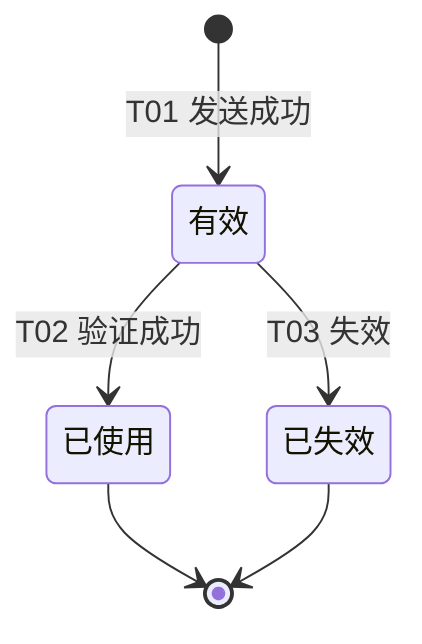

| 事件 | 守卫 | 原子副作用／结果 |
|---|---|---|
| T01 发送成功 | 间隔≥60秒；邮箱连续1小时≤5次、24小时≤20次；用途未被暂停 | 新码有效10分钟；同邮箱同用途旧码失效；不同用途不串用 |
| T02 验证成功 | 最新成功发送码、同邮箱同用途、未过期未使用、未暂停 | 消耗一次；登录完成验证；数据操作仅放行当前范围本次确认，授权10分钟 |
| T03 过期/替换/错误超限 | 满10分钟；或新码发送成功；或同邮箱同用途15分钟内输错5次 | 失效；输错超限另暂停该用途验证和发送15分钟 |

发送失败不扣次数但仍等60秒；结果不明先占额度，明确失败退回。30秒仍不明显示不明确，60秒后可再获取；失败不使旧码失效。禁止USED/INVALID重新有效；刷新、换页、重登不清零限制。重发产生新验证码身份，不是旧码复活。

## SM02 登录会话

对应E05；E01/E02的权限另见映射表。初始：无有效会话；终止：ENDED。来源：[01](01_首次使用与设置_待确认.md)。

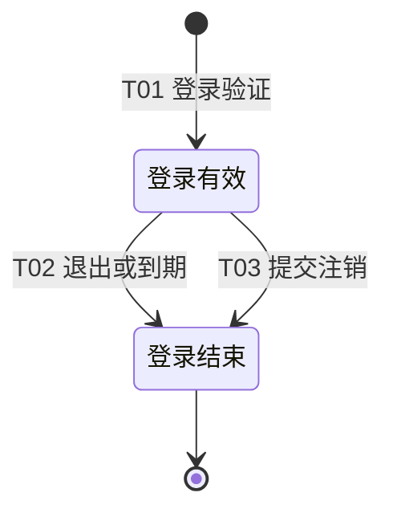

| 事件 | 守卫 | 原子副作用／结果 |
|---|---|---|
| T01 登录验证 | 登录用途验证码成功 | 依据账号和请求状态路由：首次配置、原授权页面、首页或数据请求进度 |
| T02 退出/到期 | 主动退出或最长7天到期 | 当前会话结束；退出后旧页面/返回键不能继续显示个人数据；已保存记录及未过期草稿保留 |
| T03 提交注销 | SM10提交成功 | 全部现有会话结束；后续邮箱验证仅进入注销进度 |

禁止仅凭登录成功绕过年龄、条款、首次配置或清理锁定；重新登录创建新会话，不恢复失效会话。MVP不增加设备列表或“退出其他设备”功能。

## SM03 首次配置草稿

对应E06，成功更新E02/E07/E08。初始：EDITING；终止：SUBMITTED或DISCARDED。来源：[01](01_首次使用与设置_待确认.md)、[02](02_初始化与录入闭环_待确认.md)。

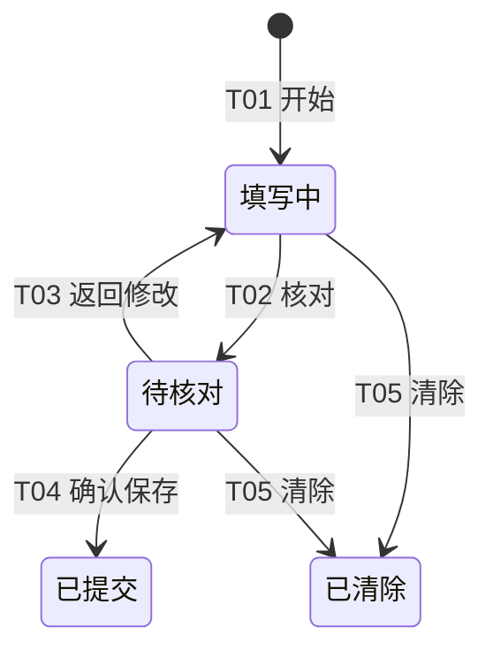

| 事件 | 守卫 | 原子副作用／结果 |
|---|---|---|
| T01 开始/续填 | 登录及必要确认通过；续填未超过最后成功修改后30天 | 可保存首次配置；仅打开不延长期限；并发修改先检测冲突 |
| T02 核对 | 各输入有效；所有初始报价来源/方向/时间齐全、正值、未满5分钟 | 固定本次核对金额及报价；用最早过期报价确定剩余时间 |
| T03 返回/修改/报价过期 | 输入或报价需重核 | 核对依据失效；保留输入重新查询，不静默换单位或成本 |
| T04 确认保存 | 重新检查全部报价、金额及最新内容；任一失败全不入账 | 全部初始记录、账户、成本与完成标记一起生效；确定记账起点；清除草稿；重复提交不重复增余额 |
| T05 清除 | 草稿满30天；或确认重新开始；或明确未满18岁/不同意并退出 | 仅清除未提交内容；重新开始可新建草稿，不覆盖已入账记录 |

禁止SUBMITTED返回旧草稿改初始账本。登录到期不自动删除未过期草稿；仅未勾选不自动清除。30天不适用于计划草稿。清空请求删除草稿按SM09执行。

## SM04 计划生命周期

对应E11；E10/E12/E13见映射。初始：ACTIVE；不可重启终态：CANCELLED、STOPPED；COMPLETED仅T05可重开。来源：[06](06_创建换汇计划.md)、[10](10_资金使用记录更正.md)。

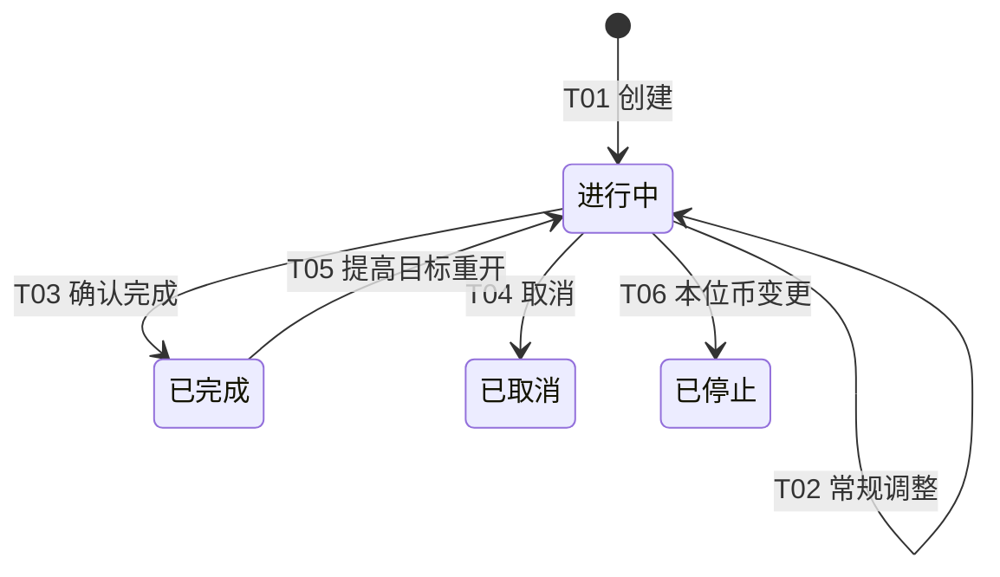

| 事件 | 守卫 | 原子副作用／结果 |
|---|---|---|
| T01 创建 | 目标可独立已有；无其他active；A≠B、方案可生成；拟分配不超余额和需求 | 新planId、初始版本及安排；只保存用户明确确认的分配；草稿不占用 |
| T02 常规调整 | 状态和字段允许；新目标≥目标全历史累计使用；重新检查依据 | 原planId新增版本；目标调低超分配同步释放；调高不自动补分配；日期具体权限待定 |
| T03 确认完成 | 目标全历史累计使用＝目标总额；本计划剩余分配＝0；用户确认 | 标completed并保留完成事实；停止提醒，不再扣款 |
| T04 取消 | 进行中，用户确认 | 标cancelled；释放未用分配；余额/已使用/成本/其他分配不变 |
| T05 提高目标重开 | 已完成；累计使用仍＝原目标；分配0；无其他active；计划本位币＝当前默认；新目标提高；再次确认 | 同planId、新版本；目标修改与重开一起保存；历史完成保留，不自动分配 |
| T06 停旧建新 | SM05整次确认成功；仅本位币＝原默认的active计划 | 标stopped、释放未用分配、停止提醒；保存停止快照/报告任务；必要时另建新planId |

禁止取消/停止→进行中；禁止已备齐/预计使用日到达→自动完成。已完成或已停止使用调小更正保持原状态；历史更正不得重启后继终态。已完成调低目标、终态调大使用/改日期、取消后编辑权限未确认，不画可执行迁移。

## SM05 本位币变更操作

对应E25及E02/E11/E15/E27/E28。初始：EDITING；终止：COMMITTED或CANCELLED。来源：[01](01_首次使用与设置_待确认.md)、[06](06_创建换汇计划.md)。

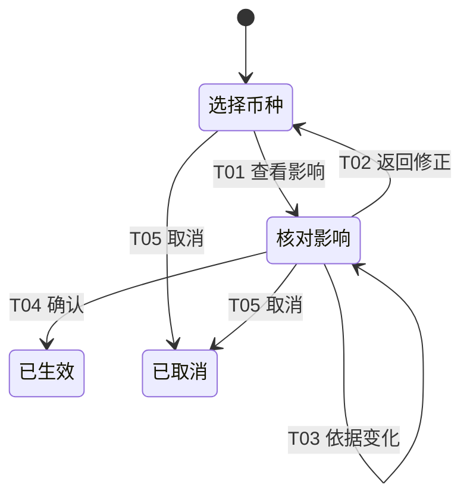

| 事件 | 守卫 | 原子副作用／结果 |
|---|---|---|
| T01 查看影响 | 已选新本位币 | 枚举原本位币下active计划；逐项列目标、累计使用、原分配、释放、需求与新安排；不提前停止提醒 |
| T02/T03 修正或重核 | 方案不可生成、A=B、金额不合法、提交依据变化等 | 不改变设置/旧计划/分配；保留选择并重核；用户再次确认 |
| T04 确认 | 全部目标通过：需求>0且A≠B、方案有效；或累计使用恰等目标且分配0；无冲突active | 新默认、停旧、释放、停止快照/任务及必要后继计划整体保存；后继分配0；同请求返回原结果 |
| T05 取消 | 尚未生效 | 原设置与全部正式数据不变 |

无受影响active时只更新默认，不造旧计划/空报告。零需求仅在累计使用恰等目标且分配0时无需后继；累计使用超目标或零需求仍有分配不得成功。禁止COMMITTED因PDF失败返回REVIEW，禁止重试重复建计划；文件交SM07。切回曾用本位币仍建新计划身份，不复活旧停止计划。

## SM06 更正操作

对应E24，目标对象为E08/E16/E18；成功版本/事实不再进入此操作生命周期。初始：EDITING；终止：APPLIED、CANCELLED或已明确REJECTED。来源：[02](02_初始化与录入闭环_待确认.md)、[09](09_交易更正与日志.md)、[10](10_资金使用记录更正.md)。

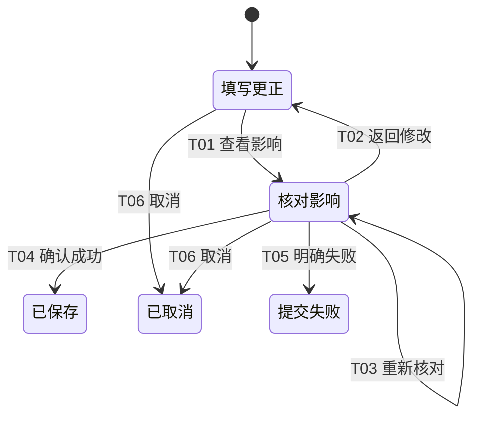

| 事件 | 守卫 | 原子副作用／结果 |
|---|---|---|
| T01 查看影响 | 必填原因；当前记录身份确定；字段/状态权限允许 | 计算原/新值、余额、分配、历史资金、成本与期间影响；不写有效新版本 |
| T02/T03 修改或依据变化 | 输入变化、金额不合法、余额不足或数据已变 | 回同笔修改或重新核对；原正式记录不变，不直接按旧预览保存 |
| T04 确认成功 | 当前与历史余额合法、现分配可覆盖、记录原币与归属合法；初始另检查原时点报价 | 新版本、更正事实、真实差额和相关成本整体生效；旧版本/旧报告快照保留；新版报告另存 |
| T05 明确提交失败 | 已正式提交且系统已确认失败；不含取消/输入检查/结果不明 | 不产生有效新版本、不改余额/分配/报告；买入留失败尝试，使用失败留存字段待定 |
| T06 取消 | 尚未成功提交 | 回同笔详情，无正式变动 |

| T04子类 | 守卫 | 副作用／禁止行为 |
|---|---|---|
| 初始更正 | 日期及原成本币不改；币种更正无第二条有效初始记录；原时点有效报价 | 重算受影响余额/成本；不得套今日报价；漏填新增不冒充更正 |
| 买入更正 | 保持原记录币种口径；本金、到账数量及费用金额可按09更正；改买入币种先处理受影响分配，仍须完整校验 | 保留旧版本；必要时创建新币账户，原零余额账户保留；不改原使用币种/计划/日期 |
| 使用调小 | 同币种、同计划、原日期不变；已完成/已停止按此范围 | 差额回未分配，原剩余分配不变；不写“恢复分配”事件；终态不重开 |
| 使用调大 | 状态允许，同币同计划同日；原分配+未分配足够；目标上限细则未决不默认放开异常 | 先用原分配，不足同次补分配并立即使用；仅扣增量；两步整体生效、不倒签补分配 |
| 使用改日期 | 状态允许，同币同计划同数量；新日期资金足够 | 原顺序身份保留；重算成本/期间，不补期初、不改买入日期 |

结果不明不等于REJECTED：初始更正按02先查询原请求，不再次创建；普通买入/使用更正超时后的核对重试细则仍待定，故图不画自动重试边。使用改为0、终态调大/改日期未确认，不放行。原计划记录不能搬到后继；历史使用更正仅使仍active的后继需求/缺口可见更新，终态后继只显示目标差额，不恢复提醒或分配。

## SM07 报告生成任务

对应E28；关联E27/E29。初始：GENERATING；成功终止：GENERATED。来源：[11](11_成本摘要与报告_待确认.md)。

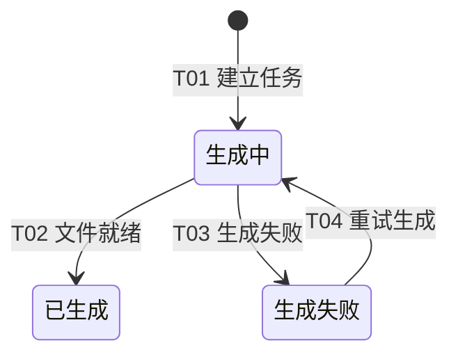

| 事件 | 守卫 | 原子副作用／结果 |
|---|---|---|
| T01 建立任务 | 有有效使用记录；或本位币变更已停止计划（含零使用） | 绑定实际planId与固定快照；停止任务依据来自已提交停旧建新 |
| T02 生成完成 | 对应文件真实就绪 | 标已生成、提供对应文件下载、保留生成时间与依据版本 |
| T03 失败 | 文件生成明确失败 | 显示失败；快照、旧计划和后继不回滚 |
| T04 重试生成 | 当前任务失败 | 同taskId、同快照重新生成；不重复停旧、释放或建后继 |

禁止GENERATED文件就地改写。更正形成新快照/新任务，不把旧失败任务静默换依据。多成本币不合并均价，零使用均价N/A，未知费用不写0。文件保留期/重命名/归档、收益算法仍待定。

## SM08 个人数据导出请求

对应E30.type=EXPORT；产物E31。初始：SUBMITTED；终止：COMPLETED或WITHDRAWN。来源：[01](01_首次使用与设置_待确认.md)。

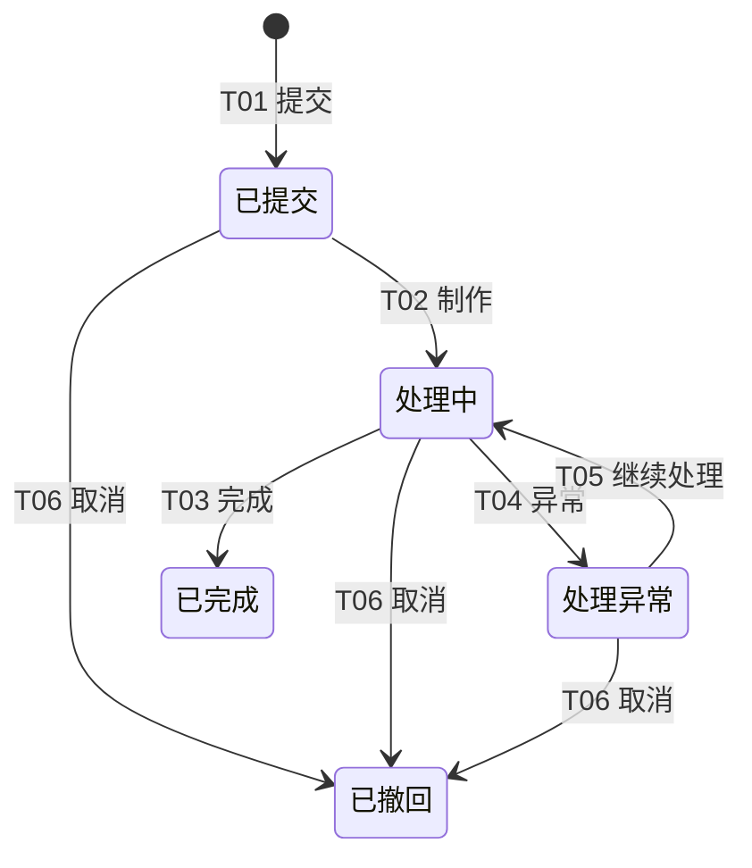

| 事件 | 守卫 | 原子副作用／结果 |
|---|---|---|
| T01 提交 | 本用途邮箱验证≤10分钟；范围未改、影响已确认；无其他在办请求 | 消耗验证、建立唯一请求及提交时已保存数据边界；重复返回原请求 |
| T02 制作 | 请求未取消 | 按提交边界制作ZIP，后续新增/修改留待下次 |
| T03 完成 | 文件已就绪且取消未成功 | 7自然日内交付；开放同账号登录下载24小时 |
| T04/T05 异常/继续 | 超期或处理异常→显示原因、已完成部分与下一步 | 沿用原请求处理，提供联系支持；具体后台恢复调度不作实现承诺，不要求用户反复提交 |
| T06 取消 | 导出尚未完成 | 停止交付、删除已有临时文件；取消成功优先于同时完成，不开放下载 |

禁止异常直接宣告完成；COMPLETED后文件过期不把请求改成失败。用户可另行申请新导出；不支持导回系统迁移旧数据。

## SM09 清空业务记录请求

对应E30.type=CLEAR；影响E02及账本业务对象。初始：SUBMITTED；终止：COMPLETED或WITHDRAWN。来源：[01](01_首次使用与设置_待确认.md)。

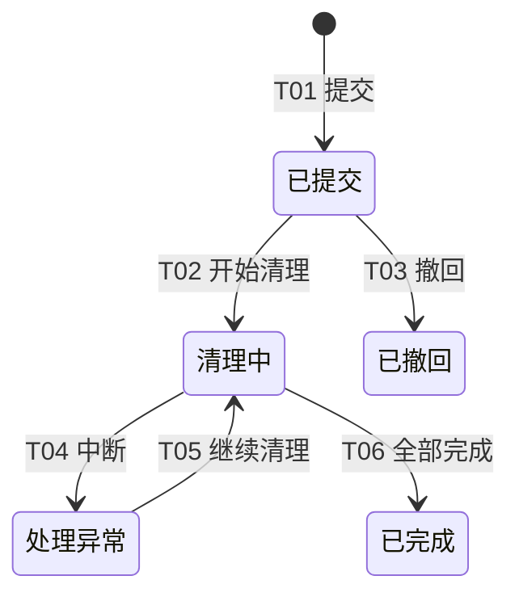

| 事件 | 守卫 | 原子副作用／结果 |
|---|---|---|
| T01 提交 | 当前范围用途验证码有效；影响及不可恢复提示已确认；无在办冲突 | 停止业务新增/修改和提醒；导出链接失效、临时包删除；7自然日内处理 |
| T02 开始清理 | 请求未撤回 | 不再允许撤回或打开原账本，不接收新导出或另一删除请求 |
| T03 撤回 | 尚未开始清理 | 恢复原记录和操作；不据此恢复已失效导出链接 |
| T04/T05 中断/继续 | 尚未全部清理 | 保持锁定，显示异常/已完成部分/下一步；同请求继续，不把残留数据视为正常账本 |
| T06 全部完成 | 全部范围清理成功 | 才显示空账本；保留账号配置/必要同意/请求结果等01规定字段；默认本位币不变 |

已完成首次配置者保留完成标记，以清空完成时刻为新记账起点；未完成者返回首次配置，不将未提交本位币当作生效设置。禁止开始清理后撤回、提前显示空账本、恢复清空前记录。备份最多请求提交后90天轮换清除；依法保留项单独限定用途与期限。

## SM10 注销请求

对应E30.type=DELETE及E01。初始：WAITING；终止：COMPLETED或WITHDRAWN。WAITING对外为“等待撤回期结束”，提交事实仍保留。来源：[01](01_首次使用与设置_待确认.md)。

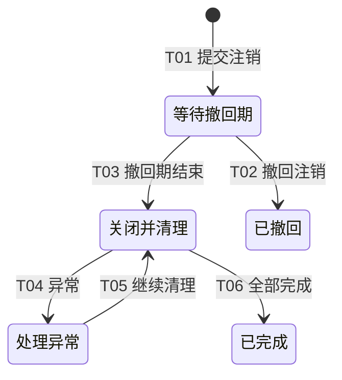

| 事件 | 守卫 | 原子副作用／结果 |
|---|---|---|
| T01 提交 | 注销用途验证有效；影响确认；无在办冲突 | 停业务及提醒、退出全部现有登录、失效导出链接并删临时包；记录7自然日撤回截止 |
| T02 撤回注销 | 未过撤回期；重新验证邮箱并明确点击撤回 | 恢复原账号及注销前默认本位币；未过期草稿可续；不补提醒、不恢复旧导出链接 |
| T03 期满 | 7自然日撤回期结束且未撤回 | 账号关闭不可恢复，开始清理；在线资料及业务数据从原提交起30自然日内完成 |
| T04/T05 异常/继续 | 清理未完成 | 同请求继续、展示原因与进度；原账号保持关闭；同邮箱不能重新注册 |
| T06 全部完成 | 在线清理全部完成 | 显示结果；同邮箱可注册新账号，原记录不可恢复；必要保留及备份按01处理 |

禁止仅登录视为撤回；禁止撤回期后重开原账号；禁止清理完成前同邮箱重新注册。90天备份轮换不延长在线清理30天期限，不开放备份日常查询。

## SM11 临时导出文件可用性

对应E31；不适用于E29计划PDF。初始：AVAILABLE；终止：REMOVED。来源：[01](01_首次使用与设置_待确认.md)。

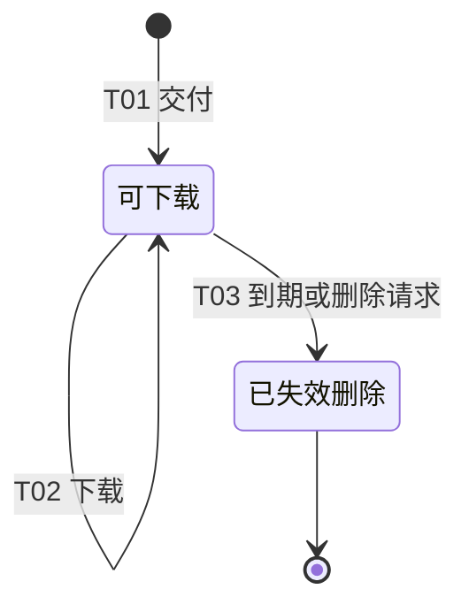

| 事件 | 守卫 | 原子副作用／结果 |
|---|---|---|
| T01 交付 | SM08完成且未成功取消 | 建立24小时临时下载可用期；文件对应提交时数据 |
| T02 下载 | 登录同一账号、链接未到期未失效 | 提供当前请求文件；邮件不附业务数据 |
| T03 失效 | 满24小时，或清空/注销提交成功 | 关闭链接并删除系统临时文件；已下载到用户设备的文件无法远程删除 |

导出完成前取消时，已生成但未交付的临时文件也删除，不进入AVAILABLE。禁止撤回注销后恢复旧链接；再次导出是新请求和新文件。此文件状态不代替SM08请求历史状态。

## 全实体状态映射与不可变规则

“无独立状态机”不是允许覆盖历史；以下对象按生成事实、版本引用或派生计算处理。合法清空/注销按SM09/10删除，不能以日常更正代替删除业务历史。

| 实体 | 状态映射 | 生成、引用与禁止行为 |
|---|---|---|
| E01 User | SM02、SM10；账号权限组合 | 会话有效不等于可写；必要条款拒绝时只读，导出/清空/注销仍可用；注销新注册新身份 |
| E02 UserProfile | SM03、SM05、SM09/10 | 配置可变，不作“历史交易币种”实时来源；账本起点/首次完成按对应成功动作更新 |
| E03 ConsentRecord | 无；不可变确认事实 | 保存用户、类别、版本与时间；新同意追加，语言切换不重复；不把旧同意改为新版 |
| E04 VerificationChallenge | SM01 | 发送结果、额度和用途暂停属验证控制；不凭页面刷新清零 |
| E05 LoginSession | SM02 | 登录新会话；失效会话不复活 |
| E06 SetupDraft | SM03 | 只有未提交首次草稿享30天续填规则 |
| E07 FXAccount | 无；存在性及余额派生 | 首次有效入账自动建，同用户同币复用；余额0不是关闭；归档未提供 |
| E08 InitialHolding | SM06更正过程；历史版本无生命周期 | 入账/补充成功生成；原日期/成本币固定；有效版本指向更新，旧内容保留 |
| E09 QuoteSnapshot | 无；不可变报价事实 | 核对时有效性由来源时间派生；入账后不因5分钟到期撤销；合法报价更正另存依据 |
| E10 Goal | 无；独立保存对象 | 无计划/有active/仅历史计划为关系查询；目标完成/归档/删除生命周期未定义，不沿用Plan状态 |
| E11 Plan | SM04 | active/completed/cancelled/stopped与备齐/逾期分开 |
| E12 PlanVersion | 无；不可变版本 | 同planId下新增修订；current/historical是指向关系，不更新旧版状态实现重写 |
| E13 PreparationSchedule | 无；版本化建议 | 确认安排随版本保存；旧安排保留；“需更新”由差异派生，不假定每节点成交/执行状态 |
| E14 Allocation | 无；剩余量派生 | 由确认的分配事件汇总；0不代表不存在历史，不用账户余额替代该计划分配 |
| E15 AllocationEvent | 无；不可变事实 | 成功操作生成；同次使用更正关联补分配和使用，原子保存；没有分配变动不制造事件 |
| E16 Transaction | 无；记录身份与有效版本引用 | 新入账成功生成；更正保留原身份/首次顺序；不设置已付款等银行状态 |
| E17 TransactionVersion | 无；不可变事实版本 | 成功更正追加并供当前读取；旧版本保留；失败不生成有效版本 |
| E18 Usage | 无；记录身份与有效版本引用 | 计划内确认后生成；不迁移原planId；终态计划更正不改变归属 |
| E19 UsageVersion | 无；不可变事实版本 | 原/新金额日期保留；有效版本参与目标汇总，禁止所有历史版本一起累计 |
| E20 CostLot | 无；来源及剩余量派生 | 引用来源记录版本；消耗完毕不是删除批次；重算保留可追溯来源依据 |
| E21 CostComponent | 无；来源原币事实/核算分量 | 本金/费用来源币保留，已知性保留；随合法更正产生新依据，不随配置折算 |
| E22 CostConsumption | 无；核算结果版本 | 由有效使用与FIFO来源生成；重算不改实际使用数量/归属；历史报告仍引用原依据 |
| E23 ConsumedCostComponent | 无；原币核算结果 | 与消耗和来源分量引用一致；多币成本分列，数量不因分量重复 |
| E24 Correction | SM06操作；提交结果留存事实 | 原对象/新版本与原因关联；操作页取消不是失败尝试；超时未知不硬判失败 |
| E25 BaseCurrencyChange | SM05操作；成功结果留存 | 重复提交取原结果；已生效后再次改本位币是新操作，不修改旧变更结果 |
| E26 Reminder | 无；稳定身份通知实体，发送资格派生 | 提醒身份、planId与同日键稳定；同日已有提醒可更新合并内容，不另推送；开关/备齐/终态决定后续提醒资格；读/未读生命周期未定义 |
| E27 ReportSnapshot | 无；不可变报告依据 | 停旧成功或后续合法报告生成建立；更正另存快照，旧快照不折算、不迁移planId |
| E28 ReportTask | SM07 | 失败重试同身份和快照；依据变化新任务 |
| E29 ReportFile | 无；不可变已生成文件 | 成功后引用任务/快照；新报告新文件，已下载不改；生命周期期限待定，不套SM11 |
| E30 DataRequest | SM08/SM09/SM10按类型 | 同账号在办互斥；不能改类型绕过重新验证；已完成/撤回结果保留 |
| E31 ExportFile | SM11 | 系统临时文件24小时；与个人已下载副本区分 |

## 派生状态与金额约束

| 对象 | 派生条件 | 不触发的生命周期动作 |
|---|---|---|
| 进行中计划资金准备 | 剩余需求>0且分配足够→已备齐；剩余需求>0且分配不足→显示缺口；累计使用恰等目标、剩余需求=0且分配=0→资金已使用完成，待用户确认完成 | 不自动完成、扣款或新增Usage；超额使用或零需求仍有分配不按正常完成处理 |
| 资金使用完成提示 | 目标全历史有效使用＝目标、当前剩余分配0 | 用户未确认前Plan仍active |
| 准备逾期/预计使用日已过 | 日期经过及缺口条件按08；具体时区/截止仍待定 | 不自动执行交易、不把计划取消或停止 |
| 终态计划更正后差额 | 有效使用变化但生命周期不变；仍active后继才更新准备需求展示 | completed/cancelled/stopped后继不恢复提醒或计划 |
| 提醒资格 | 提醒启用、计划active、对应日期/安排有效；备齐仅停止准备提醒，使用日仍可提醒 | 不把通知改挂后继，不补发错过日期，不重发当日通知 |
| 账户零余额/成本未知 | 数量0无均价；未知费用≠0；来源币分项 | 账户不终止；不能把未知成本伪造成完整均价 |

工作日日历、普通报价时效与失败手填、Goal额外生命周期、取消计划修改、更多终态更正、使用改0/超目标、历史成本分摊细节、收益算法和报告归档期限均维持原章节待确定。模型中的缺边不是隐藏功能入口。
