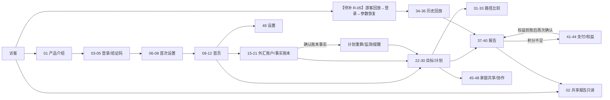
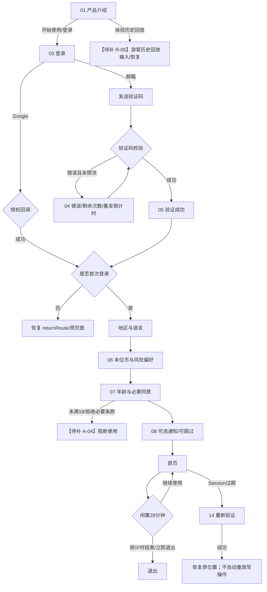
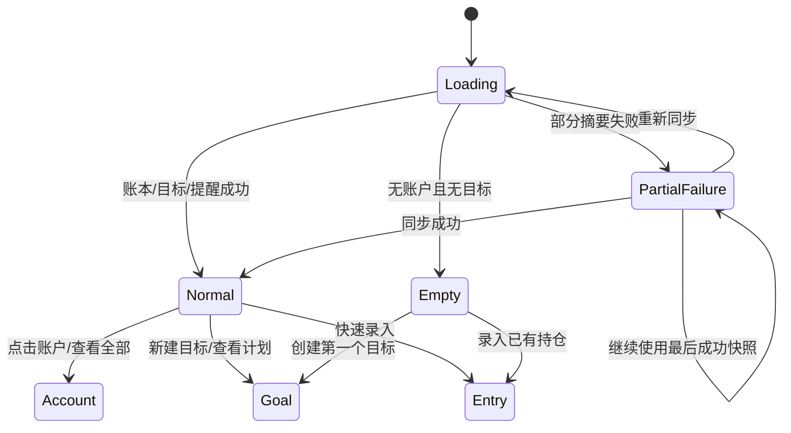
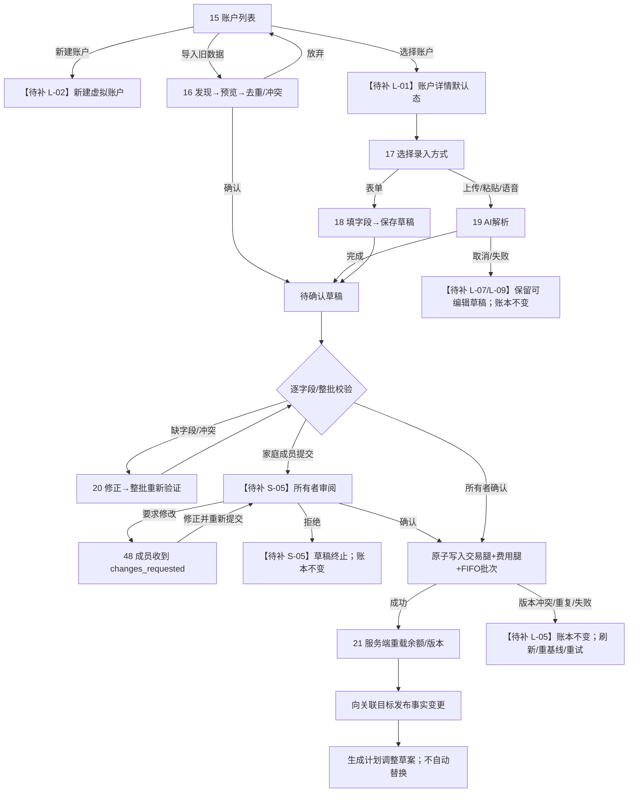
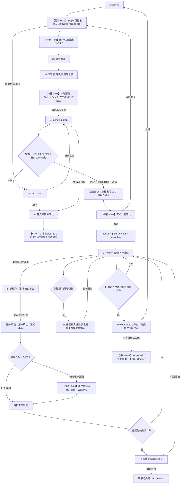
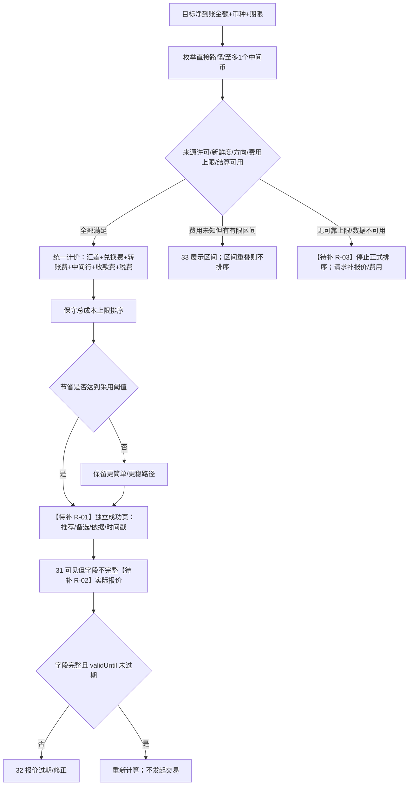
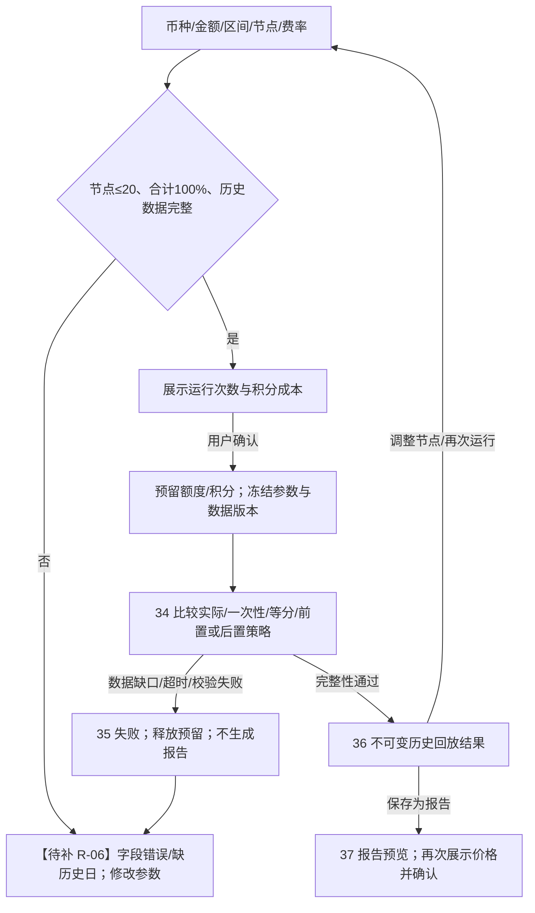
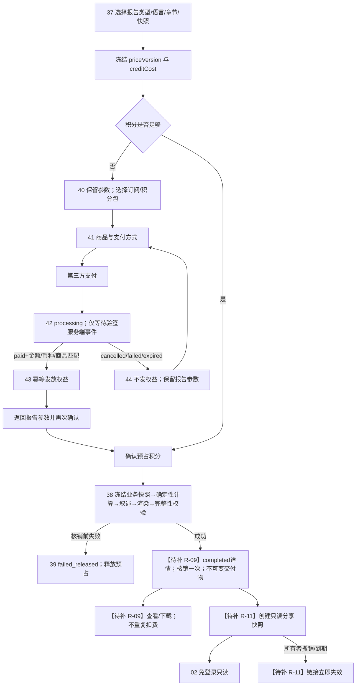
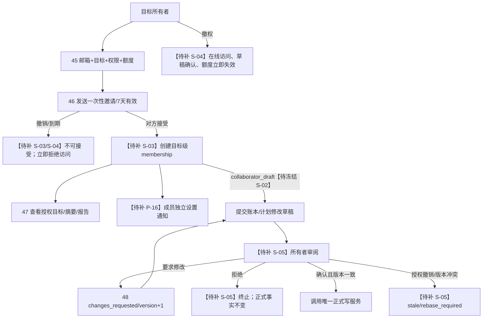

# FXplanner 业务交互流程与断点清单 V1.0

## 0. 审计边界

| 项 | 结果 |
|---|---|
| 原型 | `FXplanner-V1.2.0-完整验收原型.pen` |
| 格式 / 规模 | Pencil 2.14；49 个编号画板 |
| SHA-256 | `9f18a176251f346187cf12bcd0d930624e151f2e221949eeab4afb24c06c546d` |
| 可验证内容 | 页面、字段、文案、静态状态、画板关系线 |
| 不可验证内容 | 点击热区、跳转、返回、表单校验、持久化、权限、接口、并发、幂等、真实异步结果 |
| 关键证据 | 全文件未发现 `interaction/onClick/action/href/destination/navigateTo` 交互定义 |
| 结论 | 当前是“49 状态静态视觉稿”，不是可验收的交互原型 |

优先级：`P0`=主链/资金/权限阻断；`P1`=关键闭环缺失；`P2`=体验、运营或边界状态缺失。

流程图图例：带 `nn` 画板号的节点=原型静态可见状态；带 `【待补 ID】`=原型缺失节点；其余判断/规则节点=由静态文案推导，仍需交互与接口验证。所有连线均为业务目标流，不代表 `.pen` 已实现跳转。

## 1. 全局业务总流程

主业务闭环：`创建目标 → 形成计划 → 用户在线下渠道执行 → 录入并确认事实 → 账本更新 → 计划重算/提醒 → 资金准备完成 → 生成/共享报告`。产品边界止于“用户本人目标币账户已形成足额、已确认、可用持仓”，不代表学校/收款方到账，不发起真实交易。

## 2. 入口、认证、首次设置

对应画板：01、03–08、13–14。

业务规则：

- 必要同意逐文档记录版本与时间；营销/通知必须独立、可选。
- 会话恢复只能恢复页面/草稿上下文，不得自动重放“确认写账、确认计划、支付、扣积分”等命令。
- 未提交草稿与敏感原始文件的保存位置、生命周期必须分开定义。
- 原型可见顺序为“地区→本位币/风险→年龄/同意→通知”，但 06 同时显示“年龄待完成”“本位币进行中”，CTA 却是“勾选必要同意后继续”→ 步骤状态与动作冲突，需先冻结真实步骤状态机。

## 3. 首页与导航

对应画板：09–12。

展示口径：余额、持仓总成本、加权平均成本、目标真实准备进度、最晚安全日期、数据时间必须分别标注；失败模块不得污染其他成功模块。

## 4. 外汇账户、录入与 FIFO 事实账本

对应画板：15–21、48。

账本不变量：

- AI 只生成 canonical 草稿；只有所有者确认命令可写正式账本。
- 金额使用 Decimal；交易腿、费用腿、FIFO 批次、余额、成本在同一事务内提交。
- 已确认事实不得物理删除；更正必须“冲正原记录 + 新记录 + 关联链”。
- 重复确认返回原 transaction，不得重复计入余额/成本。

## 5. 目标、计划、执行回填与持续监测

对应画板：22–30。

关键口径：目标金额=`用户本人目标币账户净到账目标`；`已准备`仅包含已结算、可用、未重复分配的目标币持仓；pending settlement 只能计入预计进度；非目标币持仓只能作为可转换资金，不能直接算已准备。

## 6. 路径比较与报价复算

对应画板：31–33。

## 7. 历史回放

对应画板：34–36。

禁止：读取回放截止日之后的数据、插值补齐关键缺失率、把历史最优策略表述为未来建议。

## 8. 报告、积分与支付

对应画板：02、37–44。

计费不变量：预占、核销、释放、退款/补偿是不同流水；支付页面返回不等于支付成功；相同 idempotency key 不得重复发权益或重复扣积分。

## 9. 家庭共享与协作草稿

对应画板：45–48；公开只读分享对应 02，必须与家庭成员身份模型分离。

## 10. 49 画板覆盖映射

| 模块 | 成功/主状态 | 异常/过渡状态 | 缺少的关键默认页 |
|---|---|---|---|
| 入口/认证 | 01、03、05–08 | 04、13–14 | Google 失败、限流、未成年阻断 |
| 首页 | 09 | 10–12 | 目标列表/提醒中心 |
| 账户/录入 | 15–18、21 | 19–20、48 | 干净账户详情、新建账户、交易详情/更正 |
| 目标/计划 | 22–23、27–28、30 | 24–26、29 | Step1、计划预览/正式确认、目标列表 |
| 路径 | — | 31–33 | 无遮罩的成功结果页、数据完全不可用 |
| 历史回放 | 36 | 34–35 | 游客→登录→恢复、字段错误、积分不足 |
| 报告 | 37 | 38–40 | 报告详情、下载/分享/撤销、生成后缺陷 |
| 支付 | 41、43 | 42、44 | 超时/重复单/退款/拒付/兑换码结果 |
| 家庭共享 | 45–47 | 48 | 接受邀请、成员管理、撤权结果、所有者审阅 |
| 设置 | 49（仅界面偏好） | — | 账号/通知/数据源/AI/隐私各子页 |

## 11. 业务断点与缺失交互清单

### 11.1 全局交互合同

| ID | 级别 | 断点/缺失 | 补充交互与验收口径 |
|---|---|---|---|
| G-01 | P0 | 49 画板无任何可执行跳转/点击定义 | 为每个 CTA、卡片、Tab、关闭、返回建立 `source→action→target→guard→failure→return` 合同；全链可点击回放 |
| G-02 | P0 | 无统一返回、取消、浏览器后退、刷新、深链规则 | 每页定义 returnRoute、草稿保存、刷新恢复、无权限/已删除深链落点；写命令不得因刷新重放 |
| G-03 | P0 | 无 API、字段来源、权限、幂等、聚合版本映射 | 每个写操作冻结 request/response/error/role/idempotency/If-Match；双击、重试、并发只产生一次副作用 |
| G-04 | P0 | “静态状态存在”被当作异步行为已闭环 | 为 loading/running 增加轮询/推送、超时、取消、后台继续、重试、终态通知与断线恢复 |
| G-05 | P0 | 数据来源、时间、TTL、许可状态仅文案，无统一状态模型 | 定义 current/stale/unavailable/revoked；过期或停源后禁止正式排名/计划激活，保留真实事实展示 |
| G-06 | P0 | 无离线、弱网、请求超时、服务不可用、部分成功恢复 | 正式写命令 fail-closed；只读页可展示最后成功快照；明确重试是否安全 |
| G-07 | P1 | 无统一表单校验层 | 每字段定义必填、格式、范围、币种精度、日期/时区、错误落点、跨字段校验、服务端错误映射 |
| G-08 | P1 | 无全局通知中心/任务中心 | 异步计划、报告、支付、邀请、提醒集中追踪；站内事实不依赖邮件/Push 成功 |
| G-09 | P1 | 无审计记录查看入口 | 用户可查看同意、账本更正、计划版本、报告扣费、支付权益、成员授权/撤权记录 |
| G-10 | P2 | 中英页面混用：34–36 仅英文，主原型为中文 | 所有 P0 页补齐简中/繁中/英文与长文案溢出；法律文本禁止静默跨语言回退 |

### 11.2 入口、认证、会话

| ID | 级别 | 断点/缺失 | 补充交互与验收口径 |
|---|---|---|---|
| A-01 | P0 | Google 授权失败/取消/state或nonce失效无页面 | 回登录页，保留邮箱/returnRoute；展示可恢复错误；不得创建半登录会话 |
| A-02 | P0 | 验证码过期、已用、频控、次数耗尽、邮件发送失败不完整 | 区分错误码、锁定时长、重发冷却、换邮箱；不得泄露邮箱是否注册 |
| A-03 | P0 | 首次/已有用户分流、设置未完成恢复无定义；06 的步骤状态与 CTA 自相矛盾 | 先冻结唯一服务端步骤序列并使画板编号/进度/CTA一致；nextAction 驱动恢复，不重复记录已同意版本 |
| A-04 | P0 | 未满18岁、不同意必要条款无阻断页 | 明确退出、数据保留/删除、再次访问规则；可选通知拒绝不得阻断 |
| A-05 | P0 | 会话过期后的草稿恢复只写文案 | 定义草稿 token、过期时间、敏感源文件处理、跨设备/跨标签冲突；恢复后必须再确认 |
| A-06 | P1 | 邮箱修改、账号绑定/解绑、注销、设备/会话管理缺失 | 设置中补身份验证、其他会话退出、注销冷静期与数据导出/删除状态 |
| A-07 | P1 | 服务条款/隐私/AI说明“查看”无阅读与版本变化流程 | 支持打开、返回、版本差异、重新同意；拒绝新必要条款时进入受限状态 |

### 11.3 首页、账户、账本

| ID | 级别 | 断点/缺失 | 补充交互与验收口径 |
|---|---|---|---|
| L-01 | P0 | 无独立“账户详情默认态”；16 被迁移弹层覆盖 | 补余额/FIFO批次/交易/目标关联的 ready/empty/loading/error/stale 页 |
| L-02 | P0 | “新建账户”无流程 | 币种、名称、重复币种策略、初始余额/成本、确认、成功、冲突、取消 |
| L-03 | P0 | 交易行可点击但无详情页 | 展示交易腿、费用腿、证据、状态、来源、确认人、幂等键、更正链、关联目标 |
| L-04 | P0 | 已确认交易的更正/冲正闭环缺失 | 影响预览→二次确认→影子FIFO重放→原子切换；失败保持原账本；关联目标进入重算/重开 |
| L-05 | P0 | 批量写入仅有校验失败/成功，无服务端部分失败与版本冲突 | 整批原子提交；409 后展示差异并重基线；不得出现部分写入 |
| L-06 | P0 | 旧数据迁移无重复/冲突详情、回滚/封存入口 | 行级匹配依据、跳过/合并规则、导入预览版本、确认幂等、回滚影响说明 |
| L-07 | P0 | “上传文件/截图/语音”无权限、格式、大小、安全与失败状态 | 文件类型/大小/恶意文件、OCR失败、麦克风拒绝/中断、逐字稿编辑、删除源文件 |
| L-08 | P0 | AI 低置信字段、多个候选、币种歧义未形成逐字段澄清 | 每字段 value/evidence/confidence；低置信必须用户选择，禁止默认通过 |
| L-09 | P0 | 草稿缺保存、自动保存失败、过期、删除、撤回、多人冲突状态 | draft_version + expiresAt；保存失败可复制；撤回后不可确认；重叠草稿需 rebase |
| L-10 | P1 | 账户删除/归档、余额非零、已关联目标时的处理缺失 | 只允许归档；余额/活动目标/草稿存在时阻断并列出处理项；历史审计保留 |
| L-11 | P1 | “成本可信度92%”无解释与修复入口 | 展示构成、缺失批次/费用、提升动作；不得被误解为数据准确率 |
| L-12 | P1 | 首页部分摘要失败只提供整体重新同步 | 展示失败模块、原因、单模块重试；成功模块保持可用，快照时间不刷新伪装成功 |

### 11.4 目标与计划

| ID | 级别 | 断点/缺失 | 补充交互与验收口径 |
|---|---|---|---|
| P-01 | P0 | Step 1“目标信息”无独立页面 | 补名称、目标币种、净到账金额、使用日、本位币继承、字段错误、草稿恢复 |
| P-02 | P0 | 已有持仓分配缺选择/冲突交互 | 仅 settled+available+unallocated；展示其他目标占用；支持部分分配；并发冲突返回刷新 |
| P-03 | P0 | 计划预览/正式计划确认缺页且状态冲突：24 称“目标已确认/原子激活正式计划”，27 又称“待用户确认”但页面已“持续监测” | 生成前展示 Safety Date 拆解、批次、保护线、费用/假设/数据时间；冻结唯一转移：`pending_plan→用户确认→active`；未确认不启动监测/提醒 |
| P-04 | P0 | 目标金额口径未在录入处显式确认 | 前台明确“本人目标币账户净到账”；学校到账/后续付款不属于该目标；首次创建需确认 |
| P-05 | P0 | Safety Date 只显示结果，无工作日历/cutoff/缓冲依据与不可计算分支 | 展开收款/渠道/结算/节假日/产品缓冲；任一关键来源缺失时只给区间并阻断正式激活 |
| P-06 | P0 | 费用“不确定”仅复选框，无 unknown/estimated/unbounded 后果 | 展示区间与证据；无有限上限不得做最低成本排序；允许仅以安全进度生成非成本优化计划 |
| P-07 | P0 | 25 同时列“剩余缺口16,350 CAD”“仅剩5工作日”“渠道至少需7工作日”等原因，但未指出唯一硬阻断与规则归因 | 将每个失败原因绑定确定性字段、当前值、阈值、是否硬阻断及修复动作；主错误码只指向决定性门禁 |
| P-08 | P0 | 27“节点完成”依赖账本匹配，但无多目标/多节点歧义处理 | 匹配预览；用户选择目标、节点、分配金额；一笔交易可拆分且总量守恒 |
| P-09 | P0 | 28 调整草案数据自相矛盾：触发文案称0%→34%，背景为68%；新旧节点无清晰总额 | 左右对照 old/new plan_version；真实已准备、剩余缺口、节点合计守恒；确认前旧计划继续生效 |
| P-10 | P0 | 调整草案确认失败/版本冲突/数据过期无状态 | 409/STALE_PLAN 后保留草稿、展示新事实差异、重新生成；不得部分替换提醒 |
| P-11 | P0 | completed 后事实被更正、持仓被重新分配、余额不足的恢复缺失 | `completed→reopened`；旧计划只读；生成恢复草案，用户确认后才回 active |
| P-12 | P0 | 目标编辑、延期、金额/币种修改的影响预览缺失 | 先展示计划/持仓/报告/提醒影响；币种变更建议复制新目标；确认后生成新版本 |
| P-13 | P0 | 24 有“取消目标”入口但无对应确认状态；26 仅展示在 plan_failed 背景；active/completed 的取消/归档规则仍缺失 | 24 与26接通；按状态定义取消/归档；active 释放分配和提醒；completed 只归档；保留重新创建能力 |
| P-14 | P1 | 无目标列表、筛选、归档、多个目标争用同一持仓的总览 | 展示 active/draft/failed/completed/cancelled/reopened；持仓占用与资金缺口跨目标可见 |
| P-15 | P1 | 保护曲线/风险偏好无切换影响预览 | 切换前展示节点、提醒、最晚安全日期变化；不改变真实结算天数，不暗示汇率预测 |
| P-16 | P1 | 提醒与静默时段只有链接，无设置页与渠道状态 | 频率、渠道、静默时段、紧急例外、权限拒绝、失败回退、成员独立偏好 |
| P-17 | P1 | 数据过期后“刷新数据”无失败/部分恢复/停源状态 | 保留真实进度；逐源显示刷新结果；许可撤销时不可恢复成本排名，仅允许替代源/用户报价 |
| P-18 | P1 | 目标完成仅按持仓，缺“已占用但未实际支付”的后续处置 | 明示分配状态；允许用户解除/继续保留；不得把学校到账或付款成功写成完成 |
| P-19 | P1 | 30 显示完成/监测结束日为 2026-09-02，但批次5同时显示“已完成 · 2026-09-08”，计划日期与实际完成日期不可区分 | 批次分列计划截止日与实际完成日；09-08 若为计划截止，不得无标签地充当完成日；总目标完成日由实际事实推导 |

### 11.5 路径、历史回放、报告

| ID | 级别 | 断点/缺失 | 补充交互与验收口径 |
|---|---|---|---|
| R-01 | P0 | 31 只有“计算中遮罩+背景结果”，无独立成功页 | 补 ready 页；展示候选资格、排序依据、各费用腿、来源/时间、阈值、不可执行声明 |
| R-02 | P0 | 实际报价录入无完整表单 | 渠道、方向、rate/买卖金额、费用、validUntil、证据、币种；方向/倒数/精度校验 |
| R-03 | P0 | 无数据完全不可用、费用无上限、单一路径失败 | 明确 blocked 状态；保留参数；允许补数据/切渠道；不得沿用旧“推荐”标签 |
| R-04 | P0 | 报价过期仅提示录入新报价，无编辑/复制原参数/刷新来源 | 复制非时效字段，新报价必须再次确认；旧复算快照只读且标 expired |
| R-05 | P0 | 历史回放游客入口与34登录态/积分逻辑未接通 | 游客仅可填写≤3节点并看示例预览，不运行、不保存、不占run quota/积分；点击运行/保存或增加节点时登录，登录后用签名draftToken恢复参数并再次确认价格 |
| R-06 | P0 | 历史回放缺输入错误、节点合计非100%、非交易日、重复日期、超上限状态 | 行内校验+自动合计；非交易日按明确规则处理或阻断；禁止静默插值 |
| R-07 | P0 | 34–36“每日运行次数”和“积分”两个额度模型混用 | 登录用户确认运行时预占3积分；成功时核销3积分并扣1次daily run，失败/超时释放积分且不扣run；保存为报告走独立report price确认 |
| R-08 | P0 | 36 顶部称18/20剩余，底部仍称19次；保存报告又标3积分 | 单一服务端余额源；生成完成后原子刷新；保存报告进入新价格确认，不在结果页直接扣 |
| R-09 | P0 | 报告成功详情、HTML/PDF生成、下载失败/过期缺失 | completed 详情展示快照、来源、假设、警示、basis_status；下载重试不重复扣费 |
| R-10 | P0 | 报告生成时基础事实变化无处理 | 未发布任务取消并释放；已发布内容不可变，标 `facts_updated` 并可生成新版本 |
| R-11 | P0 | 报告分享只有02结果，无创建、范围预览、撤销、到期、无效链接 | 所有者预览脱敏字段→创建→复制；支持撤销/到期；访问端展示 invalid/revoked/expired |
| R-12 | P0 | AI叙述失败/多语言失败的降级与扣费未定义 | 基础确定性报告可用时询问是否接受降级价；未同意不发布/不核销 |
| R-13 | P1 | 报告删除、归档、重命名、搜索/筛选缺失 | 归档不删除计费审计；删除分享与删除报告分开；历史快照保留策略明确 |
| R-14 | P0 | 02 报告标注生成于 2026-07-12，却将 2026-07-18、08-12、09-08 批次标为“已完成” | 不可变快照不得包含生成时点之后的完成事实；修正生成时间或将未来批次恢复为待处理/计划中，并做时间一致性校验 |

### 11.6 积分、支付、共享、设置

| ID | 级别 | 断点/缺失 | 补充交互与验收口径 |
|---|---|---|---|
| B-01 | P0 | 41–44 顶部可用1积分，但钱包区仍显示长期积分3，未说明是否另有 `reserved=2`；口径不可核对 | 所有页面取同一 wallet_version；展示 `available=subscription_available+rollover_available+purchased_available-reserved`，并定义消耗、过期、退款对各桶的顺序与影响 |
| B-02 | P0 | 43 弹层余额11，背景仍显示1 | 权益到账后原子刷新钱包与订单；关闭弹层前后余额一致；刷新/多标签一致 |
| B-03 | P0 | processing 无超时、主动查询、晚到 paid 事件状态 | 后台持续查询；超时转 pending_review 而非失败；晚到已验签事件仍幂等发放 |
| B-04 | P0 | 重复支付、重复Webhook、支付成功但权益失败无恢复 | provider_event_id/order_id 幂等；履约重试/DLQ/人工对账；不得要求用户再次支付 |
| B-05 | P0 | 退款、拒付、部分退款、负积分/已消费权益无策略 | 反向权益流水、余额不足处置、报告访问影响、通知与申诉流程 |
| B-06 | P1 | 兑换码只有输入框，无校验/已用/过期/地区限制/成功态 | 服务端兑换、幂等、错误码、权益明细；失败不改变报告上下文 |
| B-07 | P1 | 订阅方案入口存在但订阅购买/续费/取消/恢复缺页 | 商品/周期/税费/自动续费同意、支付失败、管理入口、到期后权益规则 |
| B-08 | P0 | 38 仅预占2积分，39 失败后却称积分流水写入 `refund`；预占未核销不应退款 | 核销前失败写 `reservation_release`；仅已核销后的反向补偿写 `refund/compensation`；同步修正文案和流水类型 |
| B-09 | P1 | 38 显示“可用5”同时“已预占2”，未展示预占后的可用3 | 预占成功后原子展示 `available=3,reserved=2,total=5`；39释放后恢复 `available=5,reserved=0` |
| S-01 | P0 | 公开分享链接与家庭 membership 未明确分层 | 公开链接=不可变脱敏快照；家庭成员=登录身份+目标级授权；token/权限/撤销分别建模 |
| S-02 | P0 | 45“可提交草稿”，47标题“只读”，权限命名冲突 | 拆 `viewer` 与 `collaborator_draft`; 每个动作做服务端授权；UI文案与实际权限一致 |
| S-03 | P0 | 邀请接受流程缺失 | 打开→登录/注册→查看邀请人/目标/权限→接受/拒绝；过期、撤销、邮箱不匹配、已是成员 |
| S-04 | P0 | 撤销邀请/撤权缺确认与结果 | 展示影响；确认后在线访问、草稿确认、积分授权立即失效；已发布报告按独立分享规则 |
| S-05 | P0 | 所有者审阅只出现成员“请求修改”视角 | 补 pending review 列表、diff、证据、确认/拒绝/要求修改、版本冲突、审计记录 |
| S-06 | P0 | 成员额度只有“每月最多5积分”，无用量、预占、并发、归属钱包 | 展示 owner/member wallet、已用/预占/剩余；并发原子扣减；撤权释放未核销预占 |
| S-07 | P1 | 邀请重复、重发、改权限、多个目标、成员列表缺失 | 同邮箱/目标去重；重发不延长旧token或明确作废；权限变更需版本与通知 |
| S-08 | P1 | “向所有者留言”无消息线程、已读、通知与敏感信息规则 | 目标级线程；不进入正式事实；附件/PII限制；撤权后只读历史或按策略删除 |
| S-09 | P0 | 45/47 声明仅目标级授权且其他账户不可见，但48把协作草稿叠在完整 USD 账户余额、成本、FIFO与交易历史上 | 成员只可见授权目标所需的脱敏持仓摘要和本人草稿；禁止复用完整账户详情背景；服务端执行对象级+字段级授权 |
| SET-01 | P0 | 49 只实现“界面偏好”，侧栏其余板块无页面 | 补账号登录、通知、数据源、AI、隐私与数据权利；每项含 loading/error/success/conflict |
| SET-02 | P0 | 修改本位币“立即生效”但无历史成本/目标/报告影响说明 | 仅改变展示折算；不改历史交易事实/已发布报告；切换前预览并记录版本 |
| SET-03 | P0 | 隐私与数据权利缺导出、更正、删除、撤回同意流程 | 请求→身份复核→范围/预计时间→处理中→完成/拒绝；法定保留数据单独说明 |
| SET-04 | P0 | AI助手配置称“密钥不明文回显”，但无密钥生命周期交互 | 添加/验证/替换/撤销/最后使用时间；值不回显；失败不影响确定性核心功能 |
| SET-05 | P1 | 多设备同步与409冲突未定义 | settings_version/ETag；冲突展示新旧值；用户重选，不采用最后写覆盖 |

## 12. P0 五段式验收合同

所有 P0 清单项必须同时满足以下断言；任一失败即该项未关闭：

| 维度 | 统一可测试口径 |
|---|---|
| 触发条件 | 复现清单第三列所述状态，或执行对应 CTA/API；固定用户、角色、聚合版本、数据快照、时间和幂等键 |
| 业务后果 | 仅产生清单第四列允许的页面/领域状态变化；UI、API、领域事件、审计日志使用同一业务 ID 与版本 |
| 禁止副作用 | 未通过确认/权限/数据/版本门时：账本、持仓分配、active plan、积分核销、支付权益、成员授权均不得变化 |
| 用户恢复动作 | 页面提供清单第四列所述修改、刷新、重基线、重新验证、重试、返回或取消；恢复动作不重复原写命令 |
| 成功终态 | 刷新、后退、重登、多标签、重复请求后仍保持唯一终态；相同幂等键只产生一次正式事实/扣费/权益/授权 |

下列原第四列仍含设计动作，补充成可直接断言的专项验收：

| ID | 触发 | 业务后果 / 禁止副作用 | 恢复动作 | 成功终态 / 断言 |
|---|---|---|---|---|
| A-04 | 年龄选“未满18”或拒绝任一必要条款 | 阻断 onboarding；不创建可用业务会话、账户、目标或营销授权 | 返回查看条款或退出 | 重登仍进入阻断态；选择可选通知“拒绝”不触发阻断 |
| L-01 | 从15点击任一账户 | 只读载入该账户余额/FIFO/交易/关联目标；加载失败不改任何事实 | 单页重试或回账户列表 | ready/empty/error/stale 四态均可刷新重现；数据带 account_version/as_of |
| L-02 | 选择币种并连续双击“创建” | 每用户每币种最多一个 active 虚拟账户；同幂等键重放返回原账户；不同请求创建重复币种返回409 `ACCOUNT_EXISTS`+existing_account_id；不生成初始交易 | 打开现有账户、改币种或返回 | 相同幂等键仅一个 account_id；不同请求也不能产生第二个同币种active账户；列表/详情版本一致 |
| L-03 | 点击交易行 | owner 可见完整详情；目标级成员仅对授权目标内摘要字段脱敏展示，不能打开原交易对象；请求无对象授权的 transaction_id 一律403且响应无字段 | 返回原筛选与滚动位置 | owner合计与账本一致；成员摘要不含账户余额、其他交易、证据原文、PII；跨目标探测均403 |
| L-06 | 旧数据含重复、冲突、非法币种，或请求回滚已确认迁移 | 确认前仅预览。仅“同一import_id、未被后续更正、未被FIFO消耗、未被目标分配”的迁移记录可生成 `MIGRATION_REVERSAL`；否则阻断并转逐笔更正 | 跳过/修正/取消/重新预览；不满足回滚条件时逐笔影响预览与确认 | 反向事实不删除原记录；余额/FIFO原子重算；关联目标生成调整草案，completed证据失效则reopened；失败保持原账本 |
| L-07 | 文件超限/恶意、OCR失败、麦克风拒绝或听写中断 | 拒绝不安全源；不得生成正式记录或泄露原文件；允许已识别字段保留为草稿 | 换文件、手填、授权麦克风、删除源 | 删除后源文件不可再访问；草稿仅含确认字段、证据引用和来源哈希 |
| P-01 | 缺名称/币种/金额/使用日，或金额≤0/日期已过 | 保持 goal draft；不创建 pending_plan/分配/提醒 | 行内修正、保存草稿、取消 | 全部字段合法后生成唯一 preview_version；刷新恢复同一草稿 |
| R-01 | 所有候选通过资格门且计算完成 | 展示无遮罩 ready 页；金额、费用腿、来源、时间、阈值与快照一致；不发起交易 | 返回计划或录入实际报价 | 相同 request_hash 重放结果一致；过期后自动降为 stale，不保留“执行前已复算” |
| R-02 | 报价缺方向/币种/validUntil，或使用过期报价 | 不复算、不展示执行前成本标识、不覆盖原快照 | 修正字段或复制非时效参数后录入新报价 | 合法报价产生新 quote_id/snapshot；方向、倒数、Decimal、费用合计断言通过 |
| B-05 | 用户申请退款，或系统收到已验签 refund/partial_refund/chargeback 事件 | 申请阶段仅按该订单未消费 purchased credits 计算可退额，超额请求在调用支付渠道前拒绝；事件阶段无条件按渠道实际退款额记账并反向扣权益，短缺形成 `credit_debt`、阻断新付费报告；不删除原订单/流水 | 申请人缩小金额；事件入账后可补购抵 debt 或提交拒付申诉；运营只可幂等重放已验签事件 | 已核销报告保持只读；debt=0解除阻断；每个 provider_event_id 必有且仅有一笔反向流水，任何已验签事件不得丢弃，订单/钱包/debt可对账 |
| R-05 | 游客填写≤3历史节点后点击运行/保存/新增第4节点 | 不启动真实ReplayJob、不预占积分、不扣daily run；生成签名draftToken并转登录 | 登录/注册后恢复参数，用户可修改或取消，再次确认费用 | 取消登录不扣费；登录成功恢复同一参数哈希；确认前Job数、reserved credit、run usage均为0 |
| R-07 | 登录用户在预览页确认一次历史回放 | 原子预占3积分；运行成功才核销3积分并扣1次daily run；失败/超时释放预占且daily run不变；保存报告不复用该次扣费 | 失败后修改参数或重试；重试生成新preview/request id并再次确认 | 双击只预占一次；success=`reserved0,spent+3,run+1`；failure=`reserved0,spent+0,run+0`；报告另走37价格确认 |
| S-01 | 分别创建公开链接与家庭邀请 | 公开链接只产生脱敏不可变快照；家庭邀请只产生登录态目标级授权；两类 token 不可互换 | 所有者分别撤销链接或成员权限 | 撤销一种不误伤另一种；跨目标/账户字段请求返回403且无数据泄露 |
| SET-01 | 点击49侧栏任一设置板块 | 路由到对应 ready/loading/error/conflict 页；未保存不改变服务器设置 | 重试、取消、返回或解决409 | 账号/通知/数据源/AI/隐私五板块均有独立 URL、权限、版本与成功回执 |
| SET-03 | 发起导出/更正/删除/撤回同意 | 创建 request_id 与法定状态；处理前不虚假显示完成；法定保留数据不被物理删除 | 补身份验证、撤回请求或查看拒绝原因 | 状态按 submitted→verifying→processing→completed/rejected 单向推进，结果可下载/审计 |
| SET-04 | 添加、替换、验证或撤销 AI Key | Key 值不回显、不进日志/URL；验证失败不替换旧凭据；撤销后新调用立即拒绝 | 重试验证、保留旧Key或切确定性/手工路径 | 仅显示 provider、尾号、创建/最后使用时间；核心账本/计划无需 AI Key 可运行 |

## 13. 开发冻结顺序

| 顺序 | 必须冻结 | 退出条件 |
|---|---|---|
| 1 | 页面跳转/返回/深链/草稿恢复合同 | 49 画板全部映射，所有 CTA 有目标与失败落点 |
| 2 | 账本、目标、计划状态机与幂等 | 双击/重试/并发/失败不制造重复资金事实 |
| 3 | 数据/费用/Safety Date/路径资格门 | 过期、未知、无许可时 fail-closed |
| 4 | 报告/积分/支付账务 | 预占、核销、释放、退款、支付履约可对账 |
| 5 | 分享/家庭权限矩阵 | 公开链接、viewer、collaborator_draft、owner 完全隔离 |
| 6 | 全状态交互原型与端到端验收 | 主链、失败、恢复、权限、刷新、后退、弱网均可回放 |
